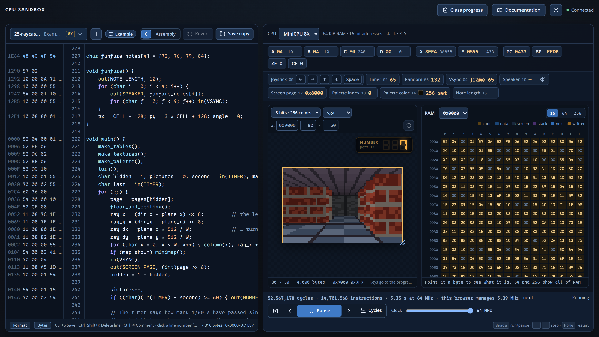
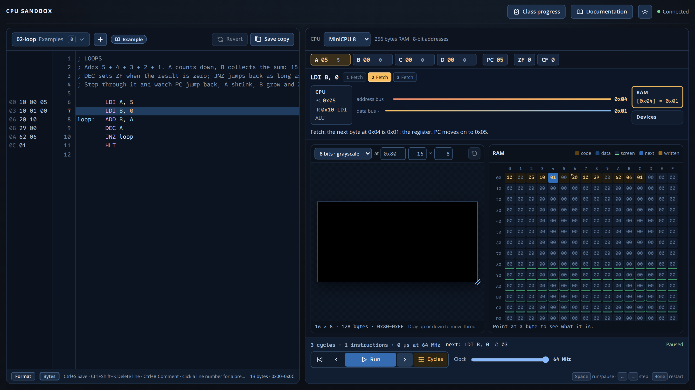
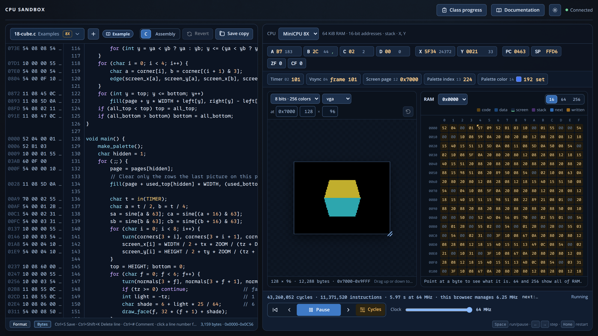

<div class='meta'>
image: cpu-sandbox.webp
</div>

# Vom Byte zum 3D-Labyrinth

<p class='abstract'>
In der CPU Sandbox programmieren Lernende einen kleinen 8-Bit-Computer – erst in
Assembler, später in C. Register, Flags, Speicher, Bildschirm und Geräte sind dabei
jederzeit sichtbar, bis hinunter zum einzelnen Takt auf dem Bus. Und am Ende läuft auf
derselben Maschine ein texturiertes 3D-Labyrinth.
</p>

**Werkzeug:** [CPU Sandbox](https://github.com/specht/cpu-sandbox) ·
**Stand der Bilder:** [`7300608`](https://github.com/specht/cpu-sandbox/commit/730060800243aaa5fa1622b6b94567c9857fa1a0) (12.10.2026)

<table class='table'>
<tr><th>Voraussetzungen</th><td>keine für den Einstieg; Binär- und Hexadezimalzahlen helfen, werden aber auch nebenbei gelernt</td></tr>
<tr><th>Sprachen</th><td>Assembler für die MiniCPU, später MiniC (eine kleine Variante von C)</td></tr>
<tr><th>Die Lernenden …</th><td>verfolgen Programme Befehl für Befehl und Takt für Takt, lösen Aufgaben mit automatischer Prüfung</td></tr>
<tr><th>Die Lehrkraft …</th><td>sieht in <strong>Class progress</strong> alle Lösungen und vergleicht sie nach Bytes und Takten</td></tr>
</table>

## Mit einer Demo anfangen

Ein simulierter Prozessor wird erst dann spannend, wenn man sieht, was er kann. Zur
CPU Sandbox gehören **26 Beispielprogramme**, von der Addition zweier Zahlen bis zu
Spielen und Grafikeffekten. Alles, was auf dem Bildschirm erscheint, berechnet die
simulierte Maschine selbst – Pixel für Pixel, ohne versteckte Grafikbefehle. Eine
Unterrichtsstunde mit einem dieser Programme zu beginnen, wirkt Wunder.

<!-- tutorial-screenshot
terminal-open
terminal-run: cd /workspace && git clone -q https://github.com/specht/cpu-sandbox.git && cd cpu-sandbox && git checkout -q 730060800243aaa5fa1622b6b94567c9857fa1a0
terminal-wait-for-prompt
terminal-run: cd /workspace/cpu-sandbox && mkdir -p programs && (nohup ./run --port 18765 > /tmp/cpu-sandbox.log 2>&1 < /dev/null &)
terminal-wait-for-prompt
preview-port: 18765
tab: preview
viewport: 1600x900
wait-for-text: Class progress
click: selector:#program-picker .picker-button
click: selector:#program-picker .picker-filter
type: 25-raycaster.c
click: selector:#program-picker .picker-option
sleep: 2
click: selector:#clock
press: End
click: selector:#run
sleep: 8
-->


Im Bild läuft `25-raycaster.c`, ein Labyrinth im Stil von Wolfenstein 3D – ganz ohne
Gleitkommazahlen. Andere Beispiele zeigen ein Feuer, die Mandelbrot-Menge, Breakout,
Snake, Plasma, Conways Game of Life, einen Sternenflug, einen rotierenden Würfel, eine
Orgel mit Arpeggios und eine Landschaft mit Wasserspiegelung. Das Feuer `09-fire` passt
übrigens samt Bildschirm in 256 Byte Speicher; das Programm selbst ist 80 Byte lang.

## Drei Ausbaustufen, eine Befehlssprache

Die MiniCPU gibt es in drei Stufen. Jede behält alles von der vorherigen und fügt genau
eine Idee hinzu, sodass nichts umgelernt werden muss:

<table class='table'>
<tr><th>Modell</th><th>Neue Idee</th><th>Speicher und Register</th></tr>
<tr><td><strong>MiniCPU 8</strong></td><td>Daten bewegen, rechnen, vergleichen, springen, Schleifen</td><td>256 Byte; A–D, PC, Flags ZF und CF</td></tr>
<tr><td><strong>MiniCPU 8S</strong></td><td>Stack: Unterprogramme mit <code>CALL</code>/<code>RET</code>, Rekursion</td><td>zusätzlich Stackpointer SP</td></tr>
<tr><td><strong>MiniCPU 8X</strong></td><td>Zeiger, große Programme, Grafik</td><td>64 KiB, 16-Bit-Adressen, Register X und Y</td></tr>
</table>

Die Schreibweise ist bewusst einheitlich: Das Ziel steht immer vorne, und **eckige
Klammern bedeuten immer „der Speicher an“**. `LDI A, 0x70` lädt die Zahl 0x70,
`LDA A, [0x70]` das Byte, das an Adresse 0x70 steht. Wer sich vertut, bekommt eine
Fehlermeldung, die genau diesen Unterschied erklärt. So sieht eine erste Schleife aus:

```nasm
        LDI A, 5
        LDI B, 0
loop:   ADD B, A
        DEC A
        JNZ loop
        HLT
```

<div class='hint think'>
<strong>Zum Weiterdenken:</strong> Das Programm addiert 5 + 4 + 3 + 2 + 1. Was passiert,
wenn man A mit 0 statt mit 5 startet – und warum steht danach ausgerechnet 128 in B?
Wer diese Frage beantworten kann, hat Überlauf, Flags und 8-Bit-Arithmetik verstanden.
</div>

## In einen Befehl hineinsehen

**Step** führt einen Befehl aus, **Step back** nimmt ihn zurück. Neben jeder
Quelltextzeile stehen Adresse und Maschinenbytes; geänderte Speicherzellen leuchten auf.
Im Modus **Cycles** geht es noch eine Ebene tiefer: Jeder Klick ist ein Takt. Man sieht,
wie der Opcode geholt und dekodiert wird, wie Operanden gelesen werden, was auf Adress-
und Datenbus liegt und wann gesprungen wird.

<!-- tutorial-screenshot
tab: preview
viewport: 1600x900
click: selector:#run
click: selector:#program-picker .picker-button
click: selector:#program-picker .picker-filter
type: 02-loop.asm
click: selector:#program-picker .picker-option
sleep: 1
click: selector:#cycle-mode
click: selector:#step-next
click: selector:#step-next
click: selector:#step-next
click: selector:#step-next
click: selector:#step-next
-->


<div class='hint task'>
<strong>Unterrichtsimpuls: Takte vorhersagen.</strong> Warum braucht
<code>LDA A, [0x80]</code> einen Takt mehr als <code>LDI A, 0x80</code>? Was schreibt
<code>CALL</code> in den Speicher, und wohin? Warum kostet ein <code>JZ</code>, das
springt, einen Takt mehr als eines, das nicht springt? Die Klasse stellt erst
Vermutungen auf und prüft sie dann im Taktmodus.
</div>

Ein paar Einsichten, die sich in der Sandbox fast von selbst ergeben und über die es sich
zu sprechen lohnt:

- Es gibt **nur einen Speicher**. Bildschirm und Stack sind einfach Bereiche darin, und
  ein Schreibzugriff an die falsche Adresse kann das Programm selbst verändern. Das
  Beispiel `05-self-modifying` macht das sogar absichtlich.
- Ein Label ist die **Adresse eines Bytes**, keine Zeilennummer.
- 8-Bit-Arithmetik läuft über: 255 + 1 ergibt 0, und das Carry-Flag ist gesetzt.
- Zeit kosten **Takte, nicht Zeilen**.

## Von Assembler zu C

Ab MiniCPU 8S lassen sich Programme auch in MiniC schreiben, einer kleinen Variante von
C, die beim Tippen übersetzt wird. Versteckt wird dabei nichts: Neben jeder C-Zeile
stehen ihre Maschinenbytes, und der Reiter **Assembly** zeigt das erzeugte Programm.
Man sieht, dass lokale Variablen auf dem Stack liegen, wie ein Funktionsaufruf sein
Argument übergibt und wie das Ergebnis zurückkommt.

<!-- tutorial-screenshot
tab: preview
viewport: 1600x900
click: selector:#program-picker .picker-button
click: selector:#program-picker .picker-filter
type: 18-cube.c
click: selector:#program-picker .picker-option
sleep: 2
click: selector:#clock
press: End
click: selector:#run
sleep: 8
-->


Der Würfel aus `18-cube.c` nutzt eine Sinustabelle in Festkommaarithmetik, Perspektive,
das Ausblenden verdeckter Flächen, Schattierung und Seitenwechsel (page flipping) gegen
Flackern – und die Füllroutine ist von Hand in Assembler geschrieben.

## Aufgaben mit automatischer Prüfung

Sechzehn Aufgaben prüfen sich selbst: vom Addieren zweier Bytes über Fibonacci,
Multiplikation und Sortieren bis zu einem Schachbrettmuster; dazu Aufgaben speziell für C
wie Fakultät, größter gemeinsamer Teiler, Primzahlsieb und Linienzeichnen. **+** legt ein
Programm zu einer Aufgabe an, **Check** führt alle Testfälle aus und erklärt Fehler wie
„0x82 should be 7, but it is 8“, und **Try it** lädt einen Testfall zum schrittweisen
Verfolgen in die Maschine.

**Class progress** sammelt die funktionierenden Lösungen der Klasse und sortiert sie nach
**Takten** – das kleinste Programm in Bytes wird zusätzlich markiert. Das lädt zu einem
freundlichen Wettbewerb ein: Wer schafft es mit weniger Takten? Wer mit weniger Bytes?
Und geht beides gleichzeitig?

Besonders lehrreich ist es, dieselbe Aufgabe zweimal zu lösen – einmal in Assembler,
einmal in C. Mit geradlinigen Lösungen ergibt sich etwa:

<table class='table'>
<tr><th>Aufgabe</th><th>Assembler: Bytes · Takte</th><th>C: Bytes · Takte</th></tr>
<tr><td><code>add</code></td><td>12 · 75</td><td>25 · 180</td></tr>
<tr><td><code>maximum</code></td><td>22 · 820</td><td>88 · 3.420</td></tr>
<tr><td><code>sort</code></td><td>42 · 4.260</td><td>176 · 19.271</td></tr>
<tr><td><code>multiply</code></td><td>33 · 5.991</td><td>92 · 1.935</td></tr>
</table>

<div class='hint think'>
<strong>Zum Weiterdenken:</strong> C braucht meist das Zwei- bis Vierfache an Bytes und
Takten – dafür ist das Programm viel schneller geschrieben. Bei <code>multiply</code> ist
es umgekehrt: Das C-Programm braucht nur ein Drittel der Takte. Woran liegt das? (Tipp:
Wie multipliziert der Compiler, und wie die naheliegende Assembler-Lösung?) Ein besserer
Algorithmus schlägt handgeschriebene Befehle.
</div>

## Eine mögliche Unterrichtsreihe

Die Beispiele bilden einen durchgehenden Weg in sieben Kapiteln; jedes endet mit den
Aufgaben, die es vorbereitet.

1. **Befehle und Schleifen** (`01-add`, `02-loop`, `03-division`): Register,
   Maschinenbytes, Flags, Schleifeninvarianten.
2. **Speicher und Bildschirm** (`04-memory` bis `07-pixel-formats`): Adressen, ein
   Pixel als Byte, selbstveränderlicher Code; danach die ersten Aufgaben.
3. **Geräte** (`08-input`, `09-fire`): Tastatur, Timer, Zufall – und warum ein Spiel
   bei jedem Prozessortakt gleich schnell laufen kann.
4. **Stack** (`10-subroutines`, `11-hanoi`, `12-scroller`): Unterprogramme,
   Rücksprungadressen, Rekursion mit den Türmen von Hanoi.
5. **Zeiger** (`13-pointers` bis `16-breakout`): großer Speicher, Festkommazahlen,
   ein vollständiges Spiel.
6. **C** (`17-first-c.c`): dieselben Aufgaben noch einmal, der Preis der Abstraktion.
7. **Projekte** (`18-cube.c` bis `26-landscape.c`): untersuchen, verändern, eigene
   Ideen umsetzen – vom Pong-Klon bis zur eigenen Landschaft.

## Organisation

Die Programme der Klasse liegen in einem **eigenen Git-Repository** im Unterordner
`programs/`, jede und jeder im eigenen Ordner. Die App selbst bleibt davon unberührt.

[Leitfaden mit Fragen zu jedem Beispiel](https://github.com/specht/cpu-sandbox/blob/730060800243aaa5fa1622b6b94567c9857fa1a0/docs/teaching.md) ·
[Alle Aufgaben](https://github.com/specht/cpu-sandbox/blob/730060800243aaa5fa1622b6b94567c9857fa1a0/docs/tasks.md) ·
[Einrichtung (README)](https://github.com/specht/cpu-sandbox/blob/730060800243aaa5fa1622b6b94567c9857fa1a0/README.md)
