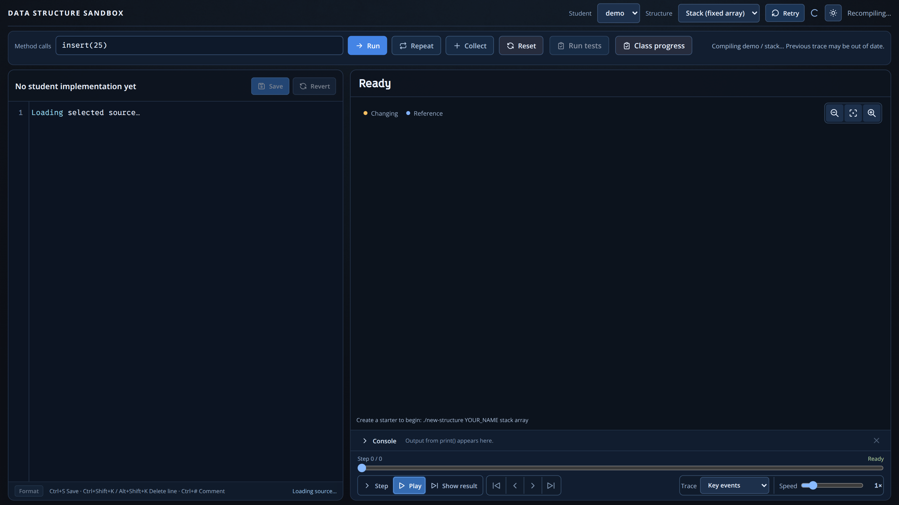
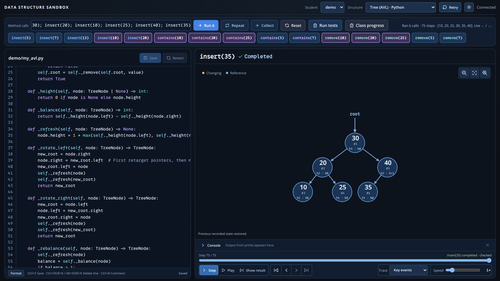
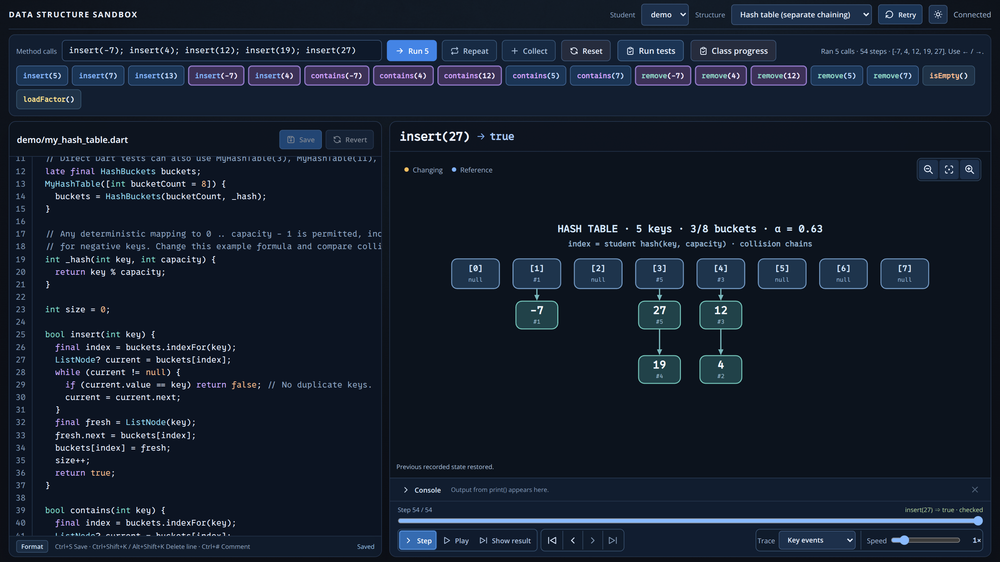

image: data-structures-sandbox.webp

# Datenstrukturen unterrichten

Die Data Structures Sandbox verbindet selbst geschriebene Dart-Implementierungen
mit einer schrittweisen Darstellung von Arrays, Knoten, Referenzen und Bäumen.
Automatische Tests kontrollieren Verhalten und Speicherinvarianten.

**Werkzeug:** [Data Structures Sandbox](https://github.com/specht/data-structures-sandbox) ·
**Dokumentierter Stand:** [`5c99ad20922f1d7c61ddd87501e8602042f15f23`](https://github.com/specht/data-structures-sandbox/commit/5c99ad20922f1d7c61ddd87501e8602042f15f23)
(12.10.2026). Alle unten gezeigten Implementierungen kommen aus den
**vollständigen Referenzbeispielen dieses Commits**, nicht aus leeren Startern.

## 1. Ein ADT, mehrere Speicherformen

Ein **Stack** erfüllt LIFO und eine **Queue** FIFO. Dasselbe öffentliche
Verhalten lässt sich aber mit festen Arrays, Ringpuffern oder verketteten
Knoten erreichen. Besonders aufschlussreich sind die vier Listenvarianten:
unsortiertes/sortiertes Array sowie unsortierte/sortierte verkettete Liste.
Die Visualisierung zeigt den tatsächlichen Zustand der selbst verwalteten
Speicherfelder; bei Listen muss auch die Größe korrekt aktualisiert werden.

<!-- tutorial-screenshot
terminal-open
terminal-run: cd /workspace && git clone -q https://github.com/specht/data-structures-sandbox.git && cd data-structures-sandbox && git checkout -q 5c99ad20922f1d7c61ddd87501e8602042f15f23
terminal-wait-for-prompt
terminal-run: cd /workspace/data-structures-sandbox && mkdir -p structures && ./new-structure demo list unsorted-nodes --example && ./new-structure demo tree avl --example && ./new-structure demo hash chains --example
terminal-wait-for-prompt
terminal-run: cd /workspace/data-structures-sandbox && (nohup ./run --port 18081 --no-open > /tmp/data-structures-sandbox.log 2>&1 < /dev/null &)
terminal-wait-for-prompt
preview-port: 18081
tab: preview
viewport: 1600x900
wait-for-text: Method calls
select-option: #structure = unsorted_linked_list
sleep: 2
click: selector:#call-input
press: Control+A
type: insert(0,7); insert(1,3); insert(1,5); insert(3,9)
press: Enter
sleep: 3
click: selector:#last
-->

**Unterrichtsimpuls:** Dieselbe Aufruffolge für Array- und Knotenliste
implementieren. Welche Operation verschiebt Werte, welche verändert nur
Referenzen? Warum ist `get(index)` beim Array O(1), bei einer einfach
verketteten Liste aber O(n)?

## 2. Bäume, Rekursion und AVL-Rotationen

Binäre Suchbäume machen die Suchinvariante sichtbar. Bei rekursiven
Operationen lässt sich beobachten, an welchem Knoten ein Aufruf arbeitet.
AVL-Bäume speichern Höhen und stellen nach Einfügungen oder Löschungen das
Gleichgewicht durch Rotationen wieder her.

<!-- tutorial-screenshot
tab: preview
viewport: 1600x900
select-option: #structure = avl
sleep: 2
click: selector:#call-input
press: Control+A
type: insert(30); insert(20); insert(10); insert(25); insert(40); insert(35)
press: Enter
sleep: 3
click: selector:#last
-->

**Unterrichtsimpuls:** Nach dem Einfügen von 30, 20 und 10 zunächst die
unbalancierte Form skizzieren und anschließend die Rechtsrotation begründen.
Später die Fälle LL, LR, RR und RL vergleichen. Duplikate sind bei BST und
AVL nicht erlaubt; Listen und Heaps erlauben dagegen gleiche Werte.

## 3. Hash-Tabellen und Tests

Die Hash-Tabelle verwendet **Separate Chaining**. Lernende wählen eine
Hashfunktion und eine Bucketzahl und untersuchen Kollisionen und Lastfaktor.
Weitere angebotene Strukturen sind Min-Heap, Ringpuffer-Queue und Stacks in
beiden Speicherformen. Graphen gehören dagegen noch nicht zu den ausführbaren
Aufgaben.

<!-- tutorial-screenshot
tab: preview
viewport: 1600x900
select-option: #structure = hash
sleep: 2
click: selector:#call-input
press: Control+A
type: insert(-7); insert(4); insert(12); insert(19); insert(27)
press: Enter
sleep: 3
click: selector:#last
-->

**Unterrichtsimpuls:** Werte suchen, die auf denselben Bucket abgebildet
werden. Dann vergleichen, wie sich unterschiedliche Hashfunktionen und
Bucketzahlen auf die Verteilung auswirken.

Das Werkzeug kennt **Step**, **Play**, **Show result**, eine wiederholbare
Aufruffolge (**Repeat**) und eine Konsole für `print`-Ausgaben und Fehler.
**Run tests** prüft Methoden und interne Darstellung gegen Referenzmodelle;
**Class progress** bietet der Lehrkraft eine Übersicht über implementierte
und geprüfte Strukturen.

## Vorschlag für eine Unterrichtsreihe

1. Unsortierte Array-Liste, danach verkettete Liste: Indizes, Einfügen,
   Entfernen, Laufzeiten.
2. Stack und Queue als ADTs formulieren und je zwei Implementierungen testen.
3. BST und AVL: rekursive Operationen, Invarianten, Rotation.
4. Heap und Hashing: weitere Implementierungsentscheidungen und Kosten.

Die Klasse programmiert ausschließlich im Unterrepository `structures/`.
[Einrichtung](https://github.com/specht/data-structures-sandbox/blob/5c99ad20922f1d7c61ddd87501e8602042f15f23/README.md) ·
[Verträge aller Strukturen](https://github.com/specht/data-structures-sandbox/blob/5c99ad20922f1d7c61ddd87501e8602042f15f23/docs/contracts.md).
