<div class='meta'>
image: klasse-fortschritt.webp
</div>

<div
    class="autotoc-secondary-trigger"
    data-title="Auf dieser Seite"
    data-levels="h2,h3">
</div>

# Einstieg für Lehrkräfte

<p class='abstract'>
Was du für die erste Stunde mit dem Workspace brauchst: wie deine Klasse sich anmeldet, was die Klassenseite zeigt, wer wo hängt, wie du Abgaben ansiehst und wie du alles vorher selbst ausprobierst. Diese Seite sehen nur Lehrkräfte.
</p>

## Was die Lernenden haben

Jede Schülerin und jeder Schüler hat einen eigenen **Workspace**: Visual Studio Code im Browser, mit einem eigenen Ordner, der erhalten bleibt. Auf der Startseite stehen **Aktivitäten**, also Anleitungen zu einem Thema (eine Webseite bauen, eine interaktive Geschichte schreiben, eine Datenbank abfragen). In vielen Aktivitäten stehen **Aufgaben**, die der Workspace selbst prüft: Er sieht in den Dateien nach, führt eine Abfrage aus oder vergleicht eine Antwort. Im **Handbuch** schlagen die Lernenden nach, was sie in mehreren Aktivitäten brauchen.

Du siehst dieselben Seiten wie deine Klasse, mit ein paar Zusätzen: dem Menüpunkt **Klassen** (deine Gruppen, ihr Fortschritt und wer darin ist; von dort führt ein Link zum **Lehrplan**, welche Aktivität zu welchem Thema deines Lehrplans passt), auf manchen Aktivitäten dem Knopf **Notiz für Lehrkräfte** und unter den Schritten dem Knopf **Code bis hier** (mehr dazu unten).

## Die erste Stunde: anmelden

Wer sich anmeldet, gibt die eigene E-Mail-Adresse ein und bekommt einen Code. Die ganze Adresse ist dabei nicht nötig: Es reicht ihr Anfang, solange nur eine eingeladene Adresse so beginnt. Meist genügt der Teil vor dem `@`, also `lea.fischer` statt `lea.fischer@schule.de`.

In der Schule kommen viele nicht an ihr Postfach. Dafür gibt es die Klassenseite:

1. Öffne **Klassen** und wähle oben deine Gruppe.
2. Klick auf **Anmelde-Codes zeigen** und zeig die Seite am Beamer.
3. Lass die Klasse die Anmeldung starten. Jeder Name erscheint mit seinem Code, sobald er angefordert ist; Mail-Adressen stehen dort nicht.

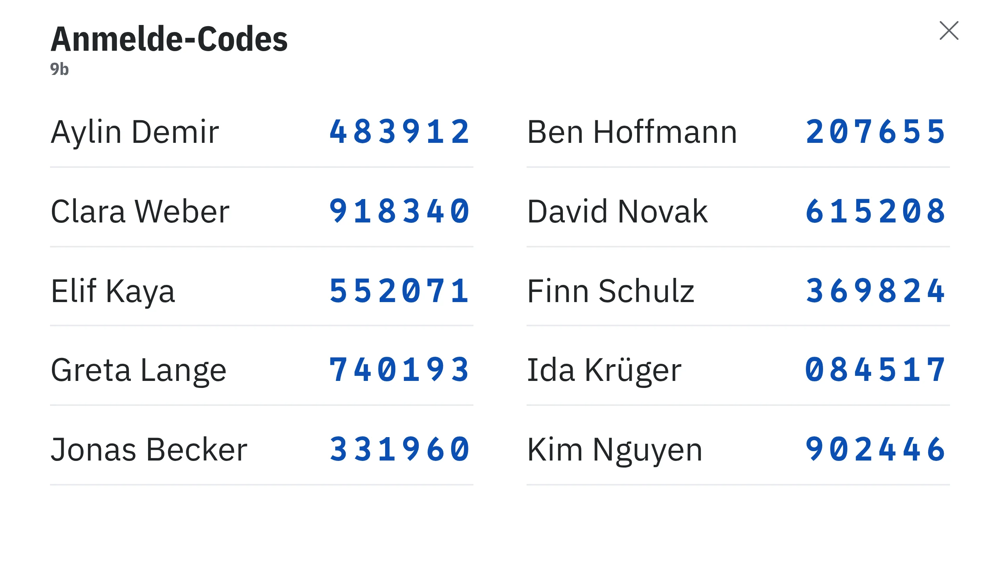

Ein Code gilt einmal und nur kurze Zeit. Wer sich vertippt, fordert einfach einen neuen an. Wartet jemand auf einen Code, siehst du ihn auch ohne Beamer-Ansicht oben auf der Klassenseite.

## Gruppen und Einladungen

Wer sich anmelden kann, steht in einer Gruppe. Unter **Klassen** legst du mit **Neue Gruppe** deine Gruppen an. Den Knopf gibt es, sobald die Administration dir eine Schule zugeordnet hat; bis dahin steht an seiner Stelle, an wen du schreibst. Danach trägst du im Reiter **Lernende** die E-Mail-Adressen ein (eine pro Zeile, mit oder ohne Namen, auch aus einer Tabelle kopiert) und schickst eine **Willkommensmail**: Sie sagt, wie die Anmeldung geht, und Antworten darauf kommen bei dir an. Namen sind freiwillig und können auch später kommen; ohne Namen zeigt die Klassenseite die Adresse. Eine Kollegin oder einen Kollegen deiner Schule nimmst du mit **Lehrkraft dazu** in eine Gruppe.

Welcher Schule du angehörst, trägt die Administration ein. Hat deine Schule dem Einsatz noch nicht zugestimmt, vermerkst du im Reiter **Lernende**, für wen ein schriftliches Einverständnis vorliegt; anmelden können sich alle schon jetzt (mehr dazu unten).

<div class='hint'>
Steht im Reiter <strong>Lernende</strong>, dass die Einladungen der Gruppe noch in Dateien stehen, pflegt sie die Administration: Schreib an <a href='mailto:${contact_email}'>${contact_email}</a>, für welche Gruppe, und schick die E-Mail-Adressen mit.
</div>

## Die Klassenseite

Unter **Klassen** wählst du oben die Gruppe. Darunter liegen fünf Reiter: **Fortschritt** zeigt eine Aktivität Aufgabe für Aufgabe, **Überblick** alle Aktivitäten der Gruppe auf einmal, **Lernende** die Personen und ihre Workspaces, **Startseite**, was die Gruppe zuerst sieht, und **Einstellungen**, was für die ganze Gruppe gilt.

### Fortschritt

Hier wählst du eine Aktivität und siehst, wer welche Aufgabe gelöst hat. Jede Spalte ist eine Aufgabe, ihr Titel steht darüber.

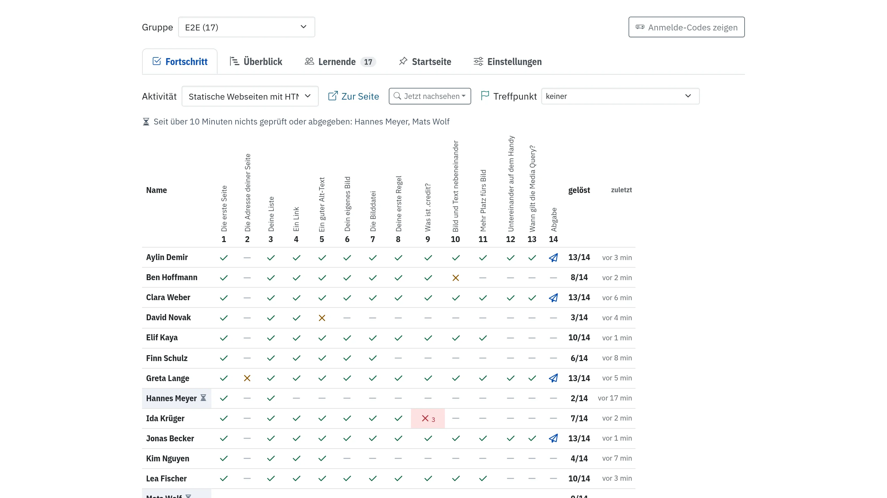

<div style='max-width: 100%; overflow-x: auto;'>
<table class='table'>
<thead><tr><th>Zeichen</th><th>Bedeutung</th></tr></thead>
<tbody>
<tr><td><span class='cb-sign cb-correct'><svg class='ti ti-check' aria-hidden='true'><use href='/include/tabler/tabler.svg#check'/></svg></span></td><td>gelöst</td></tr>
<tr><td><span class='cb-sign cb-sent'><i class='bi bi-paper-plane' aria-hidden='true'></i></span></td><td>abgegeben, oder eine Antwort in eigenen Worten gespeichert</td></tr>
<tr><td><span class='cb-sign cb-wrong'><svg class='ti ti-x' aria-hidden='true'><use href='/include/tabler/tabler.svg#x'/></svg><small>2</small></span></td><td>noch nicht gelöst, nach so vielen Versuchen</td></tr>
<tr><td><span class='cb-sign cb-wrong cb-stuck'><svg class='ti ti-x' aria-hidden='true'><use href='/include/tabler/tabler.svg#x'/></svg><small>3</small></span></td><td>hängt: noch nicht gelöst, nach drei Versuchen oder mehr</td></tr>
<tr><td><span class='cb-sign cb-stale'><svg class='ti ti-refresh' aria-hidden='true'><use href='/include/tabler/tabler.svg#refresh'/></svg></span></td><td>Die Aufgabe hat sich geändert, die Antwort ist von vorher.</td></tr>
<tr><td><span class='cb-sign cb-none'><svg class='ti ti-minus' aria-hidden='true'><use href='/include/tabler/tabler.svg#minus'/></svg></span></td><td>noch nicht bearbeitet</td></tr>
</tbody>
</table>
</div>

Die Zeile **Klasse** darunter zählt, wie viele fertig sind und wie viele hängen. Eine gelbe Spalte heißt: Viele liegen bei dieser Aufgabe gerade falsch. Das ist oft ein guter Moment, kurz für alle zu erklären.

Ganz rechts steht unter **zuletzt**, wann jemand zuletzt eine Aufgabe dieser Aktivität geprüft, beantwortet oder abgegeben hat, etwa »vor 12 min«. Wer still ist, fällt dadurch auf, auch wenn noch kein Kreuz in der Zeile steht: Arbeitet die Klasse gerade an der Aktivität, steht über der Tabelle, wer seit über zehn Minuten nichts geprüft oder abgegeben hat, und diese Namen sind leicht hinterlegt. Das kann jemand sein, der hängt und nicht fragt, oder jemand, der in Ruhe arbeitet, ohne zu prüfen; was im Workspace geschieht, sieht die Seite nicht. Wer bei einem Treffpunkt als »fehlt heute« markiert ist, steht nicht in dieser Zeile. Die Zeiten laufen weiter, solange die Seite offen ist.

Darüber stehen zwei Werkzeuge:

- **Jetzt nachsehen** prüft eine Aufgabe sofort für alle, ohne dass jemand »Prüfen« drücken muss, zum Beispiel ob alle ihre Seite angelegt haben. Das Ergebnis erscheint blau umrandet in der Tabelle; gespeichert wird nichts.
- **Vorlage aktuell?** gibt es bei Aktivitäten, die mit einer Vorlage beginnen. Es sagt, wer noch eine alte Version hat und `git pull` ausführen sollte.

Unter der Tabelle stehen die Antworten in eigenen Worten und die **Abgaben**. Ein Klick auf eine Abgabe öffnet sie über der Klassenseite: links die Dateien, rechts der Quelltext. Bei Webseiten und interaktiven Geschichten startet **Starten** die Abgabe so, wie die Person sie abgegeben hat, mit allem, was sich darin bewegt.

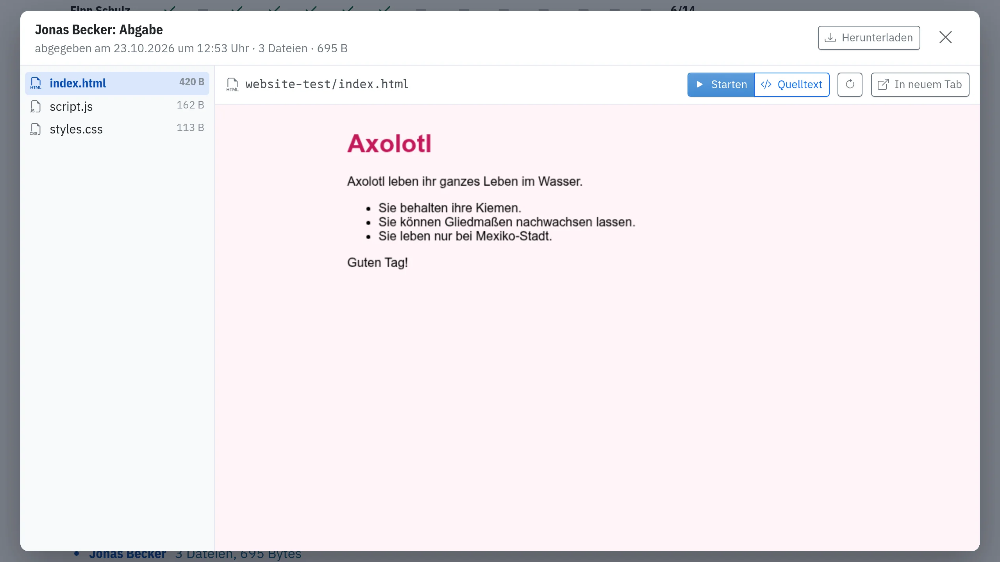

Eine Abgabe ist eine Kopie. Was die Person danach im Workspace ändert, ändert die Abgabe nicht; sie kann aber jederzeit neu abgeben.

Für eine neue Runde, etwa im nächsten Halbjahr, löscht **Alle Abgaben löschen** unter der Liste die Abgaben dieser Aufgabe in dieser Gruppe. Vorher fragt der Workspace nach; lade herunter, was du behalten willst.

Die Klassenseite merkt sich, welche Gruppe und welche Aktivität du zuletzt angesehen hast, und öffnet beim nächsten Mal dort.

#### Treffpunkt

Mit **Treffpunkt** über der Tabelle legst du fest, bis zu welcher Aufgabe alle kommen sollen, bevor ihr gemeinsam weitermacht, etwa für ein Gespräch an der Tafel. Wer die Aktivität offen hat, sieht nach dieser Aufgabe sofort das Band »Hier trifft sich deine Klasse«; wer alle Aufgaben bis dahin gelöst hat (Extras zählen nicht), liest dort »Du bist da«. Versteckt wird nichts; was danach kommt, ist nur blasser.

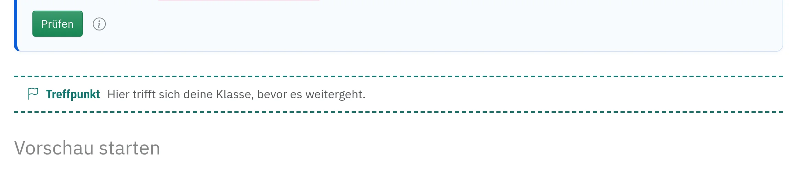

Über der Tabelle steht, wie viele schon da sind und wer noch fehlt; die Zahl ändert sich, sobald jemand eine Aufgabe löst. Wer heute nicht da ist, nimmst du mit **fehlt heute** aus der Zählung; das merkt sich nur dein Browser, bis Mitternacht. Sind alle da, wird die Zeile grün. **keiner** hebt den Treffpunkt wieder auf. Auf der Seite der Aktivität setzt und verschiebst du ihn auch direkt, mit dem gestrichelten Knopf nach einer Aufgabe.

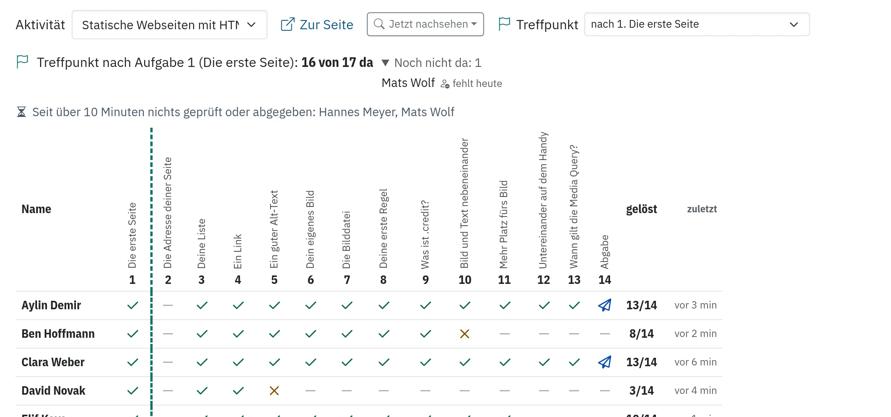

#### Rückmeldung

Haben mindestens drei aus deiner Gruppe mit einer Aktivität gearbeitet, und ist deine Klasse danach zu einer anderen Aktivität weitergegangen (mindestens die Hälfte von ihnen, nicht nur ein paar, die anderswo stöbern), fragt eine Woche später eine Karte über der Tabelle (ohne neue Aktivität nach drei Wochen, damit Ferien oder eine ausgefallene Stunde sie nicht mitten in einer Aktivität bringen): **Wie lief die Aktivität?** Ein paar Klicks genügen: wie es insgesamt lief, ob die Dauer passte, ob das Niveau für die Gruppe passte, in welcher Programmiersprache du die Aktivität gern hättest, und was gefehlt oder gut funktioniert hat. Alles ist freiwillig, eine Antwort genügt. Lesen kann die Rückmeldung nur die Administration, die die Aktivitäten schreibt; deine Klasse sieht nichts davon. Eine E-Mail bekommst du dazu nur, wenn du es ankreuzt. **Nicht jetzt** blendet die Karte für 14 Tage aus, **Nicht mehr fragen** für diese Aktivität und Gruppe ganz. Früher antworten oder deine Antwort ändern kannst du jederzeit mit **Rückmeldung geben** über der Tabelle; wartet eine Karte, steht ein kurzer Hinweis darauf auch auf deiner Startseite.

### Überblick

Hier steht jede Person der Gruppe mit allen Aktivitäten, an denen jemand aus der Gruppe gearbeitet hat; angeheftete kommen zuerst. In jeder Zelle steht, wie viele Aufgaben gelöst sind, von allen ohne Extras, mit einem schmalen Balken; ein Strich heißt: noch nichts bearbeitet. Ein Klick auf eine Spalte öffnet die Aktivität im Reiter **Fortschritt**. Ganz rechts steht, wann die Person zuletzt eine Aufgabe irgendeiner Aktivität geprüft hat. Noten sind das nicht: Die Zahlen sagen, wie weit jemand ist, nicht wie gut.

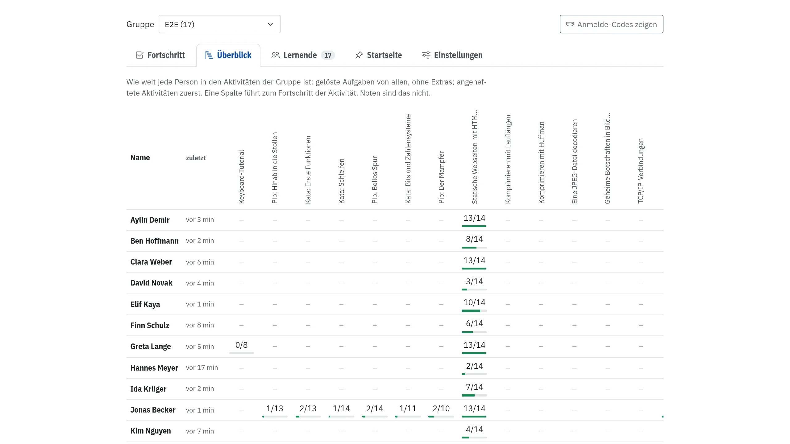

### Lernende

Hier steht jede Person der Gruppe mit ihrem Workspace: ob er läuft, wie viel Rechenzeit und Speicher er gerade braucht. Eine Zeile leuchtet gelb, solange ihr Workspace arbeitet. Darüber zeigt eine Zeile, wie ausgelastet der Server ist. So erkennst du, ob ein Workspace hängt oder ob gerade alle gleichzeitig etwas Großes starten.

Im selben Reiter verwaltest du die Gruppe: Namen und Adressen, Willkommensmails, das Einverständnis, ein Enddatum, weitere Lehrkräfte, Umbenennen und Löschen; unten nimmst du neue Personen auf.

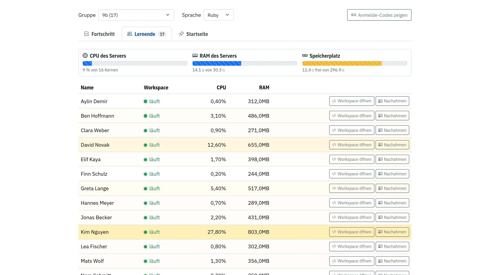

Bei jeder Person stehen zwei Knöpfe:

- **Workspace öffnen** öffnet ihren Workspace in einem neuen Tab, etwa um bei einem Fehler zu helfen.
- **Nachahmen** zeigt dir die Seite so, wie die Person sie sieht, mit ihren Aufgaben und Abgaben. Oben steht dann »Zurück zu deinem Konto«.

Bevor du einen Workspace öffnest oder jemanden nachahmst, schreibst du einen Satz dazu, warum, zum Beispiel »Ich sehe mir deine Abgabe zu Aufgabe 3 an.« Die Person liest ihn bei der nächsten Anmeldung. So bleibt nachvollziehbar, wer wann hineingesehen hat.

### Startseite

Was du hier für die Gruppe **anheftest**, steht bei allen in der Gruppe oben auf der Startseite. So findet die Klasse die Aktivität der Stunde sofort:

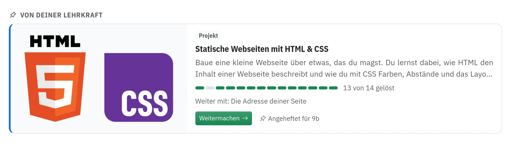

### Einstellungen

Hier steht, was für die ganze Gruppe gilt; jede Änderung ist sofort gespeichert.

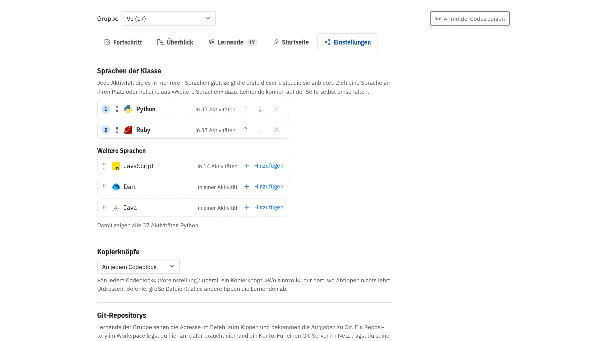

- **Sprachen der Klasse:** Gibt es eine Aktivität in mehreren Programmiersprachen (etwa Ruby, Python und JavaScript), zeigt sie der Gruppe die erste Sprache dieser Liste, die sie anbietet. Du ordnest die Liste, indem du eine Sprache an ihren Platz ziehst oder mit den Pfeilen verschiebst, und holst Sprachen aus »Weitere Sprachen« dazu; ein Satz darunter sagt, was das für die Aktivitäten heißt. Lernende können auf der Seite selbst umschalten.
- **Kopierknöpfe:** »An jedem Codeblock« setzt überall einen Kopierknopf. »Wo sinnvoll« lässt ihn nur dort, wo Abtippen nichts lehrt (Adressen, Befehle, große Dateien); alles andere tippt die Klasse ab.
- **Git-Repositorys:** die Adressen der Repositorys, die die Klasse gemeinsam klont, und wie die Lernenden zu ihren Schlüsseln kommen; mehr dazu im nächsten Abschnitt.
- **Schule:** zu welcher Schule die Gruppe gehört, ob die Schule dem Einsatz zugestimmt hat, und der Weg zu den **Unterlagen für deine Schule** (mehr dazu unten).

## Git-Repositorys der Klasse

In einigen Aktivitäten arbeitet die ganze Klasse in einem gemeinsamen Git-Repository, etwa in [Im Team mit Git: das Klassenquiz](/class-quiz): Alle klonen dasselbe Repository, jede und jeder schreibt eine Runde Fragen und pusht sie, und dabei passiert, womit Teams jeden Tag umgehen: ein abgelehnter Push, ein Konflikt. Dafür braucht die Gruppe ein Repository. Du trägst seine Adresse in den **Einstellungen** unter **Git-Repositorys** ein; die Lernenden sehen sie dann auf der Seite im Befehl zum Klonen.

Zu diesem Repository gibt es zwei Wege:

- **Eine Adresse von draußen:** Hat deine Schule einen Git-Server (GitLab, Gitea, Forgejo) oder nutzt deine Klasse GitHub, legst du das Repository dort an, lädst die Lernenden ein und trägst die Adresse ins Feld ein. Die Konten dort verwaltest du selbst.
- **Im Workspace anlegen:** Hat der Workspace deiner Schule einen eigenen Git-Server, steht dieser Knopf neben jedem Feld. Er legt das Repository dort an und trägt die Adresse gleich ein. Ein Konto braucht niemand. Hat die Aktivität Startdateien (beim Klassenquiz das Programm und die erste Runde), liegen sie schon als erster Commit darin.

### Schlüssel

Der Git-Server des Workspace erkennt die Lernenden an einem SSH-Schlüssel. Wie sie zu ihm kommen, wählst du für die Gruppe unter **Schlüssel**:

- **Die Lernenden erzeugen ein Schlüsselpaar und geben den öffentlichen Schlüssel ab:** wie bei jedem Git-Server im Netz. Sie erzeugen im Terminal ein Schlüsselpaar und fügen die Zeile ihres öffentlichen Schlüssels in den Kasten auf der Seite [Git-Server: Zugang und Veröffentlichen](/reference/gitlab) im Handbuch ein; beim Klassenquiz steht derselbe Kasten auch auf der Seite der Aktivität. Einen privaten Schlüssel weist der Kasten zurück. Was sie dabei lernen, brauchen sie später bei GitHub oder GitLab genauso.
- **Der Workspace richtet den Schlüssel für alle ein:** Für die Lernenden ist nichts zu tun. Der Workspace legt jedem Mitglied der Gruppe einen Schlüssel an: sofort in jedem Workspace, den es schon gibt, in den anderen vor ihrem nächsten Start. Dieser Schlüssel gilt nur für den Git-Server des Workspace. Das passt, wenn die Stunde von Git handeln soll und nicht von SSH.

Ob alles klappt, prüfen die Lernenden im Terminal ihres Workspace:

```bash
ssh -T git@git.workspace
```

Der Server antwortet mit »Hallo! Dein Schlüssel ist eingetragen. Hier gibt es keine Shell, nur Git.« und zählt die Repositorys auf, die sie erreichen. Mit einem abgegebenen Schlüssel fragt SSH beim ersten Mal, ob es dem Server trauen soll; den Fingerabdruck zum Vergleichen zeigt der Kasten.

### Ansehen, ablehnen, löschen

- **Ansehen** neben dem Feld zeigt das Repository im Browser: links die Dateien als Baum, rechts den Code, den Verlauf, jeden Commit mit seinen Änderungen, Branches und Tags, und alles als ZIP zum Herunterladen. So siehst du nach der Stunde, wer was beigetragen hat, ohne selbst zu klonen. Dieselbe Seite erreichst du über **ansehen** in der Zeile »Klassen-Repository« über der Aktivität und im Fortschritt der Klasse über **Repository** neben »Zur Seite«. Die Lernenden der Gruppe sehen dieselben Seiten; sie finden sie unter dem Klon-Befehl der Aktivität (»Das Repository im Browser ansehen«).
- **Was der Server ablehnt:** `git push --force`, das Löschen eines Branches auf dem Server und jeden Push über 50 MB. Was einmal gepusht ist, überschreibt also niemand; wer einen abgelehnten Push hat, holt sich erst den Stand der anderen mit `git pull`.
- **Wer hinkommt:** Klonen und pushen geht nur aus den Workspaces der Lernenden und Lehrkräfte der Gruppe. Aus dem Internet ist der Git-Server nicht zu erreichen, auch nicht von deinem eigenen Rechner zu Hause. Im Browser liest du die Repositorys über **Ansehen**, sobald du angemeldet bist.
- **Löschen** neben dem Feld fragt einmal nach (»Wirklich löschen? Alles darin ist weg.«) und löscht dann das Repository auf dem Server mit allem darin, auch mit allem, was die Klasse gepusht hat. War seine Adresse eingetragen, ist das Feld danach leer. Die Klone in den Workspaces der Lernenden bleiben, wie sie sind. Wird die Gruppe gelöscht, gehen ihre Repositorys mit.

### Alle Repositorys auf einen Blick

Unter [Git-Repositorys](/repos) stehen alle Repositorys im Workspace aus allen deinen Gruppen: Gruppe, Aktivität, Adresse, wie die Gruppe zu ihren Schlüsseln kommt, der letzte Commit mit dem Namen der Person, die ihn geschrieben hat, und daneben **Ansehen** und **Einstellungen**. Du findest die Seite in den Einstellungen unter den Feldern (»Übersicht«) und auf jeder Seite eines Repositorys oben links (»Repositorys«). »Nicht eingetragen« heißt: Das Repository liegt noch auf dem Server, aber die Gruppe hat für die Aktivität eine andere Adresse eingetragen oder keine.

Ein Repository ohne Aktivität, etwa für ein Projekt der Klasse, legst du dort mit **Neues Repository** an: Gruppe, Name, eine Beschreibung, leer oder mit einer Datei `README.md`. Es gehört der Gruppe wie ein Klassen-Repository. Außerdem kann jede und jeder, auch du, unter **Meine Repositorys** bis zu zehn eigene Repositorys zum Üben anlegen. Die sieht nur ihre Besitzerin oder ihr Besitzer, auch du als Lehrkraft nicht: Was die Klasse gemeinsam macht, gehört in ein Repository der Gruppe.

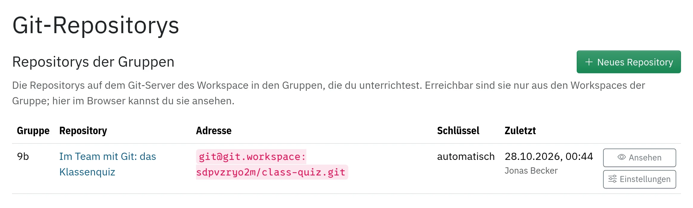

## Eine Aktivität finden: der Lehrplan

Im [Lehrplan](/lehrplan), verlinkt oben auf der Klassenseite, stehen die Themen deines Rahmenlehrplans, für die Sekundarstufe I und für die Oberstufe, und unter jedem die Aktivitäten, die es behandeln. Neben jeder Stufe führen Links zum Lehrplan selbst, als PDF, und zur Seite des Landes. Oben wählst du dein Bundesland; ohne Wahl siehst du Berlin.

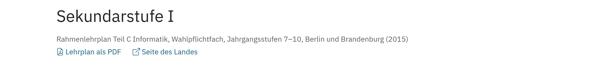

Darüber zeigt ein Bild, was worauf aufbaut: Ein Pfeil führt von einer Aktivität zu denen, die auf ihr aufbauen. Die Farbe sagt, für wen eine Aktivität gedacht ist: gelb für die Sekundarstufe I, türkis für die Oberstufe, beides im Verlauf für Aktivitäten, die zu beiden passen. Wählst du über dem Bild unter **Name der Pläne** ein Thema, hebt es die Aktivitäten dazu hervor und den Weg dorthin:

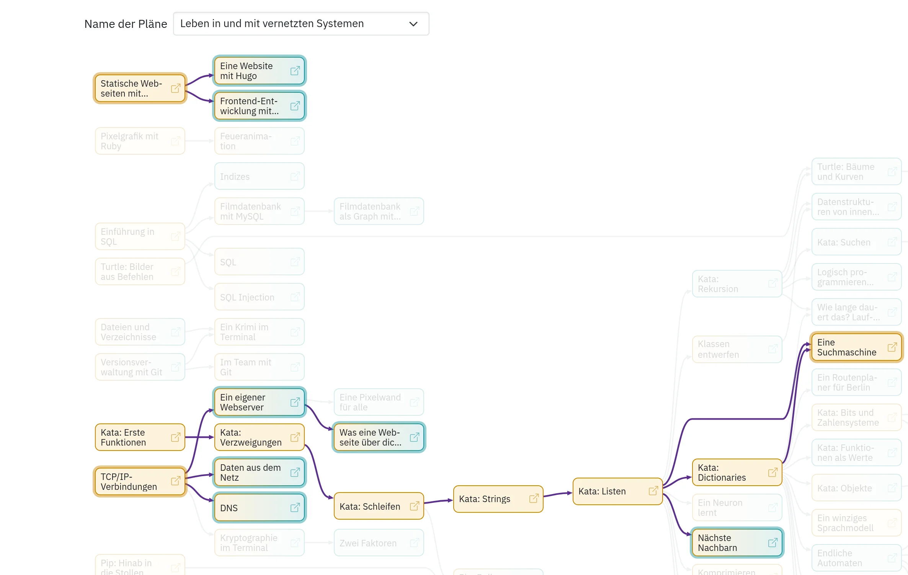

Dieselbe Zeile siehst du oben auf jeder Aktivitätsseite: Die Namen der Themen darin führen an ihre Stelle im Lehrplan.

## Die erste Doppelstunde

1. **Vorher:** Such im [Lehrplan](/lehrplan) eine Aktivität zu deinem Thema aus. Leg die Gruppe an und trag die Adressen ein (Reiter **Lernende**). Probier die Aktivität mit deinem Testkonto aus (siehe unten).
2. **Anmelden:** Zeig **Anmelde-Codes zeigen** am Beamer; die Klasse meldet sich mit dem Anfang ihrer Adresse an und liest ihren Code dort ab.
3. **Anheften:** Heft die Aktivität der Stunde im Reiter **Startseite** an. Sie steht dann bei allen ganz oben.
4. **Treffpunkt:** Setz im Reiter **Fortschritt** einen Treffpunkt nach der Aufgabe, bis zu der alle vor dem ersten Gespräch kommen sollen.
5. **Beobachten:** Behalt **Fortschritt** offen. Rote Kreuze zeigen, wer hängt, eine gelbe Spalte, wo viele hängen, die Zeile über der Tabelle, wer still ist. Ist die Treffpunkt-Zeile grün, sind alle da.
6. **Am Ende:** Der Reiter **Überblick** zeigt, wie weit alle gekommen sind, auch über mehrere Aktivitäten.

## Selbst ausprobieren

Für dich gibt es ein **Testkonto**, genau eins: ein Konto wie das einer Schülerin, nur dass es dir gehört. Es steht allein in einer eigenen Gruppe, **Testgruppe (dein Name)**, ganz unten in der Gruppenauswahl der Klassenseite. Diese Gruppe siehst nur du, auch andere Lehrkräfte und Admins sehen sie nicht. Was du mit dem Testkonto tust, landet bei keiner Klasse.

### So kommst du hinein

- **Nachahmen:** Wähl auf der Klassenseite deine Testgruppe, geh auf **Lernende** und klick bei deinem Testkonto auf **Nachahmen**; einen Satz braucht es dafür nicht. Jetzt siehst du die Website genau so, wie eine Schülerin sie sieht. Mit »Zurück zu deinem Konto« in der Leiste oben bist du wieder du selbst. **Workspace öffnen** startet daneben den Workspace des Testkontos, ohne dass du es nachahmst.
- **Direkt anmelden:** Das Testkonto hat deine Adresse mit `+test` vor dem @, aus `name@schule.de` wird `name+test@schule.de`. Den Anmelde-Code dafür schickt der Workspace an deine eigene Adresse, ohne `+test`. Meld dich damit in einem privaten Fenster oder einem zweiten Browser an, dann hast du beides nebeneinander: links die Klassenseite als Lehrkraft, rechts das Testkonto als Schülerin.

### Was du damit ausprobieren kannst

- **Eine Aktivität durcharbeiten,** Aufgabe für Aufgabe: Jede Antwort erscheint im Reiter **Fortschritt** deiner Testgruppe, so wie später die deiner Klasse, mit Haken, Versuchen und »hängt«.
- **Abgaben und Galerie:** Gib als Testkonto eine Webseite oder eine Szene ab und sieh sie dir als Lehrkraft unter **Fortschritt** an, so wie du später die Abgaben der Klasse öffnest.
- **Offene Antworten:** Schreib als Testkonto eine Reflexion. Unter derselben Aufgabe zeigt dir der Kasten »Für Lehrkräfte« mit **Antworten aus Testgruppe** genau, was du später von der Klasse siehst.
- **Den Workspace:** Alles, was Lernende im Workspace tun, auch das, was dort schiefgehen kann, ohne dass ein echter Workspace einer Schülerin leidet.
- **Leistungsüberprüfungen:** Lade im Profil unter **Leistungsüberprüfungen** eine hoch, klick auf **0 Personen** und wähl dort dein Testkonto aus. Starte sie, mach sie als Testkonto mit, beende sie und sieh dir die **Ergebnisse** an. So weißt du vorher, was die Klasse sieht und was am Ende bei dir ankommt.

### Zurücksetzen

Willst du noch einmal von vorn anfangen, klick im Reiter **Lernende** deiner Testgruppe auf **Testkonto zurücksetzen**. Das leert den Workspace des Testkontos und seine Workspaces in Leistungsüberprüfungen, legt seine Datenbanken neu an und löscht seine Antworten, Versuche und Abgaben. Einer Leistungsüberprüfung bleibt es zugewiesen. Alle anderen Konten bleiben, wie sie sind; zurücksetzen kannst du also jederzeit, auch mitten im Schuljahr.

Löst du in deinem eigenen Konto eine Aufgabe, steht sie auf der Klassenseite in einer eigenen Zeile **Du (Lehrkraft)** unter der Klasse. Für einen kurzen Test reicht das oft schon; für alles, was wie bei einer Schülerin aussehen soll, nimm das Testkonto.

## Auf der Startseite

Am Fuß jeder Karte mit Aufgaben siehst du ein schmales Band, ein Feld je Aufgabe, in der Reihenfolge der Seite. Es zählt nur die Schülerinnen und Schüler deiner Gruppen: Je dunkler ein Feld, desto mehr von ihnen haben die Aufgabe gelöst, ganz dunkel heißt alle, grau keiner. Daneben steht, wie viele Aufgaben sie dort zusammen gelöst haben und wie viele von ihnen überhaupt etwas, etwa »2« und »1/17«. Fährst du mit der Maus über ein Feld, steht dort die Aufgabe und »6 von 17 deiner Lernenden gelöst«. Die Zahlen sind aktuell: Löst jemand eine Aufgabe, steht es beim nächsten Laden der Startseite im Band. So siehst du auf einen Blick, womit deine Klassen schon gearbeitet haben; wer genau wo steht, zeigt die Klassenseite.

Deine Schülerinnen und Schüler sehen an derselben Stelle ihre eigenen Aufgaben, sobald sie eine Aktivität begonnen haben: grün gelöst, gelb versucht, dazu »3/14«.

## Auf einer Aktivitätsseite

Wie eine Aktivität aufgebaut ist und warum (Vermutungen vor dem Ausprobieren, Tipps in Stufen, Aufgaben, die im Workspace nachsehen), steht mit Bildern unter [»Was eine Aktivität ausmacht«](/about#aktivitaet).

Oben rechts steht bei manchen Aktivitäten der Knopf **Notiz für Lehrkräfte**. Er öffnet Hinweise nur für dich: wie lange die Teile dauern, was die Aufgaben prüfen, wo Lernende meistens hängen bleiben. Geschlossen stört er nicht, auch nicht am Beamer. In derselben Zeile stehen, wie lange die Aktivität dauert, und die Zeile des Lehrplans:

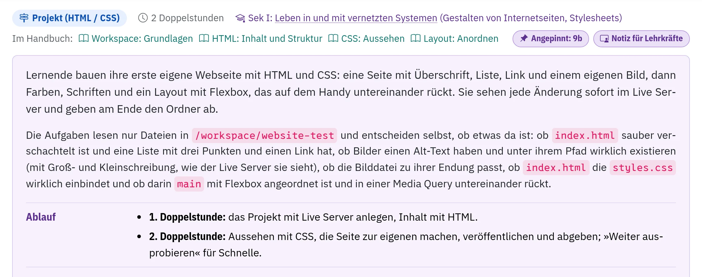

Baut eine Aktivität ein Programm Schritt für Schritt auf, steht unter vielen Bildern rechts ein kleiner Knopf **Code bis hier**. Er kopiert das ganze Programm, wie es an dieser Stelle aussieht, damit du ein Ergebnis ausprobieren kannst, ohne alle Schritte davor zu gehen. Deine Klasse sieht ihn nicht.

Steht an einer Aufgabe **Vorschau für Lehrkräfte**, sind Aufgaben auf eurer Installation für Lernende noch ausgeschaltet; du siehst sie trotzdem schon.

## Was der Server speichert

- Für jede Aufgabe die letzte Antwort, ob sie stimmt und wie viele Versuche es waren. Lernende können ihre Antwort selbst löschen.
- Abgaben als Kopie, bis die Person sie löscht oder neu abgibt.
- Wer wann einen Workspace geöffnet oder jemanden nachgeahmt hat, mit deinem Satz dazu.
- Deine Rückmeldungen zu Aktivitäten, bis dein Konto gelöscht wird.

Daraus zeigt die Klassenseite auch, wann jemand zuletzt eine Aufgabe geprüft hat; eigens gespeichert wird dafür nichts.

Noten speichert der Workspace nicht. Die Haken auf der Klassenseite sagen, ob eine Aufgabe gelöst ist, nicht wie gut.

Im Profil unter **Meine Daten** lädt jede Person alles, was zu ihrem Konto gespeichert ist, als ZIP herunter und löscht ihr Konto selbst. Spätestens zum Ende des Schuljahres, in dem ein Kurs endet, werden die Konten gelöscht; sag der Administration, welche Gruppen enden und wer die Schule verlässt. Wer die Schule verlässt und das Konto behalten möchte, kann es weiterführen. Alles Weitere steht in der [Datenschutzerklärung](/impressum#datenschutz).

## Wenn deine Schule zustimmen soll

Unter [Datenschutz: Unterlagen für die Schule](/datenschutz) liegt alles, was eine Schulleitung braucht, um den Workspace im Unterricht einzusetzen: eine Seite mit der Entscheidung zum Unterschreiben, eine Prüfübersicht für die Datenschutzbeauftragte Stelle, der Eintrag für das Verzeichnis von Verarbeitungstätigkeiten, ein Elternbrief und eine Nutzungsordnung, jeweils zum Drucken.

Unterrichtest du an einer anderen Schule als der, die den Workspace betreibt, gilt das auch für dich. Unter **Klassen** im Reiter **Einstellungen** führt **Unterlagen für deine Schule** zu denselben Unterlagen mit deiner Schule als Verantwortlicher: Sie nennen ihre Anschrift und ihre Datenschutzbeauftragte Stelle (das trägt die Administration ein; sag ihr, was fehlt), dich als Ansprechperson, und der Elternbrief trägt deinen Namen. Die Schulleitung unterschreibt die Entscheidung und die Vereinbarung zur Auftragsverarbeitung; schick beides an die Administration, die es einträgt. Damit ist für deine ganze Schule alles geklärt.

Bis dahin genügt für eine Schülerin oder einen Schüler ein schriftliches Einverständnis: Unter den Unterlagen gibt es den **Elternbrief mit Einverständniserklärung**. Du bewahrst die unterschriebenen Zettel auf und trägst im Reiter **Lernende** bei jeder Person das Datum ein; dafür bist du verantwortlich. Gesperrt wird niemand, solange das noch offen ist; die Gruppe zeigt aber, für wie viele es fehlt.

Leistungsüberprüfungen bereitest du im **Profil** unter **Für Lehrkräfte** vor.
