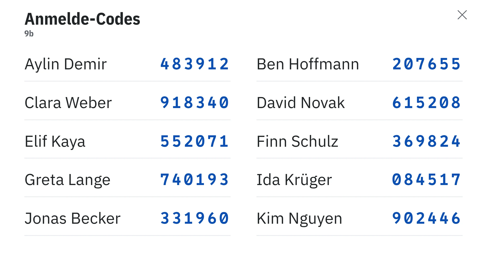
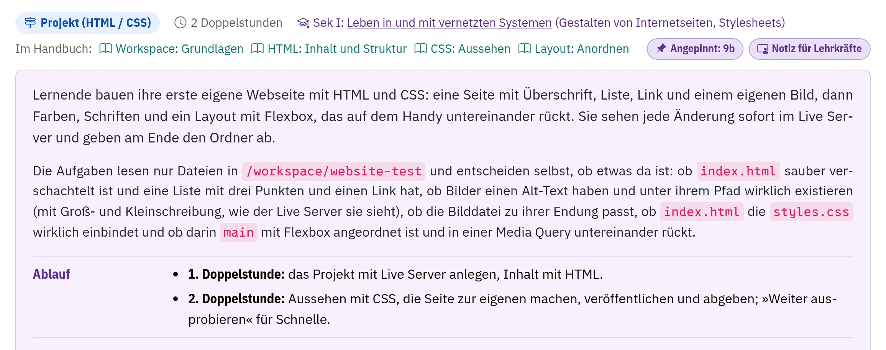

image: codes-beamer.webp

# Einstieg für Lehrkräfte

Was du für die erste Stunde mit dem Workspace brauchst: was die Lernenden haben, wie sich deine Klasse anmeldet, wie du eine Gruppe anlegst, wie die erste Doppelstunde abläuft und wie du alles vorher mit deinem Testkonto ausprobierst. Diese Seite sehen nur Lehrkräfte.

## Was die Lernenden haben

Jede Schülerin und jeder Schüler hat einen eigenen **Workspace**: Visual Studio Code im Browser, mit einem eigenen Ordner, der erhalten bleibt. Auf der Startseite stehen **Aktivitäten**, also Anleitungen zu einem Thema (eine Webseite bauen, eine interaktive Geschichte schreiben, eine Datenbank abfragen). In vielen Aktivitäten stehen **Aufgaben**, die der Workspace selbst prüft: Er sieht in den Dateien nach, führt eine Abfrage aus oder vergleicht eine Antwort. Im **Handbuch** schlagen die Lernenden nach, was sie in mehreren Aktivitäten brauchen.

Du siehst dieselben Seiten wie deine Klasse, mit ein paar Zusätzen: dem Menüpunkt **Klassen** (deine Gruppen, ihr Fortschritt und wer darin ist: [Die Klassenseite](/lehrmaterial-klassenseite); von dort führt ein Link zum **Lehrplan**, welche Aktivität zu welchem Thema deines Lehrplans passt), auf manchen Aktivitäten dem Knopf **Notiz für Lehrkräfte** und unter den Schritten dem Knopf **Code bis hier** (mehr dazu unten).

## Die erste Stunde: anmelden

Wer sich anmeldet, gibt die eigene E-Mail-Adresse ein und bekommt einen Code. Die ganze Adresse ist dabei nicht nötig: Es reicht ihr Anfang, solange nur eine eingeladene Adresse so beginnt. Meist genügt der Teil vor dem `@`, also `lea.fischer` statt `lea.fischer@schule.de`.

In der Schule kommen viele nicht an ihr Postfach. Dafür gibt es die Klassenseite:

1. Öffne **Klassen** und wähle oben deine Gruppe.
2. Klick rechts neben der Gruppe auf **Anmelde-Codes zeigen** und zeig die Seite am Beamer. Der Knopf ist immer da, auch wenn noch niemand einen Code angefordert hat; die Seite ist dann erst einmal leer.
3. Lass die Klasse die Anmeldung starten. Jeder Name erscheint mit seinem Code, sobald er angefordert ist; Mail-Adressen stehen dort nicht.

Ein Code gilt einmal und nur kurze Zeit. Wer sich vertippt, fordert einfach einen neuen an. Wartet jemand auf einen Code, siehst du ihn auch ohne Beamer-Ansicht oben auf der Klassenseite.

## Gruppen und Einladungen

Wer sich anmelden kann, steht in einer Gruppe. Unter **Klassen** legst du mit **Neue Gruppe** deine Gruppen an. Den Knopf gibt es, sobald die Administration dir eine Schule zugeordnet hat; bis dahin steht an seiner Stelle, an wen du schreibst. Danach trägst du im Reiter **Lernende** die E-Mail-Adressen ein (eine pro Zeile, mit oder ohne Namen, auch aus einer Tabelle kopiert) und schickst eine **Willkommensmail**: Sie sagt, wie die Anmeldung geht, und Antworten darauf kommen bei dir an. Namen sind freiwillig und können auch später kommen; ohne Namen zeigt die Klassenseite die Adresse. Eine Kollegin oder einen Kollegen deiner Schule nimmst du mit **Lehrkraft dazu** in eine Gruppe.

Welcher Schule du angehörst, trägt die Administration ein. Hat deine Schule dem Einsatz noch nicht zugestimmt, vermerkst du im Reiter **Lernende**, für wen ein schriftliches Einverständnis vorliegt; anmelden können sich alle schon jetzt (mehr dazu in [Datenschutz und Zustimmung der Schule](/lehrmaterial-datenschutz)).

Steht im Reiter <strong>Lernende</strong>, dass die Einladungen der Gruppe noch in Dateien stehen, pflegt sie die Administration: Schreib an <a href='mailto:${contact_email}'>${contact_email}</a>, für welche Gruppe, und schick die E-Mail-Adressen mit.

## Die erste Doppelstunde

1. **Vorher:** Such im [Lehrplan](/lehrplan) eine Aktivität zu deinem Thema aus ([wie](/lehrmaterial-lehrplan)). Leg die Gruppe an und trag die Adressen ein (Reiter **Lernende**). Probier die Aktivität mit deinem Testkonto aus (siehe unten).
2. **Anmelden:** Zeig **Anmelde-Codes zeigen** am Beamer; die Klasse meldet sich mit dem Anfang ihrer Adresse an und liest ihren Code dort ab.
3. **Anheften:** Heft die Aktivität der Stunde im Reiter **Startseite** an. Sie steht dann bei allen ganz oben.
4. **Treffpunkt:** Setz im Reiter **Fortschritt** einen Treffpunkt nach der Aufgabe, bis zu der alle vor dem ersten Gespräch kommen sollen.
5. **Beobachten:** Behalt **Fortschritt** offen. Rote Kreuze zeigen, wer hängt, eine gelbe Spalte, wo viele hängen, die Zeile über der Tabelle, wer still ist. Ist die Treffpunkt-Zeile grün, sind alle da.
6. **Am Ende:** Der Reiter **Überblick** zeigt, wie weit alle gekommen sind, auch über mehrere Aktivitäten.

Was die Reiter der Klassenseite im Einzelnen zeigen: [Die Klassenseite](/lehrmaterial-klassenseite).

## Selbst ausprobieren

Für dich gibt es ein **Testkonto**, genau eins: ein Konto wie das einer Schülerin, nur dass es dir gehört. Es steht im Reiter **Lernende** jeder deiner Klassen ganz unten, als **Dein Testkonto**. Nur du siehst es, auch andere Lehrkräfte der Klasse nicht, und keine Zahl der Klasse zählt es mit. Was du mit dem Testkonto tust, landet bei keiner Klasse. Betreust du noch keine Klasse, steht es in einer Gruppe **Testgruppe (dein Name)**, die nur du siehst.

### So kommst du hinein

- **Nachahmen:** Geh in einer Klasse auf **Lernende** und klick bei deinem Testkonto auf **Nachahmen**; einen Satz braucht es dafür nicht. Jetzt siehst du die Website genau so, wie eine Schülerin dieser Klasse sie sieht, mit dem, was du für die Klasse angeheftet und eingestellt hast. Mit »Zurück zu deinem Konto« in der Leiste oben bist du wieder du selbst. **Workspace öffnen** startet daneben den Workspace des Testkontos, ohne dass du es nachahmst.
- **Direkt anmelden:** Das Testkonto hat deine Adresse mit `+test` vor dem @, aus `name@schule.de` wird `name+test@schule.de`. Den Anmelde-Code dafür schickt der Workspace an deine eigene Adresse, ohne `+test`. Meld dich damit in einem privaten Fenster oder einem zweiten Browser an, dann hast du beides nebeneinander. Es sieht die Website dann wie die Klasse, aus der du es zuletzt nachgeahmt hast.

### Was du damit ausprobieren kannst

- **Eine Aktivität durcharbeiten,** Aufgabe für Aufgabe: Jede Antwort erscheint im Reiter **Fortschritt** unter der Klasse in einer eigenen Zeile **Dein Testkonto**, mit Haken, Versuchen und »hängt«, so wie später die Antworten der Klasse.
- **Abgaben und Galerie:** Gib als Testkonto eine Webseite oder eine Szene ab und sieh sie dir als Lehrkraft unter **Fortschritt** an, so wie du später die Abgaben der Klasse öffnest.
- **Offene Antworten:** Schreib als Testkonto eine Reflexion. Unter derselben Aufgabe zeigt dir der Kasten »Für Lehrkräfte« mit **Antworten deines Testkontos** genau, was du später von der Klasse siehst.
- **Den Workspace:** Alles, was Lernende im Workspace tun, auch das, was dort schiefgehen kann, ohne dass ein echter Workspace einer Schülerin leidet.
- **Leistungsüberprüfungen:** **Ausprobieren** im Reiter **Leistungsüberprüfungen** zeigt dir die Startseite und den Workspace, wie die Klasse sie sieht; ein Testkonto brauchst du dafür nicht. Willst du auch die **Ergebnisse** sehen, kreuz unter **Teilnehmende** dein Testkonto an, starte die Leistungsüberprüfung, mach sie als Testkonto mit und beende sie.

### Zurücksetzen

Willst du noch einmal von vorn anfangen, klick bei deinem Testkonto unter **Lernende** auf **Testkonto zurücksetzen**. Das leert den Workspace des Testkontos und seine Workspaces in Leistungsüberprüfungen, legt seine Datenbanken neu an und löscht seine Antworten, Versuche und Abgaben. Einer Leistungsüberprüfung bleibt es zugewiesen. Alle anderen Konten bleiben, wie sie sind; zurücksetzen kannst du also jederzeit, auch mitten im Schuljahr.

Löst du in deinem eigenen Konto eine Aufgabe, steht sie auf der Klassenseite in einer eigenen Zeile **Du (Lehrkraft)** unter der Klasse. Für einen kurzen Test reicht das oft schon; für alles, was wie bei einer Schülerin aussehen soll, nimm das Testkonto.

## Auf der Startseite

Am Fuß jeder Karte mit Aufgaben siehst du ein schmales Band, ein Feld je Aufgabe, in der Reihenfolge der Seite. Es zählt nur die Schülerinnen und Schüler deiner Gruppen: Je dunkler ein Feld, desto mehr von ihnen haben die Aufgabe gelöst, ganz dunkel heißt alle, grau keiner. Daneben steht, wie viele Aufgaben sie dort zusammen gelöst haben und wie viele von ihnen überhaupt etwas, etwa »2« und »1/17«. Fährst du mit der Maus über ein Feld, steht dort die Aufgabe und »6 von 17 deiner Lernenden gelöst«. Die Zahlen sind aktuell: Löst jemand eine Aufgabe, steht es beim nächsten Laden der Startseite im Band. So siehst du auf einen Blick, womit deine Klassen schon gearbeitet haben; wer genau wo steht, zeigt die Klassenseite.

Deine Schülerinnen und Schüler sehen an derselben Stelle ihre eigenen Aufgaben, sobald sie eine Aktivität begonnen haben: grün gelöst, gelb versucht, dazu »3/14«.

## Auf einer Aktivitätsseite

Wie eine Aktivität aufgebaut ist und warum (Vermutungen vor dem Ausprobieren, Tipps in Stufen, Aufgaben, die im Workspace nachsehen), steht mit Bildern unter [»Was eine Aktivität ausmacht«](/about#aktivitaet).

Oben rechts steht bei manchen Aktivitäten der Knopf **Notiz für Lehrkräfte**. Er öffnet Hinweise nur für dich: wie lange die Teile dauern, was die Aufgaben prüfen, wo Lernende meistens hängen bleiben. Geschlossen stört er nicht, auch nicht am Beamer. In derselben Zeile stehen, wie lange die Aktivität dauert, und die Zeile des Lehrplans:

Baut eine Aktivität ein Programm Schritt für Schritt auf, steht unter vielen Bildern rechts ein kleiner Knopf **Code bis hier**. Er kopiert das ganze Programm, wie es an dieser Stelle aussieht, damit du ein Ergebnis ausprobieren kannst, ohne alle Schritte davor zu gehen. Deine Klasse sieht ihn nicht.

Steht an einer Aufgabe **Vorschau für Lehrkräfte**, sind Aufgaben auf eurer Installation für Lernende noch ausgeschaltet; du siehst sie trotzdem schon.

## Weitere Anleitungen

Alle Anleitungen für Lehrkräfte stehen als Karten unter [Für Lehrkräfte](/lehrmaterial):

- [Die Klassenseite](/lehrmaterial-klassenseite): wer welche Aufgabe gelöst hat und wer hängt, der Treffpunkt, die Abgaben, die Lernenden mit ihren Workspaces, was angeheftet ist und was für die Gruppe gilt.
- [Eine Aktivität finden: der Lehrplan](/lehrmaterial-lehrplan): welche Aktivität zu welchem Thema deines Lehrplans passt und was worauf aufbaut.
- [Git-Repositorys der Klasse](/lehrmaterial-git): ein gemeinsames Repository für die Gruppe, die Schlüssel, was der Server ablehnt.
- [Leistungsüberprüfungen vorbereiten](/lehrmaterial-leistungsueberpruefung): Für einen Test oder eine Klausur bekommt jede Person einen frischen Workspace mit deinen Aufgaben. Er kommt nicht ins Internet und hat eine Farbe, die man auch von hinten im Raum sieht; der eigene Workspace bleibt unberührt. Du ziehst einen Ordner, eine ZIP- oder eine tar.gz-Datei in den Dialog im Reiter **Leistungsüberprüfungen** und probierst das Paket vorher selbst aus; danach druckst du die Ergebnisse oder lädst alle Dateien als ZIP herunter.
- [Datenschutz und Zustimmung der Schule](/lehrmaterial-datenschutz): was der Server speichert, die Unterlagen für deine Schule und das Einverständnis bis dahin.
