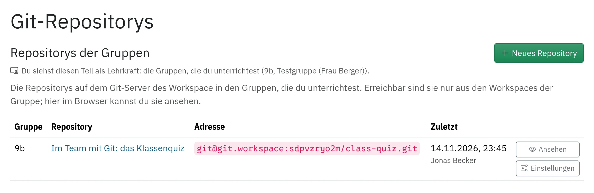

<div class='meta'>
image: git-uebersicht.webp:0:50
</div>

<div
    class="autotoc-secondary-trigger"
    data-title="Auf dieser Seite"
    data-levels="h2,h3">
</div>

# Git-Repositorys der Klasse

<p class='abstract'>
Wie deine Klasse in einem gemeinsamen Git-Repository arbeitet: das Repository anlegen oder eine Adresse von draußen eintragen, wie die Lernenden zu ihrem Schlüssel kommen, was der Git-Server ablehnt und wo du siehst, wer was beigetragen hat. Diese Seite sehen nur Lehrkräfte.
</p>

## Ein Repository für die Gruppe

In einigen Aktivitäten arbeitet die ganze Klasse in einem gemeinsamen Git-Repository, etwa in [Im Team mit Git: das Klassenquiz](/class-quiz): Alle klonen dasselbe Repository, jede und jeder schreibt eine Runde Fragen und pusht sie, und dabei passiert, womit Teams jeden Tag umgehen: ein abgelehnter Push, ein Konflikt. Dafür braucht die Gruppe ein Repository. Du trägst seine Adresse in den **Einstellungen** unter **Git-Repositorys** ein; die Lernenden sehen sie dann auf der Seite im Befehl zum Klonen.

Zu diesem Repository gibt es zwei Wege:

- **Eine Adresse von draußen:** Hat deine Schule einen Git-Server (GitLab, Gitea, Forgejo) oder nutzt deine Klasse GitHub, legst du das Repository dort an, lädst die Lernenden ein und trägst die Adresse ins Feld ein. Die Konten dort verwaltest du selbst.
- **Im Workspace anlegen:** Hat der Workspace deiner Schule einen eigenen Git-Server, steht dieser Knopf neben jedem Feld. Er legt das Repository dort an und trägt die Adresse gleich ein. Ein Konto braucht niemand. Hat die Aktivität Startdateien (beim Klassenquiz das Programm und die erste Runde), liegen sie schon als erster Commit darin.

## Schlüssel

Der Git-Server des Workspace erkennt die Lernenden an einem SSH-Schlüssel. Wie sie zu ihm kommen, wählst du für die Gruppe unter **Schlüssel**:

- **Die Lernenden erzeugen ein Schlüsselpaar und geben den öffentlichen Schlüssel ab:** wie bei jedem Git-Server im Netz. Sie erzeugen im Terminal ein Schlüsselpaar und fügen die Zeile ihres öffentlichen Schlüssels in den Kasten auf der Seite [Git-Server: Zugang und Veröffentlichen](/reference/gitlab) im Handbuch ein; beim Klassenquiz steht derselbe Kasten auch auf der Seite der Aktivität. Einen privaten Schlüssel weist der Kasten zurück. Was sie dabei lernen, brauchen sie später bei GitHub oder GitLab genauso.
- **Der Workspace richtet den Schlüssel für alle ein:** Für die Lernenden ist nichts zu tun. Der Workspace legt jedem Mitglied der Gruppe einen Schlüssel an: sofort in jedem Workspace, den es schon gibt, in den anderen vor ihrem nächsten Start. Dieser Schlüssel gilt nur für den Git-Server des Workspace. Das passt, wenn die Stunde von Git handeln soll und nicht von SSH.

Ob alles klappt, prüfen die Lernenden im Terminal ihres Workspace:

```bash
ssh -T git@git.workspace
```

Der Server antwortet mit »Hallo! Dein Schlüssel ist eingetragen. Hier gibt es keine Shell, nur Git.« und zählt die Repositorys auf, die sie erreichen. Mit einem abgegebenen Schlüssel fragt SSH beim ersten Mal, ob es dem Server trauen soll; den Fingerabdruck zum Vergleichen zeigt der Kasten.

## Ansehen, ablehnen, löschen

- **Ansehen** neben dem Feld zeigt das Repository im Browser: links die Dateien als Baum, rechts den Code, den Verlauf, jeden Commit mit seinen Änderungen, Branches und Tags, und alles als ZIP zum Herunterladen. So siehst du nach der Stunde, wer was beigetragen hat, ohne selbst zu klonen. Dieselbe Seite erreichst du über **ansehen** in der Zeile »Klassen-Repository« über der Aktivität und im Fortschritt der Klasse über **Repository** neben »Zur Seite«. Die Lernenden der Gruppe sehen dieselben Seiten; sie finden sie unter dem Klon-Befehl der Aktivität (»Das Repository im Browser ansehen«).
- **Was der Server ablehnt:** `git push --force`, das Löschen eines Branches auf dem Server und jeden Push über 50 MB. Was einmal gepusht ist, überschreibt also niemand; wer einen abgelehnten Push hat, holt sich erst den Stand der anderen mit `git pull`.
- **Wer hinkommt:** Klonen und pushen geht nur aus den Workspaces der Lernenden und Lehrkräfte der Gruppe. Aus dem Internet ist der Git-Server nicht zu erreichen, auch nicht von deinem eigenen Rechner zu Hause. Im Browser liest du die Repositorys über **Ansehen**, sobald du angemeldet bist.
- **Löschen** neben dem Feld fragt einmal nach (»Wirklich löschen? Alles darin ist weg.«) und löscht dann das Repository auf dem Server mit allem darin, auch mit allem, was die Klasse gepusht hat. War seine Adresse eingetragen, ist das Feld danach leer. Die Klone in den Workspaces der Lernenden bleiben, wie sie sind. Wird die Gruppe gelöscht, gehen ihre Repositorys mit.

## Alle Repositorys auf einen Blick

Unter [Git-Repositorys](/repos) stehen alle Repositorys im Workspace aus allen deinen Gruppen: Gruppe, Aktivität, Adresse, wie die Gruppe zu ihren Schlüsseln kommt, der letzte Commit mit dem Namen der Person, die ihn geschrieben hat, und daneben **Ansehen** und **Einstellungen**. Du findest die Seite in den Einstellungen unter den Feldern (»Übersicht«) und auf jeder Seite eines Repositorys oben links (»Repositorys«). »Nicht eingetragen« heißt: Das Repository liegt noch auf dem Server, aber die Gruppe hat für die Aktivität eine andere Adresse eingetragen oder keine.

Ein Repository ohne Aktivität, etwa für ein Projekt der Klasse, legst du dort mit **Neues Repository** an: Gruppe, Name, eine Beschreibung, leer oder mit einer Datei `README.md`. Es gehört der Gruppe wie ein Klassen-Repository. Außerdem kann jede und jeder, auch du, unter **Meine Repositorys** bis zu zehn eigene Repositorys zum Üben anlegen. Die sieht nur ihre Besitzerin oder ihr Besitzer, auch du als Lehrkraft nicht: Was die Klasse gemeinsam macht, gehört in ein Repository der Gruppe.


