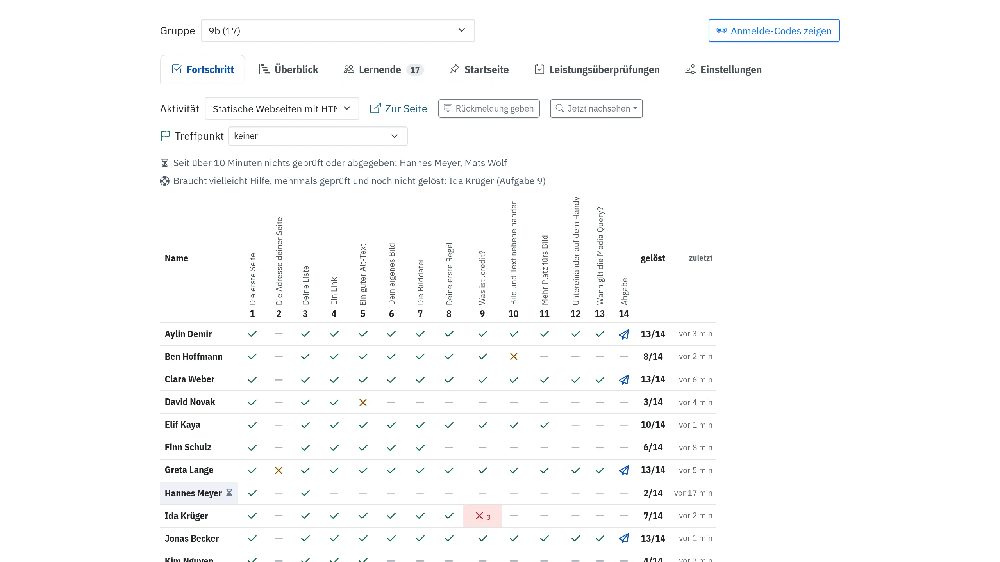
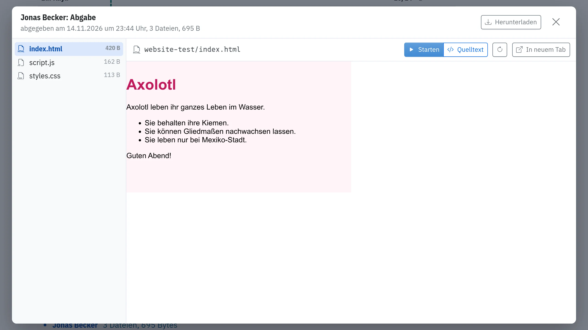
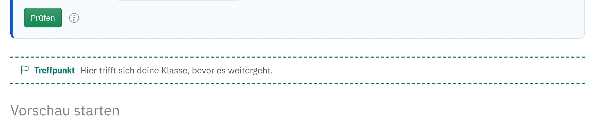
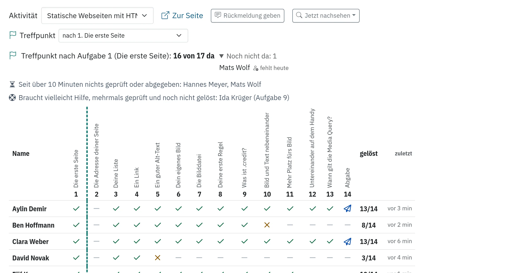
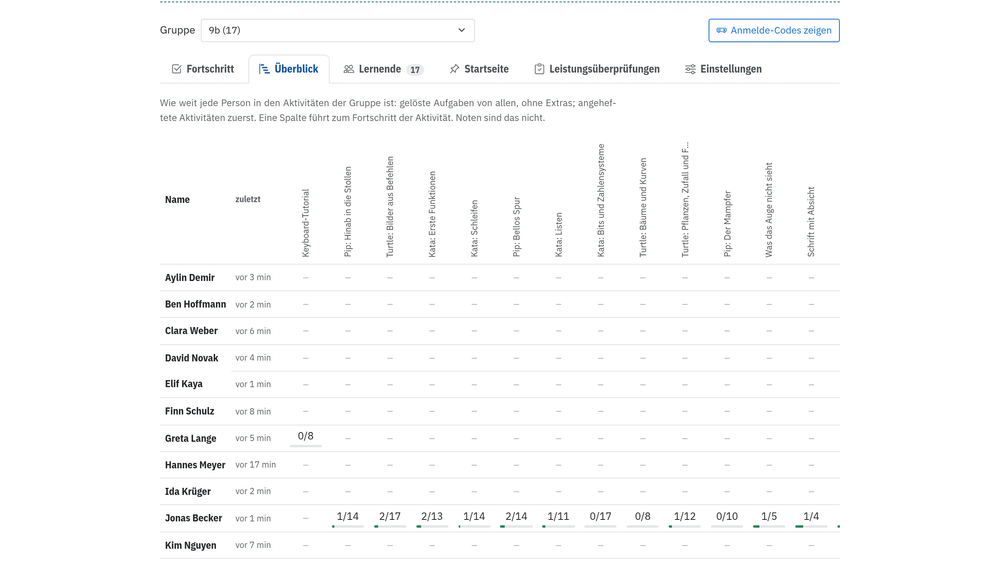
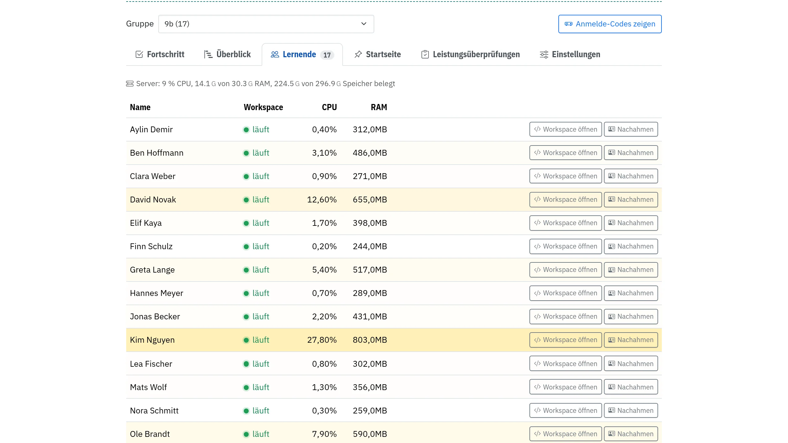
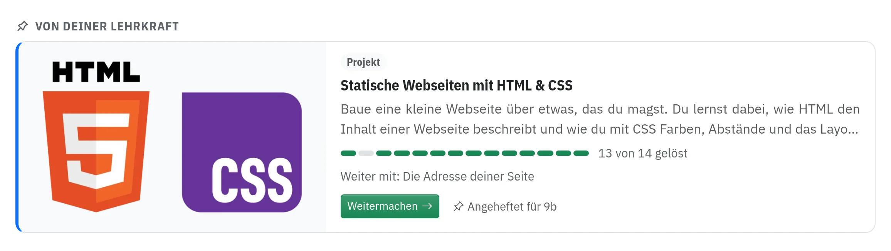
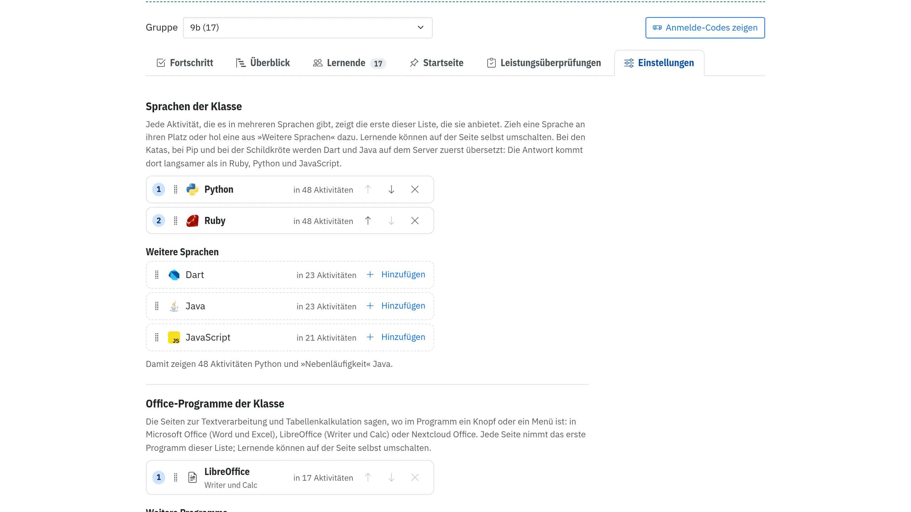

image: klasse-fortschritt.webp

# Die Klassenseite

Was die Klassenseite unter <strong>Klassen</strong> zeigt: wer welche Aufgabe gelöst hat und wer hängt, der Treffpunkt, die Abgaben, die Lernenden mit ihren Workspaces, was die Gruppe auf ihrer Startseite sieht und was für die ganze Gruppe gilt. Diese Seite sehen nur Lehrkräfte.

Unter **Klassen** wählst du oben die Gruppe. Darunter liegen fünf Reiter: **Fortschritt** zeigt eine Aktivität Aufgabe für Aufgabe, **Überblick** alle Aktivitäten der Gruppe auf einmal, **Lernende** die Personen und ihre Workspaces, **Startseite**, was die Gruppe zuerst sieht, und **Einstellungen**, was für die ganze Gruppe gilt.

## Fortschritt

Hier wählst du eine Aktivität und siehst, wer welche Aufgabe gelöst hat. Jede Spalte ist eine Aufgabe, ihr Titel steht darüber.

<table class='table'>
<thead><tr><th>Zeichen</th><th>Bedeutung</th></tr></thead>
<tbody>
<tr><td><svg class='ti ti-check' aria-hidden='true'><use href='/include/tabler/tabler.svg#check'/></svg></td><td>gelöst</td></tr>
<tr><td><i class='bi bi-paper-plane' aria-hidden='true'></i></td><td>abgegeben, oder eine Antwort in eigenen Worten gespeichert</td></tr>
<tr><td><svg class='ti ti-x' aria-hidden='true'><use href='/include/tabler/tabler.svg#x'/></svg><small>2</small></td><td>noch nicht gelöst, nach so vielen Versuchen</td></tr>
<tr><td><svg class='ti ti-x' aria-hidden='true'><use href='/include/tabler/tabler.svg#x'/></svg><small>3</small></td><td>hängt: noch nicht gelöst, nach drei Versuchen oder mehr</td></tr>
<tr><td><svg class='ti ti-refresh' aria-hidden='true'><use href='/include/tabler/tabler.svg#refresh'/></svg></td><td>Die Aufgabe hat sich geändert, die Antwort ist von vorher.</td></tr>
<tr><td><svg class='ti ti-minus' aria-hidden='true'><use href='/include/tabler/tabler.svg#minus'/></svg></td><td>noch nicht bearbeitet</td></tr>
</tbody>
</table>

Die Zeile **Klasse** darunter zählt, wie viele fertig sind und wie viele hängen. Eine gelbe Spalte heißt: Viele liegen bei dieser Aufgabe gerade falsch. Das ist oft ein guter Moment, kurz für alle zu erklären.

Ganz rechts steht unter **zuletzt**, wann jemand zuletzt eine Aufgabe dieser Aktivität geprüft, beantwortet oder abgegeben hat, etwa »vor 12 min«. Wer still ist, fällt dadurch auf, auch wenn noch kein Kreuz in der Zeile steht: Arbeitet die Klasse gerade an der Aktivität, steht über der Tabelle, wer seit über zehn Minuten nichts geprüft oder abgegeben hat, und diese Namen sind leicht hinterlegt. Das kann jemand sein, der hängt und nicht fragt, oder jemand, der in Ruhe arbeitet, ohne zu prüfen; was im Workspace geschieht, sieht die Seite nicht. Wer bei einem Treffpunkt als »fehlt heute« markiert ist, steht nicht in dieser Zeile. Die Zeiten laufen weiter, solange die Seite offen ist.

Darüber stehen zwei Werkzeuge:

- **Jetzt nachsehen** prüft eine Aufgabe sofort für alle, ohne dass jemand »Prüfen« drücken muss, zum Beispiel ob alle ihre Seite angelegt haben. Das Ergebnis erscheint blau umrandet in der Tabelle; gespeichert wird nichts.
- **Vorlage aktuell?** gibt es bei Aktivitäten, die mit einer Vorlage beginnen. Es sagt, wer noch eine alte Version hat und `git pull` ausführen sollte.

Unter der Tabelle stehen die Antworten in eigenen Worten und die **Abgaben**. Ein Klick auf eine Abgabe öffnet sie über der Klassenseite: links die Dateien, rechts der Quelltext. Bei Webseiten und interaktiven Geschichten startet **Starten** die Abgabe so, wie die Person sie abgegeben hat, mit allem, was sich darin bewegt.

Eine Abgabe ist eine Kopie. Was die Person danach im Workspace ändert, ändert die Abgabe nicht; sie kann aber jederzeit neu abgeben.

Für eine neue Runde, etwa im nächsten Halbjahr, löscht **Alle Abgaben löschen** unter der Liste die Abgaben dieser Aufgabe in dieser Gruppe. Vorher fragt der Workspace nach; lade herunter, was du behalten willst.

Die Klassenseite merkt sich, welche Gruppe und welche Aktivität du zuletzt angesehen hast, und öffnet beim nächsten Mal dort.

### Treffpunkt

Mit **Treffpunkt** über der Tabelle legst du fest, bis zu welcher Aufgabe alle kommen sollen, bevor ihr gemeinsam weitermacht, etwa für ein Gespräch an der Tafel. Wer die Aktivität offen hat, sieht nach dieser Aufgabe sofort das Band »Hier trifft sich deine Klasse«; wer alle Aufgaben bis dahin gelöst hat (Extras zählen nicht), liest dort »Du bist da«. Versteckt wird nichts; was danach kommt, ist nur blasser.

Über der Tabelle steht, wie viele schon da sind und wer noch fehlt; die Zahl ändert sich, sobald jemand eine Aufgabe löst. Wer heute nicht da ist, nimmst du mit **fehlt heute** aus der Zählung; das merkt sich nur dein Browser, bis Mitternacht. Sind alle da, wird die Zeile grün. **keiner** hebt den Treffpunkt wieder auf. Auf der Seite der Aktivität setzt und verschiebst du ihn auch direkt, mit dem gestrichelten Knopf nach einer Aufgabe.

### Rückmeldung

Haben mindestens drei aus deiner Gruppe mit einer Aktivität gearbeitet, und ist deine Klasse danach zu einer anderen Aktivität weitergegangen (mindestens die Hälfte von ihnen, nicht nur ein paar, die anderswo stöbern), fragt eine Woche später eine Karte über der Tabelle (ohne neue Aktivität nach drei Wochen, damit Ferien oder eine ausgefallene Stunde sie nicht mitten in einer Aktivität bringen): **Wie lief die Aktivität?** Ein paar Klicks genügen: wie es insgesamt lief, ob die Dauer passte, ob das Niveau für die Gruppe passte, in welcher Programmiersprache du die Aktivität gern hättest, und was gefehlt oder gut funktioniert hat. Alles ist freiwillig, eine Antwort genügt. Lesen kann die Rückmeldung nur die Administration, die die Aktivitäten schreibt; deine Klasse sieht nichts davon. Eine E-Mail bekommst du dazu nur, wenn du es ankreuzt. **Nicht jetzt** blendet die Karte für 14 Tage aus, **Nicht mehr fragen** für diese Aktivität und Gruppe ganz. Früher antworten oder deine Antwort ändern kannst du jederzeit mit **Rückmeldung geben** über der Tabelle; wartet eine Karte, steht ein kurzer Hinweis darauf auch auf deiner Startseite.

## Überblick

Hier steht jede Person der Gruppe mit allen Aktivitäten, an denen jemand aus der Gruppe gearbeitet hat; angeheftete kommen zuerst. In jeder Zelle steht, wie viele Aufgaben gelöst sind, von allen ohne Extras, mit einem schmalen Balken; ein Strich heißt: noch nichts bearbeitet. Ein Klick auf eine Spalte öffnet die Aktivität im Reiter **Fortschritt**. Ganz rechts steht, wann die Person zuletzt eine Aufgabe irgendeiner Aktivität geprüft hat. Noten sind das nicht: Die Zahlen sagen, wie weit jemand ist, nicht wie gut.

## Lernende

Hier steht jede Person der Gruppe mit ihrem Workspace: ob er läuft, wie viel Rechenzeit und Speicher er gerade braucht. Eine Zeile leuchtet gelb, solange ihr Workspace arbeitet. Darüber zeigt eine Zeile, wie ausgelastet der Server ist. So erkennst du, ob ein Workspace hängt oder ob gerade alle gleichzeitig etwas Großes starten.

Im selben Reiter verwaltest du die Gruppe: Namen und Adressen, Willkommensmails, das Einverständnis, ein Enddatum, weitere Lehrkräfte, Umbenennen und Löschen. Neue Personen nimmst du ganz unten auf: Ins große Feld kommt eine Person pro Zeile, mit Namen wie `Lena Muster <lena.muster@example.org>` oder nur mit Adresse, auch aus einer Tabelle kopiert; dann **Hinzufügen**.

Bei jeder Person stehen zwei Knöpfe:

- **Workspace öffnen** öffnet ihren Workspace in einem neuen Tab, etwa um bei einem Fehler zu helfen.
- **Nachahmen** zeigt dir die Seite so, wie die Person sie sieht, mit ihren Aufgaben und Abgaben. Oben steht dann »Zurück zu deinem Konto«.

Bevor du einen Workspace öffnest oder jemanden nachahmst, schreibst du einen Satz dazu, warum, zum Beispiel »Ich sehe mir deine Abgabe zu Aufgabe 3 an.« Die Person liest ihn bei der nächsten Anmeldung. So bleibt nachvollziehbar, wer wann hineingesehen hat.

## Startseite

Was du hier für die Gruppe **anheftest**, steht bei allen in der Gruppe oben auf der Startseite. So findet die Klasse die Aktivität der Stunde sofort:

## Einstellungen

Hier steht, was für die ganze Gruppe gilt; jede Änderung ist sofort gespeichert.

- **Sprachen der Klasse:** Gibt es eine Aktivität in mehreren Programmiersprachen (etwa Ruby, Python und JavaScript), zeigt sie der Gruppe die erste Sprache dieser Liste, die sie anbietet. Du ordnest die Liste, indem du eine Sprache an ihren Platz ziehst oder mit den Pfeilen verschiebst, und holst Sprachen aus »Weitere Sprachen« dazu; ein Satz darunter sagt, was das für die Aktivitäten heißt. Lernende können auf der Seite selbst umschalten.
- **Kopierknöpfe:** »An jedem Codeblock« setzt überall einen Kopierknopf. »Wo sinnvoll« lässt ihn nur dort, wo Abtippen nichts lehrt (Adressen, Befehle, große Dateien); alles andere tippt die Klasse ab.
- **Git-Repositorys:** die Adressen der Repositorys, die die Klasse gemeinsam klont, und wie die Lernenden zu ihren Schlüsseln kommen; mehr dazu in [Git-Repositorys der Klasse](/lehrmaterial-git).
- **Schule:** zu welcher Schule die Gruppe gehört, ob die Schule dem Einsatz zugestimmt hat, und der Weg zu den **Unterlagen für deine Schule** (mehr dazu in [Datenschutz und Zustimmung der Schule](/lehrmaterial-datenschutz)).
