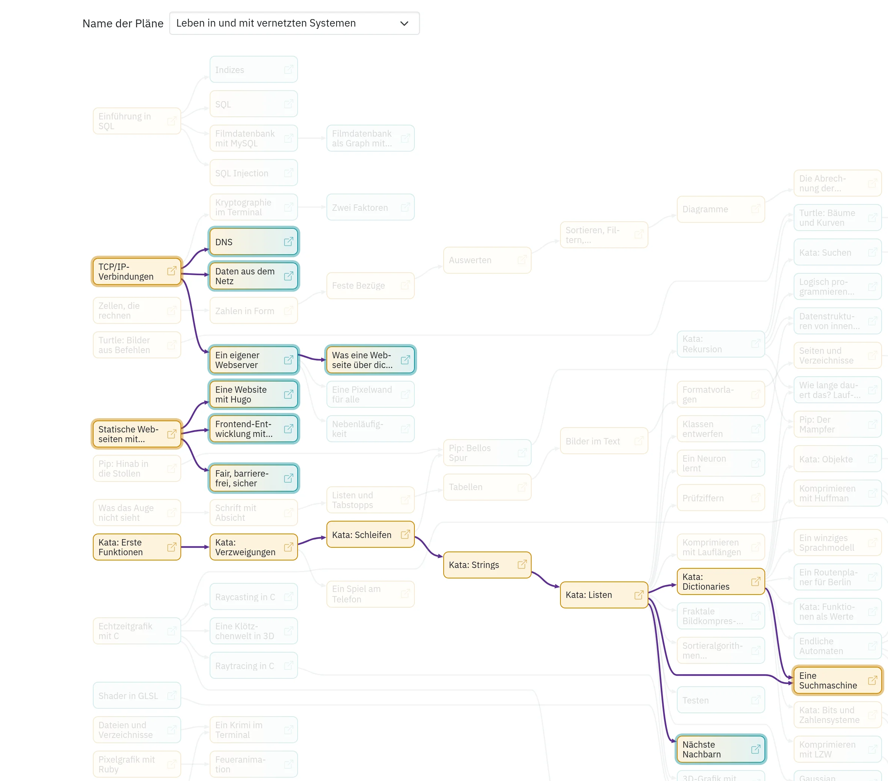

image: lehrplan.webp

# Eine Aktivität finden: der Lehrplan

Welche Aktivität zu welchem Thema deines Rahmenlehrplans passt, für die Sekundarstufe I und die Oberstufe, und was worauf aufbaut. Diese Seite sehen nur Lehrkräfte.

## Die Themen deines Lehrplans

Im [Lehrplan](/lehrplan), verlinkt oben auf der Klassenseite, stehen die Themen deines Rahmenlehrplans, für die Sekundarstufe I und für die Oberstufe, und unter jedem die Aktivitäten, die es behandeln. Neben jeder Stufe führen Links zum Lehrplan selbst, als PDF, und zur Seite des Landes. Oben wählst du dein Bundesland; ohne Wahl siehst du Berlin.

Darüber zeigt ein Bild, was worauf aufbaut: Ein Pfeil führt von einer Aktivität zu denen, die auf ihr aufbauen. Die Farbe sagt, für wen eine Aktivität gedacht ist: gelb für die Sekundarstufe I, türkis für die Oberstufe, beides im Verlauf für Aktivitäten, die zu beiden passen. Wählst du über dem Bild unter **Name der Pläne** ein Thema, hebt es die Aktivitäten dazu hervor und den Weg dorthin:

Dieselbe Zeile siehst du oben auf jeder Aktivitätsseite: Die Namen der Themen darin führen an ihre Stelle im Lehrplan.
