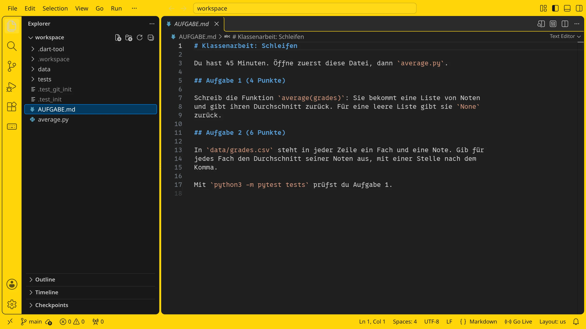
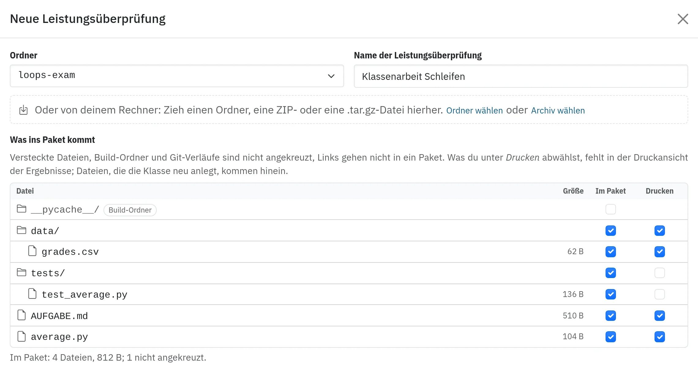
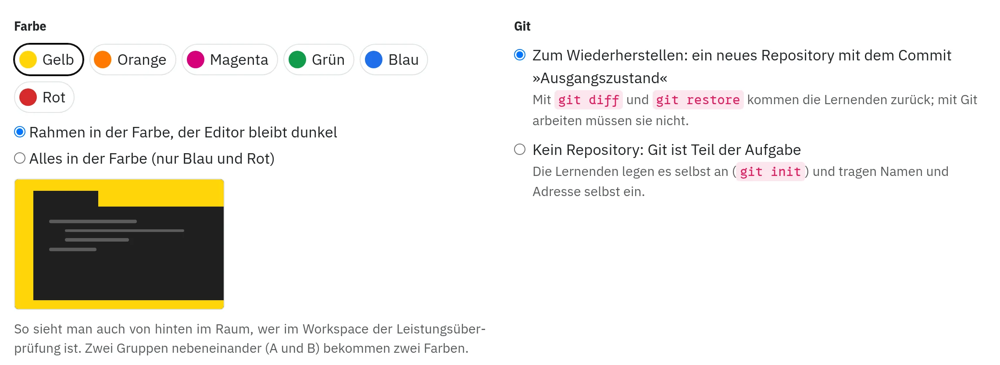

<div class='meta'>
image: workspace-rahmen.webp
</div>

<div
    class="autotoc-secondary-trigger"
    data-title="Auf dieser Seite"
    data-levels="h2,h3">
</div>

# Leistungsüberprüfungen vorbereiten

<p class='abstract'>
Wie du aus einem Ordner deines Workspace eine Leistungsüberprüfung machst, sie mit deinem Testkonto ausprobierst, mit der Klasse schreibst und die Ergebnisse druckst. Wer sein Paket lieber selbst baut, findet unten, was hineingehört. Diese Seite sehen nur Lehrkräfte.
</p>

## Was die Klasse erlebt

Während eine Leistungsüberprüfung läuft, kommt jede Schülerin und jeder Schüler, die oder der teilnimmt, beim Öffnen des Workspace nicht in den eigenen Workspace, sondern in einen eigenen, frischen Workspace der Leistungsüberprüfung. Darin liegt, was du vorbereitet hast: die Aufgabe, Vorlagen, Daten. Der eigene Workspace bleibt unberührt.

Der Workspace der Leistungsüberprüfung hat eine Farbe, die man auch von hinten im Raum sieht: entweder einen Rahmen in einer kräftigen Farbe um den gewohnten dunklen Editor oder ein ganz blaues oder rotes Farbschema. So siehst du auf einen Blick, wer im richtigen Workspace ist, und zwei Gruppen nebeneinander (A und B) bekommen zwei Farben.



Der Workspace der Leistungsüberprüfung kommt nicht ins Internet: Pakete nachinstallieren oder etwas im Netz nachsehen geht dort nicht. Erweiterungen von VS Code, die du im Paket angibst (unten, [Ein eigenes Paket bauen](#9-ein-eigenes-paket-bauen)), sind schon installiert. Wie weit das trägt und wo es aufhört, steht unten in [Was abgeschirmt ist und was nicht](#8-was-abgeschirmt-ist-und-was-nicht).

Beendest du die Leistungsüberprüfung, kommen alle beim nächsten Öffnen wieder in ihren eigenen Workspace. Die Workspaces der Leistungsüberprüfung bleiben erhalten; startest du sie noch einmal, geht es dort weiter, wo alle aufgehört haben.

## Den Ordner vorbereiten

Leg in deinem eigenen Workspace einen Ordner an, etwa `loops-exam`, mit allem, was die Klasse zu Beginn haben soll:

```text
loops-exam/
├── AUFGABE.md
├── average.py
├── data/
│   └── grades.csv
└── tests/
    └── test_average.py
```

Die Aufgabe steht am besten in einer Datei wie `AUFGABE.md`; sag der Klasse, dass sie sie zuerst öffnen soll. Vorlagen, Daten und Tests sind, was deine Aufgabe braucht; an eine Sprache ist das Paket nicht gebunden. Probier die Aufgabe in deinem Workspace einmal selbst durch, bevor du sie bereitstellst.

## Bereitstellen

Öffne **Klassen**, wähl oben die Klasse und dann den Reiter **Leistungsüberprüfungen**. Klick auf **Aus deinem Workspace**.



- **Ordner und Name:** Wähl den Ordner und gib der Leistungsüberprüfung einen Namen, etwa »Klassenarbeit Schleifen«; so steht sie in der Liste und auf den Ausdrucken.
- **Im Paket:** Was angekreuzt ist, bekommt die Klasse. Versteckte Dateien (ihr Name beginnt mit einem Punkt), Build-Ordner wie `__pycache__` oder `node_modules` und Git-Verläufe sind zuerst nicht angekreuzt, damit nichts mitgeht, was beim Arbeiten entstanden ist. Brauchst du davon etwas, kreuz es an. Links gehen nicht in ein Paket.
- **Drucken:** Was du hier abwählst, fehlt in der Druckansicht der Ergebnisse, etwa die Tests oder große Daten. Dateien, die die Klasse neu anlegt, kommen in die Druckansicht.
- **Farbe:** Gelb, Orange, Magenta, Grün, Blau oder Rot als Rahmen; der Editor bleibt dunkel, gut zu lesen in einer Doppelstunde. Oder alles in Blau oder Rot.
- **Git:** Zum Wiederherstellen legt der Workspace ein Repository mit dem Commit »Ausgangszustand« an. Mit `git diff` sehen die Lernenden, was sie geändert haben, und mit `git restore` holen sie eine Datei zurück; mit Git arbeiten müssen sie dafür nicht. Ist Git selbst Teil der Aufgabe, wähl **Kein Repository**; dann legen die Lernenden es selbst an.



Soll die Klasse mit einem Git-Verlauf arbeiten, den du vorbereitet hast (Branches, ein Merge-Konflikt, eine Historie zum Untersuchen), kreuz seinen Ordner `.git` an:

- Liegt `.git` oben im Ordner, geht der Verlauf mit, wie er ist; ein neues Repository legt der Workspace dann nicht an.
- Liegt `.git` in einem Unterordner, etwa `projekt/.git`, geht der Verlauf dieses Unterordners mit, und die Klasse arbeitet dort damit. Das Repository zum Wiederherstellen lässt diesen Unterordner aus.

In beiden Fällen trägt der Workspace in jedem dieser Repositorys Namen und Adresse der Schülerin oder des Schülers ein, damit Commits gleich gehen; nur bei **Kein Repository** richtet er nichts ein.

Klick dann auf **Für 9b bereitstellen** (mit dem Namen deiner Klasse). Der Workspace packt die Dateien und prüft das Paket; danach steht die Leistungsüberprüfung in der Liste, und alle aus der Klasse nehmen teil, ohne Lehrkräfte. Unter **Teilnehmende** nimmst du Einzelne heraus oder fügst sie aus anderen Gruppen hinzu, etwa jemanden, der nachschreibt.

Das Paket ist ein Abzug deines Ordners: Änderst du danach etwas im Ordner, stell ihn noch einmal bereit und lösch die alte Leistungsüberprüfung.

## Ausprobieren

Unter **Vorschau** öffnet **Workspace** einen frischen Workspace der Leistungsüberprüfung, genau wie ihn die Klasse beim ersten Start sieht. Er ist von deinem Workspace und von denen der Klasse getrennt; öffnest du die Vorschau noch einmal, beginnt sie wieder von vorn. **Druckansicht** zeigt, wie deine Dateien in der Vorschau gedruckt aussehen.

Wie es sich als Schülerin oder Schüler anfühlt, zeigt dein Testkonto: Stell die Leistungsüberprüfung in deiner **Testgruppe** bereit (unter **Klassen** oben die Testgruppe wählen); dein Testkonto nimmt dann teil. Starte sie und öffne dein Testkonto im Reiter **Lernende** der Testgruppe mit **Nachahmen** oder in einem privaten Fenster mit `+test` vor dem @ deiner Adresse. Bearbeite die Aufgabe, beende die Leistungsüberprüfung und sieh dir die Ergebnisse an. So weißt du vorher, was die Klasse sieht und was am Ende bei dir ankommt.

## Ein Probelauf mit der Klasse

Kennt deine Klasse den Ablauf noch nicht, hilft vielleicht ein kurzer Probelauf, bevor es zählt: eine kleine Leistungsüberprüfung von dir, für die alle einmal erleben, wie der Workspace die Farbe wechselt, wo die Aufgabe liegt und wie sie danach wieder in ihren eigenen Workspace kommen. Was darin steht und wie lang er dauert, entscheidest du.

## In der Stunde

Klick in der Zeile der Leistungsüberprüfung auf **Starten**. Wer teilnimmt, kommt beim nächsten Öffnen des Workspace in den Workspace der Leistungsüberprüfung; am einfachsten startest du, bevor die Klasse den Workspace öffnet. Die Farbe zeigt dir, wer drin ist.

Am Ende klickst du auf **Beenden**. Danach kommen alle beim nächsten Öffnen wieder in ihren eigenen Workspace.

## Die Ergebnisse

Unter **Ergebnisse** druckst du die ganze Klasse oder eine einzelne Person; zwischen zwei Personen beginnt eine neue Seite. Daneben gibt es alle Dateien als ZIP, ein Ordner je Person, zum Aufheben und um die Lösungen später auszuführen. Wer den Workspace der Leistungsüberprüfung nie geöffnet hat, steht im ZIP in `nicht-geoeffnet.txt`.

## Was abgeschirmt ist und was nicht

Eine Leistungsüberprüfung im Workspace ist keine abgeschlossene Prüfungsumgebung. Damit du weißt, worauf du dich verlassen kannst:

- **Kein Internet:** Der Workspace der Leistungsüberprüfung erreicht nichts außerhalb des Workspace, weder über einen Namen wie `api.openai.com` noch über eine IP-Adresse. `pip install`, `npm install`, `curl` und ein Programm, das eine KI fragen soll, bekommen keine Verbindung.
- **Keine Rechte, das zu ändern:** Die Lernenden sind im Workspace keine Administratoren; auch mit `sudo` ändern sie daran nichts.
- **Keine anderen Workspaces:** Von einem Workspace aus erreicht man die der anderen nicht.
- **Keine KI im Editor:** Im Workspace ist keine KI-Erweiterung installiert.
- **Was geht:** die Datenbanken des Workspace (MySQL und Neo4j), und alles, was im Workspace der Leistungsüberprüfung selbst läuft, etwa ein Dienst, den die Klasse untersuchen soll und den du mit `exam.setup.every_start` startest (unten). Soll die Klasse einen Dienst im Internet erreichen, nenn ihn in `network.allow`; dann geht genau dieser, sonst nichts.

Was nicht abgeschirmt ist:

- **Der Rest des Geräts:** Der Workspace läuft im Browser. Ein anderer Tab, ein anderes Programm oder ein Handy erreicht das Internet wie immer, auch eine KI. Dafür ist die Farbe da: Wer im Workspace der Leistungsüberprüfung ist, sieht man von hinten im Raum; wer gerade etwas anderes zeigt, fällt auf.
- **Kopieren und Hochladen:** Text lässt sich aus einem anderen Fenster einfügen, und Dateien lassen sich vom eigenen Rechner in den Workspace ziehen.

Für eine Leistungsüberprüfung im Raum heißt das: Die Aufsicht bleibt nötig, und die Farbe macht sie leichter.

## Ein eigenes Paket bauen

Statt aus einem Ordner deines Workspace kannst du ein fertiges Paket hochladen (**Paket hochladen**): ein Archiv `.tar.gz` mit dem Inhalt, den die Klasse bekommen soll. Das lohnt sich, wenn du Pakete außerhalb des Workspace baust, sie mit anderen teilst oder Einstellungen brauchst, die der Dialog nicht zeigt (Erweiterungen, Befehle beim Start).

### Packen

Das Archiv enthält direkt den Inhalt des Ordners, keinen Ordner darum herum. Öffne ein Terminal **im Ordner** und pack alles hinein, auch versteckte Dateien; das Archiv landet eine Ebene höher und heißt wie der Ordner:

```bash
tar -czf "../$(basename "$PWD").tar.gz" .
```

Pack keine privaten Schlüssel, Zugangsdaten oder Cache-Ordner ein. Links sind in einem Paket nicht erlaubt.

### Die Einstellungen

Was der Dialog einstellt, steht in einem Paket in `.workspace/config.yaml`. Die Datei ist freiwillig; ohne sie hat der Workspace ein blaues Farbschema, ein Repository zum Wiederherstellen und druckt alle Textdateien. Ein Beispiel:

```yaml
workspace_package: 1

exam:
  color: yellow
  look: frame

git:
  mode: fresh

print:
  exclude:
    - "tests/**"
    - "data/**"

extensions:
  - ms-python.python
```

<table class='table table-sm'>
<thead>
<tr><th>Angabe</th><th>Was sie tut</th></tr>
</thead>
<tbody>
<tr><td><code>exam.look</code></td><td><code>frame</code>: ein Rahmen in der Farbe, der Editor bleibt dunkel; <code>theme</code> (ohne Angabe): alles in der Farbe</td></tr>
<tr><td><code>exam.color</code></td><td>beim Rahmen <code>yellow</code>, <code>orange</code>, <code>magenta</code>, <code>green</code>, <code>blue</code> oder <code>red</code>; für alles in der Farbe <code>blue</code> (ohne Angabe) oder <code>red</code></td></tr>
<tr><td><code>git.mode</code></td><td><code>fresh</code> (ohne Angabe): ein neues Repository mit dem Commit »Ausgangszustand«, das Paket enthält oben kein <code>.git</code>; <code>preserve</code>: das <code>.git</code> im Paket bleibt mit Verlauf, Branches und Index; <code>none</code>: keine Einrichtung, das Paket enthält oben kein <code>.git</code></td></tr>
<tr><td><code>print.exclude</code></td><td>was nicht gedruckt wird, als Muster: <code>tests/**</code> ist der Ordner mit allem darin, <code>**/runner.*</code> jede Datei dieses Namens</td></tr>
<tr><td><code>print.include</code></td><td>nur das wird gedruckt, etwa <code>src/**</code>; ohne Angabe jede Textdatei</td></tr>
<tr><td><code>extensions</code></td><td>Erweiterungen von VS Code, etwa <code>ms-python.python</code>, auch mit fester Version (<code>id</code> und <code>version</code>); sie werden beim Hochladen geladen und im Workspace der Leistungsüberprüfung ohne Internet installiert</td></tr>
<tr><td><code>exam.setup.once</code></td><td>Befehle, die für jede Person einmal laufen, bevor der Editor aufgeht (höchstens zwölf, je zwei Minuten)</td></tr>
<tr><td><code>exam.setup.every_start</code></td><td>Befehle bei jedem Start des Workspace der Leistungsüberprüfung, nicht bei jedem Neuladen der Seite</td></tr>
<tr><td><code>network.allow</code></td><td>Dienste im Internet, die die Klasse erreichen darf, als Name oder IPv4-Adresse, mit <code>:Port</code> (ohne: 80 und 443), höchstens zehn, etwa <code>api.schule.example:8080</code>; ohne Angabe nichts</td></tr>
<tr><td><code>vscode_config</code></td><td>weitere Einstellungen von VS Code, nur für diese Leistungsüberprüfung, etwa <code>editor.minimap.enabled: false</code></td></tr>
</tbody>
</table>

Versteckte Ordner wie `.git` oder `.cache` werden nie gedruckt. Ein `.git` in einem Unterordner darf in jedem Paket liegen; das Repository zum Wiederherstellen lässt diesen Unterordner aus.

Beim Hochladen prüft der Workspace das Paket; stimmt etwas nicht, sagt er, was. Liegt im Ordner deines Workspace schon eine `.workspace/config.yaml`, übernimmt der Dialog **Aus deinem Workspace** ihre Farbe, Git und das Drucken, und alle übrigen Angaben daraus (Erweiterungen, Befehle beim Start) bleiben, wie sie sind.
