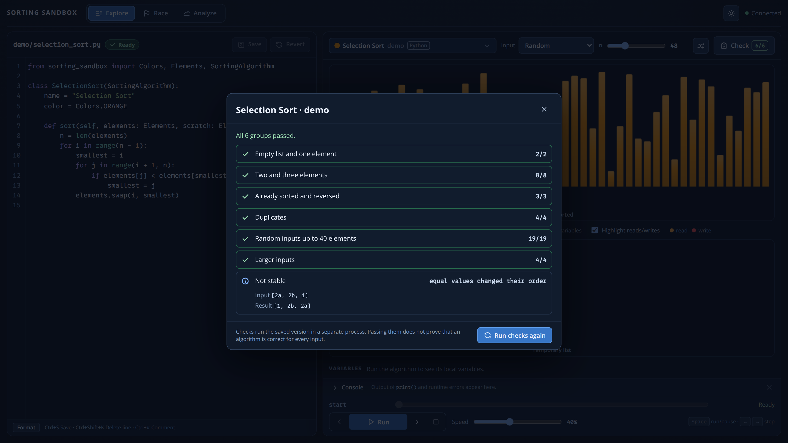

<div class='meta'>
image: sorting-sandbox.webp
</div>

# Sortieralgorithmen erforschen

<p class='abstract'>
In der Sorting Sandbox schreiben Lernende echte Sortieralgorithmen in Dart, Python,
JavaScript oder Java – und sehen dann zu, wie ihr eigener Code arbeitet. Sie lassen
Verfahren gegeneinander antreten, messen den Aufwand und finden heraus, warum zwei
korrekte Algorithmen trotzdem sehr unterschiedlich gut sein können.
</p>

**Werkzeug:** [Sorting Sandbox](https://github.com/specht/sorting-sandbox) ·
**Stand der Bilder:** [`153a572`](https://github.com/specht/sorting-sandbox/commit/153a572734bbb9be57e09fa75980479532324189) (12.10.2026)

<table class='table'>
<tr><th>Voraussetzungen</th><td>Schleifen, Bedingungen, Listen mit Index</td></tr>
<tr><th>Sprachen</th><td>Dart, Python, JavaScript oder Java – jede und jeder wählt selbst, alle treten in derselben App gegeneinander an</td></tr>
<tr><th>Die Lernenden …</th><td>schreiben, beobachten, testen und vergleichen eigene Algorithmen</td></tr>
<tr><th>Die Lehrkraft …</th><td>sieht alle Algorithmen der Klasse in einer gemeinsamen Auswertung</td></tr>
</table>

## Die Idee: Algorithmen als Untersuchungsgegenstand

Sortieren ist im Unterricht oft schnell „erledigt“: Bubble Sort an der Tafel, ein
Arbeitsblatt, fertig. Die Sorting Sandbox macht daraus ein kleines Forschungsfeld.
Jede Klasse hat ein gemeinsames Repository, in dem alle Algorithmen der Klasse
liegen. Was eine Schülerin veröffentlicht, erscheint ohne Neustart bei allen
anderen – und muss sich dort im Rennen und in der Messung bewähren.

Der Code der Lernenden ist dabei ganz gewöhnlicher Code. Es gibt keine Befehle zum
Zeichnen und keine Hilfsfunktionen, die man aufrufen muss, damit etwas sichtbar wird.
Ein vollständiger Insertion Sort in Dart sieht so aus:

<!-- screenshot-code: insertion-sort -->
```dart
import 'package:sorting_sandbox_api/sorting_sandbox_api.dart';

class InsertionSort extends SortingAlgorithm {
  String get name => 'Insertion Sort';
  String get color => Colors.purple;

  void sort(Elements list, Elements scratch) {
    for (int i = 1; i < list.length; i++) {
      final current = list[i];
      int j = i;
      while (j > 0 && list[j - 1] > current) {
        list[j] = list[j - 1];
        j--;
      }
      list[j] = current;
    }
  }
}
```

Eine Besonderheit lohnt sich, im Unterricht anzusprechen: Die Zahlen selbst sind für
den Algorithmus **unsichtbar**. Elemente lassen sich nur vergleichen, lesen, schreiben
und vertauschen. Jeder Algorithmus in der Sandbox ist damit ein *vergleichsbasiertes*
Verfahren – genau das Modell, in dem man die untere Schranke von *n* log *n*
Vergleichen beweist. Für Verfahren wie Merge Sort steht eine zweite, gleich lange
Liste `scratch` als Zwischenspeicher bereit.

## Explore: Dem eigenen Code beim Arbeiten zusehen

Im Reiter **Explore** steht links der Quelltext, der direkt im Browser bearbeitet,
formatiert und gespeichert wird. Rechts läuft der Algorithmus Schritt für Schritt: Die
**aktuelle Zeile** ist markiert, darunter stehen die lokalen Variablen, und
Indexvariablen wie `i` und `j` erscheinen als Zeiger unter der Liste. Auf Wunsch
leuchten gelesene Elemente orange und geschriebene rot auf. Mit der Zeitleiste kann
man jederzeit zurückspulen.

Wer mit `./new-algorithm` startet, bekommt einen Bubble Sort als Ausgangspunkt – mit
Absicht noch nicht optimiert:

<!-- tutorial-screenshot
terminal-open
terminal-run: cd /workspace && git clone -q https://github.com/specht/sorting-sandbox.git && cd sorting-sandbox && git checkout -q 153a572734bbb9be57e09fa75980479532324189
terminal-wait-for-prompt
terminal-run: cd /workspace/sorting-sandbox && mkdir -p algorithms && ./new-algorithm demo --lang dart
terminal-wait-for-prompt
write-file: sorting-sandbox/algorithms/demo/insertion_sort.dart <- previous-code (insertion-sort)
terminal-run: cd /workspace/sorting-sandbox && (nohup ./run --port 18080 --no-open > /tmp/sorting-sandbox.log 2>&1 < /dev/null &)
terminal-wait-for-prompt
preview-port: 18080
tab: preview
viewport: 1600x900
wait-for-text: Bubble Sort
click: selector:#show-access
click: selector:#step-next
sleep: 2
click: selector:#step-next
click: selector:#step-next
click: selector:#step-next
click: selector:#step-next
-->


<div class='hint task'>
<strong>Unterrichtsimpuls: Erst vorhersagen, dann klicken.</strong> Bevor jemand auf
<em>Weiter</em> klickt, sagt die Klasse vorher: Welche zwei Elemente werden als
Nächstes verglichen? Wird getauscht? Wo stehen <code>i</code> und <code>j</code>
danach? Nach einigen Runden kommt die eigentliche Frage: Muss die innere Schleife
wirklich jedes Mal bis ganz nach hinten laufen? Und muss die äußere Schleife
weiterlaufen, wenn in einem Durchgang gar nichts mehr getauscht wurde?
</div>

Fehler gehören zum Erkenntnisweg und werden gut sichtbar gemacht: Ein
Übersetzungsfehler erscheint mit Zeilennummer unter dem Editor, ein Laufzeitfehler
(etwa ein Index außerhalb der Liste) in der Konsole, und eine Endlosschleife wird nach
wenigen Sekunden gestoppt. Ausgaben mit `print(...)` landen ebenfalls in der Konsole.

## Race: Gleicher Auftrag, ungleiche Arbeit

Im Reiter **Race** treten zwei bis vier Algorithmen mit **exakt derselben Eingabe**
gegeneinander an. Jede Bahn macht pro Takt gleich viele Schritte; wer zuerst fertig
ist, gewinnt. Als Eingabe stehen zufällige, sortierte, umgekehrt sortierte und fast
sortierte Listen sowie Listen mit wenigen verschiedenen Werten zur Wahl.

<!-- tutorial-screenshot
tab: preview
viewport: 1600x900
click: selector:#tab-race
wait-for-text: Insertion Sort
click: selector:#race-start
sleep: 3
-->


<div class='hint task'>
<strong>Unterrichtsimpuls: Wetten abschließen.</strong> Vor jedem Rennen gibt jede
Gruppe eine begründete Prognose ab – erst für eine zufällige Liste, dann für eine
bereits sortierte und eine umgekehrt sortierte. Insertion Sort auf einer sortierten
Liste ist dabei jedes Mal ein kleines Erlebnis. Danach: Für welche Eingabe könnte euer
eigener Algorithmus das Rennen gewinnen? Konstruiert sie!
</div>

Das Rennen zeigt **Arbeitsschritte**, keine Laufzeit auf echter Hardware. Unter jeder
Bahn stehen deshalb auch die gezählten Lese-, Schreib- und Vergleichsoperationen.
Dass Schritte, Lesen, Schreiben und Vergleichen zu unterschiedlichen Ranglisten führen
können, ist selbst schon ein guter Gesprächsanlass: Was heißt eigentlich „schneller“?

## Analyze: Vom Gefühl zur Wachstumsfunktion

**Analyze** lässt alle Algorithmen der Klasse auf Listen mit 32 bis 2048 Elementen
laufen – alle mit denselben Eingaben – und zeichnet den Aufwand als Kurve.
Gezählt werden Lesen, Schreiben und Vergleichen; ihre Summe heißt in der App
**Sandbox-Score**. Die Kurven lassen sich durch *n*, *n* log *n* oder *n*² teilen
und logarithmisch skalieren. Nebenbei prüft Analyze jeden Algorithmus auf
Korrektheit und Stabilität.

<!-- tutorial-screenshot
tab: preview
viewport: 1600x900
click: selector:#tab-analyze
click: selector:#analyze-run
wait-for-text: 2 of 2 analyzed
-->


<div class='hint task'>
<strong>Unterrichtsimpuls: Eine Wachstumsvermutung belegen.</strong> Die Lernenden
lesen die Werte für <em>n</em> = 512, 1024 und 2048 ab: Was passiert mit dem Aufwand,
wenn sich <em>n</em> verdoppelt? Dann stellen sie die Anzeige auf
<em>score / n²</em>. Wird die Kurve flach, ist die Vermutung bestätigt – und die Höhe,
auf der sie flach wird, verrät noch mehr über den Algorithmus.
</div>

<div class='hint think'>
<strong>Zum Weiterdenken:</strong> Für <em>n</em> = 2048 macht der unoptimierte Bubble
Sort genau <em>n</em>·(<em>n</em>−1), also rund 4,2 Millionen Vergleiche – egal, wie
die Liste aussieht. Bei den Schreibzugriffen wird es spannender: Jede Vertauschung bei
Bubble Sort und jede Verschiebung bei Insertion Sort beseitigt genau einen
<em>Fehlstand</em>, also ein Paar, das in falscher Reihenfolge steht. Auf derselben
Eingabe tauscht Bubble Sort deshalb genau so oft, wie Insertion Sort verschiebt. Der
große Unterschied liegt woanders. Wo?
</div>

## Check: Korrekt, stabil – oder nur zufällig richtig?

**Check** testet einen Algorithmus auf vielen Eingaben und zeigt bei einem Fehler die
Liste, an der er scheitert. Außerdem prüft er die **Stabilität**: Behalten gleiche
Werte ihre ursprüngliche Reihenfolge? Weil die Sandbox die Herkunft jedes Elements
im Hintergrund mitführt, braucht der Code der Lernenden dafür keine zusätzliche Zeile.

Hier hat jemand einen Selection Sort in Python geschrieben. Er sortiert korrekt – ist
aber nicht stabil:

<!-- screenshot-code: selection-sort -->
```python
from sorting_sandbox import Colors, Elements, SortingAlgorithm

class SelectionSort(SortingAlgorithm):
    name = "Selection Sort"
    color = Colors.ORANGE

    def sort(self, elements: Elements, scratch: Elements) -> None:
        n = len(elements)
        for i in range(n - 1):
            smallest = i
            for j in range(i + 1, n):
                if elements[j] < elements[smallest]:
                    smallest = j
            elements.swap(i, smallest)
```

<!-- tutorial-screenshot
write-file: sorting-sandbox/algorithms/demo/selection_sort.py <- previous-code (selection-sort)
tab: preview
viewport: 1600x900
click: selector:#tab-explore
click: selector:#explore-picker .picker-button
type: Selection
wait-for-text: Selection Sort
press: Enter
sleep: 2
click: selector:#explore-check
wait-for-text: Not stable
sleep: 1
-->


<div class='hint think'>
<strong>Zum Weiterdenken:</strong> Das Gegenbeispiel kennzeichnet gleiche Werte mit
Buchstaben, sodass man sieht, wer an wem vorbeigesprungen ist. Welche Zeile ist schuld?
Lässt sich Selection Sort stabil machen, ohne die Idee des Verfahrens aufzugeben – und
was kostet das? Wichtig ist auch, was der Test <em>nicht</em> leistet: „stable
(tested)“ heißt nur, dass kein Gegenbeispiel gefunden wurde. Ein Beweis ist das nicht.
</div>

## Eine mögliche Unterrichtsreihe

1. **Lesen und verbessern:** Bubble Sort schrittweise erklären, dann beide Schleifen
   so weit wie möglich verkürzen und den Gewinn im Race sichtbar machen.
2. **Selbst entwickeln:** Insertion Sort oder Selection Sort zunächst mit
   Spielkarten von Hand durchspielen, dann programmieren und mit **Check** prüfen.
3. **Vergleichen:** Im Race Hypothesen für verschiedene Eingabeformen aufstellen und
   überprüfen.
4. **Messen:** Mit **Analyze** Wachstumsvermutungen belegen; Korrektheit, Stabilität
   und Aufwand als drei verschiedene Gütekriterien festhalten.
5. **Ausbauen:** Merge Sort mit `scratch`, Quick Sort, Heap Sort – die Klasse sammelt
   ihre Verfahren, und Analyze wird zur gemeinsamen Rangliste.

## Organisation

Die App und die Algorithmen der Klasse liegen in **zwei getrennten
Git-Repositories**: Die Lernenden arbeiten ausschließlich im Unterordner
`algorithms/`, jede und jeder im eigenen Ordner. Wer mehrere Varianten schreibt
(rekursiv und iterativ, in zwei Sprachen …), legt einfach weitere Dateien an. Ein
fehlerhafter Algorithmus stört die anderen nicht.

[Einrichtung und Arbeitsweise (README)](https://github.com/specht/sorting-sandbox/blob/153a572734bbb9be57e09fa75980479532324189/README.md)
