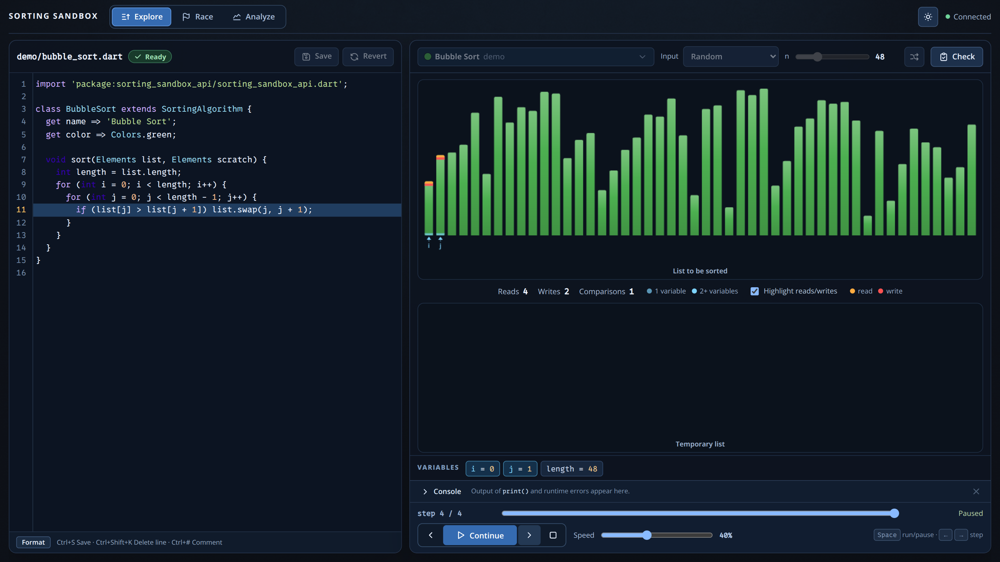

image: sorting-sandbox.webp

# Sortieralgorithmen unterrichten

Mit der Sorting Sandbox entwickeln Lernende Sortierverfahren in Dart und
untersuchen Schritt für Schritt Vergleiche, Vertauschungen, Stabilität und Laufzeiten.

## Sorting Sandbox

Die Lernenden schreiben eigene Sortieralgorithmen. Während der Ausführung
werden die aktuelle Codezeile, Variablen und Zugriffe auf die Liste angezeigt.
Unter **Race** können Verfahren auf derselben Eingabe gegeneinander antreten;
**Analyze** vergleicht die Operationen bei wachsenden Eingabegrößen.

<!-- tutorial-screenshot
terminal-open
terminal-run: cd ~ && git clone -q https://github.com/specht/sorting-sandbox.git && cd sorting-sandbox && git checkout -q 0dccab70b46a2c771091ddce72dac183fc531a79
terminal-wait-for-prompt
terminal-run: cd ~/sorting-sandbox && mkdir -p algorithms && ./new-algorithm demo
terminal-wait-for-prompt
terminal-run: cd ~/sorting-sandbox && (nohup ./run --port 18080 --no-open > /tmp/sorting-sandbox.log 2>&1 < /dev/null &)
terminal-wait-for-prompt
preview-port: 18080
tab: preview
wait-for-text: Explore
viewport: 1600x900
-->

## Einsatz im Unterricht

Als Einstieg bietet sich ein einfacher **Bubble Sort** an. Anschließend können
die Lernenden den Algorithmus verbessern, einen zweiten Algorithmus schreiben
und den Aufwand anhand der gemessenen Lese-, Schreib- und Vergleichsoperationen
diskutieren. Besonders ergiebig ist der Vergleich bereits sortierter,
umgekehrt sortierter und zufälliger Eingaben.

Die Software ist frei verfügbar. Für die Zusammenarbeit in der Klasse
kann ein zusätzliches Git-Repository im Unterordner `algorithms` eingerichtet
werden. Die Bedienung und Einrichtung sind in der Projektbeschreibung erklärt.

[Quelltext, Installation und Anleitung](https://github.com/specht/sorting-sandbox)
