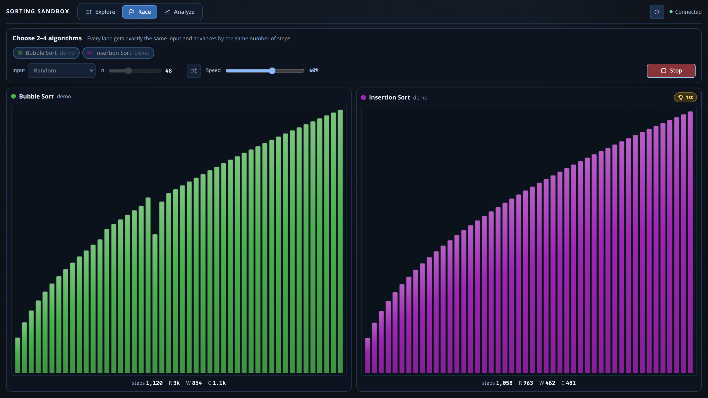
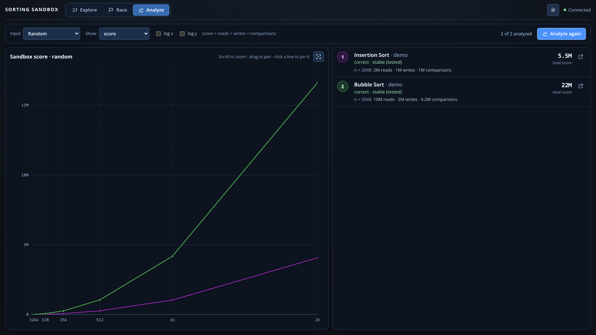

<div class='meta'>
image: sorting-sandbox.webp
</div>

# Sortieralgorithmen unterrichten

<p class='abstract'>
In der Sorting Sandbox schreiben Lernende echte Sortieralgorithmen in Dart,
beobachten jeden Schritt und untersuchen Korrektheit, Stabilität und Aufwand
mit denselben Eingaben.
</p>

**Werkzeug:** [Sorting Sandbox](https://github.com/specht/sorting-sandbox) ·
**Dokumentierter Stand:** [`0dccab70b46a2c771091ddce72dac183fc531a79`](https://github.com/specht/sorting-sandbox/commit/0dccab70b46a2c771091ddce72dac183fc531a79)
(12.10.2026). Die folgenden Screenshots starten genau diesen Commit; bei
späteren Änderungen sollten Funktionen und Bildrezepte überprüft werden.

## 1. Explore: Aus Quelltext wird ein Ablauf

Im Browser bearbeiten die Lernenden eine normale Dart-Klasse. Beim Ausführen
markiert die Sandbox die **aktuelle Quelltextzeile**, lokale Variablen und
Zeiger auf Listenelemente. Lesen, Schreiben und Vergleichen werden getrennt
gezählt; Zugriffe können farbig hervorgehoben werden. Über **Step**, **Run** und
die Zeitleiste lassen sich auch frühere Zustände untersuchen.

<!-- screenshot-code: insertion-sort -->
```dart
import 'package:sorting_sandbox_api/sorting_sandbox_api.dart';

class InsertionSort extends SortingAlgorithm {
  String get name => 'Insertion Sort';
  String get color => Colors.purple;

  void sort(Elements list, Elements scratch) {
    for (int i = 1; i < list.length; i++) {
      final current = list[i];
      int j = i;
      while (j > 0 && list[j - 1] > current) {
        list[j] = list[j - 1];
        j--;
      }
      list[j] = current;
    }
  }
}
```

<!-- tutorial-screenshot
terminal-open
terminal-run: cd /workspace && git clone -q https://github.com/specht/sorting-sandbox.git && cd sorting-sandbox && git checkout -q 0dccab70b46a2c771091ddce72dac183fc531a79
terminal-wait-for-prompt
terminal-run: cd /workspace/sorting-sandbox && mkdir -p algorithms && ./new-algorithm demo
terminal-wait-for-prompt
write-file: sorting-sandbox/algorithms/demo/insertion_sort.dart <- previous-code (insertion-sort)
terminal-run: cd /workspace/sorting-sandbox && (nohup ./run --port 18080 --no-open > /tmp/sorting-sandbox.log 2>&1 < /dev/null &)
terminal-wait-for-prompt
preview-port: 18080
tab: preview
viewport: 1600x900
wait-for-text: Bubble Sort
click: selector:#show-access
click: selector:#step-next
sleep: 2
click: selector:#step-next
click: selector:#step-next
click: selector:#step-next
click: selector:#step-next
-->


**Unterrichtsimpuls:** Vor dem nächsten Schritt vorhersagen, welcher Vergleich
stattfindet und ob vertauscht wird. Anschließend untersuchen, ob die äußere und
die innere Schleife stets vollständig durchlaufen werden müssen.

## 2. Race: Zwei Verfahren, dieselbe Eingabe

In **Race** starten zwei bis vier Algorithmen mit identischen Listen. Die
Darstellung macht sichtbar, dass gleicher Auftrag nicht gleiche Arbeit bedeutet.
Das folgende Rennen verwendet den vorgegebenen Bubble Sort und einen eigens
für die Screenshots angelegten, tatsächlich implementierten Insertion Sort.

<!-- tutorial-screenshot
tab: preview
viewport: 1600x900
click: selector:#tab-race
wait-for-text: Insertion Sort
click: selector:#race-start
sleep: 3
-->


**Unterrichtsimpuls:** Vor einem Rennen eine begründete Prognose abgeben und
danach die Resultate mit bereits sortierten, umgekehrt sortierten und zufälligen
Eingaben vergleichen. Ein Rennen ist eine **Visualisierung von Arbeitsschritten**,
keine belastbare Messung der Laufzeit auf echter Hardware.

## 3. Analyze: Aufwand und Stabilität untersuchen

**Analyze** führt die Verfahren für wachsende Eingaben aus und vergleicht
Lese-, Schreib- und Vergleichsoperationen. Neben dem absoluten Aufwand sind
Normierungen wie Aufwand pro `n`, `n log n` oder `n²` verfügbar. **Check** prüft
zusätzlich viele Eingaben und meldet Gegenbeispiele für falsche Ergebnisse
oder fehlende Stabilität. Ein erfolgreicher Stabilitätstest ist kein formaler
Beweis.

<!-- tutorial-screenshot
tab: preview
viewport: 1600x900
click: selector:#tab-analyze
click: selector:#analyze-run
wait-for-text: 2 of 2 analyzed
-->


**Unterrichtsimpuls:** Aus den Messwerten eine Wachstumsvermutung entwickeln,
mit `n²` normieren und diskutieren, inwiefern der gemessene **Sandbox-Score**
(R+W+C) nur ein vereinfachtes Kostenmodell ist.

## Vorschlag für eine Unterrichtsreihe

1. Bubble Sort lesen, schrittweise erklären und die Schleifen optimieren.
2. Insertion Sort oder Selection Sort selbst entwickeln und mit **Check** prüfen.
3. Verfahren im **Race** vergleichen und Hypothesen für verschiedene Eingaben bilden.
4. Mit **Analyze** Messungen auswerten; Korrektheit, Stabilität und Laufzeit
   als unterschiedliche Bewertungskriterien festhalten.

Die Klasse arbeitet in einem **separaten Repository** unter `algorithms/`;
die App selbst bleibt davon unabhängig. Quelltext lässt sich direkt im Browser
bearbeiten, speichern und ohne Neustart neu testen.
[Einrichtung und Arbeitsweise im README](https://github.com/specht/sorting-sandbox/blob/0dccab70b46a2c771091ddce72dac183fc531a79/README.md).
