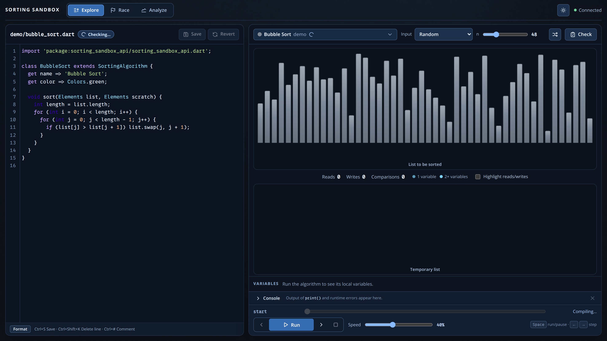
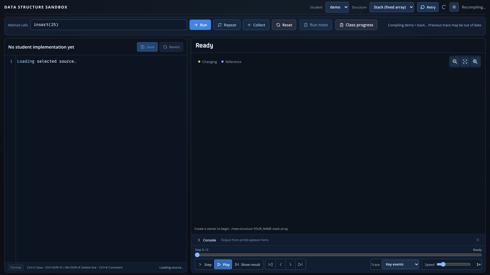
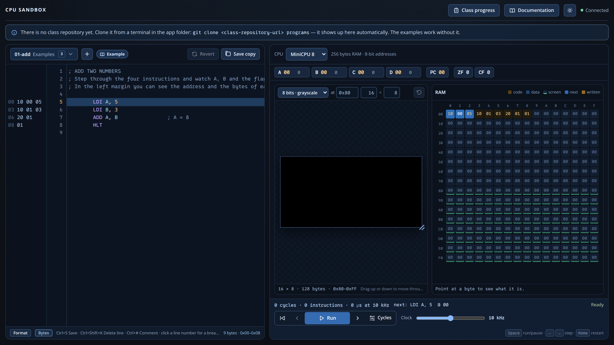

image: ../../static/images/keyboard.png

# Werkzeuge für den Informatikunterricht

Drei interaktive Werkzeuge, die Quelltext und Visualisierung miteinander verbinden.
Die Projekte sind frei verfügbar und können unabhängig vom Workspace betrieben
werden. Zu jedem Werkzeug findest du den Quelltext und Hinweise für den Unterricht.

## Sorting Sandbox

Mit der **Sorting Sandbox** können Lernende Sortierverfahren in Dart entwickeln,
schrittweise ausführen, ihre Zugriffe und Vertauschungen beobachten und mehrere
Verfahren in **Race** und **Analyze** vergleichen. Gut geeignet für die
Einführung in Sortieralgorithmen und die Diskussion von Laufzeiten und Stabilität.

[Repository und Anleitung](https://github.com/specht/sorting-sandbox)

<!-- tutorial-screenshot
# Start the real app in the disposable screenshot Workspace.
terminal-open
terminal-run: cd ~ && git clone -q https://github.com/specht/sorting-sandbox.git && cd sorting-sandbox && git checkout -q 0dccab70b46a2c771091ddce72dac183fc531a79
terminal-wait-for-prompt
terminal-run: cd ~/sorting-sandbox && mkdir -p algorithms && ./new-algorithm demo
terminal-wait-for-prompt
terminal-run: cd ~/sorting-sandbox && (nohup ./run --no-open > /tmp/sorting-sandbox.log 2>&1 < /dev/null &)
terminal-wait-for-prompt
preview-port: 8080
tab: preview
wait-for-text: Explore
viewport: 1600x900
-->

## Data Structures Sandbox

In der **Data Structures Sandbox** programmieren die Lernenden Listen, Stacks,
Queues, Bäume, Heaps und Hash-Tabellen in Dart. Operationen können schrittweise
nachvollzogen und automatisiert getestet werden. Die integrierte
Klassenübersicht eignet sich auch zur Lernstandsbeobachtung.

[Repository und Anleitung](https://github.com/specht/data-structures-sandbox)

<!-- tutorial-screenshot
terminal-run: cd ~ && git clone -q https://github.com/specht/data-structures-sandbox.git && cd data-structures-sandbox && git checkout -q 5c99ad20922f1d7c61ddd87501e8602042f15f23
terminal-wait-for-prompt
terminal-run: cd ~/data-structures-sandbox && mkdir -p structures && ./new-structure demo stack array
terminal-wait-for-prompt
terminal-run: cd ~/data-structures-sandbox && (nohup ./run --no-open > /tmp/data-structures-sandbox.log 2>&1 < /dev/null &)
terminal-wait-for-prompt
preview-port: 8081
tab: preview
wait-for-text: Structure
viewport: 1600x900
-->

## CPU Sandbox

Mit der **CPU Sandbox** untersuchen Lernende einen 8-Bit-Prozessor von innen:
Register, Flags, Speicher, Befehlsschritte und Ein-/Ausgabegeräte werden live
sichtbar. Es gibt drei CPU-Stufen, Assembler- und C-Programmierung und
vorgefertigte Aufgaben mit automatischen Tests.

[Repository und Anleitung](https://github.com/specht/cpu-sandbox)

<!-- tutorial-screenshot
terminal-run: cd ~ && git clone -q https://github.com/specht/cpu-sandbox.git && cd cpu-sandbox && git checkout -q 730060800243aaa5fa1622b6b94567c9857fa1a0
terminal-wait-for-prompt
terminal-run: cd ~/cpu-sandbox && (nohup ./run > /tmp/cpu-sandbox.log 2>&1 < /dev/null &)
terminal-wait-for-prompt
preview-port: 8765
tab: preview
wait-for-text: Examples
viewport: 1600x900
-->

## Im Unterricht einsetzen

Alle drei Projekte laufen lokal über `./run`. Die README-Dateien erklären das
Einrichten der jeweils optionalen bzw. zusätzlichen Klassen-Repositories,
die Arbeitsabläufe und die Bedienung. Für einen ersten Eindruck kannst du die
Repositories ohne Zugangsdaten ansehen; für die Zusammenarbeit mit einer Klasse
brauchst du ein gemeinsames Repository für die Lösungen.
