<div class='meta'>
image: halle.webp
image_alt: "Eine Halle aus Marmor unter einem hohen Satteldach, zwei Reihen Säulen, ganz hinten im hellen Licht eine Statue der Athena"
kind: projekt
topic: hidden
duration: 2 Doppelstunden
reference: [workspace]
template: https://github.com/specht/backrooms-starter.git
template_name: der Backrooms-Vorlage
</div>

# Die Backrooms

<div
    class="autotoc-secondary-trigger"
    data-title="Auf dieser Seite"
    data-levels="h2,h3">
</div>

<p class='abstract'>
Du bist durch eine Wand gefallen. Dahinter liegen die Backrooms: gelbe Tapete, feuchter Teppich, das Summen der Leuchten, Räume ohne Ende. Du kartierst sie in Textdateien, baust eigene Räume mit Türen, Säulen, schrägen Decken und Statuen und siehst zu, wie dein Browser das Licht berechnet, das zwischen den Wänden hin- und herfällt. Am Rechner, mit Rot-Cyan-Brille oder mit einer VR-Brille.
</p>

<div class='found-note'>
<p>Wenn du das hier liest, bist du durchgefallen. Nicht durch eine Prüfung. Durch die Wirklichkeit. Irgendwo hat eine Wand nicht gehalten, was sie versprochen hat, und jetzt bist du hier.</p>
<p>Keine Panik. Der Teppich ist feucht, aber er trägt. Die Leuchten summen, aber sie leuchten. Und du bist nicht der erste Mensch hier: Wir haben angefangen, alles aufzuschreiben.</p>
<cite>Erste Seite des Feldhandbuchs der Kartografen</cite>
</div>

<table class='table'>
<tr><th>Level</th><td>0, »Die Lobby«</td></tr>
<tr><th>Überlebensschwierigkeit</th><td>Klasse 1: sicher, stabil, keine Entitäten gesichtet</td></tr>
<tr><th>Ausdehnung</th><td>so groß, wie du es baust</td></tr>
<tr><th>Ausgänge</th><td>keine bekannten. Den Tab zu schließen, soll helfen (unbestätigt).</td></tr>
</table>

Die Backrooms sind eine Legende aus dem Internet. 2019 stellte jemand in einem Forum das Foto eines leeren Büroraums mit gelber Tapete ein, und jemand anderes schrieb dazu: Wer an der falschen Stelle aus der Wirklichkeit »noclippt«, landet hier, in endlosen leeren Räumen. Noclip heißt ein Cheat aus alten Ego-Shootern wie Quake: Mit ihm läuft man durch Wände. Seitdem haben unzählige Leute weitere Levels erfunden, Geschichten geschrieben und Videos gedreht.

Hier baust du deine eigenen Backrooms. Du beschreibst Räume in Textdateien: wo die Wände stehen, wo die Leuchten hängen, wo eine Tür in den nächsten Raum führt. Ein Programm im Browser liest sie, baut daraus ein Bauwerk in 3D und berechnet das Licht: wohin es fällt, wo Schatten liegen und wie es von Wänden, Boden und Decke zurückgeworfen wird. Programmieren musst du dafür nicht. Wer will, findet das ganze Programm im Ordner `engine/` und kann darin herumschrauben.

## Ausrüstung

<div class='found-note'>
<p>Was du brauchst: eine Karte (du hast keine), eine Lampe (es gibt hier genug) und einen Ordner, in den du alles schreibst, was du findest. Den Ordner gibt es schon. Er lag hier, als wir ankamen.</p>
<cite>Feldhandbuch, Seite 2</cite>
</div>

### Die Vorlage klonen

Alles, was du brauchst, steckt in der Backrooms-Vorlage:

_include(workspace#repository-klonen)

Danach liegt die Vorlage in `/workspace/backrooms-starter`:

<!-- tutorial-screenshot
# Klonen wie im Handbuch »Workspace« (oben eingebunden), dann die
# geöffnete Vorlage im Explorer, level.ini im Editor
show-left-sidebar
clone-start: https://github.com/specht/backrooms-starter.git @ 39ee3695a7f01e565bfa14d9f9fee8f6d8728c09
press: Enter
wait-for-input-value: /workspace/
press: Enter
wait-for-text: Would you like to open the repository?
click: Open
wait-for-text: level.ini
open-file: level.ini
sleep: 1
-->

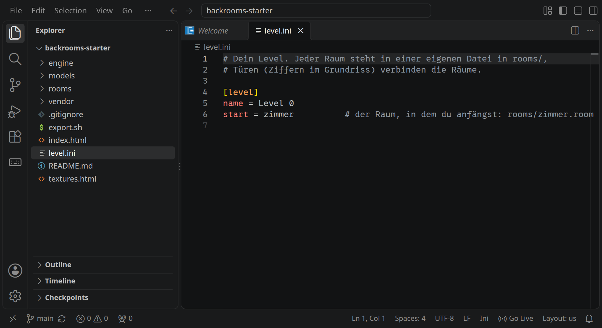

Darin liegen zwei Levels. Deins beginnt klein, in `level.ini` und im Ordner `rooms`: ein Zimmer, ein Gang und zwei farbige Räume. In `lobby` liegt ein ganzes Level zum Ausprobieren; dazu später mehr.

_task(geklont)

### Eintreten

_include(workspace#live-server)

Die Vorschau zeigt `index.html`. Zuerst ist es dunkel, nur feine Linien zeigen die Kanten der Räume. Dann gehen die Leuchten an, eine nach der anderen, die nächsten zuerst, und oben links wächst ein Balken: Das Licht wird berechnet.

<!-- tutorial-screenshot
# Die Vorschau, während das Licht gebacken wird
go-live
tab: preview
viewport: 1024x576
hook: baking
sleep: 2
-->

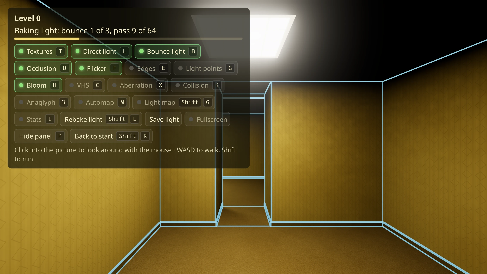

Wie lange das dauert, hängt von der Grafikkarte deines Rechners ab. Ist es fertig, steht dort »Light baked in …«:

<!-- tutorial-screenshot
# fertig gebacken; der Kasten oben links nur im Bild davor, beim Backen
tab: preview
viewport: 1024x576
hook: light
hook: info off
-->

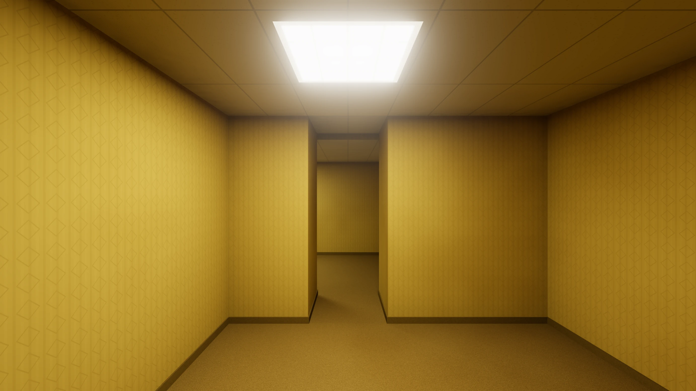

Klick ins Bild, dann siehst du dich mit der Maus um. <kbd>Esc</kbd> gibt die Maus wieder frei.

<table class='table'>
<tr><th>Taste</th><th>Was passiert</th></tr>
<tr><td><kbd>W</kbd> <kbd>A</kbd> <kbd>S</kbd> <kbd>D</kbd></td><td>laufen, mit <kbd>Shift</kbd> rennen</td></tr>
<tr><td><kbd>↑</kbd> <kbd>↓</kbd> <kbd>←</kbd> <kbd>→</kbd></td><td>vor und zurück laufen, nach links und rechts drehen</td></tr>
<tr><td><kbd>M</kbd> oder <kbd>Tab</kbd></td><td>die Automap: das ganze Bauwerk als Drahtgitter</td></tr>
<tr><td><kbd>R</kbd></td><td>zurück zum Anfang</td></tr>
<tr><td><kbd>H</kbd></td><td>den Kasten oben links aus- und wieder einblenden</td></tr>
</table>

Wo du stehst, merkt sich die Adresse der Seite. Lädst du neu, stehst du wieder dort, solange sich der Grundriss nicht geändert hat.

<div class='hint try'>
<strong>Ausprobieren:</strong> Drück <kbd>M</kbd>. Die Automap zeigt jeden Raum in seiner eigenen Farbe und mit seinem Namen, die Leuchten als gelbe Punkte; der rote Pfeil bist du. Zieh mit der Maus, um die Karte zu drehen, mit <kbd>Shift</kbd>, um sie zu verschieben, und zoom mit dem Mausrad. Lauf ein paar Schritte, während sie offen ist, und schau nach unten: Was macht die Karte? <kbd>Esc</kbd> schließt sie.
</div>

<!-- tutorial-screenshot
# die Automap vom Start aus
tab: preview
viewport: 1024x576
hook: key m
hook: wheel 450
hook: info off
-->

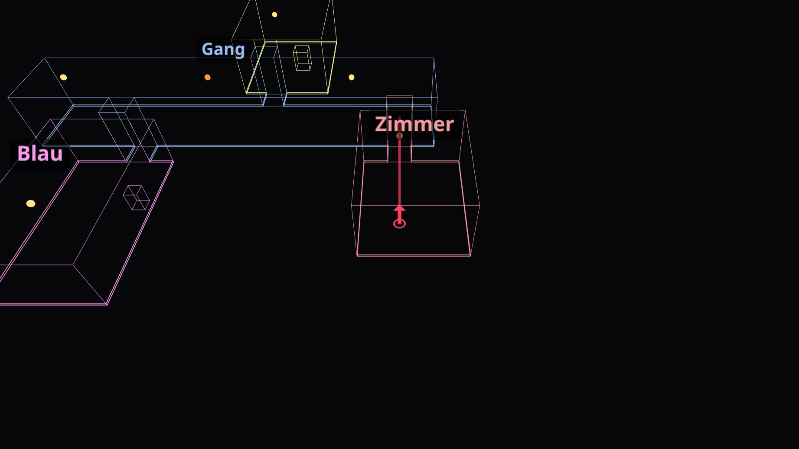

## Kartografie

<div class='found-note'>
<p>Wir kartieren in Feldern. Ein Feld ist ein Meter. Eine Raute ist eine Wand, ein Punkt ist Teppich. Was nicht auf der Karte steht, gibt es nicht. Das ist die einzige Regel, auf die man sich hier verlassen kann.</p>
<cite>Notiz, mit Kugelschreiber auf die Tapete geschrieben</cite>
</div>

### Ein Raum

Öffne `rooms/zimmer.room`. Das ist der Raum, in dem du aufgewacht bist:

```room
# Ein kleines Zimmer. Du weißt nicht, wie du hierhergekommen bist.

[room]
baseboard = 0.08, #86763c
name = Zimmer
height = 2.6
look = east              # am @ schaust du zur Tür

[map]
#######
#.....#
#.@.L.1
#.....#
#.....#
#######

[L]
light = #ffe7b8
power = 0.9

[1]
door = gang 1
```

Eine Raumdatei besteht aus Abschnitten in eckigen Klammern. In `[room]` steht, wie der Raum aussieht: sein Name, wie hoch die Decke ist (2,6 m), eine dunkle Sockelleiste unten an den Wänden, 8 cm hoch, und wohin du am Anfang schaust. Ein `#` mit einem Leerzeichen davor und danach beginnt einen Kommentar; eine Farbe wie `#86763c` hat kein Leerzeichen dahinter.

In `[map]` steht der Grundriss, von oben gesehen, oben ist Norden. Hier zählt jedes Zeichen, Kommentare gibt es darin nicht:

<table class='table'>
<tr><th>Zeichen</th><th>Bedeutung</th></tr>
<tr><td><code>#</code></td><td>Wand</td></tr>
<tr><td><code>.</code></td><td>Boden</td></tr>
<tr><td><code>@</code></td><td>hier fängst du an, nur einmal im ganzen Level</td></tr>
<tr><td>Leerzeichen</td><td>nichts, außerhalb des Raums</td></tr>
<tr><td>ein Buchstabe</td><td>eine Leuchte, ein Block oder eine Statue; was es ist, steht im Abschnitt mit diesem Buchstaben</td></tr>
<tr><td>eine Ziffer</td><td>eine Tür in einen anderen Raum, beschrieben im Abschnitt mit dieser Ziffer</td></tr>
</table>

`[L]` sagt, dass das `L` eine Leuchte ist, mit warmem, gelblichem Licht. `[1]` macht aus der `1` am rechten Rand eine Tür.

### Türen

Eine Tür ist ein Feld, das zwei Räumen gehört. `door = gang 1` heißt: Diese `1` ist dasselbe Feld wie die `1` in `rooms/gang.room`. Das Programm legt die beiden Räume so nebeneinander, dass die Türen aufeinanderliegen. Ihre Wände dürfen sich dabei überdecken, ihre Böden nicht.

So entsteht aus vielen kleinen Dateien ein Bauwerk. `level.ini` nennt nur den ersten Raum (`start = zimmer`). Das Programm liest ihn, dann jeden Raum, zu dem eine seiner Türen führt, dann deren Nachbarn, bis es keine neuen Türen mehr gibt. Eine Datei, zu der keine Tür führt, liest es gar nicht.

_task(tuer)

## Ein eigener Raum

<div class='found-note'>
<p>Gestern war im Gang neben dem Zimmer eine Wand. Heute ist dort eine Öffnung. Ich habe nachgezählt: Das Feld ist dasselbe. Die Wand ist weg. Dahinter ist eine Kammer, die es gestern nicht gab.</p>
<cite>Seite aus einem durchnässten Notizbuch</cite>
</div>

### Eine Kammer anbauen

Leg im Ordner `rooms` eine neue Datei `kammer.room` an:

```room
# Eine Kammer, die gestern noch nicht da war.

[room]
name = Kammer
height = 2.2
wallpaper = #9a8a4c

[map]
#####
5...#
#.L.#
#...#
#####

[L]
light = #ffb070
power = 0.9
flicker = 1
```

Die Leuchte ist orange und schwächer als die anderen, und mit `flicker = 1` flackert sie ab und zu. Die Tapete ist eine Farbe als Hexadezimalzahl wie in CSS: Rot, Grün und Blau, je zwei Ziffern.

Noch führt keine Tür in die Kammer, also gibt es sie nicht. Öffne `rooms/gang.room`. Weit unten im Grundriss ist links die `1`, die Tür zum Zimmer. Ersetze in dieser Zeile das `#` am rechten Rand durch eine `5`:

```room
~ #...#
1...5
~ #...#
```

und schreib ganz unten in die Datei, wohin sie führt:

```room
[5]
door = kammer 5
```

Speichere beide Dateien und lade die Vorschau neu. Die Kammer liegt östlich vom Gang, gegenüber der Tür zum Zimmer. In `kammer.room` steht kein Abschnitt `[5]`: Es genügt, wenn einer der beiden Räume die Tür beschreibt.

<!-- tutorial-screenshot
# Die Kammer: die Räume wie auf der Seite, dann aus ihrer Ecke zur Tür
write-file: rooms/zimmer.room <- file:stufen/zimmer.room
write-file: rooms/gang.room <- file:stufen/gang.room
write-file: rooms/kammer.room <- file:stufen/kammer.room
tab: preview
viewport: 1024x576
hook: open view=16.00,19.00,56,0
hook: light
hook: info off
-->

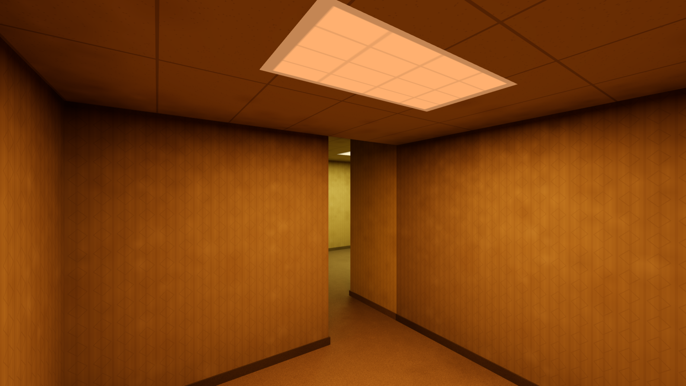

Stimmt etwas nicht, steht oben links in Rot, in welcher Datei und in welcher Zeile das Programm hängen geblieben ist, auf Englisch, zum Beispiel `rooms/kammer.room: room kammer overlaps room rot`. Das heißt: Der Raum läge auf dem Boden eines anderen. Schieb die Tür an eine andere Stelle oder mach den Raum kleiner.

## Ein Saal, Schritt für Schritt

<div class='found-note'>
<p>Hinter der Kammer ist noch eine Tür. Dahinter: ein Saal, leer und hoch. Jedes Mal, wenn ich zurückkomme, steht etwas mehr darin.</p>
<cite>Seite aus einem durchnässten Notizbuch, andere Handschrift</cite>
</div>

Hinter der Kammer baust du einen Saal, Schritt für Schritt: erst den Grundriss, dann eine hohe Decke, Säulen, farbiges Licht, eine Statue und zum Schluss Marmor. Nach jedem Schritt speicherst du und lädst die Vorschau neu.

### Der Grundriss

Gib der Kammer in `rooms/kammer.room` eine zweite Tür, an der rechten Wand, in der Zeile der ersten:

```room
~ #####
5...6
~ #.L.#
```

und schreib unten dazu, wohin sie führt:

```room
[6]
door = saal 1
```

Dann leg `rooms/saal.room` an:

```room
# Ein Saal hinter der Kammer.

[room]
name = Saal
height = 3

[map]
#############
#...........#
#...L...L...#
1...........#
#...........#
#...........#
#...L...L...#
#...........#
#############

[L]
light = #fff3cf
```

Ein Saal, 11 m lang und 7 m breit, mit vier Leuchten in zwei Reihen. Weil `[L]` nur einmal beschrieben ist, sind alle vier gleich.

<!-- tutorial-screenshot
write-file: rooms/kammer.room <- file:stufen/kammer-2.room
write-file: rooms/saal.room <- file:stufen/saal-1.room
tab: preview
viewport: 1024x576
hook: open view=18.00,17.00,-90,8
hook: light
hook: info off
-->

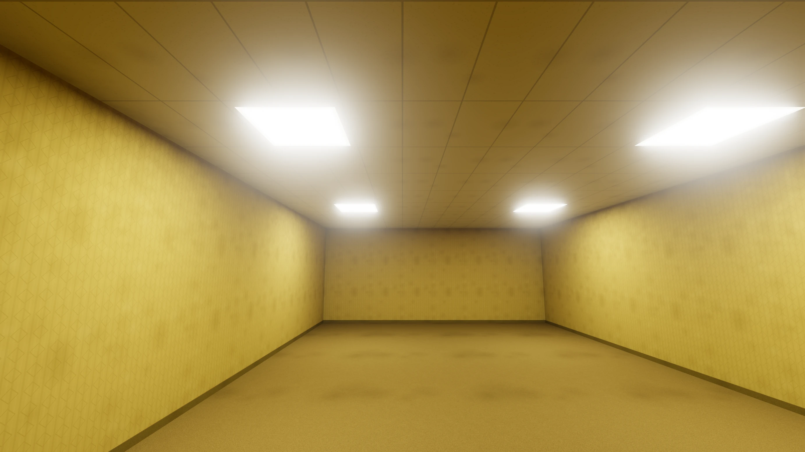

### Eine hohe Decke

Zwei Höhen machen die Decke schräg, `slope` sagt, wie. `gable` ist ein Satteldach: an den Wänden 3 m, in der Mitte 7 m hoch, der First läuft an der längeren Seite entlang. Die Leuchten liegen dann so schräg wie die Decke über ihnen. Weil sie jetzt höher hängen, bekommen sie mit `power` mehr Kraft:

```room
~ [room]
~ name = Saal
height = 3, 7
slope = gable
```

```room
~ [L]
~ light = #fff3cf
power = 1.6
```

<!-- tutorial-screenshot
write-file: rooms/saal.room <- file:stufen/saal-2.room
tab: preview
viewport: 1024x576
hook: open view=18.00,17.00,-90,8
hook: light
hook: info off
-->

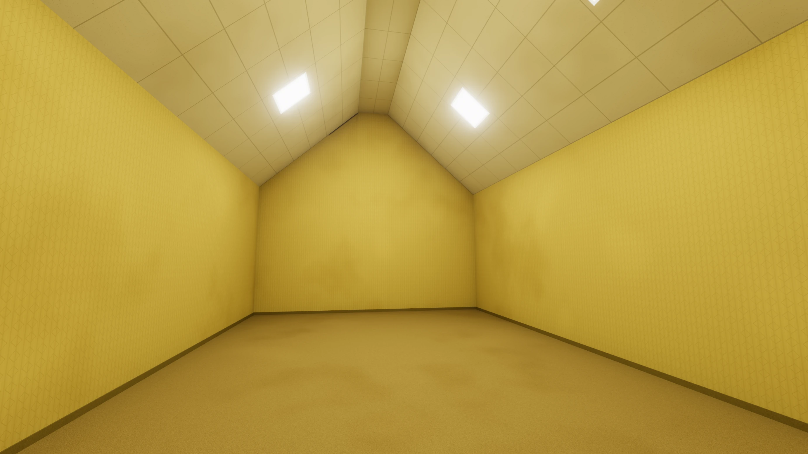

Eine Decke kann auch nur in eine Richtung ansteigen, wie ein Pultdach. Mit `slope = east` statt `gable` wird die Decke des Saals nach Osten immer höher, also nach rechts im Grundriss:

```room
~ height = 3, 7
slope = east
```

An der Westwand ist sie dann 3 m hoch, an der Ostwand 7 m. Statt `east` geht auch `north`, `south` oder `west`. Auch hier liegen die Leuchten so schräg wie die Decke. So sähe der Saal damit aus, von der Seite; für die nächsten Schritte bleibt er beim Satteldach:

<!-- tutorial-scope -->
<!-- tutorial-screenshot
write-file: rooms/saal.room <- file:stufen/saal-pult.room
tab: preview
viewport: 1024x576
hook: open view=23.00,15.20,180,14
hook: light
hook: info off
-->

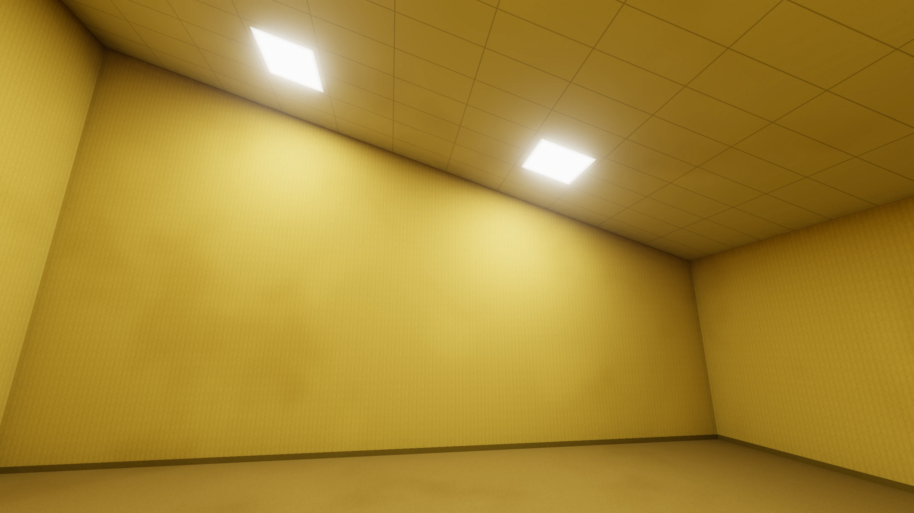

<!-- /tutorial-scope -->

### Säulen

Ein Buchstabe im Grundriss kann auch ein Block sein. Vier Säulen, je zwei an den langen Seiten, zwischen den Leuchten:

```room
~ #...........#
#...L.S.L.S.#
~ 1...........#
~ #...........#
~ #...........#
#...L.S.L.S.#
~ #...........#
```

```room
[S]
block = 0.7, 7, 0.7      # höher als die Decke: Die Säule verschwindet in ihr
```

`block = 0.7, 7, 0.7` ist 0,7 m breit, 7 m hoch und 0,7 m tief, mitten auf seinem Feld. Ist ein Block höher als die Decke, verschwindet er in ihr. `block = 1` füllt das ganze Feld einen Meter hoch, eine Kiste. Mit `base = 2` schwebt ein Block zwei Meter über dem Boden, mit `color = #6a5a3a` bekommt er eine eigene Farbe; ohne sieht er aus wie die Wände seines Raums. Durch Blöcke läuft man nicht hindurch, und sie werfen Schatten.

<!-- tutorial-screenshot
write-file: rooms/saal.room <- file:stufen/saal-3.room
tab: preview
viewport: 1024x576
hook: open view=18.00,17.00,-90,8
hook: light
hook: info off
-->

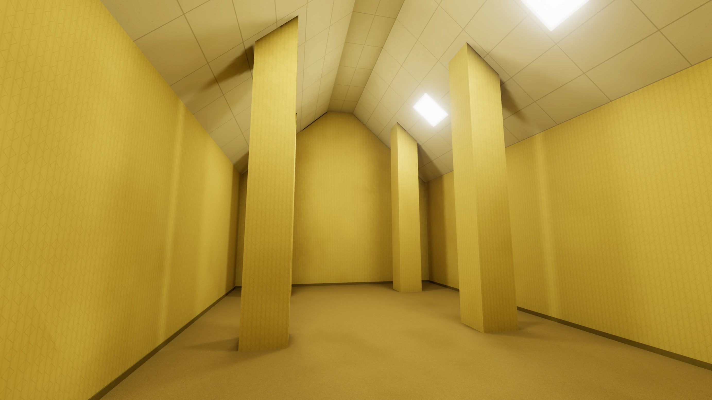

### Farbiges Licht

Die Leuchte hinten rechts soll rot leuchten. Sie bekommt einen eigenen Buchstaben:

```room
~ #...........#
#...L.S.R.S.#
~ #...........#
```

```room
[R]
light = #ff3020
power = 3
size = 1.2, 1.2
```

`light` ist die Farbe, `size` die Größe in Metern: Eine größere Leuchte wirft weichere Schatten. Mit `flicker = 1` flackert eine Leuchte ab und zu, wie die in der Kammer. So sähe der Saal mit der roten Leuchte aus; für die nächsten Schritte bleiben alle vier weiß: Das rote Licht fällt auf Wände, Boden und Säulen und wird von ihnen zurückgeworfen, rot gefärbt.

<!-- tutorial-scope -->
<!-- tutorial-screenshot
write-file: rooms/saal.room <- file:stufen/saal-4.room
tab: preview
viewport: 1024x576
hook: open view=18.00,17.00,-90,8
hook: light
hook: info off
-->

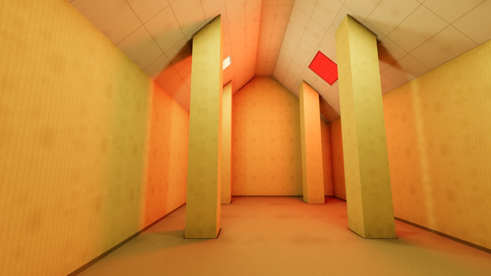

<!-- /tutorial-scope -->

### Eine Statue

<div class='found-note'>
<p>In der großen Halle steht eine Frau aus Stein, sechs Meter hoch. Sie schaut zum Eingang. Ich bin dreimal um sie herumgegangen. Sie schaut immer zum Eingang.</p>
<cite>Letzter Eintrag einer Kartografin, Halle</cite>
</div>

In die Mitte des Saals kommt Athena, auf einem Sockel:

```room
~ 1...........#
#.....M.....#
~ #...........#
```

```room
[M]
model = statues/athena.glb
height = 2.2
rotation = 270
material = marble
pedestal = 0.9, 0.8, 0.9
```

Eine Statue ist ein 3D-Modell im Format GLB. `height` macht sie so hoch wie angegeben, `rotation` dreht sie in Grad um ihre senkrechte Achse (hier zur Tür), `material = marble` macht sie aus Marmor statt aus den Farben des Modells, und `pedestal` stellt sie auf einen Sockel: 0,9 m breit, 0,8 m hoch, 0,9 m tief. Auch Statuen werfen Schatten und bekommen Bounce-Licht, und wo eine Statue sich selbst verdeckt, ist es auf ihr dunkler.

<!-- tutorial-screenshot
write-file: rooms/saal.room <- file:stufen/saal-5.room
tab: preview
viewport: 1024x576
hook: open view=18.00,17.00,-90,8
hook: light
hook: info off
-->

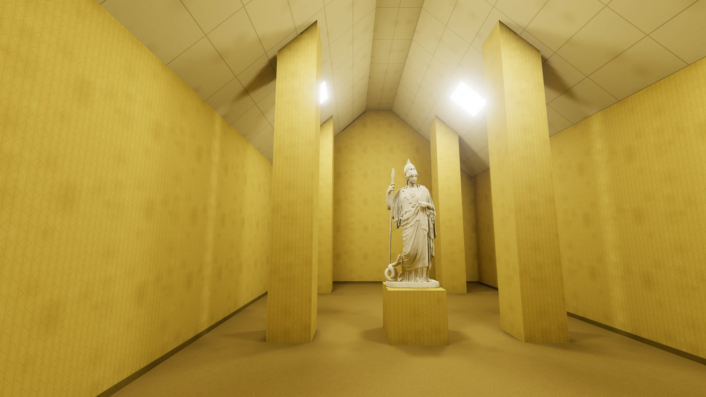

Athena ist der 3D-Scan eines Gipsabgusses einer antiken Statue, aus dem [Statens Museum for Kunst](https://open.smk.dk/artwork/image/KAS255) in Kopenhagen, gemeinfrei. Eigene Modelle lädst du als GLB-Datei herunter und legst sie in den Ordner `statues`. Nimm nur Modelle, deren Lizenz das erlaubt, etwa CC0, und schreib in einem Kommentar neben `model =` dazu, woher sie kommen. Ohne `material = marble` behält ein Modell seine eigenen Farben. Modelle unter CC0 findest du zum Beispiel hier:

- [Kenney](https://kenney.nl/assets): Pakete von Spielfiguren und Möbeln, etwa das [Furniture Kit](https://kenney.nl/assets/furniture-kit) mit Schreibtischen und Bürostühlen; die GLB-Dateien liegen im Paket im Ordner `Models/GLTF format`.
- [Polygonal Mind](https://github.com/ToxSam/cc0-models-Polygonal-Mind): Hunderte Modelle aus Spielwelten, schon als GLB.

### Marmor

Zum Schluss Wände und Boden aus Marmor:

```room
~ height = 3, 7
~ slope = gable
walls = marble
floor = marble
```

<!-- tutorial-screenshot
write-file: rooms/saal.room <- file:stufen/saal-6.room
tab: preview
viewport: 1024x576
hook: open view=18.00,17.00,-90,8
hook: light
hook: info off
-->

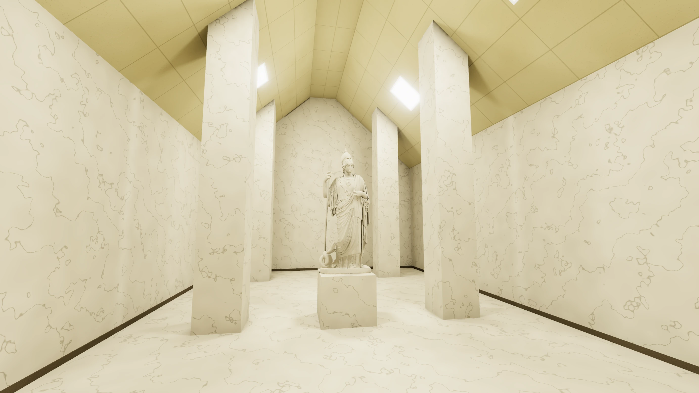

### Andere Wände und Böden

Marmor ist nur eine Möglichkeit. `walls` kennt sechs Arten, `floor` fünf, jede in der Farbe aus `wallpaper` (Wände) und `carpet` (Boden), Marmor in seiner eigenen:

<table class='table'>
<tr><th>Wert</th><th>Wände (<code>walls</code>)</th><th>Boden (<code>floor</code>)</th></tr>
<tr><td><code>wallpaper</code>, <code>carpet</code></td><td>Tapete mit Rautenmuster</td><td>Teppich</td></tr>
<tr><td><code>marble</code></td><td>Marmor</td><td>Marmor</td></tr>
<tr><td><code>wood</code></td><td>senkrechte Bretter</td><td>Dielen</td></tr>
<tr><td><code>tiles</code></td><td>Fliesen</td><td>Fliesen</td></tr>
<tr><td><code>velvet</code></td><td>Samt in senkrechten Streifen, wie im Kino</td><td></td></tr>
<tr><td><code>plain</code></td><td>einfarbig</td><td>einfarbig</td></tr>
</table>

Für Fliesen wie in einem Schwimmbad zum Beispiel `walls = tiles`, `floor = tiles`, `wallpaper = #e6ecef` und `carpet = #c4ced3`, dazu eine helle Decke mit `ceiling = #e8ecee`. So sieht der leere Saal vom Anfang mit jeder Art aus:

<!-- tutorial-scope -->
<div class='gallery columns-2'>
<figure>

<figcaption><code>wallpaper</code> und <code>carpet</code></figcaption>
</figure>
<figure>
<!-- tutorial-screenshot
write-file: rooms/saal.room <- file:stufen/saal-marmor.room
tab: preview
viewport: 1024x576
hook: open view=18.00,17.00,-90,8
hook: light
hook: info off
-->
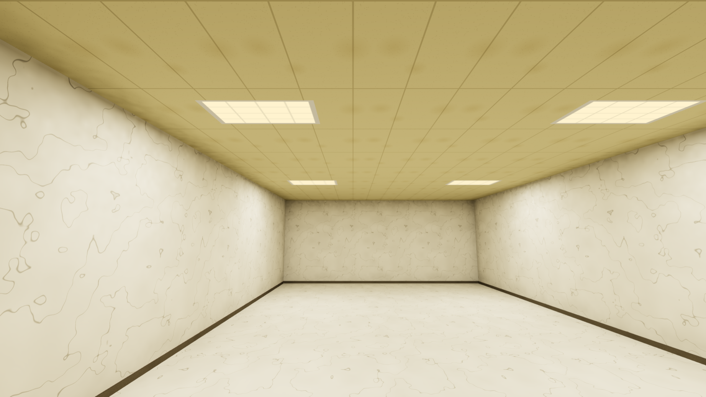
<figcaption><code>marble</code></figcaption>
</figure>
<figure>
<!-- tutorial-screenshot
write-file: rooms/saal.room <- file:stufen/saal-holz.room
tab: preview
viewport: 1024x576
hook: open view=18.00,17.00,-90,8
hook: light
hook: info off
-->
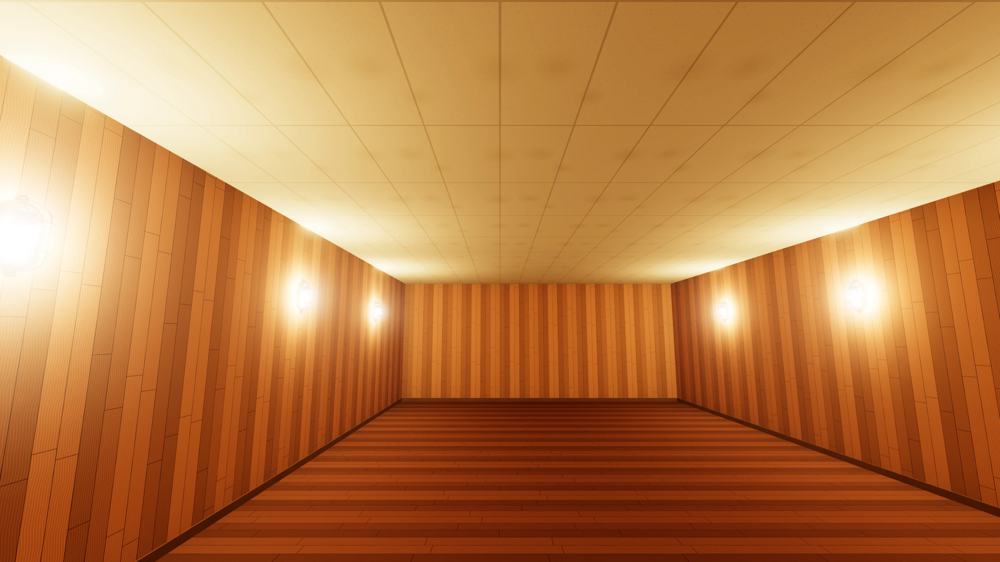
<figcaption><code>wood</code></figcaption>
</figure>
<figure>
<!-- tutorial-screenshot
write-file: rooms/saal.room <- file:stufen/saal-fliesen.room
tab: preview
viewport: 1024x576
hook: open view=18.00,17.00,-90,8
hook: light
hook: info off
-->
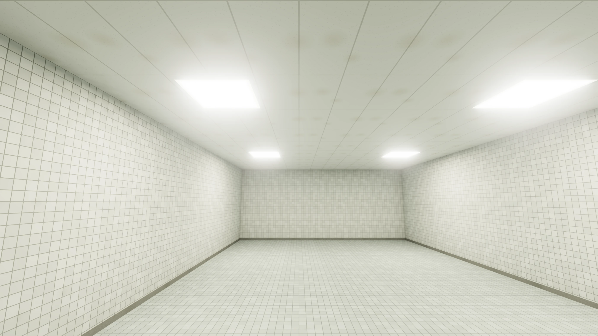
<figcaption><code>tiles</code></figcaption>
</figure>
<figure>
<!-- tutorial-screenshot
write-file: rooms/saal.room <- file:stufen/saal-einfarbig.room
tab: preview
viewport: 1024x576
hook: open view=18.00,17.00,-90,8
hook: light
hook: info off
-->
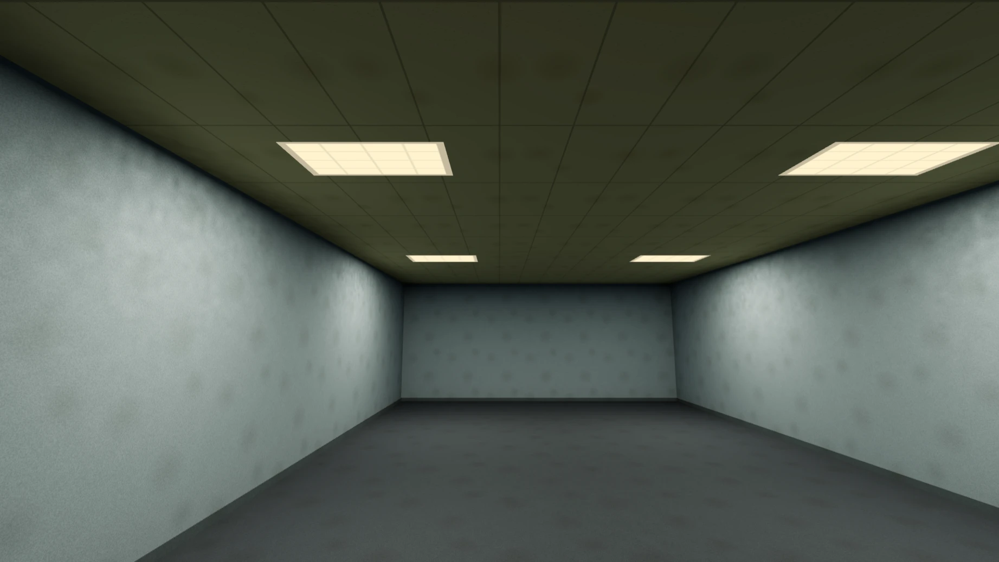
<figcaption><code>plain</code></figcaption>
</figure>
<figure>
<!-- tutorial-screenshot
write-file: rooms/saal.room <- file:stufen/saal-samt.room
tab: preview
viewport: 1024x576
hook: open view=18.00,17.00,-90,8
hook: light
hook: info off
-->
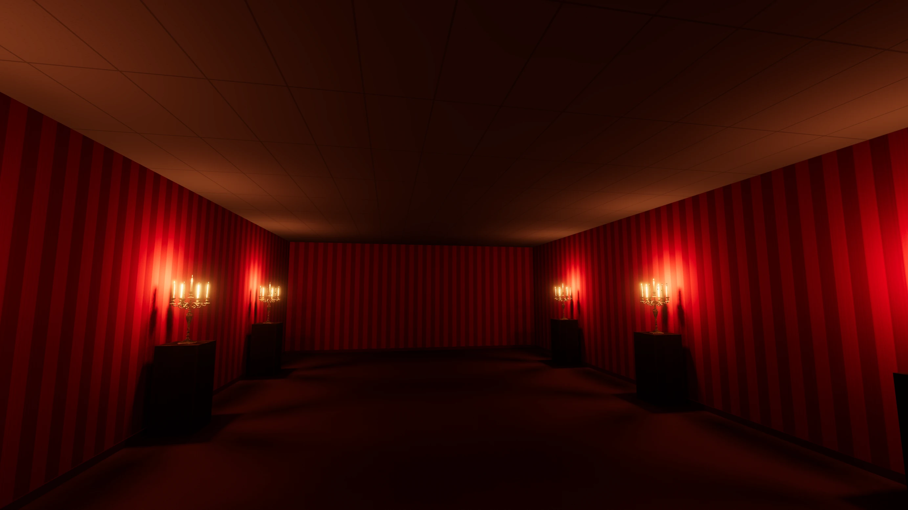
<figcaption><code>velvet</code></figcaption>
</figure>
</div>
<!-- /tutorial-scope -->

## Dein eigener Raum

Jetzt bist du dran: Bau einen Raum nach deiner Idee und schließ ihn mit einer Tür an. Was du in `[room]` einstellen kannst:

<table class='table'>
<tr><th>Eintrag</th><th>Bedeutung</th></tr>
<tr><td><code>height</code></td><td>Deckenhöhe in Metern; zwei Zahlen für eine schräge Decke</td></tr>
<tr><td><code>slope</code></td><td><code>flat</code>, <code>north</code>, <code>east</code>, <code>south</code>, <code>west</code> oder <code>gable</code></td></tr>
<tr><td><code>walls</code></td><td><code>wallpaper</code> (Tapete), <code>marble</code> (Marmor), <code>wood</code> (Holz), <code>tiles</code> (Fliesen), <code>velvet</code> (Samt) oder <code>plain</code> (einfarbig)</td></tr>
<tr><td><code>floor</code></td><td><code>carpet</code> (Teppich), <code>marble</code>, <code>wood</code>, <code>tiles</code> oder <code>plain</code></td></tr>
<tr><td><code>wallpaper</code>, <code>carpet</code>, <code>ceiling</code></td><td>die Farben von Wänden, Boden und Decke</td></tr>
<tr><td><code>baseboard</code></td><td>die Sockelleiste: Höhe und Farbe; ohne Angabe 8 cm und halb so hell wie die Tapete, <code>none</code>: keine</td></tr>
<tr><td><code>look</code></td><td>wohin du am <code>@</code> schaust: <code>north</code>, <code>east</code>, <code>south</code>, <code>west</code> oder Grad</td></tr>
</table>

Alle Einträge stehen in der `README.md` der Vorlage. Der Dateiname ist der Name des Raums, den eine Tür nennt: nur Kleinbuchstaben, Ziffern, `-` und `_`.

_task(eigener-raum)

## Licht

<div class='found-note'>
<p>Die Leuchten gehen nie aus. Ich habe versucht, eine zu erreichen, um sie abzuschrauben. Sie ist warm. Nicht heiß, warm. Wie etwas, das atmet.</p>
<p>Seltsam ist die Decke. Die Leuchten hängen direkt darunter und strahlen nach unten, und trotzdem ist die Decke hell.</p>
<cite>Funkspruch, Ende fehlt</cite>
</div>

### Leuchten

Eine Leuchte hängt knapp unter der Decke, mitten über ihrem Feld, unter einer schrägen Decke so schräg wie sie:

<table class='table'>
<tr><th>Eintrag</th><th>Bedeutung</th></tr>
<tr><td><code>light</code></td><td>ihre Farbe, zum Beispiel <code>#fff3cf</code></td></tr>
<tr><td><code>power</code></td><td>wie hell sie ist, 1.0 ohne Angabe</td></tr>
<tr><td><code>size</code></td><td>Breite und Länge in Metern, ohne Angabe <code>0.6, 1.2</code></td></tr>
<tr><td><code>flicker</code></td><td><code>1</code>: Sie flackert ab und zu</td></tr>
</table>

Farbiges Licht färbt alles, was es trifft, auch über die Tür hinaus in den Nachbarraum: Im Gang siehst du, wie rotes und blaues Licht aus zwei Türen fällt.

### Was das Programm rechnet

Viele Spiele rechnen das Licht für jedes Bild neu, 60-mal in der Sekunde, weil sich dort Dinge bewegen, und müssen dafür stark vereinfachen. Hier bewegt sich nur du, die Leuchten bleiben, wo sie sind. Darum rechnet das Programm das Licht einmal aus, wenn das Level lädt, und klebt es dann wie eine zweite Tapete auf jede Fläche. Diese Tapete aus Licht heißt **Lightmap**, und das Ausrechnen nennt man **Backen**.

Die Lightmap hat auf jedem Meter Wand, Boden und Decke 16 Punkte in jeder Richtung, alle 6,25 cm einen. Für jeden Punkt rechnet die Grafikkarte aus, wie hell es dort ist.

_task(lichtpunkte)

**Direktes Licht.** Für jeden Punkt nimmt das Programm einen zufälligen Punkt auf jeder Leuchte und schickt einen Strahl dorthin. Steht etwas im Weg, eine Wand oder eine Säule, kommt von dieser Leuchte nichts an. Sonst kommt Licht an, umso weniger, je weiter die Leuchte weg ist (doppelt so weit: ein Viertel) und je schräger es auf die Fläche fällt. Das wiederholt es 64-mal, jedes Mal mit einem anderen Punkt auf der Leuchte, und nimmt den Durchschnitt. Ein Punkt, der eine Leuchte nur halb sieht, ist in etwa der Hälfte der Durchgänge beleuchtet: Er liegt im **Halbschatten**.

**Bounce-Licht.** Jede Fläche wirft einen Teil des Lichts zurück, das auf sie fällt, in ihrer eigenen Farbe: eine gelbe Tapete gelbes Licht. Ist das direkte Licht fertig, schickt das Programm von jedem Punkt Strahlen in zufällige Richtungen und schaut, wie hell die Flächen sind, die sie treffen. Was dabei herauskommt, ist das Licht, das einmal zurückgeworfen wurde, ein **Bounce**. Das Ganze dreimal: Beim zweiten Bounce werfen die Flächen auch das Licht des ersten zurück und so weiter. Darum steht beim Backen »bounce 1 of 3«.

**Kontaktschatten.** Wo zwei Flächen aneinanderstoßen, in Ecken, an der Sockelleiste oder unter einem Block, kommt von vielen Seiten kein Bounce-Licht, weil die andere Fläche im Weg ist. Kurze Strahlen prüfen für jeden Punkt, wie viel Platz um ihn herum ist, und dunkeln das Bounce-Licht dort ab. Auf Englisch heißt das **Ambient Occlusion**.

### Die Teile einzeln ansehen

Oben links steht für jeden Teil ein Schalter mit seiner Taste; grün heißt an. Ein Klick auf den Schalter oder die Taste schaltet ihn um:

<table class='table'>
<tr><th>Taste</th><th>Schalter</th><th>Was er zeigt</th></tr>
<tr><td><kbd>T</kbd></td><td>Textures</td><td>Tapete, Teppich und Decke; aus: alles hellgrau, nur das Licht</td></tr>
<tr><td><kbd>L</kbd></td><td>Direct light</td><td>das direkte Licht der Leuchten</td></tr>
<tr><td><kbd>B</kbd></td><td>Bounce light</td><td>das zurückgeworfene Licht</td></tr>
<tr><td><kbd>O</kbd></td><td>Occlusion</td><td>die Kontaktschatten</td></tr>
<tr><td><kbd>F</kbd></td><td>Flicker</td><td>das Flackern</td></tr>
<tr><td><kbd>E</kbd></td><td>Edges</td><td>die Kanten aller Flächen als Drahtgitter</td></tr>
<tr><td><kbd>3</kbd></td><td>Anaglyph</td><td>das Bild für eine Rot-Cyan-Brille</td></tr>
<tr><td><kbd>M</kbd></td><td>Automap</td><td>die Karte</td></tr>
<tr><td><kbd>Shift</kbd> <kbd>L</kbd></td><td>Rebake light</td><td>das Licht noch einmal von vorn backen</td></tr>
<tr><td></td><td>Save light</td><td>das gebackene Licht als Datei herunterladen (siehe unten)</td></tr>
</table>

Geh zurück ins Zimmer (<kbd>R</kbd>) und schau nach oben, zur Decke.

_task(decke)

Probier es aus: Schalte mit <kbd>T</kbd> die Texturen aus, dann siehst du nur noch das Licht. Schalte mit <kbd>L</kbd> und <kbd>B</kbd> abwechselnd das direkte und das Bounce-Licht aus. Schalte mit <kbd>O</kbd> die Kontaktschatten an und aus und schau dabei in eine Ecke am Boden. So sieht der Gang aus, mit den Türen zum blauen und zum roten Raum:

<!-- tutorial-scope -->
<div class='gallery columns-2'>
<figure>
<!-- tutorial-screenshot
tab: preview
viewport: 1024x576
hook: open view=11.00,14.00,0,4
hook: light
hook: info off
-->
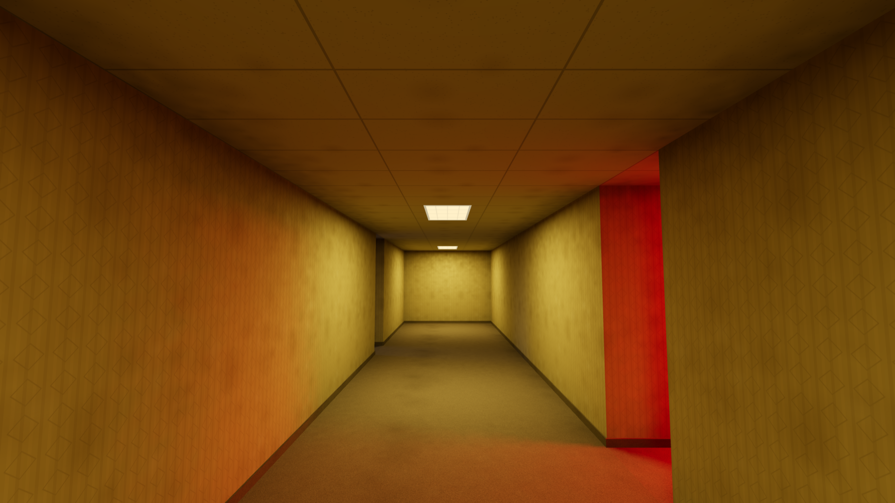
<figcaption>Alles an</figcaption>
</figure>
<figure>
<!-- tutorial-screenshot
tab: preview
viewport: 1024x576
hook: open view=11.00,14.00,0,4
hook: light
hook: info off
hook: key t
-->
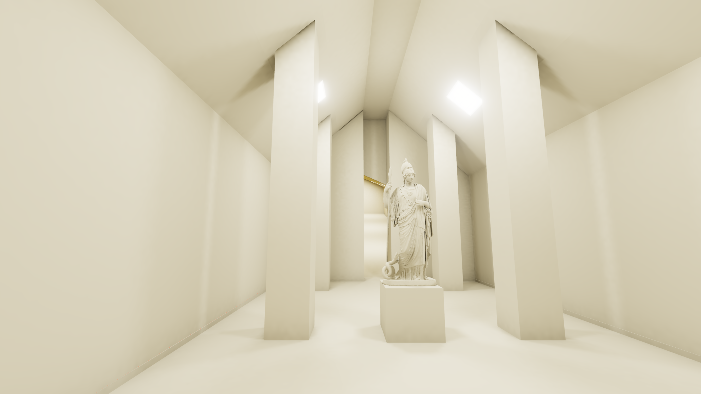
<figcaption><kbd>T</kbd>: ohne Texturen, nur das Licht</figcaption>
</figure>
<figure>
<!-- tutorial-screenshot
tab: preview
viewport: 1024x576
hook: open view=11.00,14.00,0,4
hook: light
hook: info off
hook: key t b
-->
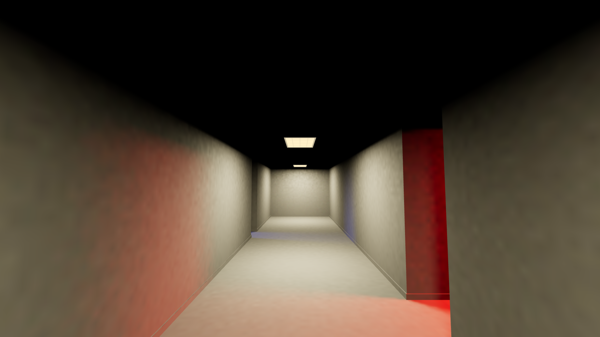
<figcaption><kbd>T</kbd> <kbd>B</kbd>: nur direktes Licht</figcaption>
</figure>
<figure>
<!-- tutorial-screenshot
tab: preview
viewport: 1024x576
hook: open view=11.00,14.00,0,4
hook: light
hook: info off
hook: key t l
-->
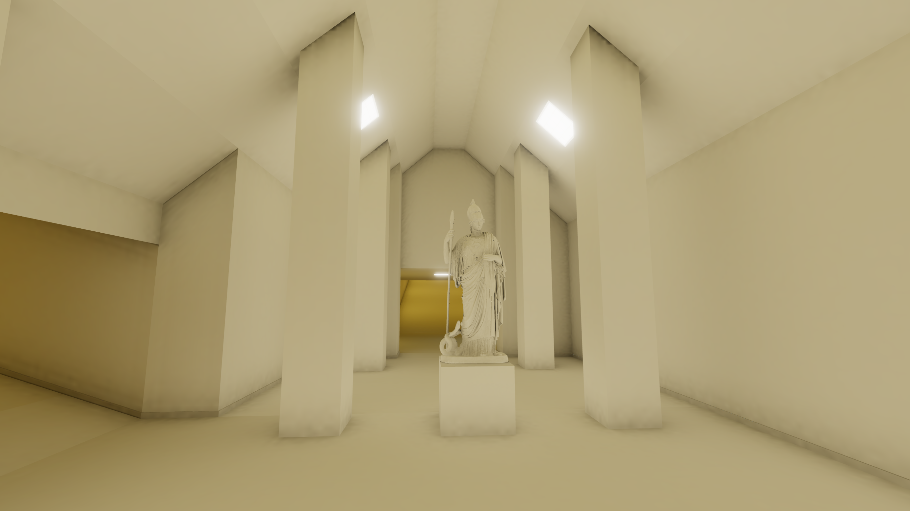
<figcaption><kbd>T</kbd> <kbd>L</kbd>: nur Bounce-Licht</figcaption>
</figure>
</div>
<!-- /tutorial-scope -->

<div class='hint try'>
<strong>Ausprobieren:</strong> Gib der Leuchte im Zimmer <code>size = 0.2, 0.2</code> und <code>power = 16</code> und lade neu. Eine kleinere Leuchte gibt auch weniger Licht, darum die größere Zahl. Sieh dir den Lichtfleck an, den sie durch die Tür in den Gang wirft: Seine Ränder werden scharf. Dann <code>size = 2, 2</code> mit <code>power = 0.16</code>: Sie werden ganz weich. Mit <code>bounces = 0</code> in <code>level.ini</code> unter <code>[level]</code> backt das Programm gar kein Bounce-Licht; wie sieht der Gang dann aus? Stell beides danach wieder zurück.
</div>

_task(weiche-schatten)

### Licht aufheben

Backen dauert, darum hebt die Vorschau das fertige Licht im Browser auf. Lädst du neu, ohne etwas zu ändern, steht oben links »Light loaded from this browser«, und es wird hell, ohne dass gebacken wird. Änderst du auch nur ein Zeichen in einem Raum, passt das aufgehobene Licht nicht mehr, und es wird neu gebacken. Ob es passt, sagt ein Fingerabdruck: eine kurze Zahl, ausgerechnet aus allen Dateien des Levels, den Statuen und dem Teil des Programms, der backt.

»Save light« lädt das Licht als Datei `level.light` herunter. Zieh sie aus deinem Download-Ordner in den Explorer von VS Code, neben `level.ini`. Dann lädt das Level sein Licht aus dieser Datei, auch in einem anderen Browser, und du kannst deine Backrooms als fertige Webseite weitergeben. Nach jeder Änderung am Level musst du sie neu speichern; eine veraltete Datei meldet die Vorschau oben links.

## Die Lobby

<div class='found-note'>
<p>Wir haben einen Teil vollständig kartiert. Elf Räume, ein Flur, der immer höher wird, und am Ende eine Halle, in der man leiser spricht. Wir nennen ihn die Lobby. Die Karte liegt bei.</p>
<cite>Feldhandbuch, eingelegtes Blatt</cite>
</div>

Im Ordner `lobby` liegt ein ganzes Level: ein Flur, der sich auf neun Meter Breite und Höhe öffnet, ein Säulengang, eine Galerie mit Sockeln, ein Lager und eine Halle aus Marmor mit einer Statue. Häng dafür an die Adresse der Vorschau `?level=lobby/level.ini` an, zum Beispiel:

```text
…/index.html?level=lobby/level.ini
```

Das Licht der Lobby ist schon gebacken, in `lobby/level.light` (siehe »Licht aufheben«), darum ist es sofort hell. Ihre Räume stehen in `lobby/rooms/`: Schau nach, wie sie gebaut sind, und nimm dir, was du brauchen kannst.

<!-- tutorial-scope -->
<div class='gallery columns-2'>
<figure>
<!-- tutorial-screenshot
tab: preview
viewport: 1024x576
hook: open level=lobby/level.ini&view=27.00,13.00,-90,18
hook: light
hook: info off
-->
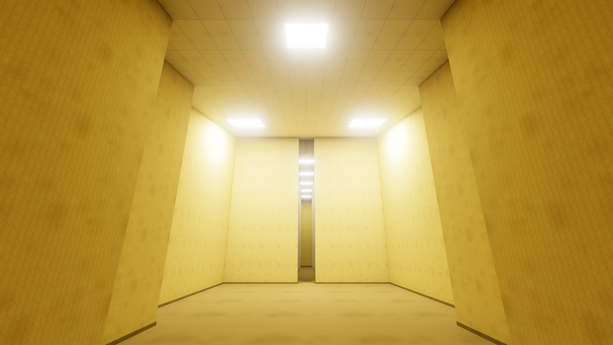
<figcaption>Der Flur wird weiter und höher</figcaption>
</figure>
<figure>
<!-- tutorial-screenshot
tab: preview
viewport: 1024x576
hook: open level=lobby/level.ini&view=58.00,26.00,180,8
hook: light
hook: info off
-->
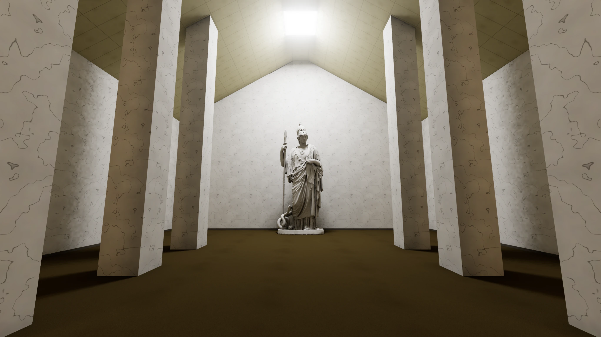
<figcaption>Die Halle mit Athena</figcaption>
</figure>
</div>
<!-- /tutorial-scope -->

## Zeigen und veröffentlichen

<div class='found-note'>
<p>Wer eine Tür findet, soll sie offen lassen. Für die Nächsten.</p>
<cite>Mit Kreide an einen Türrahmen geschrieben</cite>
</div>

_include(workspace#live-apps)

Speichere vorher das Licht (»Save light«, siehe »Licht aufheben«) und leg `level.light` neben `level.ini`: Dann ist es bei allen sofort hell, und niemand muss warten, bis gebacken ist.

_include(workspace#subdomain)

## Mit Brille

<div class='found-note'>
<p>Mit der Brille sind die Gänge tiefer. Ich weiß nicht, ob die Brille sie tiefer zeigt oder ob sie tiefer werden, wenn man sie aufsetzt.</p>
<cite>Zettel, an eine Rot-Cyan-Brille geklebt</cite>
</div>

<kbd>3</kbd> schaltet auf ein Bild für eine Rot-Cyan-Brille um: Jedes Auge sieht die Räume von seinem eigenen Platz aus, und dein Gehirn macht daraus Tiefe. Wie das funktioniert, steht in der Aktivität [3D-Grafik mit Anaglyphen](/anaglyph). Auch die Automap ist dann räumlich, wie ein Modell auf dem Tisch.

Öffnest du die Seite im Browser einer VR-Brille, steht unten »ENTER VR«. Dann läufst du mit dem linken Stick, drehst dich mit dem rechten, und die Grifftaste stellt die Automap als kleines Modell vor dich hin. Damit das geht, muss die Brille die Adresse deiner Vorschau öffnen können.

## Der Maschinenraum

<div class='found-note'>
<p>Hinter einer Tür, die auf keiner Karte steht, haben wir einen Raum voller Kabel gefunden. Es summt dort lauter als anderswo. Wir glauben, dass hier alles gemacht wird.</p>
<cite>Feldhandbuch, letzte beschriebene Seite</cite>
</div>

Das Programm steht im Ordner `engine/`, in JavaScript, und benutzt die 3D-Bibliothek [three.js](https://threejs.org/). Die liegt in `vendor/`: Die Seite lädt nichts aus dem Internet.

<table class='table'>
<tr><th>Datei</th><th>Was sie tut</th></tr>
<tr><td><code>level.js</code></td><td>liest <code>level.ini</code> und die Räume und legt sie an ihren Türen aneinander</td></tr>
<tr><td><code>geometry.js</code></td><td>baut daraus Böden, Decken, Wände, Sockelleisten und Blöcke und legt fest, wo auf der Lightmap jede Fläche liegt</td></tr>
<tr><td><code>bake.js</code></td><td>backt das Licht auf der Grafikkarte, mit Shadern in GLSL</td></tr>
<tr><td><code>textures.js</code></td><td>malt Tapete, Teppich und Marmor, mit Zufall und ohne ein einziges Bild</td></tr>
<tr><td><code>main.js</code></td><td>lädt alles, schaltet die Leuchten an und zeichnet jedes Bild</td></tr>
<tr><td><code>controls.js</code>, <code>automap.js</code></td><td>Laufen, Umsehen und die Automap</td></tr>
</table>

Was ein Shader ist, steht im [Handbuch zu GLSL](/reference/glsl). Wenn du am Programm etwas änderst und nichts mehr geht: Die Konsole des Browsers (<kbd>F12</kbd>) sagt, in welcher Zeile es hakt, und `git diff` zeigt, was du geändert hast.

<div class='found-note'>
<p>Wenn du einen Ausgang findest, schreib ihn auf. Wenn du keinen findest, bau einen Raum, in dem es sich zu warten lohnt.</p>
<cite>Feldhandbuch, Rückseite</cite>
</div>
