<div class='meta'>
image: saal-6.webp
image_alt: "Ein Saal aus weißem, geädertem Marmor unter einem Satteldach, zwei Reihen Säulen, in der Mitte Athena auf einem Sockel"
kind: projekt
topic: hidden
duration: 2 Doppelstunden
reference: [workspace, kartografie]
template: https://github.com/specht/backrooms-starter.git
template_name: der Backrooms-Vorlage
</div>

# Die Backrooms

<div
    class="autotoc-secondary-trigger"
    data-title="Auf dieser Seite"
    data-levels="h2,h3">
</div>

<p class='abstract'>
Du bist durch eine Wand gefallen. Dahinter liegen die Backrooms: gelbe Tapete, feuchter Teppich, das Summen der Leuchten, Räume ohne Ende. Du kartierst sie in Textdateien und baust eigene Räume dazu, einen Saal mit Säulen, Satteldach und einer Statue und einen Salon mit Holz an den Wänden. Dein Browser macht daraus ein Bauwerk in 3D und berechnet das Licht, das zwischen den Wänden hin- und herfällt. Am Rechner, auf dem Handy, mit Rot-Cyan-Brille oder mit einer VR-Brille. Zum Schluss schaust du nach, wie das Programm aus ein paar Zeilen Text Wände macht und Holz und Marmor, ohne ein einziges Bild.
</p>

</p>

<div class='found-note'>
<p>Wenn du das hier liest, bist du durchgefallen. Nicht durch eine Prüfung. Durch die Wirklichkeit. Irgendwo hat eine Wand nicht gehalten, was sie versprochen hat, und jetzt bist du hier.</p>
<p>Keine Panik. Der Teppich ist feucht, aber er trägt. Die Leuchten summen, aber sie leuchten. Und du bist nicht der erste Mensch hier: Wir haben angefangen, alles aufzuschreiben.</p>
<cite>Erste Seite des Feldhandbuchs der Kartografen</cite>
</div>

<table class='table'>
<tr><th>Level</th><td>0, »Die Lobby«</td></tr>
<tr><th>Überlebensschwierigkeit</th><td>Klasse 1: sicher, stabil, keine Entitäten gesichtet</td></tr>
<tr><th>Ausdehnung</th><td>so groß, wie du es baust</td></tr>
<tr><th>Ausgänge</th><td>einer, sagen die Kartografen, ganz am Ende dieser Seite. Den Tab zu schließen, soll auch helfen (unbestätigt).</td></tr>
</table>

Die Backrooms sind eine Legende aus dem Internet. 2019 stellte jemand in einem Forum das Foto eines leeren Büroraums mit gelber Tapete ein, und jemand anderes schrieb dazu: Wer an der falschen Stelle aus der Wirklichkeit »noclippt«, landet hier, in endlosen leeren Räumen. Noclip heißt ein Cheat aus alten Ego-Shootern wie Quake: Mit ihm läuft man durch Wände. Seitdem haben unzählige Leute weitere Levels erfunden, Geschichten geschrieben und Videos gedreht.

Hier baust du deine eigenen Backrooms. Du beschreibst Räume in Textdateien: wo die Wände stehen, wo die Leuchten hängen, wo eine Tür in den nächsten Raum führt. Ein Programm im Browser liest sie, baut daraus ein Bauwerk in 3D und berechnet das Licht: wohin es fällt, wo Schatten liegen und wie es von Wänden, Boden und Decke zurückgeworfen wird. Programmieren musst du dafür nicht. Wer will, findet das ganze Programm im Ordner `engine/` und kann darin herumschrauben.

## Ausrüstung

<div class='found-note'>
<p>Was du brauchst: eine Karte (du hast keine), eine Lampe (es gibt hier genug) und einen Ordner, in den du alles schreibst, was du findest. Den Ordner gibt es schon. Er lag hier, als wir ankamen.</p>
<cite>Feldhandbuch, Seite 2</cite>
</div>

### Die Vorlage klonen

Alles, was du brauchst, steckt in der Backrooms-Vorlage:

_include(workspace#repository-klonen)

Danach liegt die Vorlage in `/workspace/backrooms-starter`:

<!-- tutorial-screenshot
# Klonen wie im Handbuch »Workspace« (oben eingebunden), dann die
# geöffnete Vorlage im Explorer, level.ini im Editor
show-left-sidebar
clone-start: https://github.com/specht/backrooms-starter.git @ e9d041a77d7f4487f0870ce74b9f8e2addee1ed3
press: Enter
wait-for-input-value: /workspace/
press: Enter
wait-for-text: Would you like to open the repository?
click: Open
wait-for-text: level.ini
open-file: level.ini
sleep: 1
-->


Darin liegen drei Levels. Deins beginnt klein, in `level.ini` und im Ordner `rooms`: ein Zimmer, ein Gang und zwei farbige Räume. In `lobby` und `tiefe` liegen zwei fertige Levels zum Ausprobieren; dazu später mehr.

_task(geklont)

### Eintreten

_include(workspace#live-server)

Die Vorschau zeigt `index.html`. Zuerst ist es dunkel, nur feine hellblaue Linien zeigen die Kanten der Räume, wie in der Automap. Dann gehen die Leuchten an, eine nach der anderen, die nächsten zuerst, und oben links wächst ein Balken: Das Licht wird berechnet.

<!-- tutorial-screenshot
# Die Vorschau, während das Licht gebacken wird
go-live
tab: preview
viewport: 1536x864
zoom: 1.5
hook: baking
-->


Wie lange das dauert, hängt von der Grafikkarte deines Rechners ab. Ist es fertig, steht dort »Light baked in …«:

<!-- tutorial-screenshot
# fertig gebacken (die Seite neu, im Bild davor stand sie still); der Kasten
# oben links nur im Bild davor, beim Backen
tab: preview
viewport: 1536x864
zoom: 1.5
hook: open
hook: light
hook: info off
-->


Klick ins Bild, dann siehst du dich mit der Maus um. <kbd>Esc</kbd> gibt die Maus wieder frei.

<table class='table'>
<tr><th>Taste</th><th>Was passiert</th></tr>
<tr><td><kbd>W</kbd> <kbd>A</kbd> <kbd>S</kbd> <kbd>D</kbd></td><td>laufen, mit <kbd>Shift</kbd> rennen</td></tr>
<tr><td><kbd>↑</kbd> <kbd>↓</kbd> <kbd>←</kbd> <kbd>→</kbd></td><td>vor und zurück laufen, nach links und rechts drehen</td></tr>
<tr><td><kbd>M</kbd> oder <kbd>Tab</kbd></td><td>die Automap: das ganze Bauwerk als Drahtgitter</td></tr>
<tr><td><kbd>Shift</kbd> <kbd>R</kbd></td><td>zurück zum Anfang</td></tr>
<tr><td><kbd>P</kbd></td><td>den Kasten oben links aus- und wieder einblenden</td></tr>
</table>

Wo du stehst, merkt sich die Adresse der Seite, eine offene Automap auch, so gedreht und gezoomt, wie sie ist. Lädst du neu, stehst du wieder dort, solange sich der Grundriss nicht geändert hat: Ändere einen Raum, lade neu und sieh dir dieselbe Stelle noch einmal an.

Auf dem Handy oder Tablet läufst du mit dem linken Daumen: Wo er das Bild berührt, erscheint ein Ring, und schiebst du ihn aus dessen Mitte, läufst du in diese Richtung, ganz hinaus geschoben rennst du. Der rechte Daumen wischt, um dich umzusehen. In der Automap dreht ein Finger die Karte, zwei Finger zoomen und verschieben sie. <span class='bi bi-list'></span> oben rechts blendet den Kasten oben links aus und wieder ein.

<div class='hint try'>
<strong>Ausprobieren:</strong> Drück <kbd>M</kbd>. Die Automap zeigt das Bauwerk als Drahtgitter, jeden Raum mit seinem Namen, die Leuchten als gelbe Punkte; der rote Pfeil bist du. Zieh mit der Maus, um die Karte zu drehen, mit <kbd>Shift</kbd>, um sie zu verschieben, und zoom mit dem Mausrad. Lauf ein paar Schritte, während sie offen ist, und schau nach unten: Was macht die Karte? <kbd>V</kbd> zeigt statt des Drahtgitters die Räume selbst von oben, ohne Decken, mit ihrem Licht. <kbd>Esc</kbd> schließt die Karte.
</div>

So sieht die Automap aus, wenn du am Start nach Nordosten und etwas nach unten schaust und mit dem Mausrad ein Stück herauszoomst:

<!-- tutorial-screenshot
# die Automap über dem ganzen Level: vom Start aus nach Nordosten, nach unten geneigt
tab: preview
viewport: 1536x864
zoom: 1.5
hook: open view=5.00,17.00,-38,-35
hook: light
hook: key m
hook: wheel 450
hook: info off
-->


Und mit <kbd>V</kbd>, die Räume selbst:

<!-- tutorial-screenshot
tab: preview
viewport: 1536x864
zoom: 1.5
hook: open view=5.00,17.00,-38,-35
hook: light
hook: key m v
hook: wheel 450
hook: info off
-->

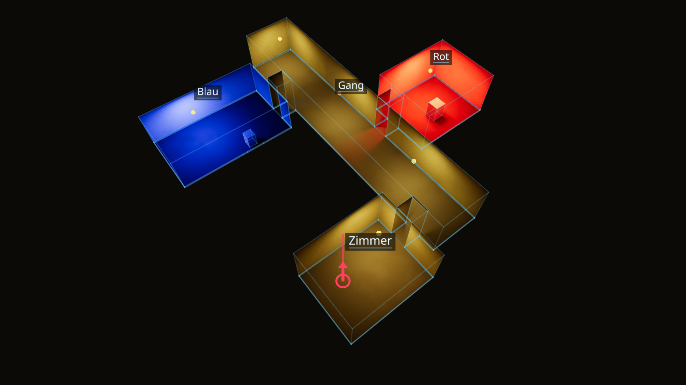

## Kartografie

<div class='found-note'>
<p>Wir kartieren in Feldern. Ein Feld ist ein Meter. Eine Raute ist eine Wand, ein Punkt ist Teppich. Was nicht auf der Karte steht, gibt es nicht. Das ist die einzige Regel, auf die man sich hier verlassen kann.</p>
<cite>Notiz, mit Kugelschreiber auf die Tapete geschrieben</cite>
</div>

### Ein Raum

Öffne `rooms/zimmer.room`. Das ist der Raum, in dem du aufgewacht bist:

```room
# Ein kleines Zimmer. Du weißt nicht, wie du hierhergekommen bist.

[room]
baseboard = 0.08, #86763c
name = Zimmer
height = 2.6
look = east              # am @ schaust du zur Tür

[map]
#######
#.....#
#.@.L.1
#.....#
#.....#
#######

[L]
light = #ffe7b8
power = 0.9

[1]
door = gang 1
```

Eine Raumdatei besteht aus Abschnitten in eckigen Klammern. In `[room]` steht, wie der Raum aussieht: sein Name, wie hoch die Decke ist (2,6 m), eine dunkle Sockelleiste unten an den Wänden, 8 cm hoch, und wohin du am Anfang schaust. Eine Zeile, die mit `#` beginnt, ist ein Kommentar, ebenso alles ab einem `#` mit Leerzeichen davor und danach; eine Farbe wie `#86763c` hat kein Leerzeichen dahinter.

In `[map]` steht der Grundriss, von oben gesehen, oben ist Norden. Hier zählt jedes Zeichen, Kommentare gibt es darin nicht:

<table class='table'>
<tr><th>Zeichen</th><th>Bedeutung</th></tr>
<tr><td><code>#</code></td><td>Wand</td></tr>
<tr><td><code>.</code></td><td>Boden</td></tr>
<tr><td><code>@</code></td><td>hier fängst du an, nur einmal im ganzen Level</td></tr>
<tr><td>Leerzeichen</td><td>nichts, außerhalb des Raums</td></tr>
<tr><td>ein Buchstabe</td><td>eine Leuchte, ein Block oder ein Modell; was es ist, steht im Abschnitt mit diesem Buchstaben</td></tr>
<tr><td>eine Ziffer</td><td>eine Tür in einen anderen Raum, beschrieben im Abschnitt mit dieser Ziffer; dieselbe Ziffer mehrmals in einer Reihe, nebeneinander oder untereinander, ist eine breite Tür</td></tr>
</table>

`[L]` sagt, dass das `L` eine Leuchte ist, mit warmem, gelblichem Licht. `[1]` macht aus der `1` am rechten Rand eine Tür.

### Türen

Eine Tür ist ein Feld, das zwei Räumen gehört. `door = gang 1` heißt: Diese `1` ist dasselbe Feld wie die `1` in `rooms/gang.room`. Das Programm legt die beiden Räume so nebeneinander, dass die Türen aufeinanderliegen. Ihre Wände dürfen sich dabei überdecken, ihre Böden nicht.

Zwei Räume dürfen sich auch mehrere Türen teilen, jede mit ihrer eigenen Ziffer. So entsteht aus vielen kleinen Dateien ein Bauwerk. `level.ini` nennt nur den ersten Raum (`start = zimmer`). Das Programm liest ihn, dann jeden Raum, zu dem eine seiner Türen führt, dann deren Nachbarn, bis es keine neuen Türen mehr gibt. Eine Datei, zu der keine Tür führt, liest es gar nicht.

_task(tuer)

## Ein Raum mehr

<div class='found-note'>
<p>Gestern war im Gang neben dem Zimmer eine Wand. Heute ist dort eine Öffnung. Ich habe nachgezählt: Das Feld ist dasselbe. Die Wand ist weg. Dahinter ist eine Kammer, die es gestern nicht gab.</p>
<cite>Seite aus einem durchnässten Notizbuch</cite>
</div>

### Eine Kammer anbauen

Leg im Ordner `rooms` eine neue Datei `kammer.room` an:

```room
# Eine Kammer, die gestern noch nicht da war.

[room]
name = Kammer
height = 2.2
wallpaper = #9a8a4c

[map]
#####
5...#
#.L.#
#...#
#####

[L]
light = #ffb070
power = 0.9
flicker = 1
```

Die Leuchte ist orange, und mit `flicker = 1` flackert sie ab und zu. Die Tapete ist eine Farbe als Hexadezimalzahl wie in CSS: Rot, Grün und Blau, je zwei Ziffern.

Noch führt keine Tür in die Kammer, also gibt es sie nicht. Öffne `rooms/gang.room`. Weit unten im Grundriss ist links die `1`, die Tür zum Zimmer. Ersetze in dieser Zeile das `#` am rechten Rand durch eine `5`:

```room
~ #...#
1...5
~ #...#
```

und schreib ganz unten in die Datei, wohin sie führt:

```room
[5]
door = kammer 5
```

Speichere beide Dateien und lade die Vorschau neu. Die Kammer liegt östlich vom Gang, gegenüber der Tür zum Zimmer. In `kammer.room` steht kein Abschnitt `[5]`: Es genügt, wenn einer der beiden Räume die Tür beschreibt.

<!-- tutorial-screenshot
# Die Kammer: die Räume wie auf der Seite, dann aus ihrer Ecke zur Tür
write-file: rooms/zimmer.room <- file:stufen/zimmer.room
write-file: rooms/gang.room <- file:stufen/gang.room
write-file: rooms/kammer.room <- file:stufen/kammer.room
tab: preview
viewport: 1536x864
zoom: 1.5
hook: open view=16.00,19.00,56,0
hook: light
hook: info off
-->


Stimmt etwas nicht, steht oben links in Rot, in welcher Datei (und, wenn es eine Zeile ist, in welcher) das Programm hängen geblieben ist, auf Englisch, zum Beispiel `rooms/kammer.room: room kammer and room rot lie in the same place at the same height`. Das heißt: Der Raum läge auf dem Boden eines anderen; dahinter steht auch, an welchem Feld. Schieb die Tür an eine andere Stelle oder mach den Raum kleiner.

## Ein Saal, Schritt für Schritt

<div class='found-note'>
<p>Hinter der Kammer ist noch eine Tür. Dahinter: ein Saal, leer und hoch. Jedes Mal, wenn ich zurückkomme, steht etwas mehr darin.</p>
<cite>Seite aus einem durchnässten Notizbuch, andere Handschrift</cite>
</div>

Hinter der Kammer baust du einen Saal, Schritt für Schritt: erst den Grundriss, dann eine schräge Decke, Säulen, farbiges Licht, eine Statue und Marmor. Nach jedem Schritt speicherst du und lädst die Vorschau neu.

### Der Grundriss

Gib der Kammer in `rooms/kammer.room` eine zweite Tür, an der rechten Wand, in der Zeile der ersten:

```room
~ #####
5...6
~ #.L.#
```

und schreib unten dazu, wohin sie führt:

```room
[6]
door = saal 1
```

Dann leg `rooms/saal.room` an:

```room
# Ein Saal hinter der Kammer.

[room]
name = Saal
height = 3

[map]
#############
#...........#
#...L...L...#
1...........#
#...........#
#...........#
#...L...L...#
#...........#
#############

[L]
light = #fff3cf
```

Ein Saal, 11 m lang und 7 m breit, mit vier Leuchten in zwei Reihen. Weil `[L]` nur einmal beschrieben ist, sind alle vier gleich.

<!-- tutorial-screenshot
write-file: rooms/kammer.room <- file:stufen/kammer-2.room
write-file: rooms/saal.room <- file:stufen/saal-1.room
tab: preview
viewport: 1536x864
zoom: 1.5
hook: open view=18.00,17.20,-100,6
hook: light
hook: info off
-->


### Schräge Decken

Zwei Höhen machen die Decke schräg, `slope` sagt, wie. `gable` ist ein Satteldach: an den Wänden 3 m, in der Mitte 7 m hoch, der First läuft an der längeren Seite entlang. Die Leuchten liegen dann so schräg wie die Decke über ihnen. Weil sie jetzt höher hängen, bekommen sie mit `power` mehr Kraft:

```room
~ [room]
~ name = Saal
height = 3, 7
slope = gable
```

```room
~ [L]
~ light = #fff3cf
power = 1.6
```

<!-- tutorial-screenshot
write-file: rooms/saal.room <- file:stufen/saal-2.room
tab: preview
viewport: 1536x864
zoom: 1.5
hook: open view=18.00,17.20,-100,6
hook: light
hook: info off
-->


Eine Decke kann auch nur in eine Richtung ansteigen, wie ein Pultdach. Mit `slope = east` statt `gable` wird die Decke des Saals nach Osten immer höher, also nach rechts im Grundriss:

```room
~ height = 3, 7
slope = east
```

An der Westwand ist sie dann 3 m hoch, an der Ostwand 7 m. Statt `east` geht auch `north`, `south` oder `west`. Auch hier liegen die Leuchten so schräg wie die Decke. So sähe der Saal damit aus, von der Seite; für die nächsten Schritte bleibt er beim Satteldach:

<!-- tutorial-scope -->

<!-- tutorial-screenshot
write-file: rooms/saal.room <- file:stufen/saal-pult.room
tab: preview
viewport: 1536x864
zoom: 1.5
hook: open view=23.40,15.20,170,14
hook: light
hook: info off
-->


<!-- /tutorial-scope -->

### Säulen

Ein Buchstabe im Grundriss kann auch ein Block sein. Vier Säulen, je zwei an den langen Seiten, zwischen den Leuchten:

```room
~ #...........#
#...L.S.L.S.#
~ 1...........#
~ #...........#
~ #...........#
#...L.S.L.S.#
~ #...........#
```

```room
[S]
block = 0.7, 7, 0.7      # höher als die Decke: Die Säule verschwindet in ihr
```

`block = 0.7, 7, 0.7` ist 0,7 m breit, 7 m hoch und 0,7 m tief, mitten auf seinem Feld. Ist ein Block höher als die Decke, verschwindet er in ihr. `block = 1` füllt das ganze Feld einen Meter hoch, eine Kiste. Mit `base = 2` schwebt ein Block zwei Meter über dem Boden, mit `color = #6a5a3a` bekommt er eine eigene Farbe; ohne sieht er aus wie die Wände seines Raums. Mit `material = marble` ist er aus Marmor, auch in einem Raum mit Tapete; es gehen alle Arten, die es für Wände gibt (in »Andere Wände und Böden«). Durch Blöcke läuft man nicht hindurch, und sie werfen Schatten.

<!-- tutorial-screenshot
write-file: rooms/saal.room <- file:stufen/saal-3.room
tab: preview
viewport: 1536x864
zoom: 1.5
hook: open view=18.00,17.20,-100,6
hook: light
hook: info off
-->


Mit `shape = round` wird ein Block rund, eine Säule wie in einem alten Bad, so breit und tief wie der Block. So sähe der Saal damit aus; für die nächsten Schritte bleiben die Säulen eckig:

<!-- tutorial-scope -->

```room
~ [S]
~ block = 0.7, 7, 0.7      # höher als die Decke: Die Säule verschwindet in ihr
shape = round
```

<!-- tutorial-screenshot
write-file: rooms/saal.room <- file:stufen/saal-rund.room
tab: preview
viewport: 1536x864
zoom: 1.5
hook: open view=18.00,17.20,-100,6
hook: light
hook: info off
-->

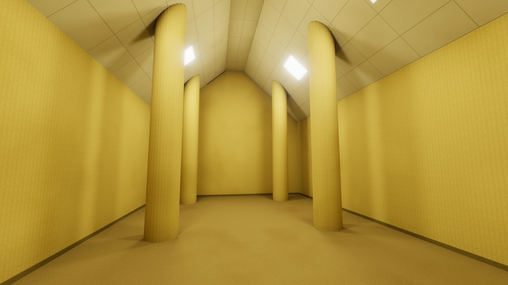

<!-- /tutorial-scope -->

### Farbiges Licht

Die Leuchte hinten rechts soll rot leuchten. Sie bekommt einen eigenen Buchstaben:

```room
~ #...........#
#...L.S.R.S.#
~ #...........#
```

```room
[R]
light = #ff3020
power = 3
size = 1.2, 1.2
```

`light` ist die Farbe, `size` die Größe in Metern: Eine größere Leuchte wirft weichere Schatten. Das rote Licht fällt auf Wände, Boden und Säulen und wird von ihnen zurückgeworfen, rot gefärbt. So sähe der Saal mit der roten Leuchte aus; für die nächsten Schritte bleiben alle vier weiß.

<!-- tutorial-scope -->

<!-- tutorial-screenshot
write-file: rooms/saal.room <- file:stufen/saal-4.room
tab: preview
viewport: 1536x864
zoom: 1.5
hook: open view=18.00,17.20,-100,6
hook: light
hook: info off
-->


<!-- /tutorial-scope -->

### Eine Statue

<div class='found-note'>
<p>Im Saal steht eine Frau aus Stein auf einem Sockel, größer als ich. Sie schaut zum Eingang. Ich bin dreimal um sie herumgegangen. Sie schaut immer zum Eingang.</p>
<cite>Letzter Eintrag einer Kartografin, Saal</cite>
</div>

In die Mitte des Saals kommt Athena, auf einem Sockel:

```room
~ 1...........#
#.....M.....#
~ #...........#
```

```room
[M]
model = models/athena.glb
height = 2.2
rotation = 270
material = marble
pedestal = 0.9, 0.8, 0.9
```

Eine Statue ist ein 3D-Modell im Format GLB. `height` macht sie so hoch wie angegeben, `rotation` dreht sie in Grad um ihre senkrechte Achse, hier zur Tür, `material = marble` macht sie aus Marmor statt aus den Farben des Modells, und `pedestal` stellt sie auf einen Sockel: 0,9 m breit, 0,8 m hoch, 0,9 m tief. Auch Modelle werfen Schatten und bekommen Licht, das Wände und Boden zurückwerfen, und wo eine Statue sich selbst verdeckt, ist es auf ihr dunkler.

<!-- tutorial-screenshot
write-file: rooms/saal.room <- file:stufen/saal-5.room
tab: preview
viewport: 1536x864
zoom: 1.5
hook: open view=18.00,17.20,-100,6
hook: light
hook: info off
-->


Athena ist der 3D-Scan eines Gipsabgusses einer antiken Statue, aus dem [Statens Museum for Kunst](https://open.smk.dk/artwork/image/KAS255) in Kopenhagen, gemeinfrei. Ohne `material = marble` behält ein Modell seine eigenen Farben. Im Ordner `models` liegen außerdem Möbel; zwei davon stehen gleich im Salon.

### Marmor

Zum Schluss Wände und Boden aus Marmor:

```room
~ height = 3, 7
~ slope = gable
walls = marble
floor = marble
```

<!-- tutorial-screenshot
write-file: rooms/saal.room <- file:stufen/saal-6.room
tab: preview
viewport: 1536x864
zoom: 1.5
hook: open view=18.00,17.20,-100,6
hook: light
hook: info off
-->


### Andere Wände und Böden

Marmor ist nur eine Möglichkeit. `walls` kennt neun Arten, `floor` zehn, jede in der Farbe aus `wallpaper` (Wände) und `carpet` (Boden), Marmor in seiner eigenen:

<table class='table'>
<tr><th>Wert</th><th>Wände (<code>walls</code>)</th><th>Boden (<code>floor</code>)</th></tr>
<tr><td><code>wallpaper</code>, <code>carpet</code></td><td>Tapete mit Rautenmuster</td><td>Teppich</td></tr>
<tr><td><code>marble</code></td><td>Marmor</td><td>Marmor</td></tr>
<tr><td><code>wood</code></td><td>senkrechte Bretter</td><td>Dielen</td></tr>
<tr><td><code>tiles</code></td><td>Fliesen</td><td>Fliesen</td></tr>
<tr><td><code>velvet</code></td><td>Samt in senkrechten Streifen, wie im Kino</td><td></td></tr>
<tr><td><code>plain</code></td><td>einfarbig</td><td>einfarbig</td></tr>
<tr><td><code>concrete</code></td><td>Sichtbeton: Fugen der Schaltafeln und die Löcher ihrer Anker</td><td>Beton mit Fugen</td></tr>
<tr><td><code>brick</code></td><td>Ziegel im Läuferverband</td><td>Ziegelpflaster</td></tr>
<tr><td><code>terrazzo</code></td><td>Terrazzo: Steinchen in Zement</td><td>Terrazzo</td></tr>
<tr><td><code>carpet_tiles</code></td><td></td><td>Teppichfliesen wie im Büro, jede gegen ihre Nachbarn gedreht</td></tr>
<tr><td><code>checker</code></td><td></td><td>Schachbrett, schwarz und in der Farbe aus <code>carpet</code></td></tr>
</table>

Für Fliesen wie in einem Schwimmbad zum Beispiel `walls = tiles`, `floor = tiles`, `wallpaper = #e6ecef` und `carpet = #c4ced3`, dazu eine helle Decke mit `ceiling = #e8ecee`. So sieht der leere Saal vom Anfang mit jeder Art aus, Holz mit Wandlampen und Samt mit Kerzenleuchtern statt Leuchten an der Decke; Lampen, die selbst leuchten, kommen in einem tieferen Level (ein Klick zeigt ein Bild groß):

<!-- tutorial-scope -->

<div class='gallery columns-3'>
<figure>

<figcaption><code>wallpaper</code> und <code>carpet</code></figcaption>
</figure>
<figure>
<!-- tutorial-screenshot
write-file: rooms/saal.room <- file:stufen/saal-marmor.room
tab: preview
viewport: 1536x864
zoom: 1.5
hook: open view=18.00,17.20,-100,6
hook: light
hook: info off
-->

<figcaption><code>marble</code></figcaption>
</figure>
<figure>
<!-- tutorial-screenshot
write-file: rooms/saal.room <- file:stufen/saal-holz.room
tab: preview
viewport: 1536x864
zoom: 1.5
hook: open view=18.00,17.20,-100,6
hook: light
hook: info off
-->

<figcaption><code>wood</code>, mit Wandlampen</figcaption>
</figure>
<figure>
<!-- tutorial-screenshot
write-file: rooms/saal.room <- file:stufen/saal-fliesen.room
tab: preview
viewport: 1536x864
zoom: 1.5
hook: open view=18.00,17.20,-100,6
hook: light
hook: info off
-->

<figcaption><code>tiles</code></figcaption>
</figure>
<figure>
<!-- tutorial-screenshot
write-file: rooms/saal.room <- file:stufen/saal-einfarbig.room
tab: preview
viewport: 1536x864
zoom: 1.5
hook: open view=18.00,17.20,-100,6
hook: light
hook: info off
-->

<figcaption><code>plain</code></figcaption>
</figure>
<figure>
<!-- tutorial-screenshot
write-file: rooms/saal.room <- file:stufen/saal-samt.room
tab: preview
viewport: 1536x864
zoom: 1.5
hook: open view=18.00,17.20,-100,6
hook: light
hook: info off
-->

<figcaption><code>velvet</code>, mit Kerzenleuchtern</figcaption>
</figure>
<figure>
<!-- tutorial-screenshot
write-file: rooms/saal.room <- file:stufen/saal-beton.room
tab: preview
viewport: 1536x864
zoom: 1.5
hook: open view=18.00,17.20,-100,6
hook: light
hook: info off
-->
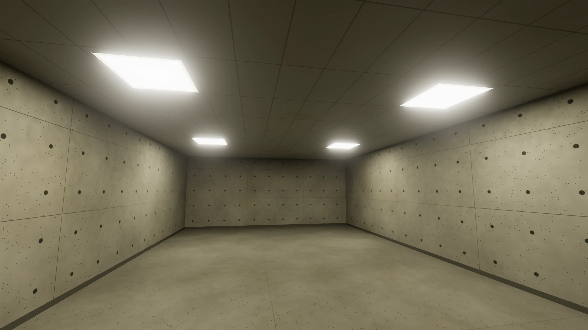
<figcaption><code>concrete</code></figcaption>
</figure>
<figure>
<!-- tutorial-screenshot
write-file: rooms/saal.room <- file:stufen/saal-ziegel.room
tab: preview
viewport: 1536x864
zoom: 1.5
hook: open view=18.00,17.20,-100,6
hook: light
hook: info off
-->
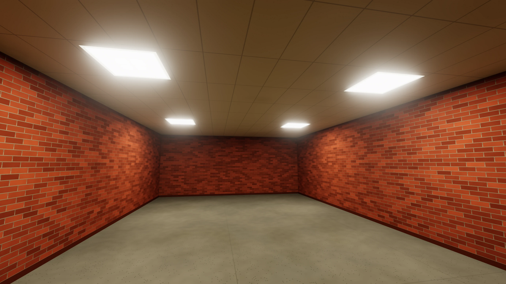
<figcaption><code>brick</code>, Boden <code>concrete</code></figcaption>
</figure>
<figure>
<!-- tutorial-screenshot
write-file: rooms/saal.room <- file:stufen/saal-terrazzo.room
tab: preview
viewport: 1536x864
zoom: 1.5
hook: open view=18.00,17.20,-100,6
hook: light
hook: info off
-->
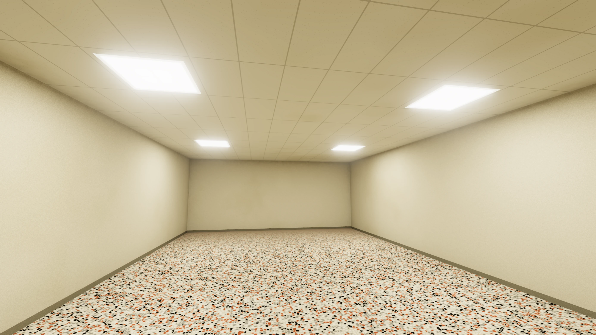
<figcaption>Boden <code>terrazzo</code></figcaption>
</figure>
<figure>
<!-- tutorial-screenshot
write-file: rooms/saal.room <- file:stufen/saal-buero.room
tab: preview
viewport: 1536x864
zoom: 1.5
hook: open view=18.00,17.20,-100,6
hook: light
hook: info off
-->
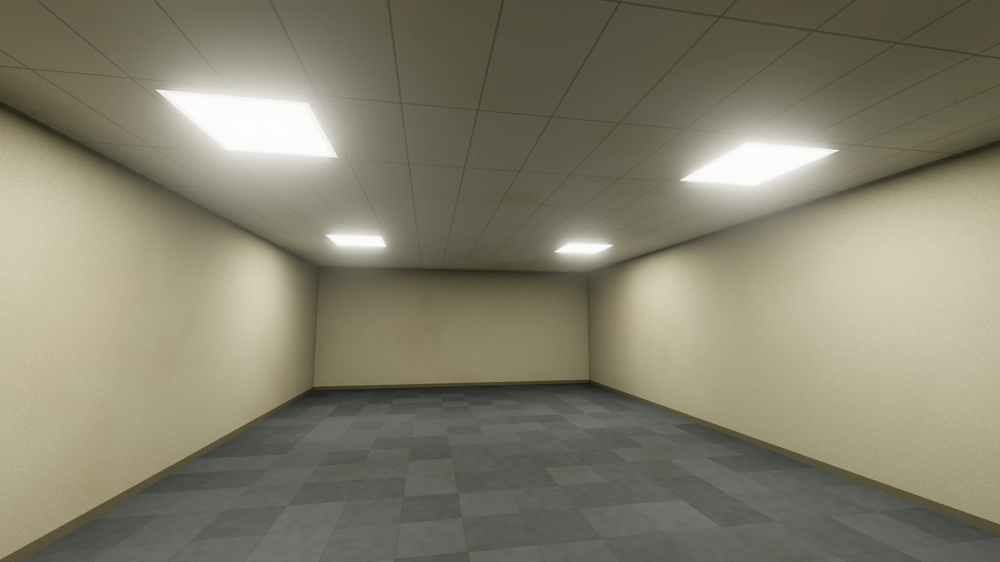
<figcaption>Boden <code>carpet_tiles</code></figcaption>
</figure>
<figure>
<!-- tutorial-screenshot
write-file: rooms/saal.room <- file:stufen/saal-schach.room
tab: preview
viewport: 1536x864
zoom: 1.5
hook: open view=18.00,17.20,-100,6
hook: light
hook: info off
-->
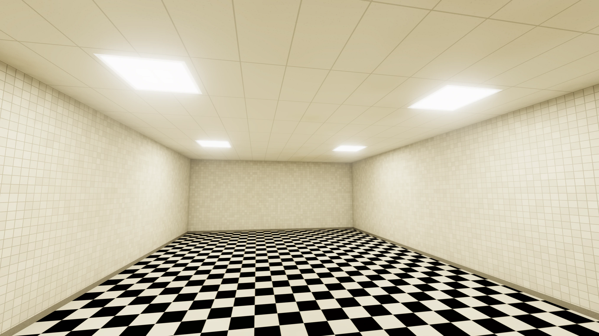
<figcaption>Boden <code>checker</code></figcaption>
</figure>
</div>

<!-- /tutorial-scope -->
## Ein Salon

<div class='found-note'>
<p>In der Südwand des Saals ist ein Bogen, der gestern nicht da war. Dahinter: Holz an den Wänden, ein Sofa, ein Tisch. Auf dem Tisch nichts. Das Sofa ist warm.</p>
<cite>Seite aus einem durchnässten Notizbuch, wieder die erste Handschrift</cite>
</div>

Der Saal ist fertig. Hinter seiner Südwand baust du einen zweiten Raum, und diesmal geht es um die Wände selbst: was unten an ihnen ist, was oben, und wie eine Tür aussieht.

### Eine breite Tür

Gib dem Saal in der Mitte seiner Südwand eine Tür, drei Felder breit:

```room
~ #...L.S.L.S.#
~ #...........#
#####444#####
```

```room
[4]
door = salon 1
```

Dieselbe Ziffer mehrmals in einer Reihe, nebeneinander wie hier oder untereinander, ist eine breite Tür. Die Tür auf der anderen Seite muss genauso breit sein; ist sie es nicht, steht oben links, wie breit jede ist. Leg dahinter `rooms/salon.room` an:

_include_file(stufen/salon-1.room, room_copy)

Grüne Tapete, ein Boden aus Dielen, eine helle Decke und eine Sockelleiste aus dunklem Holz, 10 cm hoch. Sofa und Tisch sind Modelle wie Athena, aus dem Ordner `models`; `rotation = 180` dreht das Sofa, bis es zur Tür schaut.

<!-- tutorial-screenshot
write-file: rooms/saal.room <- file:stufen/saal-salon.room
write-file: rooms/salon.room <- file:stufen/salon-1.room
tab: preview
viewport: 1536x864
zoom: 1.5
hook: open view=27.60,28.60,42,1
hook: light
hook: info off
-->

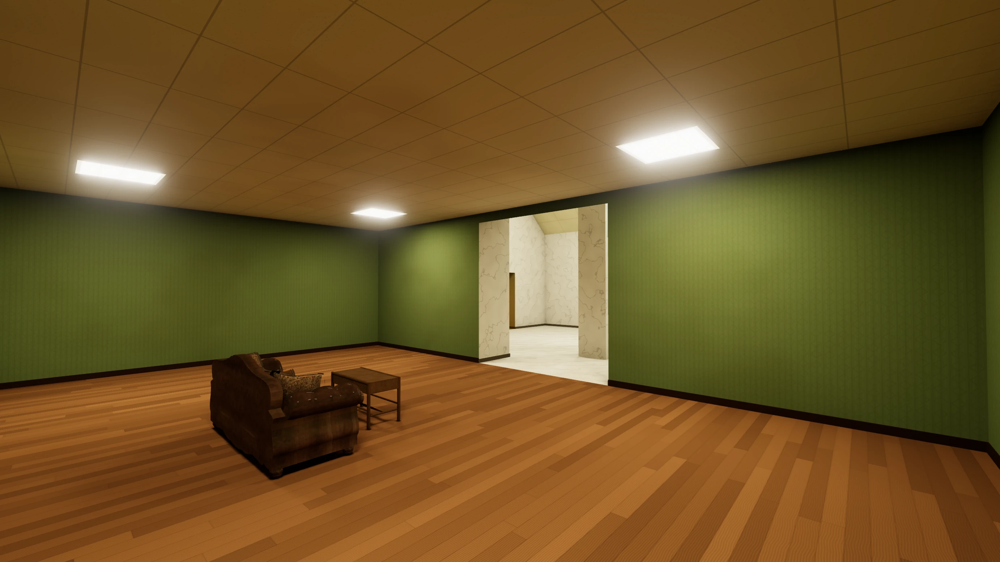

### Ein runder Bogen

Eckig sieht die Öffnung nach einem Lager aus. `arch` macht aus einer Tür einen Bogen:

```room
~ [4]
~ door = salon 1
arch = 2.9              # oben rund, in der Mitte 2,9 m hoch
casing = on             # mit Rahmen: Putz, Bekleidung und Schwelle
```

Über die ganze Breite der Tür spannt sich ein Halbkreis, in der Mitte so hoch wie die Zahl. Hier ist die Tür 3 m breit, der Halbkreis hat also 1,5 m Radius und beginnt 1,4 m über dem Boden. Es genügt, wenn einer der beiden Räume `arch` nennt, so wie bei `door`.

Eine Tür ist so tief wie die Wand, ein ganzes Feld, und sieht aus wie der Raum, dem dieses Feld gehört. Zwischen zwei gelben Räumen fällt das nicht auf; hier wäre der Bogen innen aus Marmor, und vom Salon aus sähe die grüne Wand dünn wie Papier aus. `casing = on` gibt der Tür einen Rahmen: innen heller Putz, unten eine Schwelle aus Stein und auf beiden Seiten der Wand eine Leiste um die Öffnung, in der Farbe der Sockelleiste des Raums, hier also dunkles Holz.

<!-- tutorial-screenshot
write-file: rooms/saal.room <- file:stufen/saal-salon-2.room
tab: preview
viewport: 1536x864
zoom: 1.5
hook: open view=27.60,28.60,42,1
hook: light
hook: info off
-->

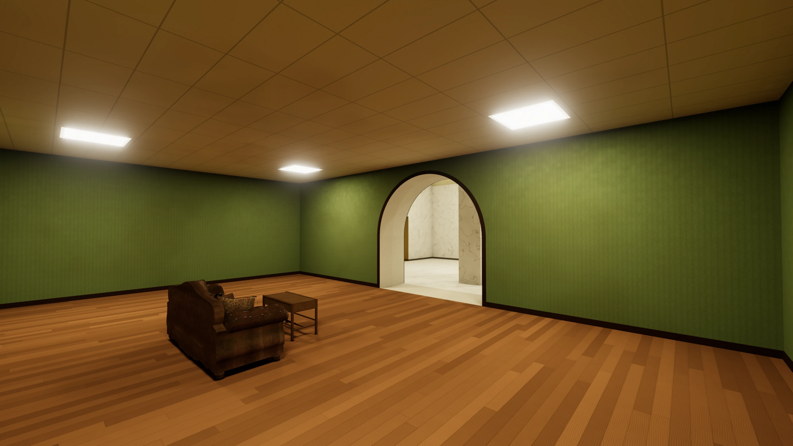

<div class='hint try'>
<p><strong>Ausprobieren:</strong> Mit einer zweiten Zahl wird der Bogen schmaler als die Tür, und daneben bleibt Wand: <code>arch = 2.9, 1.2</code> ist nur 1,2 m breit. Wie sieht <code>arch = 2.4, 0.9</code> aus, ein schmaler, hoher Durchgang? Stell danach <code>arch = 2.9</code> wieder her.</p>
</div>

### Unten anders

Die Wand soll unten aus Holz sein und oben Tapete bleiben:

```room
~ baseboard = 0.1, #3a281a
dado = 1, #553a27       # unten Holz, bis 1 m über dem Boden
dado_material = wood
```

`dado = 1, #553a27` macht die Wände bis 1 m über dem Boden anders, in dieser Farbe, und `dado_material = wood` macht diesen Teil aus Holz; ohne ist er aus demselben wie der Rest der Wand. Das Wort kommt aus der Baukunst: Im Englischen heißt der untere Teil einer Wand, der anders aussieht als der Rest, *dado*, nach dem italienischen Wort für Würfel, dem würfelförmigen Mittelstück im Sockel einer Säule. Auf Deutsch sagt man Lambris.

<!-- tutorial-screenshot
write-file: rooms/salon.room <- file:stufen/salon-3.room
tab: preview
viewport: 1536x864
zoom: 1.5
hook: open view=27.60,28.60,42,1
hook: light
hook: info off
-->

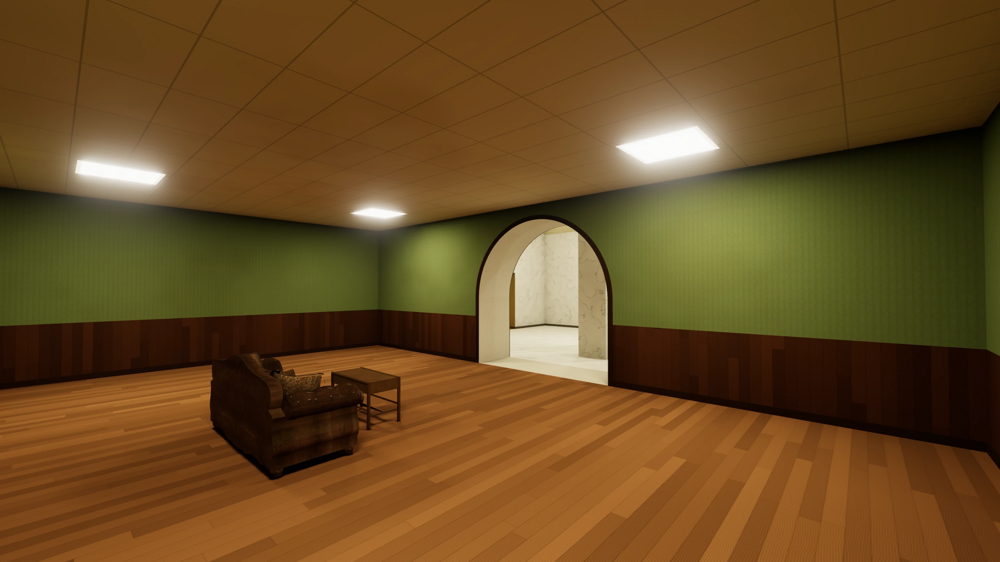

### Eine Leiste darauf

Wo Holz und Tapete sich treffen, kommt eine helle Leiste:

```room
~ dado_material = wood
dado_rail = 0.06, #d9cdae
```

`dado_rail` ist eine Leiste auf der Kante des Lambris, hier 6 cm hoch. Auf Englisch heißt sie auch *chair rail*, Stuhlleiste: Sie hielt die Lehnen der Stühle von der Wand fern, damit die Tapete hielt.

<!-- tutorial-screenshot
write-file: rooms/salon.room <- file:stufen/salon-4.room
tab: preview
viewport: 1536x864
zoom: 1.5
hook: open view=27.60,28.60,42,1
hook: light
hook: info off
-->

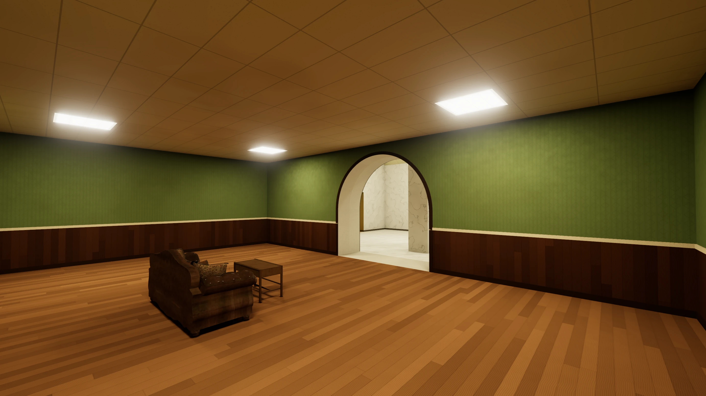

### Oben

Zuletzt die Kante, an der die Wand die Decke trifft:

```room
~ dado_rail = 0.06, #d9cdae
cornice = 0.14, #f6f3ec
```

`cornice` ist eine Leiste oben, wo Wand und Decke sich treffen, schräg wie eine Hohlkehle, hier 14 cm hoch. Auf Deutsch heißt sie Kranzgesims oder, aus Gips, Stuckleiste. Jedes dieser Stücke liegt an einer Kante: die Sockelleiste, wo die Wand auf den Boden trifft, die Stuhlleiste, wo das Holz endet, das Gesims, wo die Decke beginnt.

<!-- tutorial-screenshot
write-file: rooms/salon.room <- file:stufen/salon-5.room
tab: preview
viewport: 1536x864
zoom: 1.5
hook: open view=27.60,28.60,42,1
hook: light
hook: info off
-->

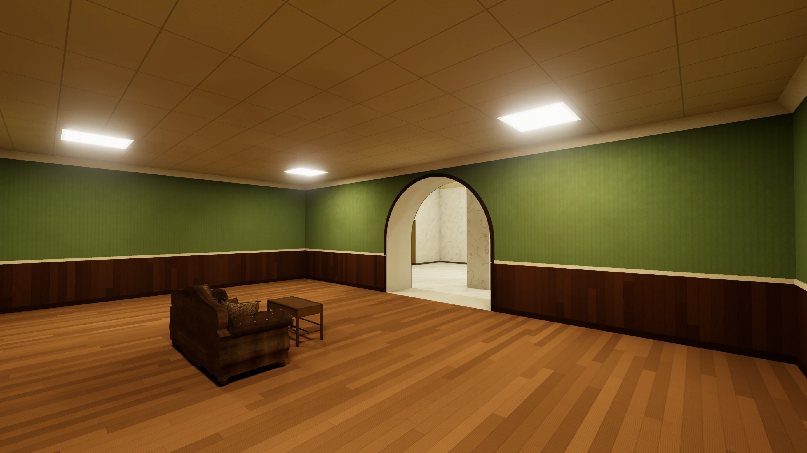
## Dein eigener Raum

Jetzt bist du dran: Bau einen Raum nach deiner Idee und schließ ihn mit einer Tür an. Was du in `[room]` einstellen kannst:

<table class='table'>
<tr><th>Eintrag</th><th>Bedeutung</th></tr>
<tr><td><code>name</code></td><td>der Name, den die Automap zeigt</td></tr>
<tr><td><code>height</code></td><td>Deckenhöhe in Metern; zwei Zahlen für eine schräge Decke</td></tr>
<tr><td><code>slope</code></td><td>wie die Decke schräg ist: <code>north</code>, <code>east</code>, <code>south</code>, <code>west</code> (sie steigt in diese Richtung an) oder <code>gable</code> (ein Satteldach)</td></tr>
<tr><td><code>walls</code></td><td><code>wallpaper</code> (Tapete), <code>marble</code> (Marmor), <code>wood</code> (Holz), <code>tiles</code> (Fliesen), <code>velvet</code> (Samt), <code>plain</code> (einfarbig), <code>concrete</code> (Beton), <code>brick</code> (Ziegel) oder <code>terrazzo</code></td></tr>
<tr><td><code>floor</code></td><td><code>carpet</code> (Teppich), <code>marble</code>, <code>wood</code>, <code>tiles</code>, <code>plain</code>, <code>concrete</code>, <code>brick</code>, <code>terrazzo</code>, <code>carpet_tiles</code> (Teppichfliesen) oder <code>checker</code> (Schachbrett)</td></tr>
<tr><td><code>wallpaper</code>, <code>carpet</code>, <code>ceiling</code></td><td>die Farben von Wänden, Boden und Decke</td></tr>
<tr><td><code>baseboard</code></td><td>die Sockelleiste: Höhe und Farbe; ohne Angabe 8 cm und etwas dunkler als die Tapete, <code>none</code>: keine</td></tr>
<tr><td><code>dado</code></td><td>die Wände unten anders: Höhe und Farbe, <code>dado_material</code> sagt, woraus</td></tr>
<tr><td><code>dado_rail</code></td><td>eine Leiste auf der Kante von <code>dado</code>: Höhe und Farbe</td></tr>
<tr><td><code>cornice</code></td><td>eine Leiste oben, wo Wand und Decke sich treffen: Höhe und Farbe</td></tr>
<tr><td><code>look</code></td><td>wohin du am <code>@</code> schaust: <code>north</code>, <code>east</code>, <code>south</code>, <code>west</code> oder Grad, im Uhrzeigersinn von Norden aus (<code>look = 30</code>: etwas rechts von Norden)</td></tr>
</table>

Für die Buchstaben im Grundriss:

<table class='table'>
<tr><th>Eintrag</th><th>Bedeutung</th></tr>
<tr><td><code>light</code></td><td>eine Leuchte unter der Decke, in dieser Farbe; dazu <code>power</code> (wie hell), <code>size</code> (wie groß, in Metern) und <code>flicker = 1</code> (sie flackert)</td></tr>
<tr><td><code>block</code></td><td>ein Block: Breite, Höhe, Tiefe; eine Zahl: ein ganzes Feld so hoch. Dazu <code>base</code> (wie hoch er schwebt), <code>color</code>, <code>material</code> (auch <code>cardboard</code>, ein Karton) und <code>shape = round</code></td></tr>
<tr><td><code>model</code></td><td>ein Modell aus <code>models/</code>: <code>height</code> (wie hoch), <code>rotation</code> (in Grad gedreht), <code>material = marble</code>, <code>pedestal</code> (ein Sockel: Breite, Höhe, Tiefe)</td></tr>
</table>

Und für eine Tür, im Abschnitt ihrer Ziffer:

<table class='table'>
<tr><th>Eintrag</th><th>Bedeutung</th></tr>
<tr><td><code>door = gang 2</code></td><td>diese Ziffer ist dasselbe Feld wie die <code>2</code> im Gang</td></tr>
<tr><td><code>arch = 2.4</code></td><td>oben rund, ein Halbkreis, in der Mitte 2,4 m hoch; <code>arch = 2.4, 0.8</code>: nur 0,8 m breit, daneben Wand</td></tr>
<tr><td><code>casing = on</code></td><td>ein Rahmen: innen Putz, eine Schwelle, auf beiden Seiten eine Leiste um die Öffnung</td></tr>
</table>

Es gibt noch mehr: Böden, die ansteigen, Treppen, Räume übereinander, Wasser. Das kommt in den tieferen Levels. Alle Einträge stehen zum Nachschlagen im Handbuch unter [Kartografie](/reference/kartografie) und in der `README.md` der Vorlage. Der Dateiname ist der Name des Raums, den eine Tür nennt: nur Kleinbuchstaben, Ziffern, `-` und `_`.

_task(eigener-raum)
## Mit Brille

<div class='found-note'>
<p>Mit der Brille sind die Gänge tiefer. Ich weiß nicht, ob die Brille sie tiefer zeigt oder ob sie tiefer werden, wenn man sie aufsetzt.</p>
<cite>Zettel, an eine Rot-Cyan-Brille geklebt</cite>
</div>

<kbd>3</kbd> schaltet auf ein Bild für eine Rot-Cyan-Brille um: Jedes Auge sieht die Räume von seinem eigenen Platz aus, und dein Gehirn macht daraus Tiefe. Wie das funktioniert, steht in der Aktivität [3D-Grafik mit Anaglyphen](/anaglyph). Auch die Automap ist dann räumlich, wie ein Modell auf dem Tisch.

Öffnest du die Seite im Browser einer VR-Brille, steht unten »ENTER VR«. Dann läufst du mit dem linken Stick, drehst dich mit dem rechten, und die Grifftaste stellt die Automap als kleines Modell vor dich hin. Damit das geht, muss die Brille die Adresse deiner Vorschau öffnen können.

## Im Maschinenraum

<div class='found-note'>
<p>Hinter einer Tür, die auf keiner Karte steht, haben wir einen Raum voller Kabel gefunden. Es summt dort lauter als anderswo. Wir glauben, dass hier alles gemacht wird.</p>
<cite>Feldhandbuch, letzte beschriebene Seite</cite>
</div>

Bis hierher hast du gebaut. Jetzt schauen wir hinter die Wände: Das Programm steht im Ordner `engine/`, in JavaScript, und benutzt die 3D-Bibliothek [three.js](https://threejs.org/). Die liegt in `vendor/`: Die Seite lädt nichts aus dem Internet. Jedes Level sieht sich ein Stück davon genauer an, hier zwei: wie aus Textdateien ein Bauwerk wird, und woher Tapete, Holz und Marmor kommen.

<table class='table'>
<tr><th>Datei</th><th>Was sie tut</th></tr>
<tr><td><code>level.js</code></td><td>liest <code>level.ini</code> und die Räume und legt sie an ihren Türen aneinander</td></tr>
<tr><td><code>geometry.js</code></td><td>baut daraus Böden, Decken, Wände, Leisten und Blöcke</td></tr>
<tr><td><code>bake.js</code></td><td>berechnet das Licht auf der Grafikkarte</td></tr>
<tr><td><code>textures.js</code></td><td>malt Tapete, Teppich, Decke und Samt, ohne ein einziges Bild</td></tr>
<tr><td><code>main.js</code></td><td>lädt alles, schaltet die Leuchten an und zeichnet jedes Bild; seine Shader rechnen Holz, Fliesen und Marmor</td></tr>
<tr><td><code>controls.js</code>, <code>automap.js</code></td><td>Laufen und Umsehen (auch mit den Daumen) und die Automap</td></tr>
</table>

### Vom Text zum Bauwerk

`level.js` macht aus den Dateien in vier Schritten ein Bauwerk:

1. **Lesen.** Es fängt mit dem Raum aus `start =` an und merkt sich jeden Raum, zu dem eine seiner Türen führt, in einer Warteschlange. Dann liest es den nächsten aus der Schlange und so weiter, bis sie leer ist; jeden Raum nur einmal. In der Informatik heißt das **Breitensuche**: erst alle Nachbarn des Anfangs, dann deren Nachbarn. Darum liest es eine Datei, zu der keine Tür führt, nie.
2. **Legen.** Der erste Raum liegt, wo er liegt. Jede Tür zu einem Raum, der noch nirgends liegt, schiebt diesen so, dass die beiden Türfelder aufeinanderliegen. Führen mehrere Türen zu einem Raum, muss jede passen; sonst steht oben links `this door doesn't fit`.
3. **Ein Gitter.** Alle Räume kommen in ein großes Gitter aus Feldern, ein Meter je Feld. Für jedes Feld steht fest, ob dort Boden ist, Wand oder nichts, und zu welchem Raum es gehört. Zwei Räume auf demselben Feld meldet das Programm: `lie in the same place`.
4. **Flächen.** `geometry.js` setzt ein Stück Wand überall dort, wo ein Feld mit Boden an eines ohne grenzt, von Boden bis Decke, und über jedes Feld mit Boden ein Stück Decke. Ein `#` im Grundriss ist im Bauwerk also keine dicke Mauer, sondern eine dünne Fläche an der Kante des Felds davor. Darum dürfen sich die Wände zweier Räume überdecken. Stücke nebeneinander legt es zu großen Flächen zusammen, solange sie nicht knicken.

Mit <kbd>E</kbd> siehst du das Gerüst des Bauwerks: jede Kante, an der zwei Flächen im Winkel aneinanderstoßen, an Ecken, an Leisten, an Möbeln und am Bogen. Am Anfang, solange das Licht noch fehlt, zeigt die Vorschau genau diese Linien. Im Salon, mit <kbd>T</kbd> ohne Texturen, damit man sie besser sieht:

<!-- tutorial-screenshot
tab: preview
viewport: 1536x864
zoom: 1.5
hook: open view=27.60,28.60,42,1
hook: light
hook: info off
hook: key e t
-->

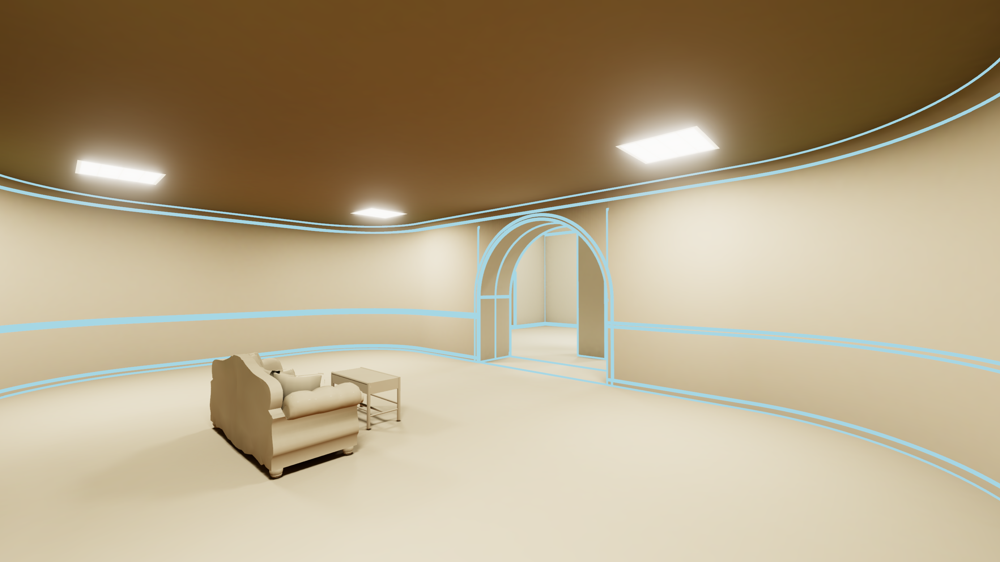
### Texturen ohne ein einziges Bild

Tapete, Teppich, Marmor, Holz, Fliesen und Samt sind keine Fotos: `textures.js` malt sie beim Laden, auf eine Leinwand des Browsers (ein `canvas`), mit Formen oder Punkt für Punkt. Man nennt das **prozedurale Texturen**: Gespeichert ist nicht das Bild, sondern das Rezept dafür. Die Vorlage braucht so keine Bilddateien, und jede Farbe in `wallpaper` oder `carpet` bekommt ihre eigene Textur.

Die Tapete entsteht in drei Schritten: eine Farbe, darauf feine senkrechte Streifen, abwechselnd etwas heller und dunkler, dann ein blasses Rautenmuster:

<div class='gallery columns-3 tiles'>
<figure>
<!-- tutorial-screenshot
# Die Tapete, Schritt 1
tab: preview
viewport: 1024x1024
zoom: 1
hook: page textures.html?show=wallpaper&step=1&bare
crop-element: canvas
-->
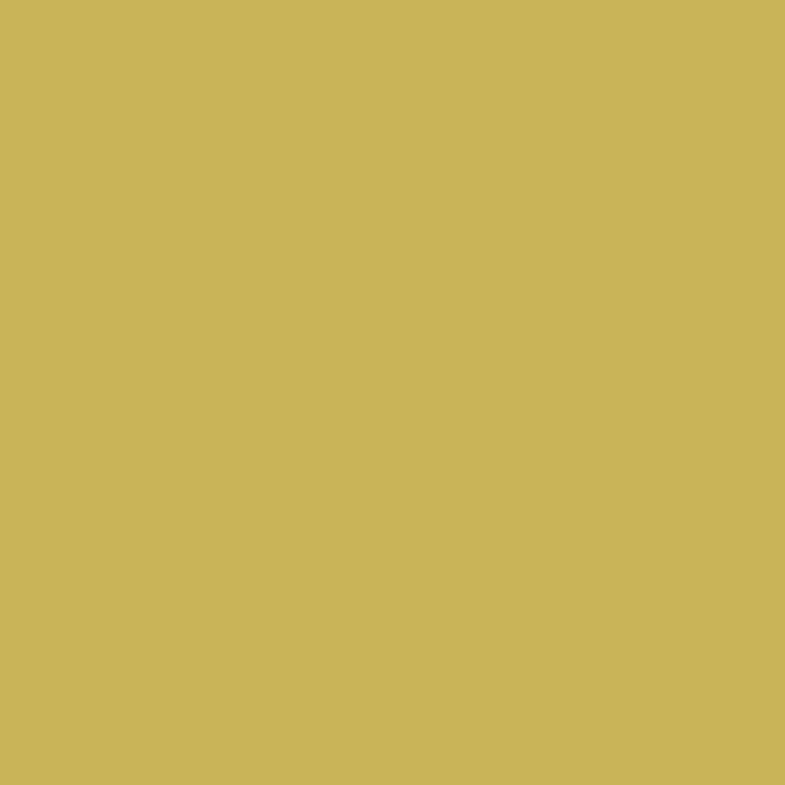
<figcaption>1. eine Farbe</figcaption>
</figure>
<figure>
<!-- tutorial-screenshot
# Die Tapete, Schritt 2
tab: preview
viewport: 1024x1024
zoom: 1
hook: page textures.html?show=wallpaper&step=2&bare
crop-element: canvas
-->
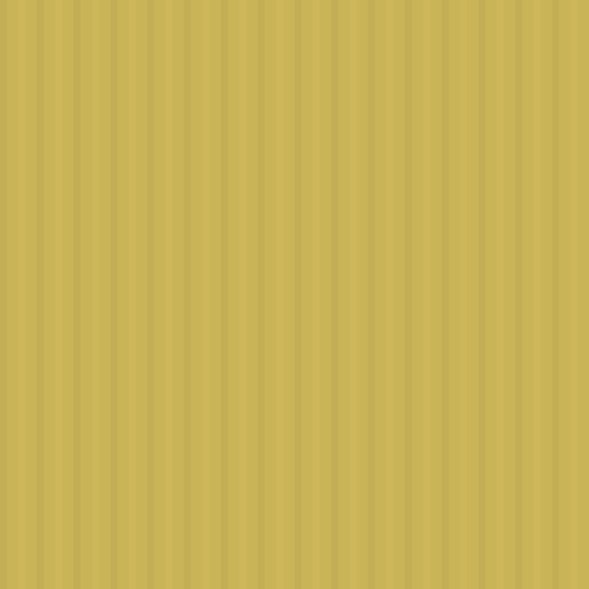
<figcaption>2. feine Streifen</figcaption>
</figure>
<figure>
<!-- tutorial-screenshot
# Die Tapete, Schritt 3
tab: preview
viewport: 1024x1024
zoom: 1
hook: page textures.html?show=wallpaper&step=3&bare
crop-element: canvas
-->
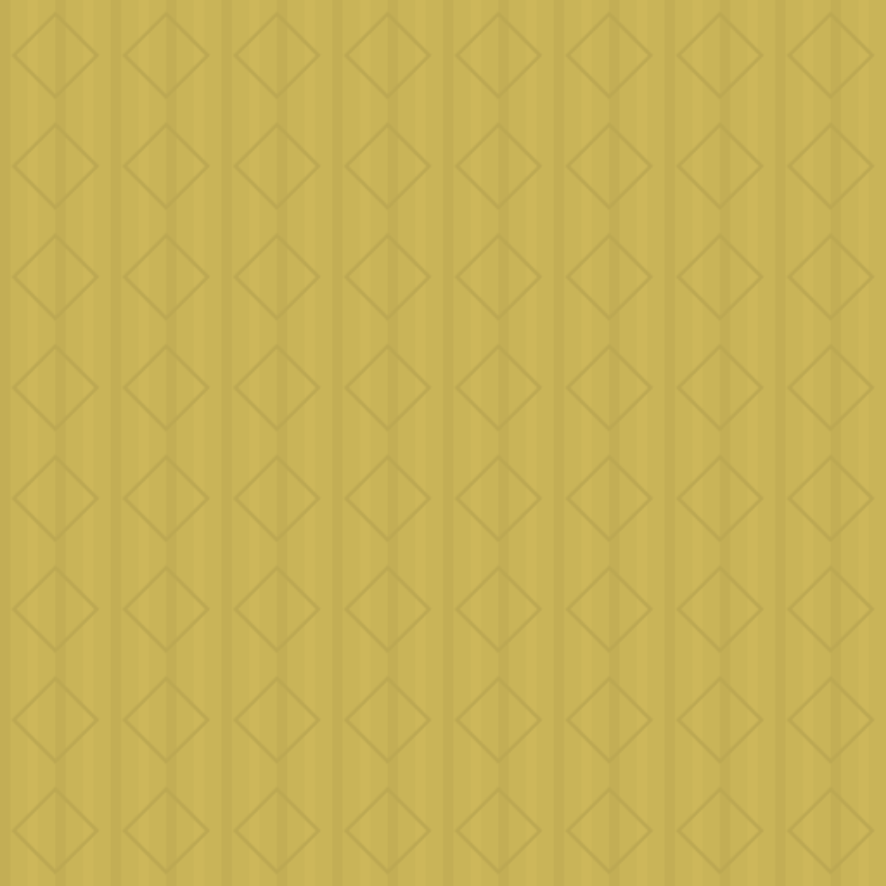
<figcaption>3. ein Rautenmuster</figcaption>
</figure>
</div>

Und die vergilbten, feuchten Flecken? Malte die Textur sie, kämen sie mit ihr jeden Meter wieder, und auf einer großen Wand sähe man ihr Muster. Darum kommen sie erst beim Zeichnen dazu, im Shader jeder Fläche: aus Rauschen, nicht über die Textur, sondern über die ganze Welt, in drei Größen. Es wiederholt sich nirgends, keine zwei Wände sehen gleich aus, und eine große Wand kostet nicht mehr als eine kleine. Dasselbe gilt für Holz, Fliesen und Marmor, wie weiter unten steht: Kein Brett kommt zweimal vor, und eine Wand von 100 m kostet nicht mehr als eine von einem Meter.

Wo die Textur selbst Zufall braucht, die Fasern im Teppich oder die Töne der Bretter, kommt er aus einer Formel (`random` in `textures.js`): Jede Zahl wird aus der vorigen berechnet, und mit derselben ersten Zahl kommt immer dieselbe Folge. So sieht alles bei jedem Laden gleich aus.

Marmor ist schwieriger: Seine Adern sind keine Form, die man malen könnte. Für jeden Punkt der Textur rechnet das Programm aus, wie hell er ist, so, wie Ken Perlin 1985 Marmor beschrieben hat:

1. **Rauschen** (englisch Noise): Auf einem Gitter von 4 × 4 Punkten liegt je eine Zufallszahl, dazwischen wird weich gemischt.
2. **Turbulenz:** dasselbe Rauschen in vier Größen, jede doppelt so fein und schwächer als die vorige, zusammengezählt.
3. Ein Sinus quer über die Textur gibt gerade Streifen; eine Ader ist dort, wo er nahe null ist.
4. Zählt man die Turbulenz zum Sinus dazu, verbiegen sich die Streifen zu Adern.

<div class='gallery columns-4 tiles'>
<figure>
<!-- tutorial-screenshot
# Marmor, Schritt 1
tab: preview
viewport: 1024x1024
zoom: 1
hook: page textures.html?show=marble&step=1&bare
crop-element: canvas
-->
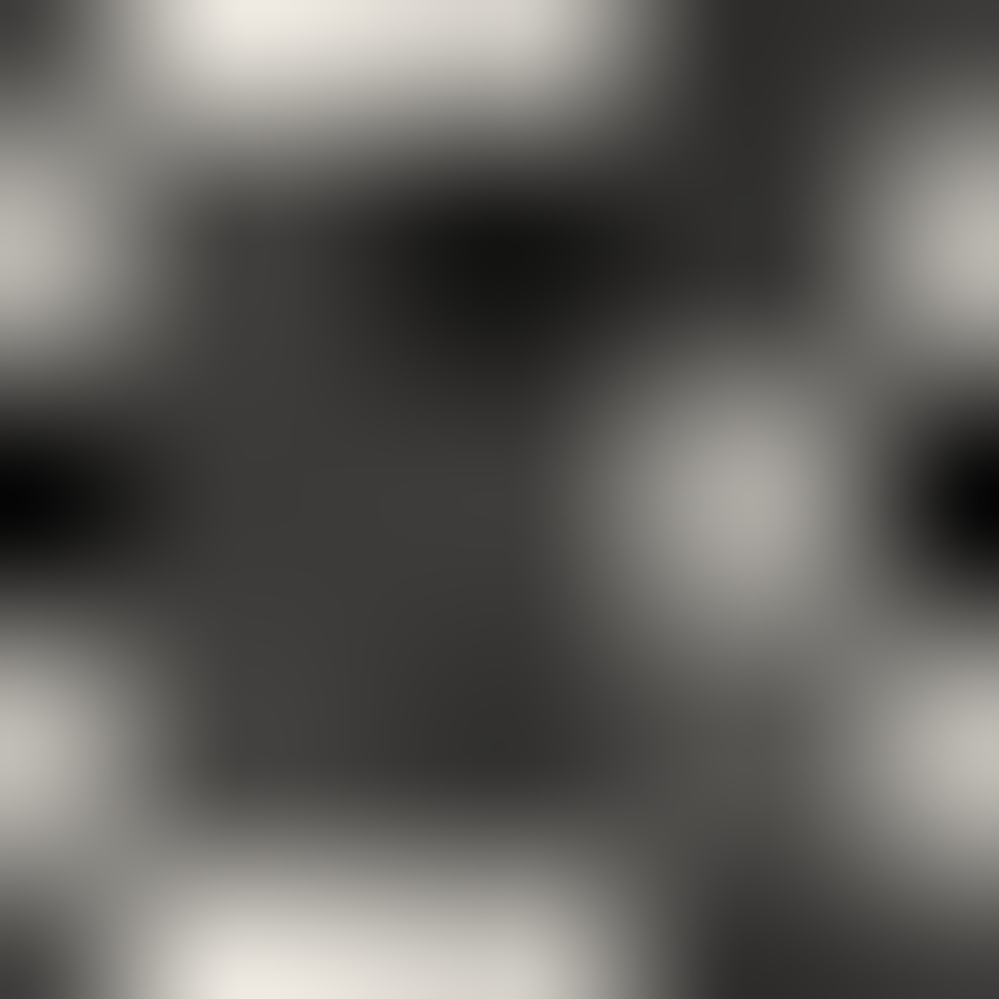
<figcaption>1. Rauschen</figcaption>
</figure>
<figure>
<!-- tutorial-screenshot
# Marmor, Schritt 2
tab: preview
viewport: 1024x1024
zoom: 1
hook: page textures.html?show=marble&step=2&bare
crop-element: canvas
-->
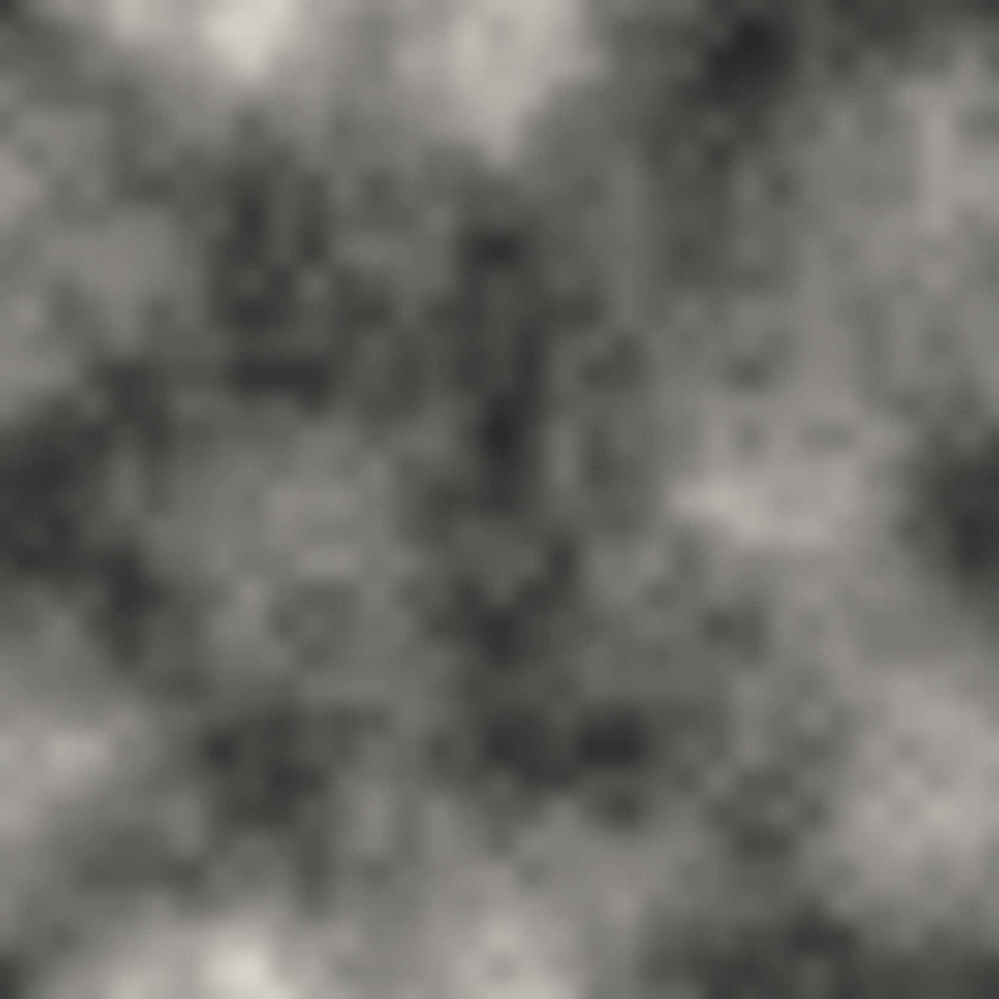
<figcaption>2. Turbulenz: Rauschen in vier Größen</figcaption>
</figure>
<figure>
<!-- tutorial-screenshot
# Marmor, Schritt 3
tab: preview
viewport: 1024x1024
zoom: 1
hook: page textures.html?show=marble&step=3&bare
crop-element: canvas
-->
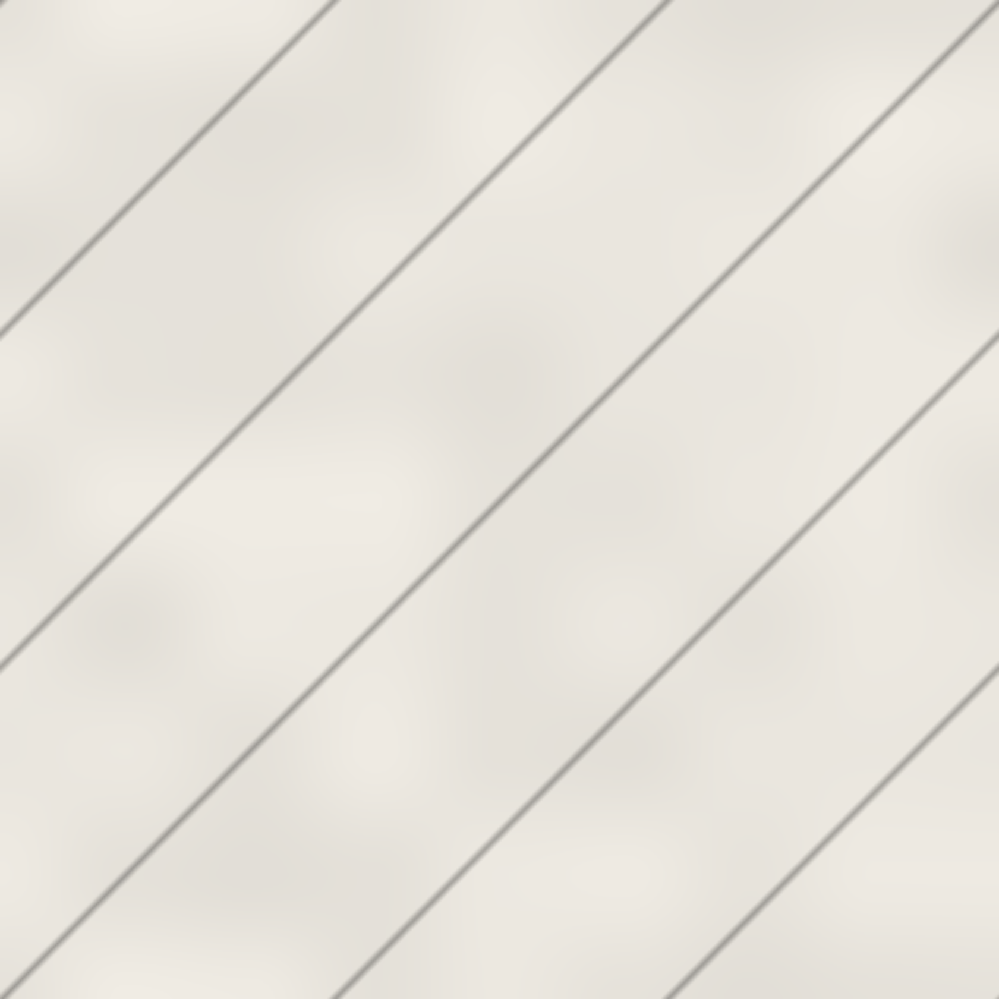
<figcaption>3. Streifen aus einem Sinus</figcaption>
</figure>
<figure>
<!-- tutorial-screenshot
# Marmor, Schritt 4
tab: preview
viewport: 1024x1024
zoom: 1
hook: page textures.html?show=marble&step=4&bare
crop-element: canvas
-->
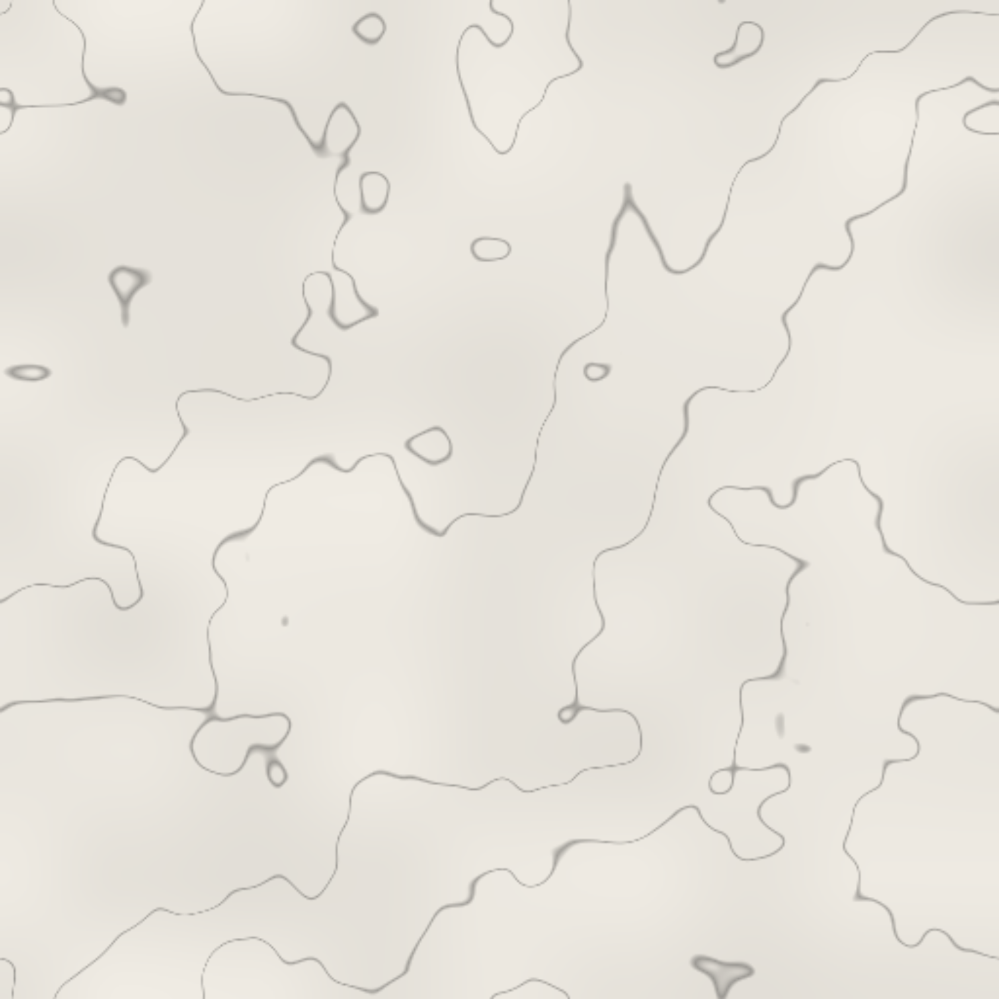
<figcaption>4. der Sinus, von der Turbulenz verbogen</figcaption>
</figure>
</div>

Holz geht ähnlich: Bretter in je eigenem Ton, eine Maserung aus einem Sinus quer über jedes Brett, von zwei weiteren Sinuswellen sanft hin und her gebogen, zuletzt die Fugen zwischen den Brettern und quer, wo eines endet:

<div class='gallery columns-4 tiles'>
<figure>
<!-- tutorial-screenshot
# Holz, Schritt 1
tab: preview
viewport: 1024x1024
zoom: 1
hook: page textures.html?show=wood&step=1&bare
crop-element: canvas
-->

<figcaption>1. Bretter, jedes in seinem Ton</figcaption>
</figure>
<figure>
<!-- tutorial-screenshot
# Holz, Schritt 2
tab: preview
viewport: 1024x1024
zoom: 1
hook: page textures.html?show=wood&step=2&bare
crop-element: canvas
-->
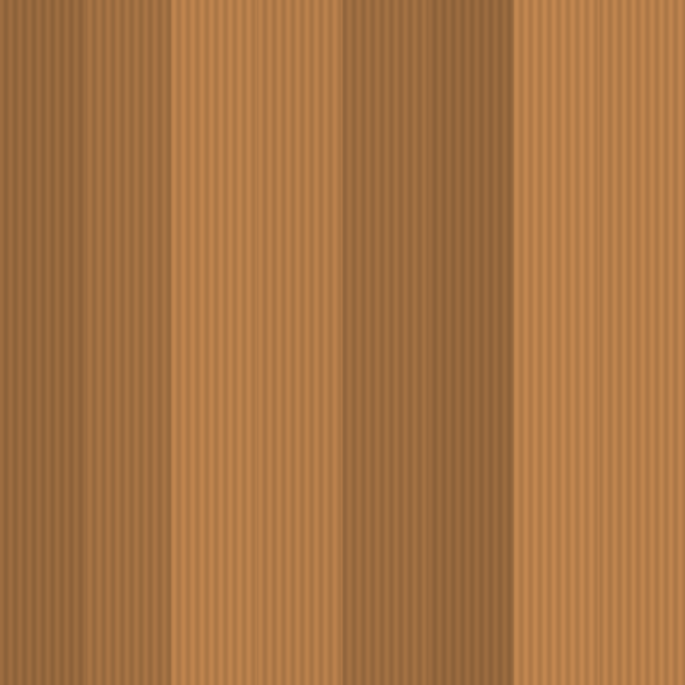
<figcaption>2. Maserung aus einem Sinus</figcaption>
</figure>
<figure>
<!-- tutorial-screenshot
# Holz, Schritt 3
tab: preview
viewport: 1024x1024
zoom: 1
hook: page textures.html?show=wood&step=3&bare
crop-element: canvas
-->
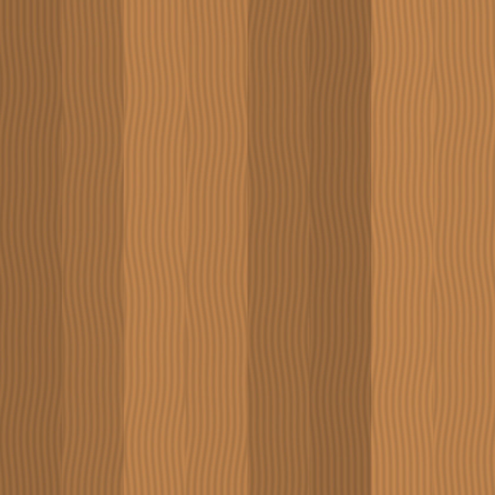
<figcaption>3. die Maserung gebogen</figcaption>
</figure>
<figure>
<!-- tutorial-screenshot
# Holz, Schritt 4
tab: preview
viewport: 1024x1024
zoom: 1
hook: page textures.html?show=wood&step=4&bare
crop-element: canvas
-->
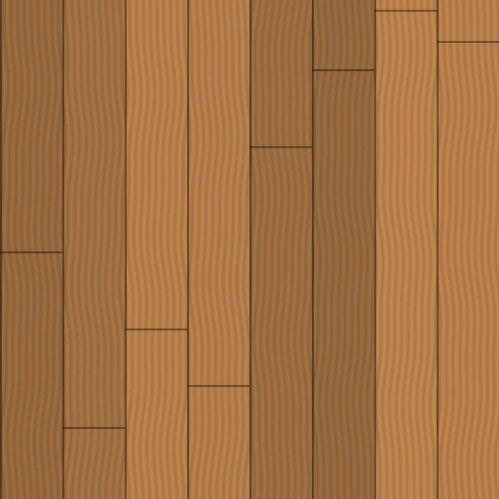
<figcaption>4. Fugen</figcaption>
</figure>
</div>

Im Level rechnet der Shader Holz, Fliesen und Marmor auf Wänden und Böden selbst aus, für jeden Bildpunkt aus seiner Stelle in der Welt, nach demselben Rezept. Der Zufall kommt dort nicht aus einer Folge, sondern aus der Stelle selbst: Aus der Nummer eines Bretts wird eine Zahl gerechnet, immer dieselbe für dasselbe Brett, und daraus sein Ton, seine Länge und seine Maserung. So ist jedes Brett anders, keine Fliese hat den Ton ihrer Nachbarin, und die Adern des Marmors, aus Rauschen im Raum, laufen über die Ecke von der Wand auf den Boden weiter. `textures.html` zeigt das Rezept auf einem Quadrat.

So sieht das Rezept für Fliesen aus, in `engine/main.js`, in GLSL, der Sprache der Shader. Die Funktion läuft für jeden Bildpunkt einer gefliesten Fläche, jedes Mal, wenn ein Bild gezeichnet wird; `uv` ist die Stelle auf der Fläche in Metern, `baseColor` die Farbe aus `wallpaper` oder `carpet`:

```glsl
vec3 tiles(vec2 uv) {
    vec2 cell = floor(uv * 10.0), inside = fract(uv * 10.0);
    float tone = 0.95 + 0.08 * hash2(cell + vec2(floor(vWorld.y * 10.0) * 0.37, 0.0));
    float aa = max(fwidth(uv.x), fwidth(uv.y)) + 1e-5;
    vec2 edge = min(inside, 1.0 - inside) / 10.0;
    float grout = max(line(edge.x, 0.003, aa), line(edge.y, 0.003, aa));
    return pow(min(baseColor * mix(tone, 0.7, grout), vec3(1.0)), vec3(2.2));
}
```

- `floor(uv * 10.0)` ist die Nummer der Fliese, zehn auf einem Meter, `fract(uv * 10.0)` die Stelle in ihr, von 0 bis 1.
- `hash2` macht aus der Nummer eine Zahl zwischen 0 und 1, die zufällig aussieht, für dieselbe Fliese aber immer gleich ist. Daraus kommt ihr Ton: Keine Fliese gleicht ihrer Nachbarin, und nichts wiederholt sich, auch auf einer Wand von 100 m nicht.
- `edge` ist der Abstand zum nächsten Rand der Fliese, in Metern. Wo er kleiner als 3 mm ist, liegt die Fuge.
- `fwidth(uv.x)` sagt, wie viel Fläche ein Bildpunkt hier misst. Weit weg ist ein Bildpunkt breiter als eine Fuge; dann zeichnet `line` sie weich und blasser, statt dass sie flimmert.
- `pow(…, 2.2)` rechnet die Farbe vom Bildschirm in Licht um, mit dem das Programm danach rechnet.

Tapete, Teppich, Decke und Samt bleiben Texturen. Jede ist ein Quadrat von einem Meter, auf der Wand liegt es nebeneinander, immer wieder. Am rechten Rand muss die Textur darum genau so weitergehen, wie sie am linken anfängt, und unten wie oben, sonst sähe man an jeder Wiederholung eine Naht. Die Streifen und Rauten der Tapete gehen deshalb glatt in einen Meter auf, und das Rauschen des Marmors auf einer Statue wiederholt sich genau über die Breite seiner Textur. Neunmal nebeneinander, die roten Linien zeigen, wo eine Wiederholung endet:

<!-- tutorial-screenshot
# Marmor neunmal nebeneinander, mit den Rändern
tab: preview
viewport: 1024x1024
zoom: 1
hook: page textures.html?tile=marble&edges&bare
crop-element: canvas
-->

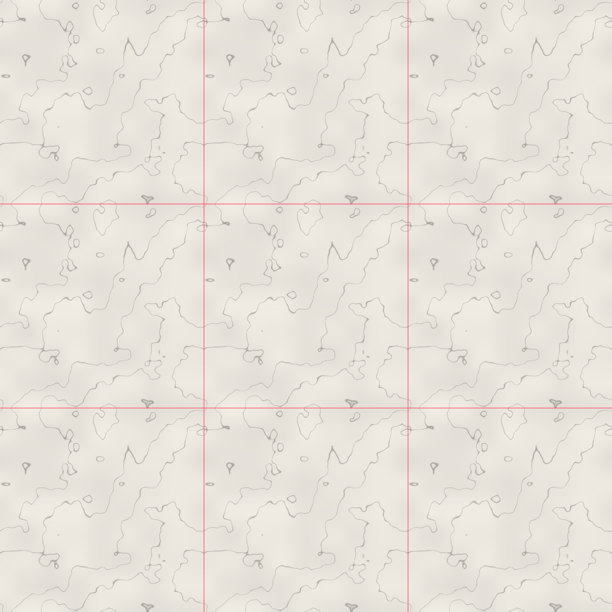

<div class='hint try'>
<p><strong>Ausprobieren:</strong> Öffne in der Vorschau statt <code>index.html</code> die Seite <code>textures.html?show=marble</code>. Ändere in <code>engine/textures.js</code> beim Marmor die Zahl in <code>vein / 0.08</code>, etwa auf 0.25, und lade neu: Wie ändern sich die Adern? Und was passiert mit <code>turbulence * 5</code>, wenn du 5 durch 12 ersetzt? Im Level ändert das nur den Marmor der Statuen: Wände und Böden aus Marmor rechnet <code>marble</code> in <code>engine/main.js</code>, dort steht dasselbe Rezept. Ersetze in <code>tiles</code> in <code>engine/main.js</code> jede <code>10.0</code> durch <code>5.0</code>, gib dem Saal <code>walls = tiles</code> und lade neu: Wie groß sind die Fliesen jetzt? Mit <code>git checkout engine/</code> ist alles wieder wie vorher.</p>
</div>

Was ein Shader ist, steht im [Handbuch zu GLSL](/reference/glsl). Wenn du am Programm etwas änderst und nichts mehr geht: Die Konsole des Browsers (<kbd>F12</kbd>) sagt, in welcher Zeile es hakt, und `git diff` zeigt, was du geändert hast.

## Ein Ausgang

<div class='found-note'>
<p>Hinter dem Saal geht es weiter, sagt eine Karte, die wir in einer Sofaritze gefunden haben. Nach Osten steigt der Boden, nach Norden führt eine Treppe, und ganz am Rand der Karte hat jemand einen Pfeil nach unten gezeichnet und nichts dazugeschrieben.</p>
<cite>Feldhandbuch, eingelegtes Blatt, an den Rändern verbrannt</cite>
</div>

Weiter geht es in [Level 1](/level-1-7e3a91c4): Böden, die ansteigen, eine Treppe ein Stockwerk hinauf, ein Dachboden und ein Loch im Boden.
