<div class='meta'>
image: halle.webp
image_alt: "Eine Halle aus Marmor unter einem hohen Satteldach, zwei Reihen Säulen, ganz hinten im hellen Licht eine Statue der Athena"
kind: projekt
topic: hidden
duration: 2 Doppelstunden
reference: [workspace]
template: https://github.com/specht/backrooms-starter.git
template_name: der Backrooms-Vorlage
</div>

# Die Backrooms

<div
    class="autotoc-secondary-trigger"
    data-title="Auf dieser Seite"
    data-levels="h2,h3">
</div>

<p class='abstract'>
Du bist durch eine Wand gefallen. Dahinter liegen die Backrooms: gelbe Tapete, feuchter Teppich, das Summen der Leuchten, Räume ohne Ende. Du kartierst sie in Textdateien, baust eigene Räume mit Türen, Säulen, schrägen Decken, Statuen und Möbeln, legst Räume übereinander, schneidest Löcher in Böden, füllst ein Becken mit Wasser und siehst zu, wie dein Browser das Licht berechnet, das zwischen den Wänden hin- und herfällt. Am Rechner, auf dem Handy, mit Rot-Cyan-Brille oder mit einer VR-Brille.
</p>

<div class='found-note'>
<p>Wenn du das hier liest, bist du durchgefallen. Nicht durch eine Prüfung. Durch die Wirklichkeit. Irgendwo hat eine Wand nicht gehalten, was sie versprochen hat, und jetzt bist du hier.</p>
<p>Keine Panik. Der Teppich ist feucht, aber er trägt. Die Leuchten summen, aber sie leuchten. Und du bist nicht der erste Mensch hier: Wir haben angefangen, alles aufzuschreiben.</p>
<cite>Erste Seite des Feldhandbuchs der Kartografen</cite>
</div>

<table class='table'>
<tr><th>Level</th><td>0, »Die Lobby«</td></tr>
<tr><th>Überlebensschwierigkeit</th><td>Klasse 1: sicher, stabil, keine Entitäten gesichtet</td></tr>
<tr><th>Ausdehnung</th><td>so groß, wie du es baust</td></tr>
<tr><th>Ausgänge</th><td>keine bekannten. Den Tab zu schließen, soll helfen (unbestätigt).</td></tr>
</table>

Die Backrooms sind eine Legende aus dem Internet. 2019 stellte jemand in einem Forum das Foto eines leeren Büroraums mit gelber Tapete ein, und jemand anderes schrieb dazu: Wer an der falschen Stelle aus der Wirklichkeit »noclippt«, landet hier, in endlosen leeren Räumen. Noclip heißt ein Cheat aus alten Ego-Shootern wie Quake: Mit ihm läuft man durch Wände. Seitdem haben unzählige Leute weitere Levels erfunden, Geschichten geschrieben und Videos gedreht.

Hier baust du deine eigenen Backrooms. Du beschreibst Räume in Textdateien: wo die Wände stehen, wo die Leuchten hängen, wo eine Tür in den nächsten Raum führt. Ein Programm im Browser liest sie, baut daraus ein Bauwerk in 3D und berechnet das Licht: wohin es fällt, wo Schatten liegen und wie es von Wänden, Boden und Decke zurückgeworfen wird. Programmieren musst du dafür nicht. Wer will, findet das ganze Programm im Ordner `engine/` und kann darin herumschrauben.

## Ausrüstung

<div class='found-note'>
<p>Was du brauchst: eine Karte (du hast keine), eine Lampe (es gibt hier genug) und einen Ordner, in den du alles schreibst, was du findest. Den Ordner gibt es schon. Er lag hier, als wir ankamen.</p>
<cite>Feldhandbuch, Seite 2</cite>
</div>

### Die Vorlage klonen

Alles, was du brauchst, steckt in der Backrooms-Vorlage:

_include(workspace#repository-klonen)

Danach liegt die Vorlage in `/workspace/backrooms-starter`:

<!-- tutorial-screenshot
# Klonen wie im Handbuch »Workspace« (oben eingebunden), dann die
# geöffnete Vorlage im Explorer, level.ini im Editor
show-left-sidebar
clone-start: https://github.com/specht/backrooms-starter.git @ 6ac89e372fe8159bad0eaf41d25fb10739a9e743
press: Enter
wait-for-input-value: /workspace/
press: Enter
wait-for-text: Would you like to open the repository?
click: Open
wait-for-text: level.ini
open-file: level.ini
sleep: 1
-->


Darin liegen drei Levels. Deins beginnt klein, in `level.ini` und im Ordner `rooms`: ein Zimmer, ein Gang und zwei farbige Räume. In `lobby` und `tiefe` liegen zwei fertige Levels zum Ausprobieren; dazu später mehr.

_task(geklont)

### Eintreten

_include(workspace#live-server)

Die Vorschau zeigt `index.html`. Zuerst ist es dunkel, nur feine Linien zeigen die Kanten der Räume. Dann gehen die Leuchten an, eine nach der anderen, die nächsten zuerst, und oben links wächst ein Balken: Das Licht wird berechnet.

<!-- tutorial-screenshot
# Die Vorschau, während das Licht gebacken wird
go-live
tab: preview
viewport: 1536x864
zoom: 1.5
hook: baking
-->


Wie lange das dauert, hängt von der Grafikkarte deines Rechners ab. Ist es fertig, steht dort »Light baked in …«:

<!-- tutorial-screenshot
# fertig gebacken (die Seite neu, im Bild davor stand sie still); der Kasten
# oben links nur im Bild davor, beim Backen
tab: preview
viewport: 1536x864
zoom: 1.5
hook: open
hook: light
hook: info off
-->


Klick ins Bild, dann siehst du dich mit der Maus um. <kbd>Esc</kbd> gibt die Maus wieder frei.

<table class='table'>
<tr><th>Taste</th><th>Was passiert</th></tr>
<tr><td><kbd>W</kbd> <kbd>A</kbd> <kbd>S</kbd> <kbd>D</kbd></td><td>laufen, mit <kbd>Shift</kbd> rennen</td></tr>
<tr><td><kbd>↑</kbd> <kbd>↓</kbd> <kbd>←</kbd> <kbd>→</kbd></td><td>vor und zurück laufen, nach links und rechts drehen</td></tr>
<tr><td><kbd>M</kbd> oder <kbd>Tab</kbd></td><td>die Automap: das ganze Bauwerk als Drahtgitter</td></tr>
<tr><td><kbd>Shift</kbd> <kbd>R</kbd></td><td>zurück zum Anfang</td></tr>
<tr><td><kbd>P</kbd></td><td>den Kasten oben links aus- und wieder einblenden</td></tr>
</table>

Wo du stehst, merkt sich die Adresse der Seite, eine offene Automap auch, so gedreht und gezoomt, wie sie ist. Lädst du neu, stehst du wieder dort, solange sich der Grundriss nicht geändert hat: Ändere einen Raum, lade neu und sieh dir dieselbe Stelle noch einmal an.

Auf dem Handy oder Tablet läufst du mit dem linken Daumen: Wo er das Bild berührt, erscheint ein Ring, und schiebst du ihn aus dessen Mitte, läufst du in diese Richtung, ganz hinaus geschoben rennst du. Der rechte Daumen wischt, um dich umzusehen. In der Automap dreht ein Finger die Karte, zwei Finger zoomen und verschieben sie. <span class='bi bi-list'></span> oben rechts blendet den Kasten oben links aus und wieder ein.

<div class='hint try'>
<strong>Ausprobieren:</strong> Drück <kbd>M</kbd>. Die Automap zeigt das Bauwerk als Drahtgitter, jeden Raum mit seinem Namen, die Leuchten als gelbe Punkte; der rote Pfeil bist du. Zieh mit der Maus, um die Karte zu drehen, mit <kbd>Shift</kbd>, um sie zu verschieben, und zoom mit dem Mausrad. Lauf ein paar Schritte, während sie offen ist, und schau nach unten: Was macht die Karte? <kbd>V</kbd> zeigt statt des Drahtgitters die Räume selbst von oben, ohne Decken, mit ihrem Licht. <kbd>Esc</kbd> schließt die Karte.
</div>

So sieht die Automap aus, wenn du am Start nach Nordosten und etwas nach unten schaust und mit dem Mausrad ein Stück herauszoomst:

<!-- tutorial-screenshot
# die Automap über dem ganzen Level: vom Start aus nach Nordosten, nach unten geneigt
tab: preview
viewport: 1536x864
zoom: 1.5
hook: open view=5.00,17.00,-38,-35
hook: light
hook: key m
hook: wheel 450
hook: info off
-->


Und mit <kbd>V</kbd>, die Räume selbst:

<!-- tutorial-screenshot
tab: preview
viewport: 1536x864
zoom: 1.5
hook: open view=5.00,17.00,-38,-35
hook: light
hook: key m v
hook: wheel 450
hook: info off
-->


## Kartografie

<div class='found-note'>
<p>Wir kartieren in Feldern. Ein Feld ist ein Meter. Eine Raute ist eine Wand, ein Punkt ist Teppich. Was nicht auf der Karte steht, gibt es nicht. Das ist die einzige Regel, auf die man sich hier verlassen kann.</p>
<cite>Notiz, mit Kugelschreiber auf die Tapete geschrieben</cite>
</div>

### Ein Raum

Öffne `rooms/zimmer.room`. Das ist der Raum, in dem du aufgewacht bist:

```room
# Ein kleines Zimmer. Du weißt nicht, wie du hierhergekommen bist.

[room]
baseboard = 0.08, #86763c
name = Zimmer
height = 2.6
look = east              # am @ schaust du zur Tür

[map]
#######
#.....#
#.@.L.1
#.....#
#.....#
#######

[L]
light = #ffe7b8
power = 0.9

[1]
door = gang 1
```

Eine Raumdatei besteht aus Abschnitten in eckigen Klammern. In `[room]` steht, wie der Raum aussieht: sein Name, wie hoch die Decke ist (2,6 m), eine dunkle Sockelleiste unten an den Wänden, 8 cm hoch, und wohin du am Anfang schaust. Eine Zeile, die mit `#` beginnt, ist ein Kommentar, ebenso alles ab einem `#` mit Leerzeichen davor und danach; eine Farbe wie `#86763c` hat kein Leerzeichen dahinter.

In `[map]` steht der Grundriss, von oben gesehen, oben ist Norden. Hier zählt jedes Zeichen, Kommentare gibt es darin nicht:

<table class='table'>
<tr><th>Zeichen</th><th>Bedeutung</th></tr>
<tr><td><code>#</code></td><td>Wand</td></tr>
<tr><td><code>.</code></td><td>Boden</td></tr>
<tr><td><code>@</code></td><td>hier fängst du an, nur einmal im ganzen Level</td></tr>
<tr><td>Leerzeichen</td><td>nichts, außerhalb des Raums</td></tr>
<tr><td>ein Buchstabe</td><td>eine Leuchte, ein Block, ein Modell oder ein Becken; was es ist, steht im Abschnitt mit diesem Buchstaben</td></tr>
<tr><td>eine Ziffer</td><td>eine Tür in einen anderen Raum, beschrieben im Abschnitt mit dieser Ziffer; dieselbe Ziffer mehrmals in einer Reihe, nebeneinander oder untereinander, ist eine breite Tür</td></tr>
<tr><td><code>_</code>, <code>^</code></td><td>ein Loch im Boden und eins in der Decke (siehe »Ein Loch im Boden«)</td></tr>
</table>

`[L]` sagt, dass das `L` eine Leuchte ist, mit warmem, gelblichem Licht. `[1]` macht aus der `1` am rechten Rand eine Tür.

### Türen

Eine Tür ist ein Feld, das zwei Räumen gehört. `door = gang 1` heißt: Diese `1` ist dasselbe Feld wie die `1` in `rooms/gang.room`. Das Programm legt die beiden Räume so nebeneinander, dass die Türen aufeinanderliegen. Ihre Wände dürfen sich dabei überdecken, ihre Böden nicht.

Zwei Räume dürfen sich auch mehrere Türen teilen, jede mit ihrer eigenen Ziffer. So entsteht aus vielen kleinen Dateien ein Bauwerk. `level.ini` nennt nur den ersten Raum (`start = zimmer`). Das Programm liest ihn, dann jeden Raum, zu dem eine seiner Türen führt, dann deren Nachbarn, bis es keine neuen Türen mehr gibt. Eine Datei, zu der keine Tür führt, liest es gar nicht.

_task(tuer)

## Ein Raum mehr

<div class='found-note'>
<p>Gestern war im Gang neben dem Zimmer eine Wand. Heute ist dort eine Öffnung. Ich habe nachgezählt: Das Feld ist dasselbe. Die Wand ist weg. Dahinter ist eine Kammer, die es gestern nicht gab.</p>
<cite>Seite aus einem durchnässten Notizbuch</cite>
</div>

### Eine Kammer anbauen

Leg im Ordner `rooms` eine neue Datei `kammer.room` an:

```room
# Eine Kammer, die gestern noch nicht da war.

[room]
name = Kammer
height = 2.2
wallpaper = #9a8a4c

[map]
#####
5...#
#.L.#
#...#
#####

[L]
light = #ffb070
power = 0.9
flicker = 1
```

Die Leuchte ist orange, und mit `flicker = 1` flackert sie ab und zu. Die Tapete ist eine Farbe als Hexadezimalzahl wie in CSS: Rot, Grün und Blau, je zwei Ziffern.

Noch führt keine Tür in die Kammer, also gibt es sie nicht. Öffne `rooms/gang.room`. Weit unten im Grundriss ist links die `1`, die Tür zum Zimmer. Ersetze in dieser Zeile das `#` am rechten Rand durch eine `5`:

```room
~ #...#
1...5
~ #...#
```

und schreib ganz unten in die Datei, wohin sie führt:

```room
[5]
door = kammer 5
```

Speichere beide Dateien und lade die Vorschau neu. Die Kammer liegt östlich vom Gang, gegenüber der Tür zum Zimmer. In `kammer.room` steht kein Abschnitt `[5]`: Es genügt, wenn einer der beiden Räume die Tür beschreibt.

<!-- tutorial-screenshot
# Die Kammer: die Räume wie auf der Seite, dann aus ihrer Ecke zur Tür
write-file: rooms/zimmer.room <- file:stufen/zimmer.room
write-file: rooms/gang.room <- file:stufen/gang.room
write-file: rooms/kammer.room <- file:stufen/kammer.room
tab: preview
viewport: 1536x864
zoom: 1.5
hook: open view=16.00,19.00,56,0
hook: light
hook: info off
-->


Stimmt etwas nicht, steht oben links in Rot, in welcher Datei (und, wenn es eine Zeile ist, in welcher) das Programm hängen geblieben ist, auf Englisch, zum Beispiel `rooms/kammer.room: room kammer and room rot lie in the same place at the same height`. Das heißt: Der Raum läge auf dem Boden eines anderen; dahinter steht auch, an welchem Feld. Schieb die Tür an eine andere Stelle oder mach den Raum kleiner.

## Ein Saal, Schritt für Schritt

<div class='found-note'>
<p>Hinter der Kammer ist noch eine Tür. Dahinter: ein Saal, leer und hoch. Jedes Mal, wenn ich zurückkomme, steht etwas mehr darin.</p>
<cite>Seite aus einem durchnässten Notizbuch, andere Handschrift</cite>
</div>

Hinter der Kammer baust du einen Saal, Schritt für Schritt: erst den Grundriss, dann eine schräge Decke, Säulen, farbiges Licht, eine Statue und Marmor. Nach jedem Schritt speicherst du und lädst die Vorschau neu.

### Der Grundriss

Gib der Kammer in `rooms/kammer.room` eine zweite Tür, an der rechten Wand, in der Zeile der ersten:

```room
~ #####
5...6
~ #.L.#
```

und schreib unten dazu, wohin sie führt:

```room
[6]
door = saal 1
```

Dann leg `rooms/saal.room` an:

```room
# Ein Saal hinter der Kammer.

[room]
name = Saal
height = 3

[map]
#############
#...........#
#...L...L...#
1...........#
#...........#
#...........#
#...L...L...#
#...........#
#############

[L]
light = #fff3cf
```

Ein Saal, 11 m lang und 7 m breit, mit vier Leuchten in zwei Reihen. Weil `[L]` nur einmal beschrieben ist, sind alle vier gleich.

<!-- tutorial-screenshot
write-file: rooms/kammer.room <- file:stufen/kammer-2.room
write-file: rooms/saal.room <- file:stufen/saal-1.room
tab: preview
viewport: 1536x864
zoom: 1.5
hook: open view=18.00,16.40,-102,8
hook: light
hook: info off
-->


### Schräge Decken

Zwei Höhen machen die Decke schräg, `slope` sagt, wie. `gable` ist ein Satteldach: an den Wänden 3 m, in der Mitte 7 m hoch, der First läuft an der längeren Seite entlang. Die Leuchten liegen dann so schräg wie die Decke über ihnen. Weil sie jetzt höher hängen, bekommen sie mit `power` mehr Kraft:

```room
~ [room]
~ name = Saal
height = 3, 7
slope = gable
```

```room
~ [L]
~ light = #fff3cf
power = 1.6
```

<!-- tutorial-screenshot
write-file: rooms/saal.room <- file:stufen/saal-2.room
tab: preview
viewport: 1536x864
zoom: 1.5
hook: open view=18.00,16.40,-102,8
hook: light
hook: info off
-->


Eine Decke kann auch nur in eine Richtung ansteigen, wie ein Pultdach. Mit `slope = east` statt `gable` wird die Decke des Saals nach Osten immer höher, also nach rechts im Grundriss:

```room
~ height = 3, 7
slope = east
```

An der Westwand ist sie dann 3 m hoch, an der Ostwand 7 m. Statt `east` geht auch `north`, `south` oder `west`. Auch hier liegen die Leuchten so schräg wie die Decke. So sähe der Saal damit aus, von der Seite; für die nächsten Schritte bleibt er beim Satteldach:

<!-- tutorial-scope -->

<!-- tutorial-screenshot
write-file: rooms/saal.room <- file:stufen/saal-pult.room
tab: preview
viewport: 1536x864
zoom: 1.5
hook: open view=23.40,15.20,170,14
hook: light
hook: info off
-->


<!-- /tutorial-scope -->

### Säulen

Ein Buchstabe im Grundriss kann auch ein Block sein. Vier Säulen, je zwei an den langen Seiten, zwischen den Leuchten:

```room
~ #...........#
#...L.S.L.S.#
~ 1...........#
~ #...........#
~ #...........#
#...L.S.L.S.#
~ #...........#
```

```room
[S]
block = 0.7, 7, 0.7      # höher als die Decke: Die Säule verschwindet in ihr
```

`block = 0.7, 7, 0.7` ist 0,7 m breit, 7 m hoch und 0,7 m tief, mitten auf seinem Feld. Ist ein Block höher als die Decke, verschwindet er in ihr. `block = 1` füllt das ganze Feld einen Meter hoch, eine Kiste. Mit `base = 2` schwebt ein Block zwei Meter über dem Boden, mit `color = #6a5a3a` bekommt er eine eigene Farbe; ohne sieht er aus wie die Wände seines Raums. Mit `material = marble` ist er aus Marmor, auch in einem Raum mit Tapete; es gehen alle Arten, die es für Wände gibt (weiter unten im Kapitel). Durch Blöcke läuft man nicht hindurch, und sie werfen Schatten.

<!-- tutorial-screenshot
write-file: rooms/saal.room <- file:stufen/saal-3.room
tab: preview
viewport: 1536x864
zoom: 1.5
hook: open view=18.00,16.40,-102,8
hook: light
hook: info off
-->


### Farbiges Licht

Die Leuchte hinten rechts soll rot leuchten. Sie bekommt einen eigenen Buchstaben:

```room
~ #...........#
#...L.S.R.S.#
~ #...........#
```

```room
[R]
light = #ff3020
power = 3
size = 1.2, 1.2
```

`light` ist die Farbe, `size` die Größe in Metern: Eine größere Leuchte wirft weichere Schatten. Das rote Licht fällt auf Wände, Boden und Säulen und wird von ihnen zurückgeworfen, rot gefärbt. So sähe der Saal mit der roten Leuchte aus; für die nächsten Schritte bleiben alle vier weiß.

<!-- tutorial-scope -->

<!-- tutorial-screenshot
write-file: rooms/saal.room <- file:stufen/saal-4.room
tab: preview
viewport: 1536x864
zoom: 1.5
hook: open view=18.00,16.40,-102,8
hook: light
hook: info off
-->


<!-- /tutorial-scope -->

### Eine Statue

<div class='found-note'>
<p>In der großen Halle steht eine Frau aus Stein, sechs Meter hoch. Sie schaut zum Eingang. Ich bin dreimal um sie herumgegangen. Sie schaut immer zum Eingang.</p>
<cite>Letzter Eintrag einer Kartografin, Halle</cite>
</div>

In die Mitte des Saals kommt Athena, auf einem Sockel:

```room
~ 1...........#
#.....M.....#
~ #...........#
```

```room
[M]
model = statues/athena.glb
height = 2.2
rotation = 270
material = marble
pedestal = 0.9, 0.8, 0.9
```

Eine Statue ist ein 3D-Modell im Format GLB. `height` macht sie so hoch wie angegeben, `rotation` dreht sie in Grad um ihre senkrechte Achse (hier zur Tür), `material = marble` macht sie aus Marmor statt aus den Farben des Modells, und `pedestal` stellt sie auf einen Sockel: 0,9 m breit, 0,8 m hoch, 0,9 m tief. Auch Statuen werfen Schatten und bekommen Bounce-Licht, und wo eine Statue sich selbst verdeckt, ist es auf ihr dunkler.

<!-- tutorial-screenshot
write-file: rooms/saal.room <- file:stufen/saal-5.room
tab: preview
viewport: 1536x864
zoom: 1.5
hook: open view=18.00,16.40,-102,8
hook: light
hook: info off
-->


Athena ist der 3D-Scan eines Gipsabgusses einer antiken Statue, aus dem [Statens Museum for Kunst](https://open.smk.dk/artwork/image/KAS255) in Kopenhagen, gemeinfrei. Ohne `material = marble` behält ein Modell seine eigenen Farben. Wie du eigene Modelle holst, Möbel zum Beispiel, steht im Kapitel »Licht«, in »Modelle von Poly Haven«.

### Marmor

Zum Schluss Wände und Boden aus Marmor:

```room
~ height = 3, 7
~ slope = gable
walls = marble
floor = marble
```

<!-- tutorial-screenshot
write-file: rooms/saal.room <- file:stufen/saal-6.room
tab: preview
viewport: 1536x864
zoom: 1.5
hook: open view=18.00,16.40,-102,8
hook: light
hook: info off
-->


### Andere Wände und Böden

Marmor ist nur eine Möglichkeit. `walls` kennt sechs Arten, `floor` fünf, jede in der Farbe aus `wallpaper` (Wände) und `carpet` (Boden), Marmor in seiner eigenen:

<table class='table'>
<tr><th>Wert</th><th>Wände (<code>walls</code>)</th><th>Boden (<code>floor</code>)</th></tr>
<tr><td><code>wallpaper</code>, <code>carpet</code></td><td>Tapete mit Rautenmuster</td><td>Teppich</td></tr>
<tr><td><code>marble</code></td><td>Marmor</td><td>Marmor</td></tr>
<tr><td><code>wood</code></td><td>senkrechte Bretter</td><td>Dielen</td></tr>
<tr><td><code>tiles</code></td><td>Fliesen</td><td>Fliesen</td></tr>
<tr><td><code>velvet</code></td><td>Samt in senkrechten Streifen, wie im Kino</td><td></td></tr>
<tr><td><code>plain</code></td><td>einfarbig</td><td>einfarbig</td></tr>
</table>

Für Fliesen wie in einem Schwimmbad zum Beispiel `walls = tiles`, `floor = tiles`, `wallpaper = #e6ecef` und `carpet = #c4ced3`, dazu eine helle Decke mit `ceiling = #e8ecee`. So sieht der leere Saal vom Anfang mit jeder Art aus, Holz mit Wandlampen und Samt mit Kerzenleuchtern statt Leuchten an der Decke; wie das geht, steht im Kapitel »Licht« (ein Klick zeigt ein Bild groß):

<!-- tutorial-scope -->

<div class='gallery columns-3'>
<figure>

<figcaption><code>wallpaper</code> und <code>carpet</code></figcaption>
</figure>
<figure>
<!-- tutorial-screenshot
write-file: rooms/saal.room <- file:stufen/saal-marmor.room
tab: preview
viewport: 1536x864
zoom: 1.5
hook: open view=18.00,16.40,-102,8
hook: light
hook: info off
-->

<figcaption><code>marble</code></figcaption>
</figure>
<figure>
<!-- tutorial-screenshot
write-file: rooms/saal.room <- file:stufen/saal-holz.room
tab: preview
viewport: 1536x864
zoom: 1.5
hook: open view=18.00,16.40,-102,8
hook: light
hook: info off
-->

<figcaption><code>wood</code>, mit Wandlampen</figcaption>
</figure>
<figure>
<!-- tutorial-screenshot
write-file: rooms/saal.room <- file:stufen/saal-fliesen.room
tab: preview
viewport: 1536x864
zoom: 1.5
hook: open view=18.00,16.40,-102,8
hook: light
hook: info off
-->

<figcaption><code>tiles</code></figcaption>
</figure>
<figure>
<!-- tutorial-screenshot
write-file: rooms/saal.room <- file:stufen/saal-einfarbig.room
tab: preview
viewport: 1536x864
zoom: 1.5
hook: open view=18.00,16.40,-102,8
hook: light
hook: info off
-->

<figcaption><code>plain</code></figcaption>
</figure>
<figure>
<!-- tutorial-screenshot
write-file: rooms/saal.room <- file:stufen/saal-samt.room
tab: preview
viewport: 1536x864
zoom: 1.5
hook: open view=18.00,16.40,-102,8
hook: light
hook: info off
-->

<figcaption><code>velvet</code>, mit Kerzenleuchtern</figcaption>
</figure>
</div>

<!-- /tutorial-scope -->

## Hinauf und hinunter

<div class='found-note'>
<p>Der Gang hinter dem Saal steigt an. Das merkt man an den Beinen, nicht an den Augen: Die Decke hängt schief, die Leuchten auch, und irgendwann weiß ich nicht mehr, ob ich hinauf- oder hinuntergehe.</p>
<cite>Bleistiftnotiz, sehr klein geschrieben</cite>
</div>

Bis hierher liegt jeder Boden auf derselben Höhe. Jetzt geht es aufwärts und abwärts: schräge Böden, ein Dachboden über dem Gang, ein Loch, durch das man fällt, und eine Tür, hinter der kein Boden mehr ist.

### Schräge Böden

Auch ein Boden kann schräg sein. Hinter dem Saal kommt erst ein ebener Gang, dann geht es hinauf. Gib dem Saal an der rechten Wand eine Tür, drei Felder breit:

```room
~ #...L.S.L.S.#
1...........2
#.....M.....2
#...........2
~ #...L.S.L.S.#
```

```room
[2]
door = vorgang 1
```

Dieselbe Ziffer mehrmals in einer Reihe, untereinander wie hier oder nebeneinander, ist eine breite Tür. Die Tür auf der anderen Seite muss genauso breit sein; ist sie es nicht, steht oben links, wie breit jede ist. Leg dahinter `rooms/vorgang.room` an, einen ebenen Gang mit einer Tür, die so breit ist wie er selbst:

_include_file(stufen/vorgang.room, room_copy)

und dahinter `rooms/rampe.room`, so breit wie der Gang:

```room
# Eine Rampe hinter dem Saal.

[room]
name = Rampe
ramp = east, 4          # der Boden steigt nach Osten um 4 m
height = 2.6

[map]
####################
1..................#
1...L.....L.....L..#
1..................#
1...L.....L.....L..#
1..................#
####################

[L]
light = #fff3cf
power = 1.6
```

`ramp = east, 4` lässt den Boden nach Osten um 4 m ansteigen, vom ersten Feld hinter der Wand bis zum letzten. `height` misst die Decke über dem Boden, an jeder Stelle: Sie steigt mit, überall 2,6 m über dir, und die Leuchten mit ihr. Wie hoch ein Raum liegt, rechnet das Programm aus seinen Türen aus: An einer Tür liegen beide Böden gleich hoch. Eine Tür am oberen Ende, in der Ostwand, führte in einen Raum 4 m über dem Saal. Vom ebenen Gang aus sieht man, wo es hinaufgeht:

<!-- tutorial-screenshot
# Vom ebenen Gang aus: vorn eben, hinten steigt der Boden
write-file: rooms/saal.room <- file:stufen/saal-7.room
write-file: rooms/vorgang.room <- file:stufen/vorgang.room
write-file: rooms/rampe.room <- file:stufen/rampe-1.room
tab: preview
viewport: 1536x864
zoom: 1.5
hook: open view=34.40,17.50,-84,10,,0
hook: light
hook: info off
-->


### Boden und Decke zusammen

Mit `slope` und zwei Höhen kippt die Decke außerdem, und weil die Höhen über dem Boden gelten, kippt sie gegen den Boden. Jede Richtung fühlt sich anders an. So sähe die Rampe mit dreien davon aus; für den Rest der Seite bleibt sie bei der letzten.

<!-- tutorial-scope -->

**Enger und enger.** Die Decke steigt nach Westen, gegen die Rampe: unten, an der Westwand, 6 m über dem Boden, oben, an der Ostwand, nur noch 2,4 m. Weil der Boden zugleich um 4 m steigt, bleibt die Decke fast waagerecht, und der Gang wird nach oben hin immer niedriger:

```room
~ ramp = east, 4          # der Boden steigt nach Osten um 4 m
height = 2.4, 6         # über dem Boden: an der Ostwand 2,4 m, an der Westwand 6 m
slope = west
```

<!-- tutorial-screenshot
write-file: rooms/rampe.room <- file:stufen/rampe-2.room
tab: preview
viewport: 1536x864
zoom: 1.5
hook: open view=34.40,17.50,-84,6,,0
hook: light
hook: info off
-->


<!-- /tutorial-scope -->

<!-- tutorial-scope -->

**Hinunter.** Mit einer negativen Zahl fällt der Boden, hier um 3 m, unter einem Satteldach:

```room
ramp = east, -3         # der Boden fällt nach Osten um 3 m
height = 2.4, 3.6
slope = gable
```

<!-- tutorial-screenshot
write-file: rooms/rampe.room <- file:stufen/rampe-3.room
tab: preview
viewport: 1536x864
zoom: 1.5
hook: open view=31.00,18.50,-97,-5,,0
hook: light
hook: info off
-->


<!-- /tutorial-scope -->

**Quer dazu.** Der Boden steigt nach vorn, die Decke kippt zur Seite, und die Leuchten hängen schief in ihr. Wo ist oben?

```room
ramp = east, 4          # der Boden steigt nach Osten um 4 m
height = 2.4, 5.5       # über dem Boden: an der Südwand 2,4 m, an der Nordwand 5,5 m
slope = north           # die Decke steigt zur Seite hin an, quer zur Rampe
```

<!-- tutorial-screenshot
write-file: rooms/rampe.room <- file:stufen/rampe.room
tab: preview
viewport: 1536x864
zoom: 1.5
hook: open view=34.40,17.50,-84,10,,0
hook: light
hook: info off
-->


### Ein krummer Gang

Am oberen Ende der Rampe geht der Gang weiter, in drei kurzen Stücken. Jedes steigt oder fällt ein wenig, die Decke kippt mal nach links, mal nach rechts, und jedes zweite Stück ist um ein Feld zur Seite versetzt; die Türen dazwischen sind zwei Felder breit. Gib der Rampe in der Ostwand eine Tür, drei Felder breit:

```room
~ ####################
~ 1..................#
1...L.....L.....L..2
1..................2
1...L.....L.....L..2
~ 1..................#
```

```room
[2]
door = knick1 1
```

und leg `rooms/knick1.room`, `rooms/knick2.room` und `rooms/knick3.room` an:

_include_file(stufen/knick1.room, room_copy)

_include_file(stufen/knick2.room, room_copy)

_include_file(stufen/knick3.room, room_copy)

<!-- tutorial-screenshot
# Vom oberen Ende der Rampe in den krummen Gang
write-file: rooms/rampe.room <- file:stufen/rampe-5.room
write-file: rooms/knick1.room <- file:stufen/knick1.room
write-file: rooms/knick2.room <- file:stufen/knick2.room
write-file: rooms/knick3.room <- file:stufen/knick3.room
tab: preview
viewport: 1536x864
zoom: 1.5
hook: open view=51.00,18.40,-96,4,,3.4
hook: light
hook: info off
-->

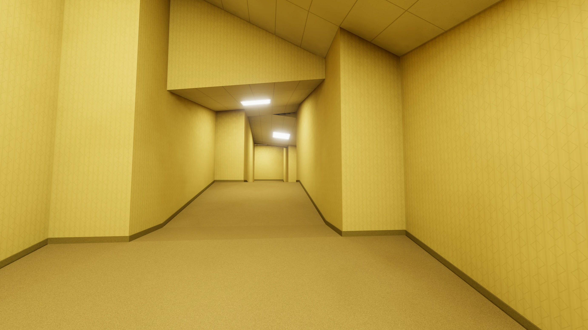

Die Lobby hat einen ganzen Weg aus solchen Räumen, die Schieflage mitten darin (siehe »Fertige Levels«).

### Übereinander

<div class='found-note'>
<p>Über dem Gang ist noch etwas. Manchmal knarrt die Decke, als ginge jemand darüber. Hinter dem Saal habe ich die Treppe gefunden, die hinaufführt.</p>
<cite>Zettel, unter der Tür des Saals durchgeschoben</cite>
</div>

Der Saal bekommt in seiner Nordwand eine Tür, drei Felder breit:

```room
~ [map]
####333######
~ #...........#
~ #...L.S.L.S.#
```

```room
[3]
door = treppe 1
```

Dahinter führt eine Treppe nach Norden, genau ein Stockwerk hinauf. Leg `rooms/treppe.room` an:

_include_file(stufen/treppe.room, room_copy)

Oben, am Ende der Treppe, liegt der Dachboden, unter einem Satteldach aus Holz, mit ein paar Kisten. Leg `rooms/dachboden.room` an:

_include_file(stufen/dachboden-1.room, room_copy)

Speichere und lade neu. Der Dachboden liegt über Blau, dem Gang und Rot: Die Treppe hebt ihn um 3 m, und keiner der drei Räume darunter ist so hoch. Räume dürfen übereinander liegen, solange der obere Boden nirgends unter der Decke des unteren Raums liegt. Wie hoch jeder liegt, rechnet das Programm wie immer aus seinen Türen aus. Stiege die Treppe nur um 2,6 m, stünde oben links `room dachboden and room rot lie in the same place at the same height`: Rot ist 2,8 m hoch.

<!-- tutorial-screenshot
# Die Treppe vom Saal aus, durch die breite Tür
write-file: rooms/saal.room <- file:stufen/saal-8.room
write-file: rooms/treppe.room <- file:stufen/treppe.room
write-file: rooms/dachboden.room <- file:stufen/dachboden-1.room
tab: preview
viewport: 1536x864
zoom: 1.5
hook: open view=21.40,18.50,4,14
hook: light
hook: info off
-->

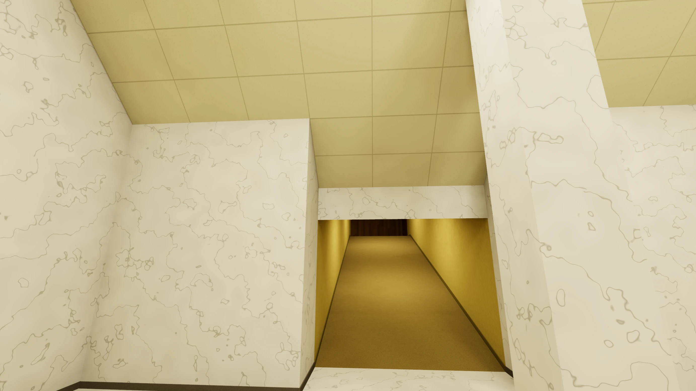

<!-- tutorial-screenshot
# Der Dachboden, von der Treppe aus über die Kisten hinweg
tab: preview
viewport: 1536x864
zoom: 1.5
hook: open view=18.50,3.00,135,-5,,3
hook: light
hook: info off
-->

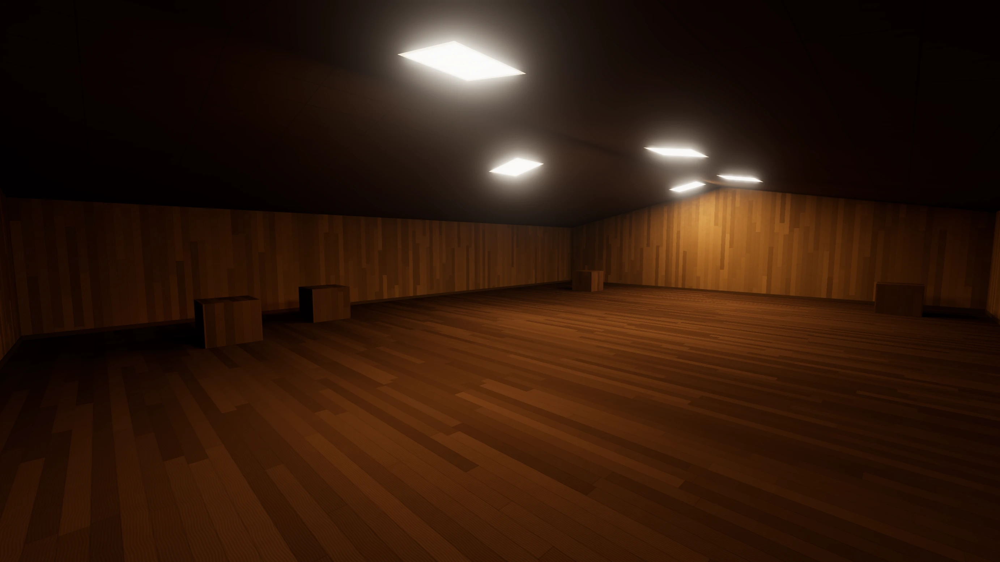

### Ein Loch im Boden

<div class='found-note'>
<p>Im Dachboden fehlt ein Stück Boden. Unten sehe ich den Gang, durch den ich gekommen bin. Ich bin nicht gesprungen. Noch nicht.</p>
<cite>Bleistiftnotiz, am Rand eingerissen</cite>
</div>

Ein Loch verbindet zwei Räume wie eine Tür, nur senkrecht. `_` im Grundriss ist ein Loch im Boden, `^` eins in der Decke. Schneid in den Dachboden ein Loch über dem Gang, drei Felder breit und zwei tief:

```room
~ #..K..........K..#
#......___..K....#
#......___.......#
~ ##################
```

In `[_]` steht, welcher Raum darunter liegt, und mit `slab`, wie dick der Boden zwischen beiden ist. Die Türen legen den Dachboden und den Gang schon fest: Der Boden muss genau passen.

_task(zwischendecke)

```room
[_]
below = gang            # darunter liegt der Gang
slab = 0.5              # so dick ist der Boden zwischen beiden
```

Im Gang werden dieselben Felder zum Loch in der Decke, in `rooms/gang.room` unter der Tür zu Rot:

```room
~ #...2
#^^^#
#^^^#
~ #...#
```

`below` nennt den Raum darunter. Dessen `^` liegen genau unter den `_`, gleich viele und in derselben Form; ein Loch darf beliebig groß sein. `slab` ist die Dicke des Bodens zwischen beiden Räumen, ohne Angabe 0,3 m. Am Rand des Lochs sieht man ihn als rohen Beton. Wie eine Tür legt ein Loch die Räume aneinander: Die Decke des unteren Raums liegt `slab` unter dem Boden des oberen. Hier liegen beide schon fest, durch die Türen, darum muss `slab` genau passen.

Tritt auf das Loch, und du fällst in den Gang.

<div class='gallery columns-2'>
<figure>
<!-- tutorial-screenshot
# Das Loch von oben, aus dem Dachboden in den Gang
write-file: rooms/dachboden.room <- file:stufen/dachboden.room
write-file: rooms/gang.room <- file:stufen/gang-2.room
tab: preview
viewport: 1536x864
zoom: 1.5
hook: open view=11.00,9.80,172,-50,,3
hook: light
hook: info off
-->
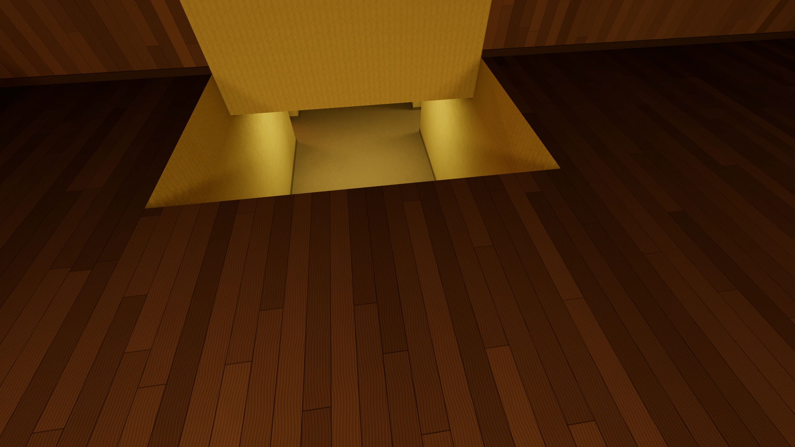
<figcaption>Von oben: der Gang unter dem Dachboden</figcaption>
</figure>
<figure>
<!-- tutorial-screenshot
# Das Loch von unten, aus dem Gang
tab: preview
viewport: 1536x864
zoom: 1.5
hook: open view=11.00,14.10,10,35,,0
hook: light
hook: info off
-->
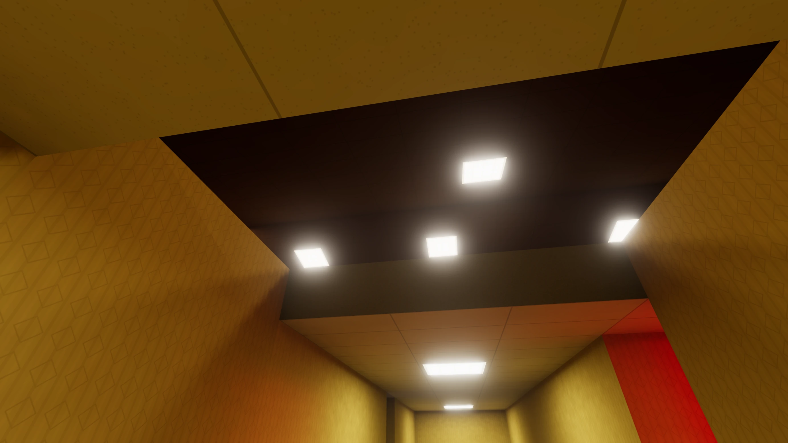
<figcaption>Von unten: das Dach des Dachbodens</figcaption>
</figure>
</div>

### Ein Becken

<div class='found-note'>
<p>Hinter einer Tür im Gang ist ein Bad. Das Wasser bewegt sich, obwohl kein Wind geht. Ich habe nicht hineingefasst.</p>
<cite>Zettel, mit Klebeband an einer Fliese befestigt</cite>
</div>

Ein Boden kann auch nur an manchen Stellen tiefer liegen: ein Becken. Der Vorgang bekommt in seiner Südwand eine Tür, zwei Felder breit und diesmal oben rund:

```room
~ #......2
###33###
```

```room
[3]
door = bad 3
arch = 2.3              # oben rund, in der Mitte 2,3 m hoch
```

`arch` macht aus einer Tür einen Bogen: einen Halbkreis über ihre ganze Breite, in der Mitte so hoch wie die Zahl. Mit einer zweiten Zahl ist er schmaler als die Tür, mit `arch = 2.3, 0.8` zum Beispiel nur 80 cm breit, und daneben bleibt Wand. Leg hinter die Tür `rooms/bad.room` an, eine Halle aus Fliesen mit einem Becken in der Mitte:

_include_file(stufen/bad.room, room_copy)

Jedes Feld mit `W` gehört zum Becken, nebeneinander sind sie eins. `pool` sagt, wie tief es unter den Boden des Raums reicht, `water`, wie tief darunter das Wasser steht: Hier steht es 25 cm unter dem Rand. `rim` legt einen Rand aus Fliesen um das Becken, 15 cm hoch und 30 cm breit, auf den du steigen kannst, und `railing = on` stellt ein Geländer aus Metall darauf, überall dort, wo man am Rand stehen kann.

Die beiden `O` sind Säulen, die im Wasser stehen. `shape = round` macht einen Block rund. Und weil auch in ihrem Abschnitt `pool` steht, mit denselben Werten wie bei `W`, gehören ihre Felder zum Becken: Die Säule steht auf seinem Boden und reicht von dort bis an die Decke: 2,2 m plus 4,5 m, darum ist ihr Block 6,7 m hoch. Genauso kann eine Leuchte über dem Wasser hängen: ein eigener Buchstabe mit `light` und denselben Werten wie das Becken.

An der Ostseite führt eine Treppe auf ein Podest neben dem Becken, und oben steht ein Stuhl, wie für einen Bademeister. `stairs = north, 2` lässt die Felder mit `S` nach Norden ansteigen, bis auf 2 m, in Stufen von etwa 18 cm; die Felder müssen ein Rechteck sein. `raise = 2` hebt die Felder mit `P` als Podest auf dieselbe Höhe. Unter beiden ist kein Platz: Sie sind massiv, wie ein Block, nur dass du darauf gehst. Der Stuhl steht in einem eigenen Feld `C`, und weil auch dort `raise = 2` steht, steht er oben. `railing = on` gibt Treppe und Podest ein Geländer, überall, wo es an der Seite hinuntergeht. Liegt am unteren Ende einer Treppe ein Podest, beginnt sie auf dessen Höhe: So geht es von einem Absatz mit einer zweiten Treppe um die Ecke weiter hinauf.

Unten sind die Wände dunkel: `dado = 1.1, #2f4a4a` färbt sie bis 1,1 m über dem Boden, und `dado_material = tiles` macht auch diesen Teil aus Fliesen. Das Wort kommt aus der Baukunst: Im Englischen heißt der untere Teil einer Wand, der anders aussieht als der Rest, *dado*, nach dem italienischen Wort für Würfel, dem würfelförmigen Mittelstück im Sockel einer Säule. Auf Deutsch sagt man Lambris.

Wie macht man Wasser? Gar nicht, eigentlich: Die Wasserfläche zeigt zwei andere Bilder desselben Raums. Für das eine schaut eine zweite Kamera von unten nach oben, so tief unter der Wasserfläche, wie du über ihr bist: Das ist die Spiegelung. Für das andere zeichnet das Programm nur, was unter dem Wasser liegt, den Boden und die Wände des Beckens. Wie viel du von welchem Bild siehst, hängt davon ab, wie flach du schaust: Von oben siehst du hinein, flach darüber spiegelt es fast nur, wie an einem echten See (Fresnel). Je mehr Wasser zwischen dir und dem Boden liegt, desto blaugrüner wird er, denn Wasser schluckt Rot am stärksten. Langsame Wellen, aus Rauschen gerechnet, verbiegen beide Bilder ein wenig, und wo sie das Licht bündeln, tanzen helle Linien über den Boden. Auch die Fliesen glänzen: In ihnen spiegeln sich die Leuchten, umso stärker, je flacher du über sie schaust. Ins Wasser gehen kannst du nicht.

<div class='gallery columns-2'>
<figure>
<!-- tutorial-screenshot
# Das Bad mit dem Becken, der Treppe und dem Podest
write-file: rooms/vorgang.room <- file:stufen/vorgang-2.room
write-file: rooms/bad.room <- file:stufen/bad.room
tab: preview
viewport: 1536x864
zoom: 1.5
hook: open view=37.50,29.80,-35,2,,0
hook: light
hook: info off
-->
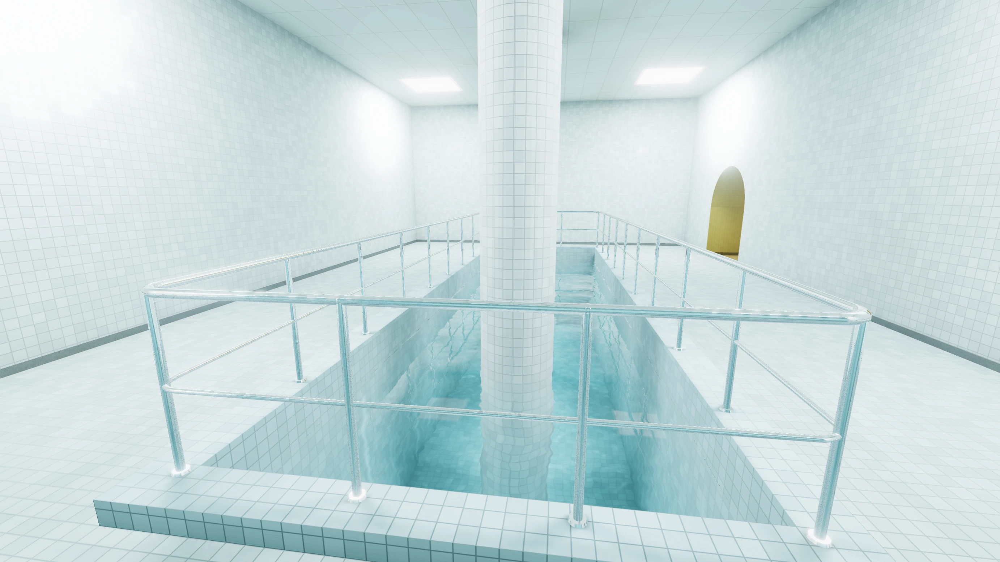
<figcaption>Das Bad</figcaption>
</figure>
<figure>
<!-- tutorial-screenshot
# Vom Podest über das Becken
tab: preview
viewport: 1536x864
zoom: 1.5
hook: open view=43.20,25.60,98,-12,,2
hook: light
hook: info off
-->

<figcaption>vom Podest aus, wo der Stuhl steht</figcaption>
</figure>
</div>

_task(wassertiefe)

<div class='hint try'>
<p><strong>Ausprobieren:</strong> Schreib in <code>[W]</code> <code>tint = #6f8f5a</code> dazu: <code>tint</code> ist die Farbe des Wassers, so, wie Weiß hinter 2 m davon aussieht, und jetzt ist es trüb und grün. Mit <code>tint = #4f6b62</code>, <code>water = 0.05</code> und <code>waves = 1.6</code> ist es dunkel, steht fast bis an den Rand und spiegelt den Raum, wie im Becken der Tiefe. Mit <code>waves = 0</code> liegt es still wie Glas, zu still. Mit <code>water = off</code> ist das Becken leer; lass dann <code>railing = on</code> weg, und du kannst hineinfallen. Wie kommst du wieder heraus?</p>
</div>

### Eine Tür ins Leere

<div class='found-note'>
<p>Am Ende des krummen Gangs ist eine Tür. Ich habe hinausgeschaut. Dahinter ist kein Boden, nur ganz unten brennt ein Licht.</p>
<cite>Letzte Zeile einer Seite, die Schrift zittert</cite>
</div>

Das letzte Stück des krummen Gangs, `rooms/knick3.room`, bekommt in seiner Ostwand eine Tür:

```room
~ #....#
1..L.2
~ 1....#
```

```room
[2]
door = schacht 1, -7    # dahinter liegt der Boden 7 m tiefer
```

Die Zahl hinter der Ziffer sagt, wie viel höher der Boden auf der anderen Seite der Tür liegt, mit einem Minus, wie viel tiefer. So sitzt eine Tür hoch oben in einer Wand: Im Schacht liegt sie 7 m über dem Boden, darunter ist Wand. Leg `rooms/schacht.room` an:

_include_file(stufen/schacht.room, room_copy)

Unten im Schacht steht ein Becken voll Wasser, mit einem Geländer darum, wie im Bad. Die Lampe unten an der Ostwand ist ein Modell, das leuchtet; wie das geht, steht in »Lampen an der Wand«.

Wer durch die Tür tritt, fällt. Zurück kommst du mit <kbd>Shift</kbd> <kbd>R</kbd>.

<div class='gallery columns-2'>
<figure>
<!-- tutorial-screenshot
# Am Ende des krummen Gangs, an der Kante
write-file: rooms/knick3.room <- file:stufen/knick3-2.room
write-file: rooms/schacht.room <- file:stufen/schacht.room
tab: preview
viewport: 1536x864
zoom: 1.5
hook: open view=69.40,18.00,-96,-40,,4.9
hook: light
hook: info off
-->
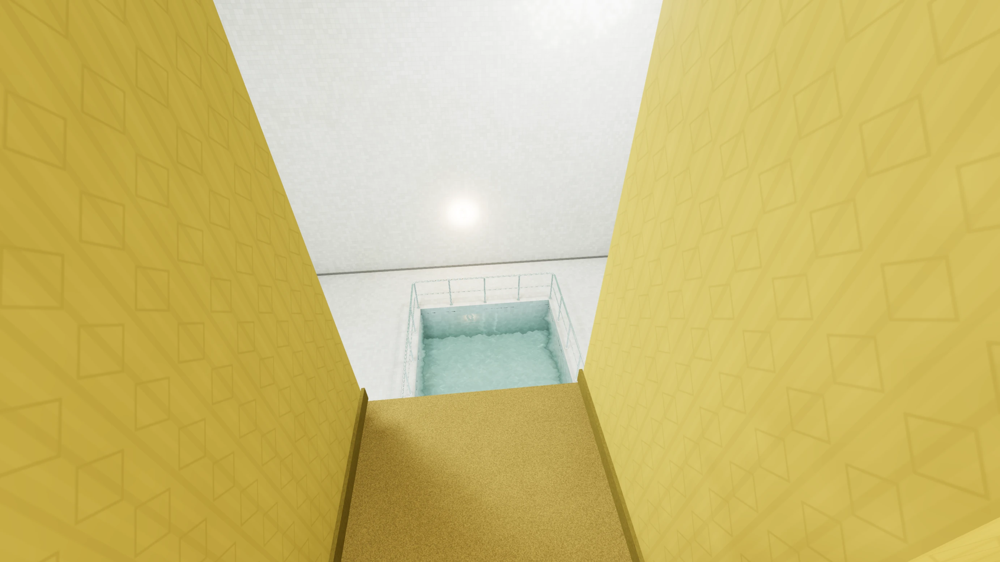
<figcaption>An der Kante</figcaption>
</figure>
<figure>
<!-- tutorial-screenshot
# Vom Boden des Schachts hinauf zur Tür
tab: preview
viewport: 1536x864
zoom: 1.5
hook: open view=78.00,17.60,82,28,,-2.1
hook: light
hook: info off
-->
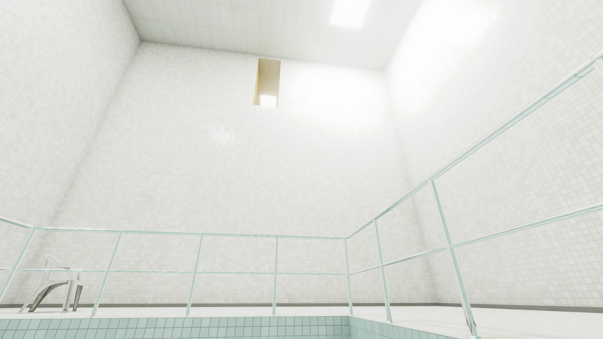
<figcaption>Vom Boden des Schachts</figcaption>
</figure>
</div>

## Dein eigener Raum

Jetzt bist du dran: Bau einen Raum nach deiner Idee und schließ ihn mit einer Tür an. Was du in `[room]` einstellen kannst:

<table class='table'>
<tr><th>Eintrag</th><th>Bedeutung</th></tr>
<tr><td><code>name</code></td><td>der Name, den die Automap zeigt</td></tr>
<tr><td><code>height</code></td><td>Deckenhöhe über dem Boden in Metern; zwei Zahlen für eine schräge Decke</td></tr>
<tr><td><code>ramp</code></td><td>ein schräger Boden: Richtung und um wie viele Meter er ansteigt, zum Beispiel <code>east, 4</code></td></tr>
<tr><td><code>slope</code></td><td><code>flat</code>, <code>north</code>, <code>east</code>, <code>south</code>, <code>west</code> oder <code>gable</code></td></tr>
<tr><td><code>walls</code></td><td><code>wallpaper</code> (Tapete), <code>marble</code> (Marmor), <code>wood</code> (Holz), <code>tiles</code> (Fliesen), <code>velvet</code> (Samt) oder <code>plain</code> (einfarbig)</td></tr>
<tr><td><code>floor</code></td><td><code>carpet</code> (Teppich), <code>marble</code>, <code>wood</code>, <code>tiles</code> oder <code>plain</code></td></tr>
<tr><td><code>wallpaper</code>, <code>carpet</code>, <code>ceiling</code></td><td>die Farben von Wänden, Boden und Decke</td></tr>
<tr><td><code>baseboard</code></td><td>die Sockelleiste: Höhe und Farbe; ohne Angabe 8 cm und etwas dunkler als die Tapete, <code>none</code>: keine</td></tr>
<tr><td><code>dado</code></td><td>die Wände unten anders, zum Beispiel <code>dado = 1.2, #1a1a1a</code>: bis 1,2 m dunkel; <code>dado_material</code> sagt, woraus (ohne: wie die Wände)</td></tr>
<tr><td><code>dado_rail</code></td><td>eine Leiste auf der Kante von <code>dado</code>: Höhe und Farbe, zum Beispiel <code>0.05, #d8d0b8</code>; auf Englisch heißt sie auch chair rail: Sie hielt die Lehnen der Stühle von der Wand fern</td></tr>
<tr><td><code>cornice</code></td><td>eine Leiste oben, wo Wand und Decke sich treffen, schräg wie eine Hohlkehle: Höhe und Farbe, zum Beispiel <code>0.12, #e8e2d0</code></td></tr>
<tr><td><code>look</code></td><td>wohin du am <code>@</code> schaust: <code>north</code>, <code>east</code>, <code>south</code>, <code>west</code> oder Grad, im Uhrzeigersinn von Norden aus (<code>look = 30</code>: etwas rechts von Norden)</td></tr>
</table>

Und so verbindest du ihn mit den anderen:

<table class='table'>
<tr><th>Eintrag</th><th>Bedeutung</th></tr>
<tr><td><code>door = gang 2</code></td><td>eine Tür: diese Ziffer ist dasselbe Feld wie die <code>2</code> im Gang; dieselbe Ziffer mehrmals in einer Reihe, nebeneinander oder untereinander, ist eine breite Tür</td></tr>
<tr><td><code>door = halle 1, -4</code></td><td>eine Tür hoch in der Wand: Der Boden auf der anderen Seite liegt 4 m tiefer (ohne Minus: höher)</td></tr>
<tr><td><code>[_]</code> mit <code>below = keller</code></td><td>ein Loch im Boden, die <code>_</code> im Grundriss; darunter liegen die <code>^</code> im Keller</td></tr>
<tr><td><code>slab = 0.3</code></td><td>in <code>[_]</code>: wie dick der Boden zwischen beiden Räumen ist</td></tr>
<tr><td><code>arch = 2.4</code></td><td>bei einer Tür: oben rund, ein Halbkreis, in der Mitte 2,4 m hoch; <code>arch = 2.4, 0.8</code>: nur 0,8 m breit, in der Mitte der Tür, daneben Wand; nicht bei einer Tür hoch in der Wand</td></tr>
</table>

Und für die Buchstaben im Grundriss noch:

<table class='table'>
<tr><th>Eintrag</th><th>Bedeutung</th></tr>
<tr><td><code>shape = round</code></td><td>bei einem Block: eine runde Säule statt eines Quaders</td></tr>
<tr><td><code>pool = 2.2</code></td><td>ein Becken, so tief unter dem Boden; dazu <code>water</code> (wie tief unter dem Rand das Wasser steht, <code>off</code>: leer), <code>tint</code> (seine Farbe), <code>waves</code> (wie groß die Wellen sind, 1 ruhig, 2 größer), <code>color</code> (die Fliesen des Beckens), <code>railing = on</code> (ein Geländer)</td></tr>
<tr><td><code>rim = 0.15, 0.3</code></td><td>bei einem Becken: ein Rand aus Fliesen, so hoch und so breit, auf den man steigen kann</td></tr>
<tr><td><code>stairs = east, 3</code></td><td>eine Treppe über diese Felder (ein Rechteck), nach Osten 3 m hinauf, in Stufen von etwa 18 cm; darunter ist kein Platz. Endet sie vor einer Tür hoch in der Wand (<code>door = oben 1, 3</code>), führt sie hinauf</td></tr>
<tr><td><code>raise = 3</code></td><td>ein Podest: Diese Felder liegen 3 m höher, nebeneinander sind sie eins, du kannst darauf stehen</td></tr>
<tr><td><code>railing = on</code></td><td>bei einem Becken, einer Treppe oder einem Podest: ein Geländer, wo es an der Seite hinuntergeht</td></tr>
<tr><td><code>pool</code> bei einer Leuchte, einem Block oder einem Modell</td><td>das Feld liegt im Becken und hat sein Ding trotzdem: eine Säule im Wasser, eine Leuchte darüber; mit denselben Werten wie das Becken daneben</td></tr>
</table>

Alle Einträge stehen in der `README.md` der Vorlage. Der Dateiname ist der Name des Raums, den eine Tür nennt: nur Kleinbuchstaben, Ziffern, `-` und `_`.

_task(eigener-raum)

## Licht

<div class='found-note'>
<p>Die Leuchten gehen nie aus. Ich habe versucht, eine zu erreichen, um sie abzuschrauben. Sie ist warm. Nicht heiß, warm. Wie etwas, das atmet.</p>
<p>Seltsam ist die Decke. Die Leuchten hängen direkt darunter und strahlen nach unten, und trotzdem ist die Decke hell.</p>
<cite>Funkspruch, Ende fehlt</cite>
</div>

### Leuchten

Eine Leuchte hängt knapp unter der Decke, mitten über ihrem Feld, unter einer schrägen Decke so schräg wie sie:

<table class='table'>
<tr><th>Eintrag</th><th>Bedeutung</th></tr>
<tr><td><code>light</code></td><td>ihre Farbe, zum Beispiel <code>#fff3cf</code></td></tr>
<tr><td><code>power</code></td><td>wie hell sie ist, 1.0 ohne Angabe</td></tr>
<tr><td><code>size</code></td><td>Breite und Länge in Metern, eine Zahl für eine quadratische; ohne Angabe <code>0.85</code>, 85 cm im Quadrat</td></tr>
<tr><td><code>flicker</code></td><td><code>1</code>: Sie flackert ab und zu</td></tr>
</table>

Farbiges Licht färbt alles, was es trifft, auch über die Tür hinaus in den Nachbarraum: Im Gang siehst du, wie rotes und blaues Licht aus zwei Türen fällt.

### Lampen an der Wand

<div class='found-note'>
<p>In der Kammer steht jetzt ein Sofa. Niemand hat es gebracht. An den Wänden hängen zwei Lampen, und sie brennen, obwohl nirgends ein Kabel ist.</p>
<cite>Seite aus einem durchnässten Notizbuch, dritte Handschrift</cite>
</div>

Eine Leuchte hängt immer unter der Decke; was hier Leuchte heißt, ist so ein helles Feld unter der Decke. Licht kann aber auch aus einem Modell kommen, einer Lampe: einer Wandlampe, einer Stehlampe, einer Laterne. Die Kammer wird ein Ruheraum. Statt der flackernden Leuchte an der Decke hängen zwei Wandlampen an den Wänden, und an der Südwand steht ein Sofa. Ersetze `rooms/kammer.room` durch:

_include_file(stufen/kammer-lampen.room, room_copy)

`light = #ffd9a0` bei einem Modell macht es zu einer Lampe. Ihr Licht kommt aus den Teilen, die im Modell selbst leuchten, bei dieser Lampe aus der Glühbirne hinter dem Glas, und es strahlt nach allen Seiten, nicht nur nach unten wie eine Leuchte unter der Decke. Hat eine Lampe einen Schirm, der nach unten zeigt, wie die Wandlampen im Holzsaal oben, schreib `beam = 75` dazu: Dann fällt ihr Licht nur nach unten, in einen Kegel, der bis 75° von der Senkrechten reicht, und die Decke darüber bekommt kein direktes Licht. `beam = up, 60` schickt es nach oben. `power` und `flicker` gelten wie bei einer Leuchte. Glas und die leuchtenden Teile halten das Licht nicht auf, aber Arm und Schirm einer Lampe werfen Schatten an die Wand.

`offset = x, y, z` schiebt ein Modell aus der Mitte seines Felds, in Metern und wie in den anderen 3D-Aktivitäten: x nach Osten (im Grundriss nach rechts), y nach oben, z nach Süden (im Grundriss nach unten), mit einer negativen Zahl in die andere Richtung. Die Lampe im Feld `W` rückt 42 cm nach Westen an die Wand und hängt 1,4 m hoch. Das Sofa rückt 7 cm nach Süden: Es ist 1,12 m tief, ein Feld nur 1 m, und ragte sonst in die Wand. `offset` gibt es auch für Blöcke. Welche Seite eines Modells vorn ist, legt fest, wer es gebaut hat; `rotation` in Schritten von 90 dreht es, bis es stimmt. Die Lampe an der Westwand ist um 90° gedreht, damit ihre Rückseite an der Wand liegt.

<!-- tutorial-screenshot
write-file: rooms/kammer.room <- file:stufen/kammer-lampen.room
tab: preview
viewport: 1536x864
zoom: 1.5
hook: open view=14.00,17.00,-150,-12
hook: light
hook: info off
-->


### Modelle von Poly Haven

Sofa und Wandlampe liegen schon in `statues/`, dazu die Wandlampe mit Schirm und der Kerzenleuchter aus dem Holz- und dem Samtsaal und die Möbel aus »Die Tiefe«: ein Schreibtisch aus Metall, Stühle, eine Kommode, ein Regal, ein altes Bettgestell, ein Schaukelstuhl und ein kleiner Tisch. Alle sind von [Poly Haven](https://polyhaven.com/models). Dort steht jedes Modell unter CC0: Du darfst es verwenden, wofür du willst, ohne zu fragen. So holst du dir weitere:

1. Wähl auf der Seite des Modells beim Download die Auflösung **1K** und das Format **glTF**. glTF und GLB kann das Programm lesen. 1K genügt: Das Programm nimmt vom Modell die Farbe der Oberfläche und, für Spiegelungen, wie glatt und metallisch sie ist; 2K oder 4K sähen genauso aus und wären nur größer.
2. Ein Modell in glTF besteht aus mehreren Dateien: einer `.gltf`, einer `.bin` und Bildern im Ordner `textures`. Sie gehören zusammen in einen eigenen Ordner in `statues`, etwa `statues/sessel/`, so wie sie ankommen.
3. In der Raumdatei steht dann `model = statues/sessel/DATEINAME.gltf`. Wie groß das Modell ist, steht auf seiner Seite bei den Maßen; die Höhe davon gehört in `height`.

Kommt beim Herunterladen eine ZIP-Datei an, zieh sie in VS Code in den Ordner `statues` und pack sie im Terminal in einen eigenen Ordner aus:

```bash
cd /workspace/backrooms-starter/statues
unzip DATEINAME.zip -d sessel
```

Weitere Modelle unter CC0 findest du bei den [3D-Scans der Smithsonian Institution](https://3d.si.edu/collections) und bei [Sketchfab](https://sketchfab.com/search?features=downloadable&licenses=7c23a1ba438d4306920229c12afcb5f9&type=models), die Suche dort schon auf CC0 und herunterladbare Modelle eingestellt; beide als GLB herunterladen. Nimm nur Modelle, deren Lizenz das erlaubt, und schreib in einem Kommentar neben `model =` dazu, woher sie kommen.

### Was das Programm rechnet

Viele Spiele rechnen das Licht für jedes Bild neu, 60-mal in der Sekunde, weil sich dort Dinge bewegen, und müssen dafür stark vereinfachen. Hier bewegst nur du dich, die Leuchten bleiben, wo sie sind. Darum rechnet das Programm das Licht einmal aus, wenn das Level lädt, und klebt es dann wie eine zweite Tapete auf jede Fläche. Diese Tapete aus Licht heißt **Lightmap**, und das Ausrechnen nennt man **Backen**. Es läuft auf der Grafikkarte, in Shadern: kleinen Programmen in [GLSL](/reference/glsl), die für Tausende Punkte zugleich laufen. Schritt für Schritt, im Saal mit seinen Säulen:

**Die Punkte.** Die Lightmap hat auf jedem Meter Wand, Boden und Decke 16 Punkte in jeder Richtung, alle 6,25 cm einen. Nur für diese Punkte rechnet die Grafikkarte aus, wie hell es dort ist; dazwischen mischt sie beim Zeichnen die vier nächsten. Mit <kbd>G</kbd> siehst du die Punkte, mit <kbd>T</kbd> ohne Tapete und Teppich deutlicher:

<!-- tutorial-screenshot
tab: preview
viewport: 1536x864
zoom: 1.5
hook: open view=18.00,17.40,-94,7
hook: light
hook: info off
hook: key t g
-->


_task(lichtpunkte)

Wo ein Modell nah an einer Wand oder auf dem Boden steht, wirft es Schatten, für die 6,25 cm zu grob sind. Dort bekommt die Fläche ein zweites, feineres Stück Lightmap, mit bis zu viermal so vielen Punkten in jeder Richtung, das zu seinem Rand hin weich in das grobe übergeht. Es reicht 60 cm über den Umriss des Dings hinaus, so weit reichen seine weichen Schatten; auch eine Lampe an der Wand bekommt eins, für die Schatten ihres Arms. Weit weg sind die feinen Punkte so klein, dass <kbd>G</kbd> sie ausblendet; dort sieht die Fläche glatt aus.

<div class='gallery columns-2'>
<figure>
<!-- tutorial-screenshot
# Hinter dem Sofa in der Kammer
tab: preview
viewport: 1536x864
zoom: 1.5
hook: open view=15.00,17.00,170,-25
hook: light
hook: info off
hook: key t g
-->

<figcaption>hinter und unter einem Modell, dem Sofa</figcaption>
</figure>
<figure>
<!-- tutorial-screenshot
# Am Geländer des Beckens im Bad
tab: preview
viewport: 1536x864
zoom: 1.5
hook: open view=31.40,24.00,-140,-48,,0
hook: light
hook: info off
hook: key t g
-->
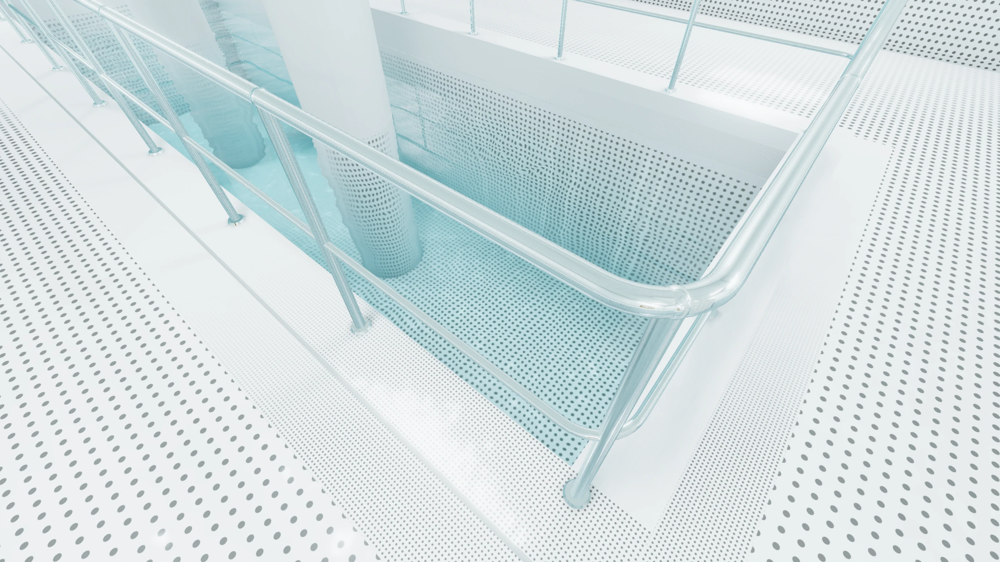
<figcaption>am Geländer, das wie ein Modell zählt</figcaption>
</figure>
</div>

Bevor es um die Strahlen geht: Geh zurück ins Zimmer (<kbd>Shift</kbd> <kbd>R</kbd>) und schau nach oben, zur Decke.

_task(decke)

**Direktes Licht.** Für jeden Punkt nimmt das Programm einen zufälligen Punkt auf jeder Leuchte und schickt einen Strahl dorthin. Steht etwas im Weg, eine Wand, eine Säule oder ein Modell, kommt von dieser Leuchte nichts an. Sonst kommt Licht an, umso weniger, je weiter die Leuchte weg ist (doppelt so weit: ein Viertel) und je schräger es auf die Fläche fällt. Das wiederholt es 64-mal, jedes Mal mit einem anderen Punkt auf der Leuchte, und nimmt den Durchschnitt. Ein Punkt, der eine Leuchte nur halb sieht, ist in etwa der Hälfte der Durchgänge beleuchtet: Er liegt im **Halbschatten**. Darum werfen große Leuchten weiche Schatten und kleine scharfe. Nur mit direktem Licht sieht der Saal so aus:

<!-- tutorial-screenshot
tab: preview
viewport: 1536x864
zoom: 1.5
hook: open view=18.00,17.40,-94,7
hook: light
hook: info off
hook: key t b
-->


Wie weich ein Schatten ist, hängt also davon ab, wie groß die Leuchte ist. Mit `size = 0.2` und mit `size = 2` (und `power` so, dass jede gleich viel Licht gibt, denn eine kleinere Leuchte gibt auch weniger):

<!-- tutorial-scope -->

```room
[L]
light = #fff3cf
power = 29
size = 0.2
```

<div class='gallery columns-2'>
<figure>
<!-- tutorial-screenshot
write-file: rooms/saal.room <- file:stufen/saal-klein.room
tab: preview
viewport: 1536x864
zoom: 1.5
hook: open view=18.00,17.40,-94,7
hook: light
hook: info off
hook: key t b
-->

<figcaption><code>size = 0.2</code>: scharfe Schatten</figcaption>
</figure>
<figure>
<!-- tutorial-screenshot
write-file: rooms/saal.room <- file:stufen/saal-gross.room
tab: preview
viewport: 1536x864
zoom: 1.5
hook: open view=18.00,17.40,-94,7
hook: light
hook: info off
hook: key t b
-->

<figcaption><code>size = 2</code>: weiche Schatten</figcaption>
</figure>
</div>

<!-- /tutorial-scope -->

**Bounce-Licht.** Die Decke ist schwarz: Keine Leuchte strahlt nach oben. In Wirklichkeit ist sie trotzdem hell, weil jede Fläche einen Teil des Lichts zurückwirft, das auf sie fällt, in ihrer eigenen Farbe: der Teppich bräunliches Licht, eine rote Wand rotes. Ist das direkte Licht fertig, schickt das Programm von jedem Punkt Strahlen in zufällige Richtungen und schaut, wie hell die Flächen sind, die sie treffen. Was dabei herauskommt, ist das Licht, das einmal zurückgeworfen wurde, ein **Bounce**. Damit das schnell geht, sammelt es das zurückgeworfene Licht vorher in Würfeln von 25 cm, und weil zufällige Strahlen ein körniges Ergebnis geben, glättet es das Bounce-Licht am Ende. Das Ganze dreimal: Beim zweiten Bounce werfen die Flächen auch das Licht des ersten zurück und so weiter, darum steht beim Backen »bounce 1 of 3«. Mit einem, zwei und drei Bounces (in `level.ini` mit `bounces = 1` und so weiter):

<!-- tutorial-scope -->

<div class='gallery columns-3'>
<figure>
<!-- tutorial-screenshot
tab: preview
viewport: 1536x864
zoom: 1.5
hook: open bounces=1&view=18.00,17.40,-94,7
hook: light
hook: info off
hook: key t
-->

<figcaption>1 Bounce</figcaption>
</figure>
<figure>
<!-- tutorial-screenshot
tab: preview
viewport: 1536x864
zoom: 1.5
hook: open bounces=2&view=18.00,17.40,-94,7
hook: light
hook: info off
hook: key t
-->

<figcaption>2 Bounces</figcaption>
</figure>
<figure>
<!-- tutorial-screenshot
tab: preview
viewport: 1536x864
zoom: 1.5
hook: open view=18.00,17.40,-94,7
hook: light
hook: info off
hook: key t
-->

<figcaption>3 Bounces</figcaption>
</figure>
</div>

<!-- /tutorial-scope -->

**Kontaktschatten.** Wo zwei Flächen aneinanderstoßen, in Ecken, an der Sockelleiste oder unter einem Block, kommt von vielen Seiten kein Bounce-Licht, weil die andere Fläche im Weg ist. Zwei kurze Strahlen von 80 cm prüfen bei jedem der 64 Durchgänge, wie viel Platz um einen Punkt herum ist: Trifft einer etwas, dunkelt das Bounce-Licht dort ab, umso mehr, je näher es ist, und sanft auslaufend, damit keine harte Linie entsteht. Auf Englisch heißt das **Ambient Occlusion**. Nur das Bounce-Licht, ohne und mit Kontaktschatten:

<div class='gallery columns-2'>
<figure>
<!-- tutorial-screenshot
tab: preview
viewport: 1536x864
zoom: 1.5
hook: open view=18.00,17.40,-94,7
hook: light
hook: info off
hook: key t l o
-->

<figcaption><kbd>T</kbd> <kbd>L</kbd> <kbd>O</kbd>: ohne Kontaktschatten</figcaption>
</figure>
<figure>
<!-- tutorial-screenshot
tab: preview
viewport: 1536x864
zoom: 1.5
hook: open view=18.00,17.40,-94,7
hook: light
hook: info off
hook: key t l
-->

<figcaption><kbd>T</kbd> <kbd>L</kbd>: mit Kontaktschatten</figcaption>
</figure>
</div>

**Alles zusammen.** Direktes Licht, Bounce-Licht und Kontaktschatten, mal der Farbe von Wänden und Boden:

<!-- tutorial-screenshot
tab: preview
viewport: 1536x864
zoom: 1.5
hook: open view=18.00,17.40,-94,7
hook: light
hook: info off
-->


**Beim Zeichnen: Tone Mapping und Bloom.** Die Lightmap enthält das Licht, wie es wirklich ist: Unter einer Leuchte ist es viel heller als in einer Ecke, und die Leuchte selbst ist noch einmal viel heller. Ein Bildschirm kann das nicht zeigen, er kennt nur Helligkeiten von 0 bis 1. Das **Tone Mapping** drückt große Werte sanft zusammen, wie eine Kamera: Helles bleibt hell, ohne dass alles darüber gleich weiß wird. Davor kommt **Bloom** (<kbd>H</kbd>): Was viel heller ist als Weiß, die Leuchten vor allem, strahlt weich in seine Umgebung, so wie in einer Kamera oder im Auge, wenn man in eine Lampe schaut. Dafür verkleinert das Programm das Bild mehrmals auf die Hälfte, verwischt die hellsten Stellen und legt sie wieder vergrößert darüber. Das kostet bei jedem Bild ein wenig Zeit, darum fehlt Bloom mit der Rot-Cyan-Brille, in VR und in der Automap; dort hat jede Leuchte einen eigenen, einfachen Schein.

<div class='gallery columns-2'>
<figure>
<!-- tutorial-screenshot
tab: preview
viewport: 1536x864
zoom: 1.5
hook: open view=18.00,17.40,-94,7
hook: light
hook: info off
hook: key h
-->

<figcaption><kbd>H</kbd>: ohne Bloom</figcaption>
</figure>
<figure>
<!-- tutorial-screenshot
tab: preview
viewport: 1536x864
zoom: 1.5
hook: open view=18.00,17.40,-94,7
hook: light
hook: info off
-->

<figcaption>mit Bloom</figcaption>
</figure>
</div>

**Warum es so echt aussieht.** Die Räume sind schlicht: gelbe Tapete, Teppich, ein paar Säulen. Dass sie trotzdem wie ein Foto wirken, liegt fast nur am Licht. In Wirklichkeit fällt Licht nicht nur von der Lampe auf den Boden, es prallt von allen Flächen ab, färbt sich dabei, macht Decken hell und Ecken dunkel, und Schatten haben weiche Ränder. Genau das rechnet das Programm aus, mit rund tausend Strahlen für jeden Punkt der Lightmap. Ein Spiel, das 60 Bilder in der Sekunde zeichnen muss, hat dafür keine Zeit und schummelt; das sieht man. Hier geht es, weil sich nichts bewegt: Keine Lampe wandert, keine Tür geht auf, keine Figur läuft durchs Bild. Das Licht wird einmal gebacken und stimmt dann für immer, und es gibt nichts, das sich anders verhielte als das Licht und den Trick verriete. Die Backrooms sind leer, und genau darum sehen sie so echt aus.

Statuen und andere Modelle bekommen ihr Licht nicht aus der Lightmap: Das Programm rechnet es für jede Ecke ihres Netzes aus, mit denselben Leuchten und demselben Bounce-Licht.

### Die Teile einzeln ansehen

Oben links steht für jeden Teil ein Schalter mit seiner Taste; grün heißt an. Ein Klick auf den Schalter oder die Taste schaltet ihn um:

<table class='table'>
<tr><th>Taste</th><th>Schalter</th><th>Was er zeigt</th></tr>
<tr><td><kbd>T</kbd></td><td>Textures</td><td>die Oberflächen mit ihren Flecken und ihrem Glanz; aus: alles hellgrau, nur das Licht</td></tr>
<tr><td><kbd>L</kbd></td><td>Direct light</td><td>das direkte Licht der Leuchten</td></tr>
<tr><td><kbd>B</kbd></td><td>Bounce light</td><td>das zurückgeworfene Licht</td></tr>
<tr><td><kbd>O</kbd></td><td>Occlusion</td><td>die Kontaktschatten</td></tr>
<tr><td><kbd>F</kbd></td><td>Flicker</td><td>das Flackern</td></tr>
<tr><td><kbd>E</kbd></td><td>Edges</td><td>die Kanten aller Flächen als Drahtgitter</td></tr>
<tr><td><kbd>G</kbd></td><td>Light points</td><td>die Punkte der Lightmap</td></tr>
<tr><td><kbd>H</kbd></td><td>Bloom</td><td>der helle Schein um die Leuchten</td></tr>
<tr><td><kbd>C</kbd></td><td>VHS</td><td>alles wie von einer alten Videokassette, mit Datum und Uhrzeit (aus; mit <code>vhs = on</code> in <code>level.ini</code> an)</td></tr>
<tr><td><kbd>X</kbd></td><td>Aberration</td><td>farbige Säume zum Rand hin, rot nach außen, blau nach innen, wie durch eine einfache Linse (aus; mit <code>aberration = on</code> in <code>level.ini</code> an)</td></tr>
<tr><td><kbd>3</kbd></td><td>Anaglyph</td><td>das Bild für eine Rot-Cyan-Brille</td></tr>
<tr><td><kbd>M</kbd></td><td>Automap</td><td>die Karte</td></tr>
<tr><td><kbd>Shift</kbd> <kbd>L</kbd></td><td>Rebake light</td><td>das Licht noch einmal von vorn backen</td></tr>
<tr><td></td><td>Save light</td><td>das gebackene Licht als Datei herunterladen (siehe unten)</td></tr>
</table>

<div class='hint try'>
<strong>Ausprobieren:</strong> Schalte mit <kbd>T</kbd> die Texturen aus und mit <kbd>L</kbd> und <kbd>B</kbd> abwechselnd das direkte und das Bounce-Licht, mit <kbd>O</kbd> die Kontaktschatten, und schau dabei in eine Ecke am Boden. Gib der Leuchte im Zimmer <code>size = 0.2</code> und <code>power = 16</code> und lade neu. Eine kleinere Leuchte gibt auch weniger Licht, darum die größere Zahl. Sieh dir den Lichtfleck an, den sie durch die Tür in den Gang wirft: Seine Ränder werden scharf. Dann <code>size = 2</code> mit <code>power = 0.16</code>: Sie werden ganz weich. Mit <code>bounces = 0</code> in <code>level.ini</code> unter <code>[level]</code> backt das Programm gar kein Bounce-Licht; wie sieht der Gang dann aus? Stell beides danach wieder zurück.
</div>

_task(weiche-schatten)

### Licht aufheben

Backen dauert, darum hebt die Vorschau das fertige Licht im Browser auf. Lädst du neu, ohne etwas zu ändern, steht oben links »Light loaded from this browser«, und es wird hell, ohne dass gebacken wird. Änderst du auch nur ein Zeichen in einem Raum, passt das aufgehobene Licht nicht mehr, und es wird neu gebacken. Ob es passt, sagt ein Fingerabdruck (englisch Hash): eine kurze Zahl, ausgerechnet aus allen Dateien des Levels, den Statuen und dem Teil des Programms, der backt.

»Save light« lädt das Licht als Datei `level.light` herunter. Zieh sie aus deinem Download-Ordner in den Explorer von VS Code, neben `level.ini`. Dann lädt das Level sein Licht aus dieser Datei, auch in einem anderen Browser, und du kannst deine Backrooms als fertige Webseite weitergeben. Nach jeder Änderung am Level musst du sie neu speichern; eine veraltete Datei meldet die Vorschau oben links.

## Fertige Levels

Zwei ganze Levels liegen schon in der Vorlage. Häng an die Adresse der Vorschau `?level=` und den Pfad zu ihrer `level.ini` an. Ihr Licht ist schon gebacken (siehe »Licht aufheben«), darum ist es sofort hell. Schau dir an, wie ihre Räume gebaut sind, und nimm dir, was du brauchen kannst.

### Die Lobby

<div class='found-note'>
<p>Wir haben einen Teil vollständig kartiert. Vierzehn Räume, ein Flur, der immer höher wird, ein Weg, auf dem nichts gerade ist, und am Ende eine Halle, in der man leiser spricht. Wir nennen ihn die Lobby. Die Karte liegt bei.</p>
<cite>Feldhandbuch, eingelegtes Blatt</cite>
</div>

Im Ordner `lobby` liegt »Level 0: Die Lobby«: ein Flur, der sich auf neun Meter Breite und Höhe öffnet, ein Säulengang, eine Galerie mit Sockeln, ein Lager, eine Halle aus Marmor mit einer Statue und, vom roten Raum aus, ein Weg über Rampen in die Halle, mitten darin die Schieflage, in der kein Boden und keine Decke gerade ist:

```text
…/index.html?level=lobby/level.ini
```

<!-- tutorial-scope -->

<div class='gallery columns-2'>
<figure>
<!-- tutorial-screenshot
tab: preview
viewport: 1536x864
zoom: 1.5
hook: open level=lobby/level.ini&view=27.00,13.30,-84,18
hook: light
hook: info off
-->

<figcaption>Der Flur wird weiter und höher</figcaption>
</figure>
<figure>
<!-- tutorial-screenshot
tab: preview
viewport: 1536x864
zoom: 1.5
hook: open level=lobby/level.ini&view=58.00,26.00,172,8
hook: light
hook: info off
-->

<figcaption>Die Halle mit Athena</figcaption>
</figure>
<figure>
<!-- tutorial-screenshot
tab: preview
viewport: 1536x864
zoom: 1.5
hook: open level=lobby/level.ini&view=24.00,28.30,-96,10
hook: light
hook: info off
-->

<figcaption>Der Aufgang</figcaption>
</figure>
<figure>
<!-- tutorial-screenshot
tab: preview
viewport: 1536x864
zoom: 1.5
hook: open level=lobby/level.ini&view=38.50,31.50,30,10
hook: light
hook: info off
-->

<figcaption>Die Schieflage</figcaption>
</figure>
</div>

<!-- /tutorial-scope -->

### Die Tiefe

<div class='found-note'>
<p>Unter der Lobby geht es weiter, und über ihr auch. Die Tapete wird grau, dann gibt es keine mehr. Irgendwo ist ein Wohnzimmer. Ich gehe da nicht noch einmal hin.</p>
<cite>Feldhandbuch, Seite ohne Nummer</cite>
</div>

Im Ordner `tiefe` liegt »Level 1: Die Tiefe«, mit Räumen über- und untereinander: ein enger Gang, dessen Tapete Stück für Stück grau wird, eine Halle aus Säulen mit einer Öffnung acht Meter über einem Abgrund, ein Großraumbüro oben mit einem Loch im Boden, eine Grube darunter, niedrige Keller, eine gekachelte Halle unter der Erde mit einem dunklen Becken, runden Säulen im Wasser und runden Türen und ein Gang aus rotem Samt, der wieder hinaufführt. Die Möbel sind von Poly Haven.

```text
…/index.html?level=tiefe/level.ini
```

<div class='hint try'>
<strong>Ausprobieren:</strong> Drück in der Tiefe <kbd>C</kbd>. Jetzt sieht alles aus wie von einer alten Videokassette, mit Zeilen, verwaschenen Farben, einem Streifen Bandsalat und dem Datum und der Uhrzeit deines Rechners in der Ecke. Wo wirkt die Tiefe so am unheimlichsten? Mit <kbd>X</kbd> dazu bekommt alles zum Rand hin farbige Säume, wie durch eine billige Linse.
</div>

<!-- tutorial-scope -->

<div class='gallery columns-2'>
<figure>
<!-- tutorial-screenshot
tab: preview
viewport: 1536x864
zoom: 1.5
hook: open level=tiefe/level.ini&view=43.20,23.00,-96,-55,,0
hook: light
hook: info off
-->
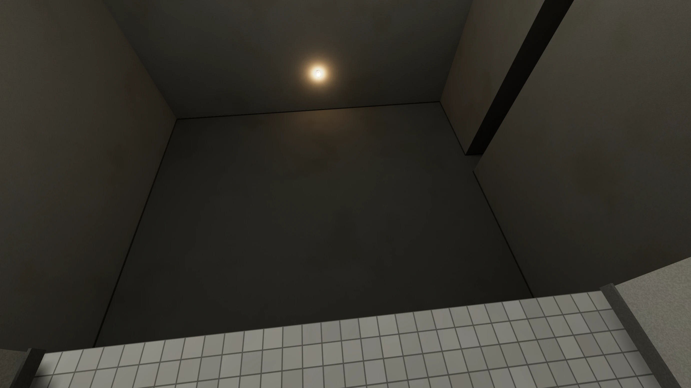
<figcaption>Die Öffnung in der Halle</figcaption>
</figure>
<figure>
<!-- tutorial-screenshot
tab: preview
viewport: 1536x864
zoom: 1.5
hook: open level=tiefe/level.ini&view=7.00,39.00,180,-25,,3.00
hook: light
hook: info off
-->
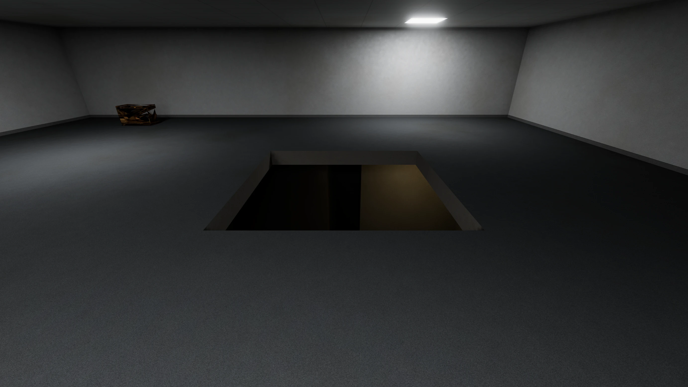
<figcaption>Das Loch im Büro</figcaption>
</figure>
<figure>
<!-- tutorial-screenshot
tab: preview
viewport: 1536x864
zoom: 1.5
hook: open level=tiefe/level.ini&view=26.00,52.00,-84,-8,,-3
hook: light
hook: info off
-->
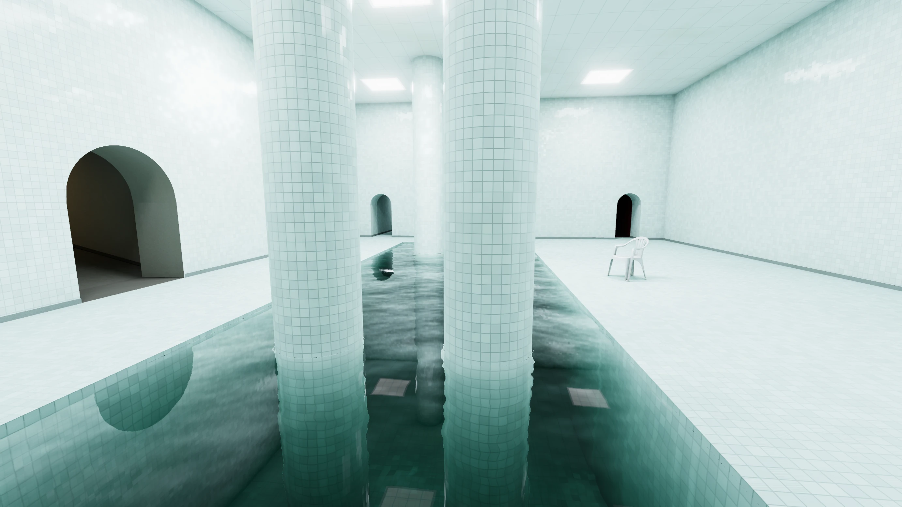
<figcaption>Das Becken unter der Erde</figcaption>
</figure>
<figure>
<!-- tutorial-screenshot
tab: preview
viewport: 1536x864
zoom: 1.5
hook: open level=tiefe/level.ini&vhs&view=42.60,69.20,-142,-10,,0
hook: light
hook: info off
-->
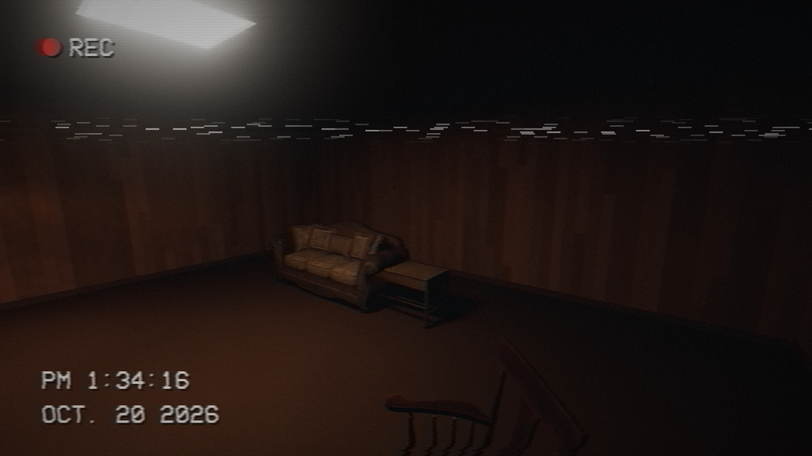
<figcaption>Das Wohnzimmer, mit <kbd>C</kbd></figcaption>
</figure>
</div>

<!-- /tutorial-scope -->

## Zeigen und veröffentlichen

<div class='found-note'>
<p>Wer eine Tür findet, soll sie offen lassen. Für die Nächsten.</p>
<cite>Mit Kreide an einen Türrahmen geschrieben</cite>
</div>

_include(workspace#live-apps)

Speichere vorher das Licht (»Save light«, siehe »Licht aufheben«) und leg `level.light` neben `level.ini`: Dann ist es bei allen sofort hell, und niemand muss warten, bis gebacken ist.

_include(workspace#subdomain)

## Mit Brille

<div class='found-note'>
<p>Mit der Brille sind die Gänge tiefer. Ich weiß nicht, ob die Brille sie tiefer zeigt oder ob sie tiefer werden, wenn man sie aufsetzt.</p>
<cite>Zettel, an eine Rot-Cyan-Brille geklebt</cite>
</div>

<kbd>3</kbd> schaltet auf ein Bild für eine Rot-Cyan-Brille um: Jedes Auge sieht die Räume von seinem eigenen Platz aus, und dein Gehirn macht daraus Tiefe. Wie das funktioniert, steht in der Aktivität [3D-Grafik mit Anaglyphen](/anaglyph). Auch die Automap ist dann räumlich, wie ein Modell auf dem Tisch.

Öffnest du die Seite im Browser einer VR-Brille, steht unten »ENTER VR«. Dann läufst du mit dem linken Stick, drehst dich mit dem rechten, und die Grifftaste stellt die Automap als kleines Modell vor dich hin. Damit das geht, muss die Brille die Adresse deiner Vorschau öffnen können.

## Der Maschinenraum

<div class='found-note'>
<p>Hinter einer Tür, die auf keiner Karte steht, haben wir einen Raum voller Kabel gefunden. Es summt dort lauter als anderswo. Wir glauben, dass hier alles gemacht wird.</p>
<cite>Feldhandbuch, letzte beschriebene Seite</cite>
</div>

Das Programm steht im Ordner `engine/`, in JavaScript, und benutzt die 3D-Bibliothek [three.js](https://threejs.org/). Die liegt in `vendor/`: Die Seite lädt nichts aus dem Internet.

<table class='table'>
<tr><th>Datei</th><th>Was sie tut</th></tr>
<tr><td><code>level.js</code></td><td>liest <code>level.ini</code> und die Räume und legt sie an ihren Türen und Löchern aneinander, auch übereinander</td></tr>
<tr><td><code>geometry.js</code></td><td>baut daraus Böden, Decken, Wände, Sockelleisten, Blöcke und Becken und legt fest, wo auf der Lightmap jede Fläche liegt</td></tr>
<tr><td><code>bake.js</code></td><td>backt das Licht auf der Grafikkarte, mit Shadern in <a href='/reference/glsl'>GLSL</a></td></tr>
<tr><td><code>textures.js</code></td><td>malt Tapete, Teppich, Decke, Samt und den Marmor der Statuen, mit Zufall und ohne ein einziges Bild; Holz, Fliesen, Marmor, die Flecken und den Glanz rechnet der Shader in <code>main.js</code></td></tr>
<tr><td><code>lightstore.js</code></td><td>hebt gebackenes Licht im Browser auf und liest <code>level.light</code></td></tr>
<tr><td><code>main.js</code></td><td>lädt alles, schaltet die Leuchten an und zeichnet jedes Bild</td></tr>
<tr><td><code>controls.js</code>, <code>automap.js</code></td><td>Laufen und Fallen, Umsehen (auch mit den Daumen) und die Automap</td></tr>
<tr><td><code>portals.js</code></td><td>sucht für jedes Bild die Räume heraus, die man von hier aus sieht; nur die werden gezeichnet</td></tr>
<tr><td><code>water.js</code>, <code>railing.js</code></td><td>das Wasser in einem Becken, mit Spiegelung, Blick ins Wasser, Wellen und Licht auf dem Grund, und das Geländer darum</td></tr>
<tr><td><code>vhs.js</code>, <code>lens.js</code></td><td>der Blick wie von einer alten Videokassette (<kbd>C</kbd>) und farbige Säume wie durch eine einfache Linse (<kbd>X</kbd>), beides Shader über dem fertigen Bild</td></tr>
</table>

### Texturen ohne ein einziges Bild

Tapete, Teppich, Marmor, Holz, Fliesen und Samt sind keine Fotos: `textures.js` malt sie beim Laden, auf eine Leinwand des Browsers (ein `canvas`), mit Formen oder Punkt für Punkt. Man nennt das **prozedurale Texturen**: Gespeichert ist nicht das Bild, sondern das Rezept dafür. Die Vorlage braucht so keine Bilddateien, und jede Farbe in `wallpaper` oder `carpet` bekommt ihre eigene Textur.

Die Tapete entsteht in drei Schritten: eine Farbe, darauf feine senkrechte Streifen, abwechselnd etwas heller und dunkler, dann ein blasses Rautenmuster:

<!-- tutorial-screenshot
# Die Tapete Schritt für Schritt
tab: preview
viewport: 1536x864
zoom: 1.5
hook: page textures.html?show=wallpaper&bare
-->

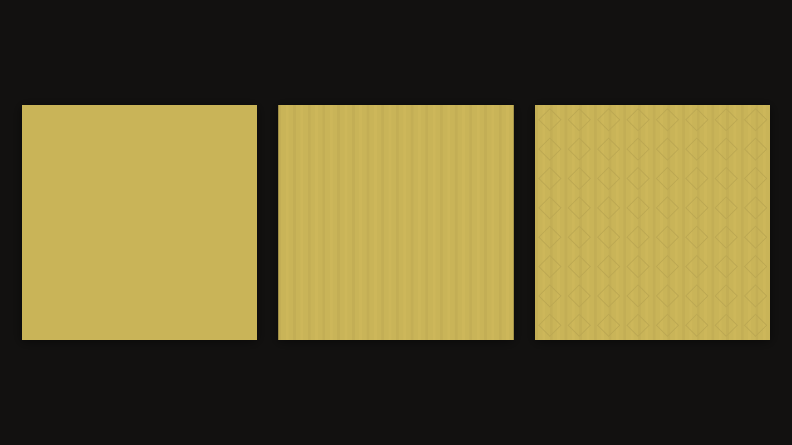

Und die vergilbten, feuchten Flecken? Malte die Textur sie, kämen sie mit ihr jeden Meter wieder, und auf einer großen Wand sähe man ihr Muster. Darum kommen sie erst beim Zeichnen dazu, im Shader jeder Fläche: aus Rauschen, nicht über die Textur, sondern über die ganze Welt, in drei Größen. Es wiederholt sich nirgends, keine zwei Wände sehen gleich aus, und eine große Wand kostet nicht mehr als eine kleine. Dasselbe gilt für Holz, Fliesen und Marmor, wie weiter unten steht: Kein Brett kommt zweimal vor, und eine Wand von 100 m kostet nicht mehr als eine von einem Meter.

Wo die Textur selbst Zufall braucht, die Fasern im Teppich oder die Töne der Bretter, kommt er aus einer Formel (`random` in `textures.js`): Jede Zahl wird aus der vorigen berechnet, und mit derselben ersten Zahl kommt immer dieselbe Folge. So sieht alles bei jedem Laden gleich aus.

Marmor ist schwieriger: Seine Adern sind keine Form, die man malen könnte. Für jeden Punkt der Textur rechnet das Programm aus, wie hell er ist, so, wie Ken Perlin 1985 Marmor beschrieben hat:

1. **Rauschen** (englisch Noise): Auf einem Gitter von 4 × 4 Punkten liegt je eine Zufallszahl, dazwischen wird weich gemischt.
2. **Turbulenz:** dasselbe Rauschen in vier Größen, jede doppelt so fein und schwächer als die vorige, zusammengezählt.
3. Ein Sinus quer über die Textur gibt gerade Streifen; eine Ader ist dort, wo er nahe null ist.
4. Zählt man die Turbulenz zum Sinus dazu, verbiegen sich die Streifen zu Adern.

<!-- tutorial-screenshot
# Marmor Schritt für Schritt
tab: preview
viewport: 1536x864
zoom: 1.5
hook: page textures.html?show=marble&bare
-->

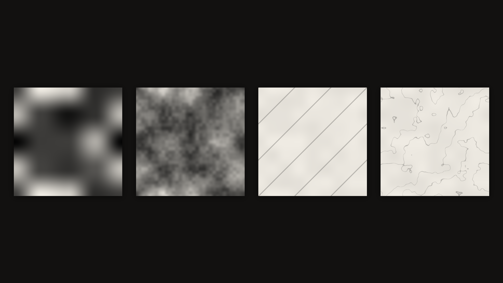

Holz geht ähnlich: Bretter in je eigenem Ton, eine Maserung aus einem Sinus quer über jedes Brett, von zwei weiteren Sinuswellen sanft hin und her gebogen, zuletzt die Fugen zwischen den Brettern und quer, wo eines endet:

<!-- tutorial-screenshot
# Holz Schritt für Schritt
tab: preview
viewport: 1536x864
zoom: 1.5
hook: page textures.html?show=wood&bare
-->

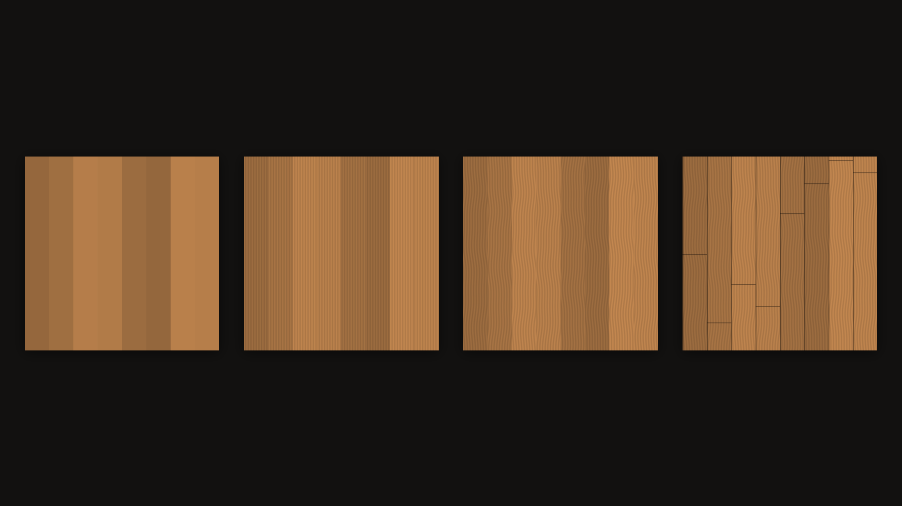

Im Level rechnet der Shader Holz, Fliesen und Marmor auf Wänden und Böden selbst aus, für jeden Bildpunkt aus seiner Stelle in der Welt, nach demselben Rezept. Der Zufall kommt dort nicht aus einer Folge, sondern aus der Stelle selbst: Aus der Nummer eines Bretts wird eine Zahl gerechnet, immer dieselbe für dasselbe Brett, und daraus sein Ton, seine Länge und seine Maserung. So ist jedes Brett anders, keine Fliese hat den Ton ihrer Nachbarin, und die Adern des Marmors, aus Rauschen im Raum, laufen über die Ecke von der Wand auf den Boden weiter. `textures.html` zeigt das Rezept auf einem Quadrat.

Tapete, Teppich, Decke und Samt bleiben Texturen. Jede ist ein Quadrat von einem Meter, auf der Wand liegt es nebeneinander, immer wieder. Am rechten Rand muss die Textur darum genau so weitergehen, wie sie am linken anfängt, und unten wie oben, sonst sähe man an jeder Wiederholung eine Naht. Die Streifen und Rauten der Tapete gehen deshalb glatt in einen Meter auf, und das Rauschen des Marmors auf einer Statue wiederholt sich genau über die Breite seiner Textur. Neunmal nebeneinander, die roten Linien zeigen, wo eine Wiederholung endet:

<!-- tutorial-screenshot
# Marmor neunmal nebeneinander, mit den Rändern
tab: preview
viewport: 1536x864
zoom: 1.5
hook: page textures.html?tile=marble&edges&bare
-->


<div class='hint try'>
<p><strong>Ausprobieren:</strong> Öffne in der Vorschau statt <code>index.html</code> die Seite <code>textures.html?show=marble</code>. Ändere in <code>engine/textures.js</code> beim Marmor die Zahl in <code>vein / 0.08</code>, etwa auf 0.25, und lade neu: Wie ändern sich die Adern? Und was passiert mit <code>turbulence * 5</code>, wenn du 5 durch 12 ersetzt? Im Level ändert das nur den Marmor der Statuen: Wände und Böden aus Marmor rechnet <code>marble</code> in <code>engine/main.js</code>, dort steht dasselbe Rezept. Mit <code>git checkout engine/</code> ist alles wieder wie vorher.</p>
</div>

### Was gezeichnet wird

<div class='found-note'>
<p>Ich habe mich umgedreht, und der Raum hinter mir war weg. Nicht dunkel, weg. Als ich wieder hinsah, war er da, als wäre nichts.</p>
<cite>Notiz am Rand einer Karte, mit Bleistift</cite>
</div>

Für ein Bild zeichnet das Programm nicht das ganze Level, nur, was du von deinem Platz aus sehen kannst. In einen anderen Raum siehst du nur durch eine Öffnung, eine Tür oder ein Loch. Solche Öffnungen heißen **Portale**, und so sucht `portals.js` für jedes Bild aus, was gezeichnet wird:

1. Der Raum, in dem du stehst, ist zu sehen, soweit er im Bild liegt.
2. Jedes seiner Portale wird aufs Bild gerechnet, als Rechteck um die Öffnung. Liegt das Rechteck im Bild, siehst du durch das Portal in den Raum dahinter, aber nur durch dieses Rechteck.
3. Von dort geht es durch die Portale dieses Raums weiter, jedes beschnitten auf das Rechteck, durch das du gerade schaust. Bleibt nichts übrig, ist dieser Weg zu Ende.

Gezeichnet werden nur die Räume, die so erreicht werden; alle anderen kosten nichts, und ein Becken spiegelt nur, wenn sein Raum dabei ist. So suchten schon Spiele wie Descent (1995) und Duke Nukem 3D (1996) aus, was sie zeichnen. In der Automap zeigt <kbd>U</kbd>, welche Räume von deinem Platz aus gezeichnet werden: Sie bleiben hell, alle anderen werden blass, die Portale, durch die du schaust, sind orange, dein Blickfeld ist rot.

<div class='gallery columns-2'>
<figure>
<!-- tutorial-screenshot
# Vom Zimmer aus durch die Türen nach Osten
tab: preview
viewport: 1536x864
zoom: 1.5
hook: open view=4.00,17.00,-82,0
hook: light
hook: info off
-->
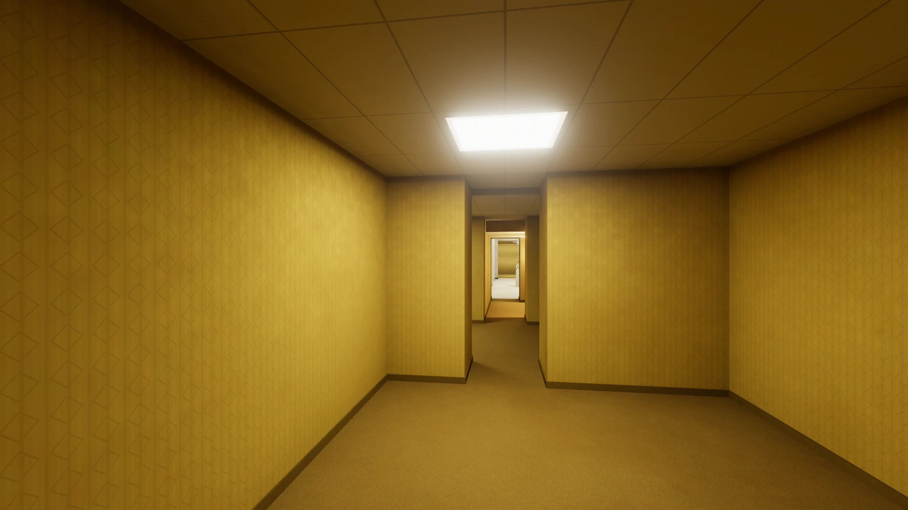
<figcaption>Vom Zimmer aus …</figcaption>
</figure>
<figure>
<!-- tutorial-screenshot
# Dasselbe in der Automap mit U
tab: preview
viewport: 1536x864
zoom: 1.5
hook: open view=4.00,17.00,-82,0&automap=0,64,48,34,0,0,sight
hook: light
hook: info off
-->
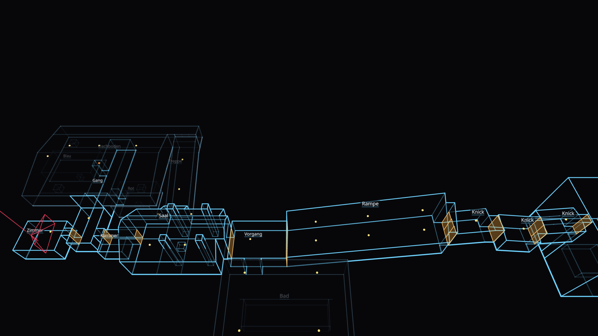
<figcaption>… in der Automap mit <kbd>U</kbd></figcaption>
</figure>
<figure>
<!-- tutorial-screenshot
# Im Bad, zur Tür hin
tab: preview
viewport: 1536x864
zoom: 1.5
hook: open view=35.50,29.50,12,2,,0
hook: light
hook: info off
-->
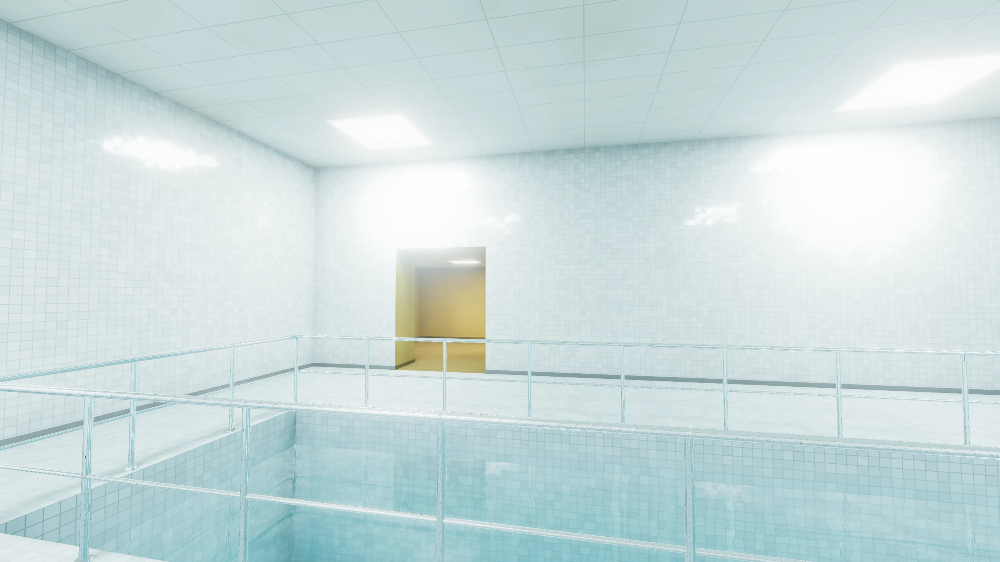
<figcaption>Im Bad …</figcaption>
</figure>
<figure>
<!-- tutorial-screenshot
# Dasselbe in der Automap mit U
tab: preview
viewport: 1536x864
zoom: 1.5
hook: open view=35.50,29.50,12,2,,0&automap=15,58,34,-2,0,-6,sight
hook: light
hook: info off
-->
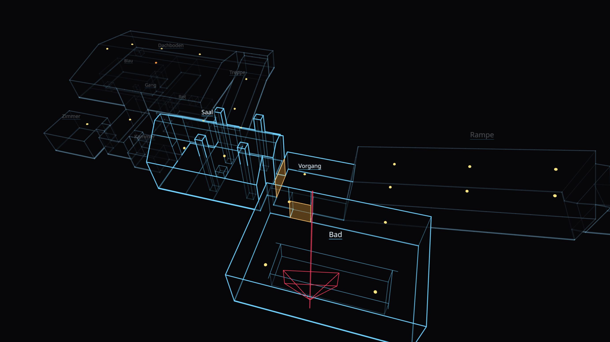
<figcaption>… zeichnet das Programm nur drei Räume</figcaption>
</figure>
</div>

<div class='hint try'>
<p><strong>Ausprobieren:</strong> Öffne die Automap, drück <kbd>U</kbd> und dreh dich langsam einmal im Kreis. Räume kommen dazu und verschwinden, je nachdem, welche Türen im Bild sind. Manchmal bleibt ein Raum hell, den du gar nicht siehst, weil eine Wand ihn verdeckt: Woran liegt das?</p>
</div>

Was ein Shader ist, steht im [Handbuch zu GLSL](/reference/glsl). Wenn du am Programm etwas änderst und nichts mehr geht: Die Konsole des Browsers (<kbd>F12</kbd>) sagt, in welcher Zeile es hakt, und `git diff` zeigt, was du geändert hast.

<div class='found-note'>
<p>Wenn du einen Ausgang findest, schreib ihn auf. Wenn du keinen findest, bau einen Raum, in dem es sich zu warten lohnt.</p>
<cite>Feldhandbuch, Rückseite</cite>
</div>
