<div class='meta'>
image: treppe.webp
image_alt: "Ein hohes Treppenhaus mit gelber Tapete: Eine Holztreppe steigt an der Wand zu einem Absatz in der Ecke, biegt um und führt weiter zu einer Tür hoch in der Wand, mit einem Geländer aus Metall."
kind: projekt
duration: 1 Doppelstunde
curriculum: "Sek I: Digitale Bilder und Visualisierung; Oberstufe: Vertiefung Computergrafik (Kollisionserkennung)"
reference: [workspace, kartografie]
template: https://github.com/specht/backrooms-starter.git
template_name: der Backrooms-Vorlage
</div>

# Level 1: Die Tiefe

<div
    class="autotoc-secondary-trigger"
    data-title="Auf dieser Seite"
    data-levels="h2,h3">
</div>

<p class='abstract'>
Hinter dem Saal hört der flache Boden auf. Ein Gang steigt an, ein anderer knickt und kippt, eine Treppe führt um eine Ecke ein Stockwerk hinauf auf einen Dachboden, in dessen Boden ein Loch klafft, und am Ende des krummen Gangs ist eine Tür, hinter der kein Boden mehr ist. Du baust weiter an deinem Level aus Level 0 und siehst dir zum Schluss an, wie das Programm merkt, wo du stehen kannst und wo eine Wand im Weg ist.
</p>

<div class='found-note'>
<p>Unter der Lobby geht es weiter, und über ihr auch. Wer hier läuft, merkt es an den Beinen, bevor er es sieht.</p>
<cite>Feldhandbuch, Seite ohne Nummer</cite>
</div>

<table class='table'>
<tr><th>Level</th><td>1, »Die Tiefe«</td></tr>
<tr><th>Überlebensschwierigkeit</th><td>Klasse 2: Böden, die nicht waagerecht sind, Treppen, Löcher. Schau, wohin du trittst.</td></tr>
<tr><th>Ausdehnung</th><td>über und unter dir</td></tr>
<tr><th>Ausgänge</th><td>einer, ganz unten (siehe »Ein Ausgang«)</td></tr>
</table>

## Wo du weitermachst

Diese Seite baut auf [Level 0](/level-0-c1d8a2f7) auf: auf deinem Klon der Vorlage in `/workspace/backrooms-starter`, mit Kammer, Saal und Salon, so wie sie am Ende von Level 0 waren. Öffne den Ordner wieder in VS Code und starte die Vorschau wie dort (»Go Live«).

<!-- tutorial-step
# Wo Level 0 aufgehört hat: die Vorlage mit den Räumen von dort, die Vorschau
show-left-sidebar
clone-start: https://github.com/specht/backrooms-starter.git @ 0ecf118ca12e8d61b685a3653354f4c3adedf9c8
press: Enter
wait-for-input-value: /workspace/
press: Enter
wait-for-text: Would you like to open the repository?
click: Open
wait-for-text: level.ini
write-file: rooms/zimmer.room <- file:../level-0-c1d8a2f7/stufen/zimmer.room
write-file: rooms/gang.room <- file:../level-0-c1d8a2f7/stufen/gang.room
write-file: rooms/kammer.room <- file:../level-0-c1d8a2f7/stufen/kammer-2.room
write-file: rooms/saal.room <- file:../level-0-c1d8a2f7/stufen/saal-salon-2.room
write-file: rooms/salon.room <- file:../level-0-c1d8a2f7/stufen/salon-5.room
go-live
-->

## Hinauf und hinunter

<div class='found-note'>
<p>Der Gang hinter dem Saal steigt an. Das merkt man an den Beinen, nicht an den Augen: Die Decke hängt schief, die Leuchten auch, und irgendwann weiß ich nicht mehr, ob ich hinauf- oder hinuntergehe.</p>
<cite>Bleistiftnotiz, sehr klein geschrieben</cite>
</div>

Bis hierher liegt jeder Boden auf derselben Höhe. Jetzt geht es aufwärts und abwärts: schräge Böden, eine Treppe um eine Ecke auf einen Dachboden, ein Loch, durch das man fällt, und eine Tür, hinter der kein Boden mehr ist.

### Schräge Böden

Auch ein Boden kann schräg sein. Hinter dem Saal kommt erst ein ebener Gang, dann geht es hinauf. Gib dem Saal an der rechten Wand eine Tür, drei Felder breit:

```room
~ #...L.S.L.S.#
1...........2
#.....M.....2
#...........2
~ #...L.S.L.S.#
```

```room
[2]
door = vorgang 1
```

Wie die Tür zum Salon ist sie breit, diesmal untereinander, und die Tür auf der anderen Seite muss genauso breit sein. Leg dahinter `rooms/vorgang.room` an, einen ebenen Gang mit einer Tür, die so breit ist wie er selbst:

_include_file(stufen/vorgang.room, room_copy)

und dahinter `rooms/rampe.room`, so breit wie der Gang:

```room
# Eine Rampe hinter dem Saal.

[room]
name = Rampe
ramp = east, 4          # der Boden steigt nach Osten um 4 m
height = 2.6

[map]
####################
1..................#
1...L.....L.....L..#
1..................#
1...L.....L.....L..#
1..................#
####################

[L]
light = #fff3cf
power = 1.6
```

`ramp = east, 4` lässt den Boden nach Osten um 4 m ansteigen, vom ersten Feld hinter der Wand bis zum letzten. `height` misst die Decke über dem Boden, an jeder Stelle: Sie steigt mit, überall 2,6 m über dir, und die Leuchten mit ihr. Wie hoch ein Raum liegt, rechnet das Programm aus seinen Türen aus: An einer Tür liegen beide Böden gleich hoch. Eine Tür am oberen Ende, in der Ostwand, führte in einen Raum 4 m über dem Saal. Vom ebenen Gang aus sieht man, wo es hinaufgeht:

<!-- tutorial-screenshot
# Vom ebenen Gang aus: vorn eben, hinten steigt der Boden
write-file: rooms/saal.room <- file:stufen/saal-7.room
write-file: rooms/vorgang.room <- file:stufen/vorgang.room
write-file: rooms/rampe.room <- file:stufen/rampe-1.room
tab: preview
viewport: 1536x864
zoom: 1.5
hook: open view=32.80,19.70,-80,10
hook: light
hook: info off
-->

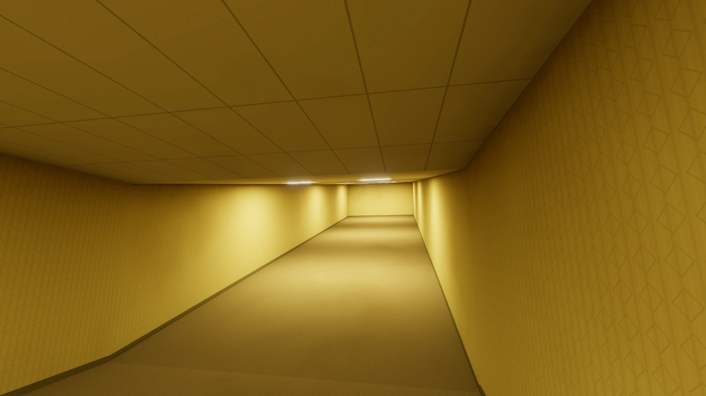

### Boden und Decke zusammen

Mit `slope` und zwei Höhen kippt die Decke außerdem, und weil die Höhen über dem Boden gelten, kippt sie gegen den Boden. Jede Richtung fühlt sich anders an. So sähe die Rampe mit dreien davon aus; für den Rest der Seite bleibt sie bei der letzten.

<!-- tutorial-scope -->

**Enger und enger.** Die Decke steigt nach Westen, gegen die Rampe: unten, an der Westwand, 6 m über dem Boden, oben, an der Ostwand, nur noch 2,4 m. Weil der Boden zugleich um 4 m steigt, bleibt die Decke fast waagerecht, und der Gang wird nach oben hin immer niedriger:

```room
~ ramp = east, 4          # der Boden steigt nach Osten um 4 m
height = 2.4, 6         # über dem Boden: an der Ostwand 2,4 m, an der Westwand 6 m
slope = west
```

<!-- tutorial-screenshot
write-file: rooms/rampe.room <- file:stufen/rampe-2.room
tab: preview
viewport: 1536x864
zoom: 1.5
hook: open view=32.80,19.70,-80,10
hook: light
hook: info off
-->

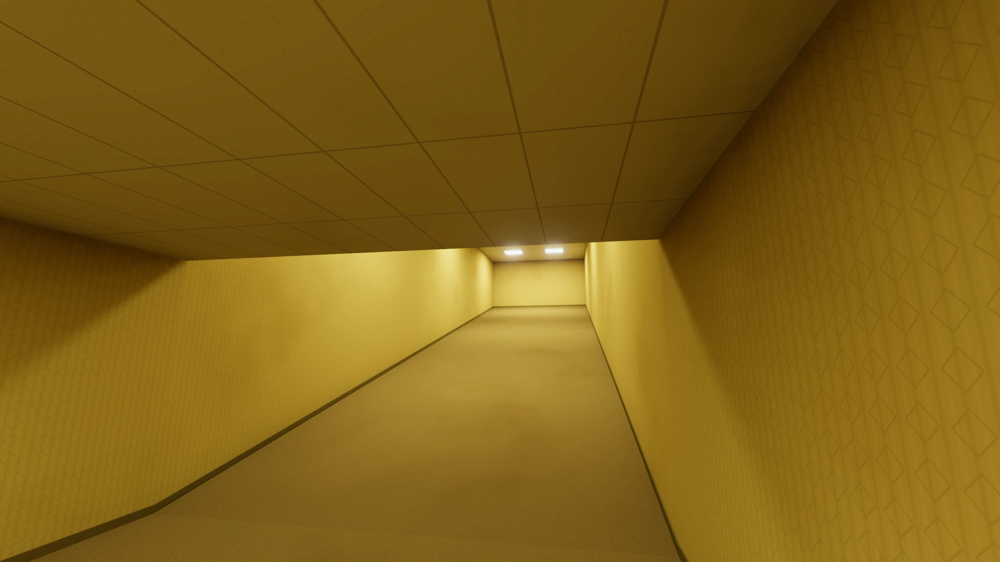

<!-- /tutorial-scope -->

<!-- tutorial-scope -->

**Hinunter.** Mit einer negativen Zahl fällt der Boden, hier um 3 m, unter einem Satteldach:

```room
ramp = east, -3         # der Boden fällt nach Osten um 3 m
height = 2.4, 3.6
slope = gable
```

<!-- tutorial-screenshot
write-file: rooms/rampe.room <- file:stufen/rampe-3.room
tab: preview
viewport: 1536x864
zoom: 1.5
hook: open view=34.60,18.00,-90,-14
hook: light
hook: info off
-->

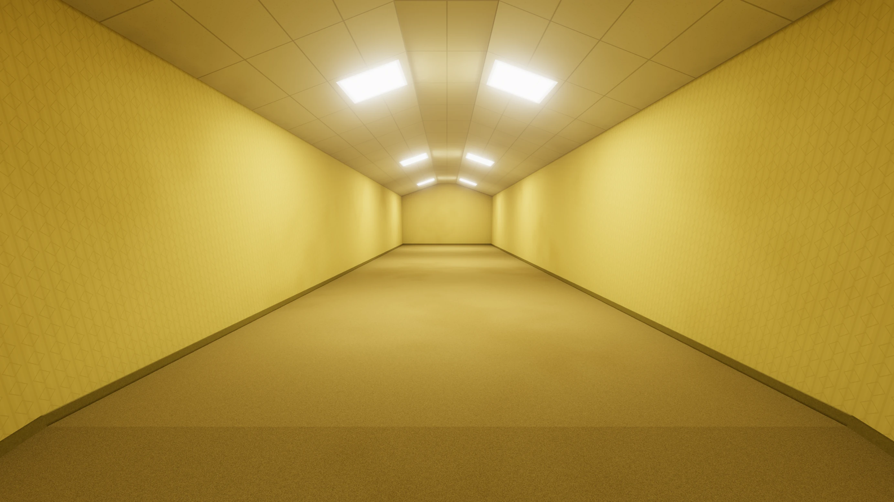

<!-- /tutorial-scope -->

**Quer dazu.** Der Boden steigt nach vorn, die Decke kippt zur Seite, und die Leuchten hängen schief in ihr. Wo ist oben?

```room
ramp = east, 4          # der Boden steigt nach Osten um 4 m
height = 2.4, 5.5       # über dem Boden: an der Südwand 2,4 m, an der Nordwand 5,5 m
slope = north           # die Decke steigt zur Seite hin an, quer zur Rampe
```

<!-- tutorial-screenshot
write-file: rooms/rampe.room <- file:stufen/rampe.room
tab: preview
viewport: 1536x864
zoom: 1.5
hook: open view=34.80,19.40,-76,14
hook: light
hook: info off
-->

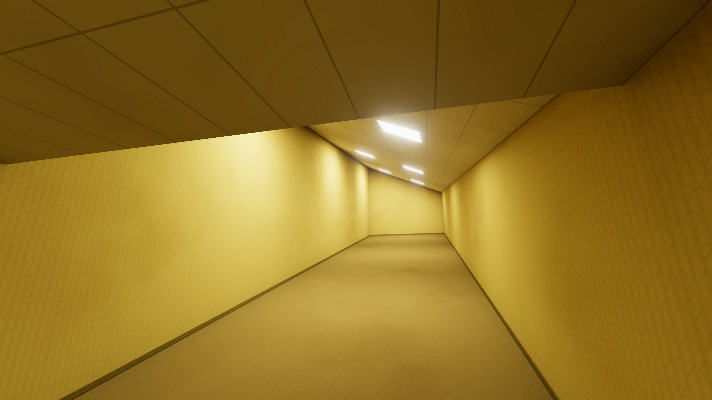

### Ein krummer Gang

Am oberen Ende der Rampe geht der Gang weiter, in drei kurzen Stücken. Jedes steigt oder fällt ein wenig, die Decke kippt mal nach links, mal nach rechts, und jedes zweite Stück ist um ein Feld zur Seite versetzt; die Türen dazwischen sind zwei Felder breit. Gib der Rampe in der Ostwand eine Tür, drei Felder breit:

```room
~ ####################
~ 1..................#
1...L.....L.....L..2
1..................2
1...L.....L.....L..2
~ 1..................#
```

```room
[2]
door = knick1 1
```

und leg `rooms/knick1.room`, `rooms/knick2.room` und `rooms/knick3.room` an:

_include_file(stufen/knick1.room, room_copy)

_include_file(stufen/knick2.room, room_copy)

_include_file(stufen/knick3.room, room_copy)

<!-- tutorial-screenshot
# Vom oberen Ende der Rampe in den krummen Gang
write-file: rooms/rampe.room <- file:stufen/rampe-5.room
write-file: rooms/knick1.room <- file:stufen/knick1.room
write-file: rooms/knick2.room <- file:stufen/knick2.room
write-file: rooms/knick3.room <- file:stufen/knick3.room
tab: preview
viewport: 1536x864
zoom: 1.5
hook: open view=51.00,18.40,-96,4,,3.4
hook: light
hook: info off
-->

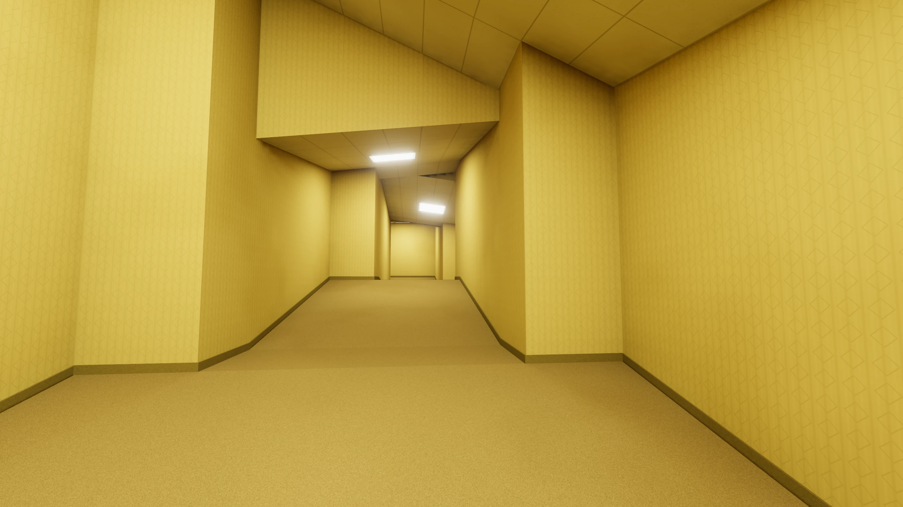

Am Ende der Reihe wartet ein fertiges Level, die Nachtschicht, gebaut aus genau solchen Räumen.

## Eine Treppe hinauf

<div class='found-note'>
<p>Über dem Gang ist noch etwas. Manchmal knarrt die Decke, als ginge jemand darüber. Hinter dem Saal habe ich die Treppe gefunden, die hinaufführt.</p>
<cite>Zettel, unter der Tür des Saals durchgeschoben</cite>
</div>

Über Blau, dem Gang und Rot ist Platz für einen Dachboden, ein Stockwerk höher. Hinauf führt eine Treppe, in einem Treppenhaus nördlich vom Saal. Der Saal bekommt dafür in seiner Nordwand eine Tür, drei Felder breit:

```room
~ [map]
####333######
~ #...........#
~ #...L.S.L.S.#
```

```room
[3]
door = treppe 1
```

### Bis zum Absatz

Das Treppenhaus ist nur 5 m tief, denn dahinter, im Westen, liegt schon der Platz für den Dachboden. Für eine gerade Treppe ein Stockwerk hinauf ist das zu kurz: 3 m Höhe sind etwa 17 Stufen von 18 cm, und jede braucht rund 29 cm, um darauf zu treten, zusammen 5 m, und vor der ersten Stufe muss man noch stehen können. So, wie es auch in echten Häusern geht, steigt die Treppe darum erst an der Ostwand ein Stück hinauf, bis zu einem Absatz in der Ecke. Leg `rooms/treppe.room` an:

_include_file(stufen/treppe-1.room, room_copy)

`stairs = north, 1.2` macht die Felder mit `S` zu einer Treppe, die nach Norden ansteigt, bis auf 1,2 m, in Stufen von etwa 18 cm; die Felder müssen ein Rechteck sein. `raise = 1.2` hebt die Felder mit `Q` auf 1,2 m: ein Podest, hier der Absatz. Unter beiden ist kein Platz, sie sind massiv, wie ein Block, nur dass du darauf gehst. `railing = on` gibt ihnen ein Geländer, überall, wo es an der Seite mehr als einen halben Meter hinuntergeht. `material` und `color` machen sie aus Holz; ohne sind die Stufen wie der Boden des Raums und ihre Seiten wie seine Wände.

<!-- tutorial-screenshot
write-file: rooms/saal.room <- file:stufen/saal-8.room
write-file: rooms/treppe.room <- file:stufen/treppe-1.room
tab: preview
viewport: 1536x864
zoom: 1.5
hook: open view=21.00,12.40,-62,16
hook: light
hook: info off
-->

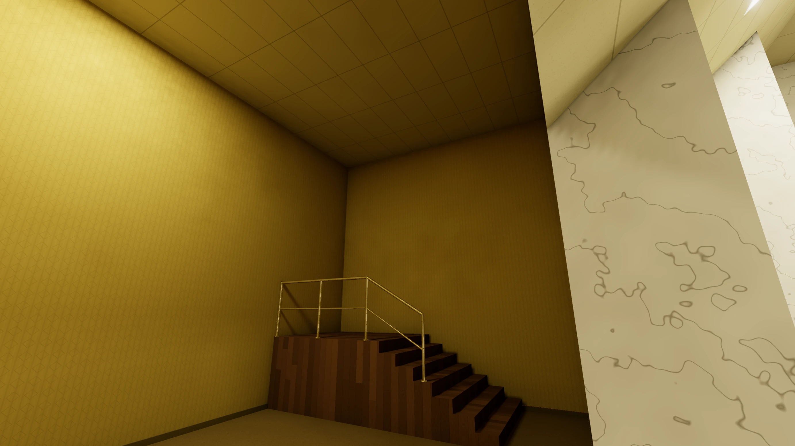

### Um die Ecke

Vom Absatz geht es nach Westen weiter, an der Nordwand entlang, bis auf 3 m, zu einem zweiten Absatz vor einer Tür hoch in der Wand:

```room
~ [map]
~ #########
2PPTTTQQ#
2PPTTTQQ#
#L....SS#
~ #.....SS#
~ #.......#
~ #111#####
```

```room
[T]
stairs = west, 3        # vom Absatz an der Nordwand nach Westen, bis auf 3 m
material = wood
color = #8a6a44
railing = on

[P]
raise = 3               # oben, vor der Tür zum Dachboden
material = wood
color = #8a6a44
railing = on
```

```room
[2]
door = dachboden 1, 3   # die Tür liegt 3 m hoch, der Dachboden dahinter auch
```

Eine Treppe fängt auf der Höhe dessen an, was an ihrem unteren Ende liegt: Liegt dort ein Podest, beginnt sie auf ihm. Die Felder mit `T` steigen darum von 1,2 m auf 3 m. Das Geländer läuft in einem Stück an allem entlang: die erste Treppe hinauf, um den Absatz, die zweite hinauf und am oberen Podest entlang.

Die Zahl hinter `dachboden 1` sagt, wie viel höher der Boden auf der anderen Seite der Tür liegt: 3 m. Im Treppenhaus sitzt die Tür also 3 m über dem Boden, darunter ist Wand, und die Treppe endet genau davor. Leg dahinter `rooms/dachboden.room` an, unter einem Satteldach aus Holz, mit ein paar Kisten:

_include_file(stufen/dachboden-1.room, room_copy)

Die Kisten sind aus Pappe: `material = cardboard` macht aus einem Block einen Karton, mit Klebeband über den Deckel, einem Etikett und zwei Pfeilen, die zeigen, wo oben ist.

Keine Kiste steht genau gerade: `rotation` dreht einen Block wie ein Modell um die senkrechte Achse, in Grad. Damit nicht alle gleich schief stehen, hat jede Sorte Kiste ihren eigenen Buchstaben, mit etwas anderer Größe, Farbe und Drehung. Bleib bei ein paar Grad: Eine gedrehte Kiste sollte ihr Feld nicht verlassen.

Eine Beschreibung der Tür genügt: Die Treppe hat sie, also steht sie im Dachboden nicht noch einmal.

Speichere und lade neu. Der Dachboden liegt über Blau, dem Gang und Rot: Die Tür hebt ihn um 3 m, und keiner der drei Räume darunter ist so hoch. Räume dürfen übereinander liegen, solange der obere Boden nirgends unter der Decke des unteren Raums liegt. Wie hoch jeder liegt, rechnet das Programm wie immer aus seinen Türen aus. Läge die Tür nur 2,6 m hoch, stünde oben links `room dachboden and room rot lie in the same place at the same height`: Rot ist 2,8 m hoch.

<!-- tutorial-screenshot
write-file: rooms/treppe.room <- file:stufen/treppe.room
write-file: rooms/dachboden.room <- file:stufen/dachboden-1.room
tab: preview
viewport: 1536x864
zoom: 1.5
hook: open view=21.90,10.10,-125,-30,,3
hook: light
hook: info off
-->

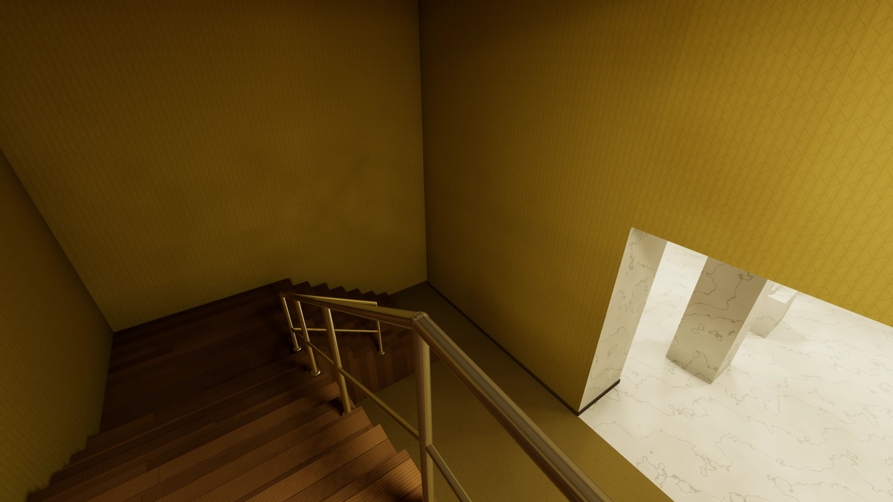

<!-- tutorial-screenshot
# Der Dachboden, von der Tür aus über die Kisten hinweg
tab: preview
viewport: 1536x864
zoom: 1.5
hook: open view=19.00,9.45,112,-18,,3
hook: light
hook: info off
-->

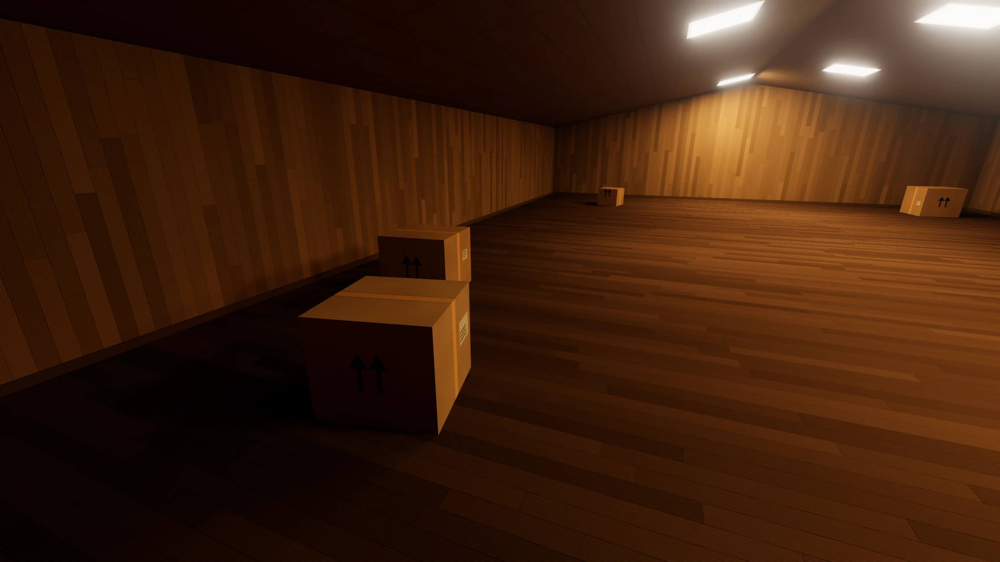

<div class='hint try'>
<p><strong>Ausprobieren:</strong> Stell im Treppenhaus etwas auf das obere Podest, den Plastikstuhl zum Beispiel. Er bekommt ein eigenes Feld auf dem Podest, ein <code>C</code> im Grundriss, und dazu:</p>
<pre class='code-room'>[C]
model = models/plastic_monobloc_chair_01/plastic_monobloc_chair_01_1k.gltf
height = 0.88
on = P</pre>
<p>Mit <code>on = P</code> gehört das Feld zum Podest, und der Stuhl steht oben. Was passiert ohne <code>on = P</code>?</p>
</div>

### Ein Loch im Boden

<div class='found-note'>
<p>Im Dachboden fehlt ein Stück Boden. Unten sehe ich den Gang, durch den ich gekommen bin. Ich bin nicht gesprungen. Noch nicht.</p>
<cite>Bleistiftnotiz, am Rand eingerissen</cite>
</div>

Ein Loch verbindet zwei Räume wie eine Tür, nur senkrecht. `_` im Grundriss ist ein Loch im Boden, `^` eins in der Decke. Schneid in den Dachboden ein Loch über dem Gang, drei Felder breit und zwei tief:

```room
~ #..K..........K..#
#......___..K....#
#......___.......#
~ ##################
```

In `[_]` steht, welcher Raum darunter liegt, und mit `slab`, wie dick der Boden zwischen beiden ist. Die Türen legen den Dachboden und den Gang schon fest: Der Boden muss genau passen.

_task(zwischendecke)

```room
[_]
below = gang            # darunter liegt der Gang
slab = 0.5              # so dick ist der Boden zwischen beiden
```

Im Gang werden dieselben Felder zum Loch in der Decke, in `rooms/gang.room` unter der Tür zu Rot:

```room
~ #...2
#^^^#
#^^^#
~ #...#
```

`below` nennt den Raum darunter. Dessen `^` liegen genau unter den `_`, gleich viele und in derselben Form; ein Loch darf beliebig groß sein. `slab` ist die Dicke des Bodens zwischen beiden Räumen, ohne Angabe 0,3 m. Am Rand des Lochs sieht man ihn als rohen Beton. Wie eine Tür legt ein Loch die Räume aneinander: Die Decke des unteren Raums liegt `slab` unter dem Boden des oberen. Hier liegen beide schon fest, durch die Türen, darum muss `slab` genau passen.

Tritt auf das Loch, und du fällst in den Gang.

<div class='gallery columns-2'>
<figure>
<!-- tutorial-screenshot
# Das Loch von oben, aus dem Dachboden in den Gang
write-file: rooms/dachboden.room <- file:stufen/dachboden.room
write-file: rooms/gang.room <- file:stufen/gang-2.room
tab: preview
viewport: 1536x864
zoom: 1.5
hook: open view=11.00,9.80,172,-50,,3
hook: light
hook: info off
-->
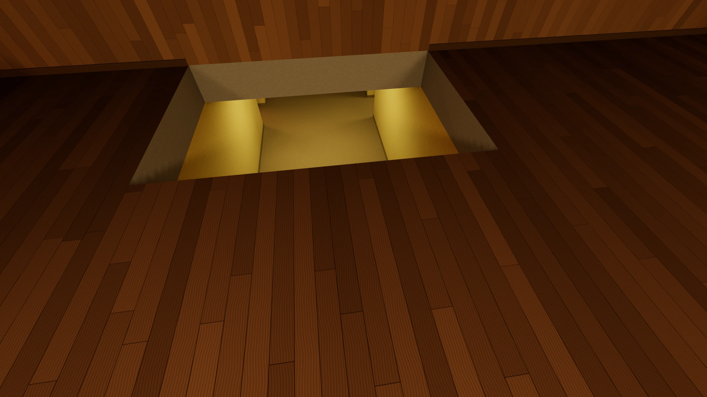
<figcaption>Von oben: der Gang unter dem Dachboden</figcaption>
</figure>
<figure>
<!-- tutorial-screenshot
# Das Loch von unten, aus dem Gang
tab: preview
viewport: 1536x864
zoom: 1.5
hook: open view=11.00,14.10,10,27,,0
hook: light
hook: info off
-->
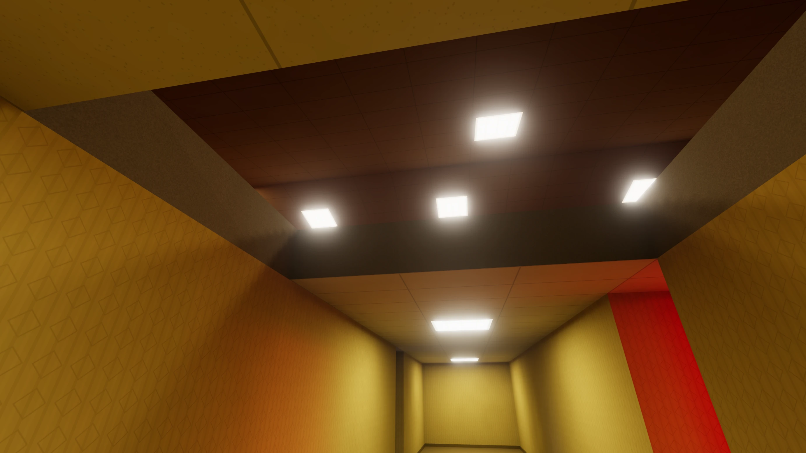
<figcaption>Von unten: das Dach des Dachbodens</figcaption>
</figure>
</div>

### Eine Tür ins Leere

<div class='found-note'>
<p>Am Ende des krummen Gangs ist eine Tür. Ich habe hinausgeschaut. Dahinter ist kein Boden, nur ganz unten brennt ein Licht.</p>
<cite>Letzte Zeile einer Seite, die Schrift zittert</cite>
</div>

Das letzte Stück des krummen Gangs, `rooms/knick3.room`, bekommt in seiner Ostwand eine Tür:

```room
~ #....#
1..L.2
~ 1....#
```

```room
[2]
door = schacht 1, -7    # dahinter liegt der Boden 7 m tiefer
```

Wie bei der Tür zum Dachboden sagt die Zahl hinter der Ziffer, wie viel höher der Boden auf der anderen Seite liegt, mit einem Minus also, wie viel tiefer: Im Schacht liegt die Tür 7 m über dem Boden, darunter ist Wand. Leg `rooms/schacht.room` an:

_include_file(stufen/schacht.room, room_copy)

Unten im Schacht stehen ein paar Kisten und ein Plastikstuhl: Von oben siehst du an ihnen, wie tief es ist. Die Lampe unten an der Ostwand ist ein Modell, das selbst leuchtet; wie das geht, kommt in Level 3.

Wer durch die Tür tritt, fällt. <kbd>R</kbd> bringt dich an die Stelle kurz vor dem Sturz zurück, <kbd>Shift</kbd> <kbd>R</kbd> an den Anfang.

<div class='gallery columns-2'>
<figure>
<!-- tutorial-screenshot
# Am Ende des krummen Gangs, an der Kante
write-file: rooms/knick3.room <- file:stufen/knick3-2.room
write-file: rooms/schacht.room <- file:stufen/schacht.room
tab: preview
viewport: 1536x864
zoom: 1.5
hook: open view=69.40,18.00,-96,-40,,4.9
hook: light
hook: info off
-->
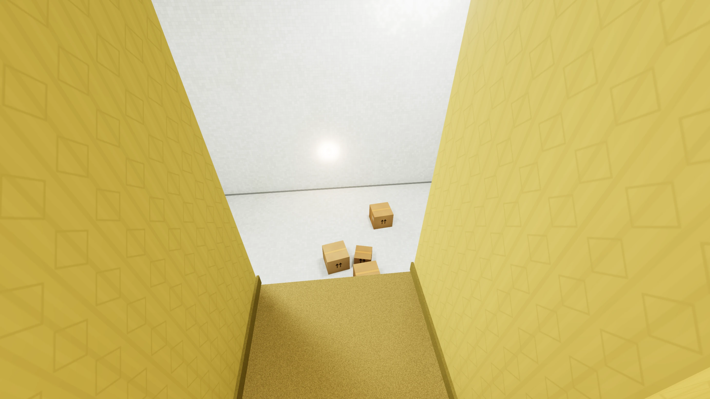
<figcaption>An der Kante</figcaption>
</figure>
<figure>
<!-- tutorial-screenshot
# Vom Boden des Schachts hinauf zur Tür
tab: preview
viewport: 1536x864
zoom: 1.5
hook: open view=78.00,17.60,82,28,,-2.1
hook: light
hook: info off
-->
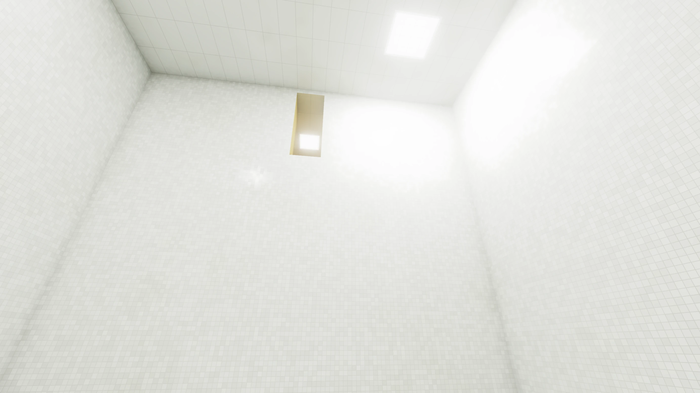
<figcaption>Vom Boden des Schachts</figcaption>
</figure>
</div>

## Was du jetzt einstellen kannst

Alles zusammen steht im Handbuch unter [Kartografie](/reference/kartografie). Zu allem aus Level 0 kommt in `[room]`:

<table class='table'>
<tr><th>Eintrag</th><th>Bedeutung</th></tr>
<tr><td><code>ramp</code></td><td>ein schräger Boden: Richtung und um wie viele Meter er ansteigt, zum Beispiel <code>east, 4</code>; negativ: Er fällt</td></tr>
<tr><td><code>height</code>, <code>slope</code></td><td>wie in Level 0, über dem Boden gemessen, an jeder Stelle: Auf einer Rampe steigt die Decke mit</td></tr>
</table>

Für die Buchstaben im Grundriss:

<table class='table'>
<tr><th>Eintrag</th><th>Bedeutung</th></tr>
<tr><td><code>stairs = east, 3</code></td><td>eine Treppe über diese Felder (ein Rechteck), nach Osten hinauf bis auf 3 m, in Stufen von etwa 18 cm; darunter ist kein Platz. Liegt an ihrem unteren Ende ein Podest, beginnt sie auf ihm</td></tr>
<tr><td><code>raise = 3</code></td><td>ein Podest: Diese Felder liegen 3 m höher, nebeneinander sind sie eins</td></tr>
<tr><td><code>railing = on</code></td><td>bei einer Treppe oder einem Podest: ein Geländer, wo es an der Seite hinuntergeht</td></tr>
<tr><td><code>material</code>, <code>color</code></td><td>bei einer Treppe oder einem Podest: woraus und in welcher Farbe</td></tr>
<tr><td><code>on = P</code></td><td>bei einer Leuchte, einem Block oder einem Modell: Das Feld gehört zum Podest der <code>P</code>, die Leuchte, der Block oder das Modell steht darauf</td></tr>
</table>

Für Türen und Löcher:

<table class='table'>
<tr><th>Eintrag</th><th>Bedeutung</th></tr>
<tr><td><code>door = halle 1, -4</code></td><td>eine Tür hoch in der Wand: Der Boden auf der anderen Seite liegt 4 m tiefer (ohne Minus: höher)</td></tr>
<tr><td><code>_</code>, <code>^</code></td><td>im Grundriss: ein Loch im Boden, ein Loch in der Decke</td></tr>
<tr><td><code>[_]</code> mit <code>below = keller</code></td><td>unter den <code>_</code> liegen die <code>^</code> im Keller</td></tr>
<tr><td><code>slab = 0.3</code></td><td>in <code>[_]</code>: wie dick der Boden zwischen beiden Räumen ist</td></tr>
</table>

## Im Maschinenraum: Wo du gehen kannst

<div class='found-note'>
<p>Ich habe versucht, durch die Wand zurückzugehen, durch die ich gekommen bin. Sie lässt mich nicht. Von dieser Seite aus ist sie eine Wand wie jede andere.</p>
<cite>Bleistiftnotiz, am Rand einer Karte</cite>
</div>

Du läufst Rampen hinauf, Treppen und um Säulen herum, an Geländern entlang, und durch Wände kommst du nicht. Woher weiß das Programm, wo du gehen kannst? Das steht in `engine/controls.js`, und <kbd>K</kbd> zeigt es: was dir im Weg steht, rot, und deinen Kreis am Boden.

Für das Programm bist du ein Kreis um deine Füße, 25 cm Radius, mit den Augen 1,6 m darüber. In jedem Bild rechnet es aus, wohin du willst, und prüft, ob der Kreis dort Platz hat. Zwei Arten von Hindernissen gibt es:

1. **Felder ohne Boden.** An der Mitte des Kreises und an acht Punkten auf seinem Rand sieht das Programm im Gitter nach, ob dort in irgendeinem Raum ein Boden ist, auf den du treten kannst: höchstens 45 cm über deinen Füßen, mit mindestens einem Meter Luft darüber, und kein Wasser. Eine Stufe von 18 cm nimmst du also, eine Kante von 1,2 m nicht. Wände sind darum keine Klötze, sondern einfach Felder ohne Boden. Mit <kbd>K</kbd> sind die acht Punkte grün, wo es weitergeht, und rot, wo nicht.
2. **Kästen.** Blöcke, Modelle, die Rohre der Geländer und die Wand neben einem schmalen Bogen sind Kästen: ihr Grundriss und wie hoch sie reichen. Der Kreis darf keinen berühren. Was höher hängt als 1,7 m über deinen Füßen, eine Wandlampe, gilt nicht, darunter läufst du hindurch; was niedriger ist als 10 cm, übersteigst du. Eine runde Säule ist ein Kreis, kein Kasten, und ein Rohr des Geländers ein schmaler Kasten bis einen Meter darunter.

Jeden Schritt prüft das Programm in zwei Teilen, erst in Ost-West-, dann in Nord-Süd-Richtung, und macht jeden Teil, der frei ist. Läufst du schräg gegen eine Wand, geht der eine Teil nicht und der andere schon: Du gleitest an ihr entlang, statt stehen zu bleiben.

Danach stellt es dich auf den Boden, der dort ist: Auf einer Rampe oder Stufe ein Stück höher, ein Stück tiefer auch. Liegt der Boden mehr als 30 cm unter deinen Füßen, über einem Loch oder hinter einer Tür ins Leere, fällst du, immer schneller, wie ein Stein (9,81 m/s²), bis wieder Boden kommt.

<div class='gallery columns-3'>
<figure>
<!-- tutorial-screenshot
# Mit K: das Treppenhaus, der Kreis am Boden
tab: preview
viewport: 1536x864
zoom: 1.5
hook: open view=25.00,11.80,-80,-68,,0
hook: light
hook: info off
hook: key k
-->
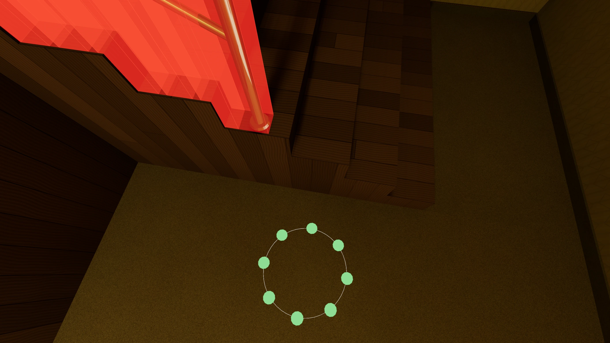
<figcaption>Geländer als Kästen, dein Kreis am Boden</figcaption>
</figure>
<figure>
<!-- tutorial-screenshot
# Mit K: Säulen und Athena im Saal
tab: preview
viewport: 1536x864
zoom: 1.5
hook: open view=18.00,16.40,-102,8
hook: light
hook: info off
hook: key k
-->
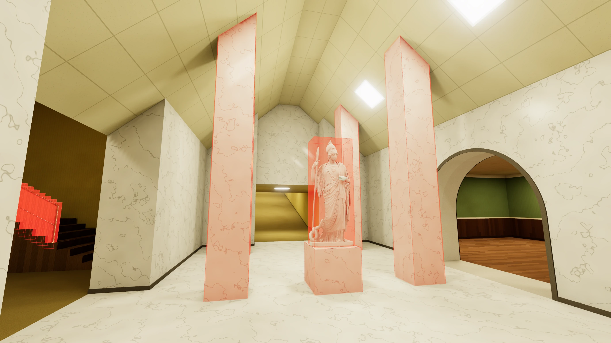
<figcaption>Säulen und Statue</figcaption>
</figure>
<figure>
<!-- tutorial-screenshot
# Mit K in der Automap: alle Hindernisse von oben
tab: preview
viewport: 1536x864
zoom: 1.5
hook: open view=23.00,19.00,-20,-40
hook: light
hook: key m k
hook: wheel 900
hook: info off
-->
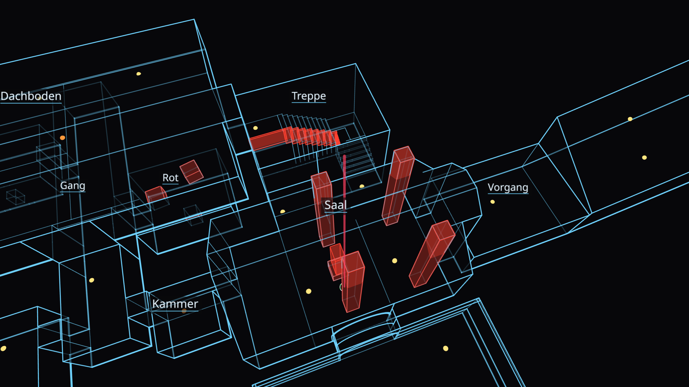
<figcaption>alle in der Automap</figcaption>
</figure>
</div>

<div class='hint try'>
<p><strong>Ausprobieren:</strong> Drück <kbd>K</kbd> und lauf schräg gegen eine Wand. Welche der acht Punkte werden rot, und warum gleitest du trotzdem weiter? Stell dich vor die erste Stufe im Treppenhaus und dann vor die Seite des Absatzes: Wann werden die Punkte dort rot? Geh im Saal um Athena herum, ganz dicht: Wie nah kommst du an den Sockel?</p>
</div>

## Ein Ausgang

<div class='found-note'>
<p>Unten im Schacht riecht es nach Chlor. Ich habe die Kisten beiseitegeschoben: Darunter sind Fliesen, und zwischen den Fliesen ist es feucht. Irgendwo hier unten ist Wasser.</p>
<cite>Zettel, mit Klebeband an einer Kiste befestigt</cite>
</div>

Weiter geht es in [Level 2](/level-2-b52d0f18): ein Bad mit einem Becken voll Wasser, runde Säulen darin und ein Podest für den Bademeister.
