<div class='meta'>
image: bad.webp
image_alt: "Ein Bad ganz in Fliesen: ein Becken voll klarem, blaugrünem Wasser mit Rand und Geländer, darin eine runde Säule; dahinter führt eine weiße Treppe auf ein Podest mit einem Plastikstuhl."
kind: projekt
topic: hidden
duration: 1 Doppelstunde
reference: [workspace, kartografie]
template: https://github.com/specht/backrooms-starter.git
template_name: der Backrooms-Vorlage
</div>

# Level 2: Das Bad

<div
    class="autotoc-secondary-trigger"
    data-title="Auf dieser Seite"
    data-levels="h2,h3">
</div>

<p class='abstract'>
Unter den gelben Gängen riecht es nach Chlor. Du baust ein Bad aus Fliesen, Schritt für Schritt: ein Becken voll Wasser, einen Rand und ein Geländer, runde Säulen, die im Wasser stehen, und eine Treppe auf ein Podest, von dem aus ein Bademeister über alles wacht, nur dass keiner da ist. Dann machst du das Wasser trüb, dunkel oder lässt es ab, und zum Schluss siehst du, wie das Programm Wasser zeichnet, das es gar nicht gibt, und warum es dafür nicht das ganze Level zeichnen darf.
</p>

<div class='found-note'>
<p>Hinter einer Tür im Gang ist ein Bad. Das Wasser bewegt sich, obwohl kein Wind geht. Ich habe nicht hineingefasst.</p>
<cite>Zettel, mit Klebeband an einer Fliese befestigt</cite>
</div>

<table class='table'>
<tr><th>Level</th><td>2, »Das Bad«</td></tr>
<tr><th>Überlebensschwierigkeit</th><td>Klasse 2: Die Fliesen sind glatt, das Wasser ist tief. Wie tief, steht in einer Aufgabe.</td></tr>
<tr><th>Ausdehnung</th><td>gekachelt, so weit man sieht</td></tr>
<tr><th>Ausgänge</th><td>einer, durch das Licht (siehe »Ein Ausgang«)</td></tr>
</table>

## Wo du weitermachst

Diese Seite baut auf [Level 1](/level-1-7e3a91c4) auf: auf deinem Level, so wie es am Ende von Level 1 war, mit Vorgang, Rampe, krummem Gang, Treppenhaus, Dachboden und Schacht. Öffne den Ordner `/workspace/backrooms-starter` wieder in VS Code und starte die Vorschau (»Go Live«).

<!-- tutorial-step
# Wo Level 1 aufgehört hat: die Vorlage mit den Räumen aus Level 0 und 1, die Vorschau
show-left-sidebar
clone-start: https://github.com/specht/backrooms-starter.git @ c50c53e0e2747a3c73b81e00b072d4ad4d7c3130
press: Enter
wait-for-input-value: /workspace/
press: Enter
wait-for-text: Would you like to open the repository?
click: Open
wait-for-text: level.ini
write-file: rooms/zimmer.room <- file:../level-0-c1d8a2f7/stufen/zimmer.room
write-file: rooms/kammer.room <- file:../level-0-c1d8a2f7/stufen/kammer-2.room
write-file: rooms/salon.room <- file:../level-0-c1d8a2f7/stufen/salon-5.room
write-file: rooms/gang.room <- file:../level-1-7e3a91c4/stufen/gang-2.room
write-file: rooms/saal.room <- file:../level-1-7e3a91c4/stufen/saal-8.room
write-file: rooms/vorgang.room <- file:../level-1-7e3a91c4/stufen/vorgang.room
write-file: rooms/rampe.room <- file:../level-1-7e3a91c4/stufen/rampe-5.room
write-file: rooms/knick1.room <- file:../level-1-7e3a91c4/stufen/knick1.room
write-file: rooms/knick2.room <- file:../level-1-7e3a91c4/stufen/knick2.room
write-file: rooms/knick3.room <- file:../level-1-7e3a91c4/stufen/knick3-2.room
write-file: rooms/treppe.room <- file:../level-1-7e3a91c4/stufen/treppe.room
write-file: rooms/dachboden.room <- file:../level-1-7e3a91c4/stufen/dachboden.room
write-file: rooms/schacht.room <- file:../level-1-7e3a91c4/stufen/schacht.room
go-live
-->

## Ein Bad, Schritt für Schritt

### Ein Becken

Der Vorgang hinter dem Saal bekommt in seiner Südwand eine Tür, zwei Felder breit und oben rund wie der Bogen zum Salon:

```room
~ #......2
###33###
```

```room
[3]
door = bad 3
arch = 2.3              # oben rund, in der Mitte 2,3 m hoch
```

Leg dahinter `rooms/bad.room` an, eine Halle aus Fliesen, unten dunkel wie der Lambris im Salon, mit einem Becken in der Mitte:

_include_file(stufen/bad-1.room, room_copy)

Jedes Feld mit `W` gehört zum Becken, nebeneinander sind sie eins. `pool` sagt, wie tief es unter den Boden des Raums reicht, `water`, wie tief darunter das Wasser steht: Hier steht es 25 cm unter dem Rand. Ins Wasser gehen kannst du nicht.

<!-- tutorial-screenshot
write-file: rooms/vorgang.room <- file:stufen/vorgang-2.room
write-file: rooms/bad.room <- file:stufen/bad-1.room
tab: preview
viewport: 1536x864
zoom: 1.5
hook: open view=36.00,29.60,-42,0,,0
hook: light
hook: info off
-->

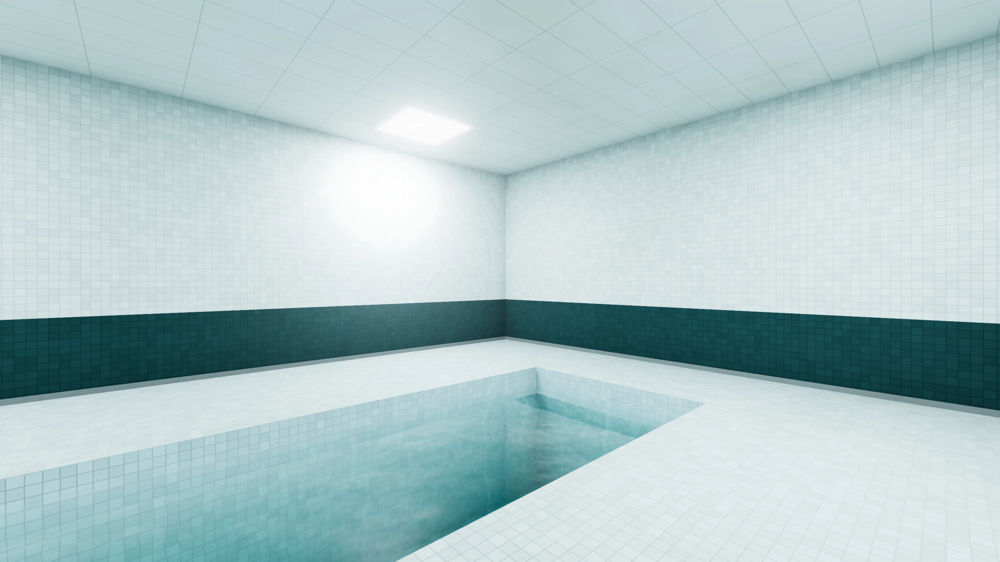

_task(wassertiefe)

### Ein Rand und ein Geländer

```room
~ [W]
~ pool = 2.2              # so tief ist das Becken unter dem Boden
~ water = 0.25            # so tief unter dem Boden steht das Wasser
rim = 0.15, 0.3         # ein Rand aus Fliesen, 15 cm hoch, 30 cm breit
railing = on            # ein Geländer auf dem Rand
```

`rim` legt einen Rand aus Fliesen um das Becken, 15 cm hoch und 30 cm breit; du kannst hinaufsteigen. `railing = on` stellt ein Geländer aus Metall darauf, überall dort, wo man am Rand stehen kann; um die Ecken biegt es sich.

<!-- tutorial-screenshot
write-file: rooms/bad.room <- file:stufen/bad-2.room
tab: preview
viewport: 1536x864
zoom: 1.5
hook: open view=36.00,29.60,-42,0,,0
hook: light
hook: info off
-->

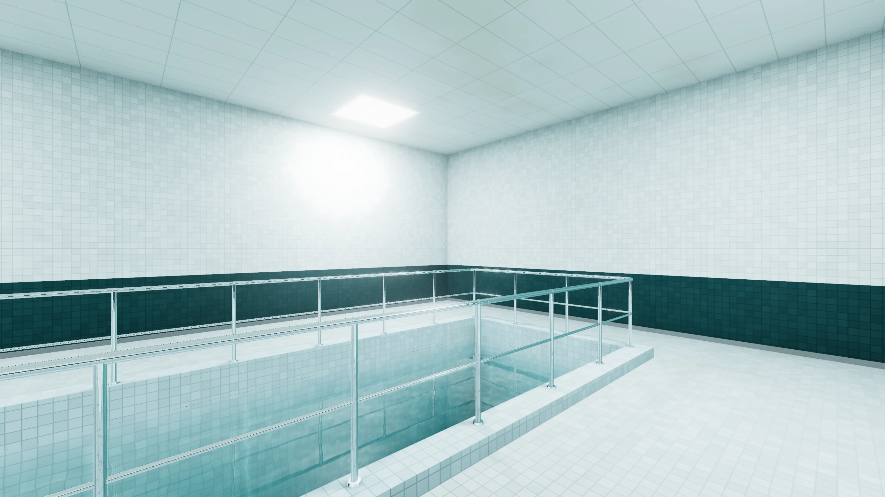

### Säulen im Wasser

Zwei runde Säulen sollen im Becken stehen, vom Boden des Beckens bis an die Decke. Eine Säule ist ein Block; damit ihr Feld trotzdem zum Becken gehört, sagt `in = W`, in welchem Becken sie steht:

```room
~ #..WWWWWWWWWW..#
#..WWWOWWWOWW..#
~ #..WWWWWWWWWW..#
```

```room
[O]
block = 0.8, 6.7, 0.8   # vom Boden des Beckens bis an die Decke
shape = round
material = tiles
color = #e8eeec
in = W                  # die Säule steht im Becken
```

Mit `in = W` gehört das Feld zum Becken der `W`, und die Säule steht trotzdem darin. Die Säule steht auf dem Boden des Beckens und reicht von dort bis an die Decke: 2,2 m plus 4,5 m, darum ist ihr Block 6,7 m hoch.

<!-- tutorial-screenshot
write-file: rooms/bad.room <- file:stufen/bad-3.room
tab: preview
viewport: 1536x864
zoom: 1.5
hook: open view=36.00,29.60,-42,0,,0
hook: light
hook: info off
-->

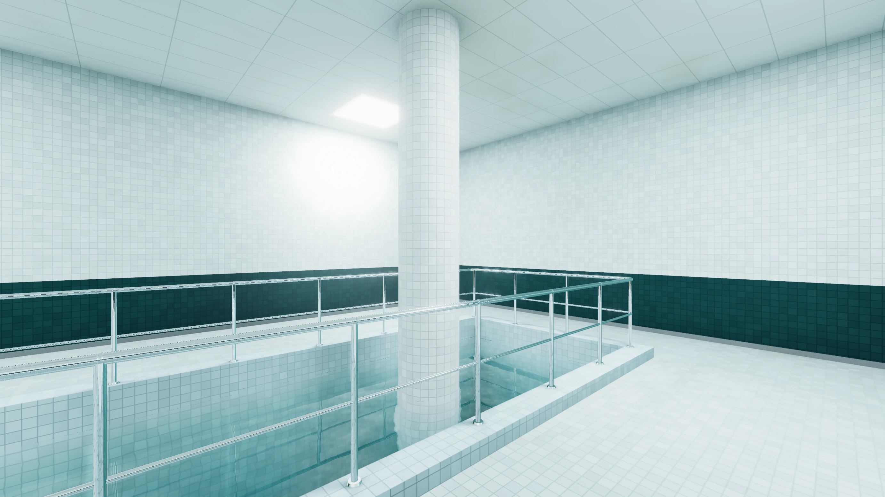

<div class='hint try'>
<p><strong>Ausprobieren:</strong> Genauso hängt eine Leuchte über dem Wasser: ein eigener Buchstabe im Becken, mit <code>light = #e4f3ff</code> und <code>in = W</code>. Wie sieht ihr Licht im Wasser aus? Und was passiert, wenn du bei einer Säule <code>in = W</code> weglässt?</p>
</div>

### Ein Podest für den Bademeister

An der Ostseite führt eine Treppe auf ein Podest neben dem Becken, und oben steht ein Stuhl, wie für einen Bademeister:

```room
~ #..............#
#..WWWWWWWWWWPP#
#..WWWOWWWOWWPC#
#..WWWWWWWWWWSS#
#............SS#
#..L.......L.SS#
~ #..............#
```

```room
[S]
stairs = north, 2       # eine Treppe nach Norden, 2 m hinauf
material = tiles
color = #e8eeec
railing = on

[P]
raise = 2               # oben ein Podest, so hoch, wie die Treppe steigt
material = tiles
color = #e8eeec
railing = on

[C]
model = models/plastic_monobloc_chair_01/plastic_monobloc_chair_01_1k.gltf   # Poly Haven, CC0
height = 0.88
rotation = 270          # mit Blick über das Becken
on = P                  # auf dem Podest
```

Treppe und Podest kennst du aus dem Treppenhaus in Level 1. Diese Treppe steht frei im Raum; ihr Geländer läuft auf der offenen Seite hinauf und oben um das Podest herum, in einem Stück. Der Stuhl steht in einem eigenen Feld, und mit `on = P` gehört es zum Podest: Der Stuhl steht oben.

<div class='gallery columns-2'>
<figure>
<!-- tutorial-screenshot
# Das Bad mit dem Becken, der Treppe und dem Podest
write-file: rooms/bad.room <- file:stufen/bad.room
tab: preview
viewport: 1536x864
zoom: 1.5
hook: open view=36.00,29.60,-42,0,,0
hook: light
hook: info off
-->
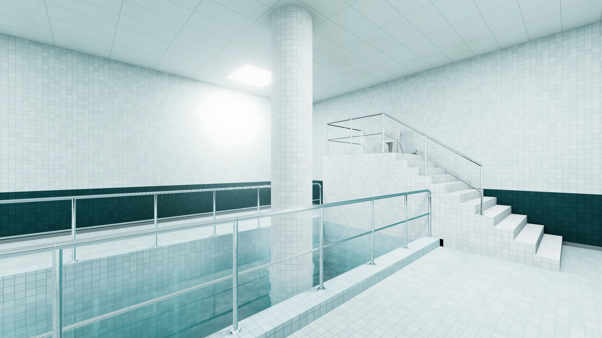
<figcaption>Das Bad</figcaption>
</figure>
<figure>
<!-- tutorial-screenshot
# Vom Podest über das Becken
tab: preview
viewport: 1536x864
zoom: 1.5
hook: open view=42.80,25.30,95,-16,,2
hook: light
hook: info off
-->
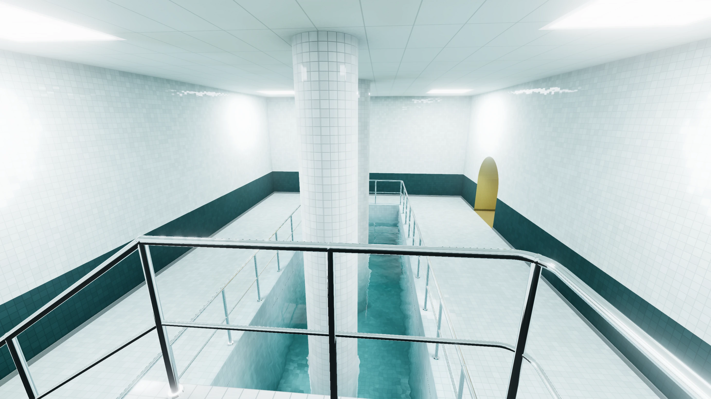
<figcaption>vom Podest aus, wo der Stuhl steht</figcaption>
</figure>
</div>

## Anderes Wasser

Das Wasser hat noch drei Einträge. `tint` ist seine Farbe, so, wie Weiß hinter 2 m davon aussieht; ohne Angabe `#86b8b5`, blaugrün. `waves` sagt, wie groß die Wellen sind: 1 ruhig, 2 größer und schneller, 0 glatt wie Glas. Und `water = off` lässt das Becken leer; ohne Geländer fällst du dann hinein. So sähe das Bad mit dreien davon aus, vom Ende des Beckens aus über seine ganze Länge; danach bleibt es klar:

<!-- tutorial-scope -->

<div class='gallery columns-3'>
<figure>
<!-- tutorial-screenshot
write-file: rooms/bad.room <- file:stufen/bad-gruen.room
tab: preview
viewport: 1536x864
zoom: 1.5
hook: open view=30.50,26.00,-92,-32,,0
hook: light
hook: info off
-->
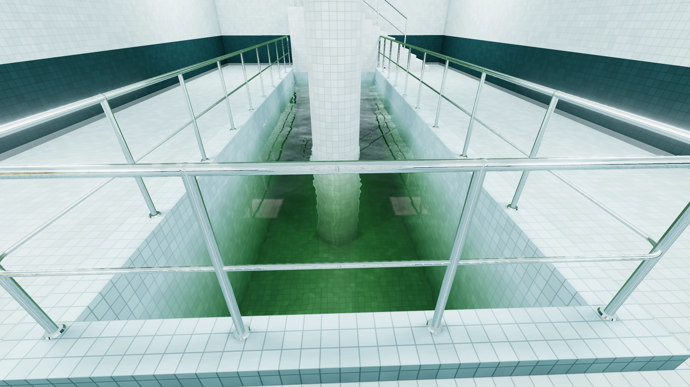
<figcaption><code>tint = #6f8f5a</code>: trüb</figcaption>
</figure>
<figure>
<!-- tutorial-screenshot
write-file: rooms/bad.room <- file:stufen/bad-dunkel.room
tab: preview
viewport: 1536x864
zoom: 1.5
hook: open view=30.50,26.00,-92,-32,,0
hook: light
hook: info off
-->
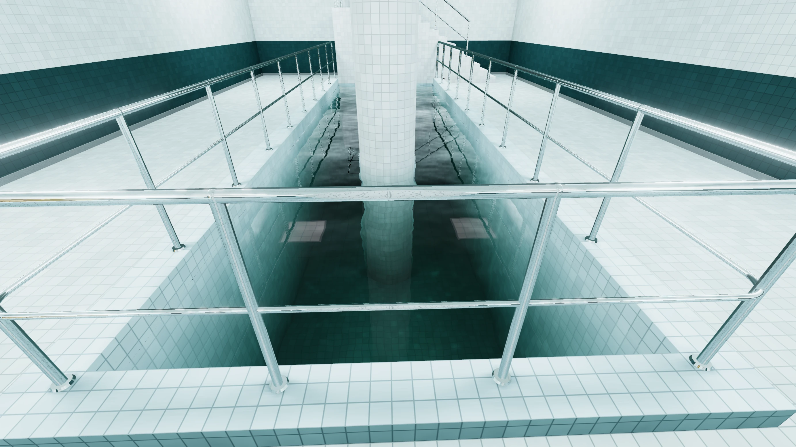
<figcaption><code>tint = #4f6b62</code>, <code>water = 0.05</code>, <code>waves = 1.6</code></figcaption>
</figure>
<figure>
<!-- tutorial-screenshot
write-file: rooms/bad.room <- file:stufen/bad-leer.room
tab: preview
viewport: 1536x864
zoom: 1.5
hook: open view=30.50,26.00,-92,-32,,0
hook: light
hook: info off
-->
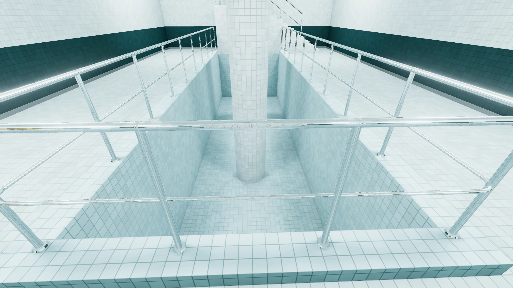
<figcaption><code>water = off</code>: leer</figcaption>
</figure>
</div>

<!-- /tutorial-scope -->

Steht eine Säule oder eine Leuchte mit `in = W` in einem Becken, nimmt ihr Feld alles vom Becken der `W`: Tiefe, Wasser, Farbe und Wellen.

## Unten im Schacht

<div class='found-note'>
<p>Die Kisten im Schacht sind weg. Wo sie standen, ist Wasser, so tief, dass ich den Grund nicht sehe.</p>
<cite>Zettel, nass, kaum noch zu lesen</cite>
</div>

Der Schacht hinter dem krummen Gang aus Level 1 bekommt statt der Kisten ein Becken, mit einem Geländer darum. Ersetze in `rooms/schacht.room` die Kisten im Grundriss durch ein Becken:

```room
~ #..........#
#....BBBB..#
1....BBBB.W#
#....BBBB..#
#....BBBB..#
~ #..S...L...#
```

und den Abschnitt `[K]` durch:

```room
[B]
pool = 1.4              # unten im Schacht ein Becken
water = 0.2
tint = #9fbfb4
railing = on
```

Wer durch die Tür ins Leere tritt, fällt gleich hinter ihr senkrecht hinunter, an der Westwand: Das Becken fängt erst vier Felder weiter an. Von unten siehst du dann übers Geländer aufs Wasser.

<!-- tutorial-screenshot
# Von der Tür ins Leere hinunter auf das Becken
write-file: rooms/schacht.room <- file:stufen/schacht-becken.room
tab: preview
viewport: 1536x864
zoom: 1.5
hook: open view=69.40,18.00,-96,-40,,4.9
hook: light
hook: info off
-->

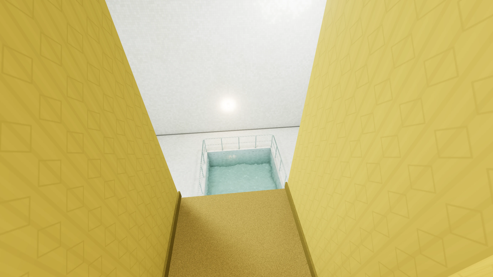

## Im Maschinenraum: Wasser und was gezeichnet wird

<div class='found-note'>
<p>Ich habe mich umgedreht, und der Raum hinter mir war weg. Nicht dunkel, weg. Als ich wieder hinsah, war er da, als wäre nichts.</p>
<cite>Notiz am Rand einer Karte, mit Bleistift</cite>
</div>

### Wasser, das es nicht gibt

Wie macht man Wasser? Gar nicht, eigentlich: Die Wasserfläche zeigt zwei andere Bilder desselben Raums. Für das eine schaut eine zweite Kamera von unten nach oben, so tief unter der Wasserfläche, wie du über ihr bist: Das ist die Spiegelung. Für das andere zeichnet das Programm nur, was unter dem Wasser liegt, den Boden und die Wände des Beckens. Wie viel du von welchem Bild siehst, hängt davon ab, wie flach du schaust: Von oben siehst du hinein, flach darüber spiegelt es fast nur, wie an einem echten See (Fresnel). Je mehr Wasser zwischen dir und dem Boden liegt, desto blaugrüner wird er, denn Wasser schluckt Rot am stärksten. Langsame Wellen, aus Rauschen gerechnet, verbiegen beide Bilder ein wenig, und wo sie das Licht bündeln, tanzen helle Linien über den Boden.

Das steht in `engine/water.js`. Auch die Fliesen glänzen: In ihnen spiegeln sich die Leuchten, umso stärker, je flacher du über sie schaust; das rechnet der Shader in `engine/main.js` aus, ohne ein zweites Bild.

Zwei Bilder mehr für jedes Bild, in dem Wasser zu sehen ist: Das kostet. Zeichnete das Programm jedes Mal das ganze Level, mit allen Räumen, wäre das bald zu langsam, vor allem auf dem Handy. Darum zeichnet es nur, was du von deinem Platz aus sehen kannst.

### Was gezeichnet wird

Für ein Bild zeichnet das Programm nicht das ganze Level, nur, was du von deinem Platz aus sehen kannst. In einen anderen Raum siehst du nur durch eine Öffnung, eine Tür oder ein Loch. Solche Öffnungen heißen **Portale**, und so sucht `portals.js` für jedes Bild aus, was gezeichnet wird:

1. Der Raum, in dem du stehst, ist zu sehen, soweit er im Bild liegt.
2. Jedes seiner Portale wird aufs Bild gerechnet, als Rechteck um die Öffnung. Liegt das Rechteck im Bild, siehst du durch das Portal in den Raum dahinter, aber nur durch dieses Rechteck.
3. Von dort geht es durch die Portale dieses Raums weiter, jedes beschnitten auf das Rechteck, durch das du gerade schaust. Bleibt nichts übrig, ist dieser Weg zu Ende.

Gezeichnet werden nur die Räume, die so erreicht werden; alle anderen kosten nichts, und ein Becken zeichnet seine beiden Bilder nur, wenn sein Raum dabei ist. So suchten schon Spiele wie Descent (1995) und Duke Nukem 3D (1996) aus, was sie zeichnen. In der Automap zeigt <kbd>U</kbd>, welche Räume von deinem Platz aus gezeichnet werden: Sie bleiben hell, alle anderen werden blass, die Portale, durch die du schaust, sind orange, dein Blickfeld ist rot.

<div class='gallery columns-2'>
<figure>
<!-- tutorial-screenshot
# Vom Zimmer aus durch die Türen nach Osten
tab: preview
viewport: 1536x864
zoom: 1.5
hook: open view=4.00,17.00,-82,0
hook: light
hook: info off
-->
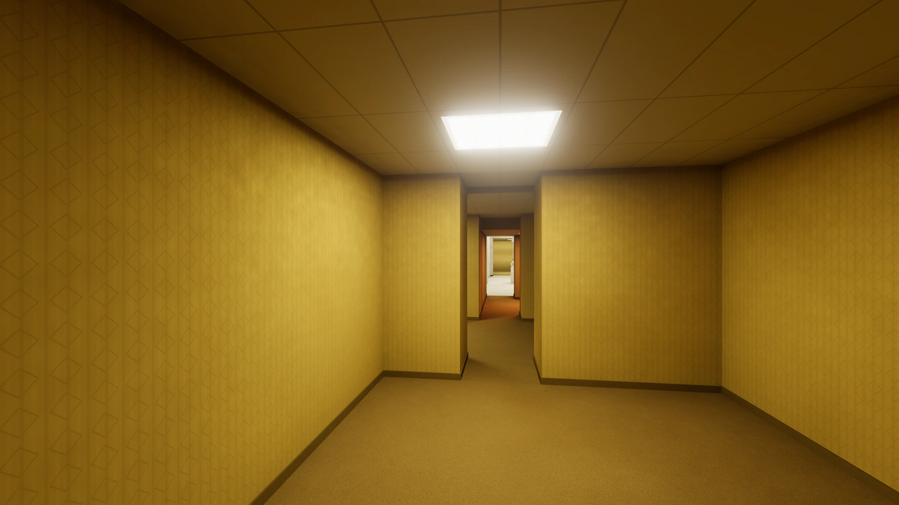
<figcaption>Vom Zimmer aus …</figcaption>
</figure>
<figure>
<!-- tutorial-screenshot
# Dasselbe in der Automap mit U
tab: preview
viewport: 1536x864
zoom: 1.5
hook: open view=4.00,17.00,-82,0&automap=0,64,64,38,-10,0,sight
hook: light
hook: info off
-->
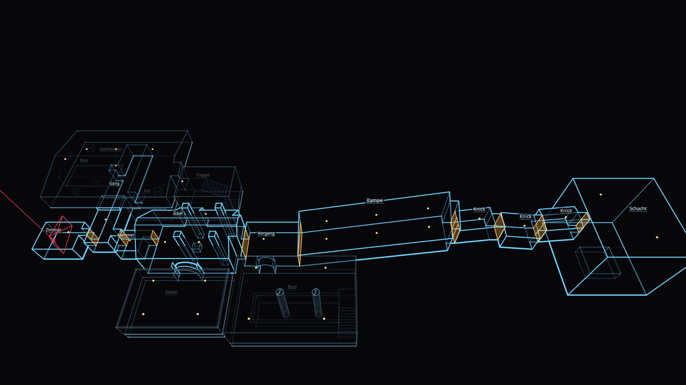
<figcaption>… in der Automap mit <kbd>U</kbd></figcaption>
</figure>
<figure>
<!-- tutorial-screenshot
# Im Bad, zur Tür hin
tab: preview
viewport: 1536x864
zoom: 1.5
hook: open view=35.50,29.50,12,2,,0
hook: light
hook: info off
-->
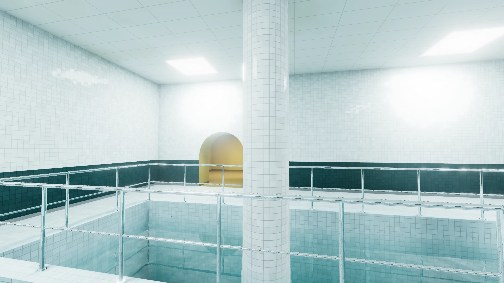
<figcaption>Im Bad …</figcaption>
</figure>
<figure>
<!-- tutorial-screenshot
# Dasselbe in der Automap mit U
tab: preview
viewport: 1536x864
zoom: 1.5
hook: open view=35.50,29.50,12,2,,0&automap=15,58,34,-2,0,-6,sight
hook: light
hook: info off
-->
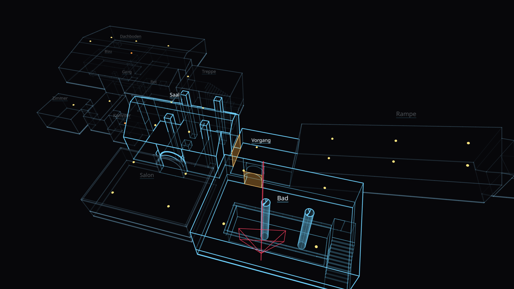
<figcaption>… zeichnet das Programm nur drei Räume</figcaption>
</figure>
</div>

<div class='hint try'>
<p><strong>Ausprobieren:</strong> Öffne die Automap, drück <kbd>U</kbd> und dreh dich langsam einmal im Kreis. Räume kommen dazu und verschwinden, je nachdem, welche Türen im Bild sind. Manchmal bleibt ein Raum hell, den du gar nicht siehst, weil eine Wand ihn verdeckt: Woran liegt das?</p>
</div>

Was ein Shader ist, steht im [Handbuch zu GLSL](/reference/glsl). Wenn du am Programm etwas änderst und nichts mehr geht: Die Konsole des Browsers (<kbd>F12</kbd>) sagt, in welcher Zeile es hakt, und `git diff` zeigt, was du geändert hast.

## Ein Ausgang

<div class='found-note'>
<p>Die Leuchten gehen nie aus. Ich habe versucht, eine zu erreichen, um sie abzuschrauben. Sie ist warm. Nicht heiß, warm. Wie etwas, das atmet. Ich glaube, wer verstehen will, wie es hier hell wird, muss dorthin, wo das Licht gemacht wird.</p>
<cite>Funkspruch, Ende fehlt</cite>
</div>

Weiter geht es in [Level 3](/level-3-4c9e6a2d): Lampen an der Wand, Möbel, und wie das Programm das Licht berechnet, das zwischen den Wänden hin- und herfällt.
