<div class='meta'>
image: licht-alles.webp
image_alt: "Ein Saal aus Marmor im warmen Licht der Leuchten: helle Wände und heller Boden, die Säulen mit ihren weichen Schatten, Athena auf ihrem Sockel, das Satteldach hell."
kind: projekt
topic: hidden
duration: 1 Doppelstunde
reference: [workspace, kartografie]
template: https://github.com/specht/backrooms-starter.git
template_name: der Backrooms-Vorlage
</div>

# Level 3: Das Licht

<div
    class="autotoc-secondary-trigger"
    data-title="Auf dieser Seite"
    data-levels="h2,h3">
</div>

<p class='abstract'>
Woher kommt das Licht in den Backrooms? Du hängst Lampen an die Wand, stellst ein Sofa in die Kammer und holst dir Möbel aus dem Internet. Dann gehst du in den Maschinenraum und siehst zu, wie das Programm das Licht berechnet: Punkt für Punkt, Strahl für Strahl, das Licht, das von den Wänden zurückfällt, und die dunklen Ecken. Zum Schluss veröffentlichst du dein Level, und zwei fertige Levels warten auf dich, deren Räume du jetzt Zeile für Zeile lesen kannst.
</p>

<div class='found-note'>
<p>Seltsam ist die Decke. Die Leuchten hängen direkt darunter und strahlen nach unten, und trotzdem ist die Decke hell.</p>
<cite>Funkspruch, zweiter Teil</cite>
</div>

<table class='table'>
<tr><th>Level</th><td>3, »Das Licht«</td></tr>
<tr><th>Überlebensschwierigkeit</th><td>Klasse 1: hell, warm, sehr ruhig</td></tr>
<tr><th>Ausdehnung</th><td>so weit das Licht reicht</td></tr>
<tr><th>Ausgänge</th><td>keine bekannten. Aber eine Tür in ein anderes Level (siehe »Die Nachtschicht«).</td></tr>
</table>

## Wo du weitermachst

Diese Seite baut auf [Level 2](/level-2-b52d0f18) auf: auf deinem Level, so wie es am Ende von Level 2 war, mit dem Bad und dem Becken im Schacht. Öffne den Ordner `/workspace/backrooms-starter` wieder in VS Code und starte die Vorschau (»Go Live«).

<!-- tutorial-step
# Wo Level 2 aufgehört hat: die Vorlage mit den Räumen aus Level 0, 1 und 2, die Vorschau
show-left-sidebar
clone-start: https://github.com/specht/backrooms-starter.git @ dd58d5cb980fe15c2ffac7cdca076f87f4144a01
press: Enter
wait-for-input-value: /workspace/
press: Enter
wait-for-text: Would you like to open the repository?
click: Open
wait-for-text: level.ini
write-file: rooms/zimmer.room <- file:../level-0-c1d8a2f7/stufen/zimmer.room
write-file: rooms/kammer.room <- file:../level-0-c1d8a2f7/stufen/kammer-2.room
write-file: rooms/salon.room <- file:../level-0-c1d8a2f7/stufen/salon-5.room
write-file: rooms/gang.room <- file:../level-1-7e3a91c4/stufen/gang-2.room
write-file: rooms/saal.room <- file:../level-1-7e3a91c4/stufen/saal-8.room
write-file: rooms/vorgang.room <- file:../level-2-b52d0f18/stufen/vorgang-2.room
write-file: rooms/bad.room <- file:../level-2-b52d0f18/stufen/bad.room
write-file: rooms/rampe.room <- file:../level-1-7e3a91c4/stufen/rampe-5.room
write-file: rooms/knick1.room <- file:../level-1-7e3a91c4/stufen/knick1.room
write-file: rooms/knick2.room <- file:../level-1-7e3a91c4/stufen/knick2.room
write-file: rooms/knick3.room <- file:../level-1-7e3a91c4/stufen/knick3-2.room
write-file: rooms/treppe.room <- file:../level-1-7e3a91c4/stufen/treppe.room
write-file: rooms/dachboden.room <- file:../level-1-7e3a91c4/stufen/dachboden.room
write-file: rooms/schacht.room <- file:../level-2-b52d0f18/stufen/schacht-becken.room
go-live
-->

## Lampen und Möbel

### Leuchten unter der Decke

Eine Leuchte hängt knapp unter der Decke, mitten über ihrem Feld, unter einer schrägen Decke so schräg wie sie:

<table class='table'>
<tr><th>Eintrag</th><th>Bedeutung</th></tr>
<tr><td><code>light</code></td><td>ihre Farbe, zum Beispiel <code>#fff3cf</code></td></tr>
<tr><td><code>power</code></td><td>wie hell sie ist, 1.0 ohne Angabe</td></tr>
<tr><td><code>size</code></td><td>Breite und Länge in Metern, eine Zahl für eine quadratische; ohne Angabe <code>0.85</code>, 85 cm im Quadrat</td></tr>
<tr><td><code>flicker</code></td><td><code>1</code>: Sie flackert ab und zu</td></tr>
</table>

Farbiges Licht färbt alles, was es trifft, auch über die Tür hinaus in den Nachbarraum: Im Gang siehst du, wie rotes und blaues Licht aus zwei Türen fällt.

### Lampen an der Wand

<div class='found-note'>
<p>In der Kammer steht jetzt ein Sofa. Niemand hat es gebracht. An den Wänden hängen zwei Lampen, und sie brennen, obwohl nirgends ein Kabel ist.</p>
<cite>Seite aus einem durchnässten Notizbuch, dritte Handschrift</cite>
</div>

Eine Leuchte hängt immer unter der Decke; was hier Leuchte heißt, ist so ein helles Feld unter der Decke. Licht kann aber auch aus einem Modell kommen, einer Lampe: einer Wandlampe, einer Stehlampe, einer Laterne. Die Kammer wird ein Ruheraum. Statt der flackernden Leuchte an der Decke hängen zwei Wandlampen an den Wänden, und an der Südwand steht ein Sofa. Ersetze `rooms/kammer.room` durch:

_include_file(stufen/kammer-lampen.room, room_copy)

`light = #ffd9a0` bei einem Modell macht es zu einer Lampe. Ihr Licht kommt aus den Teilen, die im Modell selbst leuchten, bei dieser Lampe aus der Glühbirne hinter dem Glas, und es strahlt nach allen Seiten, nicht nur nach unten wie eine Leuchte unter der Decke. Hat eine Lampe einen Schirm, der nach unten zeigt, wie die Wandlampen im Holzsaal aus Level 0, schreib `beam = 75` dazu: Dann fällt ihr Licht nur nach unten, in einen Kegel, der bis 75° von der Senkrechten reicht, und die Decke darüber bekommt kein direktes Licht. `beam = up, 60` schickt es nach oben. `power` und `flicker` gelten wie bei einer Leuchte. Glas und die leuchtenden Teile halten das Licht nicht auf, aber Arm und Schirm einer Lampe werfen Schatten an die Wand.

`offset = x, y, z` schiebt ein Modell aus der Mitte seines Felds, in Metern und wie in den anderen 3D-Aktivitäten: x nach Osten (im Grundriss nach rechts), y nach oben, z nach Süden (im Grundriss nach unten), mit einer negativen Zahl in die andere Richtung. Die Lampe im Feld `W` rückt 42 cm nach Westen an die Wand und hängt 1,4 m hoch. Das Sofa rückt 7 cm nach Süden: Es ist 1,12 m tief, ein Feld nur 1 m, und ragte sonst in die Wand. `offset` gibt es auch für Blöcke. Welche Seite eines Modells vorn ist, legt fest, wer es gebaut hat; `rotation` in Schritten von 90 dreht es, bis es stimmt. Die Lampe an der Westwand ist um 90° gedreht, damit ihre Rückseite an der Wand liegt. Mit drei Zahlen, `rotation = x, y, z`, dreht es sich um alle drei Achsen, dieselben wie bei `offset`: erst um y, wohin es schaut, dann um x, gekippt, dann um z, zur Seite geneigt.

Dabei kommt es auf die Reihenfolge an. Zuerst dreht das Programm ein Modell, um seine eigene Mitte. Dann stellt es dessen Mitte über die Mitte des Felds und seinen tiefsten Punkt auf den Boden, oder auf den Sockel. Erst danach schiebt `offset` es weiter, in den Richtungen der Welt, nicht in denen des gedrehten Modells: `offset = -0.42, 1.4, 0` heißt immer 42 cm nach Westen und mit der Unterkante 1,4 m über dem Boden, wie auch immer die Lampe gedreht ist.

<!-- tutorial-screenshot
write-file: rooms/kammer.room <- file:stufen/kammer-lampen.room
tab: preview
viewport: 1536x864
zoom: 1.5
hook: open view=16.20,16.60,158,-14
hook: light
hook: info off
-->

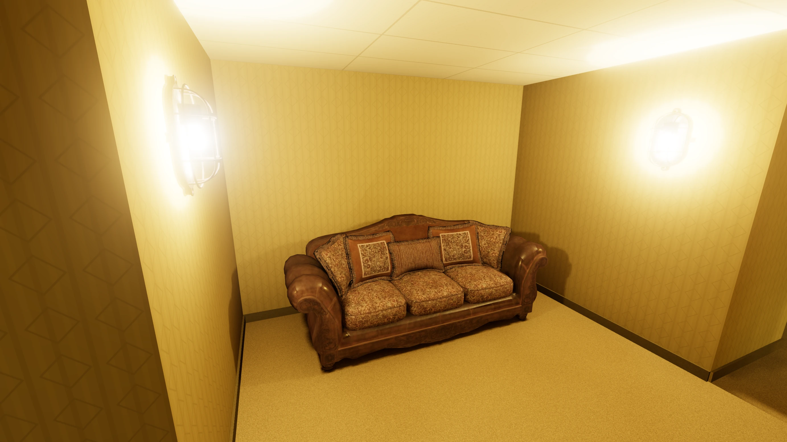

### Modelle von Poly Haven

Sofa und Wandlampe liegen schon in `models/`, dazu die Wandlampe mit Schirm und der Kerzenleuchter aus dem Holz- und dem Samtsaal und Möbel: ein Schreibtisch aus Metall, Stühle, eine Kommode, ein Regal, ein altes Bettgestell, ein Schaukelstuhl und ein kleiner Tisch. Alle sind von [Poly Haven](https://polyhaven.com/models). Dort steht jedes Modell unter CC0: Du darfst es verwenden, wofür du willst, ohne zu fragen. So holst du dir weitere:

1. Wähl auf der Seite des Modells beim Download die Auflösung **1K** und das Format **glTF**. glTF und GLB kann das Programm lesen. 1K genügt: Das Programm nimmt vom Modell die Farbe der Oberfläche und, für Spiegelungen, wie glatt und metallisch sie ist; 2K oder 4K sähen genauso aus und wären nur größer.
2. Ein Modell in glTF besteht aus mehreren Dateien: einer `.gltf`, einer `.bin` und Bildern im Ordner `textures`. Sie gehören zusammen in einen eigenen Ordner in `models`, etwa `models/sessel/`, so wie sie ankommen.
3. In der Raumdatei steht dann `model = models/sessel/DATEINAME.gltf`. Wie groß das Modell ist, steht auf seiner Seite bei den Maßen; die Höhe davon gehört in `height`.

Kommt beim Herunterladen eine ZIP-Datei an, zieh sie in VS Code in den Ordner `models` und pack sie im Terminal in einen eigenen Ordner aus:

```bash
cd /workspace/backrooms-starter/models
unzip DATEINAME.zip -d sessel
```

Weitere Modelle unter CC0 findest du bei den [3D-Scans der Smithsonian Institution](https://3d.si.edu/collections) und bei [Sketchfab](https://sketchfab.com/search?features=downloadable&licenses=7c23a1ba438d4306920229c12afcb5f9&type=models), die Suche dort schon auf CC0 und herunterladbare Modelle eingestellt; beide als GLB herunterladen. Nimm nur Modelle, deren Lizenz das erlaubt, und schreib in einem Kommentar neben `model =` dazu, woher sie kommen.

## Im Maschinenraum: Was das Programm rechnet

Viele Spiele rechnen das Licht für jedes Bild neu, 60-mal in der Sekunde, weil sich dort Figuren, Türen und Lampen bewegen, und müssen dafür stark vereinfachen. Hier bewegst nur du dich, die Leuchten bleiben, wo sie sind. Darum rechnet das Programm das Licht einmal aus, wenn das Level lädt, und klebt es dann wie eine zweite Tapete auf jede Fläche. Diese Tapete aus Licht heißt **Lightmap**, und das Ausrechnen nennt man **Backen**. Es läuft auf der Grafikkarte, in Shadern: kleinen Programmen in [GLSL](/reference/glsl), die für Tausende Punkte zugleich laufen. Schritt für Schritt, im Saal mit seinen Säulen:

**Die Punkte.** Die Lightmap hat auf jedem Meter Wand, Boden und Decke 16 Punkte in jeder Richtung, alle 6,25 cm einen. Nur für diese Punkte rechnet die Grafikkarte aus, wie hell es dort ist; dazwischen mischt sie beim Zeichnen die vier nächsten. Mit <kbd>G</kbd> siehst du die Punkte, mit <kbd>T</kbd> ohne Tapete und Teppich deutlicher:

<!-- tutorial-screenshot
tab: preview
viewport: 1536x864
zoom: 1.5
hook: open view=18.00,17.40,-94,7
hook: light
hook: info off
hook: key t g
-->

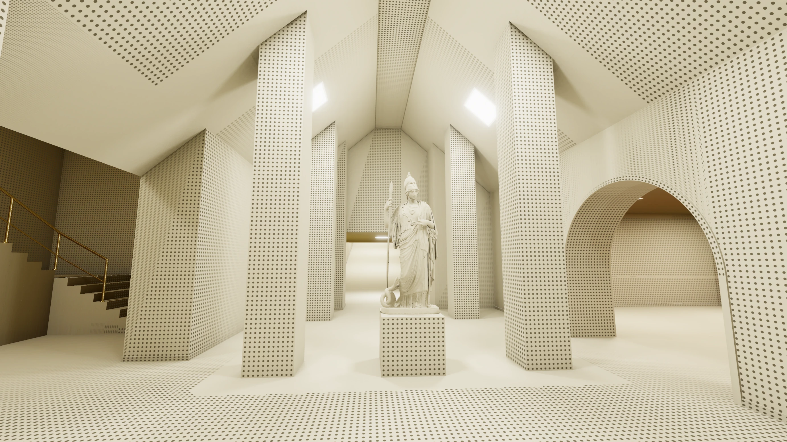

_task(lichtpunkte)

Wo ein Modell oder ein Block nah an einer Wand, auf dem Boden oder unter der Decke steht, wirft er Schatten, für die 6,25 cm zu grob sind: Eine Säule unter der Decke wirft dort einen scharfen Keil. Dort bekommt die Fläche ein zweites, feineres Stück Lightmap, das zu seinem Rand hin weich in das grobe übergeht. Es reicht 60 cm über den Umriss hinaus, so weit reichen die weichen Schatten; um ein Modell liegen bis zu viermal so viele Punkte in jeder Richtung, um einen Block dreimal so viele, denn seine Kanten sind gerade. Auch eine Lampe an der Wand bekommt eins, für die Schatten ihres Arms. Weit weg sind die feinen Punkte so klein, dass <kbd>G</kbd> sie ausblendet; dort sieht die Fläche glatt aus.

<div class='gallery columns-2'>
<figure>
<!-- tutorial-screenshot
# Hinter dem Sofa in der Kammer
tab: preview
viewport: 1536x864
zoom: 1.5
hook: open view=15.00,17.00,170,-25
hook: light
hook: info off
hook: key t g
-->
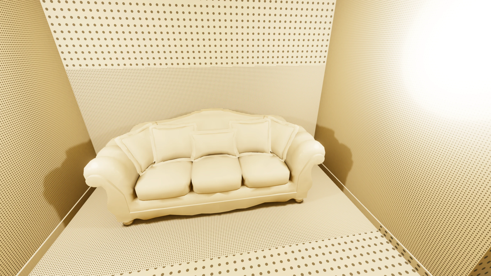
<figcaption>hinter und unter einem Modell, dem Sofa</figcaption>
</figure>
<figure>
<!-- tutorial-screenshot
# Am Geländer des Beckens im Bad
tab: preview
viewport: 1536x864
zoom: 1.5
hook: open view=31.40,24.00,-140,-48,,0
hook: light
hook: info off
hook: key t g
-->
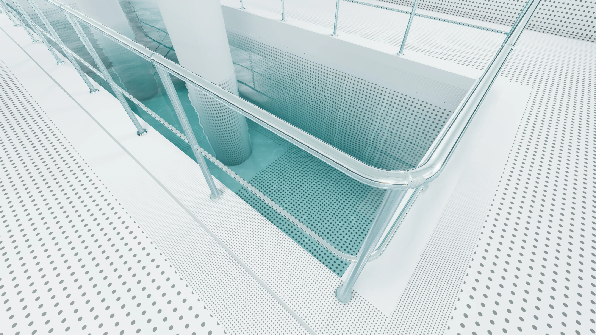
<figcaption>am Geländer, das wie ein Modell zählt</figcaption>
</figure>
</div>

**Ein Bild für alle Flächen.** Alle Punkte aller Flächen liegen in einem einzigen Bild, der Lightmap. Jede Fläche ist darin ein Rechteck aus ihren Punkten: so viele breit und hoch, wie sie Meter breit und hoch ist, mal 16. Das Programm legt die Rechtecke dicht an dicht in das Bild, die großen zuerst, wie Kisten in einen Kofferraum, und macht das Bild nur so groß wie nötig, mit einer Zweierpotenz als Seite, etwa 1024 × 1024 Punkte. Jede Ecke einer Fläche weiß, wo im Bild ihr Rechteck liegt. Beim Zeichnen holt sich die Grafikkarte für jeden Pixel der Fläche die Helligkeit von der passenden Stelle im Rechteck: Das Rechteck wird auf die Fläche geklebt, wie ein Bild auf eine Wand. <kbd>Shift</kbd>+<kbd>G</kbd> zeigt die ganze Lightmap; `?show=atlas&face=saal,floor` in der Adresse zeigt nur das Rechteck des Bodens im Saal, Punkt für Punkt (`wall` statt `floor` für eine Wand, dazu `fine` für ihr feineres Stück):

<div class='gallery columns-2'>
<figure>
<!-- tutorial-screenshot
tab: preview
viewport: 1536x864
zoom: 1.5
hook: open show=atlas&face=saal,floor
hook: light
hook: info off
-->
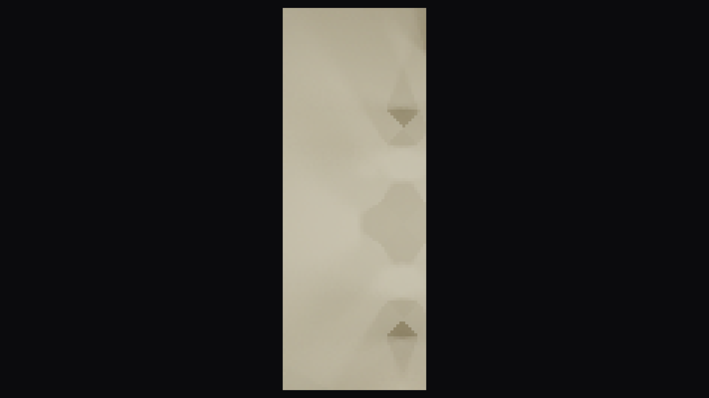
<figcaption>der Boden des Saals in der Lightmap</figcaption>
</figure>
<figure>
<!-- tutorial-screenshot
tab: preview
viewport: 1536x864
zoom: 1.5
hook: open view=18.00,17.40,-94,-32
hook: light
hook: info off
hook: key t
-->
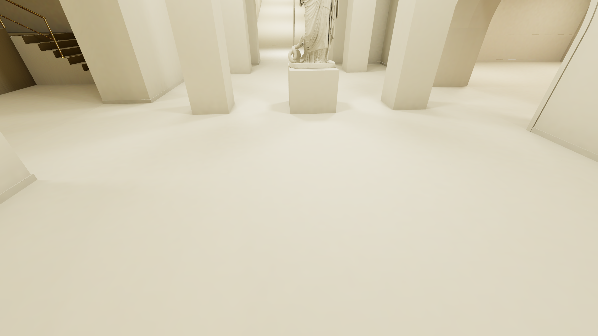
<figcaption>derselbe Boden im Saal (<kbd>T</kbd>)</figcaption>
</figure>
<figure>
<!-- tutorial-screenshot
tab: preview
viewport: 1536x864
zoom: 1.5
hook: open show=atlas&face=saal,floor,fine
hook: light
hook: info off
-->

<figcaption>das feinere Stück um eine Säule</figcaption>
</figure>
<figure>
<!-- tutorial-screenshot
tab: preview
viewport: 1536x864
zoom: 1.5
hook: open view=18.00,17.40,-94,-32
hook: light
hook: info off
hook: key t g
-->

<figcaption>dort, wo es liegt (<kbd>T</kbd>, <kbd>G</kbd>)</figcaption>
</figure>
<figure>
<!-- tutorial-screenshot
tab: preview
viewport: 1536x864
zoom: 1.5
hook: open show=atlas&face=saal,wall
hook: light
hook: info off
-->

<figcaption>die längste Wand des Saals in der Lightmap</figcaption>
</figure>
<figure>
<!-- tutorial-screenshot
tab: preview
viewport: 1536x864
zoom: 1.5
hook: open view=18.00,17.40,-94,7
hook: light
hook: info off
hook: key t
-->

<figcaption>dieselbe Wand im Saal (<kbd>T</kbd>)</figcaption>
</figure>
</div>

Bevor es um die Strahlen geht: Geh zurück ins Zimmer (<kbd>Shift</kbd> <kbd>R</kbd>) und schau nach oben, zur Decke.

_task(decke)

**Direktes Licht.** Für jeden Punkt nimmt das Programm einen zufälligen Punkt auf jeder Leuchte und schickt einen Strahl dorthin. Steht etwas im Weg, eine Wand, eine Säule oder ein Modell, kommt von dieser Leuchte nichts an. Sonst kommt Licht an, umso weniger, je weiter die Leuchte weg ist (doppelt so weit: ein Viertel) und je schräger es auf die Fläche fällt. Das wiederholt es 64-mal, jedes Mal mit einem anderen Punkt auf der Leuchte, und nimmt den Durchschnitt. Ein Punkt, der eine Leuchte nur halb sieht, ist in etwa der Hälfte der Durchgänge beleuchtet: Er liegt im **Halbschatten**. Darum werfen große Leuchten weiche Schatten und kleine scharfe. Nur mit direktem Licht sieht der Saal so aus:

<!-- tutorial-screenshot
tab: preview
viewport: 1536x864
zoom: 1.5
hook: open view=18.00,17.40,-94,7
hook: light
hook: info off
hook: key t b
-->

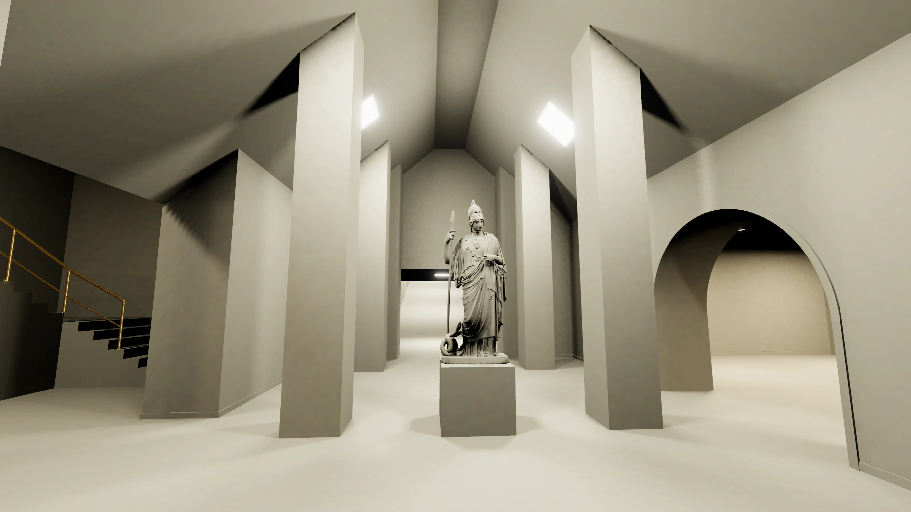

Wie weich ein Schatten ist, hängt also davon ab, wie groß die Leuchte ist. Mit `size = 0.2` und mit `size = 2` (und `power` so, dass jede gleich viel Licht gibt, denn eine kleinere Leuchte gibt auch weniger):

<!-- tutorial-scope -->

```room
[L]
light = #fff3cf
power = 29
size = 0.2
```

<div class='gallery columns-2'>
<figure>
<!-- tutorial-screenshot
write-file: rooms/saal.room <- file:stufen/saal-klein.room
tab: preview
viewport: 1536x864
zoom: 1.5
hook: open view=18.00,17.40,-94,7
hook: light
hook: info off
hook: key t b
-->
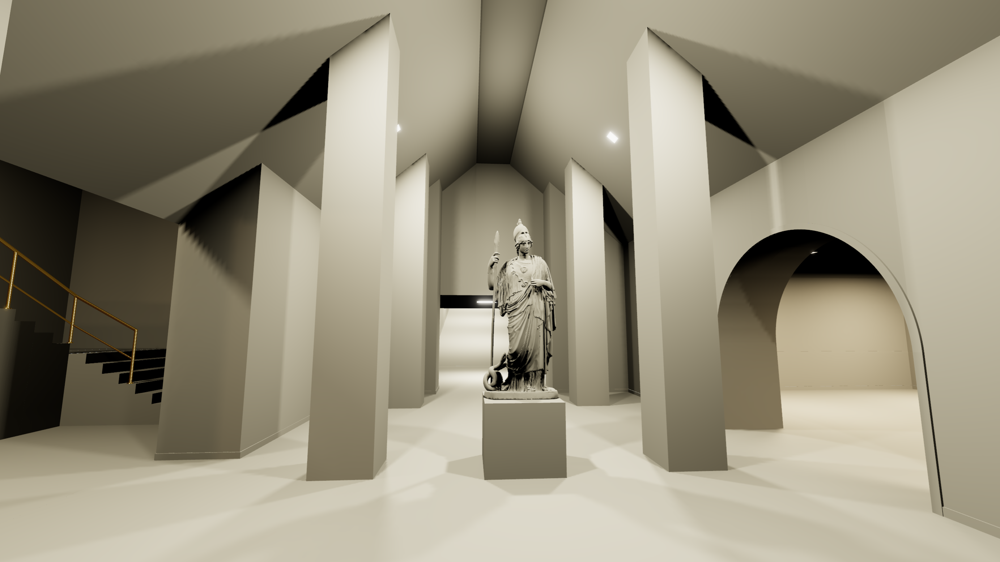
<figcaption><code>size = 0.2</code>: scharfe Schatten</figcaption>
</figure>
<figure>
<!-- tutorial-screenshot
write-file: rooms/saal.room <- file:stufen/saal-gross.room
tab: preview
viewport: 1536x864
zoom: 1.5
hook: open view=18.00,17.40,-94,7
hook: light
hook: info off
hook: key t b
-->
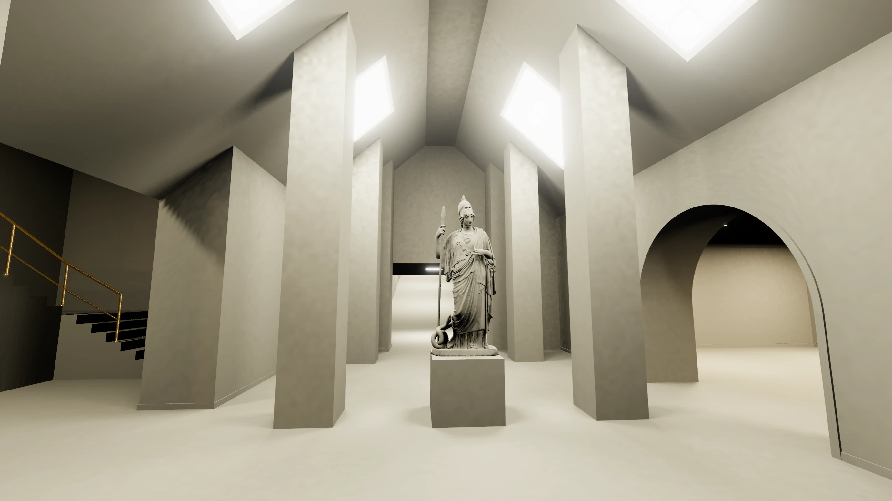
<figcaption><code>size = 2</code>: weiche Schatten</figcaption>
</figure>
</div>

<!-- /tutorial-scope -->

**Bounce-Licht.** Die Decke ist schwarz: Keine Leuchte strahlt nach oben. In Wirklichkeit ist sie trotzdem hell, weil jede Fläche einen Teil des Lichts zurückwirft, das auf sie fällt, in ihrer eigenen Farbe: der Teppich bräunliches Licht, eine rote Wand rotes. Ist das direkte Licht fertig, schickt das Programm von jedem Punkt Strahlen in zufällige Richtungen und schaut, wie hell die Flächen sind, die sie treffen. Was dabei herauskommt, ist das Licht, das einmal zurückgeworfen wurde, ein **Bounce**. Damit das schnell geht, sammelt es das zurückgeworfene Licht vorher in Würfeln von 25 cm, und weil zufällige Strahlen ein körniges Ergebnis geben, glättet es das Bounce-Licht am Ende. Das Ganze dreimal: Beim zweiten Bounce werfen die Flächen auch das Licht des ersten zurück und so weiter, darum steht beim Backen »bounce 1 of 3«. Mit einem, zwei und drei Bounces (in `level.ini` mit `bounces = 1` und so weiter):

<!-- tutorial-scope -->

<div class='gallery columns-3'>
<figure>
<!-- tutorial-screenshot
tab: preview
viewport: 1536x864
zoom: 1.5
hook: open bounces=1&view=18.00,17.40,-94,7
hook: light
hook: info off
hook: key t
-->
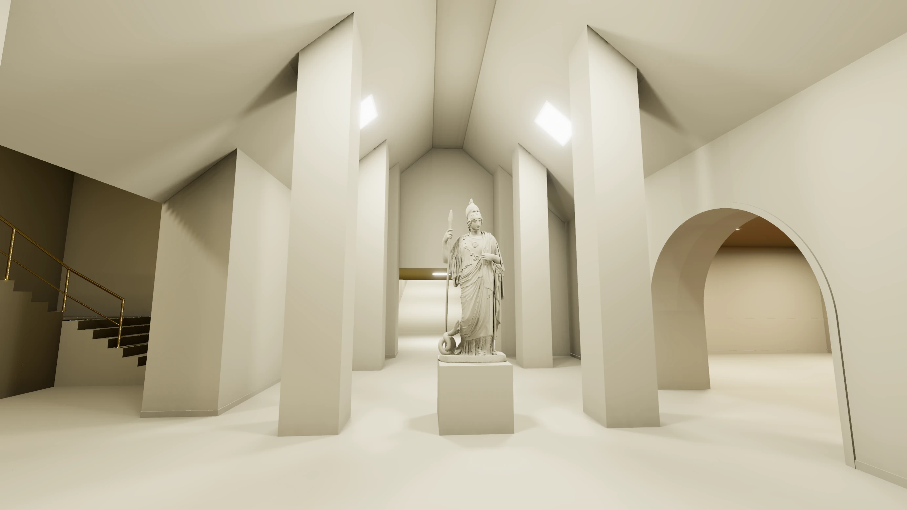
<figcaption>1 Bounce</figcaption>
</figure>
<figure>
<!-- tutorial-screenshot
tab: preview
viewport: 1536x864
zoom: 1.5
hook: open bounces=2&view=18.00,17.40,-94,7
hook: light
hook: info off
hook: key t
-->
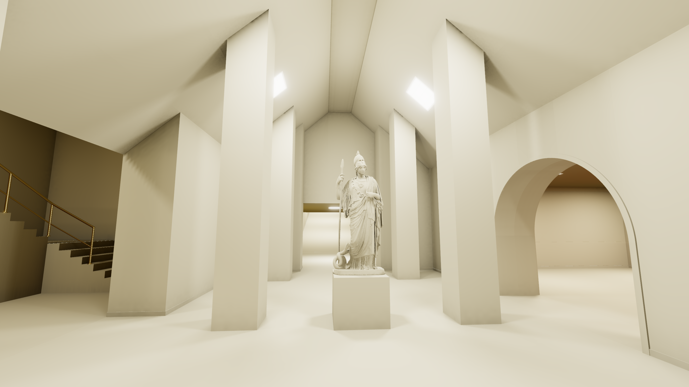
<figcaption>2 Bounces</figcaption>
</figure>
<figure>
<!-- tutorial-screenshot
tab: preview
viewport: 1536x864
zoom: 1.5
hook: open view=18.00,17.40,-94,7
hook: light
hook: info off
hook: key t
-->
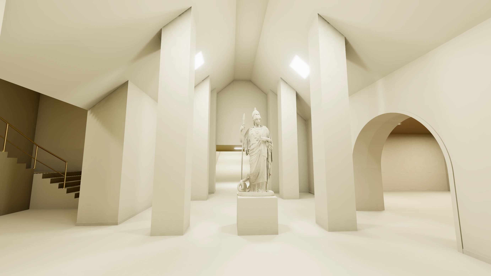
<figcaption>3 Bounces</figcaption>
</figure>
</div>

<!-- /tutorial-scope -->

**Kontaktschatten.** Wo zwei Flächen aneinanderstoßen, in Ecken, an einer Sockelleiste oder unter einem Block, kommt von vielen Seiten kein Bounce-Licht, weil die andere Fläche im Weg ist. Zwei kurze Strahlen von 80 cm prüfen bei jedem der 64 Durchgänge, wie viel Platz um einen Punkt herum ist: Trifft einer etwas, dunkelt das Bounce-Licht dort ab, umso mehr, je näher es ist, und sanft auslaufend, damit keine harte Linie entsteht. Auf Englisch heißt das **Ambient Occlusion**. Nur das Bounce-Licht, ohne und mit Kontaktschatten:

<div class='gallery columns-2'>
<figure>
<!-- tutorial-screenshot
tab: preview
viewport: 1536x864
zoom: 1.5
hook: open view=18.00,17.40,-94,7
hook: light
hook: info off
hook: key t l o
-->
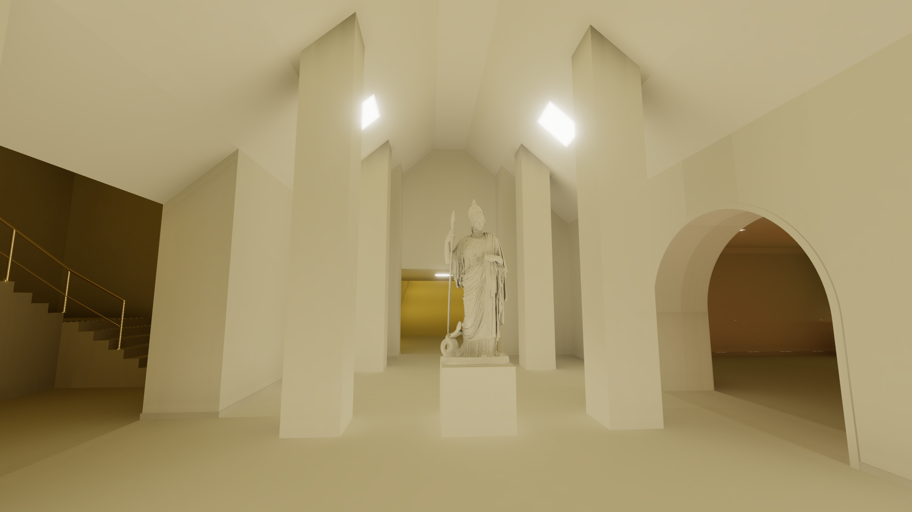
<figcaption><kbd>T</kbd> <kbd>L</kbd> <kbd>O</kbd>: ohne Kontaktschatten</figcaption>
</figure>
<figure>
<!-- tutorial-screenshot
tab: preview
viewport: 1536x864
zoom: 1.5
hook: open view=18.00,17.40,-94,7
hook: light
hook: info off
hook: key t l
-->
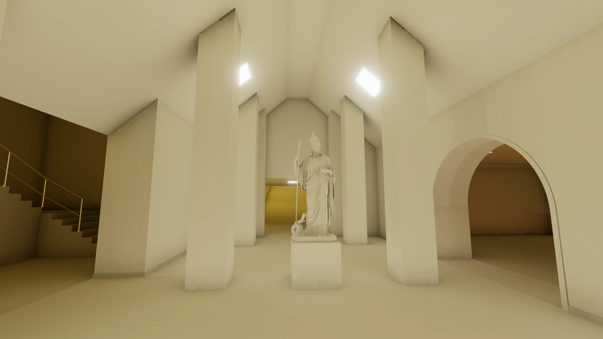
<figcaption><kbd>T</kbd> <kbd>L</kbd>: mit Kontaktschatten</figcaption>
</figure>
</div>

**Alles zusammen.** Direktes Licht, Bounce-Licht und Kontaktschatten, mal der Farbe von Wänden und Boden:

<!-- tutorial-screenshot
tab: preview
viewport: 1536x864
zoom: 1.5
hook: open view=18.00,17.40,-94,7
hook: light
hook: info off
-->


**Beim Zeichnen: Tone Mapping und Bloom.** Die Lightmap enthält das Licht, wie es wirklich ist: Unter einer Leuchte ist es viel heller als in einer Ecke, und die Leuchte selbst ist noch einmal viel heller. Ein Bildschirm kann das nicht zeigen, er kennt nur Helligkeiten von 0 bis 1. Das **Tone Mapping** drückt große Werte sanft zusammen, wie eine Kamera: Helles bleibt hell, ohne dass alles darüber gleich weiß wird. Davor kommt **Bloom** (<kbd>H</kbd>): Was viel heller ist als Weiß, die Leuchten vor allem, strahlt weich in seine Umgebung, so wie in einer Kamera oder im Auge, wenn man in eine Lampe schaut. Dafür verkleinert das Programm das Bild mehrmals auf die Hälfte, verwischt die hellsten Stellen und legt sie wieder vergrößert darüber. Das kostet bei jedem Bild ein wenig Zeit, darum fehlt Bloom mit der Rot-Cyan-Brille, in VR und in der Automap; dort hat jede Leuchte einen eigenen, einfachen Schein.

<div class='gallery columns-2'>
<figure>
<!-- tutorial-screenshot
tab: preview
viewport: 1536x864
zoom: 1.5
hook: open view=18.00,17.40,-94,7
hook: light
hook: info off
hook: key h
-->
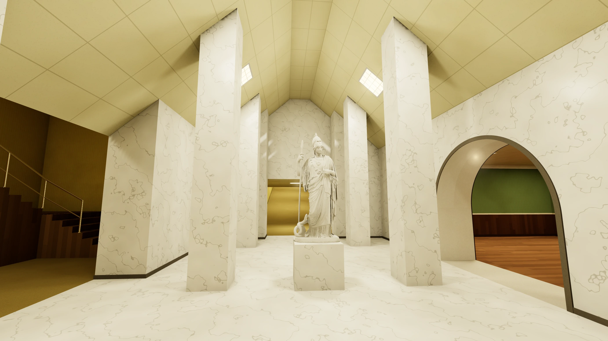
<figcaption><kbd>H</kbd>: ohne Bloom</figcaption>
</figure>
<figure>
<!-- tutorial-screenshot
tab: preview
viewport: 1536x864
zoom: 1.5
hook: open view=18.00,17.40,-94,7
hook: light
hook: info off
-->

<figcaption>mit Bloom</figcaption>
</figure>
</div>

**Warum es so echt aussieht.** Die Räume sind schlicht: gelbe Tapete, Teppich, ein paar Säulen. Dass sie trotzdem wie ein Foto wirken, liegt fast nur am Licht. In Wirklichkeit fällt Licht nicht nur von der Lampe auf den Boden, es prallt von allen Flächen ab, färbt sich dabei, macht Decken hell und Ecken dunkel, und Schatten haben weiche Ränder. Genau das rechnet das Programm aus, mit rund tausend Strahlen für jeden Punkt der Lightmap. Ein Spiel, das 60 Bilder in der Sekunde zeichnen muss, hat dafür keine Zeit und schummelt; das sieht man. Hier geht es, weil sich nichts bewegt: Keine Lampe wandert, keine Tür geht auf, keine Figur läuft durchs Bild. Das Licht wird einmal gebacken und stimmt dann für immer, und es gibt nichts, das sich anders verhielte als das Licht und den Trick verriete. Die Backrooms sind leer, und genau darum sehen sie so echt aus.

Modelle bekommen ihr Licht nicht aus der Lightmap: Das Programm rechnet es für jede Ecke ihres Netzes aus, mit denselben Leuchten und demselben Bounce-Licht.

### Die Teile einzeln ansehen

Oben links steht für jeden Teil ein Schalter mit seiner Taste; grün heißt an. Ein Klick auf den Schalter oder die Taste schaltet ihn um:

<table class='table'>
<tr><th>Taste</th><th>Schalter</th><th>Was er zeigt</th></tr>
<tr><td><kbd>T</kbd></td><td>Textures</td><td>die Oberflächen mit ihren Flecken und ihrem Glanz; aus: alles hellgrau, nur das Licht</td></tr>
<tr><td><kbd>L</kbd></td><td>Direct light</td><td>das direkte Licht der Leuchten</td></tr>
<tr><td><kbd>B</kbd></td><td>Bounce light</td><td>das zurückgeworfene Licht</td></tr>
<tr><td><kbd>O</kbd></td><td>Occlusion</td><td>die Kontaktschatten</td></tr>
<tr><td><kbd>F</kbd></td><td>Flicker</td><td>das Flackern</td></tr>
<tr><td><kbd>E</kbd></td><td>Edges</td><td>die Kanten aller Flächen als Drahtgitter</td></tr>
<tr><td><kbd>G</kbd></td><td>Light points</td><td>die Punkte der Lightmap</td></tr>
<tr><td><kbd>H</kbd></td><td>Bloom</td><td>der helle Schein um die Leuchten</td></tr>
<tr><td><kbd>C</kbd></td><td>VHS</td><td>alles wie von einer alten Videokassette, mit Datum und Uhrzeit (aus; mit <code>vhs = on</code> in <code>level.ini</code> an)</td></tr>
<tr><td><kbd>X</kbd></td><td>Aberration</td><td>farbige Säume zum Rand hin, rot nach außen, blau nach innen, wie durch eine einfache Linse (aus; mit <code>aberration = on</code> in <code>level.ini</code> an)</td></tr>
<tr><td><kbd>3</kbd></td><td>Anaglyph</td><td>das Bild für eine Rot-Cyan-Brille</td></tr>
<tr><td><kbd>K</kbd></td><td>Collision</td><td>was beim Laufen im Weg ist (siehe Level 1)</td></tr>
<tr><td><kbd>M</kbd></td><td>Automap</td><td>die Karte</td></tr>
<tr><td><kbd>Shift</kbd> <kbd>L</kbd></td><td>Rebake light</td><td>das Licht noch einmal von vorn backen</td></tr>
<tr><td></td><td>Save light</td><td>das gebackene Licht als Datei herunterladen (siehe unten)</td></tr>
</table>

<div class='hint try'>
<strong>Ausprobieren:</strong> Schalte mit <kbd>T</kbd> die Texturen aus und mit <kbd>L</kbd> und <kbd>B</kbd> abwechselnd das direkte und das Bounce-Licht, mit <kbd>O</kbd> die Kontaktschatten, und schau dabei in eine Ecke am Boden. Gib der Leuchte im Zimmer <code>size = 0.2</code> und <code>power = 16</code> und lade neu. Eine kleinere Leuchte gibt auch weniger Licht, darum die größere Zahl. Sieh dir den Lichtfleck an, den sie durch die Tür in den Gang wirft: Seine Ränder werden scharf. Dann <code>size = 2</code> mit <code>power = 0.16</code>: Sie werden ganz weich. Mit <code>bounces = 0</code> in <code>level.ini</code> unter <code>[level]</code> backt das Programm gar kein Bounce-Licht; wie sieht der Gang dann aus? Stell beides danach wieder zurück.
</div>

_task(weiche-schatten)

### Licht aufheben

Backen dauert, darum hebt die Vorschau das fertige Licht im Browser auf. Lädst du neu, ohne etwas zu ändern, steht oben links »Light loaded from this browser«, und es wird hell, ohne dass gebacken wird. Änderst du auch nur ein Zeichen in einem Raum, passt das aufgehobene Licht nicht mehr, und es wird neu gebacken. Ob es passt, sagt ein Fingerabdruck (englisch Hash): eine kurze Zahl, ausgerechnet aus allen Dateien des Levels, den Modellen, dem Teil des Programms, der backt, und dem, was das Programm aus deinen Räumen baut: den Flächen und den Leuchten.

Nach dem Backen bekommen noch die Modelle ihr Licht, oben links steht dann »Light for the models« mit einer Zahl in Prozent. Ist auch das fertig, lädt »Save light« das Licht als Datei `level.light` herunter. Zieh sie aus deinem Download-Ordner in den Explorer von VS Code, neben `level.ini`. Dann lädt das Level sein Licht aus dieser Datei, auch in einem anderen Browser, und du kannst deine Backrooms als fertige Webseite weitergeben. Nach jeder Änderung am Level musst du sie neu speichern; eine veraltete Datei meldet die Vorschau oben links.

## Zeigen und veröffentlichen

<div class='found-note'>
<p>Wer eine Tür findet, soll sie offen lassen. Für die Nächsten.</p>
<cite>Mit Kreide an einen Türrahmen geschrieben</cite>
</div>

_include(workspace#live-apps)

Speichere vorher das Licht (»Save light«, siehe »Licht aufheben«) und leg `level.light` neben `level.ini`: Dann ist es bei allen sofort hell, und niemand muss warten, bis gebacken ist.

_include(workspace#subdomain)

Willst du dein Level woanders hinlegen, auf einen Webserver, der nur Dateien ausliefert: `./export.sh . ../mein-level` im Terminal, im Ordner der Vorlage, baut einen Ordner `mein-level` neben ihr, nur mit dem, was dein Level braucht, dem Licht und den Modellen, die es nennt. Für eine VR-Brille muss die Adresse mit `https://` anfangen.

## Die Nachtschicht

<div class='found-note'>
<p>Ein Gebäude, nachts. In jedem Raum brennt Licht, und in jedem ist es ein anderes. Niemand hat Dienst. Trotzdem steht im Büro ein Laptop offen.</p>
<cite>Feldhandbuch, eingelegtes Blatt</cite>
</div>

Jetzt kennst du alles, was in einer Raumdatei stehen kann. Die Nachtschicht ist ein ganzes Level, gebaut aus genau diesen Einträgen. Du kannst sie sofort durchlaufen, ihr Licht ist schon gebacken:

<a class='btn btn-primary' href='/nachtschicht-8ee59051/' target='_blank'><i class='bi bi-door-open'></i> Die Nachtschicht betreten</a>

Sie öffnet sich in einem neuen Tab, schon fertig gebacken. Das geht auch auf dem Handy, dem Tablet und mit einer VR-Brille: Öffne dieselbe Adresse im Browser der Brille und tippe auf »ENTER VR«.

<div class='hint try'>
<strong>Ausprobieren:</strong> Drück <kbd>C</kbd>. Jetzt sieht alles aus wie von einer alten Videokassette, mit Zeilen, verwaschenen Farben, einem Streifen Bandsalat und dem Datum und der Uhrzeit deines Rechners in der Ecke. Mit <kbd>X</kbd> dazu bekommt alles zum Rand hin farbige Säume, wie durch eine billige Linse.
</div>

Wie sie gebaut ist, kannst du nachlesen: Ihre Räume liegen auf [GitHub](https://github.com/specht/backrooms-nachtschicht), eine Datei pro Raum, im Ordner `rooms`. Lies sie Zeile für Zeile und nimm dir, was du brauchen kannst.

Du kannst sie auch in deine Vorlage holen und dort öffnen. Klone sie im Terminal in den Ordner der Vorlage, als Ordner `nachtschicht`:

```bash
git clone https://github.com/specht/backrooms-nachtschicht nachtschicht
```

Dann häng an die Adresse der Vorschau `?level=nachtschicht` an. Beim ersten Mal backt dein Browser das Licht selbst. Bei siebzehn Räumen und 150 Modellen dauert das an einem Rechner mit einer Grafikkarte von vor ein paar Jahren etwa eine Viertelstunde. Lass so lange den Tab und die Vorschau offen. Danach hebt dein Browser das Licht auf, und beim nächsten Mal ist es sofort hell, solange du an der Nachtschicht nichts änderst.

<div class='found-note'>
<p>Wenn du einen Ausgang findest, schreib ihn auf. Wenn du keinen findest, bau einen Raum, in dem es sich zu warten lohnt.</p>
<cite>Feldhandbuch, Rückseite</cite>
</div>
