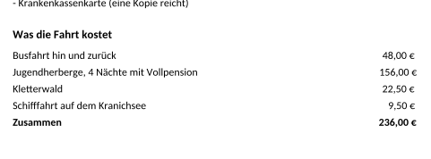
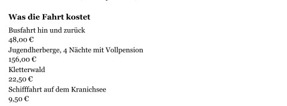
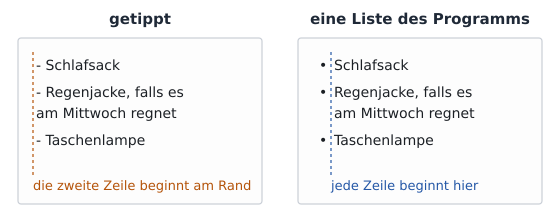
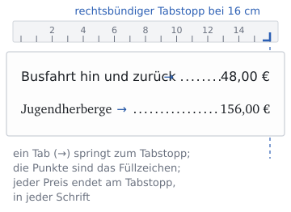
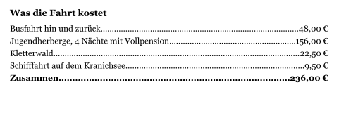

image: teaser.webp
image_alt: "Eine Packliste für die Klassenfahrt, jede Zeile mit einem Strich davor, darunter Preise, die mit Leerzeichen nach rechts geschoben sind"
kind: labor
duration: 1 Stunde (45 Minuten)
curriculum: "Sek I: Standardsoftware (Umgang mit Textverarbeitungssoftware); Medienbildung: Produzieren (Herstellung von Medienprodukten)"
topics: [standardsoftware]
language: LibreOffice / Word / Nextcloud Office
languages: [libreoffice, word, nextcloud]
requires: [character-formatting]
reference: []

# Listen und Tabstopps

Für die Klassenfahrt gibt es ein Blatt für zu Hause: was mitkommt und was die
Fahrt kostet. Die Preise stehen schön untereinander:

Gebaut sind sie mit Leerzeichen, so vielen, bis es passte.

_task(andere-schrift)

<!-- after: andere-schrift -->
So sieht es in einer anderen Schrift aus:

Jede Schrift hat ihre eigene Breite für ein Leerzeichen. Die Leerzeichen waren
genau für Calibri in 12 pt gezählt; in Georgia sind sie breiter, und die
Zeile wird zu lang.
<!-- /after -->

## Die Liste

Hol dir das Blatt und schalte die Formatierungszeichen ein:

<a class='document-starter btn btn-primary' href='/lists-and-tabs/03%20Packliste.docx' download><i class='bi bi-file-earmark-word' aria-hidden='true'></i>Vorlage herunterladen:03 Packliste.docx</a>

Vor jedem Punkt der Packliste steht ein Strich und ein Leerzeichen, getippt.
Eine **Liste**, die das Programm führt, setzt das Zeichen selbst davor, rückt
jeden Punkt gleich ein, auch wenn er über zwei Zeilen geht, und zählt bei einer
nummerierten Liste von selbst weiter.

<!-- language: word -->
In Word markierst du die Zeilen und klickst im Register *Start* auf
*Aufzählungszeichen* (die Punkte) oder *Nummerierung* (die Zahlen).
<!-- /language -->
<!-- language: libreoffice -->
In LibreOffice markierst du die Zeilen und wählst *Format* <i class='bi bi-chevron-right' aria-hidden='true'></i> *Aufzählungszeichen und Nummerierung*,
oder du klickst in der Leiste auf die Liste mit den Punkten.
<!-- /language -->
<!-- language: nextcloud -->
In Nextcloud Office markierst du die Zeilen und klickst im Register *Start*
auf die Liste mit den Punkten.
<!-- /language -->

**Jetzt bist du dran:** Lösch die getippten Striche und mach aus den sechs
Zeilen eine Liste mit Aufzählungszeichen.

## Tabstopps

Ein **Tab** (die Taste <kbd>Tab</kbd>) springt zum nächsten **Tabstopp**. Ohne eigene Tabstopps gibt es einen alle 1,25 cm.
Einen eigenen setzt du am Lineal oben, mit einem Klick; er kann links-, rechts-
oder dezimal ausgerichtet sein. Ein **rechtsbündiger** Tabstopp am rechten
Rand stellt das Ende jedes Preises genau dorthin, in jeder Schrift; ein
**Füllzeichen** zieht Punkte bis zum Preis.

<!-- language: word -->
In Word setzt du ihn genau unter *Start* <i class='bi bi-chevron-right' aria-hidden='true'></i> *Absatz* (der kleine Pfeil) <i class='bi bi-chevron-right' aria-hidden='true'></i>
*Tabstopps*: Position 16 cm, Ausrichtung *Rechts*, Füllzeichen *2 .....*.
<!-- /language -->
<!-- language: libreoffice -->
In LibreOffice setzt du ihn genau unter *Format* <i class='bi bi-chevron-right' aria-hidden='true'></i> *Absatz* <i class='bi bi-chevron-right' aria-hidden='true'></i> *Tabulatoren*:
Position 16 cm, Typ *Rechts*, Füllzeichen *.......*.
<!-- /language -->
<!-- language: nextcloud -->
In Nextcloud Office setzt du ihn unter *Format* <i class='bi bi-chevron-right' aria-hidden='true'></i> *Absatz* <i class='bi bi-chevron-right' aria-hidden='true'></i> *Tabulatoren*:
Position 16 cm, Typ *Rechts*, Füllzeichen *.......*.
<!-- /language -->

_task(tab-zeichen)

<!-- after: tab-zeichen -->

<!-- /after -->

**Jetzt bist du dran:** Ersetz in jeder Zeile der Kosten die Leerzeichen
zwischen Posten und Preis durch einen einzigen Tab. Markier dann alle fünf
Zeilen und setz einen rechtsbündigen Tabstopp bei 16 cm, mit Punkten als
Füllzeichen.

## Prüfen

_task(packliste)

<!-- after: packliste -->

<strong>Ausprobieren:</strong> Stell die Kosten in eine andere Schrift und eine andere Größe. Achte darauf, wo die Preise enden.

<!-- /after -->
