

image: teaser.webp
image_alt: "Eine Packliste für die Klassenfahrt, jede Zeile mit einem Strich davor, darunter Preise, die mit Leerzeichen nach rechts geschoben sind"
kind: labor
duration: 1 Stunde (45 Minuten)
curriculum: "Sek I: Standardsoftware (Umgang mit Textverarbeitungssoftware); Medienbildung: Produzieren (Herstellung von Medienprodukten)"
topics: [standardsoftware]
language: LibreOffice / Word / Nextcloud Office
languages: [libreoffice, word, nextcloud]
requires: [character-formatting]
reference: []

# Listen und Tabstopps

Für die Klassenfahrt gibt es ein Blatt für zu Hause: was mitkommt und was die
Fahrt kostet. Die Preise stehen schön untereinander:

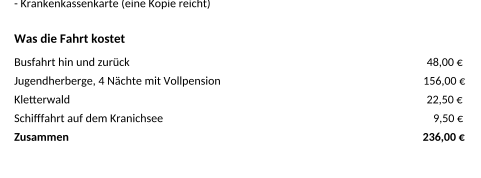

Gebaut sind sie mit Leerzeichen, so vielen, bis es passte.

_task(andere-schrift)

<!-- after: andere-schrift -->
So sieht es in einer anderen Schrift aus:

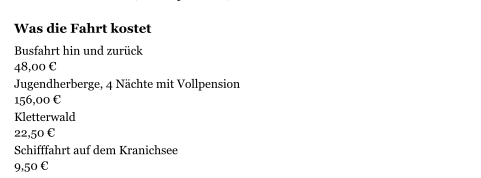

Jede Schrift hat ihre eigene Breite für ein Leerzeichen. Die Leerzeichen waren
genau für Calibri in 12 pt gezählt; in Georgia sind sie breiter, und die
Zeile wird zu lang.
<!-- /after -->

## Die Liste

Hol dir das Blatt und schalte die Formatierungszeichen ein:

<a class='document-starter btn btn-primary' href='/lists-and-tabs/03%20Packliste.docx' download><i class='bi bi-file-earmark-word' aria-hidden='true'></i>Vorlage herunterladen:03 Packliste.docx</a>

Vor jedem Punkt der Packliste steht ein Strich und ein Leerzeichen, getippt.
Eine **Liste**, die das Programm führt, setzt das Zeichen selbst davor, rückt
jeden Punkt gleich ein, auch wenn er über zwei Zeilen geht, und zählt bei einer
nummerierten Liste von selbst weiter.

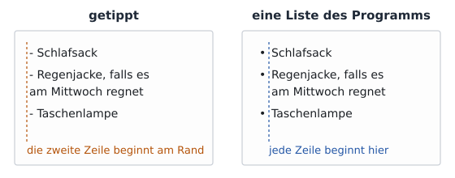

<!-- language: word -->
In Word markierst du die Zeilen und klickst im Register *Start* auf
*Aufzählungszeichen* (die Punkte) oder *Nummerierung* (die Zahlen).
<!-- /language -->
<!-- language: libreoffice -->
In LibreOffice markierst du die Zeilen und wählst *Format* <i class='bi bi-chevron-right' aria-hidden='true'></i> *Aufzählungszeichen und Nummerierung*,
oder du klickst in der Leiste auf die Liste mit den Punkten.
<!-- /language -->
<!-- language: nextcloud -->
In Nextcloud Office markierst du die Zeilen und klickst im Register *Start*
auf die Liste mit den Punkten.
<!-- /language -->

**Jetzt bist du dran:** Lösch die getippten Striche und mach aus den sechs
Zeilen eine Liste mit Aufzählungszeichen.

## Tabstopps

Ein **Tab** (die Taste <kbd>Tab</kbd>) springt zum nächsten **Tabstopp**. Ohne eigene Tabstopps gibt es einen alle 1,25 cm.
Einen eigenen Tabstopp setzt du selbst, an die Stelle, an der der Text
hinter dem Tab stehen soll. Ein **rechtsbündiger** Tabstopp am rechten Rand
stellt das Ende jedes Preises genau dorthin, in jeder Schrift; ein
**Füllzeichen** zieht Punkte bis zum Preis. Wie das geht, steht unten in
Schritten.

_task(tab-zeichen)

<!-- after: tab-zeichen -->
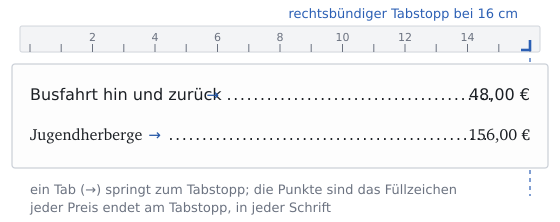
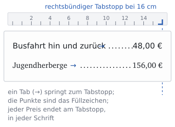
<!-- /after -->

### Vier Arten von Tabstopps

Ein Tabstopp kann den Text hinter dem Tab auf vier Arten an sich stellen. Im
Lineal zeigt jede Art ihr eigenes Zeichen:

- **links** <svg class='tab-mark' viewBox='0 0 14 14' aria-hidden='true'><path d='M3 2V13H12' fill='none' stroke='currentColor' stroke-width='2' stroke-linecap='square'/></svg>: Der Text beginnt am Tabstopp, für eine Spalte aus Wörtern.
- **zentriert** <svg class='tab-mark' viewBox='0 0 14 14' aria-hidden='true'><path d='M2 13H12M7 13V2' fill='none' stroke='currentColor' stroke-width='2' stroke-linecap='square'/></svg>: Die Mitte des Textes steht am Tabstopp, etwa für eine Überschrift über einer Spalte.
- **rechts** <svg class='tab-mark' viewBox='0 0 14 14' aria-hidden='true'><path d='M2 13H11V2' fill='none' stroke='currentColor' stroke-width='2' stroke-linecap='square'/></svg>: Der Text endet am Tabstopp, für Preise und Seitenzahlen.
- **dezimal** <svg class='tab-mark' viewBox='0 0 14 14' aria-hidden='true'><path d='M2 13H12M7 13V2' fill='none' stroke='currentColor' stroke-width='2' stroke-linecap='square'/><circle cx='10.6' cy='7' r='1.5' fill='currentColor' stroke='none'/></svg>: Das Komma steht am Tabstopp, für Zahlen mit verschieden vielen Stellen.

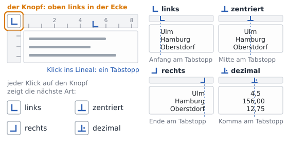
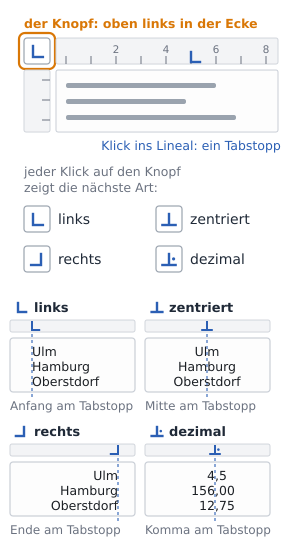

### Ein Tabstopp gehört zum Absatz

Jede Zeile, die mit <kbd>Enter</kbd> endet, ist ein eigener **Absatz**; die
Formatierungszeichen zeigen sein Ende als ¶. Ein Tabstopp gehört zu einem
Absatz, nicht zum ganzen Blatt. Setzt du ihn, während der Cursor nur in einer
Zeile steht, bekommt ihn nur diese Zeile, und in den anderen bleiben die Preise,
wo sie waren. Markier darum zuerst alle Zeilen, die ihn bekommen sollen, und
setz ihn erst dann; alle markierten Zeilen bekommen ihn auf einmal. Das Lineal
zeigt immer die Tabstopps der Zeile, in der der Cursor steht.

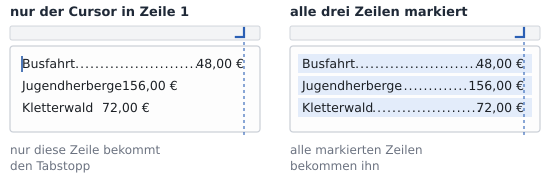
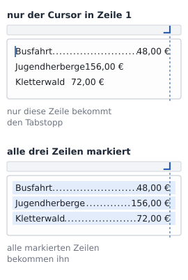

### Den Tabstopp setzen

Der Weg über das Menü geht immer:

<!-- language: word -->
1. **Alle Zeilen markieren**, die den Tabstopp bekommen sollen, für die Kosten alle fünf.
2. *Start* <i class='bi bi-chevron-right' aria-hidden='true'></i> *Absatz*: der kleine Pfeil unten rechts in der Gruppe *Absatz*, dann unten im Fenster *Tabstopps…*.
3. *Tabstoppposition* 16 cm, *Ausrichtung* *Rechts*, *Füllzeichen* *2 .....*.
4. **Festlegen** klicken, dann *OK*. Ohne *Festlegen* ist der Tabstopp nicht gesetzt.
<!-- /language -->
<!-- language: libreoffice nextcloud -->
1. **Alle Zeilen markieren**, die den Tabstopp bekommen sollen, für die Kosten alle fünf.
2. *Format* <i class='bi bi-chevron-right' aria-hidden='true'></i> *Absatz* <i class='bi bi-chevron-right' aria-hidden='true'></i> Register *Tabulatoren*.
3. *Position* 16 cm, *Typ* *Rechts*, *Füllzeichen* *.......*.
4. **Neu** klicken, dann *OK*. Ohne *Neu* ist der Tabstopp nicht gesetzt.
<!-- /language -->

<!-- language: word libreoffice -->
### Schneller am Lineal

Mit etwas Übung geht es am Lineal über der Seite schneller.
<!-- /language -->

<!-- language: word -->
**1. Das Lineal einschalten.** In Word ist es nicht immer zu sehen. Du
schaltest es im Register *Ansicht* ein: In der Gruppe *Anzeigen* setzt du das
Häkchen bei *Lineal*.

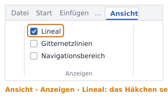
<!-- /language -->
<!-- language: libreoffice -->
**1. Das Lineal.** In LibreOffice steht es über der Seite.
<!-- /language -->

<!-- language: word libreoffice -->
**2. Die Art wählen.** Oben links, ganz am Anfang des Lineals, steht ein
kleiner Knopf mit einem Zeichen. Er ist leicht zu übersehen. Er zeigt die
Art, die ein Klick ins Lineal setzt, und jeder Klick auf den Knopf zeigt die
nächste Art. Für die Preise klickst du, bis er das Zeichen für rechts zeigt <svg class='tab-mark' viewBox='0 0 14 14' aria-hidden='true'><path d='M2 13H11V2' fill='none' stroke='currentColor' stroke-width='2' stroke-linecap='square'/></svg>.
<!-- /language -->
<!-- language: word -->
In Word steht der Knopf in der Ecke, wo sich das waagerechte und das
senkrechte Lineal treffen. Nach den vier Arten zeigt er noch eine fünfte, die
nur einen senkrechten Strich in den Text zieht, und zwei Zeichen für
Einzüge.
<!-- /language -->
<!-- language: word libreoffice -->

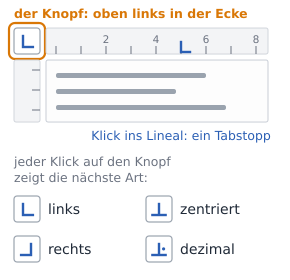

**3. Vorsicht an den Enden.** An den Enden des Lineals liegen der Rand
(grau) und die Einzüge (die kleinen Dreiecke). Ziehst du an einem davon,
entsteht kein Tabstopp, sondern Text verschiebt sich: am Rand der ganze Text
der Seite, an einem Dreieck die markierten Zeilen. Ist doch etwas verrutscht,
macht <kbd>Strg</kbd>+<kbd>Z</kbd> es rückgängig.

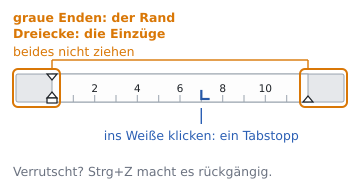

**4. Setzen.** Markier alle Zeilen und klick ins Weiße unter den Zahlen,
bei 16 cm. Einen Tabstopp im Lineal verschiebst du, indem du sein Zeichen
ziehst; ziehst du es nach unten aus dem Lineal, ist er weg.
<!-- /language -->
<!-- language: word -->
Das Füllzeichen setzt das Lineal nicht: Ein Doppelklick auf das neue Zeichen
im Lineal öffnet *Tabstopps*, dort wählst du es und klickst wieder
*Festlegen*.
<!-- /language -->
<!-- language: libreoffice -->
Das Füllzeichen setzt das Lineal nicht: Du wählst es danach wie oben unter
*Format* <i class='bi bi-chevron-right' aria-hidden='true'></i> *Absatz* <i class='bi bi-chevron-right' aria-hidden='true'></i> *Tabulatoren*.
<!-- /language -->

**Jetzt bist du dran:** Ersetz in jeder Zeile der Kosten die Leerzeichen
zwischen Posten und Preis durch einen einzigen Tab. Markier dann **alle fünf
Zeilen** und setz einen rechtsbündigen Tabstopp bei 16 cm, mit Punkten als
Füllzeichen. Achte darauf, dass danach in jeder Zeile der Preis am rechten
Rand endet, nicht nur in einer.

<strong>Die Taste für Tabellen</strong>, um 1900. Auf einer Schreibmaschine rückte jeder Anschlag den Wagen mit dem Papier um ein Zeichen weiter. Wer eine Tabelle tippte, drückte für jede Spalte wieder und wieder die Leertaste und die Rücktaste. Um 1900 kamen Schreibmaschinen mit einem Tabulator: kleine Klammern auf einer Schiene, die man von Hand an die Stellen der Spalten steckte, und eine Taste, auf die hin der Wagen bis zur nächsten Klammer sprang. Daher der Name: <em>Tab</em> kommt von <em>tabulate</em>, »in eine Tabelle bringen«. Ein Patent von 1903 sah sogar eigene Tasten für Einer, Zehner und Hunderter vor, damit die Stellen von Zahlen genau untereinander standen.

## Prüfen

_task(packliste)

<!-- after: packliste -->
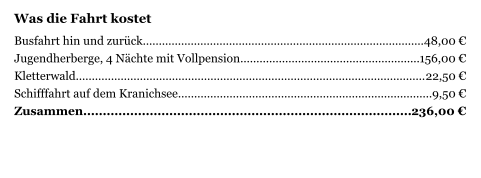

<strong>Ausprobieren:</strong> Stell die Kosten in eine andere Schrift und eine andere Größe. Achte darauf, wo die Preise enden.

<!-- /after -->

<!-- extra -->
## Üben und knobeln

Drei Dokumente für alle, die mehr wollen: eins zum Üben, eins mit zwei neuen
Handgriffen und eins zum Suchen.

### Noch eine Runde

Für den Flohmarkt der 7b hat jemand einen Aushang gemacht, gebaut wie die
Packliste. Bau ihn richtig, diesmal ohne oben nachzusehen.

_task(runde)

### Zwei Handgriffe

Im Plan für den Wandertag stehen oben die wichtigsten Angaben: links ein Wort
wie »Ziel« oder »Treffpunkt«, rechts daneben, was dazugehört. Auch diese Spalte
ist mit Leerzeichen gebaut.

Ersetz die Leerzeichen durch einen Tab, und die Spalte springt zu den
Tabstopps, die es von selbst alle 1,25 cm gibt: hinter »Ziel« zum ersten, hinter
»Treffpunkt« zum zweiten. Gerade wird sie mit einem eigenen **linksbündigen**
Tabstopp: Dort beginnt der Text hinter dem Tab, egal wie lang das Wort davor
ist.

<!-- language: word -->
In Word setzt du ihn unter *Start* <i class='bi bi-chevron-right' aria-hidden='true'></i> *Absatz* (der kleine Pfeil) <i class='bi bi-chevron-right' aria-hidden='true'></i>
*Tabstopps* mit der Ausrichtung *Links*. Schneller geht es am Lineal (*Ansicht*
<i class='bi bi-chevron-right' aria-hidden='true'></i> *Anzeigen* <i class='bi bi-chevron-right' aria-hidden='true'></i> *Lineal*): Der Knopf oben links in der Ecke zeigt, welche Art
ein Klick setzt; ein L heißt linksbündig.
<!-- /language -->
<!-- language: libreoffice -->
In LibreOffice setzt du ihn unter *Format* <i class='bi bi-chevron-right' aria-hidden='true'></i> *Absatz* <i class='bi bi-chevron-right' aria-hidden='true'></i>
*Tabulatoren* mit dem Typ *Links*. Schneller geht es am Lineal: Ein Klick
setzt einen linksbündigen Tabstopp.
<!-- /language -->
<!-- language: nextcloud -->
In Nextcloud Office setzt du ihn unter *Format* <i class='bi bi-chevron-right' aria-hidden='true'></i> *Absatz* <i class='bi bi-chevron-right' aria-hidden='true'></i>
*Tabulatoren* mit dem Typ *Links*.
<!-- /language -->

Der zweite Handgriff: Die Rallye am Gipfel ist von Hand nummeriert, ihre
Unterpunkte sind mit Leerzeichen eingerückt. Eine **nummerierte Liste** zählt
von selbst, und ihre Punkte können auf verschiedenen **Ebenen** stehen:
<kbd>Tab</kbd> am Anfang eines Punkts rückt ihn eine Ebene tiefer,
<kbd>Shift</kbd>+<kbd>Tab</kbd> holt ihn wieder hoch. Die Zahlen der oberen
Ebene zählen dabei weiter, als stünden die Unterpunkte nicht dazwischen.

<!-- language: word -->
In Word schaltest du sie im Register *Start* mit *Nummerierung* ein.
<!-- /language -->
<!-- language: libreoffice -->
In LibreOffice schaltest du sie in der Leiste mit der Liste mit den Zahlen ein
oder mit <kbd>F12</kbd>.
<!-- /language -->
<!-- language: nextcloud -->
In Nextcloud Office schaltest du sie im Register *Start* mit der Liste mit den
Zahlen ein.
<!-- /language -->

_task(handgriffe)

### Acht Fallen

Die 7b schreibt den Eltern einen Brief zum Sportfest. Er sieht fertig aus.
Sechs Fallen sind von der Art wie auf dem ersten Blatt, eine ist vom zweiten,
und eine ist von diesem: Auf dem Papier sieht man sie nicht. Wie bei den
anderen Fallen zählt die Prüfung nur, und jede Falle hat ihre eigenen Tipps.

_task(fallen)
