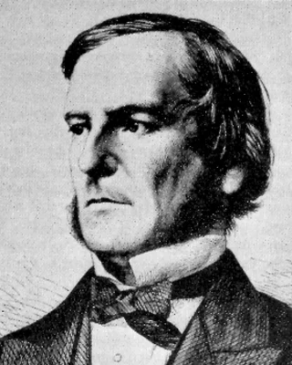
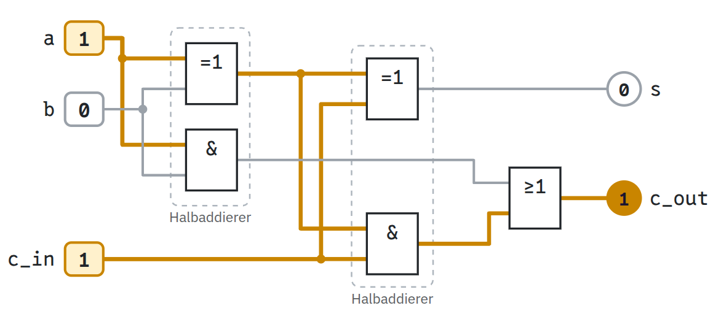

image: teaser.webp:contain
image_alt: "Ein Volladdierer aus zwei Halbaddierern und einem ODER, gezeichnet mit den rechteckigen Schaltzeichen nach DIN: a = 1, b = 0 und c_in = 1 ergeben s = 0 und c_out = 1; die Leitungen mit einer 1 leuchten gelb, die mit einer 0 sind grau."
kind: labor
language: Ruby / Python
languages: [ruby, python]
duration: 2 bis 3 Doppelstunden
age: Oberstufe
curriculum: "Oberstufe: Vertiefung Technische Informatik (Gatter, Schaltnetze, Addierer, Flipflops, Rechenwerk), Rechner und Netze (Von-Neumann-Architektur: das Rechenwerk)"
topics: [schaltnetze, rechneraufbau, zahlensysteme]
requires: [kata-bits]
reference: [bits-und-bytes, minicpu]

# Vom Gatter zum Rechenwerk

Ein Computer rechnet mit Leitungen, auf denen Strom fließt oder nicht: mit 1 und 0. Du baust daraus Schritt für Schritt ein Rechenwerk, aus Gattern einen Addierer für zwei Bits, für drei und für vier, dazu ein Flipflop, das sich ein Bit merkt, und zum Schluss ein Rechenwerk mit denselben Befehlen und Flags wie die CPU Sandbox. Jede Schaltung probierst du auf der Seite aus und schreibst sie danach in Ruby oder Python, als Funktion, die nur Gatter benutzen darf.

## Worum es geht

In der CPU Sandbox addiert `ADD A, B` zwei Bytes in einem einzigen Befehl. Aber wie macht ein Chip das, der nur Leitungen kennt, auf denen eine Spannung anliegt oder nicht? Diese Seite baut die Antwort von unten auf: erst Gatter, die aus ein oder zwei Bits ein neues machen, dann Schaltungen, die zwei Zahlen addieren, eine, die sich ein Bit merkt, und am Ende ein kleines Rechenwerk, das addiert, subtrahiert und Bits verknüpft.

Einrichten musst du nichts. Die Schaltungen probierst du direkt auf der Seite aus, und deinen Code schreibst du in die Karten der Aufgaben; »Ausführen« prüft ihn sofort. Was Bits und das Zweiersystem sind, steht im Handbuch unter [Bits und Bytes](/reference/bits-und-bytes).

## Gatter

### 0 und 1 auf einer Leitung

Im Chip liegt auf jeder Leitung eine Spannung an oder nicht. Die eine Möglichkeit heißt 1, die andere 0. Ein **Gatter** ist eine kleine Schaltung, heute aus wenigen Transistoren, mit einem oder zwei Eingängen und einem Ausgang: Was am Ausgang herauskommt, hängt nur davon ab, was gerade an den Eingängen anliegt. Welche Ausgabe zu welchen Eingaben gehört, sagt die **Wahrheitstabelle** des Gatters, eine Zeile für jede Kombination der Eingänge.

Vier Gatter reichen für fast alles auf dieser Seite:

- **UND** liefert 1, wenn beide Eingänge 1 sind, sonst 0.
- **ODER** liefert 1, wenn mindestens einer der Eingänge 1 ist.
- **NICHT** hat nur einen Eingang und dreht ihn um: aus 1 wird 0, aus 0 wird 1.
- **XOR**, das exklusive ODER, liefert 1, wenn genau einer der Eingänge 1 ist.

Klick auf die Eingänge links, oder auf eine Zeile der Wahrheitstabelle. Leitungen mit einer 1 leuchten gelb, Leitungen mit einer 0 sind grau.

### Die Schaltzeichen

Die Gatter sind gezeichnet wie in der Norm DIN EN 60617, international IEC 60617: als Rechteck, in dem steht, was das Gatter tut. `&` steht für UND, `≥1` für ODER (»mindestens eine 1«), `=1` für XOR (»genau eine 1«) und `1` für ein Gatter, das seinen Eingang nur weitergibt. Ein kleiner Kreis am Ausgang dreht das Ergebnis um: Die `1` mit Kreis ist das NICHT. Diese Zeichen findest du in den meisten deutschen Schulbüchern. In englischen Büchern und in vielen Simulatoren siehst du stattdessen die amerikanischen Formen nach ANSI/IEEE 91, bei denen jedes Gatter eine eigene Form hat, das UND zum Beispiel wie ein D. Gemeint sind dieselben Gatter.

### Zwei Schaltungen vergleichen

Gatter lassen sich hintereinanderschalten: Der Ausgang des einen wird zum Eingang des nächsten. Zwei Schaltungen mit den Eingängen `a` und `b`:

1. ein ODER aus `a` und `b`, dahinter ein NICHT: nicht (a oder b)
2. ein NICHT für `a` und eins für `b`, dahinter ein UND: (nicht a) und (nicht b)

_task(de-morgan)

<!-- after: de-morgan -->

Beide Schaltungen liefern in jeder Zeile dasselbe: 1 nur dann, wenn `a` und `b` beide 0 sind. Das ist eine der beiden Regeln von De Morgan, nach dem Mathematiker Augustus De Morgan: nicht (a oder b) ist dasselbe wie (nicht a) und (nicht b), und ebenso ist nicht (a und b) dasselbe wie (nicht a) oder (nicht b). Mit ihnen wird aus einem ODER ein UND und umgekehrt, wenn man an den richtigen Stellen umdreht. Gleich brauchst du das.
<!-- /after -->

### Rechnen mit wahr und falsch

Dass man mit 1 und 0 rechnen kann wie mit Zahlen, nach festen Regeln wie den beiden von eben, ist älter als jeder Computer.

<strong>George Boole</strong> (1815–1864), englischer Mathematiker, Professor in Cork in Irland. In seinem Buch <em>The Laws of Thought</em> von 1854 rechnete er mit Aussagen, die wahr oder falsch sind, wie mit Zahlen. Nach ihm heißen <code>true</code> und <code>false</code> in vielen Sprachen Boolean, in Python ist es der Typ <code>bool</code>.

Bild: unbekannter Künstler, um 1864, gemeinfrei, zugeschnitten (<a href='https://commons.wikimedia.org/wiki/File:George_Boole.jpg'>Wikimedia Commons</a>)

Gut achtzig Jahre später zeigte Claude Shannon, damals Student am MIT, dass Booles Algebra genau beschreibt, was Schalter tun.

_person(shannon)

<i class='bi bi-file-earmark-text'></i>

<strong>A Symbolic Analysis of Relay and Switching Circuits</strong>, Claude E. Shannon, 1937 als Masterarbeit am MIT geschrieben, 1938 gedruckt. Schaltungen aus Relais, wie sie damals in Telefonvermittlungen steckten, als Gleichungen mit 1 und 0, die man vereinfachen kann wie Terme; damit fängt die Theorie der Schaltungen an, die diese Seite benutzt: <a href='https://dspace.mit.edu/handle/1721.1/11173'>als PDF bei DSpace@MIT</a>.

## Alles aus NAND

Zwei weitere Gatter haben einen Kreis am Ausgang: **NAND** ist ein UND, dessen Ergebnis umgedreht wird, und **NOR** ein umgedrehtes ODER.

NAND hat eine erstaunliche Eigenschaft: Aus NAND-Gattern allein lässt sich jedes andere Gatter bauen, und damit jede Schaltung überhaupt. Chips werden darum gern aus NAND gebaut: In der heute üblichen CMOS-Technik braucht ein NAND vier Transistoren, ein UND sechs, denn es ist ein NAND mit einem NICHT dahinter.

### Gatter aus NAND bauen

In den beiden Karten unten steht `nand(a, b)` schon fertig. Deine Funktionen dürfen ihre Eingänge nur an `nand` weitergeben, als ob sie Leitungen wären: nicht selbst vergleichen, nicht rechnen und keine Tabelle nachschlagen. Darauf achtet die Prüfung: Sie ruft deine Funktionen zuerst mit 0 und 1 auf und dann noch einmal mit Signalen, die nur `nand` lesen kann. Ein `if a == 1` oder ein `a & b` in deinem Code fällt dabei auf, auch wenn die Ergebnisse stimmen. `nand` selbst ist mit `==` geschrieben, denn in Ruby und Python gibt es keine Transistoren.

_task(nand-not-and)

_task(nand-or-xor)

<!-- after: nand-or-xor -->
So sehen die vier Gatter aus NAND aus. Hinter dem ODER steckt eine Regel von De Morgan: nand(nicht a, nicht b) ist nicht ((nicht a) und (nicht b)), und das ist dasselbe wie a oder b. Für das XOR reichen vier NAND.

<strong>Zum Nachdenken:</strong> NOR ist genauso vielseitig wie NAND. Wie baust du ein NICHT nur aus NOR, und wie ein ODER?

<!-- /after -->

## Zwei Bits addieren: der Halbaddierer

Im Zweiersystem addierst du schriftlich wie im Zehnersystem, nur dass jede Ziffer 0 oder 1 ist. Zwei Bits zusammen ergeben höchstens 1 + 1, und das ist im Zweiersystem `10`: Die Ziffer, die stehen bleibt, ist 0, und eine 1 geht als **Übertrag** in die nächste Spalte.

<table class='table table-sm lc-truth-table'>
<thead><tr><th>a</th><th>b</th><th class='lc-gap'>a + b</th><th>Übertrag c</th><th>Summe s</th></tr></thead>
<tbody>
<tr><td>0</td><td>0</td><td class='lc-gap'>00</td><td>0</td><td>0</td></tr>
<tr><td>0</td><td>1</td><td class='lc-gap'>01</td><td>0</td><td>1</td></tr>
<tr><td>1</td><td>0</td><td class='lc-gap'>01</td><td>0</td><td>1</td></tr>
<tr><td>1</td><td>1</td><td class='lc-gap'>10</td><td>1</td><td>0</td></tr>
</tbody>
</table>

In der Spalte a + b steht das Ergebnis mit zwei Ziffern: Die linke Ziffer ist der Übertrag c, die rechte die Summe s.

Eine Schaltung, die das rechnet, hat zwei Eingänge und zwei Ausgänge: die Summe `s` und den Übertrag `c`, englisch Carry. Jeder der beiden Ausgänge ist ein einziges Gatter.

_task(half-adder-gates)

<!-- after: half-adder-gates -->

Die Schaltung heißt **Halbaddierer**: Sie addiert zwei Bits, aber ein Übertrag aus der Spalte rechts davon hat in ihr keinen Platz. Für eine ganze Spalte fehlt also noch ein Eingang.
<!-- /after -->

_task(half-adder)

## Drei Bits: der Volladdierer

Beim schriftlichen Addieren kommt in jeder Spalte außer der rechten der Übertrag aus der Spalte davor dazu. So addierst du 0110 und 0111, von rechts nach links, die Überträge klein darüber:

<pre class='spec'>
 Übertrag   1 1 0
            0 1 1 0      6
          + 0 1 1 1    + 7
          ---------    ---
            1 1 0 1     13
</pre>

In der dritten Spalte von rechts stehen 1, 1 und der Übertrag 1: zusammen 3, im Zweiersystem `11`, also Summe 1 und wieder ein Übertrag. Eine Schaltung für eine solche Spalte hat drei Eingänge, `a`, `b` und den Übertrag von rechts `c_in`, und zwei Ausgänge, die Summe `s` und den Übertrag nach links `c_out`. Sie heißt **Volladdierer**. Ihre Wahrheitstabelle hat acht Zeilen, eine für jede Kombination der drei Eingänge.

_task(full-adder-rows)

<!-- after: full-adder-rows -->
Ein Übertrag entsteht, sobald mindestens zwei der drei Bits 1 sind: bei 011, 101, 110 und 111. Die Summe ist 1, wenn eine ungerade Zahl der Bits 1 ist: bei 001, 010, 100 und 111.
<!-- /after -->

Einen Volladdierer kannst du aus zwei Halbaddierern bauen. Der erste addiert `a` und `b`, der zweite addiert zu dessen Summe den Übertrag `c_in`. Bleibt die Frage, was aus den beiden Überträgen wird.

_task(full-adder)

<!-- after: full-adder -->

Die beiden gestrichelten Rahmen sind die Halbaddierer. Ihre Überträge laufen durch ein ODER: Einer von beiden reicht für den Übertrag nach links, und beide zugleich kommen nie vor.

<strong>Zum Nachdenken:</strong> Warum sind die beiden Überträge nie zugleich 1? Und warum dürfte deshalb statt des ODER auch ein XOR dort stehen?

<!-- /after -->

## Vier Bits: der Addierer

Für Zahlen mit vier Bits stellst du vier Volladdierer nebeneinander, so wie die vier Spalten der schriftlichen Addition: Jeder bekommt ein Bit von `a` und das Bit von `b` darunter, und sein Übertrag `c_out` wird der Übertrag `c_in` seines linken Nachbarn. Der rechte bekommt als Übertrag eine feste 0. Weil der Übertrag von rechts nach links durch alle Volladdierer läuft, heißt die Schaltung **Ripple-Carry-Addierer**, nach englisch ripple, eine kleine Welle.

Aus vier Bits kommen dabei vier Bits heraus und ein Übertrag aus der linken Spalte, der in kein Bit mehr passt.

_task(overflow)

<!-- after: overflow -->

1111 ist 15, und 15 + 1 = 16 braucht ein fünftes Bit: In den vier Bits steht `0000`, und der Übertrag aus der linken Spalte ist 1. Genauso in der CPU Sandbox, nur mit 8 Bit: 255 + 1 ergibt dort 0, und das Carry-Flag CF ist 1 (Handbuch, [MiniCPU: Flags](/reference/minicpu#flags)).

<strong>Ausprobieren:</strong> Stell oben <code>0111</code> und <code>0000</code> ein und schalte dann <code>b0</code> auf 1. Schau auf die Leitungen zwischen den Volladdierern: Der Übertrag läuft nacheinander durch alle vier, denn jeder Volladdierer kann erst rechnen, wenn der rechts von ihm fertig ist. Bei 64 Bit wären es 64 nacheinander; schnelle Rechenwerke rechnen die Überträge darum mit zusätzlichen Gattern im Voraus aus (Carry-Lookahead).

<!-- /after -->

In Ruby und Python sind die vier Bits einer Zahl eine Liste, das höchste Bit vorn, so wie du die Zahl schreibst: 0110 ist `[0, 1, 1, 0]`. Das Bit ganz rechts hat also den Index 3.

_task(add4)

## Ein Bit merken: das Flipflop

Bis hierher hing der Ausgang jeder Schaltung nur davon ab, was gerade an ihren Eingängen anliegt. Eine solche Schaltung heißt **Schaltnetz**. Ein Register wie `A` in der CPU Sandbox muss sich aber eine Zahl merken, auch wenn sich die Eingänge danach ändern. Dafür führt man den Ausgang eines Gatters zurück an einen Eingang davor: Die Schaltung bekommt einen Zustand und heißt dann **Schaltwerk**.

Das einfachste Schaltwerk ist das **RS-Flipflop** aus zwei NOR-Gattern. Sein Ausgang Q ist das gespeicherte Bit, der zweite Ausgang Qnicht Q (»Q quer«) das umgedrehte Bit. Jedes NOR bekommt einen Eingang von außen und den Ausgang des anderen NOR:

- \\(\mathrm{Q} = \mathrm{NOR}(\mathrm{R}, \overline{\mathrm{Q}})\\)
- \\(\overline{\mathrm{Q}} = \mathrm{NOR}(\mathrm{S}, \mathrm{Q})\\)

`S` heißt Set, »setzen«, und `R` Reset, »zurücksetzen«. Am Anfang sind S und R beide 0, Q ist 0 und Qnicht Q ist 1. Denk an die Wahrheitstabelle von NOR: Es liefert nur dann 1, wenn beide Eingänge 0 sind.

_task(latch-hold)

_task(latch-both)

<!-- after: latch-both -->

Ist S einmal 1 gewesen, hält sich das Flipflop selbst: Q ist 1, also ist \\(\overline{\mathrm{Q}} = \mathrm{NOR}(\mathrm{S}, 1) = 0\\), und damit bleibt \\(\mathrm{Q} = \mathrm{NOR}(0, 0) = 1\\), auch wenn S wieder 0 ist. Erst R = 1 setzt Q zurück auf 0, und auch das bleibt.

Sind S und R beide 1, sind Q und Qnicht Q beide 0. Gehen dann beide im selben Augenblick zurück auf 0, sehen beide NOR zwei Nullen und schalten auf 1, dann sehen beide eine 1 und schalten auf 0, immer weiter: In der Simulation oben schalten alle Gatter gleich schnell, und die Schaltung kommt nie zur Ruhe. In echter Hardware ist eines der beiden Gatter ein wenig schneller, aber welches, weiß man vorher nicht. Darum heißt S = R = 1 der **verbotene Zustand** des RS-Flipflops.
<!-- /after -->

### Mit Takt: das D-Flipflop

Damit der verbotene Zustand nicht vorkommt, bekommt das Flipflop zwei UND-Gatter davor. Der Eingang `D` (Daten) sagt, welches Bit gespeichert werden soll, und der **Takt** sagt, wann: Ist der Takt 1, wird D gespeichert, und Q folgt D. Ist der Takt 0, sind S und R beide 0, und das Flipflop hält sein Bit, egal was an D anliegt. Weil das NICHT vor dem einen UND steht, sind S und R nie zugleich 1.

Genauer heißt diese Schaltung **taktzustandsgesteuertes D-Flipflop** oder D-Latch: Solange der Takt 1 ist, folgt Q dem Eingang D. Die Register eines Prozessors übernehmen D dagegen meist nur in dem Augenblick, in dem der Takt von 0 auf 1 springt; das erreicht man mit zwei solchen Latches hintereinander. Ein Register mit 8 Bit besteht aus acht Flipflops mit demselben Takt, eins für jedes Bit.

_task(d-latch)

## Das Rechenwerk

Der Teil des Prozessors, der rechnet, heißt **Rechenwerk** oder ALU, nach englisch Arithmetic Logic Unit. Es bekommt zwei Zahlen und einen Befehl und liefert ein Ergebnis und die **Flags**: kleine Merker, die sagen, wie die Rechnung ausgegangen ist. Die MiniCPU der CPU Sandbox kennt zum Rechnen unter anderem `ADD`, `SUB`, `AND`, `OR` und `XOR` und hat zwei Flags (Handbuch, [MiniCPU: Flags](/reference/minicpu#flags)):

- **ZF**, das Zero-Flag, ist 1, wenn das Ergebnis 0 ist.
- **CF**, das Carry-Flag, ist nach `ADD` der Übertrag aus dem obersten Bit und nach `SUB` 1, wenn geborgt werden musste, weil die erste Zahl kleiner war. `AND`, `OR` und `XOR` setzen CF immer auf 0.

Das Rechenwerk dieser Seite hat dieselben fünf Befehle und dieselben beiden Flags, nur mit 4 statt mit 8 Bit. Für `AND`, `OR` und `XOR` reichen vier Gatter nebeneinander, eins für jedes Bit. Für `ADD` gibt es den Addierer. Bleibt `SUB`, und auch dafür nimmt das Rechenwerk den Addierer.

_task(sub-trick)

<!-- after: sub-trick -->
Von einer Zahl mit 4 Bit `b` abziehen heißt dasselbe wie 16 − b addieren und den Übertrag aus der linken Spalte wegzulassen. Und 16 − b ist b mit allen Bits umgedreht, plus 1: Aus b = 0011 wird 1100 + 1 = 1101, das ist 13 = 16 − 3. Das ist das Zweierkomplement aus der Kata [Negative Zahlen in einem Byte](/kata-bits). Das Umdrehen erledigen vier XOR-Gatter, an deren zweitem Eingang beim Subtrahieren eine 1 liegt, und die 1 dazu kommt als Übertrag `c_in` in den rechten Volladdierer.

Und das Carry-Flag? Bei 5 − 3 rechnet der Addierer 0101 + 1100 + 1 = 1 0010: Es gibt einen Übertrag, und es musste nicht geborgt werden. Bei 3 − 5 rechnet er 0011 + 1010 + 1 = 0 1110: kein Übertrag, aber 3 ist kleiner als 5. Nach `SUB` ist CF also genau dann 1, wenn aus dem Addierer **kein** Übertrag kommt.

So sieht das Rechenwerk aus, mit Leitungen, die vier Bits auf einmal tragen (die dicken Linien, über ihnen ihr Wert): Links laufen `a` und `b` nach unten zum Addierer `Σ` und zu den drei Gattern für `AND`, `OR` und `XOR`. Rechts sagt der Befehl auf zwei Leitungen, was zu tun ist (gestrichelt): `sub` ist bei `SUB` 1 und dreht über das `=1` die Bits von `b` um, kommt als Übertrag in den Addierer und dreht den Übertrag aus dem Addierer für CF um; `sel` wählt im Block `MUX` (Multiplexer), welches der vier Ergebnisse herauskommt. Rechnen tun alle vier Teile immer, der Multiplexer gibt nur eins davon weiter, und bei `AND`, `OR` und `XOR` als CF eine 0. ZF kommt aus einem NOR über die vier Bits des Ergebnisses.
<!-- /after -->

_task(alu)

### Und in der CPU Sandbox

Die ALU der MiniCPU kannst du dir genauso vorstellen, nur 8 Bit breit und mit weiteren Befehlen wie `ADC`, `CMP` und den Schiebebefehlen `SHL` und `SHR`. In der Sandbox selbst rechnet sie mit JavaScript, nicht mit Gattern, aber ihre Ergebnisse und Flags sind dieselben. Dass sie 8 Bit breit ist, merkst du in der Stufe MiniCPU 8X: Rechnungen mit den 16-Bit-Registern X und Y brauchen dort einen Takt mehr. `CMP A, B` rechnet A − B wie `SUB` und behält nur die Flags: Danach sagt CF = 1, dass A kleiner als B ist, genau wie bei deinem Rechenwerk.

<strong>Ausprobieren:</strong> Stell im Rechenwerk oben <code>SUB</code> mit a = <code>0011</code> und b = <code>0101</code> ein, also 3 − 5, und schau auf r, ZF und CF. In der CPU Sandbox steht nach <code>LDI A, 3</code>, <code>LDI B, 5</code> und <code>SUB A, B</code> die Zahl 254 in A, und CF ist 1 (Handbuch, <a href='/reference/minicpu#flags'>MiniCPU: Flags</a>). Wie hängen 254 und dein Ergebnis mit 4 Bit zusammen?

<!-- tutorial-screenshot
# Das Bild für die Karte: der Volladdierer mit a = 1, b = 0 und c_in = 1
open-site: /logikgatter
tab: preview
viewport: 1280x1000
variants: dark
hook: circuit full-adder a c_in
crop-element: .logic-circuit[data-circuit='full-adder'] svg.lc-svg
-->

## Wie geht es weiter?

In der [CPU Sandbox](/sandbox-cpu) programmierst du einen ganzen Prozessor mit Registern, Speicher und Bildschirm, erst in Assembler und später in C. Das Rechenwerk dieser Seite steckt dort in jedem `ADD` und jedem `CMP`.

<i class='bi bi-book'></i>

<strong>Code: The Hidden Language of Computer Hardware and Software</strong>, Charles Petzold, 1999. Von Morsezeichen und Taschenlampen über Relais zu Gattern, Addierern und Flipflops und weiter bis zu einem ganzen Computer, Schritt für Schritt wie auf dieser Seite, nur viel ausführlicher: <a href='https://www.charlespetzold.com/code/'>die Seite des Autors zum Buch</a>.

<i class='bi bi-book'></i>

<strong>The Elements of Computing Systems</strong>, Noam Nisan und Shimon Schocken, MIT Press. Der Kurs »From Nand to Tetris« fängt genau hier an, bei einem einzigen NAND, und baut daraus in zwölf Projekten einen Computer, seinen Assembler, einen Compiler und ein kleines Betriebssystem. Der Kurs mit allen Projekten und Werkzeugen ist frei: <a href='https://www.nand2tetris.org/'>nand2tetris.org</a>.

