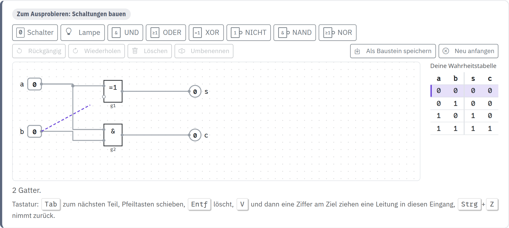
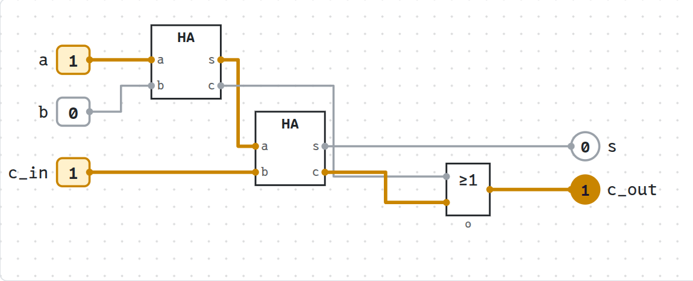

image: teaser.webp:contain
image_alt: "Ein Volladdierer im Editor der Logik-Werkstatt: zwei Bausteine HA und ein ODER, die Schalter a und c_in auf 1, die Lampe c_out leuchtet; Leitungen mit einer 1 sind gelb, die mit einer 0 grau."
kind: labor
duration: 2 Doppelstunden
age: Oberstufe
curriculum: "Oberstufe: Vertiefung Technische Informatik (Schaltnetze und Schaltwerke entwerfen: Halbaddierer, Multiplexer, Volladdierer, Addierer, Vergleicher, D-Flipflop)"
topics: [schaltnetze, rechneraufbau]
requires: [logikgatter]

# Logik-Werkstatt

Du baust Schaltungen selbst, direkt auf der Seite: Gatter setzen, Leitungen ziehen, Schalter umlegen und zusehen, wie die Signale Runde für Runde durchlaufen. Aus deinem Halbaddierer wird ein Baustein, aus zwei Bausteinen ein Volladdierer und aus vier Volladdierern ein Addierer für 4 Bit, so wie Hardware in Schichten gebaut wird. Zum Schluss baust du ein Flipflop, das sich ein Bit merkt.

## Worum es geht

In [Vom Gatter zum Rechenwerk](/logikgatter) hast du fertige Schaltungen durchgeklickt und jede danach als Funktion geschrieben. Hier zeichnest du sie selbst. So entwerfen auch Leute, die Chips bauen, ihre Schaltungen: in einem Simulator, der zeigt, was auf jeder Leitung liegt, lange bevor etwas aus Silizium entsteht.

Die Gatter sehen aus wie dort, als Rechtecke nach DIN EN 60617: `&` für UND, `≥1` für ODER, `=1` für XOR, `1` mit Kreis für NICHT, und ein Kreis am Ausgang dreht das Ergebnis um. Eine Leitung mit einer 1 ist gelb, eine mit einer 0 grau.

Einrichten musst du nichts, und der Workspace muss nicht laufen. Jede Aufgabe hat ihren eigenen Editor in der Karte; »Prüfen« schickt deine Schaltung an den Server, der sie Zeile für Zeile durchrechnet.

## Der Editor

### So baust du

<!-- tutorial-screenshot
# Der Editor mit einem halb fertigen Halbaddierer: eine Leitung wird gerade gezogen
open-site: /logikwerkstatt
tab: preview
viewport: 1280x900
variants: dark
hook: sandbox intro
crop-element: .circuit-editor[data-free]
-->

- **Ein Bauteil einsetzen:** Klick in der Leiste oben auf ein Gatter, dann steht es auf einem freien Platz. Oder zieh es aus der Leiste dorthin, wo es stehen soll.
- **Verschieben:** Zieh ein Bauteil an eine andere Stelle. Kommt einer seiner Anschlüsse fast auf die Höhe einer Leitung, rastet es so ein, dass die Leitung gerade wird.
- **Eine Leitung ziehen:** Jedes Gatter hat links seine Eingänge und rechts seinen Ausgang, als kleine Punkte. Zieh vom Ausgang eines Schalters, Gatters oder Bausteins zu einem Eingang. Auf einem Tablet geht es auch mit zwei Tipps: erst auf den Ausgang, dann auf den Eingang. Ein Ausgang darf an viele Eingänge, ein Eingang hat genau eine Leitung; eine neue ersetzt die alte. Ein Eingang ohne Leitung ist ein leerer Kreis.
- **Schalten:** Klick auf einen Schalter, und die Signale laufen los. Gatter rechnen in Runden, alle zugleich, wie auf der Seite davor.
- **Löschen und zurücknehmen:** Klick auf ein Bauteil oder eine Leitung und dann auf »Löschen«. »Rückgängig« nimmt jeden Schritt zurück. Ein UND, ODER, NAND, NOR oder XOR, das du ausgewählt hast, bekommt mit <i class='bi bi-plus-lg'></i> einen Eingang mehr, bis zu vier.
- **Mit der Tastatur:** <kbd>Tab</kbd> geht von Bauteil zu Bauteil, die Pfeiltasten schieben es, die Leertaste legt einen Schalter um, <kbd>Entf</kbd> löscht. <kbd>V</kbd> beginnt eine Leitung am Ausgang des Bauteils; geh dann mit <kbd>Tab</kbd> zum Ziel und drück die Nummer des Eingangs, <kbd>1</kbd> für den obersten.

Neben der Fläche steht die Wahrheitstabelle deiner Schaltung, bis zu fünf Schaltern; ein Klick auf eine Zeile stellt die Schalter so ein. Auf einem Handy kannst du Schaltungen ansehen und die Schalter umlegen. Zum Bauen brauchst du einen größeren Bildschirm, ein Tablet oder einen Computer.

Hier ist ein Editor zum freien Bauen, mit Schaltern und Lampen in der Leiste. Einen Schalter oder eine Lampe benennst du mit »Umbenennen«.

<strong>Ausprobieren:</strong> Setz ein NICHT ein und zieh eine Leitung von seinem Ausgang zurück an seinen eigenen Eingang. Achte auf die Leitung und auf die Meldung unter der Fläche: Was macht ein Gatter, das sich selbst umdreht? Lösch die Leitung danach wieder.

### Was gespeichert wird

Was du in einem Editor baust, merkt sich dein Browser, nach jedem Schritt, auch über das Neuladen der Seite hinweg, für jedes Konto getrennt. Prüfst du eine Schaltung, speichert der Workspace sie außerdem als deine Antwort zu der Aufgabe; an einem anderen Computer lädt die Karte diese geprüfte Schaltung, wenn du angemeldet bist. Was du danach nur im Browser geändert und nicht mehr geprüft hast, bleibt auf dem ersten Computer.

## Schaltnetze bauen

Eine Schaltung, deren Lampen nur davon abhängen, wie die Schalter gerade stehen, heißt **Schaltnetz**. In jeder Karte stehen die Schalter und Lampen der Aufgabe schon bereit; verschieben kannst du sie, löschen nicht. Die Prüfung schaltet jede Zeile der Wahrheitstabelle ein, wartet, bis die Schaltung zur Ruhe gekommen ist, und vergleicht die Lampen. Stimmt eine Zeile nicht, nennt sie die erste.

### Der Halbaddierer

Fang mit einer Schaltung an, die du kennst: dem Halbaddierer, der zwei Bits addiert.

_task(halbaddierer)

<!-- after: halbaddierer -->
Dein Halbaddierer wird gleich ein Baustein. Klick in seiner Karte auf **Als Baustein speichern** und nenne ihn `HA`. Aus seinen Schaltern werden die Eingänge des Bausteins, aus seinen Lampen die Ausgänge, von oben nach unten in der Reihenfolge, in der sie stehen: links `a` und `b`, rechts `s` und `c`. Danach steht `HA` in der Leiste jedes Editors auf der Seite, wie ein Gatter.

Ein **Baustein** ist eine gespeicherte Schaltung mit eigenen Anschlüssen. Setzt du ihn ein, siehst du nur seinen Kasten; innen rechnen seine Gatter, als stünden sie da. Genauso wird Hardware gebaut: aus Transistoren Gatter, aus Gattern Addierer, aus Addierern ein Rechenwerk, und auf jeder Stufe muss man nur noch wissen, was ein Kasten tut, nicht mehr, wie.

<strong>Ausprobieren:</strong> Setz im freien Editor oben zwei Bausteine <code>HA</code> ein und schließ an beide dieselben zwei Schalter an. Beide rechnen dasselbe, jeder mit seinen eigenen zwei Gattern: Der Zähler unter der Fläche sagt »4 Gatter, 4 davon in Bausteinen«.

<!-- /after -->

### Alles aus NAND

Aus NAND allein lässt sich jedes Gatter bauen. Auf der Seite davor hast du das in Ruby oder Python gezeigt, hier baust du es mit Leitungen.

_task(xor-nand)

<!-- after: xor-nand -->

So sieht ein XOR aus vier NAND aus: Das erste NAND liefert x, und nur dort, wo genau einer der Eingänge 1 ist, gibt eines der beiden mittleren eine 0 an das letzte weiter.
<!-- /after -->

### Der Multiplexer

Das Rechenwerk der Seite davor rechnet jedes Ergebnis gleichzeitig aus, die Summe, das UND, das ODER und das XOR, und ein Block `MUX` gibt das weiter, das der Befehl verlangt. Dieser **Multiplexer** wählt mit einer Leitung `sel` (select) zwischen zwei Eingängen.

_task(multiplexer)

<!-- after: multiplexer -->
Ein Multiplexer für vier Eingänge braucht zwei Leitungen zum Auswählen, eine für acht drei. Du kannst ihn aus drei Multiplexern für zwei Eingänge bauen: zwei wählen aus je zwei aus, und der dritte wählt zwischen ihren Ergebnissen.
<!-- /after -->

## In Schichten bauen

### Der Volladdierer

Ein Volladdierer addiert drei Bits: `a`, `b` und den Übertrag `c_in` aus der Spalte rechts. Bau ihn aus deinen beiden Halbaddierern: Du findest `HA` in der Leiste seiner Karte.

_task(volladdierer)

<!-- after: volladdierer -->
Speichere auch ihn als Baustein, als `VA`. In seinem Kasten stecken jetzt zwei Kästen `HA`, und in jedem von ihnen zwei Gatter: drei Schichten. Ändert sich später dein `HA` (du speicherst ihn noch einmal unter demselben Namen), nimmt `VA` beim nächsten Einsetzen den neuen.
<!-- /after -->

### Der Addierer für 4 Bit

Vier Volladdierer nebeneinander addieren zwei Zahlen mit 4 Bit, eine Spalte jeder, wie beim schriftlichen Addieren. Der Übertrag jeder Spalte geht in die links daneben.

_task(addierer4)

_task(ripple)

<!-- after: ripple -->
Die Summe der linken Spalte ändert sich zuletzt: Der Übertrag läuft von rechts nach links durch alle vier Volladdierer, und jeder kann erst rechnen, wenn der rechts von ihm fertig ist. Darum heißt diese Schaltung **Ripple-Carry-Addierer**. In jedem Volladdierer braucht der Übertrag zwei Runden, ein UND und ein ODER.

<strong>Ausprobieren:</strong> Stell an deinem Addierer a = 0111 und b = 0000 ein und leg dann <code>b0</code> auf 1. Schau auf die Leitungen zwischen den Volladdierern: Der Übertrag wandert gelb von rechts nach links, und erst danach springen <code>s3</code> und <code>c_out</code>. Probier dasselbe mit a = 1111: Jetzt läuft er bis zu <code>c_out</code>.

<!-- /after -->

### Zwei Zahlen vergleichen

`CMP A, B` in der CPU Sandbox vergleicht, indem es subtrahiert und nur die Flags behält. Ein Vergleicher lässt sich aber auch direkt bauen, Bit für Bit, vom höchsten an.

_task(vergleicher)

<!-- after: vergleicher -->
Dein Vergleicher entscheidet wie du, wenn du zwei Zahlen vergleichst: Das höchste Bit, in dem sie sich unterscheiden, sagt, welche größer ist. Für 8 Bit kommen nur weitere Stufen dazu; jede fragt, ob alle Bits davor gleich waren.
<!-- /after -->

## Ein Bit merken

Bis hierher hingen die Lampen nur davon ab, wie die Schalter gerade stehen. Führt eine Leitung vom Ausgang eines Gatters zurück zu einem Gatter davor, hat die Schaltung einen Zustand: Sie heißt dann **Schaltwerk** und kann sich etwas merken. Die Wahrheitstabelle neben dem Editor verschwindet dann, denn welche Lampen leuchten, hängt auch davon ab, was vorher war.

### Das D-Flipflop

Auf der Seite davor hast du das RS-Flipflop aus zwei NOR und das D-Flipflop mit Takt durchgeklickt. Jetzt baust du das D-Flipflop selbst. In deinem Editor fangen alle Gatter mit 0 an. Die beiden NOR des Flipflops schalten dann im Gleichtakt hin und her, bis ein Eingang sie aus dem Takt bringt: Leg den Takt einmal auf 1, dann kommt es zur Ruhe.

_task(d-latch)

<!-- after: d-latch -->

So sieht eines aus, das RS-Flipflop mit den beiden UND davor. Ein Register mit 8 Bit, wie `A` in der CPU Sandbox, besteht aus acht solchen Flipflops mit einem gemeinsamen Takt.

<strong>Ausprobieren:</strong> Speichere dein D-Flipflop als Baustein <code>DL</code> und setz im freien Editor zwei davon ein, beide mit demselben Schalter als Takt und je einem eigenen Schalter als <code>d</code>: ein Register für 2 Bit. Achte darauf, was die Lampen tun, während der Takt auf 0 steht und du die beiden <code>d</code> umlegst.

<!-- /after -->

<!-- tutorial-screenshot
# Das Bild für die Karte: ein Volladdierer aus zwei Bausteinen HA, a und c_in auf 1
open-site: /logikwerkstatt
tab: preview
viewport: 1280x900
variants: dark
hook: sandbox teaser
crop-element: .circuit-editor[data-free] .ce-canvas svg
-->

## Wie geht es weiter?

Aus Gattern, Addierern, Multiplexern und Flipflops besteht jeder Prozessor. In der [CPU Sandbox](/sandbox-cpu) programmierst du einen, mit Registern, einem Rechenwerk und Speicher, erst in Assembler und später in C: vom Gatter zum Prozessor.

Wer weiterbauen will, findet dieselben Schaltzeichen im Simulator [Digital](https://github.com/hneemann/Digital), der an Hochschulen in Deutschland viel benutzt wird, und in [Logisim-evolution](https://github.com/logisim-evolution/logisim-evolution). Beide können, was dieser Editor kann, und noch viel mehr: Busse, Zähler, Speicher, ganze Prozessoren.

<i class='bi bi-book'></i>

<strong>The Elements of Computing Systems</strong>, Noam Nisan und Shimon Schocken, MIT Press. Der Kurs »From Nand to Tetris« baut genau so in Schichten: aus einem NAND die Gatter, daraus Addierer, ein Rechenwerk, Register und Speicher und schließlich einen ganzen Computer, für den man dann einen Assembler und einen Compiler schreibt. Der Kurs mit allen Projekten und dem Simulator ist frei: <a href='https://www.nand2tetris.org/'>nand2tetris.org</a>.

