<div class='meta'>
image: select-country.webp:25:0
kind: grundlagen
language: SQL
reference: [sql, datensaetze]
</div>

<div
    class="autotoc-secondary-trigger"
    data-title="Auf dieser Seite"
    data-levels="h2,h3">
</div>

# Einführung in SQL

<p class='abstract'>
In diesem Kapitel lernst du, wie du MySQL-Da­ten­ban­ken abfragen kannst. Dazu verwenden wir SQL, die Structured Query Language. Wir beginnen mit einfachen Abfragen und kombinieren die einzelnen Bausteine anschließend zu eigenen Fragen an die Daten.
</p>

## Vorbereitung

### Einen Ordner anlegen

Stelle zuerst sicher, dass du keinen Ordner geöffnet hast. Um sicherzugehen, drücke einfach den Shortcut für »Ordner schließen«: <kbd>Strg</kbd><kbd>K</kbd> und dann <kbd>F</kbd>. Dein Workspace sollte jetzt ungefähr so aussehen:

<!-- tutorial-screenshot
# Workspace ohne geöffneten Ordner
show-left-sidebar
-->


Wir erstellen nun ein Verzeichnis für unser MySQL-Experiment. Klicke dazu auf »Open Folder« und gib `sql-einfuehrung` ein:

<!-- tutorial-screenshot
press: Control+K
press: Control+O
wait-for-input-value: /workspace/
type: sql-einfuehrung
crop-bottom: 55%
-->

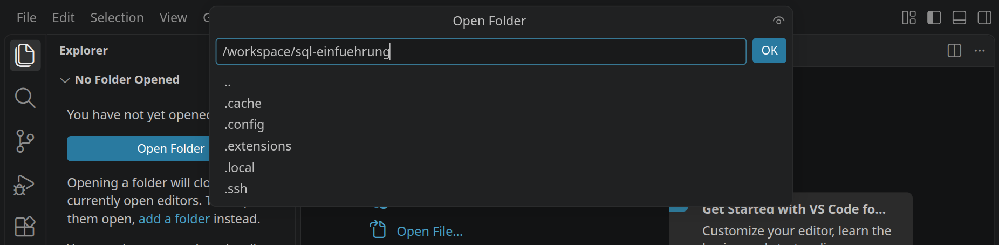

Da das Verzeichnis noch nicht existiert, wirst du gefragt, ob das Verzeichnis erstellt werden soll. Bestätige die Frage mit <kbd>Enter</kbd>:

<!-- tutorial-screenshot
press: Enter
wait-for-text: create it
crop-bottom: 83%
-->

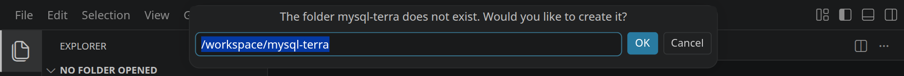

Öffne anschließend das Terminal:

<!-- tutorial-screenshot
press: Enter
sleep: 1
click: Next Up
terminal-open
-->

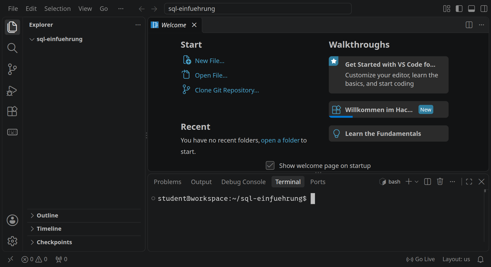


Du kannst das Terminal auch maximieren, indem du auf das Symbol in der rechten oberen Ecke des Terminals klickst.

### Beispieldaten laden

Um MySQL kennenzulernen, benötigen wir eine Datenbank. Wir verwenden die Länder der Welt: alle 197 Länder mit ihren Kontinenten und gut 4.700 Städte, zusammengestellt aus [Wikidata](https://www.wikidata.org/); was genau drinsteht, beschreibt das Handbuch unter [Datensätze](/reference/datensaetze#countries). Für den Anfang nehmen wir eine kleine Fassung mit drei Tabellen. Du lädst sie herunter, indem du folgenden Befehl eingibst:

```bash_copy
wget https://github.com/specht/workspace-files/raw/main/country-archive/countries-basic.sql
```

Die Ausgabe sollte in etwa so aussehen:

<!-- tutorial-screenshot
terminal-maximize
terminal-run: clear
terminal-run: wget https://github.com/specht/workspace-files/raw/main/country-archive/countries-basic.sql
terminal-wait-for-prompt
wait-for-file: sql-einfuehrung/countries-basic.sql
sleep: 0.51
-->

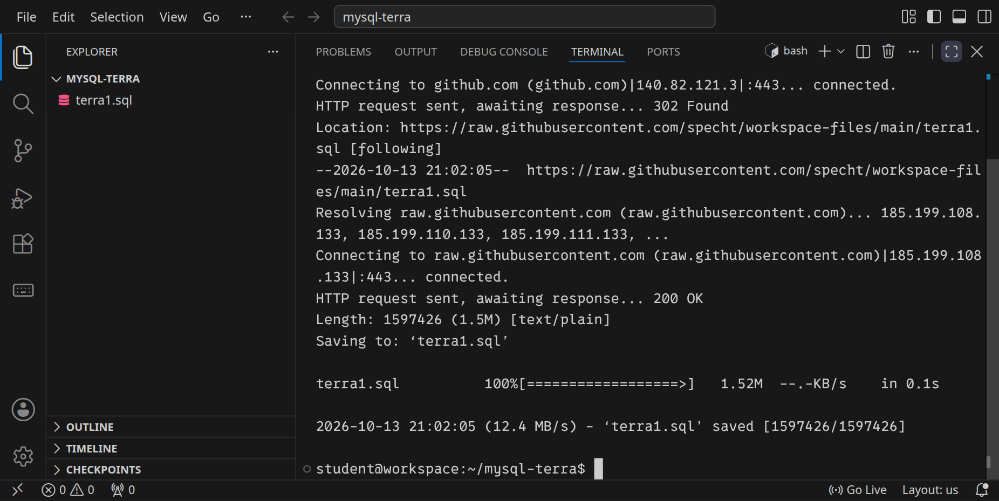

Klicke auf die Datei, um sie zu öffnen. Sie enthält die Befehle, die die Tabellen anlegen und mit Daten füllen, hier die Zeilen der Länder:

<!-- tutorial-screenshot
open-file: countries-basic.sql
press: Control+G
press: 1
press: 0
press: 9
press: Enter
press: Control+J
sleep: 0.5
-->

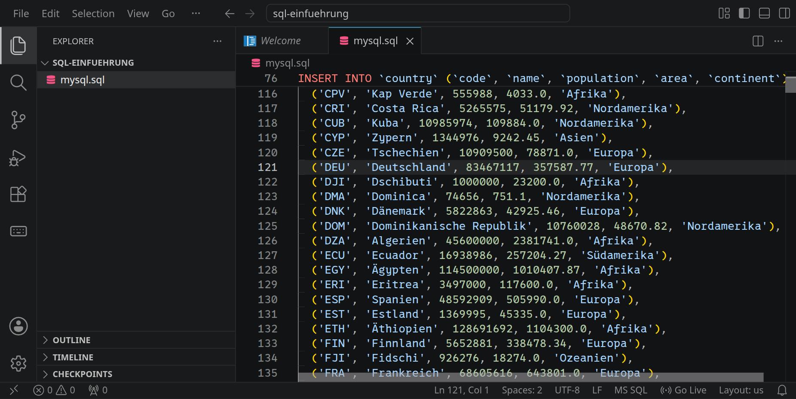

Um die Beispieldatenbank in MySQL zu importieren, gib einfach den folgenden Befehl ein:

```bash
mysql < countries-basic.sql
```

Der Import geht relativ schnell. Zum Schluss lässt er die Datenbank die neuen Tabellen kurz durchsehen und meldet für jede ein `OK`:

<!-- tutorial-screenshot
press: Control+B
press: Control+J
terminal-maximize
terminal-run: clear
terminal-run: mysql < countries-basic.sql
terminal-wait-for-prompt
sleep: 0.5
crop-terminal-lines: auto
-->

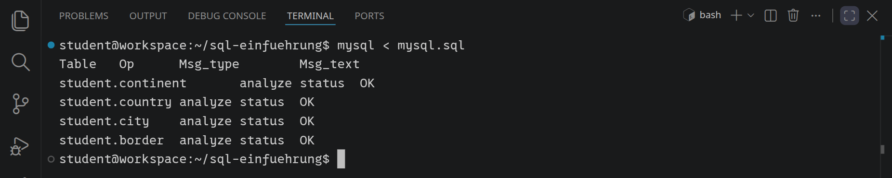

Das hast du gerade importiert: drei Tabellen, jede mit ihren Spalten und ihren ersten Zeilen. Schau sie dir an, bevor du weiterliest. Was könnte man diese Daten fragen?

_schema(countries-basic, rows)

## Die Datenbank erkunden

### mycli starten

Um mit MySQL zu arbeiten, verwenden wir `mycli`, einen MySQL-Client, der speziell für die Kommandozeile entwickelt wurde. Starte `mycli`, indem du den folgenden Befehl eingibst:

```bash
mycli
```

Die Ausgabe sollte in etwa so aussehen:

<!-- tutorial-screenshot
terminal-run: clear
terminal-run: mycli
sleep: 0.5
crop-terminal-lines: auto
crop-terminal-skip-bottom: 1
-->

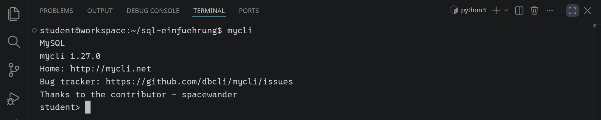

### Tabellen und Spalten

Um dir die Tabellen in der Datenbank anzeigen zu lassen, gib den Befehl `SHOW TABLES;` ein und drücke <kbd>Enter</kbd>:

<!-- tutorial-screenshot
press: Control+L
type: SHOW TABLES;
press: Enter
sleep: 0.5
crop-terminal-lines: auto
crop-terminal-skip-bottom: 1
-->

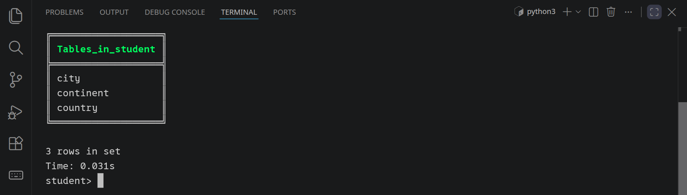

Du siehst die drei Tabellen `city`, `continent` und `country`.

<div class='hint'>
SQL-Befehle schreiben wir in diesem Tutorial zur besseren Les­bar­keit in Großbuchstaben. Für MySQL spielt die Groß- und Kleinschreibung der hier ver­wen­deten SQL-Schlüsselwörter keine Rolle.
</div>

Mit `DESCRIBE` kannst du untersuchen, welche Spalten eine Tabelle besitzt:

```sql
DESCRIBE country;
```

<!-- tutorial-screenshot
press: Control+L
type: DESCRIBE country;
press: Enter
sleep: 0.5
terminal-scroll-back: 1
crop-terminal-lines: auto
crop-terminal-skip-bottom: 1
-->

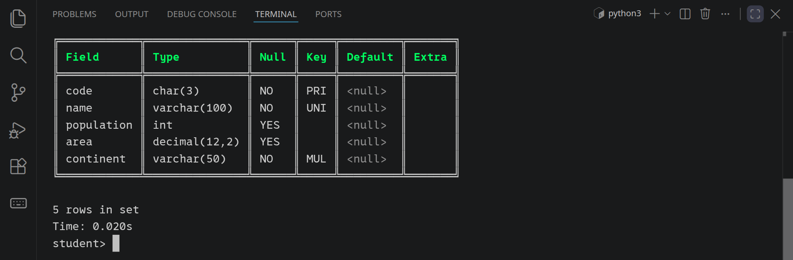

Jede Spalte hat einen Namen und einen Datentyp. So erkennst du, welche Informationen in der Tabelle gespeichert werden: `code` ist das Kürzel des Landes aus drei Buchstaben (`DEU` für Deutschland), `population` die Einwohnerzahl, `area` die Fläche. Die Namen der Spalten sind englisch, wie fast überall in der Programmierung; die Namen der Länder und Kontinente stehen auf Deutsch darin.

<div class='hint task tasks-off-only'>
Untersuche auch die Tabelle <code>city</code> &ndash; welche Spalten gibt es und welche Datentypen haben sie?
</div>

_task(stadt-land)

Kurz aufgeschrieben sieht die ganze Datenbank so aus, eine Zeile pro Tabelle mit ihren Spalten in Klammern:

_schema(countries-basic)

Unterstrichen ist der **Primärschlüssel**: die Spalte, deren Wert jede Zeile eindeutig macht, in `country` das Kürzel `code`, in `city` eine Nummer, `id`. Der Name reicht bei Städten nicht, denn er kommt mehrfach vor: Springfield gibt es in den Vereinigten Staaten gleich dreimal. Der Pfeil ↑ markiert einen **Fremdschlüssel**, eine Spalte, die auf eine Zeile einer anderen Tabelle verweist: `country_code` in `city` nennt das Land, in dem die Stadt liegt, mit seinem Kürzel; `continent` in `country` den Kontinent mit seinem Namen. `is_capital` in `city` ist `1`, wenn die Stadt die Hauptstadt ihres Landes ist, sonst `0`.

## Abfragen mit SELECT

### Spalten auswählen

Mit `SELECT` fragst du Daten aus einer Tabelle ab. Ein Stern `*` steht dabei für alle Spalten:

```sql
SELECT * FROM country;
```

<!-- tutorial-screenshot
press: Control+L
type: SELECT * FROM country;
press: Enter
sleep: 0.5
-->

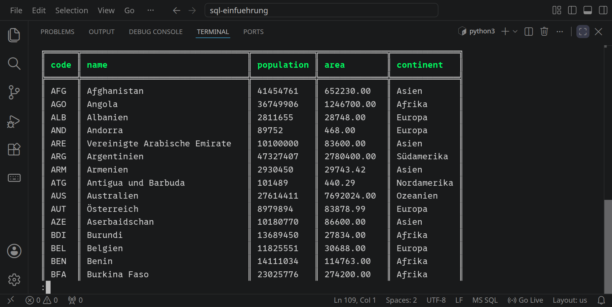

Du siehst nun alle Einträge in der Tabelle `country`. Eine Zeile entspricht einem Land in der Tabelle. Nutze die Pfeiltasten <kbd>←</kbd><kbd>↑</kbd><kbd>→</kbd><kbd>↓</kbd> sowie <kbd>Bild↑</kbd><kbd>Bild↓</kbd>, um durch die Ausgabe zu navigieren.

<div class='hint'>
Bei langen Ergebnissen zeigt <code>mycli</code> die Ausgabe seitenweise an. Drücke <kbd>Q</kbd>, um zur SQL-Eingabe zurückzukehren.
</div>

Meistens brauchst du nicht alle Spalten. Schreibe die gewünschten Spaltennamen hinter `SELECT`, zum Beispiel:

```sql
SELECT name, population FROM country;
```

<!-- tutorial-screenshot
press: Q
press: Control+L
type: SELECT name, population FROM country;
press: Enter
sleep: 0.5
-->

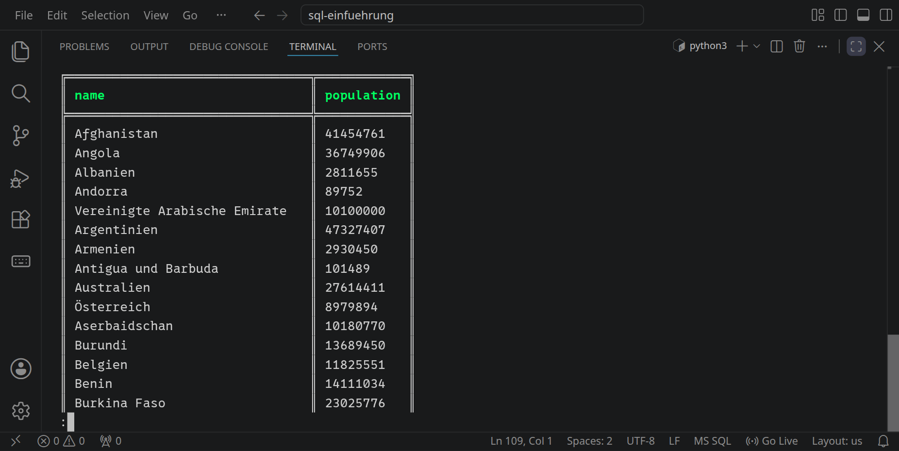

### Zeilen filtern: WHERE

Mit `WHERE` wählst du nur die Zeilen aus, die eine Bedingung erfüllen:

```sql
SELECT * FROM country WHERE name = 'Deutschland';
```

<!-- tutorial-screenshot
press: Q
press: Control+L
type: SELECT * FROM country WHERE name = 'Deutschland';
press: Enter
sleep: 0.5
crop-terminal-lines: auto
crop-terminal-skip-bottom: 1
-->

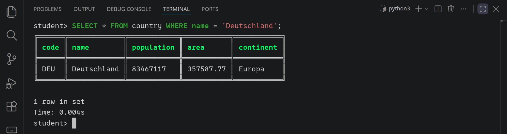

Texte stehen in SQL in einfachen Anführungszeichen, zum Beispiel `'Deutschland'`.

<div class='hint task tasks-off-only'>
Wie viele Einwohner hat Griechenland? Und was bedeutet die Zahl in der Spalte <code>area</code>?
</div>

<div class='hint tasks-on-only'>
<strong>Wo du Abfragen schreibst.</strong> Ausprobieren tust du in <code>mycli</code>: Dort siehst du jedes Ergebnis und kannst die Abfrage so oft ändern, wie du willst. Fragt eine Aufgabe nach einem Wert, etwa einer Zahl oder einem Namen, trägst du nur das Ergebnis ein. Soll die Abfrage Zeilen ausgeben, kopierst du die fertige Abfrage aus <code>mycli</code> in das Feld der Aufgabe; dort wird sie geprüft.
</div>

_task(griechenland)

_task(flaeche-einheit)

Bedingungen lassen sich kombinieren. Mit `AND` müssen beide Bedingungen erfüllt sein:

```sql
SELECT * FROM country
WHERE population < 5000000 AND area > 1000000;
```

<!-- tutorial-screenshot
press: Control+L
type: SELECT * FROM country WHERE population < 5000000 AND area > 1000000;
press: Enter
sleep: 0.5
crop-terminal-lines: auto
crop-terminal-skip-bottom: 1
-->

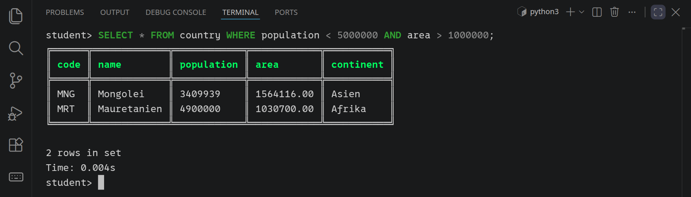

Das Ergebnis enthält genau die Länder, die beide Bedingungen erfüllen. Mit `OR` genügt dagegen eine der Bedingungen, zum Beispiel:

```sql
SELECT name FROM country
WHERE continent = 'Europa' OR continent = 'Asien';
```

<!-- tutorial-screenshot
press: Control+L
type: SELECT name FROM country WHERE continent = 'Europa' OR continent = 'Asien';
press: Enter
sleep: 0.5
-->

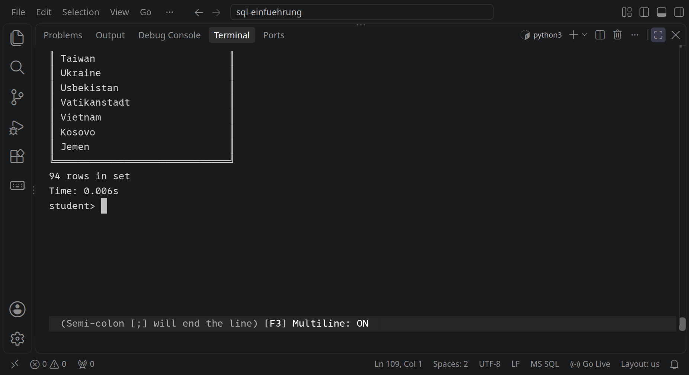

### Sortieren: ORDER BY

Mit `ORDER BY` sortierst du ein Abfrageergebnis. Ohne weitere Angabe wird aufsteigend sortiert:

```sql
SELECT * FROM country ORDER BY population;
```

<!-- tutorial-screenshot
press: Q
press: Control+L
type: SELECT * FROM country ORDER BY population;
press: Enter
sleep: 0.5
-->

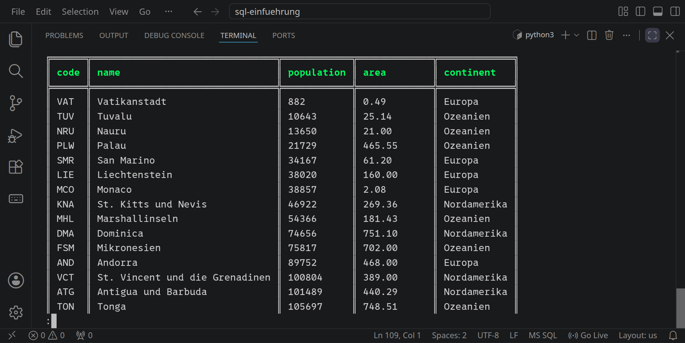

Für eine absteigende Sortierung ergänzt du `DESC`:

```sql
SELECT * FROM country ORDER BY population DESC;
```

<!-- tutorial-screenshot
press: Q
press: Control+L
type: SELECT * FROM country ORDER BY population DESC;
press: Enter
sleep: 0.5
-->

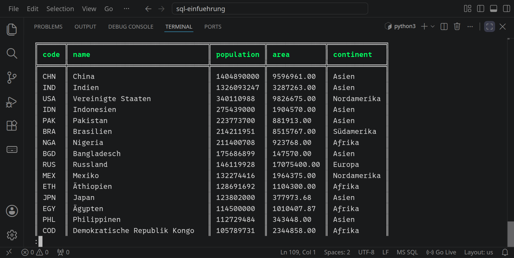

_task(kleinste-laender)

### Begrenzen: LIMIT

Mit `LIMIT` begrenzt du die Anzahl der ausgegebenen Zeilen:

```sql
SELECT * FROM country LIMIT 5;
```

<!-- tutorial-screenshot
press: Q
press: Control+L
type: SELECT * FROM country LIMIT 5;
press: Enter
sleep: 0.5
terminal-scroll-back: 1
crop-terminal-lines: auto
crop-terminal-skip-bottom: 1
-->

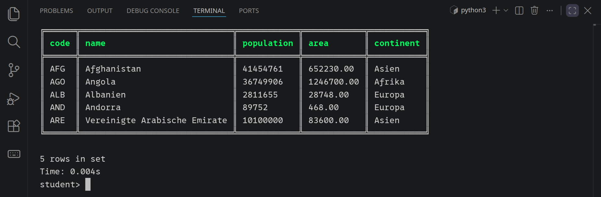

`ORDER BY` und `LIMIT` lassen sich gut kombinieren. Damit kannst du zum Beispiel nach einer Spalte sortieren und anschließend nur die ersten zehn Treffer ausgeben.

_task(top5-laender)

## Zählen und suchen

### Zeilen zählen: COUNT

`COUNT(*)` zählt, wie viele Zeilen ein Abfrageergebnis enthält:

```sql
SELECT COUNT(*) FROM country;
```

<!-- tutorial-screenshot
press: Control+L
terminal-run: SELECT COUNT(*) FROM country;
sleep: 0.5
crop-terminal-lines: auto
crop-terminal-skip-bottom: 1
-->

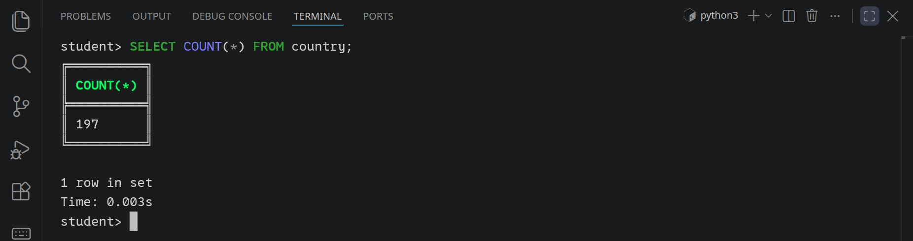

Auch `COUNT` kannst du mit `WHERE` kombinieren. So lässt sich zum Beispiel zählen, wie viele Datensätze eine bestimmte Bedingung erfüllen:

```sql
SELECT COUNT(*) FROM country WHERE continent = 'Asien';
```

<!-- tutorial-screenshot
press: Control+L
terminal-run: SELECT COUNT(*) FROM country WHERE continent = 'Asien';
sleep: 0.5
crop-terminal-lines: auto
crop-terminal-skip-bottom: 1
-->

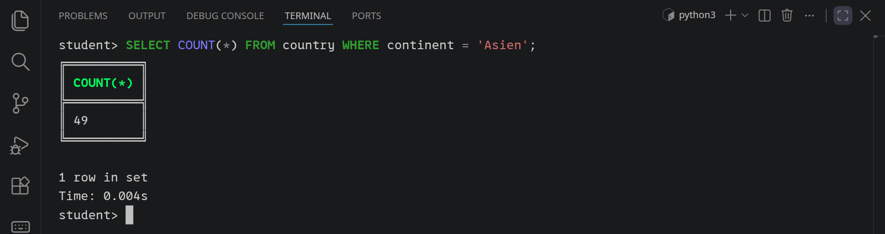

_task(hundert-millionen)

### Text durchsuchen: LIKE

Mit `LIKE` kannst du Text nach einem Muster durchsuchen. Das Prozentzeichen `%` steht dabei für beliebig viele Zeichen. Die folgende Abfrage findet Ländernamen, in denen `land` vorkommt:

```sql
SELECT name FROM country
WHERE name LIKE '%land%'
ORDER BY name;
```

<!-- tutorial-screenshot
press: Control+L
terminal-run: SELECT name FROM country WHERE name LIKE '%land%' ORDER BY name;
sleep: 0.5
terminal-scroll-back: 5
crop-terminal-lines: auto
crop-terminal-skip-bottom: 1
-->

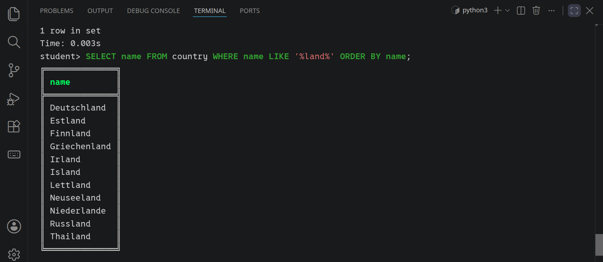

`'land%'` würde dagegen nur Namen finden, die mit `land` beginnen, und `'%land'` nur Namen, die damit enden.

_task(ka-laender)

### Jeden Wert einmal: DISTINCT

Wenn du nur sehen möchtest, welche **verschiedenen** Werte in einer Spalte vorkommen, verwendest du `DISTINCT`:

```sql
SELECT DISTINCT continent FROM country
ORDER BY continent;
```

<!-- tutorial-screenshot
press: Control+L
terminal-run: SELECT DISTINCT continent FROM country ORDER BY continent;
sleep: 0.5
terminal-scroll-back: 2
crop-terminal-lines: auto
crop-terminal-skip-bottom: 1
-->

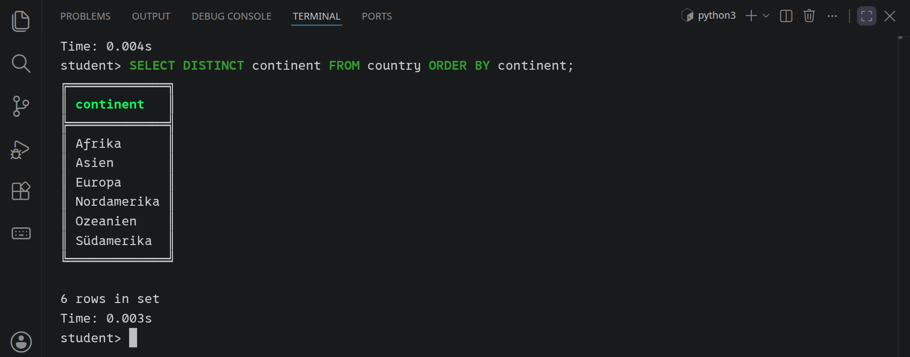

Sechs Kontinente, nicht sieben: Antarktika steht zwar in der Tabelle `continent`, aber kein Land liegt dort.

Hätte jemand bei einem Land `Europe` eingetragen statt `Europa`, käme hier ein siebter Kontinent heraus, und jede Abfrage nach `'Europa'` würde das Land übersehen. In dieser Datenbank kann das nicht passieren: `continent` in `country` ist ein Fremdschlüssel, und die Datenbank nimmt dort nur einen Wert an, den es in der Tabelle `continent` gibt. Probier es aus und lege ein Land auf einem Kontinent an, den es nicht gibt:

```sql
INSERT INTO country (code, name, continent)
VALUES ('ATL', 'Atlantis', 'Atlantik');
```

<!-- tutorial-screenshot
press: Control+L
terminal-run: INSERT INTO country (code, name, continent) VALUES ('ATL', 'Atlantis', 'Atlantik');
sleep: 0.5
crop-terminal-lines: auto
crop-terminal-skip-bottom: 1
-->

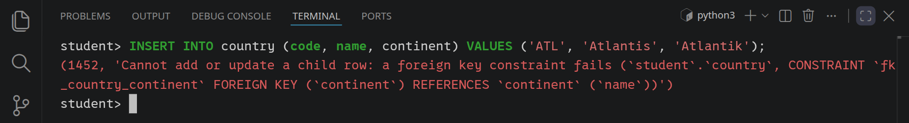

MySQL lehnt die Zeile ab: Ein Fremdschlüssel wäre verletzt (*a foreign key constraint fails*), und nichts wird gespeichert. Jeder Kontinent steht nur einmal in der Datenbank, in `continent`; alle anderen Tabellen verweisen auf diese eine Zeile.

_task(kontinente-grosse-laender)

## In welcher Reihenfolge arbeitet die Datenbank?

Eine Abfrage schreibst du mit `SELECT` zuerst. Die Datenbank fängt aber woanders an: Sie holt zuerst die Zeilen der Tabelle aus `FROM`, wirft mit `WHERE` die weg, die nicht passen, und wählt erst danach mit `SELECT` die Spalten aus. Dann sortiert sie mit `ORDER BY` und schneidet mit `LIMIT` ab. Der Query Stepper unten führt eine Abfrage so aus, Teil für Teil, und zeigt nach jedem Schritt die Tabelle, die gerade entstanden ist. Mit <kbd>←</kbd> und <kbd>→</kbd> gehst du durch die Schritte; die Abfrage kannst du ändern.

<div class='query-stepper' data-stepper data-query="SELECT name, ROUND(population / area) AS density
FROM country
WHERE continent = 'Europa'
ORDER BY density DESC
LIMIT 5;">
</div>

<script src='/include/query_stepper.js'></script>

`density` ist hier die Bevölkerungsdichte, die Zahl der Menschen pro Quadratkilometer, gerundet. Den Namen bekommt die Spalte mit `AS` bei `SELECT`, und weil `ORDER BY` danach kommt, darf es ihn schon benutzen.

_task(reihenfolge)

_task(dichte-where)

Mehr Beispiele, auch mit `GROUP BY` und `JOIN`, die später drankommen, hat der Query Stepper auf einer eigenen Seite:

_tool(query-stepper)

## Zusammenfassung

Du kennst jetzt die wichtigsten Bausteine, die wir für die folgenden Aufgaben benötigen:

<div style='max-width: 100%; overflow-x: auto;'>
<table class='table'>
<thead>
<tr><th>Baustein</th><th>Bedeutung</th></tr>
</thead>
<tbody>
<tr><td><code>SELECT</code></td><td>Welche Spalten oder berechneten Werte sollen ausgegeben werden?</td></tr>
<tr><td><code>FROM</code></td><td>Aus welcher Tabelle kommen die Daten?</td></tr>
<tr><td><code>WHERE</code></td><td>Welche Zeilen erfüllen die Bedingung?</td></tr>
<tr><td><code>AND</code> / <code>OR</code></td><td>Wie werden mehrere Bedingungen verknüpft?</td></tr>
<tr><td><code>ORDER&nbsp;BY</code></td><td>In welcher Reihenfolge werden die Zeilen ausgegeben?</td></tr>
<tr><td><code>LIMIT</code></td><td>Wie viele Zeilen werden höchstens ausgegeben?</td></tr>
<tr><td><code>COUNT(*)</code></td><td>Wie viele Zeilen enthält das Ergebnis?</td></tr>
<tr><td><code>LIKE</code></td><td>Welche Texte passen zu einem Muster?</td></tr>
<tr><td><code>DISTINCT</code></td><td>Welche unterschiedlichen Werte kommen vor?</td></tr>
</tbody>
</table>
</div>

Die Bausteine lassen sich kombinieren. Eine typische Abfrage kann beispielsweise filtern, sortieren und die Ausgabe anschließend begrenzen.

Im Handbuch: _uses(mycli, select, where, sortieren, aggregieren)

<div class='hint'>
Um <code>mycli</code> zu beenden, gib <code>exit</code> ein oder verwende <kbd>Strg</kbd><kbd>D</kbd>.
</div>

Die drei Tabellen sind die kleine Fassung der Länder der Welt. Im zweiten Teil unten lädst du die ganze, mit Grenzen, Währungen und Amtssprachen, und verbindest Tabellen miteinander.

## Aufgaben

Beantworte die folgenden Fragen mit geeigneten SQL-Abfragen. Gib möglichst nur die Spalten aus, die du für die Antwort tatsächlich brauchst.

<div class='tasks-off-only'>
<p>Notiere jeweils deine Abfrage und das Ergebnis.</p>
<ol>
<li>Gib alle Länder mit Name, Einwohnerzahl und Fläche aus. Sortiere die Tabelle nach der Einwohnerzahl absteigend.</li>
<li>Wie viele Länder gibt es in der Tabelle <code>country</code>?</li>
<li>Wie viele Länder in Afrika haben mehr als 50 Millionen Einwohner?</li>
<li>Welche Länder haben die Zeichenfolge <code>arm</code> oder <code>bein</code> im Namen?</li>
<li>Welche Stadt hat die meisten Einwohner, wie viele Einwohner hat sie und in welchem Land liegt sie?</li>
<li>Wie viele Städte aus Frankreich sind in der Tabelle <code>city</code> gespeichert?</li>
<li>Gib die zehn bevölkerungsreichsten Städte Frankreichs aus.</li>
<li>Finde jeweils drei Städte, deren Name die Zeichenfolge <code>arm</code> beziehungsweise <code>heim</code> enthält.</li>
<li>Welche Städte in Deutschland liegen nördlicher als Hamburg (53,55° Nord)?</li>
<li>Welche Hauptstädte liegen auf der Südhalbkugel?</li>
</ol>
</div>

<p class='tasks-on-only'>Wie vorhin: Probier in <code>mycli</code>, bis das Ergebnis stimmt. Ist nach einem Wert gefragt, trägst du ihn ein; soll die Abfrage Zeilen ausgeben, kommt die fertige Abfrage in das Feld der Aufgabe. Der Workspace führt sie dann in deiner eigenen Datenbank aus und sagt, ob es passt. Er liest dabei nur; deine Daten bleiben, wie sie sind.</p>

_task(laender-sortiert)

_task(anzahl-laender)

_task(afrika-grosse-laender)

_task(arm-bein)

_task(groesste-stadt)

_task(staedte-frankreich)

_task(top10-frankreich)

_task(drei-arm)

_task(drei-heim)

_task(noerdlich-hamburg)

_task(hauptstaedte-sueden)

<!-- tutorial-step
# Jede SQL-Aufgabe nimmt ihre Lösung an und lehnt einen typischen Fehler ab, auf den Daten, die die Seite lädt
check-task: griechenland <- 10566531
check-task-fails: griechenland <- 1056653
check-task: kleinste-laender <- SELECT name, population FROM country ORDER BY population;
check-task-fails: kleinste-laender <- SELECT name, population FROM country ORDER BY population DESC;
check-task: top5-laender <- SELECT name FROM country ORDER BY population DESC LIMIT 5;
check-task-fails: top5-laender <- SELECT name FROM country ORDER BY population LIMIT 5;
check-task: hundert-millionen <- 15
check-task-fails: hundert-millionen <- 197
check-task: ka-laender <- SELECT name FROM country WHERE name LIKE 'Ka%';
check-task-fails: ka-laender <- SELECT name FROM country WHERE name LIKE '%Ka%';
check-task: kontinente-grosse-laender <- SELECT DISTINCT continent FROM country WHERE population > 100000000;
check-task-fails: kontinente-grosse-laender <- SELECT continent FROM country WHERE population > 100000000;
check-task: laender-sortiert <- SELECT name, population, area FROM country ORDER BY population DESC;
check-task-fails: laender-sortiert <- SELECT name, population, area FROM country ORDER BY population;
check-task: anzahl-laender <- 197
check-task-fails: anzahl-laender <- 4748
check-task: afrika-grosse-laender <- 6
check-task-fails: afrika-grosse-laender <- 76
check-task: arm-bein <- SELECT name FROM country WHERE name LIKE '%arm%' OR name LIKE '%bein%';
check-task-fails: arm-bein <- SELECT name FROM country WHERE name LIKE '%arm%' AND name LIKE '%bein%';
check-task: groesste-stadt <- SELECT name, population, country_code FROM city ORDER BY population DESC LIMIT 1;
check-task-fails: groesste-stadt <- SELECT name, population, country_code FROM city ORDER BY population LIMIT 1;
check-task: staedte-frankreich <- 43
check-task-fails: staedte-frankreich <- 0
check-task: top10-frankreich <- SELECT name, population FROM city WHERE country_code = 'FRA' ORDER BY population DESC LIMIT 10;
check-task-fails: top10-frankreich <- SELECT name, population FROM city WHERE country_code = 'FRA' LIMIT 10;
check-task: drei-arm <- SELECT name FROM city WHERE name LIKE '%arm%' LIMIT 3;
check-task-fails: drei-arm <- SELECT name FROM city LIMIT 3;
check-task: drei-heim <- SELECT name FROM city WHERE name LIKE '%heim%' LIMIT 3;
check-task-fails: drei-heim <- SELECT name FROM city WHERE name LIKE 'heim%' LIMIT 3;
check-task: noerdlich-hamburg <- SELECT name FROM city WHERE country_code = 'DEU' AND latitude > 53.55;
check-task-fails: noerdlich-hamburg <- SELECT name FROM city WHERE country_code = 'DEU' AND latitude < 53.55;
check-task: hauptstaedte-sueden <- SELECT name FROM city WHERE is_capital AND latitude < 0;
check-task-fails: hauptstaedte-sueden <- SELECT name FROM city WHERE latitude < 0;
-->

## Teil 2: Mehr Tabellen

Bisher hat jede Abfrage eine Tabelle gelesen. Die spannenderen Fragen brauchen mehrere: Welche Hauptstadt hat welches Land? Wer sind die Nachbarn Deutschlands? Wo ist Deutsch Amtssprache? Dafür gibt es die ganze Fassung der Länder der Welt.

### Die ganze Datenbank laden

Beende `mycli` mit <kbd>Strg</kbd><kbd>D</kbd>, lade die ganze Fassung herunter und importiere sie:

```bash_copy
wget https://github.com/specht/workspace-files/raw/main/country-archive/countries.sql
```

```bash
mysql < countries.sql
```

<!-- tutorial-screenshot
press: Control+D
sleep: 0.5
terminal-run: clear
terminal-run: wget -q https://github.com/specht/workspace-files/raw/main/country-archive/countries.sql
terminal-wait-for-prompt
wait-for-file: sql-einfuehrung/countries.sql
terminal-run: clear
terminal-run: mysql < countries.sql
terminal-wait-for-prompt
sleep: 0.5
crop-terminal-lines: auto
-->

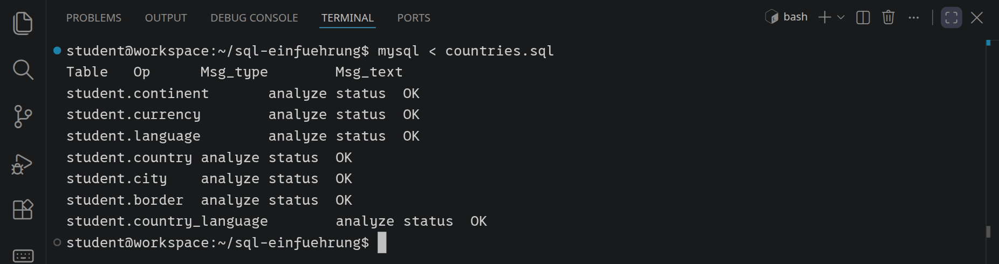

`countries.sql` löscht die drei Tabellen der kleinen Fassung und legt sie neu an, dazu vier weitere. Die Länder, Städte und Kontinente sind dieselben wie vorher; deine Abfragen aus dem ersten Teil gehen weiter. Starte `mycli` wieder und sieh dir die Tabellen an:

<!-- tutorial-screenshot
terminal-run: clear
terminal-run: mycli
sleep: 0.5
press: Control+L
type: SHOW TABLES;
press: Enter
sleep: 0.5
terminal-scroll-back: 2
crop-terminal-lines: auto
crop-terminal-skip-bottom: 1
-->

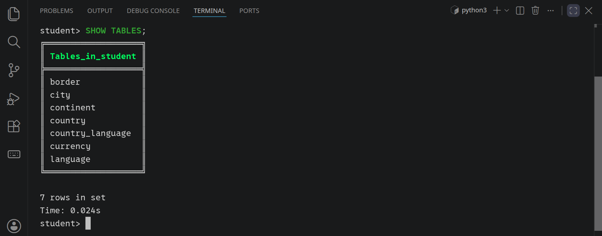

_schema(countries, rows, new: border currency language country_language)

Neu in `country` sind vier Spalten: `currency_code`, die Währung, ein Fremdschlüssel auf `currency`; `tld`, die Internet-Endung wie `.de`; `calling_code`, die Vorwahl wie `+49`; und `driving_side`, `left` oder `right`, je nachdem, auf welcher Straßenseite gefahren wird. `border` enthält die Grenzen an Land, jede als Paar von zwei Ländern; erst beide Spalten zusammen sind der Primärschlüssel. `language` und `country_language` sagen, welche Sprachen in welchem Land Amtssprache sind.

_task(linksverkehr)

## Gruppen bilden: GROUP BY

`COUNT(*)` hat bisher alle Zeilen gezählt, die übrig blieben. Mit `GROUP BY` teilt die Datenbank die Zeilen vorher in Gruppen ein und rechnet für jede Gruppe einmal. Wie viele Länder hat jeder Kontinent?

```sql
SELECT continent, COUNT(*)
FROM country
GROUP BY continent;
```

<!-- tutorial-screenshot
press: Control+L
terminal-run: SELECT continent, COUNT(*) FROM country GROUP BY continent;
sleep: 0.5
terminal-scroll-back: 2
crop-terminal-lines: auto
crop-terminal-skip-bottom: 1
-->

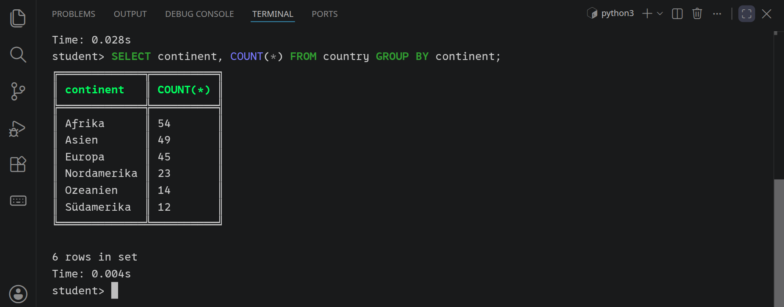

Jede Gruppe wird zu einer Zeile. Neben `COUNT` gibt es `SUM` (die Summe), `AVG` (den Durchschnitt), `MIN` und `MAX`. Die Einwohner jedes Kontinents, die größten zuerst:

```sql
SELECT continent, COUNT(*) AS countries, SUM(population) AS people
FROM country
GROUP BY continent
ORDER BY people DESC;
```

<!-- tutorial-screenshot
press: Control+L
terminal-run: SELECT continent, COUNT(*) AS countries, SUM(population) AS people FROM country GROUP BY continent ORDER BY people DESC;
sleep: 0.5
terminal-scroll-back: 2
crop-terminal-lines: auto
crop-terminal-skip-bottom: 1
-->

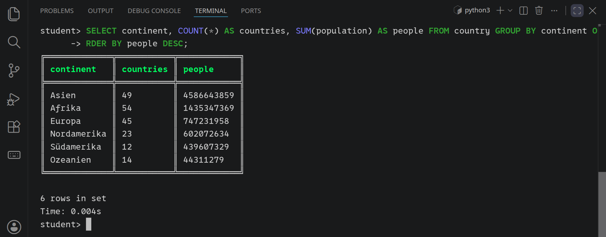

Hinter `SELECT` dürfen bei `GROUP BY` nur die Spalten stehen, nach denen gruppiert wird, und Funktionen wie `COUNT` oder `SUM`: Welchen `name` sollte die Datenbank für Afrika auch zeigen, es sind 54? Gruppen filtern kannst du mit `HAVING`; anders als `WHERE`, das einzelne Zeilen prüft, kommt es nach dem Gruppieren:

```sql
SELECT continent, COUNT(*) AS countries
FROM country
GROUP BY continent
HAVING countries > 40;
```

Wie die Gruppen entstehen, zeigt der [Query Stepper](/query-stepper): Er färbt bei `GROUP BY` jede Gruppe ein, und `HAVING` streicht ganze Gruppen.

_task(laender-pro-kontinent)

_task(einwohner-pro-kontinent)

_task(grosse-kontinente)

## Tabellen verbinden: JOIN

In `country` steht nicht, wie die Hauptstadt eines Landes heißt; das steht in `city`, bei der Stadt mit `is_capital = 1`. Ein `JOIN` setzt die beiden Tabellen zusammen: Zu jeder Zeile von `country` holt er die Zeilen von `city`, für die die Bedingung hinter `ON` stimmt, hier die Städte des Landes.

```sql
SELECT country.name, city.name
FROM country
JOIN city ON city.country_code = country.code
WHERE city.is_capital = 1 AND country.continent = 'Europa'
  AND country.population > 50000000;
```

<!-- tutorial-screenshot
press: Control+L
terminal-run: SELECT country.name, city.name FROM country JOIN city ON city.country_code = country.code WHERE city.is_capital = 1 AND country.continent = 'Europa' AND country.population > 50000000;
sleep: 0.5
terminal-scroll-back: 2
crop-terminal-lines: auto
crop-terminal-skip-bottom: 1
-->

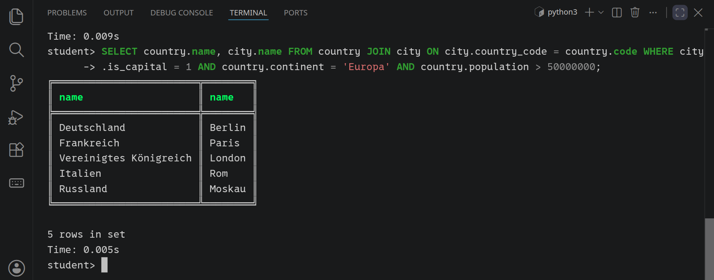

Weil es `name` in beiden Tabellen gibt, steht der Name der Tabelle davor: `country.name`, `city.name`. Die Bedingung hinter `ON` ist fast immer dieselbe Art: Ein Fremdschlüssel ist gleich dem Primärschlüssel, auf den er verweist. So kommt auch der Name der Währung dazu, über `country.currency_code` und `currency.code`.

Wie ein `JOIN` arbeitet, zeigt der Query Stepper Schritt für Schritt: Nach `FROM` stehen alle Länder da, nach `JOIN` ist jedes Land so oft da, wie es Städte hat, und erst `WHERE` lässt die Hauptstädte übrig.

<div class='query-stepper' data-stepper data-query="SELECT country.name, city.name
FROM country
JOIN city ON city.country_code = country.code
WHERE city.is_capital = 1 AND country.continent = 'Südamerika'
ORDER BY country.name;">
</div>

_task(waehrung-japan)

### Die Nachbarn: dieselbe Tabelle zweimal

In `border` stehen nur Kürzel. Für die Namen der Nachbarn verbindest du `border` mit `country`, und zwar über `neighbor_code`. Bekommt eine Tabelle mit `AS` einen eigenen Namen, liest sich das besser:

```sql
SELECT neighbor.name
FROM border
JOIN country AS neighbor ON neighbor.code = border.neighbor_code
WHERE border.country_code = 'DEU';
```

<!-- tutorial-screenshot
press: Control+L
terminal-run: SELECT neighbor.name FROM border JOIN country AS neighbor ON neighbor.code = border.neighbor_code WHERE border.country_code = 'DEU';
sleep: 0.5
terminal-scroll-back: 3
crop-terminal-lines: auto
crop-terminal-skip-bottom: 1
-->

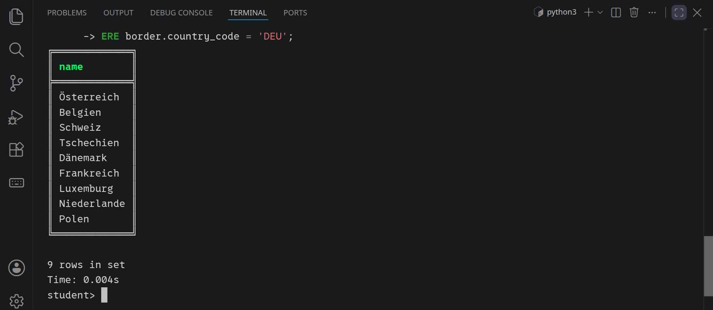

Jede Grenze steht in `border` zweimal, einmal in jeder Richtung: `('DEU', 'FRA')` und `('FRA', 'DEU')`. Das ist Absicht, sonst müsste die Abfrage in beiden Spalten nach Deutschland suchen.

_task(grenze-zweimal)

_task(nachbarn-deutschland)

_task(viele-nachbarn)

### Auch ohne Partner: LEFT JOIN

Ein `JOIN` lässt ein Land weg, für das es keine passende Zeile gibt: Inselstaaten haben keine Nachbarn und tauchen bei einem `JOIN` mit `border` gar nicht auf. Ein `LEFT JOIN` behält jede Zeile der linken Tabelle und füllt die Spalten der rechten mit `NULL`, wenn es keinen Partner gibt:

```sql
SELECT country.name, border.neighbor_code
FROM country
LEFT JOIN border ON border.country_code = country.code
WHERE country.continent = 'Ozeanien' AND country.population > 1000000;
```

<!-- tutorial-screenshot
press: Control+L
terminal-run: SELECT country.name, border.neighbor_code FROM country LEFT JOIN border ON border.country_code = country.code WHERE country.continent = 'Ozeanien' AND country.population > 1000000;
sleep: 0.5
terminal-scroll-back: 2
crop-terminal-lines: auto
crop-terminal-skip-bottom: 1
-->

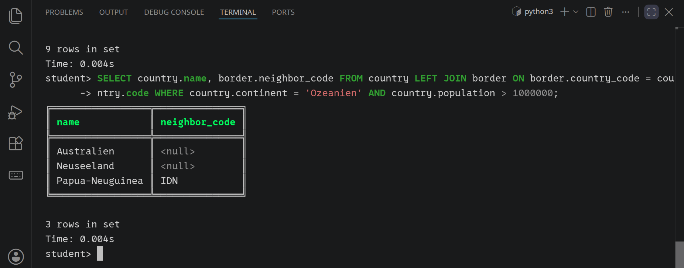

Australien und Neuseeland bleiben im Ergebnis, mit `NULL`; Papua-Neuguinea hat einen Nachbarn, Indonesien auf derselben Insel. Mit `WHERE border.country_code IS NULL` bleiben die Länder ohne Nachbarn übrig.

_task(ohne-nachbarn)

_task(meiste-staedte)

## Viele zu viele: Amtssprachen

Ein Land kann mehrere Amtssprachen haben, Finnland etwa Finnisch und Schwedisch, und eine Sprache kann in vielen Ländern Amtssprache sein. Das passt weder in eine Spalte von `country` noch in eine von `language`. Deshalb gibt es eine Tabelle dazwischen, `country_language`, mit einer Zeile für jedes Paar aus Land und Sprache. Für die Namen braucht es zwei `JOIN`s:

```sql
SELECT country.name, language.name
FROM country
JOIN country_language ON country_language.country_code = country.code
JOIN language ON language.code = country_language.language_code
WHERE country.name = 'Finnland';
```

<!-- tutorial-screenshot
press: Control+L
terminal-run: SELECT country.name, language.name FROM country JOIN country_language ON country_language.country_code = country.code JOIN language ON language.code = country_language.language_code WHERE country.name = 'Finnland';
wait-for-text: 2 rows in set
sleep: 0.5
crop-terminal-lines: auto
crop-terminal-skip-bottom: 1
-->

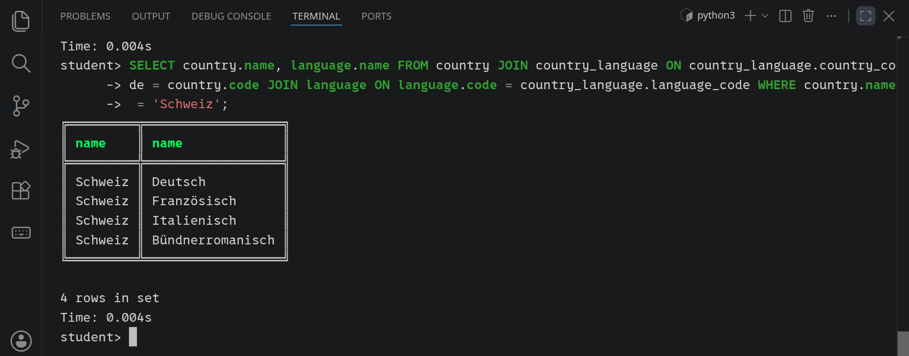

Eine solche Tabelle in der Mitte brauchst du immer, wenn auf beiden Seiten viele stehen: bei Filmen und Genres in der Filmdatenbank genauso.

_task(sprachen-schweiz)

_task(deutsch-amtssprache)

_task(englisch-amtssprache)

## Wie weit ist es? Entfernungen

Jede Stadt hat in `latitude` und `longitude` ihre Lage auf der Erde, Breite und Länge in Grad. Daraus rechnet MySQL die Entfernung zweier Städte aus. `POINT(x, y)` macht aus zwei Zahlen einen Punkt, und auf der Erde kommt die Länge zuerst, wie auf einer Karte x vor y. `ST_Distance_Sphere` gibt die Entfernung zweier Punkte auf einer Kugel, so groß wie die Erde, in Metern: die Luftlinie.

Für zwei Städte braucht die Abfrage die Tabelle `city` zweimal, wie `country` bei den Nachbarn. `CROSS JOIN` setzt jede Zeile der einen mit jeder Zeile der anderen zusammen, und `WHERE` sucht das eine Paar heraus:

```sql
SELECT a.name, b.name,
    ST_Distance_Sphere(POINT(a.longitude, a.latitude), POINT(b.longitude, b.latitude)) / 1000 AS km
FROM city AS a
CROSS JOIN city AS b
WHERE a.name = 'Berlin' AND b.name = 'Paris';
```

Berlin und Paris liegen 876 Kilometer auseinander. Für die Städte in der Nähe von Berlin ist `a` Berlin und `b` jede andere Stadt; `ON b.id <> a.id` lässt das Paar von Berlin mit sich selbst weg. Sortiert nach der Entfernung stehen die nächsten oben:

```sql
SELECT b.name, ROUND(ST_Distance_Sphere(POINT(a.longitude, a.latitude), POINT(b.longitude, b.latitude)) / 1000) AS km
FROM city AS a
JOIN city AS b ON b.id <> a.id
WHERE a.name = 'Berlin'
ORDER BY km
LIMIT 5;
```

<!-- tutorial-screenshot
press: Control+L
terminal-run: SELECT b.name, ROUND(ST_Distance_Sphere(POINT(a.longitude, a.latitude), POINT(b.longitude, b.latitude)) / 1000) AS km FROM city AS a JOIN city AS b ON b.id <> a.id WHERE a.name = 'Berlin' ORDER BY km LIMIT 5;
sleep: 0.5
terminal-scroll-back: 2
crop-terminal-lines: auto
crop-terminal-skip-bottom: 1
-->

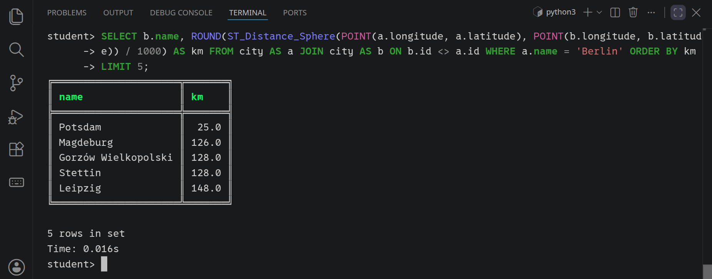

_task(naechste-hamburg)

_task(brandenburg)

_task(weiteste-vermutung)

_task(weiteste-berlin)

### Braucht das eine besondere Datenbank?

Für diese Abfragen rechnet MySQL die Entfernung von Berlin zu jeder der 4.748 Städte einmal aus und sortiert. Das dauert ein paar Millisekunden. Eine Karten-App hat aber Millionen Orte, Haltestellen, Restaurants, Ladesäulen, und Tausende fragen in jeder Sekunde: »Was ist in meiner Nähe?« Jedes Mal alle Orte durchzurechnen, wäre zu langsam.

Dafür bekommt die Lage eine eigene Spalte vom Typ `POINT` und einen `SPATIAL INDEX`. Der teilt die Karte in Rechtecke ein, große, die kleinere enthalten, und die wieder kleinere (ein R-Baum). Für eine Frage nach der Nähe sieht die Datenbank nur in den Rechtecken nach, die nah genug liegen, und lässt den Rest der Welt aus. Dieselbe Idee steckt in Datenstrukturen wie dem k-d-Baum, der den Raum abwechselnd längs und quer teilt. Für unsere paar Tausend Städte lohnt sich das nicht: Gerechnet ist hier schneller als nachgeschlagen.

## Zusammenfassung von Teil 2

<div style='max-width: 100%; overflow-x: auto;'>
<table class='table'>
<thead>
<tr><th>Baustein</th><th>Bedeutung</th></tr>
</thead>
<tbody>
<tr><td><code>GROUP&nbsp;BY</code></td><td>Welche Zeilen bilden zusammen eine Gruppe, für die einmal gerechnet wird?</td></tr>
<tr><td><code>SUM</code>, <code>AVG</code>, <code>MIN</code>, <code>MAX</code></td><td>Was wird für jede Gruppe ausgerechnet?</td></tr>
<tr><td><code>HAVING</code></td><td>Welche Gruppen bleiben übrig?</td></tr>
<tr><td><code>JOIN … ON</code></td><td>Welche Zeilen zweier Tabellen gehören zusammen?</td></tr>
<tr><td><code>AS</code> bei einer Tabelle</td><td>Unter welchem Namen steht eine Tabelle in der Abfrage?</td></tr>
<tr><td><code>LEFT&nbsp;JOIN</code></td><td>Welche Zeilen bleiben, auch wenn es keinen Partner gibt?</td></tr>
<tr><td><code>CROSS&nbsp;JOIN</code></td><td>Jede Zeile mit jeder: alle Paare, zum Beispiel aus zwei Städten</td></tr>
<tr><td><code>ST_Distance_Sphere</code></td><td>Wie weit liegen zwei Punkte auf der Erde auseinander, in Metern?</td></tr>
</tbody>
</table>
</div>

Im Handbuch: _uses(aggregieren, join, entfernung)

<!-- tutorial-step
# Jede SQL-Aufgabe des zweiten Teils nimmt ihre Lösung an und lehnt einen typischen Fehler ab, auf der ganzen Fassung
check-task: linksverkehr <- SELECT name FROM country WHERE continent = 'Europa' AND driving_side = 'left';
check-task-fails: linksverkehr <- SELECT name FROM country WHERE continent = 'Europa' AND driving_side = 'right';
check-task: laender-pro-kontinent <- SELECT continent, COUNT(*) FROM country GROUP BY continent;
check-task-fails: laender-pro-kontinent <- SELECT continent FROM country GROUP BY continent;
check-task: einwohner-pro-kontinent <- SELECT continent, SUM(population) AS people FROM country GROUP BY continent ORDER BY people DESC;
check-task-fails: einwohner-pro-kontinent <- SELECT continent, SUM(population) AS people FROM country GROUP BY continent ORDER BY people;
check-task: grosse-kontinente <- SELECT continent, COUNT(*) FROM country GROUP BY continent HAVING COUNT(*) > 40;
check-task-fails: grosse-kontinente <- SELECT continent, COUNT(*) FROM country GROUP BY continent;
check-task: waehrung-japan <- Yen
check-task-fails: waehrung-japan <- JPY
check-task: nachbarn-deutschland <- SELECT neighbor.name FROM border JOIN country AS neighbor ON neighbor.code = border.neighbor_code WHERE border.country_code = 'DEU';
check-task-fails: nachbarn-deutschland <- SELECT neighbor_code FROM border WHERE country_code = 'DEU';
check-task: viele-nachbarn <- SELECT country.name FROM border JOIN country ON country.code = border.country_code GROUP BY country.code, country.name HAVING COUNT(*) > 8;
check-task-fails: viele-nachbarn <- SELECT country.name FROM border JOIN country ON country.code = border.country_code GROUP BY country.code, country.name HAVING COUNT(*) > 9;
check-task: ohne-nachbarn <- SELECT country.name FROM country LEFT JOIN border ON border.country_code = country.code WHERE border.country_code IS NULL;
check-task-fails: ohne-nachbarn <- SELECT country.name FROM country JOIN border ON border.country_code = country.code WHERE border.country_code IS NULL;
check-task: meiste-staedte <- SELECT country.name, COUNT(*) AS cities FROM country JOIN city ON city.country_code = country.code GROUP BY country.code, country.name ORDER BY cities DESC LIMIT 1;
check-task-fails: meiste-staedte <- SELECT country.name, COUNT(*) AS cities FROM country JOIN city ON city.country_code = country.code GROUP BY country.code, country.name ORDER BY cities LIMIT 1;
check-task: sprachen-schweiz <- SELECT language.name FROM country_language JOIN language ON language.code = country_language.language_code WHERE country_language.country_code = 'CHE';
check-task-fails: sprachen-schweiz <- SELECT language_code FROM country_language WHERE country_code = 'CHE';
check-task: deutsch-amtssprache <- SELECT country.name FROM country JOIN country_language ON country_language.country_code = country.code JOIN language ON language.code = country_language.language_code WHERE language.name = 'Deutsch';
check-task-fails: deutsch-amtssprache <- SELECT country.name FROM country WHERE continent = 'Europa' AND name LIKE '%reich%';
check-task: englisch-amtssprache <- 59
check-task-fails: englisch-amtssprache <- 372
check-task: naechste-hamburg <- SELECT b.name, ROUND(ST_Distance_Sphere(POINT(a.longitude, a.latitude), POINT(b.longitude, b.latitude)) / 1000) AS km FROM city AS a JOIN city AS b ON b.id <> a.id WHERE a.name = 'Hamburg' ORDER BY km LIMIT 5;
check-task-fails: naechste-hamburg <- SELECT b.name FROM city AS a JOIN city AS b WHERE a.name = 'Hamburg' ORDER BY ST_Distance_Sphere(POINT(a.longitude, a.latitude), POINT(b.longitude, b.latitude)) LIMIT 5;
check-task: weiteste-berlin <- SELECT b.name FROM city AS a CROSS JOIN city AS b WHERE a.name = 'Berlin' ORDER BY ST_Distance_Sphere(POINT(a.longitude, a.latitude), POINT(b.longitude, b.latitude)) DESC LIMIT 1;
check-task-fails: weiteste-berlin <- SELECT b.name FROM city AS a CROSS JOIN city AS b WHERE a.name = 'Berlin' ORDER BY ST_Distance_Sphere(POINT(a.longitude, a.latitude), POINT(b.longitude, b.latitude)) LIMIT 1;
-->
