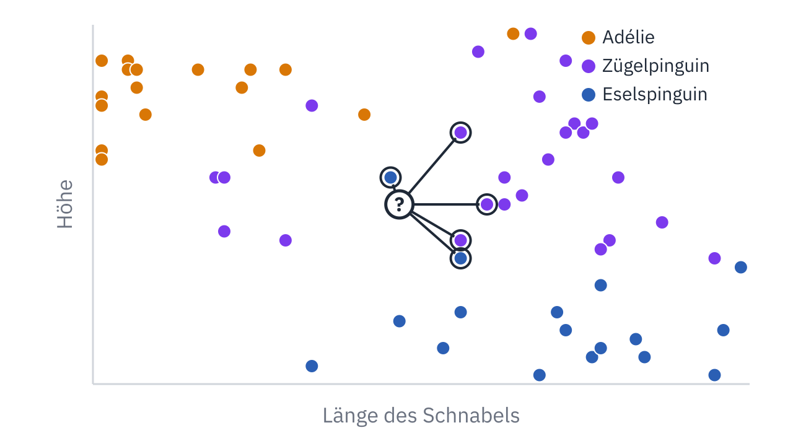
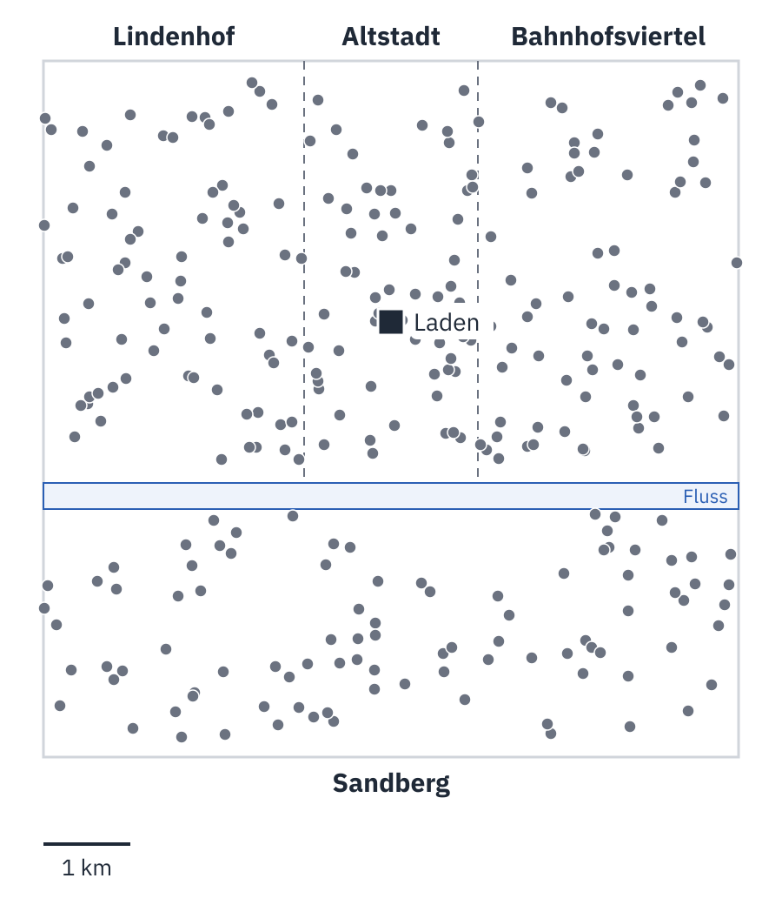
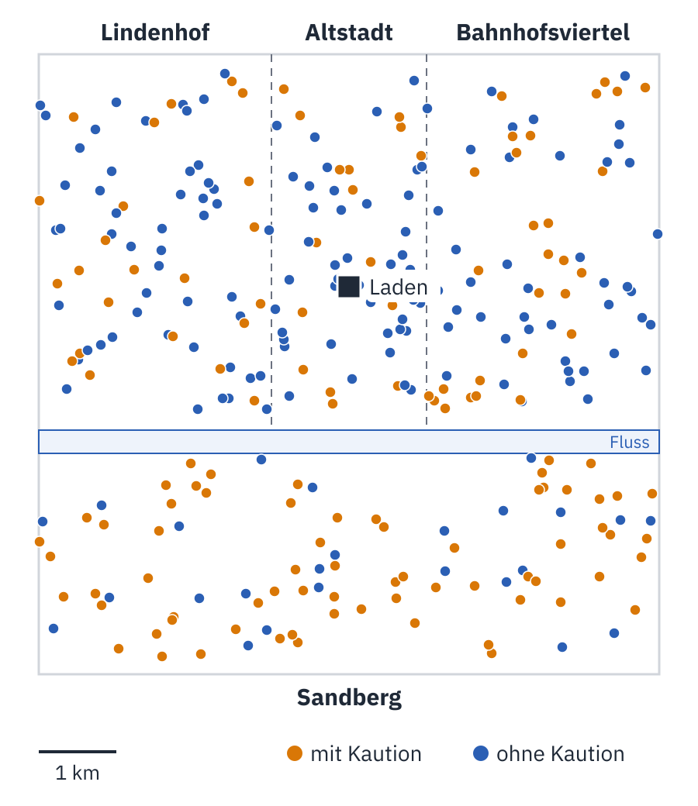

<div class='meta'>
image: karte.webp
image_alt: "Der Süden einer ausgedachten Stadt mit einem Fluss, darunter der Stadtteil Sandberg. Punkte für Kundinnen und Kunden, orange mit Kaution, blau ohne; am Sandberg sind die meisten orange. In der Mitte ein neuer Kunde mit einem Fragezeichen, von dem Linien zu seinen fünf nächsten Nachbarn gehen, drei davon orange."
kind: projekt
duration: 2 Doppelstunden
languages: [ruby, python]
curriculum: "Sek I: Algorithmisches Problemlösen (Implementieren von Algorithmen), Leben in und mit vernetzten Systemen (Datenschutz, rechtliche Grundlagen); Oberstufe: Vertiefung Künstliche Intelligenz (Klassifizieren nach den nächsten Nachbarn), Vertiefung Informatik und Gesellschaft (was ein Programm aus alten Entscheidungen übernimmt, wer verantwortlich bleibt)"
requires: [kata-lists]
</div>

<div
    class="autotoc-secondary-trigger"
    data-title="Auf dieser Seite"
    data-levels="h2,h3">
</div>

# Nächste Nachbarn: Wer entscheidet hier?

<p class='abstract'>
Ein Programm kann entscheiden, ohne eine Regel zu kennen: Es sieht nach, wie bei den Beispielen entschieden wurde, die dem neuen Fall am ähnlichsten sind. Du schreibst so ein Programm, erst für Pinguine, dann für einen Fahrradverleih, der wissen will, wer eine Kaution zahlen soll. Dabei siehst du, was das Programm aus alten Entscheidungen übernimmt, auch das, was daran falsch war.
</p>

## Wer ist wie die anderen?

Auf den Inseln vor der Antarktischen Halbinsel leben drei Arten von Pinguinen:
der Adéliepinguin, der Zügelpinguin (englisch Chinstrap) und der Eselspinguin
(Gentoo). Die Biologin Kristen Gorman hat an 342 von ihnen die Länge und die
Höhe des Schnabels gemessen, in Millimetern.

<div class='gallery single'>
<figure><figcaption>Zügel-, Esels- und Adéliepinguin. Zeichnung: Allison Horst, CC0 (<a href='https://allisonhorst.github.io/palmerpenguins/'>palmerpenguins</a>)</figcaption></figure>
</div>

Jemand misst einen weiteren Pinguin, aber schreibt die Art nicht dazu. Welcher
Art er ist, lässt sich raten, ohne eine Regel zu kennen: Man sucht unter den
342 bekannten Pinguinen die, deren Schnabel seinem am ähnlichsten ist, und
nimmt die Art, die unter ihnen am häufigsten ist. Das sind seine **nächsten
Nachbarn**, und das Verfahren heißt danach: **k nächste Nachbarn**, wobei k
sagt, wie viele Nachbarn gefragt werden.

<div class='gallery single'>
<figure><figcaption>Ein unbekannter Pinguin und seine fünf nächsten Nachbarn: Der nächste ist ein Eselspinguin, aber drei der fünf sind Zügelpinguine</figcaption></figure>
</div>

Mit k = 1 wäre der unbekannte Pinguin ein Eselspinguin, mit k = 5 ein
Zügelpinguin. Ein einzelner Nachbar kann ein Ausreißer sein; mehrere
Nachbarn stimmen ab.

Beschrieben haben das Verfahren die Statistikerin Evelyn Fix und der
Statistiker Joseph Hodges 1951, in einem Bericht für die Luftwaffe der USA. Es
ist bis heute eines der einfachsten Verfahren, mit denen ein Programm aus
Beispielen lernt, und eines der durchsichtigsten: Zu jeder Entscheidung kann
es sagen, welche Beispiele dahinterstehen.

<div class='book'>
<i class='bi bi-file-earmark-text'></i>
<p><strong>Discriminatory Analysis. Nonparametric Discrimination: Consistency Properties</strong>, Evelyn Fix und Joseph L. Hodges, USAF School of Aviation Medicine, 1951. Der Bericht, in dem ein neuer Fall die Antwort seiner nächsten Nachbarn bekommt: als <a href='https://apps.dtic.mil/sti/pdfs/ADA800276.pdf'>PDF beim Defense Technical Information Center</a>, 1989 neu gedruckt in der <a href='https://doi.org/10.2307/1403796'>International Statistical Review</a>.</p>
</div>

## Einrichten

<!-- language: ruby -->
Lege einen Ordner an und lade die Daten herunter:

```bash
mkdir -p ~/nachbarn
cd ~/nachbarn
wget ${web_root}/naechste-nachbarn/penguins.csv ${web_root}/naechste-nachbarn/customers.csv
touch knn.rb penguins.rb
```

In `knn.rb` kommen die Funktionen, in `penguins.rb` das Programm, das sie für
die Pinguine benutzt. Ausprobieren kannst du die Funktionen in `irb`, das
`knn.rb` vorher lädt:

```bash
irb -r ./knn.rb
```
<!-- /language -->
<!-- language: python -->
Lege einen Ordner an und lade die Daten herunter:

```bash
mkdir -p ~/nachbarn
cd ~/nachbarn
wget ${web_root}/naechste-nachbarn/penguins.csv ${web_root}/naechste-nachbarn/customers.csv
touch knn.py penguins.py
```

In `knn.py` kommen die Funktionen, in `penguins.py` das Programm, das sie für
die Pinguine benutzt. Ausprobieren kannst du die Funktionen in Python, das
`knn.py` vorher ausführt:

```bash
python3 -i knn.py
```
<!-- /language -->

`penguins.csv` hat eine Zeile je Pinguin: die Art, die Insel, die Länge und die
Höhe des Schnabels, die Länge der Flosse und das Gewicht.

```text
species,island,bill_length_mm,bill_depth_mm,flipper_length_mm,body_mass_g
Adelie,Torgersen,39.1,18.7,181,3750
```

## Wie weit zwei Pinguine auseinanderliegen

Trägst du die zwei Maße eines Schnabels als Punkt in ein Diagramm ein, die Länge
nach rechts und die Höhe nach oben, dann ist »ähnlich« dasselbe wie »nah«. Wie
weit zwei Punkte auseinanderliegen, rechnest du mit dem Satz des Pythagoras aus:
Die Unterschiede in jeder Richtung sind die Katheten, der Abstand ist die
Hypotenuse.

$$d = \sqrt{(a\_1 - b\_1)^2 + (a\_2 - b\_2)^2}$$

Bei mehr als zwei Merkmalen kommt für jedes ein Quadrat unter die Wurzel dazu.
Die Formel bleibt dieselbe, nur zeichnen kann man den Raum dann nicht mehr.

_task(abstand-von-hand)

<div class='hint own' data-check='abstand'>
<strong>Jetzt bist du dran:</strong> Schreib in <code>knn</code> die Funktion <code>distance(a, b)</code>:
<code>a</code> und <code>b</code> sind zwei gleich lange Listen von Zahlen, und
die Funktion gibt zurück, wie weit die beiden Punkte auseinanderliegen. Später
haben die Punkte vier Merkmale; schreib sie so, dass sie mit jeder Anzahl geht.
</div>

<!-- language: ruby -->
<!-- hint -->
Geh die Listen mit einem Index durch: `a.each_index do |i| … end`. Für jeden
Index kommt das Quadrat des Unterschieds zu einer Summe dazu.
<!-- /hint -->

<!-- hint -->
Das Quadrat ist `** 2`, die Wurzel `Math.sqrt(sum)`. Beginn die Summe mit
`0.0`, dann bleibt alles eine Kommazahl.
<!-- /hint -->

<!-- solution -->
```ruby
# Wie weit zwei Punkte auseinanderliegen, mit beliebig vielen Merkmalen
def distance(a, b)
  sum = 0.0
  a.each_index do |i|
    sum += (a[i] - b[i])**2
  end
  Math.sqrt(sum)
end
```
<!-- /solution -->
<!-- /language -->
<!-- language: python -->
<!-- hint -->
Geh die Listen mit einem Index durch: `for i in range(len(a)):`. Für jeden
Index kommt das Quadrat des Unterschieds zu einer Summe dazu.
<!-- /hint -->

<!-- hint -->
Das Quadrat ist `** 2`, die Wurzel `math.sqrt(total)`; dafür steht oben in der
Datei `import math`.
<!-- /hint -->

<!-- solution -->
```python
import math


# Wie weit zwei Punkte auseinanderliegen, mit beliebig vielen Merkmalen
def distance(a, b):
    total = 0.0
    for i in range(len(a)):
        total += (a[i] - b[i]) ** 2
    return math.sqrt(total)
```
<!-- /solution -->
<!-- /language -->

_task(abstand)

## Die nächsten Nachbarn

Ein Beispiel ist ein Paar: die Merkmale und die Antwort, die dazugehört. Bei
einem Pinguin sind das die zwei Maße des Schnabels und seine Art:
`[[39.1, 18.7], "Adelie"]`. Die nächsten Nachbarn eines Punktes findest du,
indem du alle Beispiele nach ihrem Abstand zu ihm sortierst und die ersten
nimmst.

<div class='hint own' data-check='nachbarn'>
<strong>Jetzt bist du dran:</strong> Schreib die Funktion <code>nearest(examples, features, k)</code>:
Sie gibt die <code>k</code> Beispiele zurück, deren Merkmale am nächsten an
<code>features</code> liegen, das nächste zuerst.
</div>

<!-- language: ruby -->
<!-- hint -->
`sort_by` sortiert eine Liste nach dem Wert, den der Block für jedes Element
ausrechnet. Ein Beispiel kannst du im Block gleich in seine zwei Teile
zerlegen: `|other, label|`.
<!-- /hint -->

<!-- hint -->
Die ersten `k` Elemente einer Liste gibt `first(k)`.
<!-- /hint -->

<!-- solution -->
```ruby
# Die k Beispiele, deren Merkmale features am nächsten liegen, das nächste zuerst
def nearest(examples, features, k)
  examples.sort_by { |other, _label| distance(other, features) }.first(k)
end
```
<!-- /solution -->
<!-- /language -->
<!-- language: python -->
<!-- hint -->
`sorted(examples, key=…)` sortiert eine Liste nach dem Wert, den die Funktion
bei `key` für jedes Element ausrechnet. Eine kurze Funktion schreibst du gleich
dorthin: `lambda example: …`. Die Merkmale eines Beispiels sind `example[0]`.
<!-- /hint -->

<!-- hint -->
Die ersten `k` Elemente einer Liste gibt `[:k]`.
<!-- /hint -->

<!-- solution -->
```python
# Die k Beispiele, deren Merkmale features am nächsten liegen, das nächste zuerst
def nearest(examples, features, k):
    return sorted(examples, key=lambda example: distance(example[0], features))[:k]
```
<!-- /solution -->
<!-- /language -->

_task(nachbarn)

## Die Nachbarn stimmen ab

Jetzt fehlt die Abstimmung: Welche Antwort kommt unter den `k` nächsten
Nachbarn am häufigsten vor? Kommen zwei gleich oft vor, gewinnt die, die unter
den Nachbarn zuerst kommt, also zum näheren gehört.

<div class='hint own' data-check='abstimmen'>
<strong>Jetzt bist du dran:</strong> Schreib die Funktion <code>classify(examples, features, k)</code>:
Sie gibt die Antwort zurück, die unter den <code>k</code> nächsten Nachbarn
von <code>features</code> am häufigsten ist; bei Gleichstand die des näheren
Nachbarn.
</div>

<!-- language: ruby -->
<!-- hint -->
Mach aus den Nachbarn erst eine Liste ihrer Antworten, mit `map`, in derselben
Reihenfolge, das nächste zuerst.
<!-- /hint -->

<!-- hint -->
`labels.count(label)` zählt, wie oft eine Antwort in der Liste steht.
`max_by` gibt das Element, für das der Block am größten ist, und bei
Gleichstand das, das in der Liste zuerst kommt.
<!-- /hint -->

<!-- solution -->
```ruby
# Was die meisten der k nächsten Nachbarn sind; bei Gleichstand das, was zuerst kommt
def classify(examples, features, k)
  labels = nearest(examples, features, k).map { |_features, label| label }
  labels.max_by { |label| labels.count(label) }
end
```
<!-- /solution -->
<!-- /language -->
<!-- language: python -->
<!-- hint -->
Mach aus den Nachbarn erst eine Liste ihrer Antworten, in derselben
Reihenfolge, das nächste zuerst: `[label for _features, label in …]`.
<!-- /hint -->

<!-- hint -->
`labels.count(label)` zählt, wie oft eine Antwort in der Liste steht.
`max(labels, key=labels.count)` gibt die Antwort, die am häufigsten ist, und
bei Gleichstand die, die in der Liste zuerst kommt.
<!-- /hint -->

<!-- solution -->
```python
# Was die meisten der k nächsten Nachbarn sind; bei Gleichstand das, was zuerst kommt
def classify(examples, features, k):
    labels = [label for _features, label in nearest(examples, features, k)]
    return max(labels, key=labels.count)
```
<!-- /solution -->
<!-- /language -->

_task(abstimmen)

Damit das Programm die Pinguine kennt, liest diese Funktion die Datei. Sie gibt
für jeden Pinguin ein Beispiel zurück: die zwei Maße des Schnabels und die Art.
Schreib sie unter die anderen in dieselbe Datei:

<!-- language: ruby -->
```ruby
# Die Pinguine als [[Länge, Höhe], Art]
def penguins(path)
  File.readlines(path).drop(1).map do |line|
    species, _island, length, depth = line.split(",")
    [[length.to_f, depth.to_f], species]
  end
end
```

Und in `penguins.rb` das Programm:

```ruby
require_relative "knn"

examples = penguins("penguins.csv")
puts classify(examples, [46.0, 18.0], 5)
```

```bash
ruby penguins.rb
```
<!-- /language -->
<!-- language: python -->
```python
# Die Pinguine als [[Länge, Höhe], Art]
def penguins(path):
    examples = []
    for line in open(path).readlines()[1:]:
        species, _island, length, depth = line.split(",")[:4]
        examples.append([[float(length), float(depth)], species])
    return examples
```

Und in `penguins.py` das Programm:

```python
from knn import *

examples = penguins("penguins.csv")
print(classify(examples, [46.0, 18.0], 5))
```

```bash
python3 penguins.py
```
<!-- /language -->

_task(unbekannt)

## Wie oft liegt es richtig?

Gelernt hat das Programm eigentlich nichts. Es hebt alle Beispiele auf und sieht
bei jeder Frage nach. Ob das reicht, zeigt sich an Pinguinen, deren Art es
nicht kennt: Es bekommt nur jeden zweiten Pinguin als Beispiel und muss die
anderen einordnen, deren Art man kennt und vergleichen kann.

<div class='hint own' data-check='genauigkeit'>
<strong>Jetzt bist du dran:</strong> Schreib die Funktion <code>accuracy(training, test, k)</code>:
Sie ordnet jedes Beispiel aus <code>test</code> mit <code>classify</code> nach
den Beispielen in <code>training</code> ein und gibt den Anteil zurück, bei dem
die Antwort stimmt, als Zahl von 0 bis 1.
</div>

<!-- language: ruby -->
<!-- hint -->
Zähl die Testbeispiele, bei denen `classify` die Antwort des Beispiels gibt:
`test.count { |features, label| … }`.
<!-- /hint -->

<!-- hint -->
Teile durch die Zahl aller Testbeispiele, mit `to_f` vorher, denn in Ruby
ergibt `3 / 4` die ganze Zahl 0.
<!-- /hint -->

<!-- solution -->
```ruby
# Der Anteil der Testbeispiele, die classify richtig einordnet
def accuracy(training, test, k)
  right = test.count { |features, label| classify(training, features, k) == label }
  right.to_f / test.size
end
```
<!-- /solution -->
<!-- /language -->
<!-- language: python -->
<!-- hint -->
Zähl die Testbeispiele, bei denen `classify` die Antwort des Beispiels gibt, in
einer Schleife über `for features, label in test:`.
<!-- /hint -->

<!-- hint -->
Teile die Zahl durch `len(test)`.
<!-- /hint -->

<!-- solution -->
```python
# Der Anteil der Testbeispiele, die classify richtig einordnet
def accuracy(training, test, k):
    right = sum(1 for features, label in test if classify(training, features, k) == label)
    return right / len(test)
```
<!-- /solution -->
<!-- /language -->

_task(genauigkeit)

<!-- language: ruby -->
In `penguins.rb`, statt den einen Pinguin einzuordnen:

```ruby
~ examples = penguins("penguins.csv")
training = examples.select.with_index { |_, i| i.even? }
test = examples.select.with_index { |_, i| i.odd? }
puts "Richtig: #{(accuracy(training, test, 3) * 100).round(1)} %"
```
<!-- /language -->
<!-- language: python -->
In `penguins.py`, statt den einen Pinguin einzuordnen:

```python
~ examples = penguins("penguins.csv")
training = examples[0::2]
test = examples[1::2]
print(f"Richtig: {round(accuracy(training, test, 3) * 100, 1)} %")
```
<!-- /language -->

_task(pinguine)

<div class='hint try'>
<strong>Ausprobieren:</strong> Ändere k auf 1, 5, 15 und 51. Achte darauf, ab
welchem k das Programm deutlich schlechter wird.
</div>

_task(alle-nachbarn)

<!-- after: alle-nachbarn -->
Mit k = 171 fragt das Programm jedes Mal alle Pinguine, die es kennt, und die
häufigste Art unter ihnen ist immer dieselbe: der Adéliepinguin. Dann sagt es
zu jedem Pinguin »Adelie« und liegt bei 43,9 Prozent richtig, so oft, wie unter
den Testpinguinen Adéliepinguine sind. Ein kleines k hört auf einzelne
Nachbarn, auch auf Ausreißer; ein großes k sieht nicht mehr hin, wo der Punkt
liegt. Dazwischen liegt das k, mit dem das Programm am besten ist, und das muss
man ausprobieren.
<!-- /after -->

## Ein Fahrradverleih entscheidet

Ab hier ist alles ausgedacht. In einer Stadt, durch die ein Fluss fließt,
verleiht ein Laden Fahrräder. Wer ein Rad leiht, zahlt manchmal 50 Euro
Kaution, die er zurückbekommt, wenn das Rad pünktlich und heil wiederkommt. Ob
jemand eine Kaution zahlen muss, haben bisher die Leute im Laden entschieden,
und sie haben zu jeder Kundin und jedem Kunden aufgeschrieben:

<div class='scroll-x'>
<table class='table'>
<tr><th>Spalte</th><th>Was darin steht</th></tr>
<tr><td><code>district</code></td><td>der Stadtteil, in dem die Person wohnt</td></tr>
<tr><td><code>x</code>, <code>y</code></td><td>wo sie wohnt, in Kilometern östlich und nördlich der Südwestecke der Stadt</td></tr>
<tr><td><code>distance</code></td><td>wie weit sie vom Laden entfernt wohnt, in Kilometern</td></tr>
<tr><td><code>years</code></td><td>seit wie vielen Jahren sie Kundin oder Kunde ist</td></tr>
<tr><td><code>late</code></td><td>wie oft sie im letzten Jahr ein Rad zu spät zurückgebracht hat</td></tr>
<tr><td><code>deposit</code></td><td>die Entscheidung des Ladens: 1 heißt Kaution, 0 keine</td></tr>
<tr><td><code>on_time</code></td><td>ob sie das nächste Rad pünktlich zurückgebracht hat: 1 heißt ja</td></tr>
</table>
</div>

<div class='gallery single'>
<figure><figcaption>Die Stadt und die 300 Kundinnen und Kunden, über die der Laden bisher entschieden hat</figcaption></figure>
</div>

Jetzt soll ein Programm entscheiden, damit es schneller geht und, wie der Laden
sagt, gerechter. Es lernt aus den 300 Entscheidungen der letzten Jahre und
entscheidet über die nächsten 300 Kundinnen und Kunden. Die Funktionen hast du
schon; dazu kommen zwei, die die Datei lesen. Schreib sie unter die anderen in
deine Datei mit den Funktionen:

<!-- language: ruby -->
```ruby
# Jede Kundin und jeder Kunde als Hash: Spalte => Wert, Zahlen als Zahlen
def customers(path)
  lines = File.readlines(path, chomp: true)
  keys = lines[0].split(",")
  lines.drop(1).map do |line|
    keys.zip(line.split(",")).to_h { |key, value| [key, key == "district" ? value : value.to_f] }
  end
end

# Beispiele aus Kunden: die Spalten in columns als Merkmale, die Kaution als Antwort
def examples(people, columns)
  people.map { |person| [columns.map { |column| person[column] }, person["deposit"].to_i] }
end
```

Und das Programm in einer neuen Datei `deposit.rb`:

```ruby
require_relative "knn"

people = customers("customers.csv")
past = people.select.with_index { |_, i| i.even? }
latest = people.select.with_index { |_, i| i.odd? }
columns = ["years", "late", "x", "y"]
training = examples(past, columns)
test = examples(latest, columns)
puts "Gleich entschieden wie der Laden: #{(accuracy(training, test, 5) * 100).round(1)} %"
```

```bash
ruby deposit.rb
```
<!-- /language -->
<!-- language: python -->
```python
# Jede Kundin und jeder Kunde als Dictionary: Spalte -> Wert, Zahlen als Zahlen
def customers(path):
    lines = open(path).read().splitlines()
    keys = lines[0].split(",")
    people = []
    for line in lines[1:]:
        person = {}
        for key, value in zip(keys, line.split(",")):
            person[key] = value if key == "district" else float(value)
        people.append(person)
    return people


# Beispiele aus Kunden: die Spalten in columns als Merkmale, die Kaution als Antwort
def examples(people, columns):
    return [[[person[column] for column in columns], int(person["deposit"])] for person in people]
```

Und das Programm in einer neuen Datei `deposit.py`:

```python
from knn import *

people = customers("customers.csv")
past = people[0::2]
latest = people[1::2]
columns = ["years", "late", "x", "y"]
training = examples(past, columns)
test = examples(latest, columns)
print(f"Gleich entschieden wie der Laden: {round(accuracy(training, test, 5) * 100, 1)} %")
```

```bash
python3 deposit.py
```
<!-- /language -->

Für die neuen Kundinnen und Kunden weiß man, wie der Laden entschieden hätte;
`accuracy` vergleicht damit, was das Programm sagt. Die Merkmale sind die Jahre,
die Verspätungen und der Wohnort, so wie die Leute im Laden ihre Kundschaft
kannten.

_task(uebereinstimmung)

## Wen trifft es?

Eine Kaution von jemandem zu verlangen, der jedes Rad pünktlich zurückbringt,
ist ein Fehler zu seinen Lasten: Er muss 50 Euro haben, die er für nichts
hinterlegt. Ob ein Programm gerecht entscheidet, zeigt sich daran, wen solche
Fehler treffen.

_task(stadtteile)

<div class='hint own' data-check='kaution-anteil'>
<strong>Jetzt bist du dran:</strong> Schreib die Funktion <code>deposit_share(training, test, k)</code>:
Sie gibt den Anteil der Beispiele in <code>test</code> zurück, für die
<code>classify</code> nach <code>training</code> eine Kaution verlangt, also 1
sagt, als Zahl von 0 bis 1. Die Antworten in <code>test</code> zählen dabei
nicht.
</div>

<!-- language: ruby -->
<!-- hint -->
Sie sieht aus wie `accuracy`. Nur zählt sie nicht, wo `classify` die Antwort des
Beispiels gibt, sondern wo es 1 gibt.
<!-- /hint -->

<!-- hint -->
```ruby
def deposit_share(training, test, k)
  deposits = test.count { |features, _label| … }
  # hier: durch die Zahl der Testbeispiele teilen, als Kommazahl
end
```
<!-- /hint -->

<!-- solution -->
```ruby
# Der Anteil der Testbeispiele, für die classify eine Kaution verlangt (1)
def deposit_share(training, test, k)
  deposits = test.count { |features, _label| classify(training, features, k) == 1 }
  deposits.to_f / test.size
end
```
<!-- /solution -->
<!-- /language -->
<!-- language: python -->
<!-- hint -->
Sie sieht aus wie `accuracy`. Nur zählt sie nicht, wo `classify` die Antwort des
Beispiels gibt, sondern wo es 1 gibt.
<!-- /hint -->

<!-- hint -->
```python
def deposit_share(training, test, k):
    deposits = sum(1 for features, _label in test if ...)
    # hier: durch die Zahl der Testbeispiele teilen
```
<!-- /hint -->

<!-- solution -->
```python
# Der Anteil der Testbeispiele, für die classify eine Kaution verlangt (1)
def deposit_share(training, test, k):
    deposits = sum(1 for features, _label in test if classify(training, features, k) == 1)
    return deposits / len(test)
```
<!-- /solution -->
<!-- /language -->

_task(kaution-anteil)

<!-- language: ruby -->
Am Ende von `deposit.rb`: für jeden Stadtteil die neuen Kundinnen und Kunden,
die ihr Rad pünktlich zurückgebracht haben, und wie viele davon nach dem
Programm eine Kaution zahlen sollen:

```ruby
["Altstadt", "Lindenhof", "Bahnhofsviertel", "Sandberg"].each do |district|
  punctual = latest.select { |person| person["district"] == district && person["on_time"] == 1 }
  share = deposit_share(training, examples(punctual, columns), 5)
  puts "#{district}: #{(share * 100).round(1)} % der Pünktlichen sollen Kaution zahlen"
end
```
<!-- /language -->
<!-- language: python -->
Am Ende von `deposit.py`: für jeden Stadtteil die neuen Kundinnen und Kunden,
die ihr Rad pünktlich zurückgebracht haben, und wie viele davon nach dem
Programm eine Kaution zahlen sollen:

```python
for district in ["Altstadt", "Lindenhof", "Bahnhofsviertel", "Sandberg"]:
    punctual = [person for person in latest if person["district"] == district and person["on_time"] == 1]
    share = deposit_share(training, examples(punctual, columns), 5)
    print(f"{district}: {round(share * 100, 1)} % der Pünktlichen sollen Kaution zahlen")
```
<!-- /language -->

_task(sandberg)

<!-- after: sandberg -->
<div class='scroll-x'>
<table class='table'>
<tr><th>Stadtteil</th><th>Pünktliche</th><th>Kaution nach dem Laden</th><th>Kaution nach dem Programm</th></tr>
<tr><td>Altstadt</td><td>43</td><td>18,6 %</td><td>14,0 %</td></tr>
<tr><td>Lindenhof</td><td>63</td><td>28,6 %</td><td>15,9 %</td></tr>
<tr><td>Bahnhofsviertel</td><td>69</td><td>24,6 %</td><td>18,8 %</td></tr>
<tr><td>Sandberg</td><td>85</td><td>70,6 %</td><td>84,7 %</td></tr>
</table>
</div>

Wer am Sandberg wohnt und sein Rad pünktlich zurückbringt, soll in mehr als
acht von zehn Fällen eine Kaution zahlen; in den anderen Stadtteilen in ein bis
zwei von zehn. Das Programm kennt keine Stadtteile, nur Zahlen. Aber zwei der
Zahlen sind der Wohnort, und die nächsten Nachbarn eines Menschen am Sandberg
wohnen am Sandberg, im wörtlichen Sinn. Der Laden hat dort öfter eine Kaution
verlangt, also verlangt sie das Programm dort auch.

<div class='gallery single'>
<figure><figcaption>Wie der Laden bisher entschieden hat</figcaption></figure>
</div>

Warum der Laden so entschieden hat, steht in keiner Spalte. Die Daten sind
ausgedacht, und das Programm, das sie erzeugt hat, sagt es: Wer am Sandberg
wohnt, ist genauso zuverlässig wie alle anderen, aber der Laden hat dort von
sechs in zehn Leuten, die er sonst ohne Kaution gelassen hätte, trotzdem eine
verlangt. Und das Programm ist sogar strenger als der Laden: Haben drei von fünf
Nachbarn eine Kaution gezahlt, verlangt es sie immer. Aus »meistens« wird bei
einer Abstimmung »immer«.
<!-- /after -->

_task(ohne-wohnort)

<!-- after: ohne-wohnort -->
Ohne `x` und `y` sollen von den Pünktlichen am Sandberg 28,2 Prozent Kaution
zahlen, in der Altstadt 18,6, in Lindenhof 27,0 und im Bahnhofsviertel 27,5.
Die Stadtteile werden fast gleich behandelt. Aber nicht, weil das Programm jetzt
gerechte Beispiele hätte: Es lernt immer noch aus den alten Entscheidungen, nur
kann es den Wohnort nicht mehr sehen. Die Kautionen, die der Laden am Sandberg
zu Unrecht verlangt hat, verteilen sich jetzt auf alle: In Lindenhof und im
Bahnhofsviertel trifft es mehr Pünktliche als vorher.
<!-- /after -->

Den Wohnort wegzulassen, scheint zu reichen. Aber in der Datei steht noch eine
Spalte, die mit dem Wohnort zu tun hat: wie weit jemand vom Laden entfernt
wohnt. Der Laden liegt in der Altstadt, nördlich des Flusses.

_task(entfernung)

<!-- after: entfernung -->
Mit der Entfernung statt des Wohnorts sollen 56,5 Prozent der Pünktlichen am
Sandberg eine Kaution zahlen. Die Entfernung verrät ungefähr den Stadtteil:
Wer weit weg wohnt, wohnt oft am Sandberg. Ein Merkmal, das für ein anderes
steht, heißt **Stellvertreter** (englisch proxy). Ein Programm kann so eine
Gruppe benachteiligen, ohne dass in seinen Daten steht, wer zu ihr gehört.
<!-- /after -->

## Was der Laden tun könnte

Das Programm macht genau das, was es soll: entscheiden wie der Laden. Der Fehler
steckt in den Beispielen, aus denen es lernt. Daraus folgt einiges, was der
Laden tun könnte:

- **Aus etwas anderem lernen.** In `on_time` steht, ob jemand das nächste Rad
  wirklich pünktlich zurückgebracht hat. Lernt das Programm daraus statt aus
  den alten Entscheidungen, lernt es, was tatsächlich passiert ist, nicht, was
  jemand im Laden vermutet hat.
- **Nachmessen, bevor es entscheidet.** Wie oft es Pünktliche trifft, je
  Stadtteil, hast du eben ausgerechnet. Das lässt sich vor dem ersten Einsatz
  prüfen und danach immer wieder.
- **Merkmale prüfen,** auch die, die harmlos aussehen, wie die Entfernung.
- **Fragen, ob ein Programm hier überhaupt entscheiden soll.** Eine Kaution von
  50 Euro ist für manche Menschen viel Geld. Wer sie verlangt, sollte sagen
  können, warum.

<div class='hint think'>
Das Programm verlangt von einem Kunden am Sandberg eine Kaution, und er fragt,
warum. Was kann der Laden ihm sagen? Wer ist verantwortlich: der Laden, die
Person, die das Programm geschrieben hat, oder das Programm?
</div>

Die Datenschutz-Grundverordnung hat dazu eine Regel: Nach
[Artikel 22](https://dsgvo-gesetz.de/art-22-dsgvo/) hat jeder Mensch das Recht,
keiner Entscheidung unterworfen zu werden, die nur ein Programm getroffen hat
und die ihn erheblich beeinträchtigt. Es gibt Ausnahmen, etwa wenn die
Entscheidung für einen Vertrag nötig ist; dann muss ein Mensch sie auf Wunsch
überprüfen, und die betroffene Person darf ihren Standpunkt darlegen und die
Entscheidung anfechten. Ein Mensch bleibt verantwortlich, auch wenn ein Programm
entscheidet.

## Wenn es wirklich passiert

Was dein Programm mit ausgedachten Kunden macht, passiert mit echten Menschen.
Die Informatikerin Joy Buolamwini hat es an Programmen gezeigt, die Gesichter
erkennen.

_person(buolamwini)

2018 prüften sie und die Informatikerin Timnit Gebru drei Programme großer
Firmen, die auf einem Foto erkennen sollten, ob es eine Frau oder einen Mann
zeigt. Bei Männern mit heller Haut lagen sie fast nie falsch, höchstens in
0,8 Prozent der Fälle. Bei Frauen mit dunkler Haut lag eines in 34,7 Prozent der
Fälle falsch. Die Sammlungen von Fotos, an denen man solche Programme bis dahin
gemessen hatte, zeigten vor allem Menschen mit heller Haut; dass die Programme
bei anderen schlechter sind, fiel so nicht auf. Nach der Studie haben IBM und Microsoft
ihre Programme überarbeitet.

<div class='book'>
<i class='bi bi-file-earmark-text'></i>
<p><strong>Gender Shades: Intersectional Accuracy Disparities in Commercial Gender Classification</strong>, Joy Buolamwini und Timnit Gebru, Conference on Fairness, Accountability and Transparency, 2018. Die Studie, die die Fehler dreier Programme nach Hautfarbe und Geschlecht getrennt zählt: <a href='https://proceedings.mlr.press/v81/buolamwini18a/buolamwini18a.pdf'>PDF</a>, auch bei den <a href='https://proceedings.mlr.press/v81/buolamwini18a.html'>Proceedings of Machine Learning Research</a>.</p>
</div>

_task(verantwortung)

## Zum Nachschlagen

- [Katas: Listen](/kata-lists): Listen durchgehen, mit Index und ohne
- [Artikel 22 der DSGVO](https://dsgvo-gesetz.de/art-22-dsgvo/):
  automatisierte Entscheidungen im Einzelfall
- Die Pinguine: Kristen Gorman, Tony Williams und William Fraser,
  [»Ecological Sexual Dimorphism and Environmental Variability within a
  Community of Antarctic Penguins«](https://doi.org/10.1371/journal.pone.0090081),
  PLOS ONE, 2014; die Daten unter CC0 im Paket
  [palmerpenguins](https://allisonhorst.github.io/palmerpenguins/)
- Die Kundinnen und Kunden des Fahrradverleihs sind ausgedacht; das Programm,
  das sie erzeugt, steht im Repository des Workspace
