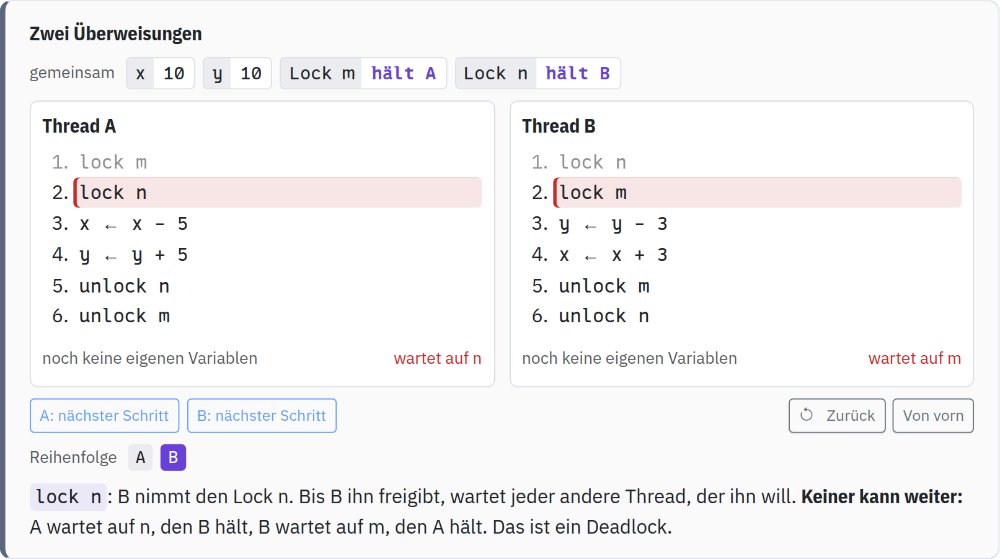
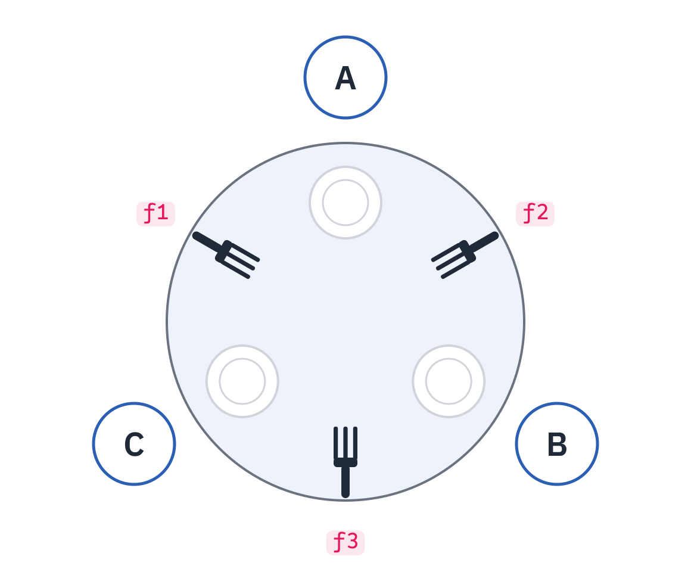
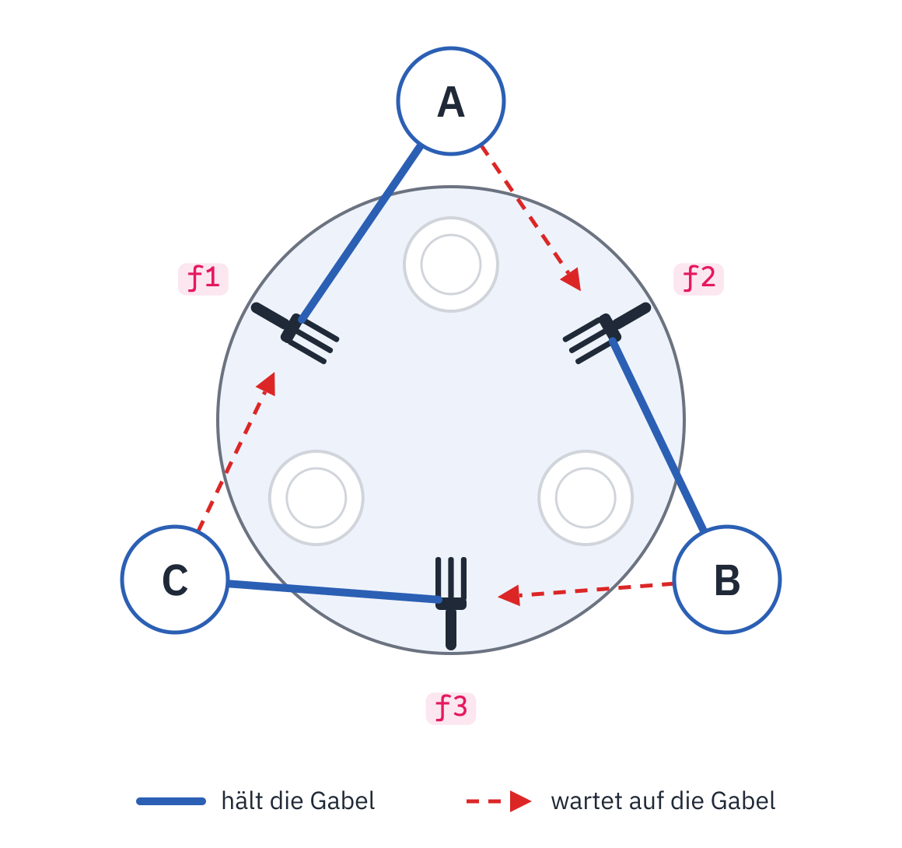

<div class='meta'>
image: teaser.webp:contain
image_alt: "Zwei Threads, die je einen Lock halten und auf den des anderen warten: ein Deadlock"
kind: projekt
language: Java / Dart
languages: [java, dart]
duration: 3 Doppelstunden
curriculum: "Oberstufe: Rechner und Netze (Client-Server-Struktur)"
topics: [client-server]
requires: [webserver]
</div>

<div
    class="autotoc-secondary-trigger"
    data-title="Auf dieser Seite"
    data-levels="h2,h3">
</div>

# Nebenläufigkeit

<p class='abstract'>
Ein Webserver beantwortet viele Anfragen zugleich, ein Spiel rechnet, während es zeichnet: Teile eines Programms laufen nebeneinander. Das geht schief, sobald sie dieselben Daten ändern. In dieser Aktivität probierst du zuerst ohne Code aus, wo es schiefgeht, mit zwei Threads, deren Schritte du selbst in eine Reihenfolge bringst. Dann schützt du gemeinsame Daten mit einem Lock und siehst, wie zwei Locks einander blockieren können.
</p>

## Zwei Threads, ein Zähler

Im Webserver zählte ein Zähler die Besuche, und jede Verbindung lief in einem eigenen Thread. Zählen sieht aus wie ein einziger Schritt, `counter ← counter + 1`. Der Rechner macht daraus drei: den Wert lesen, eins dazuzählen, den neuen Wert zurückschreiben. Jeder Thread hat dafür seine eigene Variable, `a` und `b`; `counter` teilen sich beide.

Zwei Threads können ihre Schritte in jeder Reihenfolge machen. Welcher als Nächstes dran ist, entscheidest hier du: Jeder Knopf führt die nächste Zeile eines Threads aus.

<div class='interleaving' data-title='Zwei Threads zählen' data-program='{"shared": {"counter": 0}, "locks": [], "threads": {"A": ["a ← counter", "a ← a + 1", "counter ← a"], "B": ["b ← counter", "b ← b + 1", "counter ← b"]}}'></div>

<script src='/include/interleaving.js'></script>

<div class='hint try'>
<strong>Ausprobieren:</strong> Lass erst A alle drei Schritte machen, dann B. Achte darauf, welchen Wert <code>b</code> beim Lesen bekommt und was am Ende in <code>counter</code> steht. Dann von vorn, diesmal abwechselnd: A, B, A, B, A, B.
</div>

_task(verlorene-erhoehung)

<!-- after: verlorene-erhoehung -->
Liest B den Zähler, bevor A seinen neuen Wert zurückgeschrieben hat, rechnen beide mit 0 und schreiben beide 1. Eine der beiden Erhöhungen ist verloren, ohne Fehlermeldung. Das heißt **lost update**; dass das Ergebnis von der Reihenfolge abhängt, in der die Threads drankommen, heißt **Race Condition**.
<!-- /after -->

_task(reihenfolgen-ohne-verlust)

### Drei Threads

Mit einem dritten Thread wird es schlimmer: Jetzt können sogar zwei Erhöhungen verloren gehen.

_task(drei-threads)

<!-- after: drei-threads -->
Drei Threads mit je drei Schritten haben 1680 Reihenfolgen. Nur in 6 davon steht am Ende 3 in `counter`, in 270 steht 2, und in 1404, also in den meisten, steht 1. Je mehr Threads denselben Zähler erhöhen, desto weniger wahrscheinlich ist es, dass alles gut geht.
<!-- /after -->

## Ein Lock

Ein **Lock** (auch Mutex) sorgt dafür, dass immer nur ein Thread einen Abschnitt ausführt. `lock m` nimmt den Lock `m`; hält ihn schon ein anderer Thread, wartet der Thread an dieser Zeile, bis `unlock m` ihn freigibt.

<div class='interleaving' data-title='Zählen mit einem Lock' data-program='{"shared": {"counter": 0}, "locks": ["m"], "threads": {"A": ["lock m", "a ← counter", "a ← a + 1", "counter ← a", "unlock m"], "B": ["lock m", "b ← counter", "b ← b + 1", "counter ← b", "unlock m"]}}'></div>

<div class='hint try'>
<strong>Ausprobieren:</strong> Versuch wieder, eine Erhöhung zu verlieren. Achte darauf, wann der Knopf eines Threads grau wird und was dann in seiner Spalte steht.
</div>

_task(reihenfolgen-mit-lock)

<!-- after: reihenfolgen-mit-lock -->
Es bleiben nur zwei: erst A ganz, dann B ganz, oder umgekehrt. Wer den Lock zuerst nimmt, macht alle seine Schritte, bevor der andere überhaupt anfangen kann. In beiden steht am Ende 2 in `counter`. Der Lock macht aus den drei Schritten einen einzigen, den niemand unterbrechen kann; so einen Abschnitt nennt man **kritischen Abschnitt**. Der Preis: Die Threads laufen hier nicht mehr nebeneinander, sondern nacheinander.
<!-- /after -->

## Zwei Locks

Eine Bank überweist zwischen zwei Konten `x` und `y`. Damit niemand dazwischenfunkt, nimmt jede Überweisung die Locks beider Konten. A überweist von `x` nach `y` und nimmt erst `m` (für `x`), dann `n`. B überweist in die andere Richtung und nimmt erst `n`, dann `m`.

<div class='interleaving' data-title='Zwei Überweisungen' data-program='{"shared": {"x": 10, "y": 10}, "locks": ["m", "n"], "threads": {"A": ["lock m", "lock n", "x ← x - 5", "y ← y + 5", "unlock n", "unlock m"], "B": ["lock n", "lock m", "y ← y - 3", "x ← x + 3", "unlock m", "unlock n"]}}'></div>

<!-- tutorial-screenshot
# Bild für die Karte: das Widget im Deadlock, nach A und B
open-site: /nebenlaeufigkeit
tab: preview
viewport: 980x700
click: selector:.interleaving[data-title='Zwei Überweisungen'] .il-step[data-thread='A']
click: selector:.interleaving[data-title='Zwei Überweisungen'] .il-step[data-thread='B']
sleep: 0.5
crop-element: .interleaving[data-title='Zwei Überweisungen']
variants: dark
-->


_task(deadlock)

<!-- after: deadlock -->
Hält jeder Thread einen Lock und wartet auf den des anderen, kommt keiner mehr weiter: ein **Deadlock**. Es hilft, wenn alle Threads ihre Locks in derselben Reihenfolge nehmen, hier immer erst `m`, dann `n`. Dann kann der zweite gar nicht erst einen Lock halten, auf den der erste wartet.
<!-- /after -->

_person(dijkstra)

### Die speisenden Philosophen

Drei Philosophen sitzen um einen runden Tisch, zwischen je zweien liegt eine Gabel. Wer essen will, braucht beide Gabeln neben sich, die linke und die rechte. Jeder nimmt erst die eine, dann die andere, isst, und legt beide zurück. Die Gabeln sind Locks: `f2` zwischen A und B, `f3` zwischen B und C, `f1` zwischen C und A. A braucht also `f1` und `f2`, B `f2` und `f3`, C `f3` und `f1`.



<div class='interleaving' data-title='Drei Philosophen' data-program='{"shared": {"meals": 0}, "locks": ["f1", "f2", "f3"], "threads": {"A": ["lock f1", "lock f2", "meals ← meals + 1", "unlock f2", "unlock f1"], "B": ["lock f2", "lock f3", "meals ← meals + 1", "unlock f3", "unlock f2"], "C": ["lock f3", "lock f1", "meals ← meals + 1", "unlock f1", "unlock f3"]}}'></div>

_task(philosophen)

<!-- after: philosophen -->


Jeder hält seine erste Gabel, und die zweite hält sein Nachbar. Die Pfeile, wer auf wen wartet, laufen einmal um den Tisch: Keiner kann essen, also legt auch keiner eine Gabel zurück.
<!-- /after -->

Damit kein Deadlock entsteht, ändert C die Reihenfolge: Er nimmt erst `f1`, dann `f3`. A und B bleiben, wie sie sind.

_task(philosophen-reihenfolge)

<!-- after: philosophen-reihenfolge -->
<div class='interleaving' data-title='C greift anders' data-program='{"shared": {"meals": 0}, "locks": ["f1", "f2", "f3"], "threads": {"A": ["lock f1", "lock f2", "meals ← meals + 1", "unlock f2", "unlock f1"], "B": ["lock f2", "lock f3", "meals ← meals + 1", "unlock f3", "unlock f2"], "C": ["lock f1", "lock f3", "meals ← meals + 1", "unlock f3", "unlock f1"]}}'></div>

Jetzt nehmen alle drei ihre Gabeln in derselben Reihenfolge: die mit der kleineren Nummer zuerst. Ein Kreis, in dem jeder auf den Nächsten wartet, kann so nicht entstehen: Wer `f3` hält, hält schon seine andere Gabel und kann essen. Probiert man alle 236 Reihenfolgen durch, die es dann gibt, endet keine in einem Deadlock. Das ist dieselbe Regel wie bei den Überweisungen: Alle nehmen ihre Locks in derselben Reihenfolge.
<!-- /after -->

## Im Code

<!-- language: java -->
In Java ist ein Thread ein Objekt der Klasse `Thread`. Ihm gibst du mit, was er tun soll, als Lambda; `start()` lässt ihn loslaufen, `join()` wartet, bis er fertig ist. Dieses Programm lässt zwei Threads je hunderttausendmal `count++` ausführen:

```java
int count = 0;

void main() throws InterruptedException {
    Thread a = new Thread(() -> { for (int i = 0; i < 100000; i++) count++; });
    Thread b = new Thread(() -> { for (int i = 0; i < 100000; i++) count++; });
    a.start();
    b.start();
    a.join();
    b.join();
    IO.println(count);
}
```
<!-- /language -->
<!-- language: dart -->
Dart hat keine Threads, die sich Variablen teilen. Ein Dart-Programm macht immer nur eins auf einmal. Trotzdem kann eine Erhöhung verloren gehen: an einem `await`. Dort hält eine `async`-Funktion an, bis etwas fertig ist, etwa das Speichern, und in der Zwischenzeit läuft anderer Code weiter. Diese Funktion zahlt Geld auf ein Konto ein und speichert dabei:

```dart
var balance = 0;

Future<void> save() => Future.delayed(const Duration(milliseconds: 10));

Future<void> deposit(int amount) async {
  final before = balance;
  await save();
  balance = before + amount;
}
```

Was als Nächstes läuft, wenn eine Funktion an einem `await` anhält, entscheidet Darts **Event Loop**. Er arbeitet eine Liste von Aufgaben ab, eine nach der anderen:

```dart
import 'dart:async';

Future<void> main() async {
  print('A');
  Future(() => print('B'));
  scheduleMicrotask(() => print('C'));
  print('D');
  await Future.delayed(Duration.zero);
  print('E');
}
```

<div class='hint try'>
<strong>Ausprobieren:</strong> Führe das Programm aus und achte darauf, in welcher Reihenfolge die Buchstaben erscheinen. Was läuft sofort, was danach, und was erst ganz am Ende?
</div>

`Future.wait` startet mehrere solche Aufrufe und wartet, bis alle fertig sind:

```dart
balance = 0;
await Future.wait([deposit(5), deposit(7)]);
print(balance);
```
<!-- /language -->

_task(was-kommt-heraus)

<!-- after: was-kommt-heraus -->
<!-- language: java -->
Bei jedem Lauf kommt eine andere Zahl heraus, fast immer weniger als 200000. `count++` ist in Java genau die drei Schritte aus dem Widget: lesen, eins dazu, zurückschreiben. Die beiden Threads laufen auf zwei Kernen wirklich gleichzeitig, und jedes Mal, wenn sie zwischen Lesen und Schreiben aufeinandertreffen, geht eine Erhöhung verloren. Wie oft das passiert, hängt davon ab, wann der Rechner welchen Thread laufen lässt. Darum ist der Fehler so tückisch: Ein Lauf kann auch einmal stimmen.
<!-- /language -->
<!-- language: dart -->
Es kommt 7 heraus, bei jedem Lauf. `deposit(5)` liest 0 und hält am `await` an; dann liest `deposit(7)` ebenfalls 0 und hält an. Danach schreibt der erste 5 zurück, der zweite 7. Genau wie im Widget haben beide gelesen, bevor einer geschrieben hat. Anders als bei Threads passiert das in Dart immer an derselben Stelle, am `await`, und darum jedes Mal gleich.
<!-- /language -->
<!-- /after -->

<!-- language: java -->
Ein Lock heißt in Java oft einfach `synchronized`. Eine Methode mit diesem Wort kann immer nur ein Thread zugleich ausführen; jeder andere wartet, bis sie wieder frei ist. Das ist der Lock aus dem Widget, um die ganze Methode herum.
<!-- /language -->
<!-- language: dart -->
Damit nichts verloren geht, darf eine Einzahlung erst beginnen, wenn die vorige fertig ist. In einer Schleife mit `await` geht das: Jedes `await deposit(…)` wartet, bis diese Einzahlung gespeichert ist.
<!-- /language -->

_task(sicherer-zaehler)

<!-- language: java -->
<!-- stage: loesung/Counter.java as nebenlaeufigkeit/Counter.java -->
<!-- /language -->
<!-- language: dart -->
<!-- stage: loesung/bank.dart as nebenlaeufigkeit/bank.dart -->
<!-- /language -->

### Locks im Code

<!-- language: java -->
Die Überweisungen aus dem Widget sehen in Java so aus. `synchronized (from) { … }` nimmt den Lock des Objekts `from` und gibt ihn am Ende des Blocks wieder frei; jedes Objekt in Java hat so einen Lock. `run` lässt zwei Threads je `times`-mal überweisen, einen von `x` nach `y`, einen zurück:

```java
class Account {
    final int id;
    int balance;

    Account(int id, int balance) {
        this.id = id;
        this.balance = balance;
    }
}

public class Bank {
    static void transfer(Account from, Account to, int amount) {
        synchronized (from) {
            synchronized (to) {
                from.balance -= amount;
                to.balance += amount;
            }
        }
    }

    static int run(int times) throws InterruptedException {
        Account x = new Account(1, 100);
        Account y = new Account(2, 100);
        Thread a = new Thread(() -> { for (int i = 0; i < times; i++) transfer(x, y, 1); });
        Thread b = new Thread(() -> { for (int i = 0; i < times; i++) transfer(y, x, 1); });
        a.start();
        b.start();
        a.join();
        b.join();
        return x.balance + y.balance;
    }

    static void main() throws InterruptedException {
        IO.println(run(100000));
    }
}
```

<!-- /language -->
<!-- language: dart -->
Für `async`-Code hat Dart keinen Lock, aber einen kann man aus `Future`s bauen. Diese Klasse merkt sich in `_last`, wann die zuletzt angemeldete Aktion fertig ist. `synchronized` hängt die nächste Aktion mit `then` dahinter: Sie beginnt erst, wenn die vorige fertig ist, auch wenn sie mit einem Fehler endet.

```dart
class Lock {
  Future<void> _last = Future.value();

  Future<T> synchronized<T>(Future<T> Function() action) {
    final result = _last.then((_) => action());
    _last = result.then((_) {}, onError: (_) {});
    return result;
  }
}
```

`lock.synchronized(() => deposit(5))` meldet eine Einzahlung beim Lock an. Startest du mehrere so zugleich, kommt trotzdem eine nach der anderen an die Reihe.

Auch in Dart kann ein Lock auf sich selbst warten. Dieses Programm meldet innerhalb einer Aktion, die den Lock schon hat, noch eine zweite an:

```dart
Future<void> main() async {
  final lock = Lock();
  print('vorher');
  await lock.synchronized(() async {
    print('außen');
    await lock.synchronized(() async {
      print('innen');
    });
    print('wieder außen');
  });
  print('fertig');
}
```
<!-- /language -->

_task(haengt-es)

<!-- after: haengt-es -->
<!-- language: java -->
<div class='hint try'>
<strong>Ausprobieren:</strong> Leg <code>Bank.java</code> in <code>/workspace/nebenlaeufigkeit</code> und führe es mehrmals mit <code>java Bank.java</code> aus. Achte darauf, ob am Ende 200 erscheint. Ein Programm, das hängt, beendest du mit <kbd>Strg</kbd><kbd>C</kbd>.
</div>

Hunderttausend Überweisungen in jede Richtung sind viele Gelegenheiten: Fast jeder Lauf bleibt irgendwann hängen, sobald beide Threads gleichzeitig ihren ersten Lock genommen haben. Genau die Reihenfolge, die du im Widget gefunden hast.
<!-- /language -->
<!-- language: dart -->
Das Programm gibt `vorher` und `außen` aus und endet dann, ohne Fehlermeldung. Die innere Aktion wartet, bis die äußere fertig ist, und die äußere wartet auf die innere. Weil sonst nichts mehr geplant ist, hat Dart nichts mehr zu tun und beendet das Programm einfach. Das ist der Deadlock in Dart: Er hängt nicht, er hört leise auf, mitten in der Arbeit.
<!-- /language -->
<!-- /after -->

_task(locks-im-code)

<!-- language: java -->
<!-- stage: loesung/Bank.java as nebenlaeufigkeit/Bank.java -->
<!-- /language -->
<!-- language: dart -->
<!-- stage: loesung/bank-lock.dart as nebenlaeufigkeit/bank.dart -->
<!-- /language -->

<!-- language: java -->
Für einen einzelnen Zähler braucht Java keinen eigenen Lock. `AtomicInteger` aus `java.util.concurrent.atomic` hat eine Methode `incrementAndGet()`, die lesen, eins dazuzählen und schreiben in einem einzigen Schritt erledigt, den kein anderer Thread unterbrechen kann. Das Wort `volatile` vor einer Variablen reicht dafür nicht: Es sorgt nur dafür, dass jeder Thread den neuesten Wert sieht. `count++` bleibt auch dann drei Schritte.
<!-- /language -->
<!-- language: dart -->
Was zwischen zwei `await` passiert, kann auch eine Datei treffen. Ein Besuchszähler liest die Zahl aus einer Datei, wartet aufs Lesen und aufs Schreiben, und schreibt die neue Zahl zurück:

```dart
import 'dart:io';

Future<void> visit(String path) async {
  final file = File(path);
  final count = int.parse(await file.readAsString());
  await file.writeAsString('${count + 1}');
}
```

Kommen mehrere Besuche zugleich, lesen alle dieselbe Zahl.
<!-- /language -->

_task(atomar)

<!-- language: java -->
<!-- stage: loesung/AtomicCounter.java as nebenlaeufigkeit/AtomicCounter.java -->
<!-- /language -->
<!-- language: dart -->
<!-- stage: loesung/visits.dart as nebenlaeufigkeit/visits.dart -->
<!-- /language -->

### Arbeit weitergeben

<!-- language: java -->
Oft macht ein Thread etwas, das ein anderer weiterverarbeitet: Ein Thread liest Anfragen, ein anderer beantwortet sie. Dazwischen liegt ein **Puffer** mit Platz für ein paar Werte. Ist er voll, muss der eine warten; ist er leer, der andere. Eine Klasse, deren Methoden alle `synchronized` sind und die Threads so warten lässt, heißt **Monitor**.

Warten geht in Java mit `wait()`: Der Thread gibt den Lock des Objekts ab und schläft, bis ein anderer `notifyAll()` aufruft. Danach bekommt er den Lock zurück und prüft seine Bedingung noch einmal, darum steht `wait()` in einer `while`-Schleife:

```java
public synchronized void put(int x) throws InterruptedException {
    while (count == items.length) {
        wait();
    }
    // … x hineinlegen …
    notifyAll();
}
```
<!-- /language -->
<!-- language: dart -->
Ein Isolate ist in Dart ein eigener Arbeiter mit eigenem Speicher. Isolates teilen keine Variablen; sie schicken einander nur Nachrichten. Darum kann zwischen ihnen auch keine Erhöhung verloren gehen. Und anders als `async`-Code laufen mehrere Isolates wirklich gleichzeitig, auf mehreren Kernen.

`Isolate.run` startet eine Funktion in einem neuen Isolate und gibt ihr Ergebnis als `Future` zurück. Diese Funktion zählt die Primzahlen von `from` bis vor `to`:

```dart
import 'dart:isolate';

int countPrimes(int from, int to) {
  var count = 0;
  for (var n = from; n < to; n++) {
    if (n < 2) continue;
    var prime = true;
    for (var d = 2; d * d <= n; d++) {
      if (n % d == 0) {
        prime = false;
        break;
      }
    }
    if (prime) count++;
  }
  return count;
}
```

`await Isolate.run(() => countPrimes(0, 1000))` zählt dasselbe in einem eigenen Isolate.
<!-- /language -->

_task(arbeit-weitergeben)

<!-- language: java -->
<!-- stage: loesung/Buffer.java as nebenlaeufigkeit/Buffer.java -->
<!-- /language -->
<!-- language: dart -->
<!-- stage: loesung/primes.dart as nebenlaeufigkeit/primes.dart -->
<!-- /language -->

<!-- language: java -->
_person(hoare)

Java hat so einen Puffer schon: `ArrayBlockingQueue` aus `java.util.concurrent`. Seine Methoden `put` und `take` warten genauso, wenn er voll oder leer ist. Im Alltag nimmst du ihn statt eines eigenen Monitors.
<!-- /language -->
<!-- language: dart -->
Zwischen zwei Teilen eines Dart-Programms, die nacheinander Werte liefern und verarbeiten, liegt oft ein **Stream**. Ein `StreamController` ist sein Anfang: `controller.add(x)` legt einen Wert hinein, `controller.close()` sagt, dass keiner mehr kommt. Am anderen Ende holt `await for (final x in controller.stream)` die Werte der Reihe nach ab und wartet, solange keiner da ist.
<!-- /language -->

_task(weitergeben-fertig)

<!-- language: java -->
<!-- stage: loesung/Pipeline.java as nebenlaeufigkeit/Pipeline.java -->
<!-- /language -->
<!-- language: dart -->
<!-- stage: loesung/stream.dart as nebenlaeufigkeit/stream.dart -->
<!-- /language -->

### Mehrere Kerne nutzen

<!-- language: java -->
Threads einzeln zu starten und auf jeden zu warten ist mühsam. Ein **Thread-Pool** hält ein paar Threads bereit und verteilt Aufgaben auf sie: `Executors.newFixedThreadPool(4)` macht einen mit vier Threads. `pool.submit(() -> …)` gibt ihm eine Aufgabe und bekommt sofort ein `Future<Integer>` zurück, ein Versprechen auf das Ergebnis; `future.get()` wartet, bis es da ist. Am Ende beendet `pool.shutdown()` die Threads.

Diese Methode zählt die Primzahlen von `from` bis vor `to`:

```java
public static int countPrimes(int from, int to) {
    int count = 0;
    for (int n = Math.max(from, 2); n < to; n++) {
        boolean prime = true;
        for (int d = 2; d * d <= n; d++) {
            if (n % d == 0) {
                prime = false;
                break;
            }
        }
        if (prime) count++;
    }
    return count;
}
```
<!-- /language -->
<!-- language: dart -->
<div class='hint try'>
<strong>Ausprobieren:</strong> Miss mit einer <code>Stopwatch</code>, wie lange <code>countPrimesParallel(5000000, 1)</code> braucht und wie lange dasselbe mit 2 und mit 4 Teilen. Dein Workspace hat vier Kerne. Achte darauf, ob vier Teile auch viermal so schnell sind, und überleg, welcher Teil am längsten rechnet.
</div>

Die Teile sind nicht gleich viel Arbeit: Je größer eine Zahl, desto länger dauert die Prüfung, ob sie eine Primzahl ist. Gerechter wird es, wenn jedes Isolate kleine und große Zahlen bekommt: das erste 0, 4, 8, …, das zweite 1, 5, 9, … und so weiter.
<!-- /language -->

_task(mehrere-kerne)

<!-- language: java -->
<!-- stage: loesung/Primes.java as nebenlaeufigkeit/Primes.java -->

<div class='hint try'>
<strong>Ausprobieren:</strong> Miss mit <code>System.nanoTime()</code> vorher und nachher, wie lange <code>countPrimesParallel(5000000, 1)</code> braucht und wie lange dasselbe mit 2 und mit 4 Threads. Dein Workspace hat vier Kerne. Achte darauf, ob vier Threads auch viermal so schnell sind.
</div>
<!-- /language -->
<!-- language: dart -->
<!-- stage: loesung/primes-fair.dart as nebenlaeufigkeit/primes.dart -->

<div class='hint try'>
<strong>Ausprobieren:</strong> Miss <code>countPrimesFair(5000000, 4)</code> genauso wie vorhin <code>countPrimesParallel</code>. Achte darauf, um wie viel die gerechte Verteilung schneller ist.
</div>
<!-- /language -->
