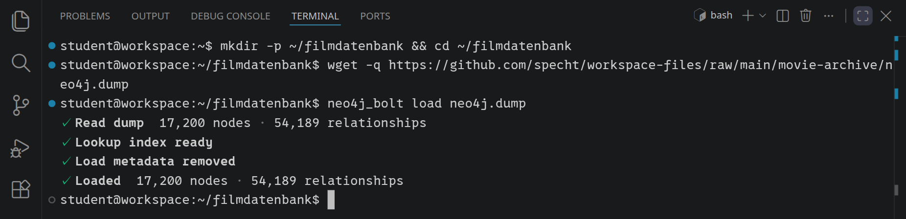
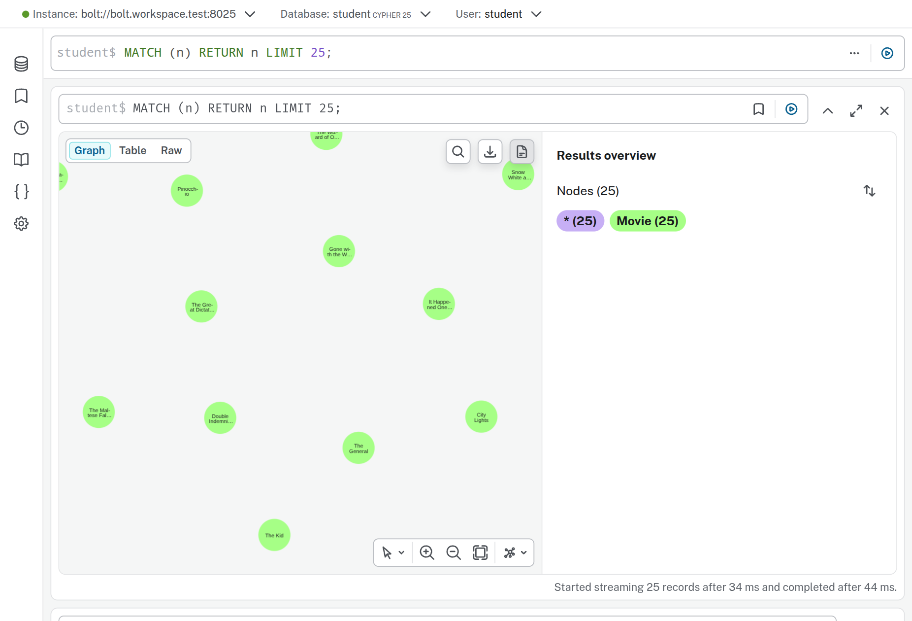
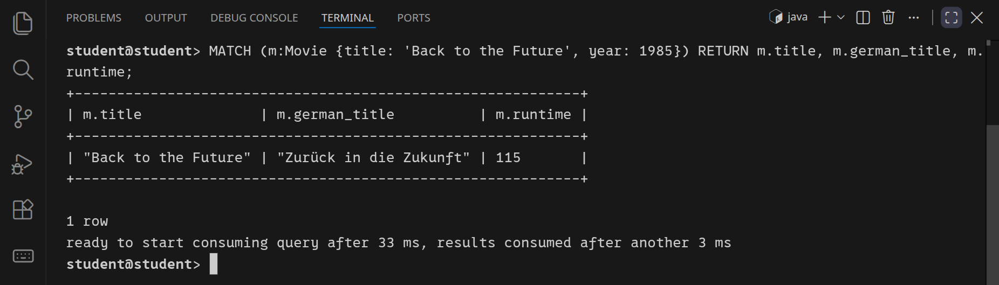
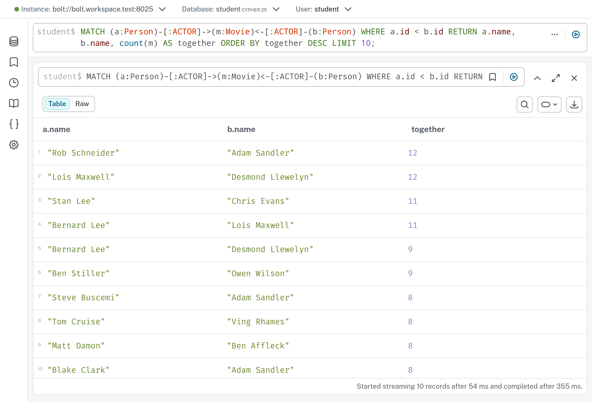
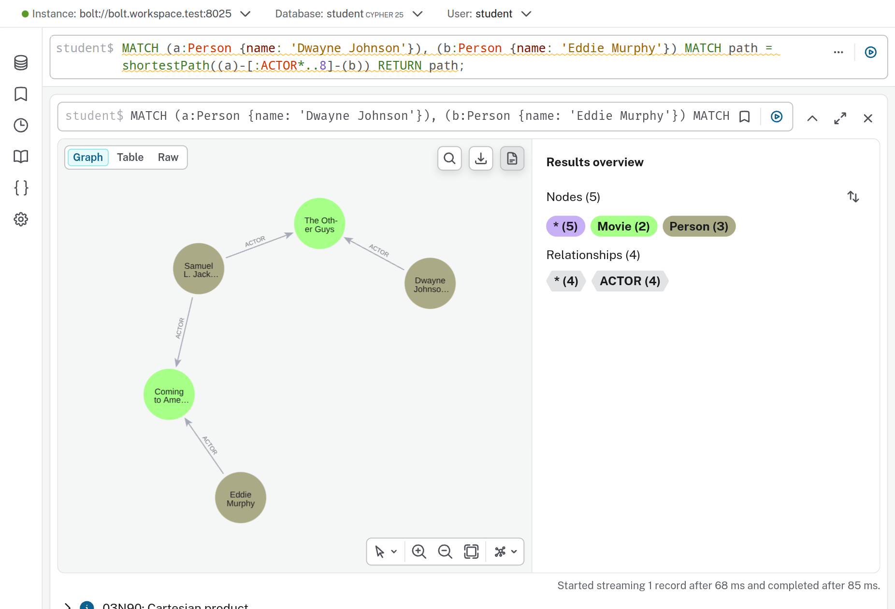

<div class='meta'>
kind: projekt
topic: databases
duration: 2 Doppelstunden
requires: [filmdatenbank]
</div>

<div
    class="autotoc-secondary-trigger"
    data-title="Auf dieser Seite"
    data-levels="h2">
</div>

# Filmdatenbank als Graph mit Neo4j

<p class='abstract'>
In der »Filmdatenbank mit MySQL« hast du Filme, Genres und Personen auf Tabellen verteilt und mit <code>JOIN</code> wieder zusammengesetzt. Jetzt speicherst du dieselben Daten als <strong>Graph</strong> in Neo4j: Filme, Personen und Genres werden zu Knoten, ihre Beziehungen zu direkten Verbindungen. Du lernst die Abfragesprache <strong>Cypher</strong> kennen und siehst, warum Fragen wie »Wer arbeitet oft mit wem?« in einem Graphen kurz werden.
</p>

## Dieselben Daten, ein anderes Modell

Am Ende der Filmdatenbank hattest du sechs Tabellen: `movie`, `genre`, `movie_genre`, `crew`, `job` und `movie_crew`. Für die Genres eines Films führte der Weg durch eine Zwischentabelle, für die Menschen sogar durch zwei:

```text
movie → movie_genre → genre

movie → movie_crew → crew
             ↓
            job
```

Das funktioniert. Aber die letzte Frage dort, wer besonders oft mit wem gespielt hat, brauchte jede Tabelle zweimal. Es ging nicht mehr um einen Film oder eine Person, sondern um die **Verbindungen** zwischen ihnen. Eine Graphdatenbank speichert genau diese Verbindungen.

Im Graphen gibt es drei Arten von **Knoten**: `Movie`, `Person` und `Genre`. Zwischen ihnen liegen **Beziehungen**, und jede Beziehung hat einen **Typ**:

```cypher
(:Movie)-[:IN_GENRE]->(:Genre)

(:Person)-[:ACTOR]->(:Movie)
(:Person)-[:DIRECTOR]->(:Movie)
(:Person)-[:WRITER]->(:Movie)
(:Person)-[:PRODUCER]->(:Movie)
(:Person)-[:COMPOSER]->(:Movie)
(:Person)-[:CINEMATOGRAPHER]->(:Movie)
(:Person)-[:EDITOR]->(:Movie)
```

Die Typen sind die Tätigkeiten aus der Tabelle `job`, nur in Großbuchstaben, so wie man sie in Cypher üblicherweise schreibt.

_task(zwischentabelle)

_task(taetigkeit)

<div class='hint'>
Man muss eine relationale Datenbank nicht immer so in einen Graphen übersetzen. Wir wählen dieses Modell, weil bei unseren Filmdaten gerade die Verbindungen zwischen Filmen, Genres und Personen interessant sind.
</div>

## Knoten haben Eigenschaften

Ein Knoten hat ein **Label**, das sagt, was für ein Ding er ist, und **Eigenschaften** mit Werten. »Back to the Future« sieht im Graphen ungefähr so aus:

```cypher
(:Movie {
  id: 233,
  title: "Back to the Future",
  german_title: "Zurück in die Zukunft",
  year: 1985,
  runtime: 115
})
```

`Movie` ist das Label, `id`, `title`, `german_title`, `year` und `runtime` sind Eigenschaften. Ein Genre und eine Person sehen so aus:

```cypher
(:Genre { id: 5, name: "Comedy" })

(:Person { id: 2493, name: "Michael J. Fox", birth_year: 1961 })
```

Eine Beziehung verbindet zwei Knoten und zeigt in eine Richtung:

```cypher
(:Person { name: "Robert Zemeckis" })-[:DIRECTOR]->(:Movie { title: "Back to the Future" })
```

Runde Klammern stehen für Knoten, eckige für Beziehungen. Der Name hinter dem Doppelpunkt ist bei einem Knoten sein Label, bei einer Beziehung ihr Typ. Das ist schon Cypher: Genau so schreibst du gleich deine Abfragen.

## Die Filmdaten laden

Schalte zuerst in deinem [Profil](/profil) unter »Datenbanken« **Neo4j** ein. Du hast dann eine eigene, leere Neo4j-Datenbank, und oben im Menü erscheint der Knopf »Neo4j«. Im Workspace stehen deine Zugangsdaten in den Umgebungsvariablen `NEO4J_URI`, `NEO4J_USERNAME`, `NEO4J_PASSWORD` und `NEO4J_DATABASE`; die Werkzeuge unten lesen sie von selbst.

Öffne ein Terminal und lade die Filmdaten herunter, am besten in den Ordner aus der Filmdatenbank:

```bash
mkdir -p ~/filmdatenbank
cd ~/filmdatenbank
wget https://github.com/specht/workspace-files/raw/main/movie-archive/neo4j.dump
neo4j_bolt load neo4j.dump
```

<!-- tutorial-screenshot
# neo4j.dump geladen
hide-left-sidebar
show-bottom-panel
terminal-open
terminal-maximize
terminal-run: mkdir -p ~/filmdatenbank && cd ~/filmdatenbank
terminal-run: wget -q https://github.com/specht/workspace-files/raw/main/movie-archive/neo4j.dump
terminal-wait-for-prompt
terminal-run: neo4j_bolt load neo4j.dump
terminal-wait-for-prompt
crop-terminal-lines: auto
-->



`neo4j.dump` ist eine Textdatei: Jede Zeile beginnt mit `n` für einen Knoten oder mit `r` für eine Beziehung. `neo4j_bolt` legt erst alle Knoten an und verbindet sie dann. Die Daten stammen, wie die für MySQL, aus [Wikidata](https://www.wikidata.org/).

<div class='hint'>
<code>neo4j_bolt load</code> erwartet eine leere Datenbank. Hast du schon etwas ausprobiert, setze deine Neo4j-Datenbank im Profil zurück und lade dann noch einmal.
</div>

## Zwei Werkzeuge für Abfragen

Abfragen schreibst du in **Cypher**. Dafür gibt es zwei Werkzeuge:

- Den **Neo4j Browser** öffnest du mit dem Knopf »Neo4j« oben im Menü. Melde dich dort mit dem Benutzernamen und dem Passwort aus deinem Profil an. Er zeigt Ergebnisse als Graph zum Anschauen oder als Tabelle.
- **`cypher-shell`** läuft im Terminal des Workspace und meldet sich mit deinen Umgebungsvariablen von selbst an. Er zeigt Ergebnisse als Tabelle, wie `mycli` für MySQL. Mit `:exit` beendest du ihn.

Fang im Neo4j Browser an:

```cypher
MATCH (n)
RETURN n
LIMIT 25;
```

<!-- tutorial-screenshot
# Neo4j Browser: die ersten 25 Knoten als Graph
neo4j-browser
tab: preview
# Same layout width and scale as the VS Code shots, a little taller for the
# graph. zoom: 1.8 lets the graph canvas draw at the capture resolution.
viewport: 1853x1260
zoom: 1.8
click: selector:button[aria-label="Database overview"]
click: selector:[data-testid=main-editor] .cm-content
type: MATCH (n) RETURN n LIMIT 25;
press: Control+Enter
wait-for-text: Started streaming 25 records
sleep: 2
click: selector:button[aria-label="Zoom in"]
click: selector:button[aria-label="Zoom in"]
move-mouse: Results overview
sleep: 2
-->



Die Abfrage bedeutet:

```text
MATCH (n)   finde Knoten, und nenne jeden gefundenen Knoten n
RETURN n    gib diese Knoten zurück
LIMIT 25    höchstens 25
```

`n` ist ein frei gewählter Name, wie ein Alias in SQL. Mit einem Label findest du nur Knoten einer Art:

```cypher
MATCH (m:Movie)
RETURN m
LIMIT 10;
```

Probier das auch für `Person` und `Genre` aus.

## Einen bestimmten Film finden

Wie in SQL filterst du mit `WHERE`:

```cypher
MATCH (m:Movie)
WHERE m.title = 'Back to the Future' AND m.year = 1985
RETURN m;
```

Kürzer schreibst du die Eigenschaften direkt in das Muster:

```cypher
MATCH (m:Movie {title: 'Back to the Future', year: 1985})
RETURN m;
```

Beide Abfragen finden denselben Film. Willst du nur einige Eigenschaften, nennst du sie hinter `RETURN`. Das Ergebnis ist dann eine Tabelle, auch im Terminal:

```cypher
MATCH (m:Movie {title: 'Back to the Future', year: 1985})
RETURN m.title, m.german_title, m.runtime;
```

<!-- tutorial-screenshot
# cypher-shell mit einer ersten Abfrage
terminal-run: clear
terminal-run: cypher-shell
wait-for-text: student@student>
press: Control+L
type: MATCH (m:Movie {title: 'Back to the Future', year: 1985}) RETURN m.title, m.german_title, m.runtime;
press: Enter
wait-for-text: 1 row
crop-terminal-lines: auto
-->



<div class='hint task'>
Wie lang ist »Toy Story« aus dem Jahr 1995, und wie heißt der Film auf Deutsch?
</div>

## Beziehungen folgen

Jetzt kommt der Unterschied zu MySQL. Welche Genres hat »Back to the Future«? In MySQL brauchtest du dafür zwei `JOIN`s, über `movie_genre` zu `genre`. Im Graphen liegt die Beziehung schon da, und du schreibst sie als Muster hin:

```cypher
MATCH (m:Movie {title: 'Back to the Future', year: 1985})-[:IN_GENRE]->(g:Genre)
RETURN m, g;
```

<!-- Screenshot von Hand: Neo4j Browser mit Back to the Future und seinen Genres -->

Lies das Muster wie eine kleine Zeichnung:

- `(m:Movie {…})` ist der Filmknoten,
- `-[:IN_GENRE]->` eine Beziehung dieses Typs, in Pfeilrichtung,
- `(g:Genre)` der Genreknoten am anderen Ende.

Brauchst du nur die Namen, gibst du nur sie zurück:

```cypher
MATCH (m:Movie {title: 'Back to the Future', year: 1985})-[:IN_GENRE]->(g:Genre)
RETURN g.name;
```

Das ist die Idee von Cypher: **Du beschreibst den Ausschnitt des Graphen, den du suchst, und Neo4j findet alle Stellen, an denen er vorkommt.**

_task(richtung)

## Alle Beteiligten eines Films

Zu einem Film führen Beziehungen verschiedener Typen. Lässt du den Typ weg, passt jede:

```cypher
MATCH (p:Person)-[r]->(m:Movie {title: 'Back to the Future', year: 1985})
RETURN p, r, m;
```

Die Beziehung hat jetzt einen Namen, `r`. Damit fragst du ihren Typ ab:

```cypher
MATCH (p:Person)-[r]->(m:Movie {title: 'Back to the Future', year: 1985})
RETURN type(r) AS job, p.name
ORDER BY job, p.name;
```

In MySQL war die Tätigkeit eine eigene Tabelle, die du mit einem weiteren `JOIN` nachschlagen musstest. Hier ist sie Teil der Beziehung.

## Filme eines Genres

```cypher
MATCH (m:Movie)-[:IN_GENRE]->(:Genre {name: 'Animation'})
RETURN m.title, m.year
ORDER BY m.year DESC
LIMIT 10;
```

Ein Knoten im Muster braucht keinen Namen, wenn du ihn später nicht mehr verwendest, wie hier das Genre. Zum Vergleich der Weg in SQL:

```text
SQL:     movie JOIN movie_genre JOIN genre WHERE genre.name = 'Animation'
Cypher:  (:Movie)-[:IN_GENRE]->(:Genre {name: 'Animation'})
```

<div class='hint task'>
Schreib Cypher-Abfragen für diese Fragen:
<ol>
<li>Welche Science-Fiction-Filme (<code>Sci-Fi</code>) ab dem Jahr 2010 enthält die Datenbank, die neuesten zuerst?</li>
<li>Welche Filme sind länger als drei Stunden?</li>
<li>Welche Filme gehören zugleich zu <code>Comedy</code> und zu <code>Sci-Fi</code>? Tipp: Ein Muster darf zwei Beziehungen vom selben Film aus haben, <code>(g1:Genre)&lt;-[:IN_GENRE]-(m:Movie)-[:IN_GENRE]-&gt;(g2:Genre)</code>.</li>
</ol>
</div>

## Zählen

Auch Cypher kennt `count()`, `avg()`, `min()` und `max()`. Wie viele Filme gibt es pro Genre?

```cypher
MATCH (m:Movie)-[:IN_GENRE]->(g:Genre)
RETURN g.name, count(m) AS movies
ORDER BY movies DESC;
```

Ein `GROUP BY` gibt es nicht. Cypher gruppiert von selbst nach allem, was hinter `RETURN` steht und nicht gezählt wird, hier nach `g.name`. Auch Durchschnitte gehen so:

```cypher
MATCH (m:Movie)-[:IN_GENRE]->(g:Genre)
RETURN g.name, count(m) AS movies, round(avg(m.runtime)) AS minutes
ORDER BY minutes DESC;
```

## Wer führte Regie?

In MySQL brauchte die Frage »Wer führte bei ›Back to the Future‹ Regie?« drei `JOIN`s. Im Graphen ist das gesuchte Muster fast schon die Antwort:

```cypher
MATCH (p:Person)-[:DIRECTOR]->(:Movie {title: 'Back to the Future', year: 1985})
RETURN p.name;
```

<div class='hint task'>
Schreib Abfragen für diese Fragen:
<ol>
<li>Bei welchen Filmen führte Christopher Nolan Regie? Zeig Titel und Jahr, nach dem Jahr sortiert.</li>
<li>An welchen Filmen war Hans Zimmer beteiligt, und als was?</li>
<li>Welche zehn Personen haben bei den meisten Filmen Regie geführt?</li>
</ol>
</div>

_task(muster)

## Regeln für den Graphen

Neo4j wird oft »schemalos« genannt: Du musst keine Tabellen anlegen, bevor du Knoten speicherst. Regeln sind trotzdem sinnvoll. In MySQL hatte jede Tabelle einen Primärschlüssel; auch hier soll es keine zwei Filme mit derselben `id` geben. Lege dafür drei **Schlüssel** an:

```cypher
CREATE CONSTRAINT movie_id IF NOT EXISTS FOR (m:Movie) REQUIRE m.id IS NODE KEY;
CREATE CONSTRAINT genre_id IF NOT EXISTS FOR (g:Genre) REQUIRE g.id IS NODE KEY;
CREATE CONSTRAINT person_id IF NOT EXISTS FOR (p:Person) REQUIRE p.id IS NODE KEY;
```

Ein Schlüssel verlangt: Jeder Knoten mit diesem Label hat die Eigenschaft, und kein Wert kommt doppelt vor. Das ist, was ein Primärschlüssel in MySQL tut. Versuch danach, einen zweiten Film mit der `id` von »Back to the Future« anzulegen, und lies die Fehlermeldung:

```cypher
MATCH (m:Movie {title: 'Back to the Future', year: 1985})
CREATE (:Movie {id: m.id, title: 'Doppelt'});
```

Für Eigenschaften, nach denen du oft suchst, legst du **Indizes** an. Sie beschleunigen die Suche, verbieten aber nichts:

```cypher
CREATE INDEX movie_title IF NOT EXISTS FOR (m:Movie) ON (m.title);
CREATE INDEX person_name IF NOT EXISTS FOR (p:Person) ON (p.name);
```

`SHOW CONSTRAINTS;` und `SHOW INDEXES;` zeigen, was es gibt.

<div class='hint'>
Ein Gegenstück zum Fremdschlüssel braucht der Graph nicht: Eine Beziehung verbindet immer zwei Knoten, die es wirklich gibt. Eine Beziehung zu einer <code>id</code>, die es nicht gibt, kann gar nicht entstehen.
</div>

## Wer spielt mit wem?

Jetzt die Frage, mit der die Filmdatenbank aufgehört hat: Welche zwei Schauspielerinnen oder Schauspieler standen besonders oft gemeinsam vor der Kamera? Im Graphen ist das ein Muster aus zwei Personen und einem gemeinsamen Film:

```cypher
(:Person)-[:ACTOR]->(:Movie)<-[:ACTOR]-(:Person)
```

_task(paare)

In Cypher:

```cypher
MATCH (a:Person)-[:ACTOR]->(m:Movie)<-[:ACTOR]-(b:Person)
WHERE a.id < b.id
RETURN a.name, b.name, count(m) AS together
ORDER BY together DESC
LIMIT 10;
```

Wie in SQL sorgt `a.id < b.id` dafür, dass jedes Paar einmal vorkommt und niemand mit sich selbst. Der Rest ist das Muster selbst: zwei Personen, ein Film, zweimal `ACTOR`. Vergleich das mit der SQL-Abfrage, die jede Tabelle zweimal brauchte.

<!-- tutorial-screenshot
# Neo4j Browser: die Schauspielpaare als Tabelle
tab: preview
viewport: 1853x1260
zoom: 1.8
click: selector:[data-testid=main-editor] .cm-content
press: Control+A
type: :clear
press: Control+Enter
press: Control+A
type: MATCH (a:Person)-[:ACTOR]->(m:Movie)<-[:ACTOR]-(b:Person) WHERE a.id < b.id RETURN a.name, b.name, count(m) AS together ORDER BY together DESC LIMIT 10;
press: Control+Enter
wait-for-text: Started streaming 10 records
click: Table
wait-for-text: together
move-mouse: selector:[data-testid=main-editor]
sleep: 1
-->



## Regie und Kamera

Gibt es Paare aus Regie und Kamera, die immer wieder zusammenarbeiten? Das Muster ändert sich nur bei den Typen:

```cypher
MATCH (d:Person)-[:DIRECTOR]->(m:Movie)<-[:CINEMATOGRAPHER]-(c:Person)
WITH d, c, count(m) AS together
WHERE together >= 3
RETURN d.name AS director, c.name AS cinematographer, together
ORDER BY together DESC;
```

`WITH` reicht Zwischenergebnisse weiter, hier die Zahl gemeinsamer Filme. Das `WHERE` danach filtert die fertigen Paare, so wie `HAVING` in SQL. In MySQL hätte die Frage `movie_crew`, `job` und `crew` je zweimal gebraucht; hier unterscheiden die Typen `DIRECTOR` und `CINEMATOGRAPHER` die beiden Rollen.

## Wege durch den Graphen

Ein Graph kann auch nach **Wegen** gefragt werden: Wie hängen zwei Personen über Filme zusammen?

```cypher
MATCH (a:Person {name: 'Michael J. Fox'}), (b:Person {name: 'Hans Zimmer'})
MATCH path = shortestPath((a)-[*..8]-(b))
WHERE none(n IN nodes(path) WHERE n:Genre)
RETURN path;
```

`[*..8]` heißt: ein Weg aus höchstens acht Beziehungen, egal welchen Typs und in welche Richtung. Ohne die Zeile mit `WHERE` führt der kürzeste Weg über ein Genre: Michael J. Fox spielt in »The Frighteners«, einem Krimi wie »The Dark Knight«, zu dem Hans Zimmer die Musik geschrieben hat. Das stimmt, sagt aber nichts darüber, wer mit wem gearbeitet hat. `none(n IN nodes(path) WHERE n:Genre)` verlangt, dass kein Knoten auf dem Weg ein Genre ist. Dann führt der Weg über »Back to the Future Part II« und den Kameramann Dean Cundey, der auch »The Holiday« gedreht hat. Im Neo4j Browser siehst du das Ergebnis als Kette aus Personen und Filmen.

<!-- tutorial-screenshot
# Neo4j Browser: der kürzeste Weg von Michael J. Fox zu Hans Zimmer
tab: preview
viewport: 1853x1260
zoom: 1.8
click: selector:[data-testid=main-editor] .cm-content
press: Control+A
type: :clear
press: Control+Enter
press: Control+A
type: MATCH (a:Person {name: 'Michael J. Fox'}), (b:Person {name: 'Hans Zimmer'}) MATCH path = shortestPath((a)-[*..8]-(b)) WHERE none(n IN nodes(path) WHERE n:Genre) RETURN path;
press: Control+Enter
wait-for-text: Started streaming 1 record
move-mouse: selector:[data-testid=main-editor]
sleep: 3
-->



<div class='hint task'>
Such dir zwei Personen aus, die nichts miteinander zu tun zu haben scheinen. Über welche Filme und welche anderen Menschen sind sie verbunden? Findet Neo4j keinen Weg, gibt es in unseren Daten keinen mit höchstens acht Schritten.
</div>

_task(vergleich)

## Zusammenfassung

- **Knoten** sind Dinge wie Filme, Personen und Genres, ihr **Label** sagt, welche Art. **Eigenschaften** speichern Werte wie Titel oder Jahr.
- **Beziehungen** verbinden zwei Knoten direkt und haben einen **Typ** wie `IN_GENRE`, `ACTOR` oder `DIRECTOR`. Zwischentabellen und die Tabelle `job` aus MySQL werden zu Beziehungen und ihren Typen.
- `MATCH` beschreibt ein Muster, `WHERE` filtert, `RETURN` sagt, was herauskommt. Gruppiert wird von selbst, `WITH` reicht Zwischenergebnisse weiter.
- **Schlüssel** (`IS NODE KEY`) übernehmen die Aufgabe von Primärschlüsseln, **Indizes** beschleunigen Suchen.

Eine Graphdatenbank ist nicht besser als eine relationale. MySQL hat dir mit Tabellen, Primär- und Fremdschlüsseln eine klare Struktur gegeben. Aber sobald die Verbindungen selbst die Frage sind, wer mit wem, über welche Wege, lassen sie sich als Graph direkt hinschreiben.
