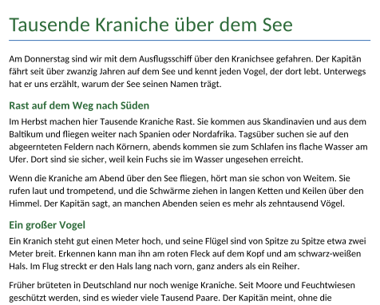
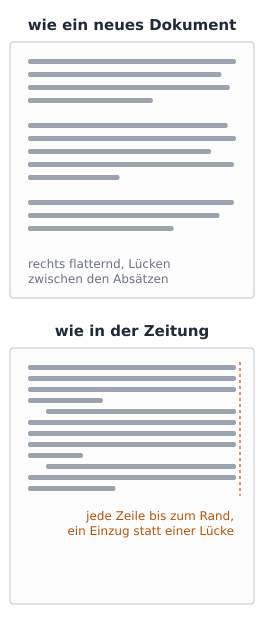
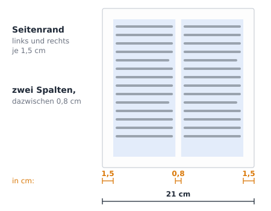
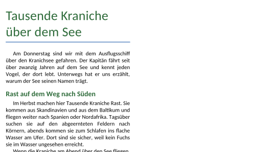
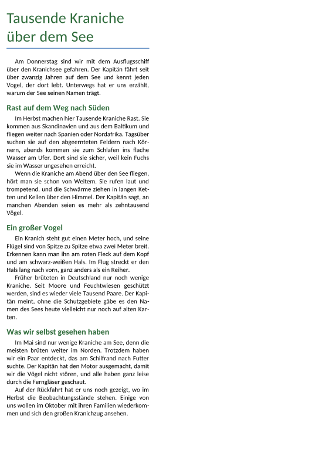

image: teaser.webp
image_alt: "Der Anfang einer Zeitungsseite: der Titel »Tausende Kraniche über dem See«, darunter Text in einer schmalen Spalte im Blocksatz, mit Einzügen am Anfang der Absätze"
kind: labor
duration: 1 Stunde (45 Minuten)
curriculum: "Sek I: Standardsoftware (Umgang mit Textverarbeitungssoftware); Medienbildung: Produzieren (Gestaltung von Medienproduktionen)"
topics: [standardsoftware]
language: LibreOffice / Word / Nextcloud Office
languages: [libreoffice, word, nextcloud]
requires: [headers-and-footnotes]
reference: []

# Die Zeitungsseite

Bevor die Zeitung der 7b gedruckt wird, setzt die Redaktion jeden Artikel so,
wie eine Zeitung aussieht. Die Gruppe vom Schiff hat ihren Artikel über die
Kraniche so abgegeben, wie das Programm ein neues Dokument anlegt:

Eine Zeitung sieht anders aus: Der Text steht in schmalen Spalten, jede
Zeile reicht bis zum Rand der Spalte, und die Absätze stehen dicht
untereinander. So passt mehr auf eine Seite, und das Auge springt am Ende
einer kurzen Zeile leicht in die nächste.

## Spalten und Ränder

Hol dir den Artikel:

<a class='document-starter btn btn-primary' href='/newspaper-page/09%20Kraniche.docx' download><i class='bi bi-file-earmark-word' aria-hidden='true'></i>Vorlage herunterladen:09 Kraniche.docx</a>

Wie viele **Spalten** ein Text hat, stellst du für die Seite ein; das
Programm lässt den Text von unten in der ersten Spalte oben in der zweiten
weiterlaufen. Damit die Spalten nicht zu schmal werden, bekommt die Seite
schmalere **Seitenränder**: 1,5 cm statt 2,5 cm.

<!-- language: libreoffice -->
In LibreOffice wählst du *Format* <i class='bi bi-chevron-right' aria-hidden='true'></i> *Spalten…*, stellst 2 Spalten ein und einen
Abstand von 0,8 cm. Die Ränder stellst du unter *Format* <i class='bi bi-chevron-right' aria-hidden='true'></i> *Seitenvorlage…* im
Register *Seite* ein.
<!-- /language -->
<!-- language: nextcloud -->
In Nextcloud Office wählst du *Format* <i class='bi bi-chevron-right' aria-hidden='true'></i> *Spalten…*, stellst 2 Spalten ein und
einen Abstand von 0,8 cm. Die Ränder stellst du unter *Format* <i class='bi bi-chevron-right' aria-hidden='true'></i>
*Seitenvorlage…* im Register *Seite* ein.
<!-- /language -->
<!-- language: word -->
In Word wählst du im Register *Layout* <i class='bi bi-chevron-right' aria-hidden='true'></i> *Spalten* <i class='bi bi-chevron-right' aria-hidden='true'></i> *Weitere Spalten…*, 2 Spalten mit
einem Abstand von 0,8 cm. Die Ränder stellst du unter *Layout* <i class='bi bi-chevron-right' aria-hidden='true'></i> *Seitenränder*
<i class='bi bi-chevron-right' aria-hidden='true'></i> *Benutzerdefinierte Seitenränder…* ein.
<!-- /language -->

_task(spalte)

<!-- after: spalte -->

<!-- /after -->

**Jetzt bist du dran:** Stell die Seite auf zwei Spalten mit 0,8 cm Abstand
und alle vier Ränder auf 1,5 cm.

## Blocksatz

Neben links, Mitte und rechts (das erste Blatt) gibt es eine vierte
Ausrichtung: Im **Blocksatz** reicht jede Zeile eines Absatzes vom linken bis
zum rechten Rand, nur die letzte nicht. Das Programm verteilt dafür den Platz,
der am Ende einer Zeile übrig bleibt, auf die Lücken zwischen den Wörtern.

_task(luecken)

<!-- after: luecken -->

Passt ein langes Wort nicht mehr in die Zeile, wandert es ganz in die nächste.
Den Platz, den es hinterlässt, verteilt der Blocksatz auf wenige Lücken, und
in einer schmalen Spalte werden sie groß. Abhilfe schafft die
**Silbentrennung**: Das Programm trennt lange Wörter am Zeilenende, und die
Lücken bleiben klein.
<!-- /after -->

<strong>Wie ein Programm Wörter trennt.</strong> Für jedes Wort im Wörterbuch nachzusehen, wo es getrennt wird, wäre viel Arbeit, und neue Wörter fehlen immer. Für das Satzprogramm TeX von Donald Knuth erfand sein Doktorand Frank Liang 1983 darum Muster: kurze Stücke von Buchstaben, an denen man trennen darf oder nicht. Aus ihnen rechnet das Programm die Trennstellen jedes Worts aus, auch eines neuen. Die Silbentrennung von LibreOffice benutzt Muster, die aus denen von TeX gemacht sind.

_person(knuth-lamport)

## Silbentrennung, Einzug und Zeilenabstand

Wie der Text einer Zeitung aussieht, gilt für jeden Absatz Text. Du stellst
es darum einmal in der Formatvorlage »Standard« ein (das Blatt
<a href='/paragraph-styles'>Formatvorlagen</a>): Blocksatz, Silbentrennung,
dazu ein **Einzug** der ersten Zeile von 0,5 cm statt einer Lücke nach jedem
Absatz und ein einzeiliger **Zeilenabstand**. Die Überschriften behalten ihre
eigenen Vorlagen.

<!-- language: libreoffice -->
In LibreOffice öffnest du die Seitenleiste mit den Vorlagen (<kbd>F11</kbd>),
klickst mit der rechten Maustaste auf *Standard* und wählst *Vorlage
bearbeiten…*. Im Register *Ausrichtung* wählst du *Blocksatz*, im Register
*Textfluss* bei *Silbentrennung* *Automatisch*. Im Register *Einzüge und
Abstände* stellst du *Erste Zeile* auf 0,5 cm, *Unter dem Absatz* auf 0 cm und
den *Zeilenabstand* auf *Einzeilig*.
<!-- /language -->
<!-- language: nextcloud -->
In Nextcloud Office öffnest du die Seitenleiste mit den Vorlagen, klickst
mit der rechten Maustaste auf *Standard* und wählst *Vorlage bearbeiten…*.
Im Register *Ausrichtung* wählst du *Blocksatz*, im Register *Textfluss* bei
*Silbentrennung* *Automatisch*. Im Register *Einzüge und Abstände* stellst du
*Erste Zeile* auf 0,5 cm, *Unter dem Absatz* auf 0 cm und den *Zeilenabstand*
auf *Einzeilig*.
<!-- /language -->
<!-- language: word -->
In Word klickst du mit der rechten Maustaste in der Liste der Formatvorlagen
auf *Standard*, wählst *Ändern…* und dort *Format* <i class='bi bi-chevron-right' aria-hidden='true'></i> *Absatz…*: *Ausrichtung*
*Blocksatz*, unter *Sondereinzug* *Erste Zeile* mit 0,5 cm, *Abstand Nach* 0 pt,
*Zeilenabstand* *Einfach*. Die Silbentrennung gilt in Word für das ganze
Dokument: Register *Layout* <i class='bi bi-chevron-right' aria-hidden='true'></i> *Silbentrennung* <i class='bi bi-chevron-right' aria-hidden='true'></i> *Automatisch*.
<!-- /language -->

**Jetzt bist du dran:** Stell »Standard« so ein, dass der Artikel aussieht wie
in einer Zeitung: Blocksatz, Silbentrennung, 0,5 cm Einzug der ersten Zeile,
kein Abstand nach dem Absatz, einzeilig.

## Prüfen

_task(seite)

<!-- after: seite -->

<strong>Ausprobieren:</strong> Schalte die Silbentrennung noch einmal aus und wieder ein. Achte auf die Lücken zwischen den Wörtern und darauf, wie viele Zeilen der Artikel braucht.

<!-- /after -->
