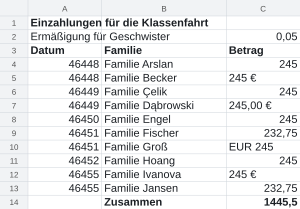
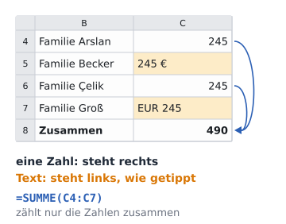
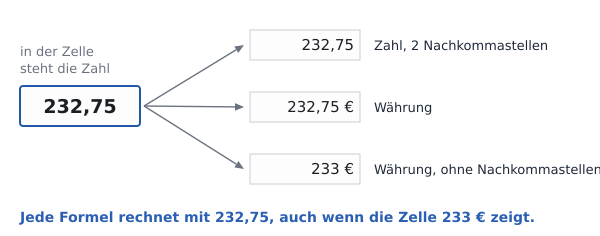
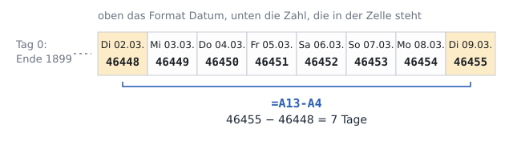

image: teaser.webp
image_alt: "Die Einzahlungen für die Klassenfahrt als Tabelle: Datum, Familie und Betrag, die Beträge mit Euro-Zeichen, die Ermäßigung als 5 %"
kind: labor
duration: 1 Stunde (45 Minuten)
curriculum: "Sek I: Standardsoftware (Tabellenkalkulation)"
topics: [standardsoftware]
language: LibreOffice / Excel / Nextcloud Office
languages: [libreoffice, word, nextcloud]
office: sheet
requires: [spreadsheet-cells]
reference: []

# Zahlen in Form

Was in einer Zelle steht und was sie zeigt, ist nicht immer dasselbe. Du machst aus Beträgen, die als Text getippt sind, Zahlen, mit denen die Tabelle rechnet, und gibst ihnen ein Format: Euro, Prozent, Datum.

Für die Klassenfahrt zahlt jede Familie 245 € auf das Konto der Klasse ein,
etwas mehr, als die Fahrt für ein Kind kosten wird: Was übrig bleibt, bekommen
die Familien nach der Fahrt zurück. Geschwister bekommen 5 % Ermäßigung und
zahlen 232,75 €. Das Elternteil, das die Kasse führt, trägt jede Einzahlung in
eine Tabelle ein: das Datum, die Familie und den Betrag. Manche Beträge hat es
aus den E-Mails der Familien kopiert, so wie sie dort standen.

_task(vorher)

## Zahl oder Text

Hol dir die Tabelle und öffne sie:

<a class='document-starter btn btn-primary' href='/number-formats/02%20Einzahlungen.xlsx' download><i class='bi bi-file-earmark-spreadsheet' aria-hidden='true'></i>Vorlage herunterladen:02 Einzahlungen.xlsx</a>

<!-- after: vorher -->

<!-- /after -->

In einer Zelle steht entweder eine **Zahl** oder ein **Text**. Tippst du
`245`, erkennt das Programm eine Zahl und stellt sie an den rechten Rand der
Zelle. Steht etwas in der Zelle, das es nicht als Zahl lesen kann, `EUR 245`
etwa oder einen Betrag, der aus einer E-Mail kopiert ist, bleibt es Text und
steht links, wie ein Name. Mit Text rechnet keine Formel, und SUMME lässt
ihn aus, ohne etwas zu melden.

_task(fehlt)

**Jetzt bist du dran:** Tipp die vier Beträge, die links stehen, neu: nur die
Zahl, `245`, ohne Euro-Zeichen. Sieh nach, was C14 jetzt zeigt.

## Zahlenformate

Jetzt rechnet die Tabelle richtig, aber sie sieht nicht nach Geld aus: `245`,
`232,75`, und die Summe zeigt `2425,5`. Das Euro-Zeichen und die zwei
Nachkommastellen bekommt eine Zahl von ihrem **Zahlenformat**. Das Format
bestimmt, wie eine Zelle ihre Zahl zeigt: als Betrag in Euro (*Währung*), als
*Prozent*, als *Datum* oder mit einer festen Zahl von Nachkommastellen. Die
Zahl selbst ändert es nicht.

_task(gerundet)

<!-- after: gerundet -->

Die Zelle zeigt 233, gerechnet wird mit 232,75. Deshalb stimmt eine Summe
manchmal scheinbar nicht: Wer die gezeigten Zahlen im Kopf zusammenzählt,
kommt auf etwas anderes als die Tabelle.
<!-- /after -->

<!-- language: libreoffice -->
Das Format wählst du in LibreOffice für alle markierten Zellen auf einmal:
Rechtsklick <i class='bi bi-chevron-right' aria-hidden='true'></i> *Zellen
formatieren…* (oder <kbd>Strg</kbd>+<kbd>1</kbd>), Register *Zahlen*. Links
stehen die Kategorien *Zahl*, *Prozent*, *Währung*, *Datum* und weitere,
rechts ihre Formate; unten siehst du, wie die erste markierte Zelle damit
aussieht. Schneller geht es mit den Knöpfen in der Symbolleiste: **Als Währung
formatieren**, **Als Prozent formatieren**, **Dezimalstelle hinzufügen** und
**Dezimalstelle entfernen**.
<!-- /language -->
<!-- language: word -->
Das Format wählst du in Excel für alle markierten Zellen auf einmal: im
Register *Start*, Gruppe *Zahl*, im Feld *Zahlenformat* (dort steht zuerst
*Standard*), mit *Währung*, *Prozent*, *Datum, kurz* und weiteren. Mehr
Möglichkeiten hat <kbd>Strg</kbd>+<kbd>1</kbd>: das Fenster *Zellen
formatieren*, Register *Zahlen*. Der Knopf *Buchhaltungszahlenformat* daneben
setzt das Format *Buchhaltung*, eine Währung, deren Euro-Zeichen am rechten
Rand der Zelle steht.
<!-- /language -->
<!-- language: nextcloud -->
Das Format wählst du in Nextcloud Office für alle markierten Zellen auf
einmal: Rechtsklick <i class='bi bi-chevron-right' aria-hidden='true'></i>
*Zellen formatieren…*, Register *Zahlen*. Links stehen die Kategorien *Zahl*,
*Prozent*, *Währung*, *Datum* und weitere, rechts ihre Formate; unten siehst
du, wie die erste markierte Zelle damit aussieht.
<!-- /language -->

Zeigt eine Zelle danach nur `###`, ist ihre Spalte zu schmal für die Zahl im
neuen Format. Zieh die Spalte an der Linie rechts neben ihrem Buchstaben
breiter.

**Jetzt bist du dran:** Markiere die Beträge mit der Summe, C4 bis C14, und
gib ihnen das Format Währung. Die Ermäßigung in C2 bekommt das Format Prozent.
Prozent heißt Hundertstel: 0,05 sind 5 %.

## Ein Datum ist eine Zahl

Das Datum jeder Einzahlung hat das Elternteil aus dem Kontoauszug kopiert,
und dabei ist das Format verloren gegangen: In Spalte A stehen Zahlen wie
46448. Auch ein Datum ist für die Tabelle eine Zahl, die Zahl der Tage seit
dem Ende des Jahres 1899. Das Format *Datum* zeigt sie als Tag, Monat und
Jahr.

Weil ein Datum eine Zahl ist, kann die Tabelle mit ihm rechnen: Ein Datum
minus ein anderes ergibt die Tage dazwischen, ein Datum plus 14 den Tag zwei
Wochen später.

_task(tage)

**Jetzt bist du dran:** Gib A4 bis A13 das Format Datum. Die Zahl, die du
für die Tage ausgerechnet hast, kannst du wieder löschen.

<strong>Der 29. Februar 1900</strong>, den es nie gab. 1983 kam Lotus 1-2-3 heraus, die Tabellenkalkulation, mit der damals in den Büros auf dem IBM PC gerechnet wurde. Lotus zählte die Tage als Zahlen wie heute Excel, hielt aber 1900 für ein Schaltjahr und kannte einen 29. Februar 1900. Den gab es nicht: Ein volles Jahrhundert ist nur ein Schaltjahr, wenn es durch 400 teilbar ist. Für Lotus war die Rechnung so einfacher, und fast kein Datum kam dabei falsch heraus. Microsoft übernahm den Fehler in Multiplan und Excel, damit Tabellen aus Lotus für jeden Tag dieselbe Zahl behielten. Excel hat ihn bis heute: Wer ihn beseitigte, verschöbe fast jedes Datum in jeder Tabelle um einen Tag. LibreOffice zählt vom 30. Dezember 1899 an und kommt so ohne den falschen Tag aus; ab dem 1. März 1900 hat jeder Tag in beiden Programmen dieselbe Zahl.

_person(kapor)

## Prüfen

Speichere die Tabelle und lass sie prüfen. Die Prüfung sieht nach, ob die
Beträge Zahlen sind, ob die Summe stimmt und welches Format jede Zelle hat.

_task(einzahlungen)

<!-- after: einzahlungen -->

<strong>Ausprobieren:</strong> Tipp in eine leere Zelle eine <code>1</code> und gib ihr das Format Datum. Achte darauf, welcher Tag Tag 1 ist. In LibreOffice ist es der 31. Dezember 1899, in Excel der 1. Januar 1900: Excel zählt den 29. Februar 1900 mit.

<!-- /after -->
