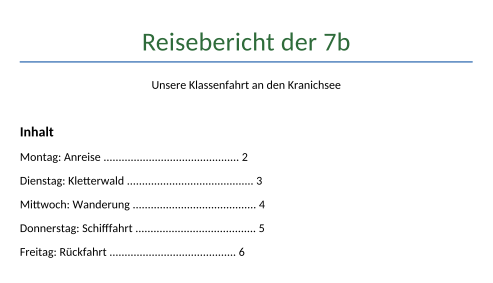
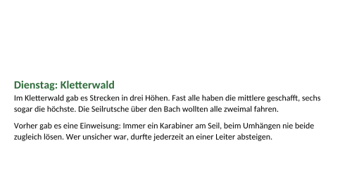
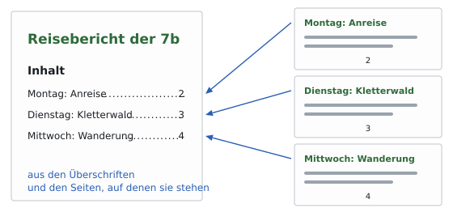
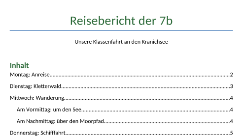

image: teaser.webp
image_alt: "Die Titelseite des Reiseberichts der 7b: Titel, Untertitel und ein getipptes Inhaltsverzeichnis mit Punkten und Seitenzahlen"
kind: labor
duration: 1 Stunde (45 Minuten)
curriculum: "Sek I: Standardsoftware (Umgang mit Textverarbeitungssoftware); Medienbildung: Produzieren (Gestaltung von Medienproduktionen)"
topics: [standardsoftware]
language: Word / LibreOffice / Nextcloud Office
languages: [word, libreoffice, nextcloud]
requires: [paragraph-styles]
reference: []

# Seiten und Verzeichnisse

Aus dem Tagebuch ist der Reisebericht der 7b geworden: eine Titelseite mit
dem Inhalt, dann jeder Tag auf einer eigenen Seite, sechs Seiten. Die
Titelseite sieht so aus:

_task(dienstag)

<!-- after: dienstag -->

Nach dem Montag stehen 23 leere Absätze. Wird der Montag länger, rutschen die
letzten von ihnen auf die nächste Seite, vor den Dienstag. Jede Änderung
weiter vorn verschiebt so alles dahinter, und wer das Dokument in einem
anderen Programm öffnet, sieht schon andere Seiten.
<!-- /after -->

## Seitenumbrüche

Hol dir den Bericht:

<a class='document-starter btn btn-primary' href='/pages-and-contents/07%20Reisebericht.docx' download><i class='bi bi-file-earmark-word' aria-hidden='true'></i>Vorlage herunterladen:07 Reisebericht.docx</a>

_task(leere)

Ein **Seitenumbruch** beendet die Seite an genau dieser Stelle, egal wie viel
davor steht. Du setzt ihn mit <kbd>Strg</kbd>+<kbd>Enter</kbd> vor die Überschrift.

<!-- language: word -->
In Word steht er auch im Register *Einfügen* unter *Seitenumbruch*. Die
Formatierungszeichen zeigen ihn als Linie mit dem Wort *Seitenumbruch*.
<!-- /language -->
<!-- language: libreoffice -->
In LibreOffice steht er auch unter *Einfügen* <i class='bi bi-chevron-right' aria-hidden='true'></i> *Seitenumbruch*.
<!-- /language -->
<!-- language: nextcloud -->
In Nextcloud Office steht er auch unter *Einfügen* <i class='bi bi-chevron-right' aria-hidden='true'></i> *Seitenumbruch*.
<!-- /language -->

**Jetzt bist du dran:** Lösch die leeren Absätze und setz vor jeden Tag einen
Seitenumbruch. Mach danach den Montag länger und sieh nach, wo der Dienstag
jetzt steht.

## Ein Inhaltsverzeichnis

Das Inhaltsverzeichnis auf der Titelseite hat jemand getippt, mit Punkten bis
zur Seitenzahl. Ändert sich eine Überschrift oder rutscht ein Tag auf eine
andere Seite, stimmt es nicht mehr. Ein **Inhaltsverzeichnis**, das das
Programm einfügt, entsteht aus den Überschriften mit ihren Formatvorlagen
(das letzte Blatt) und kennt ihre Seiten. Nach einer Änderung aktualisierst
du es, dann stimmt es wieder.

<!-- language: word -->
In Word löschst du das getippte Verzeichnis, stellst den Cursor an seine
Stelle und wählst im Register *Referenzen* <i class='bi bi-chevron-right' aria-hidden='true'></i> *Inhaltsverzeichnis* eine
automatische Tabelle. Aktualisieren: Rechtsklick hinein, *Felder aktualisieren*,
*Gesamtes Verzeichnis aktualisieren*.
<!-- /language -->
<!-- language: libreoffice -->
In LibreOffice löschst du das getippte Verzeichnis, stellst den Cursor an
seine Stelle und wählst *Einfügen* <i class='bi bi-chevron-right' aria-hidden='true'></i> *Verzeichnis* <i class='bi bi-chevron-right' aria-hidden='true'></i> *Inhaltsverzeichnis…*.
Aktualisieren: Rechtsklick hinein, *Verzeichnis aktualisieren*.
<!-- /language -->
<!-- language: nextcloud -->
In Nextcloud Office löschst du das getippte Verzeichnis, stellst den Cursor an
seine Stelle und wählst *Einfügen* <i class='bi bi-chevron-right' aria-hidden='true'></i> *Verzeichnis* <i class='bi bi-chevron-right' aria-hidden='true'></i>
*Inhaltsverzeichnis…*. Aktualisieren: Rechtsklick hinein, *Verzeichnis
aktualisieren*.
<!-- /language -->

**Jetzt bist du dran:** Ersetz das getippte Verzeichnis durch ein echtes.
Benenn danach den Freitag in »Freitag: Heimfahrt« um und aktualisiere das
Verzeichnis.

## Prüfen

_task(bericht)

<!-- after: bericht -->

<strong>Ausprobieren:</strong> Schreib in den Dienstag so viel dazu, dass er über zwei Seiten geht, und aktualisiere das Verzeichnis. Achte auf die Seitenzahlen im Verzeichnis.

<!-- /after -->
