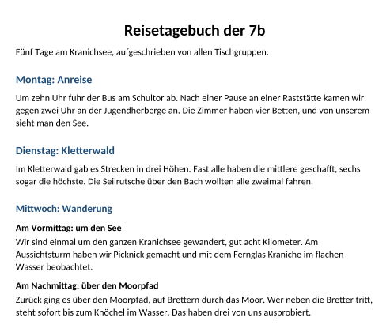
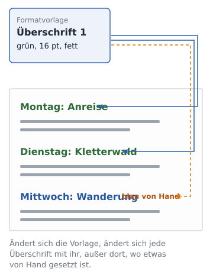
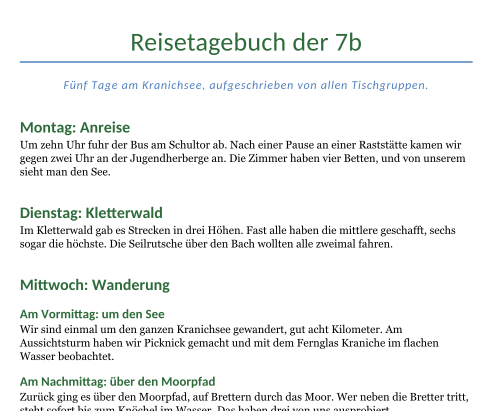

image: teaser.webp
image_alt: "Das Reisetagebuch der 7b: blaue, fette Überschriften für jeden Tag, darunter kleinere fette Zeilen für Vormittag und Nachmittag"
kind: labor
duration: 1 Stunde (45 Minuten)
curriculum: "Sek I: Standardsoftware (Umgang mit Textverarbeitungssoftware); Medienbildung: Produzieren (Gestaltung von Medienproduktionen)"
topics: [standardsoftware]
language: Word / LibreOffice / Nextcloud Office
languages: [word, libreoffice, nextcloud]
requires: [pictures-in-text]
reference: []

# Formatvorlagen

Nach der Klassenfahrt haben alle Tischgruppen ein Stück für das
Reisetagebuch der 7b geschrieben. Jemand hat die Stücke zusammengesetzt und
jede Überschrift fett, größer und blau gemacht:

_task(uebersicht)

<!-- after: uebersicht -->
Für das Programm sind die Überschriften normale Absätze, die jemand von Hand
fett, größer und blau gemacht hat. Wie eine Überschrift aussieht, weiß es;
dass sie eine ist, weiß es nicht. Schau genau hin: Der Mittwoch ist sogar
etwas kleiner als die anderen Tage. Bei neun Überschriften von Hand passiert
so etwas leicht.
<!-- /after -->

## Formatvorlagen

Hol dir das Tagebuch:

<a class='document-starter btn btn-primary' href='/paragraph-styles/06%20Reisetagebuch.docx' download><i class='bi bi-file-earmark-word' aria-hidden='true'></i>Vorlage herunterladen:06 Reisetagebuch.docx</a>

Jeder Absatz hat eine **Formatvorlage**: einen Namen für ein Aussehen. Der
Text hat die Vorlage »Standard«. Für Überschriften gibt es »Überschrift 1«,
»Überschrift 2« und so weiter, eine für jede **Ebene**: Ebene 1 für die
Kapitel, Ebene 2 für die Abschnitte darin. Ein Absatz mit einer dieser
Vorlagen ist für das Programm eine Überschrift. Es zeigt ihn in seiner
Übersicht und kann später ein Inhaltsverzeichnis daraus machen.

Was du einem Absatz von Hand gibst (fett, eine Größe, eine Farbe), gewinnt
gegen seine Formatvorlage. Lösch darum zuerst die Formatierung von Hand und
gib dem Absatz dann die Vorlage.

<!-- language: word -->
In Word markierst du die Überschrift, löschst ihre Formatierung mit
<kbd>Strg</kbd>+<kbd>Leertaste</kbd> und klickst im Register *Start* in der Liste
der Formatvorlagen auf *Überschrift 1*. Die Übersicht der Überschriften
öffnest du mit *Ansicht* <i class='bi bi-chevron-right' aria-hidden='true'></i> *Navigationsbereich*.
<!-- /language -->
<!-- language: libreoffice -->
In LibreOffice markierst du die Überschrift, löschst ihre Formatierung mit
<kbd>Strg</kbd>+<kbd>M</kbd> (*Format* <i class='bi bi-chevron-right' aria-hidden='true'></i> *Direkte Formatierung löschen*) und gibst ihr mit
<kbd>Strg</kbd>+<kbd>1</kbd> die Vorlage *Überschrift 1*, mit <kbd>Strg</kbd>+<kbd>2</kbd>
*Überschrift 2*. Die Übersicht der Überschriften ist der *Navigator*
(<kbd>F5</kbd>).
<!-- /language -->
<!-- language: nextcloud -->
In Nextcloud Office markierst du die Überschrift, löschst ihre Formatierung
mit <kbd>Strg</kbd>+<kbd>M</kbd> und wählst links oben in der Liste der
Absatzvorlagen *Überschrift 1*. Die Übersicht der Überschriften ist der
*Navigator*.
<!-- /language -->

_task(ebene)

**Jetzt bist du dran:** Gib den fünf Tagen die Vorlage »Überschrift 1« und
den Teilen eines Tages »Überschrift 2«. Öffne danach die Übersicht der
Überschriften und klick auf den Donnerstag.

## Eine Vorlage ändern

Die Klassenleitung möchte die Überschriften der Tage grün, in der Farbe der
7b. Von Hand wären das fünf Überschriften, eine nach der anderen. Mit einer
Formatvorlage änderst du nur die Vorlage, und jeder Absatz mit dieser Vorlage
ändert sich mit.

<!-- language: word -->
In Word klickst du mit der rechten Maustaste in der Liste der Formatvorlagen
auf *Überschrift 1* und wählst *Ändern…*. Dort stellst du die Farbe ein.
<!-- /language -->
<!-- language: libreoffice -->
In LibreOffice öffnest du die Seitenleiste mit den Vorlagen (<kbd>F11</kbd>),
klickst mit der rechten Maustaste auf *Überschrift 1* und wählst *Vorlage
bearbeiten…*. Dort stellst du die *Schriftfarbe* ein.
<!-- /language -->
<!-- language: nextcloud -->
In Nextcloud Office öffnest du die Seitenleiste mit den Vorlagen, klickst
mit der rechten Maustaste auf *Überschrift 1* und wählst *Vorlage
bearbeiten…*. Dort stellst du die *Schriftfarbe* ein.
<!-- /language -->

**Jetzt bist du dran:** Mach »Überschrift 1« grün. Wenn eine Überschrift blau
bleibt, hat sie noch Formatierung von Hand.

## Prüfen

_task(tagebuch)

<!-- after: tagebuch -->

<strong>Ausprobieren:</strong> Ändere die Schriftart von »Überschrift 1« und dann die von »Standard«. Achte darauf, welche Absätze sich jeweils mitändern.

<!-- /after -->
