<div class='meta'>
image: pascal-logo.png
kind: steckbrief
curriculum: "Sek I: Geschichte der Informatik (Lebensläufe und Leistungen bedeutender Persönlichkeiten); Oberstufe: Syntax und Semantik (Compiler)"
topics: [programmiersprachen, geschichte]
</div>

<div
    class="autotoc-secondary-trigger"
    data-title="Auf dieser Seite"
    data-levels="h2,h3">
</div>

# Pascal <span style='font-size: 80%;'>(1970)</span>

<p class='abstract'>
Die Programmiersprache Pascal wurde 1970 von Niklaus Wirth entwickelt und ist eine imperative und strukturierte Programmiersprache. Pascal wurde ursprünglich als Sprache für die Lehre entwickelt und hat eine klare und einfache Syntax. Die Sprache wurde nach dem französischen Mathematiker und Philosophen Blaise Pascal benannt.
</p>

_person(wirth)

<div class='book'>
<i class='bi bi-file-earmark-text'></i>
<p><strong>The Programming Language Pascal</strong>, Niklaus Wirth, Bericht der ETH Zürich, 1970. Der Bericht, in dem Pascal zum ersten Mal beschrieben ist, 1971 auch in der Zeitschrift Acta Informatica erschienen; der Compiler, von dem er erzählt, ist selbst in Pascal geschrieben. Die ETH Zürich hat ihn <a href='https://doi.org/10.3929/ethz-a-004150844'>frei ins Netz gestellt</a>.</p>
</div>

Pascal fand Anwendung in der Softwareentwicklung, insbesondere in den 1980er und 1990er Jahren, mit bekannten Entwicklungsumgebungen wie Turbo Pascal von Borland. Heutzutage ist Pascal weniger verbreitet als moderne Programmiersprachen, bleibt aber in bestimmten Nischen relevant, insbesondere in der Lehre und bei der Entwicklung von eingebetteten Systemen. Die Sprache hat auch zu Weiterentwicklungen wie Object Pascal geführt, das in der Delphi-Entwicklungsumgebung verwendet wird.

<!-- ## Eigenschaften

- **Imperativ**: Pascal ist eine imperative Programmiersprache, die auf der Abarbeitung von Befehlen basiert.
- **Strukturiert**: Pascal ist eine strukturierte Programmiersprache, die auf der Verwendung von Kontrollstrukturen wie Schleifen und Verzweigungen basiert.
- **Statisch**: Pascal ist eine statisch typisierte Sprache, was bedeutet, dass Variablen einen festen Datentyp haben, der zur Kompilierzeit überprüft wird. -->

## Hello, world!

Pascal-Programme werden in Textdateien mit der Endung `.pas` geschrieben. Diese Dateien werden anschließend von einem Compiler in ausführbare Dateien übersetzt, die auf deinem Computer direkt ausgeführt werden können. Früher waren der Compiler »Turbo Pascal« sehr verbreitet, heute wird meist der freie Compiler »Free Pascal« verwendet.

Stelle zuerst sicher, dass du keinen Ordner geöffnet hast. Um sicherzugehen, drücke einfach den Shortcut für »Ordner schließen«: <kbd>Strg</kbd><kbd>K</kbd> und dann <kbd>F</kbd>. Dein Workspace sollte jetzt ungefähr so aussehen:

<!-- tutorial-screenshot
# Ein frischer Workspace ohne Ordner
show-left-sidebar
sleep: 0.5
-->


### Quelltext schreiben

Klicke auf »New File« und wähle als Dateityp »Text File«.

<!-- tutorial-screenshot
click: New File...
wait-for-text: Text File
sleep: 0.5
crop-bottom: 77%
-->


Schreibe nun den folgenden Code in die Datei:

_include_file(hello.pas, pascal)

Da Visual Studio Code noch nicht weiß, dass es sich um Pascal-Quelltext handelt, ist dein Programm momentan noch einfarbig, aber das wird sich gleich ändern. An dem weißen Punkt erkennst du, dass deine Änderungen noch nicht gespeichert sind.

<!-- tutorial-screenshot
# Das Programm in eine noch namenlose Datei
press: Enter
sleep: 1
hide-left-sidebar
type: <- file:hello.pas
sleep: 0.5
crop-bottom: 60%
-->

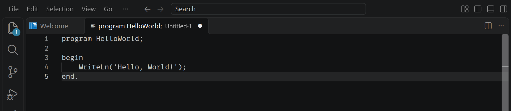

Drücke nun <kbd>Strg</kbd><kbd>S</kbd>, um die Datei zu speichern. Gib `hello.pas` ein – der vollständige Pfad zu deiner Datei lautet dann `/workspace/hello.pas`.

<!-- tutorial-screenshot
press: Control+s
wait-for-text: Save As
press: Control+a
type: /workspace/hello.pas
sleep: 0.5
crop-bottom: 82%
-->

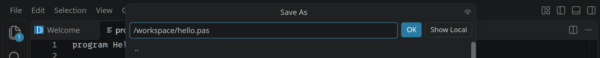

Da Pascal standardmäßig nicht von Visual Studio Code unterstützt wird, müssen wir noch eine passende Erweiterung installieren. Klicke dazu auf das Erweiterungs-Symbol  in der Seitenleiste oder drücke <kbd>Strg</kbd><kbd>Shift</kbd><kbd>X</kbd>. Suche nach der Erweiterung »Pascal Magic« und installiere sie. Weil der Herausgeber nicht verifiziert ist, fragt Visual Studio Code, ob du ihm vertraust; bestätige mit »Trust Publisher & Install«.

<!-- tutorial-screenshot
# Speichern, dann die Erweiterung im Marketplace
press: Enter
wait-for-file: hello.pas
sleep: 1
press: Control+Shift+x
wait-for-text: Marketplace
type: Pascal Magic
sleep: 3
crop-bottom: 50%
-->

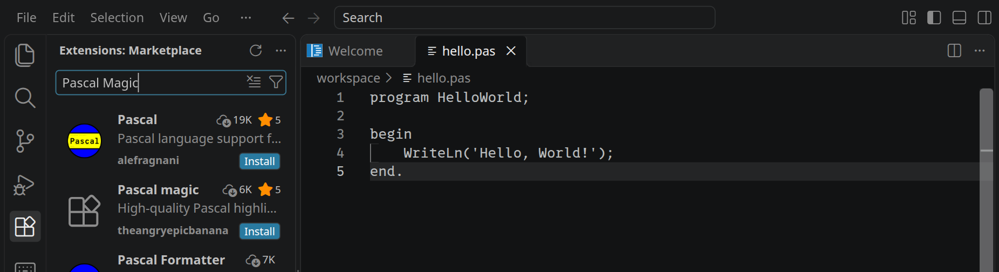

Alternativ kannst du auch <kbd>Strg</kbd><kbd>P</kbd> drücken und `ext install theangryepicbanana.language-pascal` eingeben, um die Erweiterung zu installieren.

Anschließend solltest du dein Pascal-Programm farbig sehen:

<!-- tutorial-screenshot
# Die Erweiterung installieren, wie es der Text als zweiten Weg
# nennt; danach ist der Code farbig
press: Control+p
type: ext install theangryepicbanana.language-pascal
wait-for-text: Press Enter to install extension
press: Enter
# Der Herausgeber ist nicht verifiziert: VS Code fragt nach
wait-for-text: Trust Publisher & Install
click: Trust Publisher & Install
sleep: 10
# Neu öffnen: erst dann kennt VS Code die Sprache
close-tab: hello.pas
open-file: hello.pas
hide-left-sidebar
sleep: 2
crop-bottom: 56%
-->

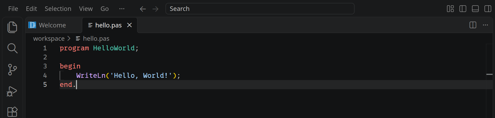

### Kompilieren und ausführen

Bevor wir das Programm ausführen können, müssen wir es kompilieren. Dadurch wird der Quelltext in Maschinencode übersetzt, den dein Computer ausführen kann.

Öffne dazu ein Terminal, indem du entweder <kbd>Strg</kbd><kbd>J</kbd> drückst oder das Panel-Symbol  rechts oben drückst. Dein Fenster sollte jetzt ungefähr so aussehen:

<!-- tutorial-screenshot
hide-left-sidebar
terminal-open
sleep: 0.5
-->

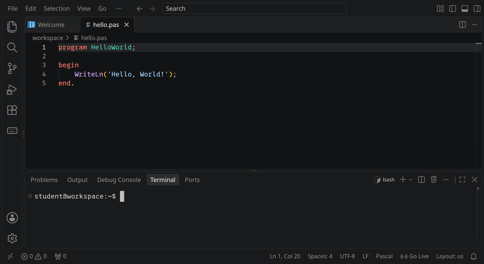

Um das Programm zu kompilieren, gib folgenden Befehl ein:

```bash
fpc hello.pas
```

<div class='hint'>
Du musst nicht den vollständigen Dateinamen schreiben. Schreib einfach <code>fpc he</code> und drücke <kbd>Tab</kbd>, um den Dateinamen automatisch zu <code>hello.pas</code> vervollständigen zu lassen. Du kannst danach ganz normal weiterschreiben.
</div>

Wenn du keinen Fehler gemacht hast, wird das Programm erfolgreich kompiliert und die ausführbare Datei `hello` wird im selben Verzeichnis erstellt. Du kannst dies überprüfen, indem du dir die Dateien im aktuellen Verzeichnis mit `ls` oder `ls -l` anzeigen lässt:

<!-- tutorial-screenshot
# Die Ausgabe des Compilers und ls passen nur ins ganze Terminal
terminal-maximize
press: Control+l
terminal-run: fpc hello.pas
terminal-wait-for-prompt
terminal-run: ls -l
terminal-wait-for-prompt
crop-terminal-lines: auto
-->

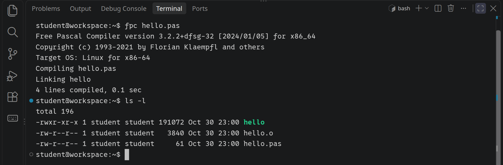

Die grüne Datei `hello` ist die ausführbare Datei – im Unterschied zu Windows, wo ausführbare Dateien die Endung `.exe` haben, haben ausführbare Dateien unter Linux keine Endung. Um das Programm auszuführen, gib folgenden Befehl ein:

```bash
./hello
```

Das Programm sollte die Nachricht `Hello, World!` im Terminal ausgeben. Du kannst beide Schritte auch in einem Befehl kombinieren:

```bash
fpc hello.pas && ./hello
```

<div class='hint'>
Die Zeichenkombination <code>&amp;&amp;</code> sorgt dafür, dass der zweite Befehl nur ausgeführt wird, wenn der erste erfolgreich war.
</div>

_task(hallo)

_task(uebersetzt)

### Fehler finden und beheben

Wenn du einen Fehler im Code machst, wird der Compiler eine Fehlermeldung ausgeben. Versuche zum Beispiel, statt `WriteLn` das Wort `WritLn` zu schreiben:

```pascal
~ program HelloWorld;
~
~ begin
    WritLn('Hello, World!');
~ end.
```

Speichere die Datei und führe den Compiler erneut aus:

```bash
fpc hello.pas
```

<div class='hint'>
Nutze die Pfeiltaste hoch <kbd>↑</kbd>, um den letzten Befehl erneut einzugeben. So kannst du schnell dein Programm testen, nachdem du es verändert hast.
</div>

Der Compiler sollte eine Fehlermeldung ausgeben, die dir hilft, den Fehler zu finden. Lies sie in deinem Terminal:

_task(fehler)

<!-- after: fehler -->

<!-- tutorial-screenshot
# Der Fehler aus dem Text; die lange Meldung braucht das ganze Terminal
write-file: hello.pas <- file:hello-error.pas
terminal-maximize
press: Control+l
terminal-run: fpc hello.pas
terminal-wait-for-prompt
crop-terminal-lines: auto
-->

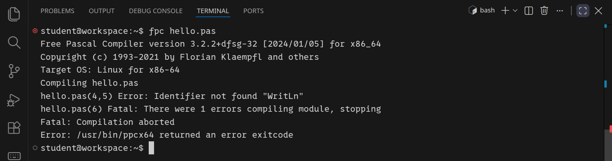

Es lohnt sich, die Fehlermeldungen genau zu lesen, um den Fehler zu finden und zu beheben. Achte auf die Zeilennummer (in diesem Beispiel 4) und den Text, der dir sagt, was falsch ist. Denke daran, den Fehler wieder zu beheben, bevor du das nächste Beispiel ausprobierst.

<!-- /after -->

## Primfaktorzerlegung

Im zweiten Beispiel wollen wir eine Zahl in ihre Primfaktoren zerlegen. An diesem Beispiel kannst du sehen, wie man in Pascal Benutzereingaben verarbeitet und Schleifen verwendet.
Erstelle eine neue Datei mit <kbd>Strg</kbd><kbd>Alt</kbd><kbd>N</kbd> und schreibe den folgenden Code hinein:

_include_file(factor.pas, pascal)

Speichere die Datei unter dem Namen `factor.pas`. Kompiliere das Programm:

```bash
fpc factor.pas
```

Falls du keine Fehlermeldung erhältst, kannst du das Programm ausführen und testen:

<!-- tutorial-screenshot
write-file: factor.pas <- file:factor.pas
terminal-maximize
press: Control+l
terminal-run: fpc factor.pas
terminal-wait-for-prompt
terminal-run: ./factor
wait-for-text: number:
terminal-run: 123
terminal-wait-for-prompt
crop-terminal-lines: auto
-->

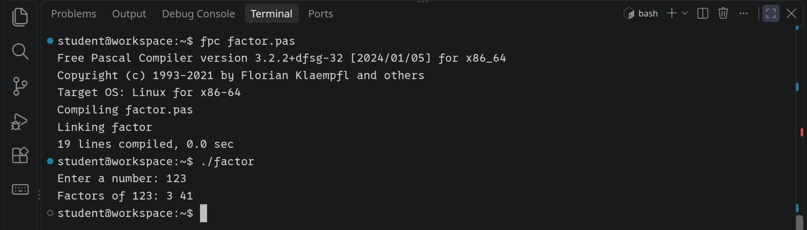

Das Programm hat die Zahl 123 in ihre Primfaktoren zerlegt und ausgegeben.

_task(ueberlauf)

<!-- after: ueberlauf -->

Statt der Faktoren steht `Factors of -31072:` da, ohne eine Fehlermeldung. `integer` hat in Free Pascal 16 Bit und reicht von -32768 bis 32767; was größer ist, läuft über und beginnt im negativen Bereich von vorn.

<div class='hint try'>
<strong>Ausprobieren:</strong> Ersetze in der Zeile <code>number, i: integer;</code> das Wort <code>integer</code> durch <code>longint</code>, übersetze neu und gib <code>100000</code> noch einmal ein. Und was passiert jetzt bei <code>3000000000</code>?
</div>

<!-- /after -->

## Bubblesort

Im dritten Beispiel wollen wir eine Liste von 10 Zufallszahlen sortieren. Dafür verwenden wir den [Bubblesort-Algorithmus](https://de.wikipedia.org/wiki/Bubblesort), der zwar nicht besonders effizient ist, aber sehr einfach zu verstehen und zu implementieren. Der Bubblesort-Algorithmus funktioniert, indem er die Liste mehrmals durchläuft und benachbarte Elemente vertauscht, wenn sie in der falschen Reihenfolge sind.

An diesem Beispiel kannst du sehen, wie man in Pascal Arrays verwendet und Schleifen verschachtelt.

Erstelle eine neue Datei und schreibe den folgenden Code hinein:

_include_file(bubblesort.pas, pascal)

Speichere die Datei unter dem Namen `bubblesort.pas`. Kompiliere das Programm:

```bash
fpc bubblesort.pas
```
Falls du keine Fehlermeldung erhältst, kannst du das Programm ausführen und testen:

<!-- tutorial-screenshot
write-file: bubblesort.pas <- file:bubblesort.pas
press: Control+l
terminal-run: fpc bubblesort.pas
terminal-wait-for-prompt
terminal-run: ./bubblesort
terminal-wait-for-prompt
crop-terminal-lines: auto
-->

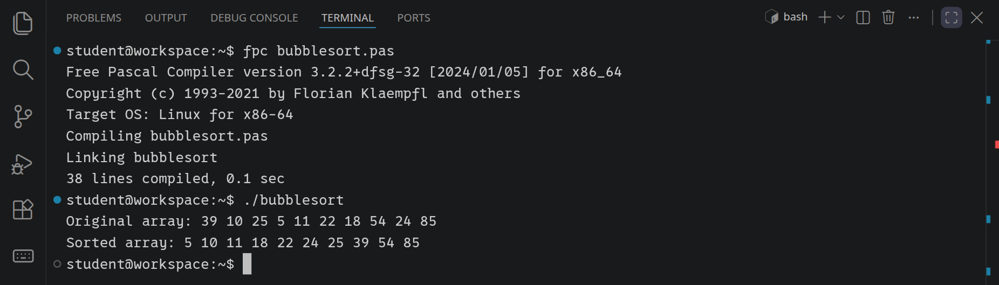

Das Programm hat eine Liste von 10 Zufallszahlen sortiert.

<div class='hint try'>
<strong>Ausprobieren:</strong> Sortiere 100 Zahlen statt 10: Ändere <code>bubblesort.pas</code>, übersetze neu und starte das Programm. Warum musst du dafür nur eine einzige Zahl ändern?
</div>

_task(absteigend)

## Programmieren wie in den 90ern

Wenn du möchtest, kannst du eine kleine Zeitreise machen und wie früher in den 90ern programmieren. Vergrößere dein Terminal und gib einfach `fp bubblesort.pas` ein:

<!-- tutorial-screenshot
# Die Entwicklungsumgebung fp mit bubblesort.pas, im maximierten Terminal
press: Control+l
terminal-maximize
terminal-run: fp bubblesort.pas
sleep: 3
-->
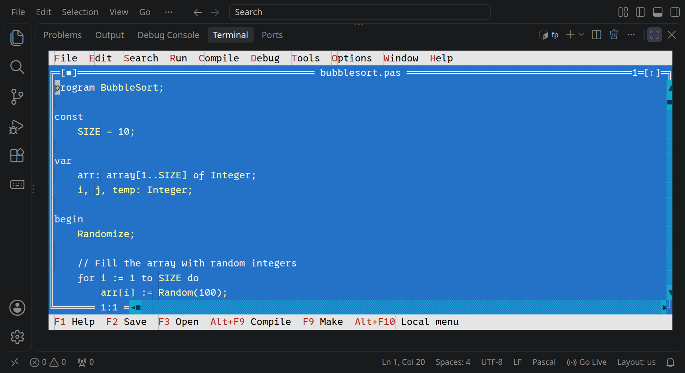

In dieser Entwicklungsumgebung kannst du den Quelltext direkt bearbeiten und du kannst folgende Tasten verwenden:

<table class='table'>
<tr><td><kbd>F9</kbd></td><td>Kompilieren</td></tr>
<tr><td><kbd>Strg</kbd><kbd>F9</kbd></td><td>Ausführen</td></tr>
<tr><td><kbd>F2</kbd></td><td>Speichern</td></tr>
<tr><td><kbd>Alt</kbd><kbd>X</kbd></td><td>Beenden</td></tr>
</table>

<div class='hint'>
Auch wenn es nicht so aussieht: in der FreePascal-Entwicklungsumgebung kann man auch die Maus verwenden.
</div>

Die Ordner mit den Units kennt die Entwicklungsumgebung schon. Drücke <kbd>F9</kbd>, und sie kompiliert das Programm:

<!-- tutorial-screenshot
# F9 kompiliert: die Ordner der Units stehen schon in /etc/fp.cfg
press: F9
sleep: 5
-->
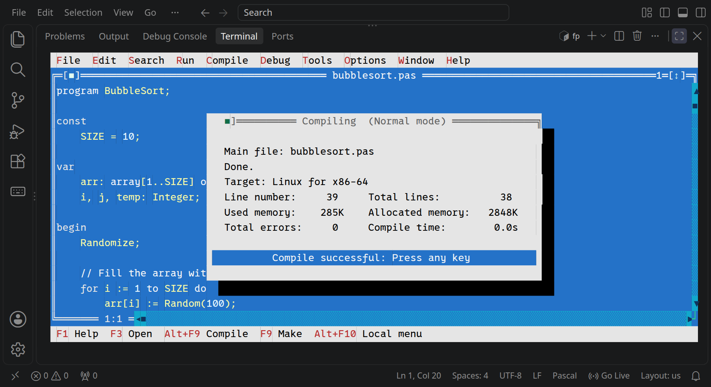

## Zusammenfassung

In diesem Kapitel hast du an drei Beispielen gesehen, wie man ein einfaches Pascal-Programm schreiben, kompilieren und ausführen kann. Das ist natürlich nur ein erster Eindruck. Um Pascal wirklich zu beherrschen, musst du noch viel mehr lernen – am besten, indem du eigene Programme schreibst und ausprobierst. Die Buchhandlungen, Bibliotheken und Youtube sind voll von Material für dich. Viel Spaß beim Programmieren!