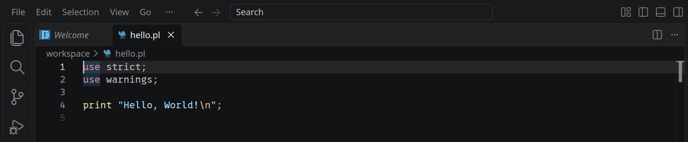
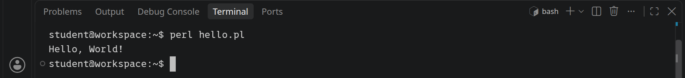
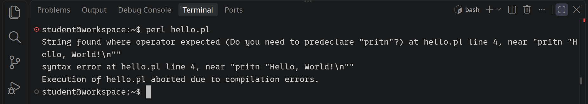
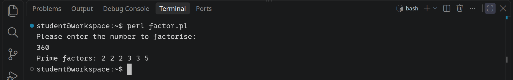
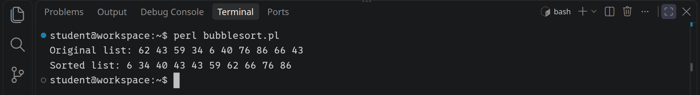

<div class='meta'>
image: perl-logo.png
kind: steckbrief
curriculum: "Sek I: Geschichte der Informatik (Lebensläufe und Leistungen bedeutender Persönlichkeiten); Oberstufe: Algorithmen und Softwareentwicklung (ein Skript ausführen, Fehlermeldungen lesen, Zeichenketten und Zahlen, Bubblesort ändern)"
topics: [programmiersprachen, geschichte]
</div>

<div
    class="autotoc-secondary-trigger"
    data-title="Auf dieser Seite"
    data-levels="h2,h3">
</div>

# Perl <span style='font-size: 80%;'>(1987)</span>

<p class='abstract'>
Perl entstand 1987, als Larry Wall bei der Firma Unisys Berichte aus vielen Textdateien zusammenstellen musste und die Werkzeuge dafür zu umständlich fand. Perl ist eine Skriptsprache, die besonders gut mit Text umgehen kann: Zeilen lesen, Muster darin finden, umbauen und ausgeben. In den 1990er Jahren liefen große Teile des frühen Webs mit Perl, weil Webserver damit Seiten erzeugen konnten, und Systemadministratoren schrieben ihre Werkzeuge damit. Bis heute ist Perl auf fast jedem Linux-System installiert, auch in deinem Workspace.
</p>

_person(wall)

## Hello, world!

Lege mit <kbd>Strg</kbd><kbd>Alt</kbd><kbd>N</kbd> eine neue Datei an und schreib hinein:

_include_file(hello.pl, perl)

Speichere sie mit <kbd>Strg</kbd><kbd>S</kbd> als `/workspace/hello.pl`. Die ersten beiden Zeilen schalten Prüfungen ein: `use strict` verlangt, dass du jede Variable mit `my` anlegst, bevor du sie benutzt, und `use warnings` warnt bei Verdächtigem. Jede Anweisung endet mit einem Semikolon, und `\n` ist ein Zeilenumbruch.

Visual Studio Code kennt Perl schon und zeigt das Programm farbig, sobald die Datei mit der Endung `.pl` gespeichert ist:

<!-- tutorial-screenshot
# Das Programm im Editor, farbig
write-file: hello.pl <- file:hello.pl
press: Control+o
wait-for-input-value: /workspace/
type: hello.pl
press: Enter
wait-for-text: Hello, World!
hide-left-sidebar
sleep: 2
crop-bottom: 62%
-->



### Skript ausführen

Öffne ein Terminal mit <kbd>Strg</kbd><kbd>J</kbd> und führe das Skript aus:

```bash
perl hello.pl
```

<!-- tutorial-screenshot
terminal-open
press: Control+l
terminal-run: perl hello.pl
terminal-wait-for-prompt
crop-terminal-lines: auto
-->



_task(hallo)

### Fehler finden und beheben

Schreib in `hello.pl` statt `print` einmal `pritn`, speichere und führe das Skript wieder aus. Lies, was Perl meldet:

_task(fehler)

<!-- after: fehler -->

<!-- tutorial-screenshot
write-file: hello.pl <- file:hello-error.pl
terminal-maximize
terminal-run: clear
terminal-run: perl hello.pl
terminal-wait-for-prompt
crop-terminal-lines: auto
-->



Perl liest erst das ganze Skript, bevor es etwas ausführt. Ein Wort, das es nicht kennt, gefolgt von einem Text, kann es nicht lesen, und so bricht es ab, bevor die erste Zeile läuft. Denk daran, den Fehler wieder zu beheben.

<!-- /after -->

## Primfaktorzerlegung

Im zweiten Beispiel zerlegt Perl eine Zahl in ihre Primfaktoren. `<STDIN>` liest eine Zeile, die du eintippst, mit dem Zeilenumbruch am Ende, und `chomp` schneidet ihn ab. `@factors` ist eine Liste, `push` hängt etwas an. Erstelle eine neue Datei `factor.pl`:

_include_file(factor.pl, perl)

<!-- tutorial-screenshot
write-file: factor.pl <- file:factor.pl
write-file: hello.pl <- file:hello.pl
terminal-run: clear
terminal-run: perl factor.pl
wait-for-text: factorise:
terminal-run: 360
terminal-wait-for-prompt
crop-terminal-lines: auto
-->



Ein Text, der wie eine Zahl aussieht, ist für Perl eine Zahl, sobald man mit ihm rechnet. Darum kann `$number % $divisor` rechnen, obwohl `<STDIN>` einen Text gelesen hat.

_task(plus-oder-punkt)

<!-- after: plus-oder-punkt -->

<div class='hint try'>
<strong>Ausprobieren:</strong> Perl kann ein Programm auch direkt aus dem Terminal nehmen: <code>perl -e 'print "3" . "4", "\n"'</code>. Probier auch <code>"3" x 4</code> und <code>"3" * "4"</code> und achte darauf, wann Perl rechnet und wann es mit Text arbeitet.
</div>

<!-- /after -->

## Bubblesort

Im dritten Beispiel sortiert Perl eine Liste von zehn Zufallszahlen mit [Bubblesort](https://de.wikipedia.org/wiki/Bubblesort). Die Liste heißt `@list`, ein einzelnes Element darin `$list[$i]`: Es ist ein einzelner Wert, darum das `$`. `$#list` ist der Index des letzten Elements, und `@list[$i, $i + 1] = @list[$i + 1, $i]` vertauscht zwei Nachbarn in einem Schritt.

_include_file(bubblesort.pl, perl)

Speichere es als `bubblesort.pl` und führe es aus:

<!-- tutorial-screenshot
write-file: bubblesort.pl <- file:bubblesort.pl
terminal-run: clear
terminal-run: perl bubblesort.pl
terminal-wait-for-prompt
crop-terminal-lines: auto
-->



<div class='hint try'>
<strong>Ausprobieren:</strong> Sortiere 100 Zahlen statt 10. Perl hat dafür auch ein eingebautes <code>sort</code>: Schreib <code>my @sorted = sort { $a &lt;=&gt; $b } @list;</code> und gib <code>@sorted</code> aus. Achte darauf, was passiert, wenn du nur <code>sort @list</code> schreibst und eine Zahl unter 10 dabei ist.
</div>

_task(absteigend)

## Zusammenfassung

Du hast an drei Beispielen gesehen, wie ein Perl-Skript aussieht und wie du es ausführst. Seine Stärke zeigt Perl bei Text: Mit regulären Ausdrücken, die in Perl so selbstverständlich sind, dass sie später in fast alle anderen Sprachen übernommen wurden, findet und ersetzt es Muster in jeder Zeile einer Datei. Wie reguläre Ausdrücke funktionieren, zeigt die Aktivität [Reguläre Ausdrücke](/regex). Die Dokumentation zu Perl findest du unter [perldoc.perl.org](https://perldoc.perl.org/).

<div class='book'>
<i class='bi bi-book'></i>
<p><strong>Programming Perl</strong>, Larry Wall, Tom Christiansen und Randal L. Schwartz, O'Reilly, 1991, nach dem Tier auf dem Umschlag »das Kamelbuch«. Das Buch, das Larry Wall selbst über seine Sprache geschrieben hat, mit vielen Beispielen und Witz; seitdem ist das Kamel das Zeichen von Perl.</p>
</div>
