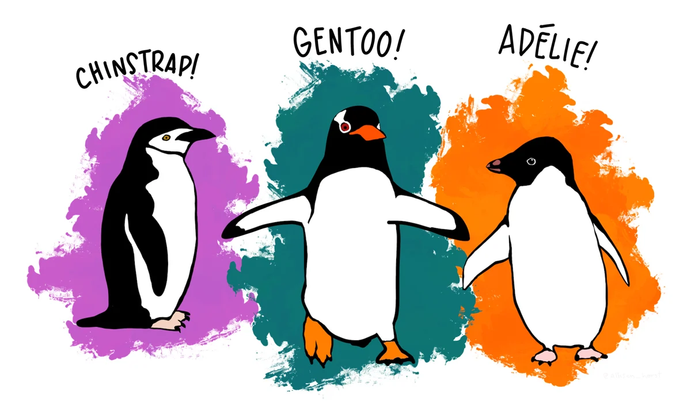
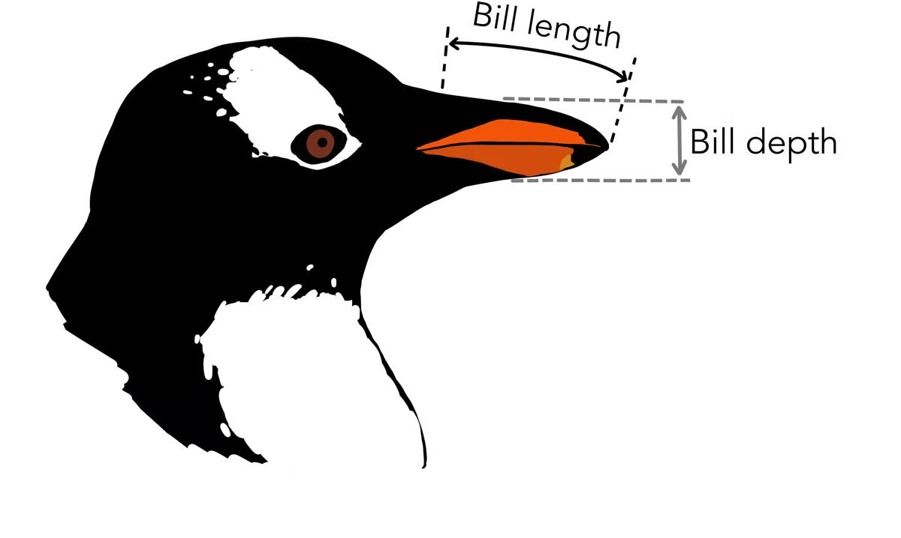
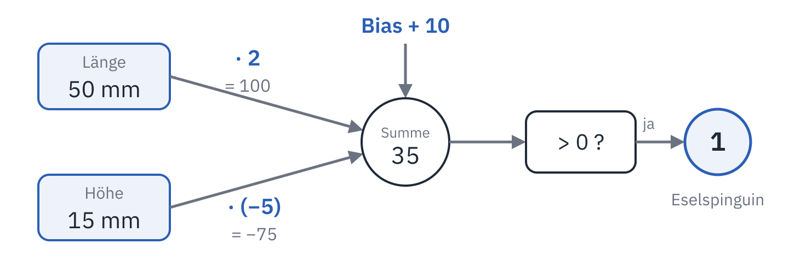
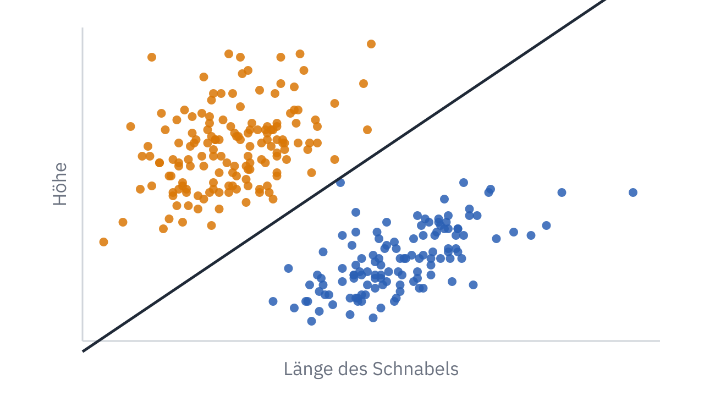

<div class='meta'>
image: teaser.webp
image_alt: "Punkte für 274 Pinguine in einem Diagramm, nach rechts die Länge des Schnabels, nach oben seine Höhe: Adéliepinguine oben links, Eselspinguine unten rechts, dazwischen die Gerade, die ein Neuron gelernt hat."
kind: projekt
duration: 2 Doppelstunden
languages: [ruby, python]
curriculum: "Sek I: Algorithmisches Problemlösen (Implementieren von Algorithmen), Geschichte der Informatik (Lebensläufe und Leistungen bedeutender Persönlichkeiten: vom Neuron auf Papier 1943 über Rosenblatts Perzeptron bis zur Kritik von Minsky und Papert); Oberstufe: Vertiefung Künstliche Intelligenz (ein Perzeptron, Lernen aus Beispielen, seine Grenzen)"
topics: [ki, geschichte]
requires: [kata-lists]
reference: [svg]
</div>

<div
    class="autotoc-secondary-trigger"
    data-title="Auf dieser Seite"
    data-levels="h2,h3">
</div>

# Ein Neuron lernt

<p class='abstract'>
Wie lernt ein Programm aus Beispielen, ohne dass jemand ihm die Regel verrät? Du baust ein künstliches Neuron, das an zwei Maßen des Schnabels erkennt, zu welcher Art ein Pinguin gehört, und das diese Regel selbst findet. Danach liest dasselbe Neuron handgeschriebene Ziffern, und du siehst, wo ein einzelnes Neuron nicht mehr weiterkommt.
</p>

## Die Pinguine

Auf den Inseln vor der Antarktischen Halbinsel hat die Biologin Kristen Gorman
von 2007 bis 2009 Pinguine vermessen: ihre Art, ihr Gewicht, die Länge ihrer
Flossen und ihren Schnabel. Drei Arten leben dort: der Zügelpinguin
(englisch Chinstrap), der Eselspinguin (Gentoo) und der Adéliepinguin.

_person(gorman)

<div class='gallery single'>
<figure><figcaption>Zügel-, Esels- und Adéliepinguin. Zeichnung: Allison Horst, CC0 (<a href='https://allisonhorst.github.io/palmerpenguins/'>palmerpenguins</a>)</figcaption></figure>
</div>

Der Adéliepinguin und der Eselspinguin sehen sich auf den ersten Blick
ähnlich. Am Schnabel kann man sie unterscheiden, wenn man weiß, worauf man
achten muss. Gemessen wurde er so:

<div class='gallery single'>
<figure><figcaption>Die Länge (bill length) und die Höhe (bill depth) des Schnabels; in der Datei heißen sie <code>bill_length_mm</code> und <code>bill_depth_mm</code>. Zeichnung: Allison Horst, CC0 (<a href='https://allisonhorst.github.io/palmerpenguins/'>palmerpenguins</a>)</figcaption></figure>
</div>

Du wirst ein Programm schreiben, das diese Regel selbst findet, nur aus den
Messungen und der Art jedes Pinguins. Niemand sagt ihm, worauf es achten soll.

_task(welcher-pinguin)

## Ein künstliches Neuron

Eine Nervenzelle im Gehirn bekommt Signale von anderen Zellen, manche stärker,
manche schwächer. Kommt insgesamt genug zusammen, feuert sie selbst ein Signal.
Ein **künstliches Neuron** rechnet das nach, in drei Schritten:

1. Jede Eingabe wird mit ihrem **Gewicht** multipliziert. Ein großes Gewicht
   heißt: Diese Eingabe zählt viel; ein negatives: Sie spricht dagegen.
2. Die Produkte werden addiert, dazu kommt eine feste Zahl, der **Bias**.
3. Ist die Summe größer als 0, sagt das Neuron 1, sonst 0.

Für einen Pinguin sind die Eingaben die Länge und die Höhe seines Schnabels in
Millimetern, und 1 heißt Eselspinguin, 0 Adéliepinguin. Mit den Gewichten 2 und
−5 und dem Bias 10 rechnet das Neuron für einen Schnabel, der 50 mm lang und
15 mm hoch ist:

$$2 \cdot 50 + (-5) \cdot 15 + 10 = 100 - 75 + 10 = 35$$

35 ist größer als 0: Das Neuron sagt 1, ein Eselspinguin.

 0 ?« und mit »ja« weiter zu einem Kreis mit 1, darunter »Eselspinguin«.'>

_task(von-hand)

Das erste solche Neuron beschrieben der Neurologe Warren McCulloch und der
Logiker Walter Pitts 1943, auf Papier. Frank Rosenblatt baute 1958 eines, das
seine Gewichte selbst einstellte: das **Perzeptron**.

_person(rosenblatt)

<div class='book'>
<i class='bi bi-file-earmark-text'></i>
<p><strong>The Perceptron: A Probabilistic Model for Information Storage and Organization in the Brain</strong>, Frank Rosenblatt, Psychological Review, 1958. Der Aufsatz, in dem ein Neuron seine Gewichte aus Beispielen lernt: <a href='https://www.ling.upenn.edu/courses/cogs501/Rosenblatt1958.pdf'>PDF</a>, auch bei der <a href='https://doi.org/10.1037/h0042519'>American Psychological Association</a>.</p>
</div>

## Einrichten

<!-- language: ruby -->
Lege einen Ordner an und lade die Messungen herunter:

```bash
mkdir -p ~/perzeptron
cd ~/perzeptron
wget ${web_root}/perzeptron/penguins.csv
touch neuron.rb learn.rb
```

In `neuron.rb` kommen die Funktionen des Neurons, in `learn.rb` das Programm,
das damit lernt. Ausprobieren kannst du die Funktionen in `irb`, das
`neuron.rb` vorher lädt:

```bash
irb -r ./neuron.rb
```
<!-- /language -->
<!-- language: python -->
Lege einen Ordner an und lade die Messungen herunter:

```bash
mkdir -p ~/perzeptron
cd ~/perzeptron
wget ${web_root}/perzeptron/penguins.csv
touch neuron.py learn.py
```

In `neuron.py` kommen die Funktionen des Neurons, in `learn.py` das Programm,
das damit lernt. Ausprobieren kannst du die Funktionen in Python, das
`neuron.py` vorher ausführt:

```bash
python3 -i neuron.py
```
<!-- /language -->

`penguins.csv` hat eine Zeile je Pinguin, 342 Zeilen: die Art, die Insel, die
Länge und die Höhe des Schnabels in Millimetern, die Länge der Flosse und das
Gewicht in Gramm.

```text
species,island,bill_length_mm,bill_depth_mm,flipper_length_mm,body_mass_g
Adelie,Torgersen,39.1,18.7,181,3750
```

## Ein Neuron lernt

### Das Neuron entscheidet

<div class='hint own' data-check='vorhersage'>
<strong>Jetzt bist du dran:</strong> Schreib die Funktion <code>predict(weights, bias, features)</code>:
Sie multipliziert jedes Merkmal mit seinem Gewicht, addiert die Produkte und den
Bias und gibt 1 zurück, wenn die Summe größer als 0 ist, sonst 0. Später hat
ein Neuron 64 Eingaben; schreib sie so, dass sie mit jeder Anzahl geht.
</div>

<!-- language: ruby -->
<!-- hint -->
`weights` und `features` sind gleich lange Listen. Geh sie mit einem Index
durch: `features.each_index do |i| … end`. Die Summe beginnt beim Bias.
<!-- /hint -->

<!-- solution -->
```ruby
# 1 oder 0: ist die gewichtete Summe der Merkmale plus Bias größer als 0?
def predict(weights, bias, features)
  sum = bias
  features.each_index do |i|
    sum += weights[i] * features[i]
  end
  sum > 0 ? 1 : 0
end
```
<!-- /solution -->
<!-- /language -->
<!-- language: python -->
<!-- hint -->
`weights` und `features` sind gleich lange Listen. Geh sie mit einem Index
durch: `for i in range(len(features)):`. Die Summe beginnt beim Bias.
<!-- /hint -->

<!-- solution -->
```python
# 1 oder 0: ist die gewichtete Summe der Merkmale plus Bias größer als 0?
def predict(weights, bias, features):
    total = bias
    for i in range(len(features)):
        total += weights[i] * features[i]
    return 1 if total > 0 else 0
```
<!-- /solution -->
<!-- /language -->

<!-- language: ruby -->
<!-- stage: stufen/neuron-1.rb as neuron.rb -->
<!-- /language -->
<!-- language: python -->
<!-- stage: stufen/neuron-1.py as neuron.py -->
<!-- /language -->

_task(vorhersage)

Damit das Neuron die Pinguine sieht, liest diese Funktion die Datei. Sie gibt
für jeden Pinguin der beiden Arten ein Paar zurück: die zwei Maße des Schnabels
und die Art als Zahl, 1 für die zweite der beiden Arten, 0 für die erste. Schreib
sie unter `predict` in dieselbe Datei:

<!-- language: ruby -->
```ruby
# Die Pinguine zweier Arten als [[Länge, Höhe], 0 oder 1]
def penguins(path, species)
  File.readlines(path).drop(1).filter_map do |line|
    name, _island, length, depth = line.split(",")
    next unless species.include?(name)

    [[length.to_f, depth.to_f], name == species[1] ? 1 : 0]
  end
end
```

<!-- stage: stufen/neuron-2.rb as neuron.rb -->
<!-- /language -->
<!-- language: python -->
```python
# Die Pinguine zweier Arten als [[Länge, Höhe], 0 oder 1]
def penguins(path, species):
    examples = []
    for line in open(path).readlines()[1:]:
        name, _island, length, depth = line.split(",")[:4]
        if name in species:
            examples.append([[float(length), float(depth)], 1 if name == species[1] else 0])
    return examples
```

<!-- stage: stufen/neuron-2.py as neuron.py -->
<!-- /language -->

### Lernen aus Fehlern

Woher kommen die Gewichte? Am Anfang sind alle 0, und das Neuron sagt zu jedem
Pinguin 0. Dann geht es die Pinguine einen nach dem anderen durch und
vergleicht, was es sagt, mit der richtigen Art. Liegt es richtig, ändert es
nichts. Liegt es falsch, verschiebt es seine Gewichte ein Stück in die Richtung
der richtigen Antwort:

- Hat es 0 gesagt, aber 1 wäre richtig, addiert es die Merkmale des Pinguins
  zu seinen Gewichten und 1 zum Bias. Beim nächsten Mal wird seine Summe für
  einen ähnlichen Pinguin größer.
- Hat es 1 gesagt, aber 0 wäre richtig, zieht es sie ab, und 1 vom Bias.

Kurz: Der Fehler ist die richtige Antwort minus die Vorhersage, also 1, −1 oder
0, und jedes Gewicht bekommt Fehler mal Merkmal dazu, der Bias den Fehler.

$$w\_i \leftarrow w\_i + (t - y) \cdot x\_i \qquad b \leftarrow b + (t - y)$$

Ein Durchgang durch alle Pinguine heißt **Epoche**. Nach einer Epoche fängt das
Neuron wieder vorne an, bis es in einer ganzen Epoche keinen Fehler mehr macht.

<div class='hint own' data-check='lernen'>
<strong>Jetzt bist du dran:</strong> Schreib die Funktion <code>train(examples, epochs)</code>:
Sie beginnt mit Gewichten 0 und Bias 0, geht höchstens <code>epochs</code>-mal
alle Beispiele durch, lernt aus jedem Fehler nach der Regel oben, gibt nach jeder
Epoche aus, wie viele Fehler es waren, hört nach einer Epoche ohne Fehler auf
und gibt die Gewichte und den Bias zurück.
</div>

<!-- language: ruby -->
<!-- hint -->
Die Gewichte sind eine Liste mit so vielen Nullen, wie ein Beispiel Merkmale
hat: `Array.new(examples[0][0].size, 0.0)`. Ein Beispiel ist ein Paar
`features, target`.
<!-- /hint -->

<!-- hint -->
Zwei Schleifen ineinander: außen die Epochen, innen die Beispiele. In der
inneren: vorhersagen, den Fehler `target - prediction` ausrechnen, und wenn er
nicht 0 ist, die Gewichte und den Bias ändern und den Fehler zählen.
<!-- /hint -->

<!-- hint -->
<!-- page-code: own -->
```ruby
def train(examples, epochs)
  weights = Array.new(examples[0][0].size, 0.0)
  bias = 0.0
  epochs.times do |epoch|
    errors = 0
    examples.each do |features, target|
      # hier: vorhersagen, den Fehler ausrechnen, bei einem Fehler
      # weights und bias ändern und errors zählen
    end
    puts "Epoche #{epoch + 1}: #{errors} Fehler"
    break if errors == 0
  end
  [weights, bias]
end
```
<!-- /hint -->

<!-- solution -->
```ruby
# Lernt Gewichte und Bias aus Beispielen [Merkmale, 0 oder 1], höchstens epochs Epochen lang
def train(examples, epochs)
  weights = Array.new(examples[0][0].size, 0.0)
  bias = 0.0
  epochs.times do |epoch|
    errors = 0
    examples.each do |features, target|
      error = target - predict(weights, bias, features)
      next if error == 0

      features.each_index do |i|
        weights[i] += error * features[i]
      end
      bias += error
      errors += 1
    end
    puts "Epoche #{epoch + 1}: #{errors} Fehler"
    break if errors == 0
  end
  [weights, bias]
end
```
<!-- /solution -->
<!-- /language -->
<!-- language: python -->
<!-- hint -->
Die Gewichte sind eine Liste mit so vielen Nullen, wie ein Beispiel Merkmale
hat: `[0.0] * len(examples[0][0])`. Ein Beispiel ist ein Paar
`features, target`.
<!-- /hint -->

<!-- hint -->
Zwei Schleifen ineinander: außen die Epochen, innen die Beispiele. In der
inneren: vorhersagen, den Fehler `target - prediction` ausrechnen, und wenn er
nicht 0 ist, die Gewichte und den Bias ändern und den Fehler zählen.
<!-- /hint -->

<!-- hint -->
<!-- page-code: own -->
```python
def train(examples, epochs):
    weights = [0.0] * len(examples[0][0])
    bias = 0.0
    for epoch in range(epochs):
        errors = 0
        for features, target in examples:
            # hier: vorhersagen, den Fehler ausrechnen, bei einem Fehler
            # weights und bias ändern und errors zählen
            ...
        print(f"Epoche {epoch + 1}: {errors} Fehler")
        if errors == 0:
            break
    return weights, bias
```
<!-- /hint -->

<!-- solution -->
```python
# Lernt Gewichte und Bias aus Beispielen [Merkmale, 0 oder 1], höchstens epochs Epochen lang
def train(examples, epochs):
    weights = [0.0] * len(examples[0][0])
    bias = 0.0
    for epoch in range(epochs):
        errors = 0
        for features, target in examples:
            error = target - predict(weights, bias, features)
            if error == 0:
                continue
            for i in range(len(features)):
                weights[i] += error * features[i]
            bias += error
            errors += 1
        print(f"Epoche {epoch + 1}: {errors} Fehler")
        if errors == 0:
            break
    return weights, bias
```
<!-- /solution -->
<!-- /language -->

<!-- language: ruby -->
<!-- stage: stufen/neuron-3.rb as neuron.rb -->
<!-- /language -->
<!-- language: python -->
<!-- stage: stufen/neuron-3.py as neuron.py -->
<!-- /language -->

_task(lernen)

_task(fehlerfrei)

<!-- language: ruby -->
Schreib das Programm in `learn.rb`:

```ruby
require_relative "neuron"

examples = penguins("penguins.csv", ["Adelie", "Gentoo"])
weights, bias = train(examples, 100)
puts "Gewichte: #{weights.map { |w| w.round(1) }}, Bias: #{bias.round(1)}"
```

```bash
ruby learn.rb
```

<!-- stage: stufen/learn-1.rb as learn.rb -->
<!-- /language -->
<!-- language: python -->
Schreib das Programm in `learn.py`:

```python
from neuron import *

examples = penguins("penguins.csv", ["Adelie", "Gentoo"])
weights, bias = train(examples, 100)
print(f"Gewichte: {[round(w, 1) for w in weights]}, Bias: {round(bias, 1)}")
```

```bash
python3 learn.py
```

<!-- stage: stufen/learn-1.py as learn.py -->
<!-- /language -->

<!-- after: fehlerfrei -->
_task(epochen)
<!-- /after -->

### Was das Neuron gelernt hat

<!-- after: epochen -->
Nach zwölf Epochen ordnet das Neuron alle 274 Pinguine richtig ein, mit den
Gewichten 29.1 und −74.0 und dem Bias −1. Als Regel gelesen: Ein Pinguin ist ein
Eselspinguin, wenn

$$29{,}1 \cdot \text{Länge} - 74 \cdot \text{Höhe} - 1 > 0$$

Die Länge hat ein positives Gewicht, die Höhe ein negatives: Ein langer, flacher
Schnabel spricht für den Eselspinguin, ein kurzer, hoher für den Adéliepinguin.
Niemand hat dem Neuron das gesagt; es hat die Regel aus 274 Beispielen.
<!-- /after -->

Die Pinguine, für die die Summe genau 0 ist, liegen auf einer Geraden. Auf der
einen Seite sagt das Neuron 0, auf der anderen 1. Diese Funktion zeichnet die
Pinguine und die Gerade in eine Datei `plot.svg`, die VS Code als Bild öffnet; sie gehört wie die anderen Funktionen in `neuron.rb` (in Python `neuron.py`).
Ein SVG-Bild ist Text, Kreise und Linien mit ihren Koordinaten; wie es aufgebaut
ist, steht im Handbuch unter [SVG](/reference/svg):

<!-- language: ruby -->
```ruby
# Die Beispiele als Punkte (Länge nach rechts, Höhe nach oben) und die Gerade,
# auf der die Summe des Neurons 0 ist, als SVG in path
def plot(examples, weights, bias, path)
  x0, x1, y0, y1 = 30.0, 62.0, 12.0, 23.0
  sx = ->(x) { (x - x0) / (x1 - x0) * 600 + 40 }
  sy = ->(y) { 440 - (y - y0) / (y1 - y0) * 400 }
  svg = ["<svg xmlns='http://www.w3.org/2000/svg' viewBox='0 0 680 480'>",
         "<rect width='680' height='480' fill='white'/>"]
  examples.each do |(length, depth), target|
    colour = target == 1 ? "#2b5fb4" : "#d97706"
    svg << "<circle cx='#{sx.(length)}' cy='#{sy.(depth)}' r='4' fill='#{colour}'/>"
  end
  if weights[1] != 0
    ya = -(weights[0] * x0 + bias) / weights[1]
    yb = -(weights[0] * x1 + bias) / weights[1]
    svg << "<line x1='#{sx.(x0)}' y1='#{sy.(ya)}' x2='#{sx.(x1)}' y2='#{sy.(yb)}' stroke='black' stroke-width='2'/>"
  end
  svg << "</svg>"
  File.write(path, svg.join("\n"))
end
```

Und am Ende von `learn.rb`:

```ruby
plot(examples, weights, bias, "plot.svg")
```

<!-- stage: stufen/neuron-4.rb as neuron.rb -->
<!-- stage: stufen/learn-2.rb as learn.rb -->
<!-- /language -->
<!-- language: python -->
```python
# Die Beispiele als Punkte (Länge nach rechts, Höhe nach oben) und die Gerade,
# auf der die Summe des Neurons 0 ist, als SVG in path
def plot(examples, weights, bias, path):
    x0, x1, y0, y1 = 30.0, 62.0, 12.0, 23.0
    def sx(x):
        return (x - x0) / (x1 - x0) * 600 + 40
    def sy(y):
        return 440 - (y - y0) / (y1 - y0) * 400
    svg = ["<svg xmlns='http://www.w3.org/2000/svg' viewBox='0 0 680 480'>",
           "<rect width='680' height='480' fill='white'/>"]
    for (length, depth), target in examples:
        colour = "#2b5fb4" if target == 1 else "#d97706"
        svg.append(f"<circle cx='{sx(length)}' cy='{sy(depth)}' r='4' fill='{colour}'/>")
    if weights[1] != 0:
        ya = -(weights[0] * x0 + bias) / weights[1]
        yb = -(weights[0] * x1 + bias) / weights[1]
        svg.append(f"<line x1='{sx(x0)}' y1='{sy(ya)}' x2='{sx(x1)}' y2='{sy(yb)}' stroke='black' stroke-width='2'/>")
    svg.append("</svg>")
    with open(path, "w") as f:
        f.write("\n".join(svg))
```

Und am Ende von `learn.py`:

```python
plot(examples, weights, bias, "plot.svg")
```

<!-- stage: stufen/neuron-4.py as neuron.py -->
<!-- stage: stufen/learn-2.py as learn.py -->
<!-- /language -->

<!-- after: epochen -->
Nach zwölf Epochen sieht `plot.svg` ungefähr so aus, blau die Eselspinguine,
orange die Adéliepinguine:


<!-- /after -->

<div class='hint try'>
<strong>Ausprobieren:</strong> Ändere in <code>train</code> die Zahl der Epochen
auf 1, dann auf 3, und öffne <code>plot.svg</code> jedes Mal neu. Achte darauf,
wie die Gerade sich von Epoche zu Epoche zwischen die beiden Gruppen schiebt.
</div>

## Was das Neuron kann und was nicht

### Pinguine, die das Neuron nie gesehen hat

Dass das Neuron alle Pinguine richtig einordnet, aus denen es gelernt hat, sagt
noch nicht viel: Vielleicht hat es sich nur genau diese gemerkt. Ob es die Regel
gelernt hat, zeigt sich an Pinguinen, die es nie gesehen hat. Darum lernt es
jetzt nur aus jedem zweiten Pinguin und wird an den anderen geprüft.

<div class='hint own' data-check='genauigkeit'>
<strong>Jetzt bist du dran:</strong> Schreib die Funktion <code>accuracy(weights, bias, examples)</code>,
die den Anteil der Beispiele zurückgibt, die das Neuron richtig einordnet, als
Zahl von 0 bis 1.
</div>

<!-- language: ruby -->
<!-- hint -->
Zähl die Beispiele, bei denen `predict` die richtige Antwort gibt:
`examples.count { |features, target| … }`. Dann teile durch die Zahl aller
Beispiele, mit `to_f` vorher, denn in Ruby ergibt `3 / 4` die ganze Zahl 0.
<!-- /hint -->

<!-- solution -->
```ruby
# Der Anteil der Beispiele, die das Neuron richtig einordnet
def accuracy(weights, bias, examples)
  right = examples.count { |features, target| predict(weights, bias, features) == target }
  right.to_f / examples.size
end
```
<!-- /solution -->
<!-- /language -->
<!-- language: python -->
<!-- hint -->
Zähl die Beispiele, bei denen `predict` die richtige Antwort gibt, in einer
Schleife über `for features, target in examples:`. Dann teile durch
`len(examples)`.
<!-- /hint -->

<!-- solution -->
```python
# Der Anteil der Beispiele, die das Neuron richtig einordnet
def accuracy(weights, bias, examples):
    right = sum(1 for features, target in examples if predict(weights, bias, features) == target)
    return right / len(examples)
```
<!-- /solution -->
<!-- /language -->

<!-- language: ruby -->
<!-- stage: stufen/neuron-5.rb as neuron.rb -->
<!-- /language -->
<!-- language: python -->
<!-- stage: stufen/neuron-5.py as neuron.py -->
<!-- /language -->

_task(genauigkeit)

<!-- language: ruby -->
In `learn.rb`, statt aus allen Pinguinen zu lernen:

```ruby
~ examples = penguins("penguins.csv", ["Adelie", "Gentoo"])
training = examples.select.with_index { |_, i| i.even? }
test = examples.select.with_index { |_, i| i.odd? }
weights, bias = train(training, 100)
puts "Richtig bei Pinguinen, die es nie gesehen hat: #{(accuracy(weights, bias, test) * 100).round(1)} %"
```

<!-- stage: stufen/learn-3.rb as learn.rb -->
<!-- /language -->
<!-- language: python -->
In `learn.py`, statt aus allen Pinguinen zu lernen:

```python
~ examples = penguins("penguins.csv", ["Adelie", "Gentoo"])
training = examples[0::2]
test = examples[1::2]
weights, bias = train(training, 100)
print(f"Richtig bei Pinguinen, die es nie gesehen hat: {round(accuracy(weights, bias, test) * 100, 1)} %")
```

<!-- stage: stufen/learn-3.py as learn.py -->
<!-- /language -->

_task(nie-gesehen)

### Wo ein Neuron nicht weiterkommt

Auf der Insel Dream lebt eine dritte Art, der Zügelpinguin (englisch
Chinstrap). Kann das Neuron ihn vom Adéliepinguin unterscheiden?

_task(zuegelpinguin)

<!-- after: zuegelpinguin -->
Das Neuron hört nie auf, Fehler zu machen. Nach jeder Epoche verschiebt es die
Gerade wieder, weil es einen Pinguin falsch einordnet, und dabei rutscht ein
anderer auf die falsche Seite. Es gibt keine Gerade, die alle Adélie- und alle
Zügelpinguine trennt: Ein Zügelpinguin hat einen Schnabel, wie ihn sonst nur
Adéliepinguine haben. Ein Neuron kann nur trennen, was sich mit einer Geraden
trennen lässt.
<!-- /after -->

Das gilt auch für Aufgaben, bei denen es keinen einzigen Ausreißer gibt.
Das bekannteste Beispiel ist **XOR**, »entweder oder«: Die Antwort ist 1, wenn
genau eine von zwei Eingaben 1 ist.

<div class='scroll-x'>
<table class='table'>
<tr><th>Eingabe 1</th><th>Eingabe 2</th><th>XOR</th></tr>
<tr><td>0</td><td>0</td><td>0</td></tr>
<tr><td>0</td><td>1</td><td>1</td></tr>
<tr><td>1</td><td>0</td><td>1</td></tr>
<tr><td>1</td><td>1</td><td>0</td></tr>
</table>
</div>

<div class='hint try'>
<strong>Ausprobieren:</strong> Lass dein Neuron XOR lernen:
<code>train([[[0, 0], 0], [[0, 1], 1], [[1, 0], 1], [[1, 1], 0]], 20)</code>.
Achte darauf, wie viele Fehler es in den letzten Epochen macht.
</div>

Die vier Punkte liegen an den Ecken eines Quadrats, die beiden mit der Antwort 1
schräg gegenüber. Keine Gerade hat die beiden 1 auf der einen und die beiden 0
auf der anderen Seite. Das bewiesen Marvin Minsky und Seymour Papert 1969 in
ihrem Buch »Perceptrons«, und für viele Jahre glaubte kaum jemand mehr an
lernende Neuronen.

Die Lösung kam später: mehrere Neuronen in **Schichten** hintereinander. Zwei
Neuronen in einer ersten Schicht ziehen zwei Geraden, ein drittes dahinter
entscheidet aus ihren Antworten. So geht XOR, und mit vielen Schichten und
Millionen von Neuronen gehen auch Bilder, Sprache und Spiele. Wie man die
Gewichte vieler Schichten lernt, ist schwieriger als bei einem einzelnen Neuron
und kam erst in den 1980er Jahren in Gang.

## Ziffern lesen

Dein Neuron kennt nichts von Pinguinen. Es nimmt Zahlen, multipliziert sie mit
Gewichten und vergleicht die Summe mit 0. Ob die Zahlen Schnäbel sind oder
etwas anderes, ist ihm gleich.

Handgeschriebene Ziffern, auf 8 mal 8 Kästchen verkleinert, sind 64 Zahlen: wie
dunkel jedes Kästchen ist, von 0 (weiß) bis 16 (schwarz). 43 Menschen haben
dafür Ziffern geschrieben, Forschende an der Universität Boğaziçi in Istanbul
haben sie 1998 gesammelt. Zwei Dateien: Aus `digits-train.csv` lernt das
Neuron, an `digits-test.csv` wird es geprüft, mit Ziffern von Menschen, deren
Handschrift es nie gesehen hat. Jede Zeile hat 65 Zahlen, die 64 Kästchen
Zeile für Zeile und am Ende die Ziffer.

```bash
wget ${web_root}/perzeptron/digits-train.csv ${web_root}/perzeptron/digits-test.csv
```

<!-- language: ruby -->
```ruby
# Die Ziffern a und b als [64 Kästchen, 0 für a oder 1 für b]
def digits(path, a, b)
  File.readlines(path).filter_map do |line|
    values = line.split(",").map(&:to_i)
    next unless [a, b].include?(values[64])

    [values[0, 64], values[64] == b ? 1 : 0]
  end
end
```

<!-- stage: stufen/neuron-6.rb as neuron.rb -->
<!-- /language -->
<!-- language: python -->
```python
# Die Ziffern a und b als [64 Kästchen, 0 für a oder 1 für b]
def digits(path, a, b):
    examples = []
    for line in open(path):
        values = [int(v) for v in line.split(",")]
        if values[64] in (a, b):
            examples.append([values[:64], 1 if values[64] == b else 0])
    return examples
```

<!-- stage: stufen/neuron-6.py as neuron.py -->
<!-- /language -->

_task(nullen-und-einsen)

<!-- language: ruby -->
In `learn.rb`, statt der Pinguine:

```ruby
training = digits("digits-train.csv", 0, 1)
test = digits("digits-test.csv", 0, 1)
weights, bias = train(training, 100)
puts "Richtig bei fremden Handschriften: #{(accuracy(weights, bias, test) * 100).round(1)} %"
```

<!-- stage: stufen/learn-4.rb as learn.rb -->
<!-- /language -->
<!-- language: python -->
In `learn.py`, statt der Pinguine:

```python
training = digits("digits-train.csv", 0, 1)
test = digits("digits-test.csv", 0, 1)
weights, bias = train(training, 100)
print(f"Richtig bei fremden Handschriften: {round(accuracy(weights, bias, test) * 100, 1)} %")
```

<!-- stage: stufen/learn-4.py as learn.py -->
<!-- /language -->

<!-- after: nullen-und-einsen -->
Mit 0 gegen 1 lernt das Neuron in zehn Epochen fehlerfrei, und auch die Ziffern
der anderen Menschen ordnet es alle richtig ein. Schwieriger sind Ziffern, die
sich ähnlich sehen.
<!-- /after -->

_task(drei-und-acht)

### Was das Neuron sieht

Die 64 Gewichte gehören zu den 64 Kästchen. Ein großes positives Gewicht heißt:
Ist dieses Kästchen dunkel, spricht das für die zweite Ziffer; ein negatives:
für die erste. Zeichnest du die Gewichte als 8 mal 8 Kästchen, blau für positiv
und orange für negativ, siehst du, worauf das Neuron achtet. Auch diese Funktion
gehört in `neuron.rb` (in Python `neuron.py`):

<!-- language: ruby -->
```ruby
# Die 64 Gewichte als 8 × 8 Kästchen, blau positiv, orange negativ, als SVG in path
def picture(weights, path)
  top = weights.map(&:abs).max
  svg = ["<svg xmlns='http://www.w3.org/2000/svg' viewBox='0 0 160 160'>"]
  weights.each_with_index do |w, i|
    colour = w > 0 ? "43,95,180" : "217,119,6"
    opacity = (w.abs / top).round(2)
    svg << "<rect x='#{i % 8 * 20}' y='#{i / 8 * 20}' width='20' height='20' fill='rgb(#{colour})' fill-opacity='#{opacity}'/>"
  end
  svg << "</svg>"
  File.write(path, svg.join("\n"))
end
```

<!-- stage: stufen/neuron-7.rb as neuron.rb -->
<!-- /language -->
<!-- language: python -->
```python
# Die 64 Gewichte als 8 × 8 Kästchen, blau positiv, orange negativ, als SVG in path
def picture(weights, path):
    top = max(abs(w) for w in weights)
    svg = ["<svg xmlns='http://www.w3.org/2000/svg' viewBox='0 0 160 160'>"]
    for i, w in enumerate(weights):
        colour = "43,95,180" if w > 0 else "217,119,6"
        opacity = round(abs(w) / top, 2)
        svg.append(f"<rect x='{i % 8 * 20}' y='{i // 8 * 20}' width='20' height='20' fill='rgb({colour})' fill-opacity='{opacity}'/>")
    svg.append("</svg>")
    with open(path, "w") as f:
        f.write("\n".join(svg))
```

<!-- stage: stufen/neuron-7.py as neuron.py -->
<!-- /language -->

<div class='hint try'>
<strong>Ausprobieren:</strong> Lass dein Neuron 0 gegen 1 lernen und zeichne
seine Gewichte mit <code>picture(weights, "weights.svg")</code>. Achte darauf,
wo die blauen Kästchen liegen und wo die orangen, und vergleiche mit einer
geschriebenen 0 und einer 1.
</div>

### Deine eigene Handschrift

Das Neuron hat aus den Ziffern von 30 Menschen gelernt. Erkennt es auch deine?
Dafür bringst du dein Neuron hierher, auf die Seite. Lass dein Programm,
nachdem es 0 gegen 1 gelernt hat, die 64 Gewichte und den Bias ausgeben, als
eine Zeile mit 65 Zahlen; schreib dazu ans Ende deines Programms:

<!-- language: ruby -->
```ruby
puts (weights + [bias]).join(" ")
```

<!-- stage: stufen/learn-5.rb as learn.rb -->
<!-- /language -->
<!-- language: python -->
```python
print(" ".join(str(v) for v in weights + [bias]))
```

<!-- stage: stufen/learn-5.py as learn.py -->
<!-- /language -->

Dann:

1. Kopiere die Zeile mit den 65 Zahlen aus dem Terminal in das Feld unter der
   Zeichenfläche.
2. Zeichne eine Ziffer. Unter dem Feld steht, was dein Neuron dazu sagt, und es
   ändert sich, während du zeichnest.

Wie bei den Ziffern, aus denen das Neuron gelernt hat, wird deine Zeichnung auf
32 mal 32 Punkte gebracht, so dass sie die Fläche füllt, und daraus werden die
64 Werte. Hast du noch kein Neuron, nimm das Beispiel: Es hat 0 gegen 1 gelernt,
so wie dein Neuron mit dem Programm oben.

<script src='/include/neuron_pad.js'></script>
<div class='neuron-pad' data-neuron-pad data-example='0 -1 -19 -13 18 77 32 0 0 4 -38 32 44 5 31 0 0 23 44 84 113 -52 -32 0 0 -19 -43 67 115 -21 -71 0 0 -16 -81 80 101 -6 -61 0 0 -18 -106 3 51 -36 -23 0 0 -4 -49 -65 -19 -35 21 0 0 1 -8 -50 1 64 26 4 3'></div>

<div class='hint try'>
<strong>Ausprobieren:</strong> Zeichne mit den Gewichten für 0 gegen 1 eine
schmale und eine breite 0, eine gerade und eine schräge 1, und eine 7. Achte
darauf, bei welcher Zeichnung die Summe nahe bei 0 liegt.
</div>

## Zum Nachschlagen

- [Katas: Listen](/kata-lists): Listen durchgehen, mit Index und ohne
- Die Pinguine: Kristen Gorman, Tony Williams und William Fraser,
  [»Ecological Sexual Dimorphism and Environmental Variability within a
  Community of Antarctic Penguins«](https://doi.org/10.1371/journal.pone.0090081),
  PLOS ONE, 2014; die Daten unter CC0 im Paket
  [palmerpenguins](https://allisonhorst.github.io/palmerpenguins/)
- Die Ziffern: [Optical Recognition of Handwritten Digits](https://archive.ics.uci.edu/dataset/80/optical+recognition+of+handwritten+digits),
  E. Alpaydin und C. Kaynak, 1998, im UCI Machine Learning Repository, unter
  CC BY 4.0
