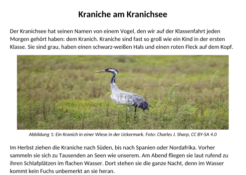
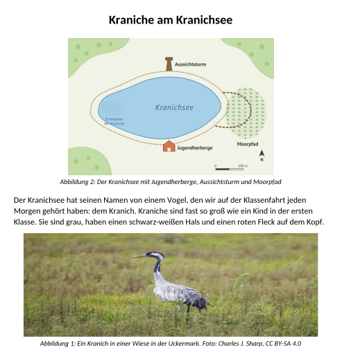
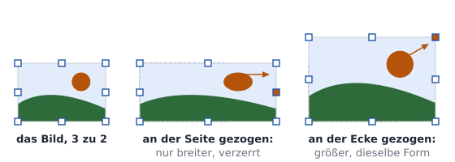
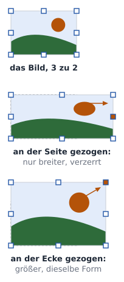
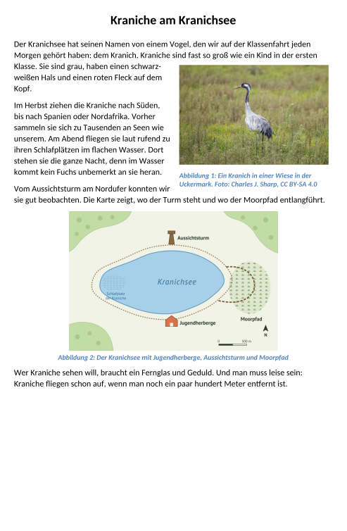

image: teaser.webp
image_alt: "Ein Artikel über Kraniche: unter dem ersten Absatz ein Foto, das so in die Breite gezogen ist, dass der Kranich dick aussieht"
kind: labor
duration: 1 Stunde (45 Minuten)
curriculum: "Sek I: Standardsoftware (Umgang mit Textverarbeitungssoftware); Medienbildung: Produzieren (Gestaltung von Medienproduktionen, eigene und lizenzierte Gestaltungselemente)"
topics: [standardsoftware]
language: LibreOffice / Word / Nextcloud Office
languages: [libreoffice, word, nextcloud]
requires: [word-tables]
reference: []

# Bilder im Text

Für die Zeitung der Klassenfahrt hat jemand einen Artikel über die Kraniche
am Kranichsee geschrieben, mit einem Foto und einer Karte. So fängt er an:

Unter jedem Bild steht eine **Bildunterschrift** mit einer Nummer:
»Abbildung 1« unter dem Kranich, weiter unten »Abbildung 2« unter der Karte.

_task(nummern)

<!-- after: nummern -->

Die Nummern hat jemand getippt. Das Programm weiß nicht, dass sie die Bilder
zählen sollen, und lässt sie stehen, wie sie sind. In einem Artikel mit zwei
Bildern fällt das noch auf; in einem Referat mit zwölf Bildern nicht mehr.
<!-- /after -->

## Das Seitenverhältnis

Hol dir den Artikel:

<a class='document-starter btn btn-primary' href='/pictures-in-text/05%20Kraniche.docx' download><i class='bi bi-file-earmark-word' aria-hidden='true'></i>Vorlage herunterladen:05 Kraniche.docx</a>

Ein Foto besteht aus Pixeln, dieses aus 1500 nebeneinander und 1000
untereinander. Wie breit es im Verhältnis zu seiner Höhe ist, heißt
**Seitenverhältnis**: hier 1500 zu 1000, also 3 zu 2. Zieht man an der Seite
eines Bildes, wird es nur breiter, nicht höher: Das Seitenverhältnis stimmt
nicht mehr, und alles darauf wird verzerrt. Genau das ist dem Kranich
passiert. Zieht man dagegen an einer Ecke, wächst das Bild in beide
Richtungen gleich.

<!-- language: word -->
1. Mit der rechten Maustaste auf das Foto klicken, *Größe und Position…*.
2. Im Register *Größe* den Haken bei *Seitenverhältnis sperren* setzen und
   unten auf *Zurücksetzen* klicken: Das Foto hat wieder seine eigene Form.
3. Oben bei *Breite* in das Feld *Absolut* die Breite tippen, etwa 7,5 cm.
   Die Höhe rechnet Word selbst aus.
4. *OK*.
<!-- /language -->
<!-- language: libreoffice nextcloud -->
1. Mit der rechten Maustaste auf das Foto klicken, *Eigenschaften…*.
2. Im Register *Typ* den Haken bei *Verhältnis beibehalten* setzen und auf
   *Originalgröße* klicken: Das Foto hat wieder seine eigene Form.
3. Bei *Breite* die Breite tippen, etwa 7,5 cm. Die Höhe rechnet das
   Programm selbst aus.
4. *OK*.
<!-- /language -->

_task(hoehe)

**Jetzt bist du dran:** Gib dem Foto seine eigene Form zurück und mach es
7,5 cm breit. Sieh nach, ob die Höhe stimmt, die du ausgerechnet hast.

## Text neben dem Bild

Ein Bild, das man einfügt, steht zuerst in der Zeile wie ein sehr großer
Buchstabe. Daneben kann kein Text stehen, und ein kleines Foto lässt rechts
und links viel Platz frei. Damit der Text neben dem Bild weiterläuft, braucht
das Bild einen anderen **Textumbruch**: Dann fließt der Text um das Bild herum,
und du kannst das Bild an den Rand schieben.

<!-- language: word -->
1. Auf das Foto klicken. Erst wenn es ausgewählt ist, erscheint oben rechts
   neben ihm ein kleiner Knopf *Layoutoptionen* und oben im Menüband das
   Register *Bildformat*.
2. Im Knopf *Layoutoptionen* *Quadrat* wählen. Findest du den Knopf nicht:
   *Bildformat* <i class='bi bi-chevron-right' aria-hidden='true'></i> *Textumbruch* <i class='bi bi-chevron-right' aria-hidden='true'></i> *Quadrat*.
3. Das Foto an den rechten Rand schieben, neben den ersten Absatz.
<!-- /language -->
<!-- language: libreoffice nextcloud -->
1. Mit der rechten Maustaste auf das Foto klicken, *Verankerung* <i class='bi bi-chevron-right' aria-hidden='true'></i> *Am
   Absatz*: Jetzt hängt es am Absatz statt in der Zeile.
2. Noch einmal mit der rechten Maustaste, *Umlauf* <i class='bi bi-chevron-right' aria-hidden='true'></i> *Parallel*.
3. Das Foto an den rechten Rand schieben, neben den ersten Absatz.
<!-- /language -->

Zum Schieben packst du das Foto in der Mitte, nicht an den kleinen Kreisen
oder Quadraten am Rand: Die an den Seiten verzerren es wieder, die an den
Ecken ändern seine Größe. Ist etwas verrutscht, macht
<kbd>Strg</kbd>+<kbd>Z</kbd> es rückgängig.

**Jetzt bist du dran:** Stell das Foto rechts neben den ersten Absatz.

<strong>Ausprobieren:</strong> Schreib ein paar Wörter in den ersten Absatz und lösch sie wieder. Achte darauf, ob das Foto beim Absatz bleibt und wie die Zeilen neben ihm umbrechen.

## Bildunterschriften, die zählen

Eine Bildunterschrift, die das Programm einfügt, heißt **Beschriftung**. Ihre
Nummer ist keine getippte Zahl, sondern ein **Feld**: ein Platzhalter, für den
das Programm selbst ausrechnet, das wievielte Bild das ist. Kommt ein Bild
dazu oder wandert eins nach oben, stimmen die Nummern wieder, sobald die
Felder aktualisiert sind.

<!-- language: word -->
1. Mit der rechten Maustaste auf das Foto klicken, *Beschriftung einfügen…*.
2. Bei *Bezeichnung* *Abbildung* wählen. Oben im Feld *Beschriftung* steht
   jetzt *Abbildung 1*: Klick dahinter und schreib den Text der alten
   Unterschrift dazu, beim Foto *: Ein Kranich in einer Wiese in der Uckermark*. Dann *OK*.
3. Die alte, getippte Unterschrift löschen.
4. Alle Felder aktualisieren: <kbd>Strg</kbd>+<kbd>A</kbd>, dann <kbd>F9</kbd>
   (auf manchen Laptops <kbd>Fn</kbd>+<kbd>F9</kbd>).
<!-- /language -->
<!-- language: libreoffice -->
1. Mit der rechten Maustaste auf das Foto klicken, *Beschriftung einfügen…*.
2. Bei *Kategorie* *Abbildung* wählen, im Feld *Beschriftung* den Text der
   alten Unterschrift schreiben. Dann *Einfügen*.
3. Die alte, getippte Unterschrift löschen.
4. Die Felder aktualisieren: <kbd>F9</kbd> (auf manchen Laptops
   <kbd>Fn</kbd>+<kbd>F9</kbd>).
<!-- /language -->
<!-- language: nextcloud -->
1. Mit der rechten Maustaste auf das Foto klicken, *Beschriftung einfügen…*.
2. Bei *Kategorie* *Abbildung* wählen, im Feld *Beschriftung* den Text der
   alten Unterschrift schreiben. Dann *Einfügen*.
3. Die alte, getippte Unterschrift löschen.
<!-- /language -->

**Jetzt bist du dran:** Gib beiden Bildern eine Beschriftung und lösch die
getippten Unterschriften.

## Der Alternativtext

Nicht alle, die den Artikel lesen, sehen die Bilder. Wer blind ist, lässt
sich den Text von einem **Screenreader** vorlesen, einem Programm, das
vorliest, was auf dem Bildschirm steht. Bei einem Bild liest es den
**Alternativtext** vor: einen Satz, der sagt, was auf dem Bild zu sehen ist.
Das Foto im Artikel hat keinen. Für die Karte hat das Programm einen geraten:
»Ein Bild, das Karte, Text enthält.« Den Weg zum Aussichtsturm findet damit
niemand.

_task(alternativtext)

<!-- language: word -->
In Word klickst du mit der rechten Maustaste auf das Bild und wählst den
Eintrag mit *Alternativtext*. Rechts öffnet sich ein Bereich mit einem Feld;
steht dort schon ein geratener Satz, lösch ihn zuerst und schreib dann deinen.
<!-- /language -->
<!-- language: libreoffice -->
In LibreOffice klickst du mit der rechten Maustaste auf das Bild und wählst
*Alternativer Text…*. Schreib den Satz in das Feld *Beschreibung*.
<!-- /language -->
<!-- language: nextcloud -->
In Nextcloud Office klickst du mit der rechten Maustaste auf das Bild und
wählst *Alternativer Text…*. Schreib den Satz in das Feld *Beschreibung*.
<!-- /language -->

**Jetzt bist du dran:** Schreib für das Foto und für die Karte einen
Alternativtext. Für die Karte reicht ein Satz, der sagt, was wo liegt.

## Prüfen

_task(artikel)

<!-- after: artikel -->

<strong>Ausprobieren:</strong> Schneide die Karte mit ihrer Beschriftung aus, füge sie über dem ersten Absatz ein und aktualisiere die Felder. Achte auf die Nummern unter beiden Bildern.

<!-- /after -->

<!-- extra -->
## Üben und knobeln

Drei Dokumente für alle, die mehr wollen: eins zum Üben, eins mit einem neuen
Handgriff und eins zum Suchen.

### Noch eine Runde

Die 7b hat in der Projektwoche Vogelhäuser gebaut und darüber einen Artikel
geschrieben, gebaut wie der über die Kraniche. Bau ihn richtig, diesmal ohne
oben nachzusehen.

_task(runde)

### Zuschneiden

In der Schülerzeitung bekommt jedes Tier des Monats einen quadratischen Kasten.
Das Foto des Kranichs ist aber breiter als hoch. Zieh es nicht in die Form,
sondern **schneid es zu**: Zuschneiden nimmt vom Rand weg, was nicht gebraucht
wird, und lässt den Rest, wie er ist. Das Seitenverhältnis des Ausschnitts
bestimmst du selbst; verzerrt wird dabei nichts.

<!-- language: word -->
In Word klickst du auf das Foto und im Register *Bildformat* auf
*Zuschneiden*. An den Rändern erscheinen schwarze Balken; zieh an ihnen, und
klick daneben, wenn der Ausschnitt passt. Unter dem Pfeil bei *Zuschneiden*
steht auch *Auf Seitenverhältnis zuschneiden*.
<!-- /language -->
<!-- language: libreoffice -->
In LibreOffice klickst du mit der rechten Maustaste auf das Foto und wählst
*Zuschneiden*; an den Ecken und Seiten erscheinen Griffe zum Ziehen. Genau, in
Zentimetern, geht es unter *Eigenschaften…* <i class='bi bi-chevron-right' aria-hidden='true'></i> *Zuschneiden*.
<!-- /language -->
<!-- language: nextcloud -->
In Nextcloud Office klickst du mit der rechten Maustaste auf das Foto und
wählst *Zuschneiden*; an den Ecken und Seiten erscheinen Griffe zum Ziehen.
<!-- /language -->

_task(zuschneiden)

### Zehn Fallen

Die 7b lädt zum Schulfest ein. Die Einladung sieht fertig aus. Sechs Fallen
sind von der Art wie auf dem ersten Blatt, je eine vom zweiten, dritten und
vierten, und eine ist von diesem. Wie bei den anderen Fallen zählt die Prüfung
nur, und jede Falle hat ihre eigenen Tipps.

_task(fallen)
