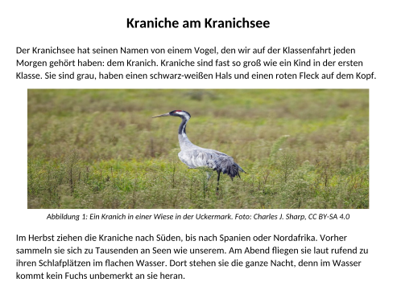
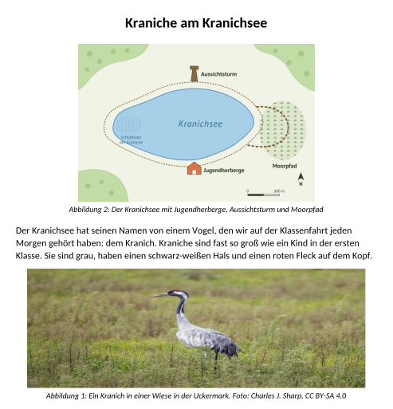
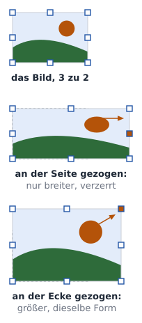
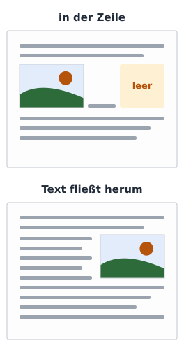
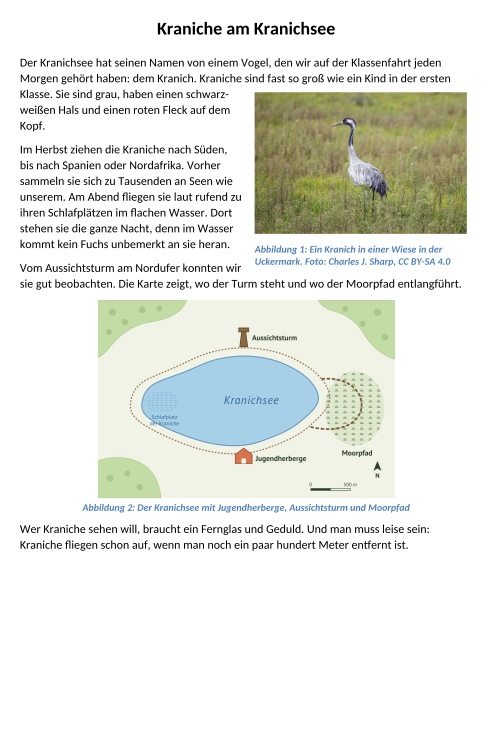

image: teaser.webp
image_alt: "Ein Artikel über Kraniche: unter dem ersten Absatz ein Foto, das so in die Breite gezogen ist, dass der Kranich dick aussieht"
kind: labor
duration: 1 Stunde (45 Minuten)
curriculum: "Sek I: Standardsoftware (Umgang mit Textverarbeitungssoftware); Medienbildung: Produzieren (Gestaltung von Medienproduktionen, eigene und lizenzierte Gestaltungselemente)"
topics: [standardsoftware]
language: Word / LibreOffice / Nextcloud Office
languages: [word, libreoffice, nextcloud]
requires: [word-tables]
reference: []

# Bilder im Text

Für die Zeitung der Klassenfahrt hat jemand einen Artikel über die Kraniche
am Kranichsee geschrieben, mit einem Foto und einer Karte. So fängt er an:

Unter jedem Bild steht eine **Bildunterschrift** mit einer Nummer:
»Abbildung 1« unter dem Kranich, weiter unten »Abbildung 2« unter der Karte.

_task(nummern)

<!-- after: nummern -->

Die Nummern hat jemand getippt. Das Programm weiß nicht, dass sie die Bilder
zählen sollen, und lässt sie stehen, wie sie sind. In einem Artikel mit zwei
Bildern fällt das noch auf; in einem Referat mit zwölf Bildern nicht mehr.
<!-- /after -->

## Das Seitenverhältnis

Hol dir den Artikel:

<a class='document-starter btn btn-primary' href='/pictures-in-text/05%20Kraniche.docx' download><i class='bi bi-file-earmark-word' aria-hidden='true'></i>Vorlage herunterladen:05 Kraniche.docx</a>

Ein Foto besteht aus Pixeln, dieses aus 1500 nebeneinander und 1000
untereinander. Wie breit es im Verhältnis zu seiner Höhe ist, heißt
**Seitenverhältnis**: hier 1500 zu 1000, also 3 zu 2. Zieht man an der Seite
eines Bildes, wird es nur breiter, nicht höher: Das Seitenverhältnis stimmt
nicht mehr, und alles darauf wird verzerrt. Genau das ist dem Kranich
passiert. Zieht man dagegen an einer Ecke, wächst das Bild in beide
Richtungen gleich.

<!-- language: word -->
In Word klickst du mit der rechten Maustaste auf das Foto und wählst *Größe
und Position…*. Im Register *Größe* setzt du den Haken bei
*Seitenverhältnis sperren* und klickst auf *Zurücksetzen*: Dann hat das Foto
wieder seine eigene Form. Gibst du danach eine Breite ein, rechnet Word die
Höhe selbst aus.
<!-- /language -->
<!-- language: libreoffice -->
In LibreOffice klickst du mit der rechten Maustaste auf das Foto und wählst
*Eigenschaften…*. Im Register *Typ* schaltest du *Verhältnis beibehalten*
ein und klickst auf *Originalgröße*: Dann hat das Foto wieder seine eigene
Form. Gibst du danach eine Breite ein, rechnet LibreOffice die Höhe selbst
aus.
<!-- /language -->
<!-- language: nextcloud -->
In Nextcloud Office klickst du mit der rechten Maustaste auf das Foto und
wählst *Eigenschaften…*. Im Register *Typ* schaltest du *Verhältnis
beibehalten* ein und klickst auf *Originalgröße*: Dann hat das Foto wieder
seine eigene Form. Gibst du danach eine Breite ein, rechnet Nextcloud Office
die Höhe selbst aus.
<!-- /language -->

_task(hoehe)

**Jetzt bist du dran:** Gib dem Foto seine eigene Form zurück und mach es
7,5 cm breit. Sieh nach, ob die Höhe stimmt, die du ausgerechnet hast.

## Text neben dem Bild

Ein Bild, das man einfügt, steht zuerst in der Zeile wie ein sehr großer
Buchstabe. Daneben kann kein Text stehen, und ein kleines Foto lässt rechts
und links viel Platz frei. Damit der Text neben dem Bild weiterläuft, braucht
das Bild einen anderen **Textumbruch**: Dann fließt der Text um das Bild herum,
und du kannst das Bild an den Rand schieben.

<!-- language: word -->
In Word klickst du auf das Foto und dann auf den Knopf *Layoutoptionen*, der
rechts daneben erscheint. Wähl *Quadrat*. Schieb das Foto danach an den
rechten Rand, neben den ersten Absatz.
<!-- /language -->
<!-- language: libreoffice -->
In LibreOffice klickst du mit der rechten Maustaste auf das Foto und wählst
*Verankerung* <i class='bi bi-chevron-right' aria-hidden='true'></i> *Am Absatz*: Jetzt hängt es am Absatz statt in der Zeile.
Dann wählst du *Umlauf* <i class='bi bi-chevron-right' aria-hidden='true'></i> *Parallel*. Schieb das Foto danach an den
rechten Rand, neben den ersten Absatz.
<!-- /language -->
<!-- language: nextcloud -->
In Nextcloud Office klickst du mit der rechten Maustaste auf das Foto und
wählst *Verankerung* <i class='bi bi-chevron-right' aria-hidden='true'></i> *Am Absatz*: Jetzt hängt es am Absatz statt in
der Zeile. Dann wählst du *Umlauf* <i class='bi bi-chevron-right' aria-hidden='true'></i> *Parallel*. Schieb das Foto danach
an den rechten Rand, neben den ersten Absatz.
<!-- /language -->

**Jetzt bist du dran:** Stell das Foto rechts neben den ersten Absatz.

<strong>Ausprobieren:</strong> Schreib ein paar Wörter in den ersten Absatz und lösch sie wieder. Achte darauf, ob das Foto beim Absatz bleibt und wie die Zeilen neben ihm umbrechen.

## Bildunterschriften, die zählen

Eine Bildunterschrift, die das Programm einfügt, heißt **Beschriftung**. Ihre
Nummer ist keine getippte Zahl, sondern ein **Feld**: ein Platzhalter, für den
das Programm selbst ausrechnet, das wievielte Bild das ist. Kommt ein Bild
dazu oder wandert eins nach oben, stimmen die Nummern wieder, sobald die
Felder aktualisiert sind.

<!-- language: word -->
In Word klickst du mit der rechten Maustaste auf das Foto und wählst
*Beschriftung einfügen…*. Als Bezeichnung wählst du *Abbildung*. Hinter die
Nummer schreibst du den Text der alten Unterschrift, dann löschst du die
getippte. Mit <kbd>Strg</kbd>+<kbd>A</kbd> und <kbd>F9</kbd> aktualisierst du alle
Felder.
<!-- /language -->
<!-- language: libreoffice -->
In LibreOffice klickst du mit der rechten Maustaste auf das Foto und wählst
*Beschriftung einfügen…*. Als Kategorie wählst du *Abbildung*. Hinter die
Nummer schreibst du den Text der alten Unterschrift, dann löschst du die
getippte. Mit <kbd>F9</kbd> aktualisierst du die Felder.
<!-- /language -->
<!-- language: nextcloud -->
In Nextcloud Office klickst du mit der rechten Maustaste auf das Foto und
wählst *Beschriftung einfügen…*. Als Kategorie wählst du *Abbildung*. Hinter
die Nummer schreibst du den Text der alten Unterschrift, dann löschst du die
getippte.
<!-- /language -->

**Jetzt bist du dran:** Gib beiden Bildern eine Beschriftung und lösch die
getippten Unterschriften.

## Der Alternativtext

Nicht alle, die den Artikel lesen, sehen die Bilder. Wer blind ist, lässt
sich den Text von einem **Screenreader** vorlesen, einem Programm, das
vorliest, was auf dem Bildschirm steht. Bei einem Bild liest es den
**Alternativtext** vor: einen Satz, der sagt, was auf dem Bild zu sehen ist.
Das Foto im Artikel hat keinen. Für die Karte hat das Programm einen geraten:
»Ein Bild, das Karte, Text enthält.« Den Weg zum Aussichtsturm findet damit
niemand.

_task(alternativtext)

<!-- language: word -->
In Word klickst du mit der rechten Maustaste auf das Bild und wählst den
Eintrag mit *Alternativtext*. Schreib den Satz in das Feld.
<!-- /language -->
<!-- language: libreoffice -->
In LibreOffice klickst du mit der rechten Maustaste auf das Bild und wählst
*Alternativer Text…*. Schreib den Satz in das Feld *Beschreibung*.
<!-- /language -->
<!-- language: nextcloud -->
In Nextcloud Office klickst du mit der rechten Maustaste auf das Bild und
wählst *Alternativer Text…*. Schreib den Satz in das Feld *Beschreibung*.
<!-- /language -->

**Jetzt bist du dran:** Schreib für das Foto und für die Karte einen
Alternativtext. Für die Karte reicht ein Satz, der sagt, was wo liegt.

## Prüfen

_task(artikel)

<!-- after: artikel -->

<strong>Ausprobieren:</strong> Schneide die Karte mit ihrer Beschriftung aus, füge sie über dem ersten Absatz ein und aktualisiere die Felder. Achte auf die Nummern unter beiden Bildern.

<!-- /after -->
