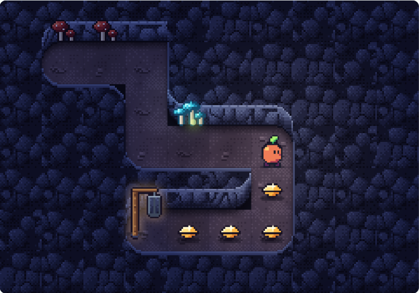

<div class='meta'>
image: teaser.webp:50:30
kind: uebung
duration: 2 Doppelstunden
languages: [ruby, python, javascript]
idea: "Pip mit einem Plan durch die Stollen schicken: Befehle nacheinander, Schleifen, Bedingungen"
curriculum: "Sek I: Algorithmisches Problemlösen, Miniwelten, Kontrollstrukturen"
</div>

# Pip unter Funkelbach: Hinab

<p class='abstract'>
Bello ist in einen Schacht gesprungen und verschwunden. Du schreibst Pip einen
Plan, Befehl für Befehl, und Pip macht genau, was draufsteht: hinunter in die
Stollen, Funkensteine sammeln, an Glibbern vorbei.
</p>

<!-- tutorial-screenshot
# Die Karte für den Katalog: der lange Stollen, gelöst und zur Hälfte abgespielt
open-site: /pip-1
tab: preview
viewport: 640x1000
hook: solve tunnel
sleep: 2
crop-element: .task-card[data-task="pip-1/tunnel"]:visible .pip-map
variants: dark
-->


Unter Funkelbach liegen alte Stollen. Früher haben die Leute dort Funkensteine
gegraben, Steine, die von selbst leuchten. Eines Abends jagt Bello einem
Glühwürmchen nach, springt in einen Schacht und ist weg. Pip will ihn holen,
aber die Stollen sind eng und finster, und unten hört Pip niemanden mehr.

<div class='pip-wichtel'>
Der Wichtel hat die alten Karten der Stollen. »Schreib Pip einen Plan«, sagt
er, »Schritt für Schritt. Pip macht genau, was draufsteht. Nicht mehr und
nicht weniger.«
</div>

In den Stollen stehen noch die Lampen der alten Steingräber, seit vielen
Jahren dunkel. Jeder Plan bringt Pip zur nächsten. Dort zündet Pip sie mit der
eigenen Laterne an, und der Wichtel zeichnet von ihr aus den nächsten Gang in
seine Karte. So bleibt auch der Weg zurück hell.

## Der Schacht

Ein Plan ist eine Liste von Befehlen, einer pro Zeile. Pip führt sie von oben
nach unten aus, einen nach dem anderen. Für den Anfang kennt Pip drei:

<!-- language: ruby -->
<table class='table'>
<tr><th>Befehl</th><th>Was Pip macht</th></tr>
<tr><td><code>move</code></td><td>geht ein Feld vorwärts, dorthin, wohin Pip schaut</td></tr>
<tr><td><code>turn_left</code></td><td>dreht sich auf der Stelle um eine Vierteldrehung nach links</td></tr>
<tr><td><code>say "Bello?"</code></td><td>sagt etwas in einer Sprechblase, ohne einen Schritt zu machen</td></tr>
</table>
<!-- /language -->
<!-- language: python -->
<table class='table'>
<tr><th>Befehl</th><th>Was Pip macht</th></tr>
<tr><td><code>move()</code></td><td>geht ein Feld vorwärts, dorthin, wohin Pip schaut</td></tr>
<tr><td><code>turn_left()</code></td><td>dreht sich auf der Stelle um eine Vierteldrehung nach links</td></tr>
<tr><td><code>say("Bello?")</code></td><td>sagt etwas in einer Sprechblase, ohne einen Schritt zu machen</td></tr>
</table>

Die Klammern gehören dazu: Ohne sie macht Pip nichts.
<!-- /language -->
<!-- language: javascript -->
<table class='table'>
<tr><th>Befehl</th><th>Was Pip macht</th></tr>
<tr><td><code>move();</code></td><td>geht ein Feld vorwärts, dorthin, wohin Pip schaut</td></tr>
<tr><td><code>turnLeft();</code></td><td>dreht sich auf der Stelle um eine Vierteldrehung nach links</td></tr>
<tr><td><code>say("Bello?");</code></td><td>sagt etwas in einer Sprechblase, ohne einen Schritt zu machen</td></tr>
</table>

Die Klammern gehören dazu: Ohne sie macht Pip nichts. Das Semikolon am Ende
schließt einen Befehl ab.
<!-- /language -->

Bevor Pip losläuft: Auf dieser Karte schaut Pip nach rechts.

<div class='pip-world pip-static' role='img' aria-label='Ein Raum, fünf mal vier Felder. Pip steht links in der dritten Reihe und schaut nach rechts. Feld 1 liegt zwei Felder rechts und eines oberhalb von Pip, Feld 2 drei Felder rechts von Pip, Feld 3 zwei Felder rechts und eines unterhalb.'>
<pre class='no-copy'>
#######
#.....#
#..1..#
#P..2.#
#..3..#
#######
</pre>
</div>

<!-- language: ruby -->
```ruby
move
move
turn_left
move
```
<!-- /language -->
<!-- language: python -->
```python
move()
move()
turn_left()
move()
```
<!-- /language -->
<!-- language: javascript -->
```javascript
move();
move();
turnLeft();
move();
```
<!-- /language -->

_task(predict)

<!-- after: predict -->
Pip steht auf Feld 1. Nach zwei Schritten dreht sich Pip nach links, und links ist
immer von Pip aus gesehen: Wer nach rechts schaut, hat links den oberen Rand
der Karte. Der letzte Schritt geht also nach oben. Eine Drehung nach rechts
kennt Pip nicht. Was tut man da?
<!-- /after -->

_task(shaft)

<div class='hint try'>
<strong>Ausprobieren:</strong> Schreib vor den ersten Schritt eine Zeile mit
<code>say</code> und einem Gruß an Bello und lass den Plan noch einmal laufen.
Schau auf den Schrittzähler unter der Karte: Zählt die Sprechblase mit?
</div>

Unten im Schacht glitzert etwas. Ein neuer Befehl hebt es auf:

<!-- language: ruby -->
<table class='table'>
<tr><th>Befehl</th><th>Was Pip macht</th></tr>
<tr><td><code>take</code></td><td>hebt den Funkenstein auf, auf dem Pip steht</td></tr>
</table>
<!-- /language -->
<!-- language: python -->
<table class='table'>
<tr><th>Befehl</th><th>Was Pip macht</th></tr>
<tr><td><code>take()</code></td><td>hebt den Funkenstein auf, auf dem Pip steht</td></tr>
</table>
<!-- /language -->
<!-- language: javascript -->
<table class='table'>
<tr><th>Befehl</th><th>Was Pip macht</th></tr>
<tr><td><code>take();</code></td><td>hebt den Funkenstein auf, auf dem Pip steht</td></tr>
</table>
<!-- /language -->

_task(first-stone)

<!-- after: first-stone -->
<div class='pip-wichtel'>
»Ein Funkenstein«, sagt der Wichtel. »Die halten deine Laterne am Brennen. Wo einer
liegt, liegen mehr. Und wo Steine liegen, ist Bello nicht weit: Der buddelt
für sein Leben gern.«
</div>
<!-- /after -->

## Funkensteine

Am Fuß des Schachts geht es in die alten Gänge. Überall liegen Funkensteine,
und Pip soll keinen liegen lassen. Liegt auf einem Feld kein Stein, greift Pip
ins Leere, und der Plan ist zu Ende: Pip geht nur weiter, wenn alles geklappt
hat. Dasselbe gilt für eine Wand.

_task(few-stones)

_task(tunnel)

<!-- after: tunnel -->
<div class='pip-wichtel'>
»Elf Steine«, sagt der Wichtel und zählt nach. »Und elfmal hast du dasselbe
geschrieben: einen Schritt, einen Griff. Das geht kürzer. Komm, ich zeig dir
die Wendeltreppe.«
</div>
<!-- /after -->

Wer noch Zeit hat: Der Wichtel hat sich verschrieben.

_task(broken-plan)

## Die Wendeltreppe

Was sich wiederholt, schreibt man einmal und lässt es wiederholen. Eine
Schleife macht das:

<!-- language: ruby -->
```ruby
4.times do
  move
  turn_left
end
```

Was zwischen `do` und `end` steht, macht Pip viermal hintereinander. Die
Befehle darin sind eingerückt, damit man sieht, was zur Schleife gehört.
<!-- /language -->
<!-- language: python -->
```python
for i in range(4):
    move()
    turn_left()
```

Was unter `for i in range(4):` eingerückt steht, macht Pip viermal
hintereinander. Der Doppelpunkt und die Einrückung gehören dazu: Daran sieht
Python, was zur Schleife gehört.
<!-- /language -->
<!-- language: javascript -->
```javascript
for (let i = 0; i < 4; i++) {
  move();
  turnLeft();
}
```

Was zwischen den geschweiften Klammern steht, macht Pip viermal
hintereinander. Die Zählvariable `i` fängt bei 0 an, und nach jedem
Durchlauf zählt `i++` eins weiter, solange `i < 4` gilt: 0, 1, 2, 3.
<!-- /language -->

_task(room)

_task(corridor)

Bei der Wendeltreppe wird jedes Stück ein Feld länger. Dafür zählt die
Schleife mit:

<!-- language: ruby -->
```ruby
(1..3).each do |side|
  say side
end
```

`side` ist die Zählvariable: im ersten Durchlauf 1, dann 2, dann 3. Pip sagt
der Reihe nach 1, 2, 3. Und `side.times do … end` wiederholt so oft, wie
`side` gerade groß ist.
<!-- /language -->
<!-- language: python -->
```python
for side in range(1, 4):
    say(side)
```

`side` ist die Zählvariable: im ersten Durchlauf 1, dann 2, dann 3. Die 4 ist
die erste Zahl, die nicht mehr dran ist. Pip sagt der Reihe nach 1, 2, 3. Und
`for step in range(side):` wiederholt so oft, wie `side` gerade groß ist.
<!-- /language -->
<!-- language: javascript -->
```javascript
for (let side = 1; side <= 3; side++) {
  say(side);
}
```

`side` ist die Zählvariable: im ersten Durchlauf 1, dann 2, dann 3. Pip sagt
der Reihe nach 1, 2, 3. Und eine Schleife mit `step < side` darin wiederholt
so oft, wie `side` gerade groß ist.
<!-- /language -->

_task(spiral)

<!-- after: spiral -->
<div class='pip-wichtel'>
Unten an der Treppe hört Pip etwas. Ganz leise, von weit weg: »Wuff!« Der
Wichtel spitzt die Ohren. »Von unten«, sagt er. »Durch die Pilzwiese.«
</div>
<!-- /after -->

_task(spiral-short)

## Die Pilzwiese

Unter der Treppe öffnet sich eine Höhle, in der Pilze leuchten. Wer hier
nichts übersehen will, geht die Wiese in Schlangenlinien ab: eine Reihe hin,
die nächste zurück.

_task(meadow)

Auf der echten Wiese liegen die Steine nicht überall, und jede Karte des
Wichtels zeigt sie woanders. Ein Plan, der nur auf eine Karte passt, greift auf
der nächsten ins Leere. Pip kann nachsehen, bevor Pip zugreift:

<!-- language: ruby -->
```ruby
take if on_stone?
```

`on_stone?` ist eine Frage an die Karte: Liegt hier ein Stein? Die Antwort ist
`true` oder `false`, und nur bei `true` macht Pip `take`. Das Fragezeichen
gehört zum Namen; in Ruby enden Fragen so.
<!-- /language -->
<!-- language: python -->
```python
if on_stone():
    take()
```

`on_stone()` ist eine Frage an die Karte: Liegt hier ein Stein? Die Antwort
ist `True` oder `False`, und nur bei `True` macht Pip, was unter dem `if`
eingerückt steht.
<!-- /language -->
<!-- language: javascript -->
```javascript
if (onStone()) {
  take();
}
```

`onStone()` ist eine Frage an die Karte: Liegt hier ein Stein? Die Antwort ist
`true` oder `false`, und nur bei `true` macht Pip, was in den geschweiften
Klammern steht.
<!-- /language -->

_task(meadow-stones)

## Glibber!

Hinter der Wiese wird es feucht. Etwas Blaues wabert quer durch den Stollen,
hin und her, ein Feld pro Schritt, und kehrt an der Wand um: ein Glibber. Wen
er erwischt, der klebt fest. Pip kann warten, bis er vorbei ist; Warten ist
auch ein Schritt, nur ohne Weg:

<!-- language: ruby -->
<table class='table'>
<tr><th>Befehl</th><th>Was Pip macht</th></tr>
<tr><td><code>wait</code></td><td>bleibt einen Schritt lang stehen</td></tr>
<tr><td><code>glibber_ahead?</code></td><td>fragt: Ist auf dem nächsten Feld ein Glibber, oder kommt gleich einer hin?</td></tr>
</table>
<!-- /language -->
<!-- language: python -->
<table class='table'>
<tr><th>Befehl</th><th>Was Pip macht</th></tr>
<tr><td><code>wait()</code></td><td>bleibt einen Schritt lang stehen</td></tr>
<tr><td><code>glibber_ahead()</code></td><td>fragt: Ist auf dem nächsten Feld ein Glibber, oder kommt gleich einer hin?</td></tr>
</table>
<!-- /language -->
<!-- language: javascript -->
<table class='table'>
<tr><th>Befehl</th><th>Was Pip macht</th></tr>
<tr><td><code>wait();</code></td><td>bleibt einen Schritt lang stehen</td></tr>
<tr><td><code>glibberAhead()</code></td><td>fragt: Ist auf dem nächsten Feld ein Glibber, oder kommt gleich einer hin?</td></tr>
</table>
<!-- /language -->

_task(glibber)

Auf einer Karte kann man abzählen, wann der Glibber wo ist. Auf drei Karten
mit verschiedenen Anfängen nicht mehr. Dann entscheidet Pip bei jedem Schritt
neu, mit einem `if` und einem `else` für den anderen Fall:

<!-- language: ruby -->
```ruby
if glibber_ahead?
  say "Iiih!"
else
  say "Frei!"
end
```
<!-- /language -->
<!-- language: python -->
```python
if glibber_ahead():
    say("Iiih!")
else:
    say("Frei!")
```
<!-- /language -->
<!-- language: javascript -->
```javascript
if (glibberAhead()) {
  say("Iiih!");
} else {
  say("Frei!");
}
```
<!-- /language -->

_task(glibbers)

<!-- after: glibbers -->
<div class='pip-wichtel'>
Hinter dem letzten Glibber leuchtet die nächste Lampe auf, und daneben, im Staub: ein
Pfotenabdruck. Noch einer. Eine ganze Spur, die tiefer in die Stollen führt.
»Bello«, sagt Pip. Der Wichtel nickt. »Morgen. Für heute hast du genug Glibber
gesehen.«
</div>
<!-- /after -->
