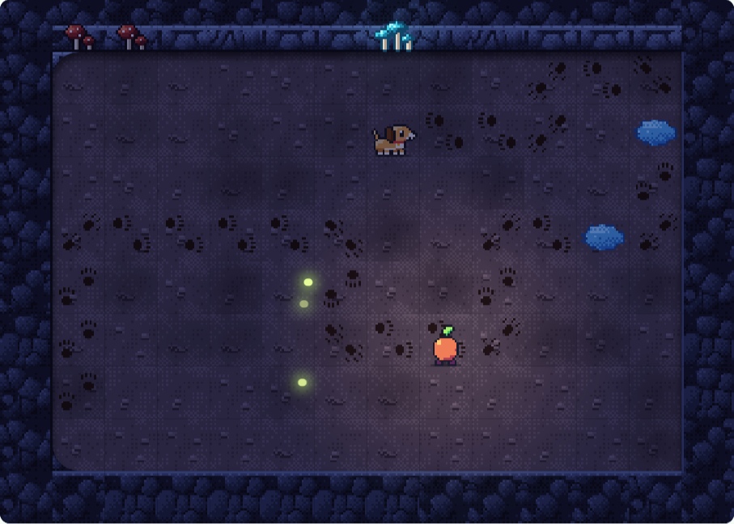

<div class='meta'>
image: teaser.webp:50:40
kind: uebung
duration: 3 Doppelstunden
languages: [ruby, python, javascript]
idea: "Pip findet Bello: Schleifen mit Bedingung, eigene Funktionen, Variablen, ein Algorithmus fürs Labyrinth"
curriculum: "Sek I: Algorithmisches Problemlösen, Kontrollstrukturen, Prozeduren; Oberstufe: Algorithmen"
requires: [pip-1, kata-loops]
</div>

# Pip unter Funkelbach: Bellos Spur

<p class='abstract'>
Bello ist noch irgendwo da unten. Jetzt wird es finster: Pip weiß nicht mehr,
wie lang ein Stollen ist, und der Plan muss selbst nachsehen. Mit eigenen
Zaubersprüchen, der Hand an der Wand und Bellos Pfotenabdrücken findet Pip den
Weg, und den zurück ans Licht.
</p>

<!-- tutorial-screenshot
# Die Karte für den Katalog: Bellos Spur, gelöst und zur Hälfte abgespielt
open-site: /pip-2
tab: preview
viewport: 640x1000
hook: solve trail
sleep: 2
crop-element: .task-card[data-task="pip-2/trail"]:visible .pip-map
variants: dark
-->


<div class='pip-wichtel'>
»Hinter den Glibbern geht es tiefer hinein«, sagt der Wichtel. »Da unten habe ich
keine Karten mehr. Pip muss selbst nachsehen, wo es weitergeht. Zum Glück kann
dein Plan Fragen stellen.«
</div>

## Im Finstern

Bisher hast du gezählt: viermal das, achtmal jenes. Hier weiß niemand, wie lang
ein Stollen ist. Eine Schleife mit `while` zählt nicht, sie fragt: Sie
wiederholt, solange eine Bedingung wahr ist.

<!-- language: ruby -->
<table class='table'>
<tr><th>Befehl</th><th>Was Pip macht</th></tr>
<tr><td><code>front_clear?</code></td><td>fragt: Ist das Feld vor Pip frei?</td></tr>
<tr><td><code>on_lamp?</code></td><td>fragt: Steht Pip an der Lampe?</td></tr>
</table>

```ruby
while front_clear?
  turn_left
end
```

Solange vorn frei ist, dreht sich Pip. Schaut Pip auf eine Wand, ist die
Bedingung falsch, und es geht nach `end` weiter. (Ist ringsum frei, dreht sich
Pip ewig; nach 1000 Schritten hält die Welt an.) `until` ist das
Gegenteil: `until on_lamp?` wiederholt, bis Pip an der Lampe steht.
<!-- /language -->
<!-- language: python -->
<table class='table'>
<tr><th>Befehl</th><th>Was Pip macht</th></tr>
<tr><td><code>front_clear()</code></td><td>fragt: Ist das Feld vor Pip frei?</td></tr>
<tr><td><code>on_lamp()</code></td><td>fragt: Steht Pip an der Lampe?</td></tr>
</table>

```python
while front_clear():
    turn_left()
```

Solange vorn frei ist, dreht sich Pip. Schaut Pip auf eine Wand, ist die
Bedingung falsch, und es geht nach der Schleife weiter. (Ist ringsum frei,
dreht sich Pip ewig; nach 1000 Schritten hält die Welt an.) `not`
dreht eine Antwort um: `while not on_lamp():` wiederholt, bis Pip an der Lampe
steht.
<!-- /language -->
<!-- language: javascript -->
<table class='table'>
<tr><th>Befehl</th><th>Was Pip macht</th></tr>
<tr><td><code>frontClear()</code></td><td>fragt: Ist das Feld vor Pip frei?</td></tr>
<tr><td><code>onLamp()</code></td><td>fragt: Steht Pip an der Lampe?</td></tr>
</table>

```javascript
while (frontClear()) {
  turnLeft();
}
```

Solange vorn frei ist, dreht sich Pip. Schaut Pip auf eine Wand, ist die
Bedingung falsch, und es geht nach der Schleife weiter. (Ist ringsum frei,
dreht sich Pip ewig; nach 1000 Schritten hält die Welt an.) `!`
dreht eine Antwort um: `while (!onLamp())` wiederholt, bis Pip an der Lampe
steht.
<!-- /language -->

_task(dark-tunnel)

_task(dark-stones)

_task(winding)

<!-- after: winding -->
<div class='pip-wichtel'>
»Nach rechts abbiegen mit drei Linksdrehungen«, brummt der Wichtel. »Jedes Mal
drei Zeilen. Dafür gibt es Zaubersprüche.«
</div>
<!-- /after -->

## Eigene Zaubersprüche

Ein Zauberspruch ist ein Befehl, den du selbst schreibst: Er bekommt einen
Namen, und was darin steht, macht Pip jedes Mal, wenn der Name im Plan steht.
In der Programmierung heißt so etwas Funktion.

<!-- language: ruby -->
```ruby
def hop
  move
  move
end

hop
turn_left
hop
```

`def hop` bis `end` bringt Pip den Spruch bei; dabei passiert noch nichts.
Erst `hop` weiter unten führt ihn aus, und zwar zweimal.
<!-- /language -->
<!-- language: python -->
```python
def hop():
    move()
    move()

hop()
turn_left()
hop()
```

`def hop():` und was darunter eingerückt steht, bringt Pip den Spruch bei;
dabei passiert noch nichts. Erst `hop()` weiter unten führt ihn aus, und zwar
zweimal.
<!-- /language -->
<!-- language: javascript -->
```javascript
function hop() {
  move();
  move();
}

hop();
turnLeft();
hop();
```

`function hop() { … }` bringt Pip den Spruch bei; dabei passiert noch nichts.
Erst `hop();` weiter unten führt ihn aus, und zwar zweimal.
<!-- /language -->

Bei den ersten drei Katas ruft die Prüfung deinen Zauberspruch selbst auf, auf
Karten, die sie dafür aufbaut. Was du unter den Spruch schreibst, um ihn
auszuprobieren, lässt sie dabei weg.

_task(turn-right)

_task(turn-around)

_task(walk)

_task(stairs)

## Das Labyrinth

Ein Labyrinth hat Gänge, Abzweigungen und Sackgassen. Den Weg kennt niemand,
aber es gibt einen alten Trick: die Hand an der Wand. Wer immer mit derselben
Hand an der Wand bleibt, läuft jeden Gang ab, jede Sackgasse hinein und wieder
heraus, und kommt irgendwann überall vorbei, wo die Wand hinführt.

_task(hand-on-wall)

_task(maze)

<!-- after: maze -->
<div class='hint try'>
<strong>Ausprobieren:</strong> Tausche in deinem Plan links und rechts: die
rechte Hand an der Wand. Schau in der Wiedergabe, ob Pip einen anderen Weg
nimmt und ob er kürzer ist.
</div>
<!-- /after -->

_task(island)

## Drei Hebel

Hinter dem Labyrinth ragen Stacheln aus dem Boden, quer über den Weg; da tritt
Pip nicht drauf. Daneben steht ein Hebel, und
in den Fels hat jemand geritzt: »Dreimal ziehen. Nicht öfter.«

<!-- language: ruby -->
<table class='table'>
<tr><th>Befehl</th><th>Was Pip macht</th></tr>
<tr><td><code>pull</code></td><td>zieht am Hebel, auf dem Pip steht</td></tr>
<tr><td><code>on_lever?</code></td><td>fragt: Steht hier ein Hebel?</td></tr>
</table>
<!-- /language -->
<!-- language: python -->
<table class='table'>
<tr><th>Befehl</th><th>Was Pip macht</th></tr>
<tr><td><code>pull()</code></td><td>zieht am Hebel, auf dem Pip steht</td></tr>
<tr><td><code>on_lever()</code></td><td>fragt: Steht hier ein Hebel?</td></tr>
</table>
<!-- /language -->
<!-- language: javascript -->
<table class='table'>
<tr><th>Befehl</th><th>Was Pip macht</th></tr>
<tr><td><code>pull();</code></td><td>zieht am Hebel, auf dem Pip steht</td></tr>
<tr><td><code>onLever()</code></td><td>fragt: Steht hier ein Hebel?</td></tr>
</table>
<!-- /language -->

_task(one-lever)

Bei mehreren Hebeln muss Pip sich merken, wie oft schon gezogen wurde. Dafür
gibt es Variablen, wie in den Katas zum Wiederholen:

<!-- language: ruby -->
```ruby
steps = 0
while front_clear?
  move
  steps += 1
end
say steps
```
<!-- /language -->
<!-- language: python -->
```python
steps = 0
while front_clear():
    move()
    steps += 1
say(steps)
```
<!-- /language -->
<!-- language: javascript -->
```javascript
let steps = 0;
while (frontClear()) {
  move();
  steps++;
}
say(steps);
```
<!-- /language -->

_task(levers)

_task(count-stones)

## Bellos Spur

Hinter den Stacheln riecht es nach nassem Hund. Auf dem Boden sind Pfotenabdrücke,
und hier und da Pfützen.

<!-- language: ruby -->
<table class='table'>
<tr><th>Befehl</th><th>Was Pip macht</th></tr>
<tr><td><code>puddle_ahead?</code></td><td>fragt: Ist vor Pip eine Pfütze?</td></tr>
<tr><td><code>trail_ahead?</code></td><td>fragt: Sind auf dem Feld vor Pip Pfotenabdrücke? (Auch Bello selbst zählt.)</td></tr>
<tr><td><code>bello_here?</code></td><td>fragt: Ist Bello hier?</td></tr>
</table>

Zwei Fragen lassen sich verbinden: `a && b` ist wahr, wenn beide wahr sind
(und), `a || b`, wenn mindestens eine wahr ist (oder), und `!a` dreht eine um
(nicht).
<!-- /language -->
<!-- language: python -->
<table class='table'>
<tr><th>Befehl</th><th>Was Pip macht</th></tr>
<tr><td><code>puddle_ahead()</code></td><td>fragt: Ist vor Pip eine Pfütze?</td></tr>
<tr><td><code>trail_ahead()</code></td><td>fragt: Sind auf dem Feld vor Pip Pfotenabdrücke? (Auch Bello selbst zählt.)</td></tr>
<tr><td><code>bello_here()</code></td><td>fragt: Ist Bello hier?</td></tr>
</table>

Zwei Fragen lassen sich verbinden: `a and b` ist wahr, wenn beide wahr sind,
`a or b`, wenn mindestens eine wahr ist, und `not a` dreht eine um.
<!-- /language -->
<!-- language: javascript -->
<table class='table'>
<tr><th>Befehl</th><th>Was Pip macht</th></tr>
<tr><td><code>puddleAhead()</code></td><td>fragt: Ist vor Pip eine Pfütze?</td></tr>
<tr><td><code>trailAhead()</code></td><td>fragt: Sind auf dem Feld vor Pip Pfotenabdrücke? (Auch Bello selbst zählt.)</td></tr>
<tr><td><code>belloHere()</code></td><td>fragt: Ist Bello hier?</td></tr>
</table>

Zwei Fragen lassen sich verbinden: `a && b` ist wahr, wenn beide wahr sind
(und), `a || b`, wenn mindestens eine wahr ist (oder), und `!a` dreht eine um
(nicht).
<!-- /language -->

_task(dry-feet)

_task(trail)

<!-- after: trail -->
<div class='pip-wichtel'>
Am Ende der Spur sitzt Bello, nass bis zu den Ohren, und wedelt, als wäre nichts
gewesen. Im Maul hat er einen Funkenstein, den größten, den Pip je gesehen hat.
»Na also«, sagt der Wichtel. »Und jetzt nichts wie raus hier.«
</div>
<!-- /after -->

## Zurück ans Licht

Der Weg nach oben führt durch alles, was Pip unterwegs gelernt hat. Bello
trottet hinterher.

_task(way-out)

<!-- after: way-out -->
<div class='pip-wichtel'>
Oben ist es Nacht, und über Funkelbach leuchten die Sterne. Bello schüttelt
sich, dass das Wasser nur so spritzt. »Gut gemacht«, sagt der Wichtel und
nimmt Pips Laterne. »Aber das war erst der Anfang. In den Stollen liegt noch
mehr, und das letzte Licht von Funkelbach …« Er verstummt. Den Rest der
Geschichte spielst du im [2D Game Studio](https://2d.hackschule.de/).
</div>
<!-- /after -->
