<div class='meta'>
image: interference.webp
image_alt: "Bunte, ineinander verschlungene Farbringe mit weichen Kanten"
kind: projekt
language: PixelRAM / C
reference: [pixelram]
template: https://github.com/specht/pixelram-starter.git
template_name: des PixelRAM-Starters
</div>

# Echtzeitgrafik mit C

<div
    class="autotoc-secondary-trigger"
    data-title="Auf dieser Seite"
    data-levels="h2,h3">
</div>

<p class='abstract'>
Mit PixelRAM programmierst du schnelle Computergrafik direkt in C. Es gibt keine Befehle für Linien, Kreise oder Figuren: Dein Programm bestimmt die Farbe jedes einzelnen Bildpunkts selbst. Daraus entstehen in diesem Tutorial bewegte Wellenmuster und ein Spiel für zwei an einer Tastatur.
</p>

<div class='gallery'>
<figure>
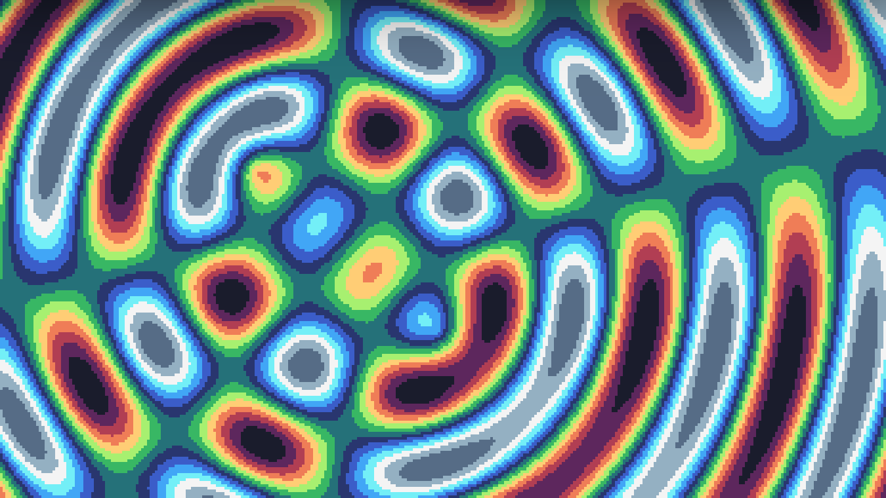
<figcaption>Zwei Wellen, die sich überlagern: 57.600 Pixel, 60-mal pro Sekunde neu berechnet</figcaption>
</figure>
<figure>
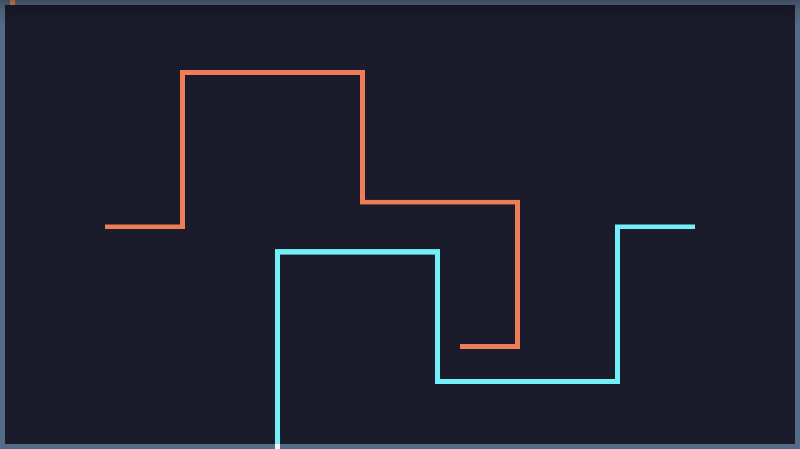
<figcaption>»Lichtspur«: ein Spiel für zwei, mit Tastatur, Zusammenstößen und Punkten</figcaption>
</figure>
<figure>
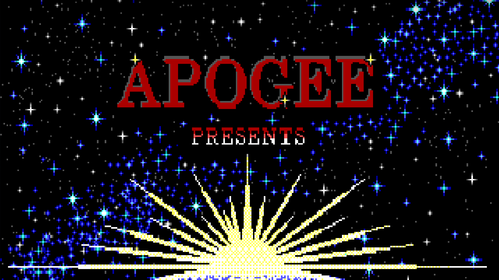
<figcaption>Crystal Caves, ein Spiel von 1991, läuft vollständig auf PixelRAM</figcaption>
</figure>
</div>

Bei [Pixelflow Canvas](/drawing) zeichnest du mit einfachen Befehlen in Ruby. PixelRAM geht eine Ebene tiefer: Der Bildschirm ist ein Stück Speicher, in dem für jeden Bildpunkt eine Zahl steht, und dein Programm schreibt diese Zahlen. Das ist der Bildschirm, wie ihn die ersten PCs hatten, und alles andere baust du dir selbst: Muster, Animationen, Spiele, Fraktale, eigene 3D-Grafik.

Dafür verwenden wir C. Die Sprache ist nah an der Arbeitsweise des Computers und schnell genug, um für jedes Bild zehntausende Pixel einzeln auszurechnen, im Browser, 60-mal pro Sekunde.

## Einrichten

### Repository klonen

Für diese Anleitung brauchst du die PixelRAM-Vorlage:

_include(workspace#repository-klonen)

### Übersetzen und ansehen

Öffne die Datei `main.c` und gib im Terminal ein:

```bash
make
```

Beim ersten Mal lädt `make` die neueste Version der Bibliothek PixelRAM herunter und legt sie im versteckten Ordner `.pixelram` ab; danach nimmt es immer diese Kopie. Mit `make pixelram-update` holst du später die neueste Version. Dann übersetzt es `main.c` in die Datei `main.html`: Dein C-Programm läuft als WebAssembly im Browser.

<!-- tutorial-screenshot
# Klonen wie im Handbuch »Workspace« (oben eingebunden), dann make im Terminal
show-left-sidebar
clone-start: https://github.com/specht/pixelram-starter.git @ 8eeadbc0bf5b46ccd4e0527f4bcda13b3c0b947d
press: Enter
wait-for-input-value: /workspace/
press: Enter
wait-for-text: Would you like to open the repository?
click: Open
wait-for-text: main.c
open-file: main.c
terminal-open
terminal-run: make
terminal-wait-for-prompt: 180
# Die Maus stand noch auf »Open«, wo jetzt das Schließen-Kreuz des Tabs ist
move-mouse: selector:.terminal
terminal-expect-no-text: error:
terminal-expect-no-text: ***
-->
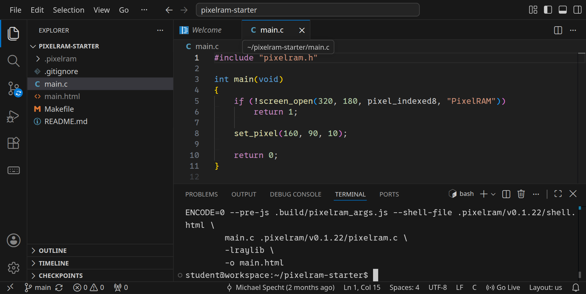


Klicke unten rechts auf »Go Live«. Im neuen Tab siehst du die Dateien des Projekts; klicke dort auf `main.html`. Du solltest einen kleinen grünen Punkt in der Mitte sehen:

<div style='clear: both;'></div>

<!-- tutorial-screenshot
go-live
tab: preview
variants: crt
viewport: 800x450
hook: open main.html
crop-element: #canvas
-->
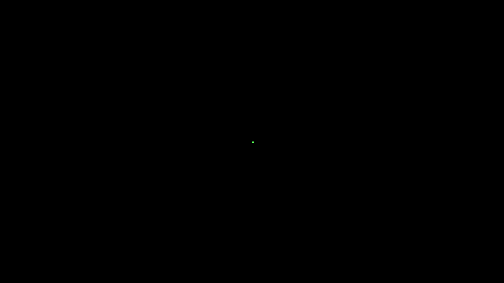

<div class='hint'>
<strong>Röhrenbildschirm:</strong> Fährst du mit der Maus über das Bild, erscheinen unten rechts drei Knöpfe. Der mittlere schaltet den CRT-Filter ein (oder <kbd>F6</kbd>): Scanlines und die gewölbte Scheibe eines alten Röhrenbildschirms, passend zu den großen Pixeln. Die Bilder auf dieser Seite haben dafür oben rechts einen eigenen Knopf mit demselben Zeichen <svg class='icon-crt' viewBox='0 0 24 24' aria-hidden='true'><rect x='3' y='4' width='18' height='15' rx='2'/><path d='M7 8h10M7 11.5h10M7 15h10'/></svg>.
</div>

<div class='hint'>
<strong>So arbeitest du ab jetzt:</strong> Datei ändern und speichern, im Terminal <code>make</code>, dann die Vorschau neu laden, falls sie es nicht von selbst tut. Findet <code>make</code> einen Fehler, nennt es die Zeile in deiner Datei, und <code>main.html</code> bleibt, wie sie war. Lies die erste Fehlermeldung zuerst, die übrigen sind oft nur Folgefehler.
</div>

## Ein Bild aus einer Formel

### Das erste Pixel

So sieht `main.c` aus:

```c
#include "pixelram.h"

int main(void)
{
    if (!screen_open(320, 180, pixel_indexed8, "PixelRAM"))
        return 1;

    set_pixel(160, 90, 10);

    return 0;
}
```

`screen_open(320, 180, pixel_indexed8, "PixelRAM")` öffnet einen Bildschirm mit 320 × 180 Pixeln. `set_pixel(160, 90, 10)` setzt genau einen davon: an der Stelle x = 160, y = 90, also in der Mitte, auf die Farbe 10. Der Punkt (0, 0) liegt links oben, y wächst nach unten.

Im Modus `pixel_indexed8` ist jedes Pixel ein Byte, eine Zahl von 0 bis 255. Welche Farbe zu einer Zahl gehört, legt eine **Palette** fest: In der Standardpalette ist 10 ein helles Grün und 0 Schwarz.

### Alle Pixel

Der Bildschirm hat 320 × 180 = **57.600 Pixel**. Für jedes einen eigenen `set_pixel`-Befehl zu schreiben, wäre unsinnig. Stattdessen laufen zwei verschachtelte Schleifen über alle Zeilen und darin über alle Spalten, und eine Funktion `color` sagt für jedes Pixel, welche Farbe es bekommt. Ersetze den Inhalt von `main.c` durch:

```c
#include "pixelram.h"

#define W 320
#define H 180

int color(int x, int y)
{
    return (x / 20 + y / 20) % 16;
}

int main(void)
{
    screen_open(W, H, pixel_indexed8, "PixelRAM");
    use_palette("sweetie_16");

    for (int y = 0; y < H; y++)
        for (int x = 0; x < W; x++)
            set_pixel(x, y, color(x, y));

    return 0;
}
```

`#define W 320` gibt der Breite einen Namen, damit die Zahl nur an einer Stelle steht. `use_palette("sweetie_16")` wählt eine Palette mit 16 Farben, die Nummern 0 bis 15. Deshalb rechnet `color` am Ende `% 16`: Der Rest beim Teilen durch 16 liegt immer zwischen 0 und 15.

<!-- tutorial-screenshot
write-file: main.c <- previous-code
terminal-open
terminal-run: make
terminal-wait-for-prompt
terminal-expect-no-text: error:
terminal-expect-no-text: ***
tab: preview
variants: crt
viewport: 800x450
hook: open main.html
crop-element: #canvas
-->
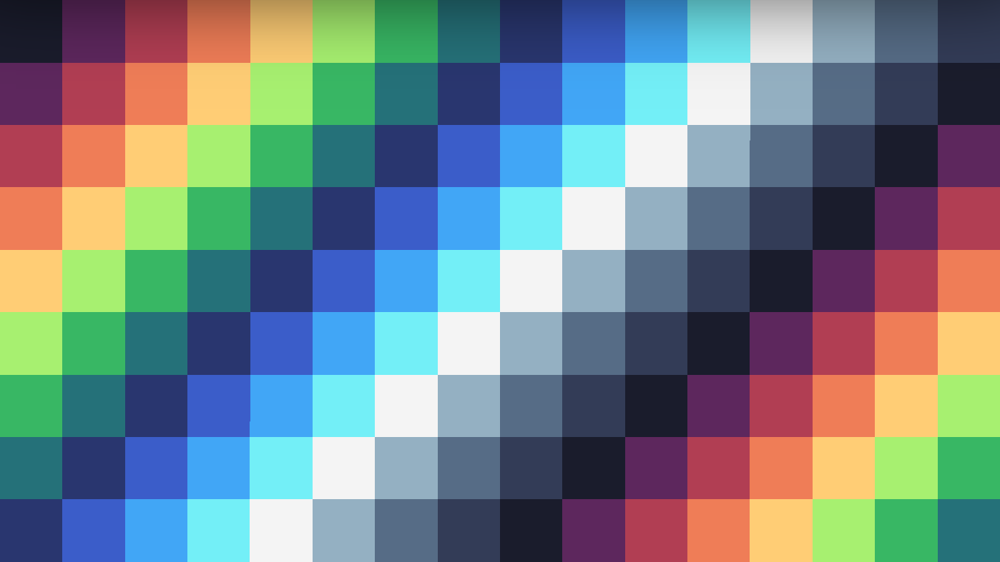

`x / 20` ist eine Ganzzahldivision: Für x = 0 bis 19 kommt 0 heraus, für 20 bis 39 kommt 1 heraus, und so weiter. So entstehen Felder von 20 × 20 Pixeln. Dein Programm zeichnet keine Quadrate. Es beantwortet für jedes Pixel einzeln die Frage: **Welche Farbe hast du?** Darum geht es auf dieser ganzen Seite.

_task(ecke)

### Formeln ausprobieren

Ändere nur die Zeile mit `return` in `color`. Jede dieser Formeln ergibt ein ganz anderes Bild:

<div class='gallery'>
<figure>
<!-- tutorial-screenshot
write-file: main.c <- code:int color(int x, int y)||return (x / 20 + y / 20) % 16;
terminal-open
terminal-run: sed -i 's|return (x / 20 + y / 20) % 16;|return (x * y / 64) % 16;|' main.c && make
terminal-wait-for-prompt
tab: preview
variants: crt
viewport: 800x450
hook: open main.html
crop-element: #canvas
-->
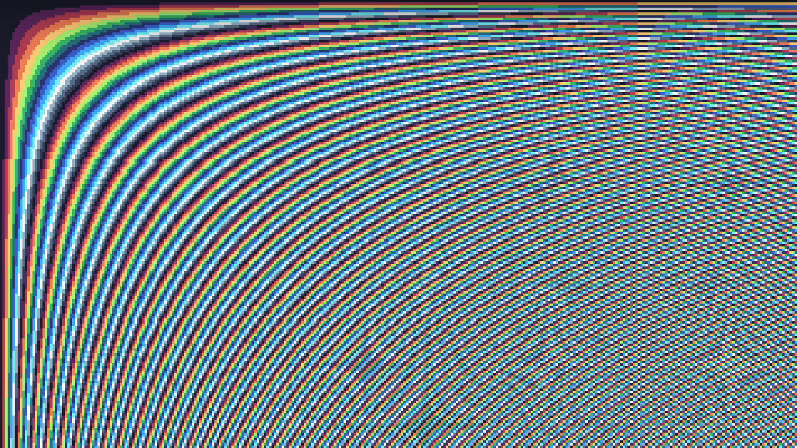
<figcaption><code>return (x * y / 64) % 16;</code></figcaption>
</figure>
<figure>
<!-- tutorial-screenshot
write-file: main.c <- code:int color(int x, int y)||return (x / 20 + y / 20) % 16;
terminal-open
terminal-run: sed -i 's|return (x / 20 + y / 20) % 16;|return (x * x + y * y) / 256 % 16;|' main.c && make
terminal-wait-for-prompt
tab: preview
variants: crt
viewport: 800x450
hook: open main.html
crop-element: #canvas
-->
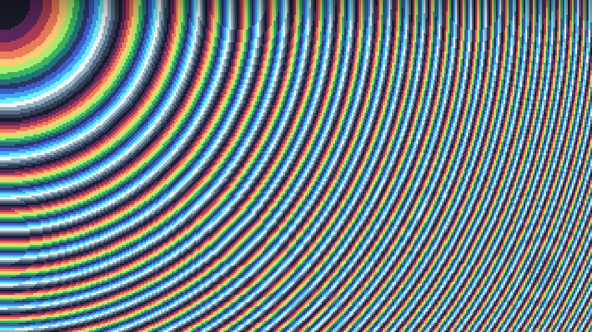
<figcaption><code>return (x * x + y * y) / 256 % 16;</code></figcaption>
</figure>
<figure>
<!-- tutorial-screenshot
write-file: main.c <- code:int color(int x, int y)||return (x / 20 + y / 20) % 16;
terminal-open
terminal-run: sed -i 's|return (x / 20 + y / 20) % 16;|return (x \& y) == 0 ? 12 : 0;|' main.c && make
terminal-wait-for-prompt
tab: preview
variants: crt
viewport: 800x450
hook: open main.html
crop-element: #canvas
-->
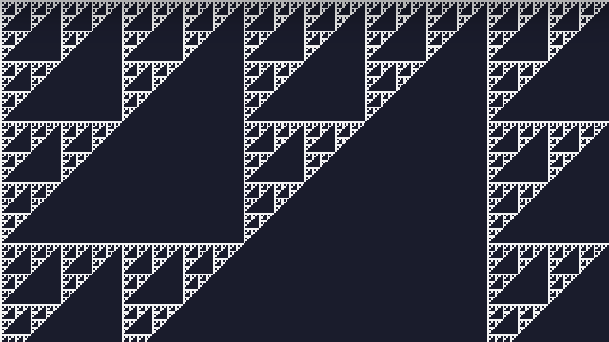
<figcaption><code>return (x & y) == 0 ? 12 : 0;</code></figcaption>
</figure>
<figure>
<!-- tutorial-screenshot
write-file: main.c <- code:int color(int x, int y)||return (x / 20 + y / 20) % 16;
terminal-open
terminal-run: sed -i 's|return (x / 20 + y / 20) % 16;|return (x ^ y) / 8 % 16;|' main.c && make
terminal-wait-for-prompt
tab: preview
variants: crt
viewport: 800x450
hook: open main.html
crop-element: #canvas
-->
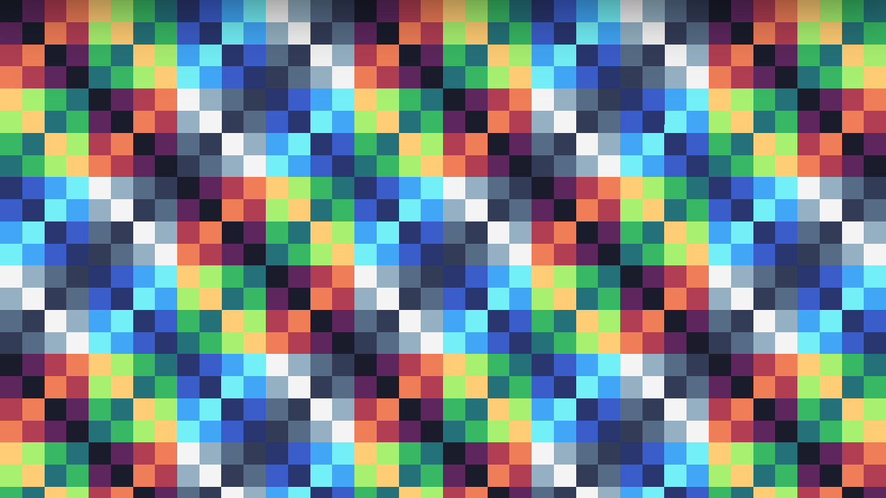
<figcaption><code>return (x ^ y) / 8 % 16;</code></figcaption>
</figure>
</div>

Die dritte Formel zeichnet das **Sierpinski-Dreieck**, ein Fraktal. `x & y` verknüpft die beiden Zahlen Bit für Bit: Ein Bit des Ergebnisses ist 1, wenn es in x **und** in y 1 ist. Das Pixel wird weiß (Farbe 12), wenn x und y keine einzige 1 an derselben Stelle haben. `?` und `:` sind ein Wenn-dann-sonst in einer Zeile. `x ^ y` in der vierten Formel ist das bitweise exklusive Oder.

<div class='hint task'>
<strong>Erfinde eigene Formeln.</strong> Was passiert, wenn du in der zweiten Formel <code>x</code> durch <code>x - 160</code> und <code>y</code> durch <code>y - 90</code> ersetzt? Wie bekommst du senkrechte Streifen, wie ein Schachbrett? Achte darauf, dass das Ergebnis zwischen 0 und 15 liegt.
</div>

### Farbpaletten

Dieselben Zahlen sehen mit einer anderen Palette ganz anders aus. Ersetze `"sweetie_16"` zum Beispiel durch `"pico_8"` (16 Farben), `"endesga_32"` (32 Farben) oder `"aap_64"` (64 Farben). Hat eine Palette mehr Farben, kannst du statt `% 16` auch `% 32` oder `% 64` rechnen.

<div class='hint books'>
Alle eingebauten Paletten siehst du unter <a href='https://specht.github.io/pixelram/palettes.html' target='_blank'>specht.github.io/pixelram/palettes.html</a>. Mit <code>set_palette(nummer, rot, grün, blau)</code> stellst du dir eine einzelne Farbe selbst ein, jeweils mit Werten von 0 bis 255.
</div>

## Wellen

Jetzt wird die Formel für `color` eine Rechnung mit Abständen und Winkelfunktionen, und am Ende bewegt sich alles.

### Abstand vom Mittelpunkt

Wie weit ist ein Pixel von der Mitte des Bildschirms entfernt? Der Satz des Pythagoras sagt es: Mit `dx` und `dy`, dem Abstand nach rechts und nach unten, ist der Abstand `sqrt(dx * dx + dy * dy)`. Für `sqrt` brauchst du die Mathematik-Bibliothek: Schreib `#include <math.h>` unter die erste Zeile und ändere `color` so:

```c
int color(double x, double y)
{
    double dx = x - W / 2.0;
    double dy = y - H / 2.0;
    double distance = sqrt(dx * dx + dy * dy);

    return (int)(distance / 6.0) % 16;
}
```

`double` ist eine Kommazahl. `W / 2.0` statt `W / 2` sorgt dafür, dass C mit Kommazahlen rechnet. `(int)` schneidet die Nachkommastellen ab, denn `%` geht nur mit ganzen Zahlen. Auch `x` und `y` sind jetzt Kommazahlen: Die Schleife in `main` gibt weiter ganze Zahlen hinein, aber `color` kann so auch die Farbe zwischen zwei Pixeln ausrechnen. Das braucht das Programm gleich.

<!-- tutorial-screenshot
write-file: main.c <- code:int color(int x, int y)||return (x / 20 + y / 20) % 16;
terminal-open
terminal-run: sed -i -e 's|#include "pixelram.h"|#include "pixelram.h"\n#include <math.h>|' -e 's|int color(int x, int y)|int color(double x, double y)|' -e 's|    return (x / 20 + y / 20) % 16;|    double dx = x - W / 2.0;\n    double dy = y - H / 2.0;\n    double distance = sqrt(dx * dx + dy * dy);\n\n    return (int)(distance / 6.0) % 16;|' main.c
terminal-wait-for-prompt
terminal-run: make
terminal-wait-for-prompt
terminal-expect-no-text: error:
terminal-expect-no-text: ***
tab: preview
variants: crt
viewport: 800x450
hook: open main.html
crop-element: #canvas
-->
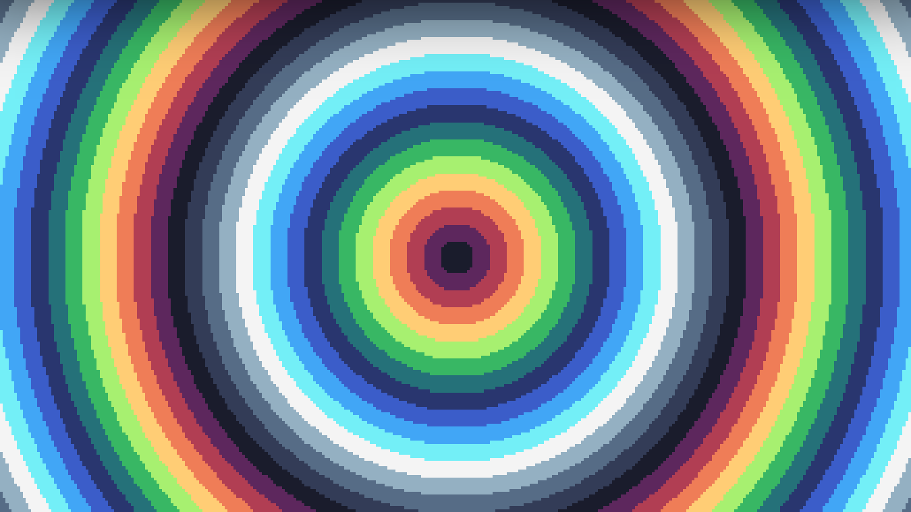

Pixel mit ungefähr demselben Abstand bekommen dieselbe Farbe. So entstehen Kreise, obwohl das Programm keinen einzigen Kreis zeichnet. Probiere aus, was passiert, wenn du `6.0` größer oder kleiner machst.

_task(abstand)

### Kreiswellen

Die Ringe haben harte Kanten. Weicher wird es mit der Sinusfunktion: `sin` liefert Werte, die gleichmäßig zwischen −1 und 1 hin- und herpendeln. Ersetze die letzte Zeile von `color`:

```c
double wave = sin(distance * 0.12);
return (int)((wave + 1.0) * 7.5);
```

`wave + 1.0` liegt zwischen 0 und 2, mal 7,5 ergibt das 0 bis 15: genau die 16 Farben der Palette. `distance * 0.20` statt `0.12` rückt die Wellen enger zusammen.

<!-- tutorial-screenshot
terminal-open
terminal-run: sed -i 's|    return (int)(distance / 6.0) % 16;|    double wave = sin(distance * 0.12);\n    return (int)((wave + 1.0) * 7.5);|' main.c
terminal-wait-for-prompt
terminal-run: make
terminal-wait-for-prompt
terminal-expect-no-text: error:
terminal-expect-no-text: ***
tab: preview
variants: crt
viewport: 800x450
hook: open main.html
crop-element: #canvas
-->
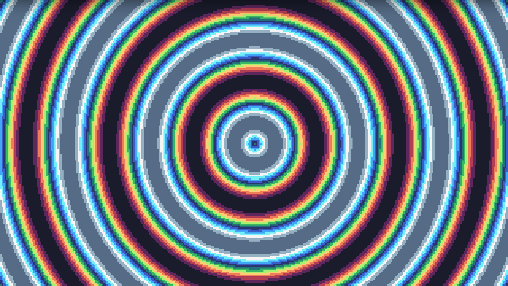

<div class='hint try'>
<strong>Ausprobieren:</strong> Eine eigene Palette. Schreib in <code>main</code> unter <code>use_palette</code> die Zeile <code>for (int i = 0; i &lt; 16; i++) set_palette(i, i * 17, 0, 255 - i * 17);</code>. Jetzt geht Farbe 0 (Blau) in 16 gleichen Schritten zu Farbe 15 (Rot), und aus den bunten Ringen werden weiche Wellenberge. Wie sieht ein Verlauf von Schwarz über Rot und Gelb bis Weiß aus, wie im <a href='/fire'>Feuer</a>? Dort steht, wie man ihn aus mehreren Abschnitten baut.
</div>

### Glatte Kanten

Sieh dir die Ränder der Ringe genau an: Treppenstufen. Jedes Pixel bekommt genau eine der 16 Farben, also verläuft jede Grenze zwischen zwei Farben in Stufen. Gleich bewegen sich die Ringe, dann springen die Stufen bei jedem Bild von Pixel zu Pixel, und entlang jeder Kante krabbelt und flimmert es.

Auf den Bildschirmen der 80er- und 90er-Jahre fiel das kaum auf. Ein **Röhrenbildschirm** (CRT, Cathode Ray Tube) hat keine Pixel mit scharfen Rändern: Ein Elektronenstrahl fährt Zeile für Zeile über die Leuchtschicht hinter dem Glas, und wo er sie trifft, glüht sie auf, in einem runden Fleck mit weichem Rand. Der Strahl springt auch nicht von einer Farbe zur nächsten, er wird stärker oder schwächer, und dafür braucht er ein Stück Weg. So fließt jedes Pixel ein wenig in seine Nachbarn über, vor allem nach links und rechts, und zwischen den Zeilen bleibt ein dunkler Streifen, die **Scanline**. Treppenstufen wurden auf der Röhre von selbst weich, und wer damals Grafik zeichnete, rechnete damit: Zwei Farben im Schachbrettmuster sahen aus wie eine Mischfarbe. Ein wenig Glättung gab es umsonst. Der CRT-Filter von PixelRAM (das Röhrensymbol, <kbd>F6</kbd>) ahmt diesen Bildschirm nach; schalte ihn ein und sieh dir die Kanten noch einmal an.

Ohne Röhre muss das Programm selbst glätten. Ein Pixel ist ein kleines Quadrat, und bisher fragt das Programm nur an einem einzigen Punkt nach der Farbe: an seiner linken oberen Ecke `(x, y)`. Läuft eine Grenze zwischen zwei Ringen mitten durch das Quadrat, bekommt es trotzdem ganz die Farbe dieser einen Ecke. Besser wäre eine Farbe dazwischen, so wie das Pixel zum Teil im einen und zum Teil im anderen Ring liegt. Dafür fragt das Programm an mehreren Punkten im Pixel und mischt die Farben. Mehrere Messpunkte für ein Pixel heißen **Supersampling**.

Viele Messpunkte für jedes Pixel wären viel Arbeit, und das schafft der Browser nicht 60-mal pro Sekunde, sobald sich etwas bewegt. Nötig sind sie aber nur an den Kanten, und die findet das Programm billig:

1. Es rechnet wie bisher die Farbe an jedem Punkt `(x, y)` aus, nur eine Spalte und eine Zeile weiter, und merkt sie sich im Array `corner`. Das sind die vier Ecken jedes Pixels; jede Ecke gehört zu vier Pixeln und wird nur einmal gerechnet.
2. Haben alle vier Ecken eines Quadrats dieselbe Farbe, liegt es ganz in einem Ring und bekommt diese Farbe.
3. Sonst läuft eine Kante hindurch. Dann teilt das Programm das Quadrat in vier kleinere, rechnet die Farbe an den fünf neuen Ecken aus, den Mitten der vier Seiten und der Mitte, und macht mit jedem der vier kleinen Quadrate dasselbe wie in 2. und 3. Die Farbe des großen Quadrats ist die Mischung der vier kleinen.

Die Funktion `square` ruft sich dafür selbst auf: Sie ist **rekursiv**. Damit das ein Ende hat, zählt `levels` mit, wie oft sie noch teilen darf. Bei 0 nimmt `square` einfach die Farbe der linken oberen Ecke, so wie bisher. `LEVELS 0` ist also genau das Bild von eben, `LEVELS 1` teilt ein Pixel an einer Kante einmal (bis zu 4 Messpunkte), `LEVELS 2` zweimal (bis zu 16), `LEVELS 3` dreimal (bis zu 64). Genauer hinsehen nur dort, wo es etwas bringt: Das heißt **adaptives Supersampling**.

An `color` ändert sich nichts. Ersetze `main` durch:

```c_copy
~     return (int)((wave + 1.0) * 7.5);
~ }
~
// wie oft ein Pixel an einer Kante höchstens geteilt wird
#define LEVELS 1

// die Farben an den Ecken der Pixel: eine Zeile und eine Spalte mehr
int corner[H + 1][W + 1];

// Die Farbe eines Quadrats mit der linken oberen Ecke (x, y) und der
// Seitenlänge size; c00, c10, c01 und c11 sind die Farben seiner Ecken.
void square(double x, double y, double size, int c00, int c10, int c01, int c11, int levels, int rgb[3])
{
    if (levels == 0 || (c00 == c10 && c00 == c01 && c00 == c11))
    {
        // alle Ecken gleich (oder nicht weiter teilen): eine Farbe
        uint8_t r, g, b;
        get_palette(c00, &r, &g, &b);
        rgb[0] = r;
        rgb[1] = g;
        rgb[2] = b;
        return;
    }

    // eine Kante läuft durch: in vier kleinere Quadrate teilen
    double half = size / 2;
    int top    = color(x + half, y);
    int left   = color(x,        y + half);
    int middle = color(x + half, y + half);
    int right  = color(x + size, y + half);
    int bottom = color(x + half, y + size);

    int upper_left[3], upper_right[3], lower_left[3], lower_right[3];
    square(x,        y,        half, c00,    top,    left,   middle, levels - 1, upper_left);
    square(x + half, y,        half, top,    c10,    middle, right,  levels - 1, upper_right);
    square(x,        y + half, half, left,   middle, c01,    bottom, levels - 1, lower_left);
    square(x + half, y + half, half, middle, right,  bottom, c11,    levels - 1, lower_right);

    // und ihre Farben mischen
    for (int i = 0; i < 3; i++)
        rgb[i] = (upper_left[i] + upper_right[i] + lower_left[i] + lower_right[i]) / 4;
}

// zeichnet das ganze Bild mit color, die Kanten geglättet
void draw(void)
{
    for (int y = 0; y <= H; y++)
        for (int x = 0; x <= W; x++)
            corner[y][x] = color(x, y);

    for (int y = 0; y < H; y++)
        for (int x = 0; x < W; x++)
        {
            int rgb[3];
            square(x, y, 1.0, corner[y][x], corner[y][x + 1], corner[y + 1][x], corner[y + 1][x + 1], LEVELS, rgb);
            set_pixel_rgb(x, y, rgb[0], rgb[1], rgb[2]);
        }
}

int main(void)
{
    screen_open(W, H, pixel_rgb24, "PixelRAM");
    use_palette("sweetie_16");

    draw();

    return 0;
}
```

- Paletten-Nummern lassen sich nicht mischen: Der Mittelwert aus Farbe 5 und Farbe 6 ist 5,5, und das ist keine Farbe. Das Programm öffnet den Bildschirm deshalb mit `pixel_rgb24`, und jedes Pixel bekommt mit `set_pixel_rgb` seinen Rot-, Grün- und Blauanteil, jeweils von 0 bis 255.
- Die Palette bleibt trotzdem: `get_palette(nummer, &r, &g, &b)` schreibt die drei Anteile einer Paletten-Farbe in `r`, `g` und `b`. Das `&` gibt der Funktion die Adressen der Variablen, damit sie hineinschreiben kann. Jeder Messpunkt ist also eine der 16 Farben; nur Pixel auf einer Kante bekommen eine Mischung.
- `square` gibt drei Zahlen zurück, Rot, Grün und Blau. Eine Funktion in C kann nur einen Wert zurückgeben, deshalb bekommt `square` das Array `rgb` und schreibt hinein: Ein Array als Parameter ist dasselbe Array wie beim Aufruf, kein neues.
- `corner` steht außerhalb von `draw`: Mit 181 × 321 Zahlen ist das Array zu groß für den Platz, den eine Funktion im Browser für ihre Variablen hat.

So sieht ein Ausschnitt aus der Nähe aus, mit `LEVELS` von 0 bis 3:

<div class='gallery columns-4'>
<figure>
<!-- tutorial-screenshot
# Noch das Programm aus »Kreiswellen«: dasselbe Bild wie LEVELS 0
tab: preview
viewport: 1600x900
hook: open main.html
crop-left: 19%
crop-right: 71%
crop-top: 11%
crop-bottom: 71%
-->
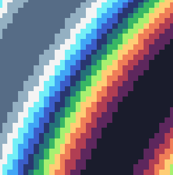
<figcaption><code>LEVELS 0</code>: ein Messpunkt</figcaption>
</figure>
<figure>
<!-- tutorial-screenshot
write-file: main.c <- file:stufen/glatt.c
terminal-open
terminal-run: make
terminal-wait-for-prompt
terminal-expect-no-text: error:
terminal-expect-no-text: ***
tab: preview
viewport: 1600x900
hook: open main.html
crop-left: 19%
crop-right: 71%
crop-top: 11%
crop-bottom: 71%
-->
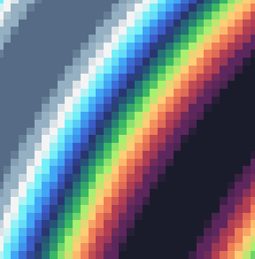
<figcaption><code>LEVELS 1</code>: bis zu 4 Messpunkte</figcaption>
</figure>
<figure>
<!-- tutorial-screenshot
terminal-open
terminal-run: sed -i 's|#define LEVELS 1|#define LEVELS 2|' main.c
terminal-wait-for-prompt
terminal-run: make
terminal-wait-for-prompt
terminal-expect-no-text: error:
terminal-expect-no-text: ***
tab: preview
viewport: 1600x900
hook: open main.html
crop-left: 19%
crop-right: 71%
crop-top: 11%
crop-bottom: 71%
-->
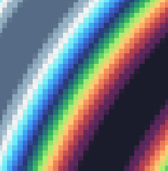
<figcaption><code>LEVELS 2</code>: bis zu 16 Messpunkte</figcaption>
</figure>
<figure>
<!-- tutorial-screenshot
terminal-open
terminal-run: sed -i 's|#define LEVELS 2|#define LEVELS 3|' main.c
terminal-wait-for-prompt
terminal-run: make
terminal-wait-for-prompt
terminal-expect-no-text: error:
terminal-expect-no-text: ***
tab: preview
viewport: 1600x900
hook: open main.html
crop-left: 19%
crop-right: 71%
crop-top: 11%
crop-bottom: 71%
-->
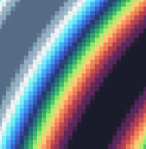
<figcaption><code>LEVELS 3</code>: bis zu 64 Messpunkte</figcaption>
</figure>
</div>

Die Pixel innen in den Ringen sind bei jeder Stufe genau wie vorher, das Bild wird nicht unscharf. Nur an den Grenzen sitzen Pixel in Zwischentönen: Je mehr von einem Pixel im einen Ring liegt, desto näher ist seine Farbe an dessen Farbe. Den größten Schritt macht `LEVELS 1`, danach werden die Unterschiede klein, die Arbeit aber nicht: Bei den beiden Wellen weiter unten braucht ein Bild mit `LEVELS 1` etwa zweieinhalbmal so lange wie ohne Glätten, mit `LEVELS 2` gut fünfmal und mit `LEVELS 3` elfmal. Für alles, was sich bewegt, ist `LEVELS 1` die richtige Wahl; für ein einzelnes Bild darf es mehr sein.

<div class='hint try'>
<strong>Ausprobieren:</strong> Stell <code>LEVELS</code> auf 2 und 3 und vergleiche. Wo sieht das Programm genauer hin? Schreib in <code>square</code> ganz unten, nach der Schleife, die das Mischen erledigt, <code>rgb[0] = 255; rgb[1] = 0; rgb[2] = 0;</code>: Jetzt ist jedes Pixel rot, das das Programm geteilt hat. Und schalte den CRT-Filter ein und aus: Wie viel macht er bei geglätteten Kanten noch aus?
</div>

### Bewegung

Bisher rechnet das Programm ein einziges Bild und ist dann fertig. Für eine Animation braucht es eine Schleife, die immer wieder ein neues Bild berechnet, bis jemand die Seite schließt:

```c
while (!should_close())
{
    // ein Bild berechnen
    present();   // und zeigen
}
```

`present()` zeigt das fertige Bild und wartet bis zum nächsten, höchstens 60-mal pro Sekunde. `seconds()` sagt, wie viele Sekunden seit dem Start vergangen sind. Steckt diese Zeit in der Sinusfunktion, wandern die Wellen nach außen.

Die Zeit braucht `color`, gesetzt wird sie in `main`: Sie steht deshalb als Variable `t` außerhalb von beiden, wo jede Funktion sie lesen kann. Ändere den Anfang der Datei bis `color`:

```c
#include "pixelram.h"
#include <math.h>

#define W 320
#define H 180

// Sekunden seit dem Start, für jedes Bild neu
double t;

int color(double x, double y)
{
    double distance = hypot(x - W / 2.0, y - H / 2.0);
    double wave = sin(distance * 0.12 - t * 2.0);
    return (int)((wave + 1.0) * 7.5);
}
```

`hypot(dx, dy)` rechnet dasselbe wie `sqrt(dx * dx + dy * dy)`, nur kürzer. `draw` bleibt, wie es ist. In `main` kommt die Schleife um `draw()`:

```c
~ int main(void)
~ {
~     screen_open(W, H, pixel_rgb24, "PixelRAM");
~     use_palette("sweetie_16");
~
    while (!should_close())
    {
        t = seconds();
        draw();
        present();
    }

    screen_close();
    return 0;
}
```

<!-- tutorial-screenshot
write-file: main.c <- file:stufen/bewegung.c
terminal-open
terminal-run: make
terminal-wait-for-prompt
terminal-expect-no-text: error:
terminal-expect-no-text: ***
tab: preview
variants: crt
viewport: 640x360
hook: open main.html
# sin(distance * 0.12 - t * 2.0) wiederholt sich nach π Sekunden
record: 3.14s
-->
<video src='wellen.mp4' autoplay loop muted playsinline style='width: 100%; max-width: 640px;'></video>

Kein Kreis wird verschoben: Das Programm rechnet jedes Bild komplett neu, und weil `t` wächst, liefert `sin` jedes Mal ein wenig andere Werte. Die Kanten gleiten dabei ruhig nach außen, weil `draw` sie glättet.

Wie schnell die Wellen wandern, hängt dabei nur an der Uhr, nicht daran, wie viele Bilder pro Sekunde der Rechner schafft: Nach einer Sekunde ist `t` um 1 größer, ob in dieser Sekunde 144 Bilder gezeigt wurden, 60 oder nur 20. Auf einem langsamen Rechner springen die Wellen von Bild zu Bild ein größeres Stück, kommen aber in einer Sekunde genauso weit. Würde das Programm dagegen in jedem Bild ein festes Stück weiterrechnen, liefen die Wellen auf jedem Bildschirm anders schnell.

_task(bewegung)

_task(richtung)

<div class='hint try'>
<strong>Ausprobieren:</strong> Schreib <code>set_target_fps(10);</code> unter <code>use_palette("sweetie_16");</code>, übersetze mit <code>make</code> und lade die Vorschau neu. Jetzt zeigt PixelRAM höchstens 10 Bilder pro Sekunde statt 60. Achte darauf, wie weit ein Ring in einer Sekunde kommt, und wie gleichmäßig er dabei wandert. Nimm die Zeile danach wieder heraus.
</div>

### Zwei Wellen treffen sich

Die Quelle der Wellen muss nicht in der Mitte bleiben. Mit `cos` und `sin` der Zeit wandert ein Punkt in Schleifen über den Bildschirm. Nimm zwei solche Quellen, rechne für jedes Pixel beide Wellen aus und zähle sie zusammen. Die beiden Quellen stehen wie `t` außerhalb der Funktionen, `color` misst den Abstand zu beiden:

```c
~ // Sekunden seit dem Start, für jedes Bild neu
~ double t;
~
// zwei Wellenquellen, die durchs Bild wandern
double ax, ay, bx, by;

int color(double x, double y)
{
    double d1 = hypot(x - ax, y - ay);
    double d2 = hypot(x - bx, y - by);

    double wave = sin(d1 * 0.12 - t * 1.0) + sin(d2 * 0.12 + t * 1.15);

    return (int)((wave + 2) * 3.75);
}
```

`main` bewegt die Quellen bei jedem Bild ein Stück weiter:

```c
~     while (!should_close())
~     {
        t = seconds();
        ax = W / 2.0 + cos(t * 0.4) * 70;
        ay = H / 2.0 + sin(t * 0.55) * 40;
        bx = W / 2.0 + cos(t * 0.65) * 90;
        by = H / 2.0 + sin(t * 0.35) * 50;

        draw();
~         present();
~     }
```

_task(interferenz)

Wo beide Wellen gleichzeitig oben sind, verstärken sie sich, wo die eine oben und die andere unten ist, löschen sie sich aus. Das nennt man **Interferenz**. Die Summe liegt zwischen −2 und 2, deshalb rechnet die letzte Zeile von `color` `(wave + 2) * 3.75`.

<!-- tutorial-screenshot
write-file: main.c <- file:stufen/interferenz.c
terminal-open
terminal-run: make
terminal-wait-for-prompt
terminal-expect-no-text: error:
terminal-expect-no-text: ***
tab: preview
variants: crt
viewport: 800x450
hook: open main.html
# nach 7,2 Sekunden: die beiden Quellen nah beieinander, ein ruhiges Muster
hook: at 7.2
crop-element: #canvas
-->


Für jedes Bild rechnet `color` an 58.000 Ecken zwei Abstände und zwei Sinuswerte aus, und weil die Ringe hier dicht liegen, an vielen Kanten noch einmal: zusammen rund 200.000-mal pro Bild, bei 60 Bildern pro Sekunde rund **12 Millionen**-mal pro Sekunde. Für solche Rechnungen ist C gemacht.

<div class='hint task'>
<strong>Experimente.</strong> Mehr Ringe mit <code>d1 * 0.18</code>, schnellere Wellen mit <code>t * 2.0</code>, weitere Wege mit <code>cos(t * 0.4) * 110</code>. Füge eine dritte Quelle hinzu: Wie musst du dann die letzte Zeile von <code>color</code> ändern, damit die Farben wieder zwischen 0 und 15 liegen? Und wie sieht es mit <code>"aap_64"</code> und 64 Farben aus?
</div>

## Ein Spiel: Lichtspur

Zwei Spuren fahren über das Spielfeld und ziehen eine Linie hinter sich her. Wer in eine Linie oder an die Wand fährt, verliert die Runde. Gespielt wird zu zweit an einer Tastatur, mit <kbd>W</kbd><kbd>A</kbd><kbd>S</kbd><kbd>D</kbd> und mit den Pfeiltasten.

Das Spiel bekommt eine eigene Datei. Lege `lichtspur.c` neben `main.c` an und übersetze sie mit:

```bash
make PROGRAM=lichtspur
```

Das ergibt `lichtspur.html`, die du in der Vorschau öffnest. So kann jedes Programm im Ordner seine eigene Datei haben.

### Eine Spur, die fährt

```c
#include "pixelram.h"

#define W 160
#define H 90
#define STEP (1.0 / 30)   // ein Schritt alle 1/30 Sekunde

int main(void)
{
    screen_open(W, H, pixel_indexed8, "Lichtspur");
    use_palette("sweetie_16");

    int x = 20, y = H / 2;   // Position
    int dx = 1, dy = 0;      // Richtung: nach rechts

    double last = seconds();
    double lag = 0;          // Zeit, für die noch Schritte fehlen

    while (!should_close())
    {
        if (key_pressed(pixel_key_up))    { dx = 0;  dy = -1; }
        if (key_pressed(pixel_key_down))  { dx = 0;  dy = 1;  }
        if (key_pressed(pixel_key_left))  { dx = -1; dy = 0;  }
        if (key_pressed(pixel_key_right)) { dx = 1;  dy = 0;  }

        double now = seconds();
        lag += now - last;
        last = now;
        if (lag > 0.25)   // nach einer Pause nicht davonrasen
            lag = 0.25;

        while (lag >= STEP)
        {
            x += dx;
            y += dy;
            set_pixel(x, y, 11);
            lag -= STEP;
        }

        present();
    }

    screen_close();
    return 0;
}
```

_task(loslassen)

Klicke in die Vorschau, damit sie die Tasten bekommt, und steuere mit den Pfeiltasten. Drei Dinge sind neu:

- Das Spielfeld hat nur 160 × 90 Pixel, also große Pixel.
- `key_pressed` ist in genau dem Bild wahr, in dem eine Taste heruntergedrückt wurde. `dx` und `dy` merken sich die Richtung, und bei jedem Schritt geht die Spur einen Pixel weiter.
- Das Programm löscht den Bildschirm nie. Jedes gesetzte Pixel bleibt stehen, so entsteht die Spur.

<!-- tutorial-screenshot
write-file: lichtspur.c <- previous-code
terminal-open
terminal-run: make PROGRAM=lichtspur
terminal-wait-for-prompt
terminal-expect-no-text: error:
terminal-expect-no-text: ***
tab: preview
variants: crt
viewport: 800x450
hook: open lichtspur.html
# Die Spur fährt los, sobald die Seite geladen ist: neu laden, dann gleich lenken.
preview-reload
hook: play 1 ArrowUp 0.4 ArrowLeft 0.4 ArrowDown 1
hook: freeze
crop-element: #canvas
-->
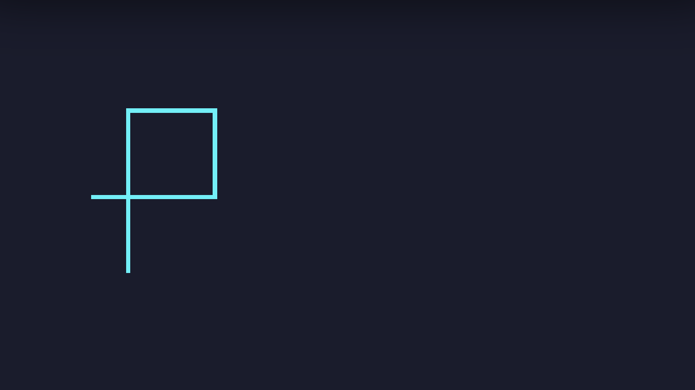

### Ein fester Takt

Die Spur fährt einen Pixel nach dem anderen, sie kann nicht wie die Wellen einfach ein krummes Stück weiterrücken. Würde sie in jedem Bild einen Schritt machen, wäre sie auf jedem Bildschirm anders schnell: Viele zeigen 60 Bilder pro Sekunde, manche 120 oder 144, ein langsamer Rechner schafft vielleicht nur 20, und ein Tab im Hintergrund zeigt gar keine. Deshalb fährt die Spur in einem festen Takt, nach der Uhr: alle `STEP` Sekunden, also 30-mal pro Sekunde, einen Schritt.

`lag` sammelt die Zeit, die seit dem letzten Bild vergangen ist. Die innere `while`-Schleife macht für jede volle Dreißigstelsekunde darin einen Schritt und zieht sie von `lag` ab; der Rest wartet auf das nächste Bild. Bei 60 Bildern pro Sekunde fährt die Spur so etwa in jedem zweiten Bild einen Schritt, bei 10 Bildern pro Sekunde drei Schritte pro Bild. Gelenkt wird dagegen in jedem Bild, denn `key_pressed` ist nur in einem einzigen Bild wahr, und kein Tastendruck soll verloren gehen. War das Programm eine Weile angehalten, zum Beispiel weil der Tab im Hintergrund lag, holt es höchstens eine Viertelsekunde nach, statt Hunderte Schritte auf einmal zu fahren.

<div class='hint try'>
<strong>Ausprobieren:</strong> Schreib <code>set_target_fps(10);</code> unter <code>use_palette("sweetie_16");</code>, übersetze mit <code>make PROGRAM=lichtspur</code> und lade die Vorschau neu. Jetzt zeigt PixelRAM höchstens 10 Bilder pro Sekunde. Achte darauf, wie schnell die Spur über das Feld kommt und in welchen Sprüngen sie wächst. Ändere danach <code>STEP</code> in <code>(1.0 / 60)</code>. Schreib zuletzt <code>clear(0);</code> als erste Zeile in die innere <code>while</code>-Schleife: Was bleibt von der Spur übrig, und warum? Nimm alles danach wieder heraus.
</div>

<div class='book'>
<i class='bi bi-book'></i>
<p><strong>Game Programming Patterns</strong>, Robert Nystrom, 2014. Das Kapitel »Game Loop« macht genau hier weiter: Es vergleicht Spielschleifen, die in jedem Bild einen Schritt machen, mit solchen, die mit der vergangenen Zeit rechnen, und landet beim festen Takt mit derselben Variable <code>lag</code>. Das ganze Buch ist frei <a href='https://gameprogrammingpatterns.com/game-loop.html'>online zu lesen</a>.</p>
</div>

Noch kannst du deine eigene Spur kreuzen und aus dem Bild fahren. Das ändert sich jetzt.

### Wände und Zusammenstöße

Was auf dem Bildschirm steht, ist Speicher, und Speicher kann man lesen: `get_pixel(x, y)` gibt die Farbnummer eines Pixels zurück. Ist das Feld, auf das die Spur fahren will, nicht mehr 0 (der Hintergrund), dann steht dort eine Wand oder eine Spur, und es kracht. Du brauchst keine Liste der Linien und keine Rechnung mit Rechtecken: Der Bildschirm selbst ist das Spielfeld.

Zeichne vor der Schleife einen Rahmen in Farbe 14:

```c
for (int x = 0; x < W; x++)
{
    set_pixel(x, 0, 14);
    set_pixel(x, H - 1, 14);
}
for (int y = 0; y < H; y++)
{
    set_pixel(0, y, 14);
    set_pixel(W - 1, y, 14);
}
```

Und prüfe bei jedem Schritt, bevor das neue Pixel gesetzt wird:

```c
while (!crashed && lag >= STEP)
{
    x += dx;
    y += dy;
    if (get_pixel(x, y) != 0)
        crashed = true;

    set_pixel(x, y, crashed ? 2 : 11);
    lag -= STEP;
}
```

Dazu gehört eine Variable `bool crashed = false;` vor der äußeren Schleife. `!crashed` in der Bedingung hält die Spur nach dem Zusammenstoß an, auch mitten in einem Bild, in dem sie noch mehrere Schritte vor sich hätte. Die Unfallstelle wird rot (Farbe 2).

_task(reihenfolge)

<div class='hint think'>
<strong>Zum Nachdenken:</strong> Was passiert, wenn du direkt in die Gegenrichtung lenkst?
</div>

_task(kollision)

### Zu zweit

Für zwei Spuren bräuchtest du alle Variablen doppelt: `x1`, `y1`, `dx1`, `x2`, … Übersichtlicher ist ein `struct`, das alles zusammenfasst, was zu einer Spur gehört. Funktionen wie `drive` bekommen dann einen Zeiger auf eine Spur, `Player *p`, und erreichen ihre Teile mit `p->x`. So arbeitet derselbe Code für beide. Hier das ganze Spiel:

```c
#include "pixelram.h"

#define W 160
#define H 90
#define WALL 14
#define CRASH 12
#define STEP (1.0 / 30)   // ein Schritt alle 1/30 Sekunde

typedef struct
{
    int x, y;      // Position
    int dx, dy;    // Richtung
    int color;
    bool crashed;
    int wins;
} Player;

void draw_field(Player *a, Player *b)
{
    clear(0);
    for (int x = 0; x < W; x++)
    {
        set_pixel(x, 0, WALL);
        set_pixel(x, H - 1, WALL);
    }
    for (int y = 0; y < H; y++)
    {
        set_pixel(0, y, WALL);
        set_pixel(W - 1, y, WALL);
    }

    // Siege als Punkte in der oberen Wand: links a, rechts b
    for (int i = 0; i < a->wins; i++)
        set_pixel(2 + 2 * i, 0, a->color);
    for (int i = 0; i < b->wins; i++)
        set_pixel(W - 3 - 2 * i, 0, b->color);
}

void start(Player *p, int x, int dx)
{
    p->x = x;
    p->y = H / 2;
    p->dx = dx;
    p->dy = 0;
    p->crashed = false;
}

void steer(Player *p, pixel_key up, pixel_key down, pixel_key left, pixel_key right)
{
    // Umdrehen geht nicht: nur abbiegen
    if (key_pressed(up)    && p->dy == 0) { p->dx = 0;  p->dy = -1; }
    if (key_pressed(down)  && p->dy == 0) { p->dx = 0;  p->dy = 1;  }
    if (key_pressed(left)  && p->dx == 0) { p->dx = -1; p->dy = 0;  }
    if (key_pressed(right) && p->dx == 0) { p->dx = 1;  p->dy = 0;  }
}

void drive(Player *p)
{
    p->x += p->dx;
    p->y += p->dy;
    if (get_pixel(p->x, p->y) != 0)
        p->crashed = true;
}

int main(void)
{
    screen_open(W, H, pixel_indexed8, "Lichtspur");
    use_palette("sweetie_16");

    Player a = { .color = 3 };    // Orange, fährt mit WASD
    Player b = { .color = 11 };   // Türkis, fährt mit den Pfeiltasten

    bool running = false;   // Die Leertaste startet jede Runde.
    draw_field(&a, &b);

    double last = seconds();
    double lag = 0;         // Zeit, für die noch Schritte fehlen

    while (!should_close())
    {
        double now = seconds();
        lag += now - last;
        last = now;
        if (lag > 0.25)   // nach einer Pause nicht davonrasen
            lag = 0.25;

        if (running)
        {
            steer(&a, pixel_key_w, pixel_key_s, pixel_key_a, pixel_key_d);
            steer(&b, pixel_key_up, pixel_key_down, pixel_key_left, pixel_key_right);
        }
        else if (key_pressed(pixel_key_space))
        {
            draw_field(&a, &b);
            start(&a, 20, 1);
            start(&b, W - 21, -1);
            running = true;
            lag = 0;   // die Runde beginnt ohne Rückstand
        }

        // beide Spuren fahren im selben Takt: immer beide einen Schritt
        while (running && lag >= STEP)
        {
            drive(&a);
            drive(&b);
            if (a.x == b.x && a.y == b.y)   // frontal ineinander
                a.crashed = b.crashed = true;

            set_pixel(a.x, a.y, a.crashed ? CRASH : a.color);
            set_pixel(b.x, b.y, b.crashed ? CRASH : b.color);

            if (a.crashed || b.crashed)
            {
                running = false;
                if (!a.crashed) a.wins++;
                if (!b.crashed) b.wins++;
            }
            lag -= STEP;
        }

        present();
    }

    screen_close();
    return 0;
}
```

<!-- tutorial-screenshot
write-file: lichtspur.c <- previous-code
terminal-open
terminal-run: make PROGRAM=lichtspur
terminal-wait-for-prompt
terminal-expect-no-text: error:
terminal-expect-no-text: ***
tab: preview
variants: crt
viewport: 800x450
hook: open lichtspur.html
# Runde 1: Türkis fährt in die Wand. Runde 2: beide kurven, Orange fährt in die türkise Spur.
hook: play Space 0.5 ArrowUp 2.5 Space 0.3 KeyW ArrowDown 0.8 KeyD ArrowLeft 0.9 KeyS ArrowUp 0.6 KeyD ArrowLeft 0.8 KeyS ArrowDown 0.7 KeyA 0.6 ArrowRight 0.5 KeyS ArrowUp 3
crop-element: #canvas
-->


_task(unentschieden)

Mit der <kbd>Leertaste</kbd> beginnt eine Runde. Gelenkt wird in jedem Bild, gefahren im festen Takt: Bei jedem Schritt fahren beide Spuren, und erst danach wird gezeichnet. Deshalb ist es gerecht, wenn beide gleichzeitig verunglücken: Dann gewinnt niemand. Die Punkte stehen als Pixel in der oberen Wand.

<div class='hint task'>
<strong>Bau das Spiel aus.</strong> Ein paar Ideen, von leicht bis knifflig:
<ul>
<li><strong>Schneller werden:</strong> Mach aus <code>STEP</code> eine Variable, die mit jedem Schritt ein wenig kleiner wird: Je länger eine Runde dauert, desto schneller fahren beide Spuren.</li>
<li><strong>Hindernisse:</strong> Setze in <code>draw_field</code> ein paar Blöcke in Wandfarbe ins Feld, mit <code>rand()</code> aus <code>&lt;stdlib.h&gt;</code> jedes Mal woanders.</li>
<li><strong>Lücken:</strong> Lass jede Spur ab und zu ein paar Pixel nicht zeichnen. Durch die Lücken kann man hindurchfahren.</li>
<li><strong>Computergegner:</strong> Spur b lenkt selbst. Sie schaut mit <code>get_pixel(b.x + b.dx, b.y + b.dy)</code> ein Feld voraus und biegt ab, wenn dort etwas ist. Wie kann sie auch weiter vorausschauen?</li>
</ul>
</div>

Die Maus fragst du mit `mouse_position(&x, &y)` und `mouse_button_down(pixel_mouse_left)` ab, alle weiteren Tasten heißen wie `pixel_key_a` oder `pixel_key_enter`. Die ganze Liste steht in der [Dokumentation](https://specht.github.io/pixelram/input.html).

<!-- extra -->
## Mehr PixelRAM

### Beispiele im Starter

Im Ordner `beispiele` der Vorlage liegen fertige Programme. Jedes übersetzt du mit `make PROGRAM=…` und öffnest die passende HTML-Datei:

```bash
make PROGRAM=beispiele/tunnel
```

<div class='gallery'>
<figure>
<!-- tutorial-screenshot
terminal-open
terminal-run: make PROGRAM=beispiele/tunnel
terminal-wait-for-prompt
terminal-expect-no-text: error:
terminal-expect-no-text: ***
tab: preview
variants: crt
viewport: 800x450
hook: open beispiele/tunnel.html
hook: at 2.5
crop-element: #canvas
-->
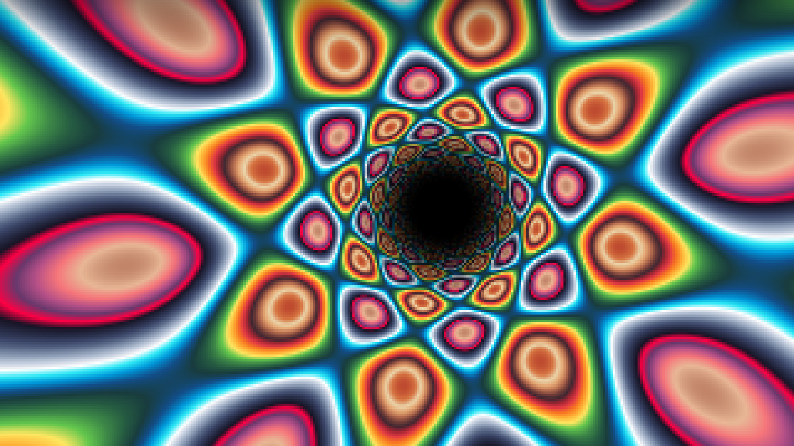
<figcaption><code>beispiele/tunnel</code>: Abstand und Winkel jedes Pixels zur Mitte ergeben einen Flug durch einen Tunnel.</figcaption>
</figure>
<figure>
<!-- tutorial-screenshot
terminal-open
terminal-run: make PROGRAM=beispiele/julia
terminal-wait-for-prompt
terminal-expect-no-text: error:
terminal-expect-no-text: ***
tab: preview
variants: crt
viewport: 800x450
hook: open beispiele/julia.html
hook: at 6
crop-element: #canvas
-->
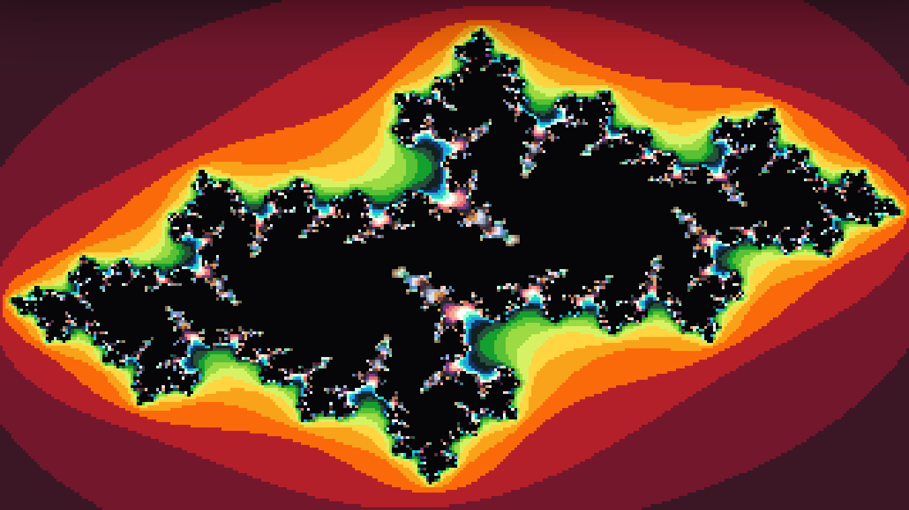
<figcaption><code>beispiele/julia</code>: Für jedes Pixel immer wieder dieselbe kleine Rechnung, ein Fraktal, das sich langsam verwandelt; die Kanten geglättet wie in »Glatte Kanten«.</figcaption>
</figure>
<figure>
<!-- tutorial-screenshot
terminal-open
terminal-run: make PROGRAM=beispiele/magie
terminal-wait-for-prompt
terminal-expect-no-text: error:
terminal-expect-no-text: ***
tab: preview
variants: crt
viewport: 800x450
hook: open beispiele/magie.html
hook: at 1.2
crop-element: #canvas
-->
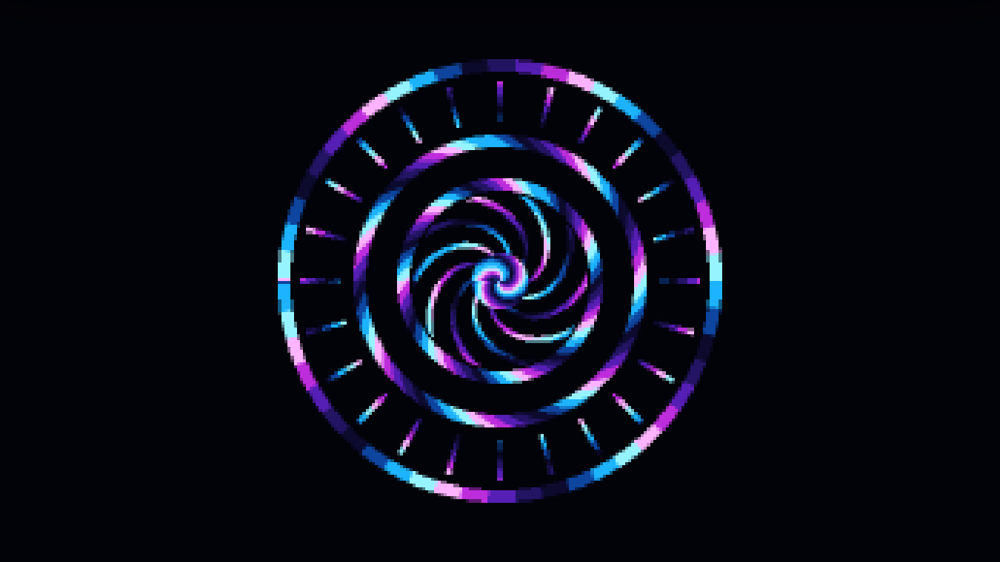
<figcaption><code>beispiele/magie</code>: Die Form wird nur einmal berechnet. Bewegung bringt allein die Palette, die sich in der Schleife dreht; jedes Bild mischt ihre Farben an den Kanten neu.</figcaption>
</figure>
</div>

Dazu kommen `beispiele/feuer`, ein Feuer, in dem jedes Pixel die Hitze seiner Nachbarn darunter aufnimmt, und `beispiele/sterne`, ein Flug durch 400 Sterne in 3D. Kopiere ein Beispiel neben `main.c` und verändere es: Das ist oft der schnellste Weg zu einer eigenen Idee.

<div class='hint info'>
Der Palettentrick aus <code>beispiele/magie</code> heißt <strong>Color Cycling</strong>. Der Künstler Mark Ferrari hat damit ganze Landschaften mit Regen, Schnee und Wasser zum Leben erweckt, ohne ein einziges Pixel zu verändern. <a href='https://www.effectgames.com/demos/canvascycle/' target='_blank'>Hier kannst du seine Bilder ansehen.</a>
</div>

### Ganze Spiele

PixelRAM ist klein, aber kein Spielzeug. Dieselben wenigen Befehle, die du kennst, tragen auch Spiele aus den Neunzigerjahren, die damals ganz ähnlich programmiert wurden: Ein Programm schreibt Pixel in den Speicher. Sogar DOOM läuft auf PixelRAM. **Crystal Caves** (1991) ist ein Jump-and-Run, dessen erste Episode frei verteilt werden darf. Probier es aus:

```bash
make crystal
```

Das lädt PixelRAM mit seinen Spiele-Anpassungen und den Quelltext von OpenCrystalCaves, einer freien Neuprogrammierung des Spiels, und übersetzt alles. Das dauert ein, zwei Minuten. Dann öffnest du `spiele/crystal.html` in der Vorschau. Du läufst mit den Pfeiltasten, springst mit <kbd>Z</kbd> und schießt mit <kbd>X</kbd>.

<!-- tutorial-screenshot
# Crystal Caves: übersetzen, öffnen, das Intro »Apogee presents« (die Enter
# kommen im Generator noch im Intro an, das Spiel läuft dort mit 15 fps);
# auf 16:9 geschnitten wie die beiden Bilder oben neben ihm
terminal-open
terminal-run: make crystal
terminal-wait-for-prompt: 600
terminal-expect-no-text: error:
terminal-expect-no-text: ***
tab: preview
variants: crt
viewport: 800x450
hook: open spiele/crystal.html
click: selector:#canvas
sleep: 3
press: Enter
sleep: 2
press: Enter
sleep: 4
hook: aspect 16 9
move-mouse: selector:body
crop-element: #canvas
-->


Die Grafik des Spiels kommt am Ende als Pixel in genau dem Speicher an, den du mit `set_pixel` beschreibst, und die Tasten kommen über `key_down` und `poll_key_event` herein. Wie das Spiel an PixelRAM angeschlossen ist, steht in [`ports/crystal`](https://github.com/specht/pixelram/tree/main/ports/crystal) im Repository von PixelRAM. Wer die Originaldateien besitzt, kann auf dieselbe Weise auch [**Prince of Persia**](https://github.com/specht/pixelram/tree/main/ports/prince) und [**Descent**](https://github.com/specht/pixelram/tree/main/ports/descent) übersetzen.

## Zeigen und veröffentlichen

_include(workspace#live-apps)

_include(workspace#subdomain)

## Wie geht es weiter?

Auf dieser Seite hast du keine einzige fertige Form gezeichnet. Aus einer Formel wurde ein Bild, aus einer Welle eine Animation und aus einem gelesenen Pixel ein Spiel. Dieselbe Frage trägt noch viel weiter, bis zu eigener 3D-Grafik:
**Welche Farbe soll dieser Pixel haben?**

Die ganze Bibliothek mit allen Befehlen ist unter [specht.github.io/pixelram](https://specht.github.io/pixelram/) beschrieben.
