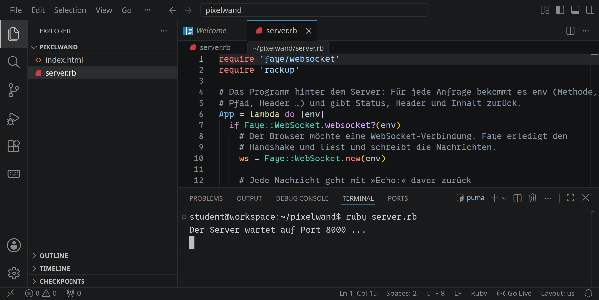
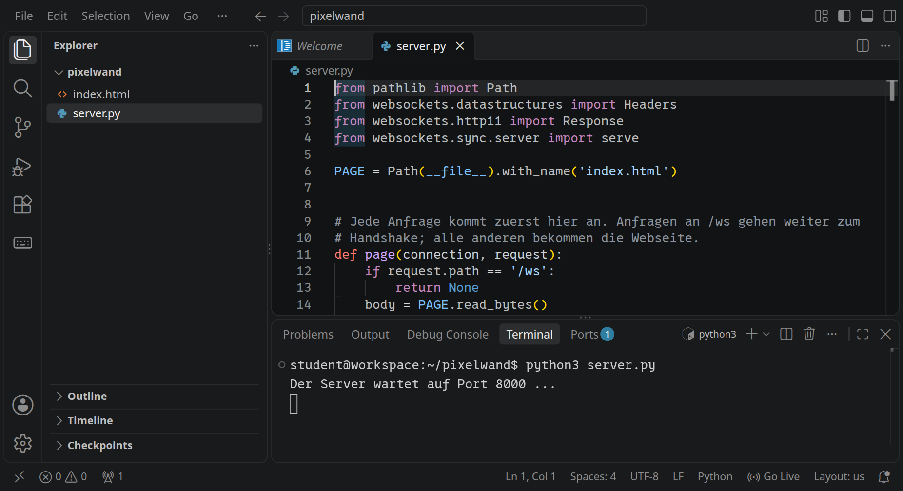
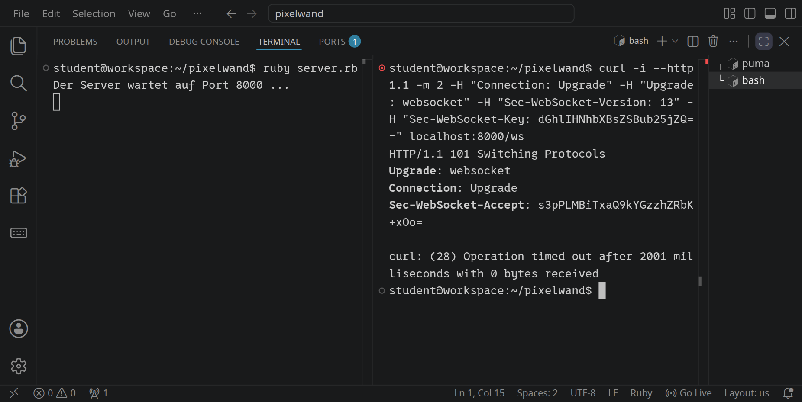
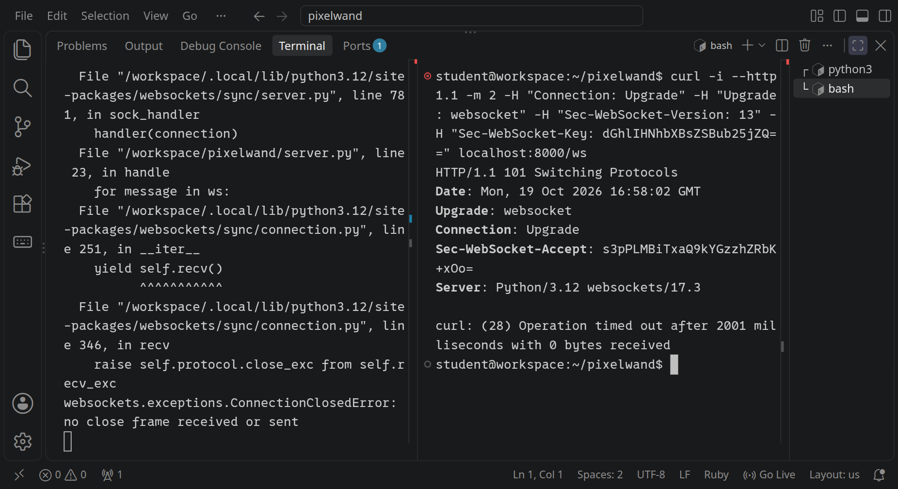
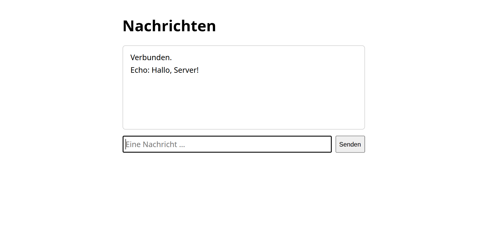
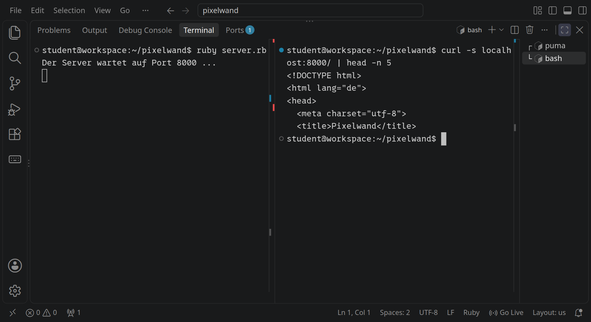
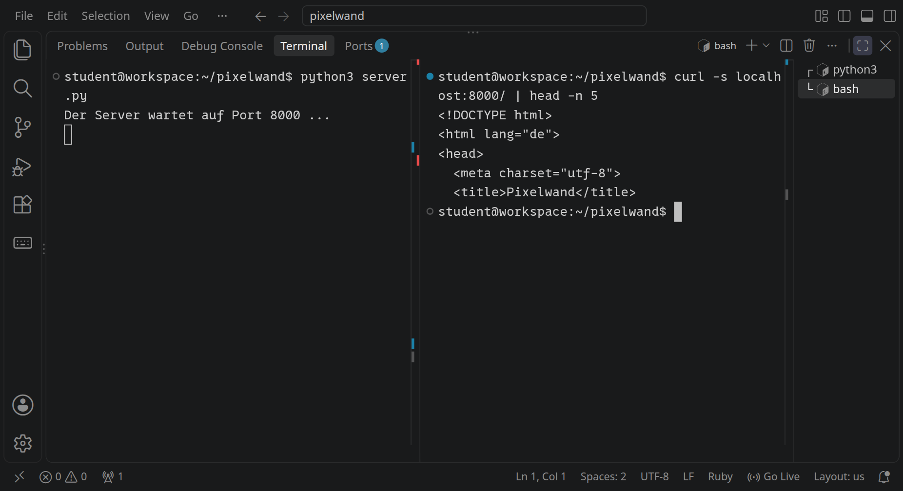
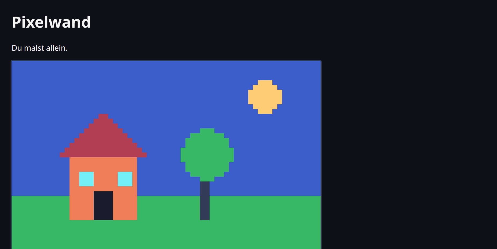
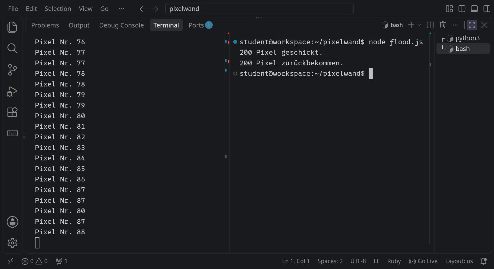
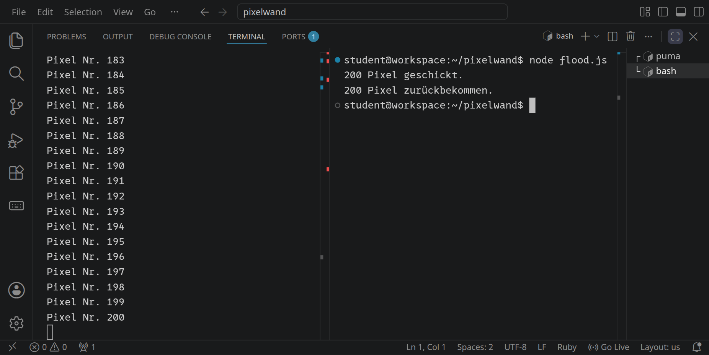

<div class='meta'>
image: teaser.webp
image_alt: "Ein Pixelbild auf einem Raster: ein Haus mit rotem Dach, ein Baum, ein Regenbogen, Sonne und Wolken"
kind: projekt
language: Ruby / Python
languages: [ruby, python]
topic: networks
duration: 2 Doppelstunden
requires: [webserver]
reference: [http, json]
</div>

<div
    class="autotoc-secondary-trigger"
    data-title="Auf dieser Seite"
    data-levels="h2,h3">
</div>

# Eine Pixelwand für alle

<p class='abstract'>
Die ganze Klasse malt gleichzeitig an einem Bild: Jeder Pixel, den jemand setzt, erscheint sofort bei allen anderen. Dafür brauchst du WebSockets, Verbindungen, die offen bleiben und in beide Richtungen funktionieren. Eine Bibliothek kümmert sich um die Technik dahinter; du kümmerst dich um das, worauf es ankommt: wer verbunden ist, wer welche Nachricht bekommt, und dass der Server keiner Nachricht blind glaubt.
</p>

## Warum WebSockets?

Bei HTTP fragt immer der Browser, und der Server antwortet. Ein Server kann nicht von sich aus etwas schicken. Für eine Pixelwand ist das ein Problem: Wenn jemand anderes malt, soll dein Browser das sofort erfahren. Er könnte jede halbe Sekunde fragen, ob es etwas Neues gibt. Bei 30 Leuten wären das 60 Anfragen pro Sekunde, und fast alle bekämen die Antwort »nichts Neues«.

Eine **WebSocket**-Verbindung beginnt wie eine HTTP-Anfrage, bleibt dann aber offen. Danach können beide Seiten jederzeit Nachrichten schicken, in beide Richtungen. So funktionieren Chats, Online-Spiele und gemeinsame Dokumente.

<!-- language: ruby -->
In [Ein eigener Webserver](/webserver) hast du HTTP von Hand gesprochen. WebSockets von Hand wären noch einmal so viel Arbeit: ein Handshake mit einem Hashwert und danach ein eigenes Format aus Bytes für jede Nachricht. Das übernimmt hier die Bibliothek **faye-websocket**, so wie in echten Projekten.
<!-- /language -->
<!-- language: python -->
In [Ein eigener Webserver](/webserver) hast du HTTP von Hand gesprochen. WebSockets von Hand wären noch einmal so viel Arbeit: ein Handshake mit einem Hashwert und danach ein eigenes Format aus Bytes für jede Nachricht. Das übernimmt hier das Paket **websockets**, so wie in echten Projekten.
<!-- /language -->

## Einrichten

Lege einen neuen Ordner an und öffne ihn mit <kbd>Strg</kbd><kbd>K</kbd> <kbd>Strg</kbd><kbd>O</kbd>:

```bash
mkdir /workspace/pixelwand
```

<!-- language: ruby -->
Installiere dann die drei Gems, die der Server braucht:

```bash_copy
gem install faye-websocket puma rackup
```

- **faye-websocket** spricht WebSocket: Handshake, Nachrichten lesen und schicken.
- **puma** ist ein Webserver für Ruby-Programme, wie dein eigener aus der letzten Aktivität, nur schneller und gründlicher.
- **rackup** startet Puma aus deinem Programm heraus.
<!-- /language -->
<!-- language: python -->
Installiere dann das Paket, das der Server braucht:

```bash_copy
pip install websockets
```

- **websockets** spricht WebSocket: Handshake, Nachrichten lesen und schicken. Die Webseite liefert es nebenbei auch aus.
<!-- /language -->

## Ein Echo

<!-- language: ruby -->
Lege `server.rb` an:

```ruby_copy
require 'faye/websocket'
require 'rackup'

# Das Programm hinter dem Server: Für jede Anfrage bekommt es env (Methode,
# Pfad, Header …) und gibt Status, Header und Inhalt zurück.
App = lambda do |env|
  if Faye::WebSocket.websocket?(env)
    # Der Browser möchte eine WebSocket-Verbindung. Faye erledigt den
    # Handshake und liest und schreibt die Nachrichten.
    ws = Faye::WebSocket.new(env)

    # Jede Nachricht geht mit »Echo:« davor zurück
    ws.on(:message) do |event|
      puts "Empfangen: #{event.data}"
      ws.send("Echo: #{event.data}")
    end

    ws.rack_response
  else
    # Jede andere Anfrage bekommt die Webseite
    [200, { 'content-type' => 'text/html; charset=utf-8' },
     [File.read(File.join(__dir__, 'index.html'))]]
  end
end

puts "Der Server wartet auf Port 8000 ..."
Rackup::Server.start(app: App, Host: '0.0.0.0', Port: 8000, server: 'puma', Silent: true)
```

- `App` ist ein **Rack-Programm**: Für jede Anfrage bekommt es `env`, einen Hash mit Methode, Pfad und Headern, und gibt drei Dinge zurück, Status, Header und Inhalt, wie die Antwort deines eigenen Webservers.
- `Faye::WebSocket.websocket?(env)` erkennt eine Anfrage, die eine WebSocket-Verbindung öffnen will. Dann übernimmt `Faye::WebSocket.new(env)` den Handshake; `ws` steht für diese eine Verbindung.
- `ws.on(:message) do |event| … end` legt fest, was bei jeder neuen Nachricht passiert. `event.data` ist der Text, `ws.send` schickt einen zurück.
- Alle anderen Anfragen bekommen die Webseite `index.html`.
- `Rackup::Server.start` startet Puma auf Port 8000 mit `App` als Programm.
<!-- /language -->
<!-- language: python -->
Lege `server.py` an:

```python_copy
from pathlib import Path
from websockets.datastructures import Headers
from websockets.http11 import Response
from websockets.sync.server import serve

PAGE = Path(__file__).with_name('index.html')


# Jede Anfrage kommt zuerst hier an. Anfragen an /ws gehen weiter zum
# Handshake; alle anderen bekommen die Webseite.
def page(connection, request):
    if request.path == '/ws':
        return None
    body = PAGE.read_bytes()
    headers = Headers({'Content-Type': 'text/html; charset=utf-8',
                       'Content-Length': str(len(body))})
    return Response(200, 'OK', headers, body)


# Läuft für jede WebSocket-Verbindung, solange sie offen ist
def handle(ws):
    # Jede Nachricht geht mit »Echo:« davor zurück
    for message in ws:
        print(f'Empfangen: {message}')
        ws.send(f'Echo: {message}')


with serve(handle, '0.0.0.0', 8000, process_request=page) as server:
    print('Der Server wartet auf Port 8000 ...')
    server.serve_forever()
```

- `page` sieht jede Anfrage, bevor etwas anderes passiert. Fragt der Browser nach `/ws`, gibt `page` `None` zurück, und websockets macht den Handshake. Alle anderen Anfragen bekommen die Webseite `index.html` als `Response`: Statuscode, Reason Phrase, Header und Body, wie die Antworten deines eigenen Webservers.
- `handle` läuft für jede WebSocket-Verbindung, jedes Mal in einem eigenen Thread; `ws` steht für diese eine Verbindung.
- `for message in ws` wartet auf die nächste Nachricht und endet, wenn die Verbindung zu ist. `ws.send` schickt einen Text zurück.
- `serve` startet den Server auf Port 8000, mit `handle` für die Verbindungen und `page` für alle Anfragen.
<!-- /language -->

Die Webseite `index.html` hat ein Eingabefeld und zeigt alles, was vom Server kommt:

```html_copy
<!DOCTYPE html>
<html lang="de">
<head>
  <meta charset="utf-8">
  <title>Nachrichten</title>
  <style>
    body { font-family: system-ui, sans-serif; max-width: 32em; margin: 2em auto; padding: 0 1em; }
    #log { border: 1px solid #ccc; border-radius: 6px; padding: 0.5em 1em; min-height: 10em; }
    #log p { margin: 0.3em 0; }
    form { display: flex; gap: 0.5em; margin-top: 0.8em; }
    input { flex: 1; font: inherit; padding: 0.3em; }
  </style>
</head>
<body>
  <h1>Nachrichten</h1>
  <div id="log"></div>
  <form id="form">
    <input id="message" placeholder="Eine Nachricht …" autocomplete="off">
    <button>Senden</button>
  </form>

  <script>
    // Dieselbe Adresse wie die Seite, nur mit ws:// (oder wss:// bei https)
    const url = (location.protocol === 'https:' ? 'wss://' : 'ws://') + location.host + '/ws';
    const socket = new WebSocket(url);
    const log = document.getElementById('log');

    function show(text) {
      const paragraph = document.createElement('p');
      paragraph.textContent = text;
      log.append(paragraph);
    }

    socket.addEventListener('open', () => show('Verbunden.'));
    socket.addEventListener('close', () => show('Die Verbindung ist zu.'));
    // Jede Nachricht vom Server landet hier, ohne dass die Seite fragt
    socket.addEventListener('message', (event) => show(event.data));

    document.getElementById('form').addEventListener('submit', (event) => {
      event.preventDefault();          // die Seite nicht neu laden
      const input = document.getElementById('message');
      if (input.value !== '') socket.send(input.value);
      input.value = '';
    });
  </script>
</body>
</html>
```

`new WebSocket(url)` öffnet die Verbindung, mit `ws://` statt `http://`. `addEventListener('message', …)` ruft eine Funktion auf, sobald eine Nachricht kommt, ohne dass die Seite fragt. `socket.send(…)` schickt eine Nachricht.

Starte den Server:

<!-- language: ruby -->
```bash
ruby server.rb
```
<!-- /language -->
<!-- language: python -->
```bash
python3 server.py
```
<!-- /language -->

<!-- language: ruby -->
<!-- tutorial-screenshot
# Ordner pixelwand mit server.rb (Echo) und index.html, Gems installiert
write-file: pixelwand/server.rb <- file:stufen/server1.rb
write-file: pixelwand/index.html <- file:stufen/index1.html
press: Control+K
press: Control+O
wait-for-input-value: /workspace/
type: pixelwand
press: Enter
wait-for-input-value: /workspace/pixelwand/
press: Enter
wait-for-text: server.rb
open-file: server.rb
terminal-open
terminal-run: gem install faye-websocket puma rackup
terminal-wait-for-prompt: 180
terminal-run: clear
terminal-run: ruby server.rb
wait-for-text: Der Server wartet
move-mouse: selector:.terminal
sleep: 1
check-task-fails: pixelwand
-->

<!-- /language -->
<!-- language: python -->
<!-- tutorial-screenshot
# Ordner pixelwand mit server.py (Echo) und index.html
write-file: pixelwand/server.py <- file:stufen/server1.py
close-tab: server.rb
terminal-open
press: Control+C
sleep: 1
terminal-run: rm server.rb
terminal-run: clear
terminal-run: pip install websockets
terminal-wait-for-prompt: 180
terminal-run: clear
terminal-run: python3 server.py
sleep: 2
open-file: server.py
move-mouse: selector:.terminal
sleep: 1
check-task-fails: pixelwand python
-->

<!-- /language -->

### Der Handshake

Eine WebSocket-Verbindung beginnt mit einer ganz normalen HTTP-Anfrage mit zwei besonderen Headern: `Upgrade: websocket` sagt, dass der Browser die Verbindung umwandeln möchte, und `Sec-WebSocket-Key` bringt einen zufälligen String mit. Der Server antwortet mit dem Statuscode **101 Switching Protocols** und beweist mit `Sec-WebSocket-Accept`, dass er WebSockets versteht. Das erledigt die Bibliothek; ansehen kannst du es trotzdem. Öffne mit <kbd>Strg</kbd><kbd>Shift</kbd><kbd>5</kbd> ein zweites Terminal. `curl` schickt dort die Header, die sonst der Browser schickt, mit dem Beispiel-Key aus dem Standard:

```bash
curl -i --http1.1 -m 2 -H "Connection: Upgrade" -H "Upgrade: websocket" -H "Sec-WebSocket-Version: 13" -H "Sec-WebSocket-Key: dGhlIHNhbXBsZSBub25jZQ==" localhost:8000/ws
```

<!-- language: ruby -->
<!-- tutorial-screenshot
# Der Handshake mit curl, im zweiten Terminal
write-file: pixelwand/server.rb <- file:stufen/server1.rb
open-file: server.rb
hide-left-sidebar
terminal-open
press: Control+C
sleep: 1
press: Control+L
type: ruby server.rb
press: Enter
sleep: 2
terminal-maximize
press: Control+Shift+5
sleep: 1
terminal-run: curl -i --http1.1 -m 2 -H "Connection: Upgrade" -H "Upgrade: websocket" -H "Sec-WebSocket-Version: 13" -H "Sec-WebSocket-Key: dGhlIHNhbXBsZSBub25jZQ==" localhost:8000/ws
sleep: 3
-->

<!-- /language -->
<!-- language: python -->
<!-- tutorial-screenshot
# Der Handshake mit curl in Python, im zweiten Terminal
open-file: server.py
terminal-open
terminal-maximize
press: Alt+ArrowLeft
sleep: 1
press: Control+C
sleep: 1
press: Control+L
type: python3 server.py
press: Enter
sleep: 2
terminal-run: clear
sleep: 1
terminal-run: curl -i --http1.1 -m 2 -H "Connection: Upgrade" -H "Upgrade: websocket" -H "Sec-WebSocket-Version: 13" -H "Sec-WebSocket-Key: dGhlIHNhbXBsZSBub25jZQ==" localhost:8000/ws
sleep: 3
-->

<!-- /language -->

Der Server antwortet mit `101 Switching Protocols` und `Sec-WebSocket-Accept: s3pPLMBiTxaQ9kYGzzhZRbK+xOo=`, genau dem Wert, den der Standard für diesen Key als Beispiel nennt. Danach bleibt die Verbindung offen, und beide Seiten schicken sich Nachrichten in einem eigenen Format aus Bytes, sogenannten Frames. `curl` versteht keine Frames und gibt nach zwei Sekunden auf (`-m 2`).

<!-- language: python -->
Links meldet der Server danach einen Fehler, `ConnectionClosedError: no close frame received or sent`. In deinem Programm ist nichts falsch: `curl` hat die Verbindung einfach zugemacht, ohne sich zu verabschieden. Ein Browser schickt beim Schließen des Tabs zum Abschied einen eigenen Frame, und die Schleife `for message in ws` endet ohne Fehler.
<!-- /language -->

### Im Browser

Öffne jetzt die Adresse von Port 8000 aus dem Reiter »Ports« (»Forwarded Address«) im Browser und schreib eine Nachricht:

<!-- tutorial-screenshot
preview-port: 8000
tab: preview
wait-for-text: Verbunden.
click: selector:#message
type: Hallo, Server!
press: Enter
wait-for-text: Echo: Hallo, Server!
sleep: 1
-->


_uses(websocket-upgrade, statuscodes)

_task(handshake)


<div class='hint try'>
<strong>Ausprobieren:</strong> Ändere im <code>curl</code>-Befehl von eben den ersten Buchstaben des Keys, aus <code>dGhl…</code> wird <code>eGhl…</code>. Wie viel ändert sich an <code>Sec-WebSocket-Accept</code>? Lass dann <code>-H "Upgrade: websocket"</code> ganz weg: Was antwortet der Server jetzt?
</div>

## An alle

<!-- language: ruby -->
Ein Echo ist noch langweilig. Spannend wird es, wenn eine Nachricht bei **allen** ankommt, die gerade verbunden sind. Dafür merkt sich der Server alle offenen Verbindungen in einer Liste `$clients`. Ersetze `server.rb` durch:

```ruby_copy
require 'faye/websocket'
require 'rackup'

# Alle offenen Verbindungen. Faye ruft die on-Blöcke aller Verbindungen
# nacheinander auf, nie zwei gleichzeitig: Die Liste braucht keinen Lock.
$clients = []

def broadcast(text)
  $clients.each { |client| client.send(text) }
end

App = lambda do |env|
  if Faye::WebSocket.websocket?(env)
    ws = Faye::WebSocket.new(env)

    ws.on(:open) do
      $clients << ws
      broadcast("Jemand ist dazugekommen. Jetzt sind wir #{$clients.size}.")
    end

    # Was kommt, geht an alle
    ws.on(:message) do |event|
      puts "Empfangen: #{event.data}"
      broadcast(event.data)
    end

    ws.on(:close) do
      $clients.delete(ws)
      broadcast("Jemand ist gegangen. Jetzt sind wir #{$clients.size}.")
    end

    ws.rack_response
  else
    [200, { 'content-type' => 'text/html; charset=utf-8' },
     [File.read(File.join(__dir__, 'index.html'))]]
  end
end

puts "Der Server wartet auf Port 8000 ..."
Rackup::Server.start(app: App, Host: '0.0.0.0', Port: 8000, server: 'puma', Silent: true)
```

- `ws.on(:open)` läuft, sobald die Verbindung steht: Sie kommt in die Liste. `ws.on(:close)` läuft, wenn sie zu ist, weil jemand den Tab geschlossen hat: Sie fliegt wieder raus.
- `broadcast` schickt eine Nachricht an jede Verbindung in der Liste, auch an die, von der sie kam.
- Viele Verbindungen benutzen dieselbe Liste. Das geht gut, weil Faye die `on`-Blöcke aller Verbindungen nacheinander aufruft, nie zwei gleichzeitig. Was passiert, wenn das nicht so ist, siehst du am Ende in [Viele Threads](#7-viele-threads).
<!-- /language -->
<!-- language: python -->
Ein Echo ist noch langweilig. Spannend wird es, wenn eine Nachricht bei **allen** ankommt, die gerade verbunden sind. Dafür merkt sich der Server alle offenen Verbindungen in einer Menge `clients`, einem `set`. Ersetze `server.py` durch:

```python_copy
from pathlib import Path
from websockets.datastructures import Headers
from websockets.exceptions import ConnectionClosed
from websockets.http11 import Response
from websockets.sync.server import serve

PAGE = Path(__file__).with_name('index.html')

# Alle offenen Verbindungen. Jede Verbindung hat ihren eigenen Thread, alle
# benutzen dieselbe Menge.
clients = set()


def broadcast(text):
    # Über eine Kopie: Kommt während der Schleife jemand dazu, ändert sich
    # die Menge, und die Schleife bräche mit einem Fehler ab.
    for client in list(clients):
        try:
            client.send(text)
        except ConnectionClosed:
            pass    # gerade gegangen; das Aufräumen erledigt ihr eigener Thread


def page(connection, request):
    if request.path == '/ws':
        return None
    body = PAGE.read_bytes()
    headers = Headers({'Content-Type': 'text/html; charset=utf-8',
                       'Content-Length': str(len(body))})
    return Response(200, 'OK', headers, body)


def handle(ws):
    clients.add(ws)
    broadcast(f'Jemand ist dazugekommen. Jetzt sind wir {len(clients)}.')
    try:
        # Was kommt, geht an alle
        for message in ws:
            print(f'Empfangen: {message}')
            broadcast(message)
    finally:
        # Die Verbindung ist zu, weil jemand den Tab geschlossen hat
        clients.discard(ws)
        broadcast(f'Jemand ist gegangen. Jetzt sind wir {len(clients)}.')


with serve(handle, '0.0.0.0', 8000, process_request=page) as server:
    print('Der Server wartet auf Port 8000 ...')
    server.serve_forever()
```

- Steht die Verbindung, nimmt `handle` sie in die Menge auf. Endet die Schleife, weil jemand den Tab geschlossen hat, fliegt sie im `finally` wieder raus. `finally` läuft auch dann, wenn die Verbindung mit einem Fehler endet.
- `broadcast` schickt eine Nachricht an jede Verbindung in der Menge, auch an die, von der sie kam. Ist eine Verbindung gerade zugegangen, wirft `send` den Fehler `ConnectionClosed`, und `broadcast` macht mit den anderen weiter.
- Jede Verbindung hat ihren eigenen Thread, und alle benutzen dieselbe Menge. `add` und `discard` sind in Python je ein einziger Schritt, dabei kommen sich Threads nicht in die Quere. Die Schleife in `broadcast` dagegen dauert; kommt währenddessen jemand dazu, bräche sie mit einem Fehler ab. Darum geht sie über eine Kopie, `list(clients)`. Was passiert, wenn mehrere Schritte zusammengehören, siehst du am Ende in [Viele Threads](#7-viele-threads).
<!-- /language -->

Starte den Server neu und öffne die Seite in zwei Tabs nebeneinander. Was du in einem Tab schreibst, erscheint in beiden.

_task(wer-bekommt-was)

## Die Pixelwand

Jetzt wird aus dem Chat ein Bild. Der Server bewahrt das Bild auf: 64 × 40 Pixel, jedes eine Farbnummer von 0 bis 15. Wer neu dazukommt, bekommt das ganze Bild, danach nur noch die Pixel, die sich ändern. Die Nachrichten sind jetzt keine einfachen Texte mehr, sondern **JSON**, eine Schreibweise für Daten, die Ruby, Python und JavaScript verstehen: `{"x":10,"y":5,"color":4}`.

<!-- language: ruby -->
Ersetze `server.rb` durch:

```ruby_copy
require 'faye/websocket'
require 'rackup'
require 'json'

# Das Bild: 64 × 40 Pixel, jedes eine Farbnummer von 0 bis 15
WIDTH = 64
HEIGHT = 40
$pixels = Array.new(WIDTH * HEIGHT, 0)

# Alle offenen Verbindungen
$clients = []

def broadcast(message)
  text = JSON.generate(message)
  $clients.each { |client| client.send(text) }
end

App = lambda do |env|
  if Faye::WebSocket.websocket?(env)
    ws = Faye::WebSocket.new(env)

    # Wer neu ist, bekommt das ganze Bild, danach nur noch einzelne Pixel
    ws.on(:open) do
      $clients << ws
      ws.send(JSON.generate({ 'type' => 'picture', 'width' => WIDTH,
                              'height' => HEIGHT, 'pixels' => $pixels }))
      broadcast({ 'type' => 'people', 'count' => $clients.size })
    end

    ws.on(:message) do |event|
      # Jeder kann alles schicken: nur glauben, was passt
      message = JSON.parse(event.data) rescue next
      next unless message.is_a?(Hash)
      x, y, color = message.values_at('x', 'y', 'color')
      next unless [x, y, color].all?(Integer)
      next unless x.between?(0, WIDTH - 1) && y.between?(0, HEIGHT - 1) && color.between?(0, 15)

      $pixels[y * WIDTH + x] = color
      broadcast({ 'type' => 'pixel', 'x' => x, 'y' => y, 'color' => color })
    end

    ws.on(:close) do
      $clients.delete(ws)
      broadcast({ 'type' => 'people', 'count' => $clients.size })
    end

    ws.rack_response
  else
    [200, { 'content-type' => 'text/html; charset=utf-8' },
     [File.read(File.join(__dir__, 'index.html'))]]
  end
end

puts "Der Server wartet auf Port 8000 ..."
Rackup::Server.start(app: App, Host: '0.0.0.0', Port: 8000, server: 'puma', Silent: true)
```

- `JSON.generate` macht aus einem Hash Text, `JSON.parse` aus Text wieder einen Hash.
- Jede Nachricht hat einen `type`: `picture` für das ganze Bild, `pixel` für einen einzelnen Pixel, `people` für die Zahl der Verbundenen.
- **Jeder kann alles schicken**, nicht nur deine Webseite. Darum glaubt der Server keiner Nachricht: Kein JSON, keine ganzen Zahlen, ein Pixel außerhalb des Bildes, eine Farbe über 15? `next` überspringt die Nachricht. Ein Server, der fremden Eingaben traut, ist eine Einladung, ihn kaputt zu machen.
<!-- /language -->
<!-- language: python -->
Ersetze `server.py` durch:

```python_copy
import json
from pathlib import Path
from websockets.datastructures import Headers
from websockets.exceptions import ConnectionClosed
from websockets.http11 import Response
from websockets.sync.server import serve

PAGE = Path(__file__).with_name('index.html')

# Das Bild: 64 × 40 Pixel, jedes eine Farbnummer von 0 bis 15
WIDTH = 64
HEIGHT = 40
pixels = [0] * (WIDTH * HEIGHT)

# Alle offenen Verbindungen
clients = set()


def broadcast(message):
    text = json.dumps(message)
    for client in list(clients):
        try:
            client.send(text)
        except ConnectionClosed:
            pass


def page(connection, request):
    if request.path == '/ws':
        return None
    body = PAGE.read_bytes()
    headers = Headers({'Content-Type': 'text/html; charset=utf-8',
                       'Content-Length': str(len(body))})
    return Response(200, 'OK', headers, body)


def handle(ws):
    # Wer neu ist, bekommt das ganze Bild, danach nur noch einzelne Pixel
    clients.add(ws)
    ws.send(json.dumps({'type': 'picture', 'width': WIDTH,
                        'height': HEIGHT, 'pixels': pixels}))
    broadcast({'type': 'people', 'count': len(clients)})
    try:
        for text in ws:
            # Jeder kann alles schicken: nur glauben, was passt
            try:
                message = json.loads(text)
            except ValueError:
                continue
            if not isinstance(message, dict):
                continue
            x, y, color = message.get('x'), message.get('y'), message.get('color')
            if not all(type(value) is int for value in (x, y, color)):
                continue
            if not (0 <= x < WIDTH and 0 <= y < HEIGHT and 0 <= color <= 15):
                continue

            pixels[y * WIDTH + x] = color
            broadcast({'type': 'pixel', 'x': x, 'y': y, 'color': color})
    finally:
        clients.discard(ws)
        broadcast({'type': 'people', 'count': len(clients)})


with serve(handle, '0.0.0.0', 8000, process_request=page) as server:
    print('Der Server wartet auf Port 8000 ...')
    server.serve_forever()
```

- `json.dumps` macht aus einem Dictionary Text, `json.loads` aus Text wieder ein Dictionary.
- Jede Nachricht hat einen `type`: `picture` für das ganze Bild, `pixel` für einen einzelnen Pixel, `people` für die Zahl der Verbundenen.
- **Jeder kann alles schicken**, nicht nur deine Webseite. Darum glaubt der Server keiner Nachricht: Kein JSON, keine ganzen Zahlen, ein Pixel außerhalb des Bildes, eine Farbe über 15? `continue` überspringt die Nachricht. `type(value) is int` lässt nur ganze Zahlen durch, auch kein `true`, das in Python sonst als 1 zählen würde. Ein Server, der fremden Eingaben traut, ist eine Einladung, ihn kaputt zu machen.
<!-- /language -->

Die neue `index.html` zeichnet das Bild in ein `<canvas>`, ein Element, in das JavaScript zeichnen kann. Es ist nur 64 × 40 Pixel groß. CSS zieht es so groß, wie das Fenster erlaubt, und legt ein feines Gitter darüber, damit man jeden Pixel der Wand sieht:

```html_copy
<!DOCTYPE html>
<html lang="de">
<head>
  <meta charset="utf-8">
  <title>Pixelwand</title>
  <style>
    body { font-family: system-ui, sans-serif; margin: 0; padding: 1.5em;
           display: flex; flex-direction: column; align-items: center; background: #14151f; color: #f4f4f4; }
    h1 { margin: 0.2em 0 0.3em; }
    #people { margin: 0 0 1em; color: #94b0c2; }
    /* So breit, wie das Fenster erlaubt, höchstens 960 Pixel, und so schmal, dass die Wand
       samt Überschrift und Farben in die Höhe passt (das Bild ist 1,6-mal so breit wie hoch). */
    #grid { position: relative; width: min(100%, 960px, (100vh - 12em) * 1.6);
            border-radius: 8px; overflow: hidden; box-shadow: 0 0 0 2px #333c57; }
    #wall { display: block; width: 100%; height: auto; image-rendering: pixelated; cursor: crosshair;
            touch-action: none; }
    /* Feine Linien über dem Bild, 64 Spalten und 40 Zeilen: so sieht man jeden Pixel der Wand.
       pointer-events: none lässt die Maus zum canvas durch. */
    #grid::after { content: ''; position: absolute; inset: 0; pointer-events: none;
                   background-image: linear-gradient(to right, rgba(255, 255, 255, 0.18) 1px, transparent 1px),
                                     linear-gradient(to bottom, rgba(255, 255, 255, 0.18) 1px, transparent 1px);
                   background-size: calc(100% / 64) calc(100% / 40); }
    #colors { display: flex; flex-wrap: wrap; justify-content: center; gap: 6px; margin-top: 1em; }
    #colors button { width: 28px; height: 28px; border: 0; border-radius: 50%; cursor: pointer; }
    #colors button.active { box-shadow: 0 0 0 2px #14151f, 0 0 0 4px #f4f4f4; }
  </style>
</head>
<body>
  <h1>Pixelwand</h1>
  <p id="people">Verbinde …</p>
  <div id="grid"><canvas id="wall" width="64" height="40"></canvas></div>
  <div id="colors"></div>

  <script>
    // Die Palette »Sweetie 16«, wie bei PixelRAM
    const PALETTE = ['#1a1c2c', '#5d275d', '#b13e53', '#ef7d57', '#ffcd75', '#a7f070', '#38b764', '#257179',
                     '#29366f', '#3b5dc9', '#41a6f6', '#73eff7', '#f4f4f4', '#94b0c2', '#566c86', '#333c57'];

    const wall = document.getElementById('wall');
    const pen = wall.getContext('2d');
    let color = 4;

    function setPixel(x, y, c) {
      pen.fillStyle = PALETTE[c];
      pen.fillRect(x, y, 1, 1);
    }

    // Die Knöpfe für die Farben
    PALETTE.forEach((value, c) => {
      const button = document.createElement('button');
      button.style.background = value;
      button.title = 'Farbe ' + c;
      if (c === color) button.classList.add('active');
      button.addEventListener('click', () => {
        document.querySelector('#colors .active').classList.remove('active');
        button.classList.add('active');
        color = c;
      });
      document.getElementById('colors').append(button);
    });

    const url = (location.protocol === 'https:' ? 'wss://' : 'ws://') + location.host + '/ws';
    const socket = new WebSocket(url);

    socket.addEventListener('message', (event) => {
      const message = JSON.parse(event.data);
      if (message.type === 'picture') {
        // Das ganze Bild, gleich nach dem Verbinden
        message.pixels.forEach((c, i) => setPixel(i % message.width, Math.floor(i / message.width), c));
      } else if (message.type === 'pixel') {
        setPixel(message.x, message.y, message.color);
      } else if (message.type === 'people') {
        document.getElementById('people').textContent =
          message.count === 1 ? 'Du malst allein.' : message.count + ' Leute malen gerade mit.';
      }
    });
    socket.addEventListener('close', () => {
      document.getElementById('people').textContent = 'Die Verbindung ist zu. Lade die Seite neu.';
    });

    // Malen: Mausposition in Pixel umrechnen und dem Server schicken.
    // Gezeichnet wird erst, wenn der Server den Pixel an alle schickt.
    function sendPixel(x, y) {
      if (x >= 0 && x < wall.width && y >= 0 && y < wall.height) {
        socket.send(JSON.stringify({ x: x, y: y, color: color }));
      }
    }

    function pixelAt(event) {
      const rect = wall.getBoundingClientRect();
      return [Math.floor((event.clientX - rect.left) / rect.width * wall.width),
              Math.floor((event.clientY - rect.top) / rect.height * wall.height)];
    }

    // Die Maus meldet sich nicht bei jedem Pixel: Von der letzten Stelle bis
    // zur neuen jeden Pixel dazwischen schicken, sonst hat die Linie Lücken
    let last = null;
    function paint(event) {
      const [x, y] = pixelAt(event);
      const [x0, y0] = last || [x, y];
      const steps = Math.max(Math.abs(x - x0), Math.abs(y - y0), 1);
      for (let i = 1; i <= steps; i++) {
        sendPixel(Math.round(x0 + (x - x0) * i / steps), Math.round(y0 + (y - y0) * i / steps));
      }
      last = [x, y];
    }
    wall.addEventListener('pointerdown', (e) => { last = pixelAt(e); sendPixel(...last); });
    wall.addEventListener('pointermove', (e) => { if (last) paint(e); });
    window.addEventListener('pointerup', () => { last = null; });
  </script>
</body>
</html>
```

- `setPixel(x, y, c)` malt ein Pixel in der Farbe Nummer `c`. Die 16 Farben sind die Palette »Sweetie 16«, wie bei [PixelRAM](/pixelram).
- Malt jemand, schickt die Seite den Pixel nur an den Server. Gezeichnet wird er erst, wenn der Server ihn an alle zurückschickt, auch an dich selbst. So sehen alle immer dasselbe Bild.
- Bewegt sich die Maus schnell, meldet der Browser nicht jeden Pixel. `paint` füllt die Pixel zwischen der letzten und der neuen Stelle auf, sonst hätten Linien Lücken.

Starte den Server neu und lade die Seite. Das Bild ist noch leer; male etwas, und lade die Seite dann neu: Dein Bild ist noch da, denn der Server hat es.

Prüfe im zweiten Terminal, ob der Server die neue Seite schickt:

```bash
curl -s localhost:8000/ | head -n 5
```

<!-- language: ruby -->
<!-- tutorial-screenshot
# Stufe 3: Neustart mit der Pixelwand, curl holt die Seite
write-file: pixelwand/server.rb <- file:stufen/server3.rb
write-file: pixelwand/index.html <- file:stufen/index3.html
terminal-open
terminal-maximize
press: Alt+ArrowLeft
sleep: 1
press: Control+C
sleep: 1
press: Control+L
type: ruby server.rb
press: Enter
sleep: 2
terminal-run: clear
sleep: 1
terminal-run: curl -s localhost:8000/ | head -n 5
sleep: 2
check-task: pixelwand
-->

<!-- /language -->
<!-- language: python -->
<!-- tutorial-screenshot
# Stufe 3 in Python: Neustart mit der Pixelwand, curl holt die Seite
write-file: pixelwand/server.py <- file:stufen/server3.py
write-file: pixelwand/index.html <- file:stufen/index3.html
terminal-open
terminal-maximize
press: Alt+ArrowLeft
sleep: 1
press: Control+C
sleep: 1
press: Control+L
type: python3 server.py
press: Enter
sleep: 2
terminal-run: clear
sleep: 1
terminal-run: curl -s localhost:8000/ | head -n 5
sleep: 2
check-task: pixelwand python
expect-no-text: Traceback
-->

<!-- /language -->

Lade die Seite im Browser neu und male. Hier malt gerade jemand anderes:

<!-- tutorial-screenshot
preview-reload
tab: preview
wait-for-text: Du malst allein
hook: paint
-->


<!-- language: ruby -->
_uses(json-aufbau, json-ruby, json-javascript)
<!-- /language -->
<!-- language: python -->
_uses(json-aufbau, json-python, json-javascript)
<!-- /language -->

_task(pixel-zahl)

_task(vertrauen)

_task(pixelwand)


<div class='hint try'>
<strong>Ausprobieren:</strong> Schick deinem Server selbst Nachrichten, so wie es jeder könnte. Öffne auf der Pixelwand mit <kbd>F12</kbd> die Entwicklerwerkzeuge des Browsers, wähle den Reiter »Console« und tippe nacheinander:
<ul>
<li><code>socket.send('{"x":0,"y":0,"color":4}')</code></li>
<li><code>socket.send('{"x":999,"y":0,"color":4}')</code></li>
<li><code>socket.send('{"x":0,"y":0,"color":99}')</code></li>
<li><code>socket.send('Hallo')</code></li>
</ul>
Welche davon landet auf der Wand? Welche Zeile im Server sorgt jeweils dafür, dass die anderen nichts anrichten?
</div>

## Mit der ganzen Klasse

Jetzt kommt der beste Teil. Gib in deinem [Profil](/profil) unter »Shared Live Apps« Port 8000 frei und sag deiner Klasse die Adresse. Alle, die sie öffnen, malen an **deinem** Bild, und jeder sieht sofort, was die anderen malen. Oben steht, wie viele gerade mitmalen.

Vielleicht merkt ihr schnell, dass einige wenige das ganze Bild übermalen. Ein paar Ideen, die Pixelwand weiterzubauen, von leicht bis schwer:

<!-- language: ruby -->
- **Eine größere Wand:** Ändere `WIDTH` und `HEIGHT` im Server und die Größe des `<canvas>` in der Seite.
- **Wartezeit:** Jede Verbindung darf nur einen Pixel pro Sekunde setzen, wie bei »r/place«. Merke dir in einer Variable neben `ws`, wann die Verbindung zuletzt gemalt hat (`Time.now`), und überspringe in `ws.on(:message)` Pixel, die zu früh kommen.
- **Das Bild laden:** Im nächsten Abschnitt speichert der Server das Bild in `picture.json`. Lies die Datei beim Start wieder ein (`File.exist?`, `JSON.parse`), dann übersteht das Bild einen Neustart.
- **Ein Chat daneben:** Ein neuer `type` für Textnachrichten und ein Eingabefeld unter der Wand.
- **Ein Spiel:** Zwei Teams mit zwei Farben, wer nach fünf Minuten mehr Pixel hat, gewinnt.
<!-- /language -->
<!-- language: python -->
- **Eine größere Wand:** Ändere `WIDTH` und `HEIGHT` im Server und die Größe des `<canvas>` in der Seite.
- **Wartezeit:** Jede Verbindung darf nur einen Pixel pro Sekunde setzen, wie bei »r/place«. Merke dir in `handle` in einer Variable, wann die Verbindung zuletzt gemalt hat (`time.monotonic()`), und überspringe Pixel, die zu früh kommen.
- **Das Bild laden:** Im nächsten Abschnitt speichert der Server das Bild in `picture.json`. Lies die Datei beim Start wieder ein (`Path('picture.json').exists()`, `json.loads`), dann übersteht das Bild einen Neustart.
- **Ein Chat daneben:** Ein neuer `type` für Textnachrichten und ein Eingabefeld unter der Wand.
- **Ein Spiel:** Zwei Teams mit zwei Farben, wer nach fünf Minuten mehr Pixel hat, gewinnt.
<!-- /language -->

## Viele Threads

<!-- language: ruby -->
Ein Neustart des Servers löscht das Bild. Darum soll der Server es nach jedem Pixel in eine Datei schreiben, `picture.json`. Das dauert einen Moment, und solange Faye mit einer Nachricht beschäftigt ist, warten alle anderen. Die übliche Lösung: Mehrere **Threads** arbeiten die Nachrichten ab, während Faye schon neue annimmt. Dazu zählt der Server mit, wie viele Pixel schon gemalt wurden, und schreibt die Zahl ins Terminal.

Ersetze `server.rb` durch:

```ruby_copy
require 'faye/websocket'
require 'rackup'
require 'json'

# Das Bild: 64 × 40 Pixel, jedes eine Farbnummer von 0 bis 15
WIDTH = 64
HEIGHT = 40
$pixels = Array.new(WIDTH * HEIGHT, 0)

# Alle offenen Verbindungen
$clients = []

# Wie viele Pixel schon gemalt wurden
$painted = 0

# Das Bild in eine Datei schreiben, damit es einen Neustart übersteht
def save_picture
  File.write('picture.json', JSON.generate($pixels))
end

def broadcast(message)
  text = JSON.generate(message)
  $clients.each { |client| client.send(text) }
end

# Vier Threads arbeiten die Nachrichten ab, während Faye neue annimmt. Mehr
# als ein paar sollten es nicht sein: Jeder Thread kostet Speicher, und ein
# Workspace darf nicht beliebig viele starten.
$queue = Queue.new
4.times do
  Thread.new do
    loop do
      text = $queue.pop        # wartet, bis eine Nachricht da ist

      # Jeder kann alles schicken: nur glauben, was passt
      message = JSON.parse(text) rescue next
      next unless message.is_a?(Hash)
      x, y, color = message.values_at('x', 'y', 'color')
      next unless [x, y, color].all?(Integer)
      next unless x.between?(0, WIDTH - 1) && y.between?(0, HEIGHT - 1) && color.between?(0, 15)

      $pixels[y * WIDTH + x] = color
      count = $painted
      save_picture             # dauert einen Moment
      $painted = count + 1
      puts "Pixel Nr. #{$painted}"
      broadcast({ 'type' => 'pixel', 'x' => x, 'y' => y, 'color' => color })
    end
  end
end

App = lambda do |env|
  if Faye::WebSocket.websocket?(env)
    ws = Faye::WebSocket.new(env)

    # Wer neu ist, bekommt das ganze Bild, danach nur noch einzelne Pixel
    ws.on(:open) do
      $clients << ws
      ws.send(JSON.generate({ 'type' => 'picture', 'width' => WIDTH,
                              'height' => HEIGHT, 'pixels' => $pixels }))
      broadcast({ 'type' => 'people', 'count' => $clients.size })
    end

    # Jede Nachricht kommt in die Queue; Faye ist sofort frei
    ws.on(:message) { |event| $queue << event.data }

    ws.on(:close) do
      $clients.delete(ws)
      broadcast({ 'type' => 'people', 'count' => $clients.size })
    end

    ws.rack_response
  else
    [200, { 'content-type' => 'text/html; charset=utf-8' },
     [File.read(File.join(__dir__, 'index.html'))]]
  end
end

puts "Der Server wartet auf Port 8000 ..."
Rackup::Server.start(app: App, Host: '0.0.0.0', Port: 8000, server: 'puma', Silent: true)
```

- `ws.on(:message)` legt jede Nachricht nur in eine **[Queue](/reference/listen#queue)**, `$queue`, und ist sofort frei für die nächste.
- Vier Threads holen sich mit `$queue.pop` die nächste Nachricht und verarbeiten sie, jeder in einer Schleife ohne Ende. `pop` wartet, solange die Queue leer ist. Ein Thread pro Nachricht wäre einfacher, aber jeder Thread kostet Speicher, und dein Workspace darf nicht beliebig viele starten. Echte Server arbeiten genauso mit einer festen Zahl von Threads.
- `save_picture` schreibt das ganze Bild als JSON in die Datei.
- `$painted` zählt die Pixel: lesen, speichern, um eins erhöhen.
<!-- /language -->
<!-- language: python -->
Ein Neustart des Servers löscht das Bild. Darum soll der Server es nach jedem Pixel in eine Datei schreiben, `picture.json`. Das dauert einen Moment, und solange der Thread einer Verbindung damit beschäftigt ist, warten die nächsten Nachrichten dieser Verbindung. Die übliche Lösung: Mehrere **Threads** arbeiten die Nachrichten ab, während die Verbindung schon neue annimmt. Dazu zählt der Server mit, wie viele Pixel schon gemalt wurden, und schreibt die Zahl ins Terminal.

Ersetze `server.py` durch:

```python_copy
import json
import queue
import threading
from pathlib import Path
from websockets.datastructures import Headers
from websockets.exceptions import ConnectionClosed
from websockets.http11 import Response
from websockets.sync.server import serve

PAGE = Path(__file__).with_name('index.html')

# Das Bild: 64 × 40 Pixel, jedes eine Farbnummer von 0 bis 15
WIDTH = 64
HEIGHT = 40
pixels = [0] * (WIDTH * HEIGHT)

# Alle offenen Verbindungen
clients = set()

# Wie viele Pixel schon gemalt wurden
painted = 0


# Das Bild in eine Datei schreiben, damit es einen Neustart übersteht
def save_picture():
    Path('picture.json').write_text(json.dumps(pixels))


def broadcast(message):
    text = json.dumps(message)
    for client in list(clients):
        try:
            client.send(text)
        except ConnectionClosed:
            pass


def work():
    global painted
    while True:
        text = messages.get()       # wartet, bis eine Nachricht da ist

        # Jeder kann alles schicken: nur glauben, was passt
        try:
            message = json.loads(text)
        except ValueError:
            continue
        if not isinstance(message, dict):
            continue
        x, y, color = message.get('x'), message.get('y'), message.get('color')
        if not all(type(value) is int for value in (x, y, color)):
            continue
        if not (0 <= x < WIDTH and 0 <= y < HEIGHT and 0 <= color <= 15):
            continue

        pixels[y * WIDTH + x] = color
        count = painted
        save_picture()              # dauert einen Moment
        painted = count + 1
        print(f'Pixel Nr. {painted}')
        broadcast({'type': 'pixel', 'x': x, 'y': y, 'color': color})


# Vier Threads arbeiten die Nachrichten ab, während die Verbindung schon die
# nächste annimmt. Mehr als ein paar sollten es nicht sein: Jeder Thread
# kostet Speicher, und ein Workspace darf nicht beliebig viele starten.
messages = queue.Queue()
for _ in range(4):
    threading.Thread(target=work, daemon=True).start()


def page(connection, request):
    if request.path == '/ws':
        return None
    body = PAGE.read_bytes()
    headers = Headers({'Content-Type': 'text/html; charset=utf-8',
                       'Content-Length': str(len(body))})
    return Response(200, 'OK', headers, body)


def handle(ws):
    # Wer neu ist, bekommt das ganze Bild, danach nur noch einzelne Pixel
    clients.add(ws)
    ws.send(json.dumps({'type': 'picture', 'width': WIDTH,
                        'height': HEIGHT, 'pixels': pixels}))
    broadcast({'type': 'people', 'count': len(clients)})
    try:
        # Jede Nachricht kommt in die Queue; die Verbindung ist sofort frei
        for text in ws:
            messages.put(text)
    finally:
        clients.discard(ws)
        broadcast({'type': 'people', 'count': len(clients)})


with serve(handle, '0.0.0.0', 8000, process_request=page) as server:
    print('Der Server wartet auf Port 8000 ...')
    server.serve_forever()
```

- `handle` legt jede Nachricht nur in eine **[Queue](/reference/listen#queue)**, `messages`, und ist sofort frei für die nächste.
- Vier Threads holen sich mit `messages.get()` die nächste Nachricht und verarbeiten sie in `work`, jeder in einer Schleife ohne Ende. `get` wartet, solange die Queue leer ist. Ein Thread pro Nachricht wäre einfacher, aber jeder Thread kostet Speicher, und dein Workspace darf nicht beliebig viele starten. Echte Server arbeiten genauso mit einer festen Zahl von Threads. `daemon=True` heißt: Die Threads halten das Programm nicht am Leben, <kbd>Strg</kbd><kbd>C</kbd> beendet es trotzdem.
- `save_picture` schreibt das ganze Bild als JSON in die Datei.
- `painted` zählt die Pixel: lesen, speichern, um eins erhöhen. `global painted` erlaubt `work`, die Variable außerhalb der Funktion zu ändern.
<!-- /language -->

### 200 Pixel auf einmal

Damit es spannend wird, malen jetzt sehr viele Leute gleichzeitig. Lege `flood.js` an; es schickt 200 Pixel auf einmal an deinen eigenen Server auf `localhost` und wartet, bis der Server alle an alle verteilt hat:

```js
// Schickt 200 Pixel auf einmal, als würden 200 Leute gleichzeitig malen.
// Nur für den eigenen Server auf localhost: Fremde Server so zu überschütten,
// ist ein Angriff.
const socket = new WebSocket('ws://localhost:8000/ws');
let back = 0;

socket.addEventListener('open', () => {
  for (let i = 0; i < 200; i++) {
    socket.send(JSON.stringify({ x: i % 64, y: Math.floor(i / 64) % 40, color: i % 16 }));
  }
  console.log('200 Pixel geschickt.');
});

// Fertig, sobald der Server alle 200 Pixel an alle verteilt hat
socket.addEventListener('message', (event) => {
  if (JSON.parse(event.data).type === 'pixel' && ++back === 200) {
    console.log('200 Pixel zurückbekommen.');
    socket.close();
  }
});
```

Starte den Server neu und führe das Skript im zweiten Terminal aus:

```bash
node flood.js
```

<div class='hint'>
<code>flood.js</code> ist für deinen eigenen Server da, und nur für den. Einen fremden Server mit Anfragen zu überschütten, bis er für alle anderen nicht mehr erreichbar ist, ist ein Angriff (<em>Denial of Service</em>) und kann als Computersabotage strafbar sein (§ 303b Strafgesetzbuch). Die geteilten Pixelwände deiner Klasse sind für sie genauso ein fremder Server.
</div>

_task(counter)

<!-- language: ruby -->
<!-- tutorial-screenshot
# Stufe 4: viele Threads, flood.js schickt 200 Pixel
write-file: pixelwand/server.rb <- file:stufen/server4.rb
write-file: pixelwand/flood.js <- file:stufen/flood.js
terminal-open
terminal-maximize
press: Alt+ArrowLeft
sleep: 1
press: Control+C
sleep: 1
press: Control+L
type: ruby server.rb
press: Enter
sleep: 2
terminal-run: clear
sleep: 1
terminal-run: node flood.js
wait-for-text: 200 Pixel zurückbekommen
sleep: 1
check-task-fails: lock
-->

<!-- /language -->
<!-- language: python -->
<!-- tutorial-screenshot
# Stufe 4 in Python: viele Threads, flood.js schickt 200 Pixel
write-file: pixelwand/server.py <- file:stufen/server4.py
write-file: pixelwand/flood.js <- file:stufen/flood.js
terminal-open
terminal-maximize
press: Alt+ArrowLeft
sleep: 1
press: Control+C
sleep: 1
press: Control+L
type: python3 server.py
press: Enter
sleep: 2
terminal-run: clear
sleep: 1
terminal-run: node flood.js
wait-for-text: 200 Pixel zurückbekommen
sleep: 1
check-task-fails: lock python
-->

<!-- /language -->

### Ein Lock

<!-- language: ruby -->
200 Pixel, und der Zähler kommt nicht annähernd bis 200. Jeder der vier Threads liest `$painted`, speichert das Bild und schreibt dann seinen Wert plus eins zurück. Während einer speichert, lesen die anderen denselben alten Wert; vier Threads schreiben dieselbe Zahl, und drei Pixel sind beim Zählen verloren. Dasselbe Problem hatte der Besuchszähler deines Webservers; dort war die Lücke zwischen Lesen und Schreiben nur so kurz, dass man den Fehler selten sieht. Hier dauert das Speichern, und der Fehler passiert jedes Mal.

Die Lösung ist ein **Lock**, in Ruby ein `Mutex`: Nur ein Thread auf einmal darf durch, die anderen warten davor. Ergänze unter `$painted = 0`:

```ruby
~ $clients = []
~
~ # Wie viele Pixel schon gemalt wurden
~ $painted = 0
$lock = Mutex.new
~
~ # Das Bild in eine Datei schreiben, damit es einen Neustart übersteht
~ def save_picture
~   File.write('picture.json', JSON.generate($pixels))
```

und schließe das Ändern von Bild und Zähler in `$lock.synchronize` ein:

```ruby
~     x, y, color = message.values_at('x', 'y', 'color')
~     next unless [x, y, color].all?(Integer)
~     next unless x.between?(0, WIDTH - 1) && y.between?(0, HEIGHT - 1) && color.between?(0, 15)
~
    $lock.synchronize do
      $pixels[y * WIDTH + x] = color
      count = $painted
      save_picture             # dauert einen Moment
      $painted = count + 1
      puts "Pixel Nr. #{$painted}"
    end
~     broadcast({ 'type' => 'pixel', 'x' => x, 'y' => y, 'color' => color })
~   end
~ end
```
<!-- /language -->
<!-- language: python -->
200 Pixel, und der Zähler bleibt weit unter 200. Jeder der vier Threads liest `painted`, speichert das Bild und schreibt dann seinen Wert plus eins zurück. Während einer speichert, lesen die anderen denselben alten Wert; mehrere Threads schreiben dieselbe Zahl, und Pixel gehen beim Zählen verloren. Dasselbe Problem hatte der Besuchszähler deines Webservers; dort war die Lücke zwischen Lesen und Schreiben nur so kurz, dass man den Fehler selten sieht. Hier dauert das Speichern, und der Fehler passiert jedes Mal.

Die Lösung ist ein **Lock**: Nur ein Thread auf einmal darf durch, die anderen warten davor. Ergänze unter `painted = 0`:

```python
~ clients = set()
~
~ # Wie viele Pixel schon gemalt wurden
~ painted = 0
lock = threading.Lock()
~
~ # Das Bild in eine Datei schreiben, damit es einen Neustart übersteht
~ def save_picture():
~     Path('picture.json').write_text(json.dumps(pixels))
```

und schließe das Ändern von Bild und Zähler in `with lock:` ein:

```python
~ if not (0 <= x < WIDTH and 0 <= y < HEIGHT and 0 <= color <= 15):
~     continue
~
with lock:
    pixels[y * WIDTH + x] = color
    count = painted
    save_picture()          # dauert einen Moment
    painted = count + 1
    print(f'Pixel Nr. {painted}')
~ broadcast({'type': 'pixel', 'x': x, 'y': y, 'color': color})
```
<!-- /language -->

Starte den Server neu und schick noch einmal 200 Pixel:

<!-- language: ruby -->
<!-- tutorial-screenshot
# Stufe 5: mit Lock zählt der Server richtig
write-file: pixelwand/server.rb <- file:stufen/server5.rb
terminal-open
terminal-maximize
press: Alt+ArrowLeft
sleep: 1
press: Control+C
sleep: 1
press: Control+L
type: ruby server.rb
press: Enter
sleep: 2
terminal-run: clear
sleep: 1
terminal-run: node flood.js
wait-for-text: 200 Pixel zurückbekommen
sleep: 1
check-task: lock
-->

<!-- /language -->
<!-- language: python -->
<!-- tutorial-screenshot
# Stufe 5 in Python: mit Lock zählt der Server richtig
write-file: pixelwand/server.py <- file:stufen/server5.py
terminal-open
terminal-maximize
press: Alt+ArrowLeft
sleep: 1
press: Control+C
sleep: 1
press: Control+L
type: python3 server.py
press: Enter
sleep: 2
terminal-run: clear
sleep: 1
terminal-run: node flood.js
wait-for-text: 200 Pixel zurückbekommen
sleep: 1
check-task: lock python
-->

<!-- /language -->

Jetzt kommt der Zähler bei 200 an. Die Threads stehen nur an der einen Stelle hintereinander, an der sie das Bild und den Zähler ändern; alles andere, das Prüfen der Nachricht und das Verteilen an alle, läuft weiter gleichzeitig. Ein Lock gehört genau um die Teile, die gemeinsame Daten lesen und ändern, und um nicht mehr.

Gegen jemanden, der eine geteilte Pixelwand mit Pixeln überschüttet, hilft der Lock nicht: Er sorgt nur dafür, dass richtig gezählt wird. Dagegen hilft die **Wartezeit** aus den Ideen oben. Erlaubt der Server jeder Verbindung nur einen Pixel pro Sekunde, kommen von `flood.js` nur noch die ersten an.

_task(lock)

_task(abgabe)

## Wie geht es weiter?

Eure Pixelwand funktioniert genauso wie große Anwendungen, nur kleiner: Ein Server hält den gemeinsamen Zustand, jeder Browser hat eine offene Verbindung, und jede Änderung geht an alle. So arbeiten Online-Spiele, Chats und Programme, in denen mehrere Leute gleichzeitig an einem Dokument schreiben.

Im Ernstfall läuft eine WebSocket-Verbindung verschlüsselt über `wss://`, und der Server muss mit Tausenden Verbindungen und mit Leuten umgehen können, die ihm absichtlich falsche Daten schicken. Die Prüfung jeder Nachricht in deinem Server war ein erster Schritt dahin.

<!-- tutorial-screenshot
# Bild für die Karte der Aktivität: die Wand, nachdem die Klasse eine Weile gemalt hat
preview-reload
tab: preview
viewport: 1029x700
wait-for-text: Pixelwand
hook: paint-teaser
crop-element: #wall
-->

