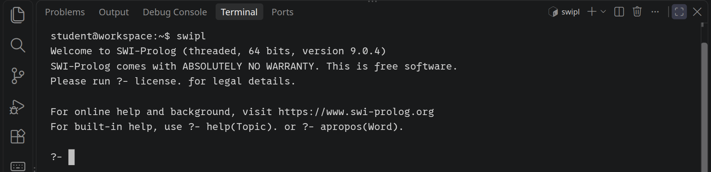
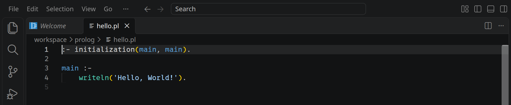
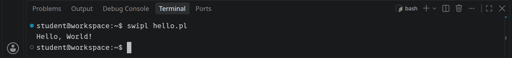
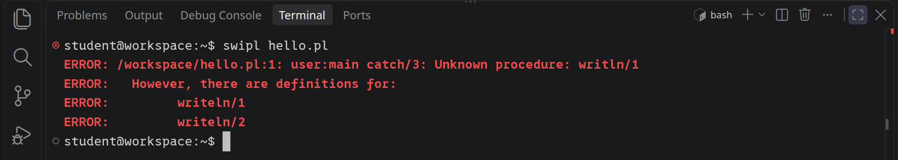
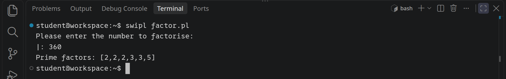
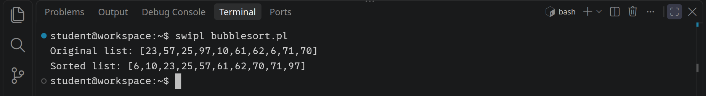

<div class='meta'>
image: prolog-logo.png
kind: steckbrief
curriculum: "Oberstufe: Vertiefung Applikative Programmierung (logisch)"
topics: [programmiersprachen, geschichte]
</div>

<div
    class="autotoc-secondary-trigger"
    data-title="Auf dieser Seite"
    data-levels="h2,h3">
</div>

# Prolog <span style='font-size: 80%;'>(1972)</span>

<p class='abstract'>
Prolog entstand 1972 in Marseille bei Alain Colmerauer und Philippe Roussel, die einen Computer Fragen auf Französisch beantworten lassen wollten. Ein Prolog-Programm sagt nicht, was der Computer der Reihe nach tun soll, sondern was gilt: Fakten und Regeln. Dann stellt man Anfragen, und Prolog sucht die Antworten selbst. In den 1980er Jahren war Prolog eine der Sprachen der Künstlichen Intelligenz, und Japan setzte in seinem großen Projekt der »Computer der fünften Generation« auf logische Programmierung. Heute steckt logische Programmierung in Typprüfern, Datenbanken und Planungssystemen. Hier benutzt du SWI-Prolog, eine freie Umsetzung aus Amsterdam.
</p>

_person(colmerauer)

<div class='hint'>
Diese Seite zeigt Prolog an drei kurzen Programmen, wie die anderen Seiten zu Programmiersprachen. Wie man in Prolog wirklich denkt, mit Fakten, Regeln, Rekursion und Backtracking, zeigt das Projekt <a href='/prolog'>Logisch programmieren mit Prolog</a>.
</div>

## Hello, world!

Öffne ein Terminal mit <kbd>Strg</kbd><kbd>J</kbd> und starte SWI-Prolog mit `swipl`:

<!-- tutorial-screenshot
# Ein frischer Workspace, das Terminal groß, swipl mit seiner Begrüßung
hide-left-sidebar
terminal-maximize
press: Control+l
terminal-run: swipl
wait-for-text: ?-
sleep: 0.5
crop-terminal-lines: auto
-->



Hinter `?-` wartet Prolog auf eine **Anfrage**. Gib `writeln('Hello, World!').` ein, mit dem Punkt am Ende, und drücke <kbd>Enter</kbd>. Prolog schreibt die Zeile und antwortet dann `true.`: Die Anfrage ist gelungen. Mit `halt.` beendest du Prolog.

### Ein Programm in einer Datei

Beende Prolog mit `halt.` und lege im Terminal einen Ordner für deine Prolog-Programme an:

```bash_copy
mkdir -p /workspace/prolog
cd /workspace/prolog
```

Lege dann mit <kbd>Strg</kbd><kbd>Alt</kbd><kbd>N</kbd> eine neue Datei an, schreib hinein:

_include_file(hello.pl, prolog)

und speichere sie mit <kbd>Strg</kbd><kbd>S</kbd> als `/workspace/prolog/hello.pl`. Die erste Zeile sagt: Wenn die Datei geladen ist, rufe `main` auf und beende danach Prolog. `main :- …` ist eine **Regel**: `main` gilt, wenn `writeln('Hello, World!')` gilt.

Die Endung `.pl` benutzt auch Perl, eine ganz andere Sprache. Im Ordner `prolog` zeigt Visual Studio Code eine solche Datei als Prolog, farbig; anderswo hält es sie für Perl:

<!-- tutorial-screenshot
# Prolog beenden, das Terminal schließen, die Datei im Ordner prolog
# öffnen: dort farbig als Prolog
terminal-run: halt.
terminal-wait-for-prompt
press: Control+j
write-file: prolog/hello.pl <- file:hello.pl
press: Control+o
wait-for-input-value: /workspace/
type: prolog/hello.pl
press: Enter
wait-for-text: Hello, World!
hide-left-sidebar
sleep: 2
crop-bottom: 62%
-->



Führe das Programm im Terminal aus:

```bash
swipl hello.pl
```

<!-- tutorial-screenshot
terminal-open
press: Control+l
terminal-run: cd /workspace/prolog && clear
terminal-run: swipl hello.pl
terminal-wait-for-prompt
crop-terminal-lines: auto
-->



_task(hallo)

### Fehler finden und beheben

Schreib in `hello.pl` statt `writeln` einmal `writln`, speichere und führe das Programm wieder aus. Lies, was SWI-Prolog meldet:

_task(fehler)

<!-- after: fehler -->

<!-- tutorial-screenshot
write-file: prolog/hello.pl <- file:hello-error.pl
terminal-maximize
terminal-run: clear
terminal-run: swipl hello.pl
terminal-wait-for-prompt
crop-terminal-lines: auto
-->



Ein Prädikat heißt in Prolog mit seinem Namen und der Zahl seiner Argumente: `writln/1` ist `writln` mit einem Argument. Das gibt es nicht, aber SWI-Prolog kennt eines mit fast demselben Namen und schlägt es vor. Denk daran, den Fehler wieder zu beheben.

<!-- /after -->

## Primfaktorzerlegung

Im zweiten Beispiel zerlegt Prolog eine Zahl in ihre Primfaktoren. Statt einer Schleife gibt es Regeln, die sich selbst aufrufen: `factors(N, D, Fs)` probiert den Teiler `D`, und passt er nicht, ruft es sich mit `D + 1` wieder auf. Gerechnet wird mit `is`. Erstelle im Ordner `prolog` eine neue Datei `factor.pl`:

_include_file(factor.pl, prolog)

<!-- tutorial-screenshot
write-file: prolog/factor.pl <- file:factor.pl
write-file: prolog/hello.pl <- file:hello.pl
press: Control+l
terminal-run: clear
terminal-run: swipl factor.pl
wait-for-text: factorise:
terminal-run: 360
terminal-wait-for-prompt
crop-terminal-lines: auto
-->



Prolog rechnet mit beliebig großen ganzen Zahlen. Probier `2 ** 100` aus: Starte `swipl` und gib `X is 2 ** 100.` ein.

_task(rechnen)

<!-- after: rechnen -->

`=` rechnet nicht: Es macht beide Seiten gleich, und `X` wird zum Term `1+2`, einem Baum aus `+` mit den Zweigen `1` und `2`. Erst `is` rechnet den Term rechts aus: `X is 1 + 2.` ergibt `X = 3`.

<!-- /after -->

## Bubblesort

Im dritten Beispiel sortiert Prolog eine Liste von zehn Zufallszahlen mit [Bubblesort](https://de.wikipedia.org/wiki/Bubblesort). Es gibt keine Variable, die sich ändert: `swap` macht aus einer Liste eine neue, in der das erste Paar in falscher Reihenfolge vertauscht ist, und `bubble_sort` macht das, solange es so ein Paar gibt. Gibt es keines mehr, scheitert `swap`, und die zweite Klausel von `bubble_sort` sagt: Dann ist die Liste sortiert. Das `!` nach `swap` verhindert, dass Prolog später noch andere Vertauschungen ausprobiert.

_include_file(bubblesort.pl, prolog)

Speichere es als `bubblesort.pl` im Ordner `prolog` und führe es aus:

<!-- tutorial-screenshot
write-file: prolog/bubblesort.pl <- file:bubblesort.pl
press: Control+l
terminal-run: clear
terminal-run: swipl bubblesort.pl
terminal-wait-for-prompt
crop-terminal-lines: auto
-->



<div class='hint try'>
<strong>Ausprobieren:</strong> Starte <code>swipl</code>, lade das Programm mit <code>[bubblesort].</code> (so ruft es <code>main</code> nicht auf) und frag <code>bubble_sort([3, 1, 2], S).</code> Nimm dann das <code>!</code> aus <code>bubble_sort</code> heraus, lade mit <code>make.</code> neu, frag noch einmal und drück nach jeder Antwort <code>;</code>. Achte darauf, welche Listen Prolog jetzt noch für sortiert hält.
</div>

_task(absteigend)

## Zusammenfassung

Du hast an drei Beispielen gesehen, wie ein Prolog-Programm aussieht und wie du es ausführst. Prolog ist nicht dafür gemacht, Schritte nacheinander aufzuschreiben; seine Stärke zeigt es, wenn du beschreibst, was gilt, und Prolog suchen lässt. Wie das geht, zeigt das Projekt [Logisch programmieren mit Prolog](/prolog): eine Familie über fünf Generationen, Listen, die rückwärts rechnen, und die Bezirke Berlins in vier Farben. Das [Handbuch von SWI-Prolog](https://www.swi-prolog.org/pldoc/index.html) beschreibt jedes eingebaute Prädikat.
