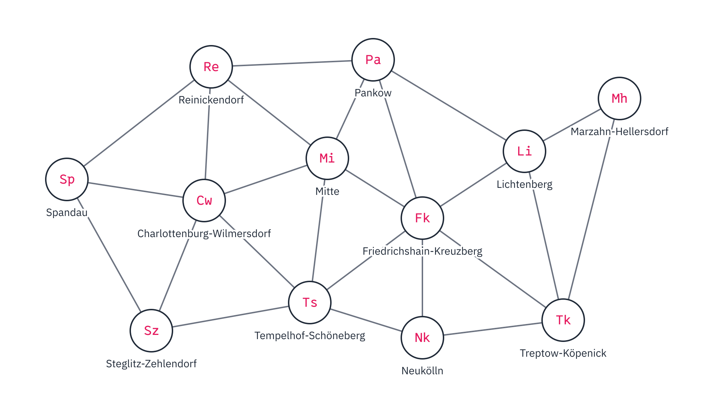
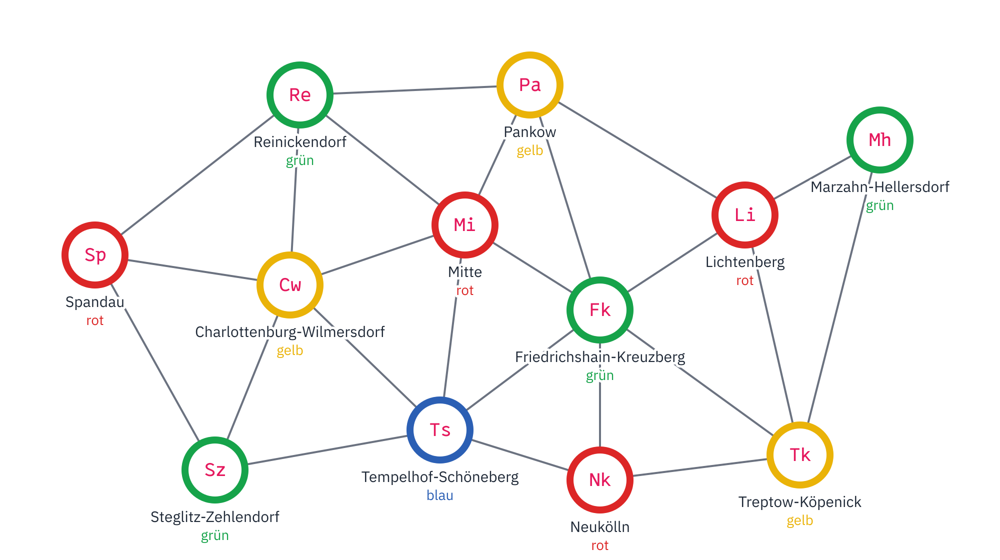
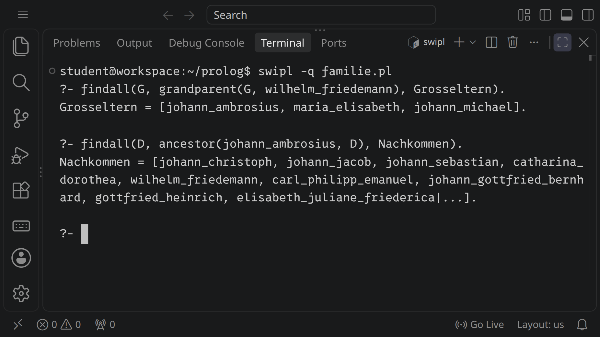

<div class='meta'>
image: teaser.webp
image_alt: "Ein Terminal, in dem SWI-Prolog läuft: die Anfragen nach den Großeltern von Wilhelm Friedemann Bach und nach allen Nachkommen von Johann Ambrosius Bach, mit den Listen der Namen, die Prolog findet"
kind: projekt
language: Prolog
duration: 3 Doppelstunden
curriculum: "Oberstufe: Vertiefung Applikative Programmierung (logische Programmierung: Fakten, Regeln, Anfragen, Rekursion, Listen, Backtracking)"
topics: [programmiersprachen, rekursion, listen, funktional]
requires: [kata-recursion]
age: Oberstufe
reference: [terminal]
</div>

<div
    class="autotoc-secondary-trigger"
    data-title="Auf dieser Seite"
    data-levels="h2,h3">
</div>

# Logisch programmieren mit Prolog

<p class='abstract'>
In Prolog schreibt man nicht auf, was der Computer der Reihe nach tun soll,
sondern was wahr ist: Fakten über eine Familie und Regeln, was Großeltern,
Geschwister und Vorfahren sind. Dann stellt man Fragen, und Prolog sucht
die Antworten selbst. Du fragst die Musikerfamilie Bach über fünf
Generationen aus, lässt Listen rückwärts rechnen und färbst die Bezirke
Berlins mit vier Farben.
</p>

## Was Prolog anders macht

_person(colmerauer)

Ein Prolog-Programm besteht aus **Fakten**, die einfach gelten, und
**Regeln**, die sagen, wann etwas gilt. Ein Programm läuft nicht von oben
nach unten, sondern man stellt eine **Anfrage**, und Prolog sucht in den
Fakten und Regeln, ob sie stimmt und für welche Werte.

## Einrichten

Leg einen Ordner an, hol die Fakten über die Familie Bach und starte
SWI-Prolog mit ihnen:

```bash_copy
mkdir -p /workspace/prolog
cd /workspace/prolog
wget ${web_root}/prolog/starter/familie.pl
swipl familie.pl
```

Jetzt wartet Prolog hinter `?-` auf eine Anfrage. Sie endet immer mit einem
Punkt:

```prolog
?- parent(johann_sebastian, wilhelm_friedemann).
true.

?- parent(johann_sebastian, X).
X = catharina_dorothea ;
X = wilhelm_friedemann ;
X = carl_philipp_emanuel .
```

Was klein beginnt, ist ein Name, ein **Atom**: `johann_sebastian`. Was groß
beginnt, ist eine **Variable**: `X`. Gibt es mehrere Antworten, zeigt
Prolog die erste und wartet: `;` holt die nächste, Enter hört auf. Hast du
`familie.pl` im Editor geändert, lädt `make.` sie neu; `halt.` beendet
Prolog.

## Fakten und Regeln

### Fakten und Anfragen

Jede Zeile `parent(johann_ambrosius, johann_sebastian).` in `familie.pl` ist
ein Fakt: Johann Ambrosius ist ein Elternteil von Johann Sebastian. Eine
Anfrage mit einer Variablen fragt, wofür sie gilt, an jeder Stelle:
`parent(X, johann_sebastian)` fragt nach den Eltern.

_task(eltern-von)

_task(kinder)

<!-- after: kinder -->
So sieht die Familie in `familie.pl` jetzt aus, die Kinder von Anna
Magdalena in Blau. Jeder Pfeil ist ein Fakt `parent(Elternteil, Kind)`;
eine Anfrage wie `parent(X, johann_sebastian)` sucht die Pfeile, die bei
Johann Sebastian ankommen.

<div class='gallery single'>
<figure><figcaption>Jeder Pfeil ein Fakt <code>parent(P, K)</code>; blau, was du eingetragen hast</figcaption></figure>
</div>
<!-- /after -->

### Regeln

Eine Regel sagt, wann etwas gilt. `:-` liest man »wenn«, das Komma »und«:

```prolog
son(S, P) :- parent(P, S), male(S).
```

»S ist ein Sohn von P, wenn P ein Elternteil von S ist und S männlich.« Eine
Variable gilt in der ganzen Regel: Das `S` in `male(S)` ist dasselbe wie
das in `parent(P, S)`.

_task(regeln)

_task(geschwister-vorhersage)

<!-- after: geschwister-vorhersage -->
Johann Sebastian hat mit sich selbst einen gemeinsamen Elternteil, sogar
zwei: Für `P = johann_ambrosius` passt `Y = johann_sebastian`, und für
`P = maria_elisabeth` wieder. Jedes Geschwister kommt zweimal, einmal über
den Vater und einmal über die Mutter. Prolog weiß nur, was dasteht, und
nirgends steht, dass niemand sein eigenes Geschwister ist.
<!-- /after -->

_task(geschwister)

## Wie Prolog sucht

### Unifikation und Backtracking

Wie findet Prolog die Großeltern von Wilhelm Friedemann? Es nimmt das erste
Ziel, die Anfrage, und sucht von oben eine Klausel, deren Kopf dazu passt.
Passen heißt: Die beiden lassen sich gleich machen, indem Variablen Werte
bekommen. Das heißt **Unifikation**. Passt eine Regel, treten ihre
Bedingungen an die Stelle des Ziels. Könnten weiter unten noch andere
Klauseln passen, merkt sich Prolog die Stelle. Scheitert später ein Ziel,
geht es zum letzten Merkpunkt zurück und probiert dort die nächste
Klausel. Das heißt **Backtracking**.

<div class='prolog-search' data-stepper data-query='grandparent(G, wilhelm_friedemann)'>
<script type='text/plain'>
parent(christoph, johann_ambrosius).
parent(johann_ambrosius, johann_christoph).
parent(johann_ambrosius, johann_jacob).
parent(johann_ambrosius, johann_sebastian).
parent(maria_elisabeth, johann_christoph).
parent(maria_elisabeth, johann_jacob).
parent(maria_elisabeth, johann_sebastian).
parent(johann_michael, maria_barbara).
parent(johann_sebastian, catharina_dorothea).
parent(johann_sebastian, wilhelm_friedemann).
parent(johann_sebastian, carl_philipp_emanuel).
parent(johann_sebastian, johann_gottfried_bernhard).
parent(maria_barbara, catharina_dorothea).
parent(maria_barbara, wilhelm_friedemann).
parent(maria_barbara, carl_philipp_emanuel).
parent(maria_barbara, johann_gottfried_bernhard).
parent(johann_sebastian, gottfried_heinrich).
parent(johann_sebastian, elisabeth_juliane_friederica).
parent(johann_sebastian, johann_christoph_friedrich).
parent(johann_sebastian, johann_christian).
parent(anna_magdalena, gottfried_heinrich).
parent(anna_magdalena, elisabeth_juliane_friederica).
parent(anna_magdalena, johann_christoph_friedrich).
parent(anna_magdalena, johann_christian).
parent(carl_philipp_emanuel, johann_sebastian_der_juengere).
parent(johann_christoph_friedrich, wilhelm_friedrich_ernst).
grandparent(G, C) :- parent(G, P), parent(P, C).
</script>
</div>
<script src='/include/prolog_search.js'></script>

Die Merkpunkte sind ein Stack: Prolog geht immer zum zuletzt gemerkten
zurück. Darum findet es die Antworten in der Reihenfolge, in der die Fakten
in der Datei stehen.

### Rekursion

Ein Vorfahr ist ein Elternteil, oder ein Elternteil eines Vorfahren. Diese
Regel benutzt sich selbst, wie eine rekursive Funktion. Auf die Reihenfolge
kommt es dabei an:

_task(vorfahren-vorhersage)

<!-- after: vorfahren-vorhersage -->
Für `ancestor(christoph, X)` nimmt Prolog die erste Klausel, und deren
erstes Ziel ist wieder `ancestor(christoph, P)`: Prolog nimmt die erste
Klausel, und so fort, ohne je bei einem Fakt anzukommen. Jeder Aufruf kommt
auf den Stack, bis der Speicher voll ist. Logisch ist die Regel richtig,
aber Prolog sucht von links nach rechts und von oben nach unten. Erst einen
Schritt gehen, dann weiterfragen: Das endet, weil die Familie endlich ist.
<!-- /after -->

_task(vorfahren)

## Listen

Eine Liste schreibt man `[a, b, c]`. Prolog sieht sie als **Kopf** und
**Rest**: `[a | [b, c]]`, und in einer Regel lässt sich beides auf einmal
herausnehmen, `[Kopf | Rest]`. Die leere Liste ist `[]`. Schreib die
folgenden Prädikate in eine neue Datei:

```bash_copy
cd /workspace/prolog
wget ${web_root}/prolog/starter/listen.pl
```

_task(is-in)

_task(size)

_task(joined)

_task(rueckwaerts)

<!-- after: rueckwaerts -->
Vier: `[]` und `[a, b, c]`, `[a]` und `[b, c]`, `[a, b]` und `[c]`,
`[a, b, c]` und `[]`. `joined` ist keine Funktion, die aus zwei Listen eine
macht, sondern eine Beziehung zwischen drei Listen. Prolog kann jede Stelle
fragen, die unbekannt ist. Dasselbe gilt für `is_in`: Mit einer Variablen
an erster Stelle zählt es die Elemente auf.
<!-- /after -->

## Berlin in vier Farben

Jede Landkarte lässt sich mit vier Farben so färben, dass keine zwei
Nachbarn dieselbe haben. Bewiesen haben das Kenneth Appel und Wolfgang
Haken 1976, als einen der ersten großen Beweise mit Hilfe eines Computers.
Hier färbt Prolog die zwölf Bezirke Berlins. Nachbarn sind Bezirke mit
einer gemeinsamen Grenze; im Bild verbindet sie eine Linie:

<div class='gallery single'>
<figure><figcaption>Die Bezirke und ihre Nachbarn, noch ohne Farben</figcaption></figure>
</div>

<table class='table'>
<tr><th>Bezirk</th><th>Variable</th><th>Nachbarn</th></tr>
<tr><td>Charlottenburg-Wilmersdorf</td><td><code>Cw</code></td><td>Mitte, Reinickendorf, Spandau, Steglitz-Zehlendorf, Tempelhof-Schöneberg</td></tr>
<tr><td>Friedrichshain-Kreuzberg</td><td><code>Fk</code></td><td>Lichtenberg, Mitte, Neukölln, Pankow, Tempelhof-Schöneberg, Treptow-Köpenick</td></tr>
<tr><td>Lichtenberg</td><td><code>Li</code></td><td>Friedrichshain-Kreuzberg, Marzahn-Hellersdorf, Pankow, Treptow-Köpenick</td></tr>
<tr><td>Marzahn-Hellersdorf</td><td><code>Mh</code></td><td>Lichtenberg, Treptow-Köpenick</td></tr>
<tr><td>Mitte</td><td><code>Mi</code></td><td>Charlottenburg-Wilmersdorf, Friedrichshain-Kreuzberg, Pankow, Reinickendorf, Tempelhof-Schöneberg</td></tr>
<tr><td>Neukölln</td><td><code>Nk</code></td><td>Friedrichshain-Kreuzberg, Tempelhof-Schöneberg, Treptow-Köpenick</td></tr>
<tr><td>Pankow</td><td><code>Pa</code></td><td>Friedrichshain-Kreuzberg, Lichtenberg, Mitte, Reinickendorf</td></tr>
<tr><td>Reinickendorf</td><td><code>Re</code></td><td>Charlottenburg-Wilmersdorf, Mitte, Pankow, Spandau</td></tr>
<tr><td>Spandau</td><td><code>Sp</code></td><td>Charlottenburg-Wilmersdorf, Reinickendorf, Steglitz-Zehlendorf</td></tr>
<tr><td>Steglitz-Zehlendorf</td><td><code>Sz</code></td><td>Charlottenburg-Wilmersdorf, Spandau, Tempelhof-Schöneberg</td></tr>
<tr><td>Tempelhof-Schöneberg</td><td><code>Ts</code></td><td>Charlottenburg-Wilmersdorf, Friedrichshain-Kreuzberg, Mitte, Neukölln, Steglitz-Zehlendorf</td></tr>
<tr><td>Treptow-Köpenick</td><td><code>Tk</code></td><td>Friedrichshain-Kreuzberg, Lichtenberg, Marzahn-Hellersdorf, Neukölln</td></tr>
</table>

Du beschreibst nur, was gelten soll: Jeder Bezirk hat eine Farbe, und
Nachbarn haben verschiedene. Wie man eine Färbung findet, überlegt sich
Prolog selbst.

```bash_copy
cd /workspace/prolog
wget ${web_root}/prolog/starter/bezirke.pl
```

_task(bezirke)

<!-- after: bezirke -->
Mit der Lösung findet Prolog zuerst diese Färbung. Stehen deine
Bedingungen oder die Farben in anderer Reihenfolge, kann deine erste
Antwort eine andere sein; richtig ist jede, in der keine Linie zwei Kreise
derselben Farbe verbindet.

<div class='gallery single'>
<figure><figcaption>Die erste Färbung, die Prolog findet: vier Farben, keine zwei Nachbarn gleich</figcaption></figure>
</div>
<!-- /after -->

<div class='hint try'>
<strong>Ausprobieren:</strong> Schreib die Regel einmal so, dass sie erst
alle zwölf Bezirke färbt und dann alle Nachbarpaare prüft, und frag mit
<code>time(aggregate_all(count, berlin(_, _, _, _, _, _, _, _, _, _, _, _), N)).</code>
nach der Zahl der Färbungen. Achte darauf, wie viele Schlüsse
(»inferences«) Prolog jeweils braucht.
</div>

<!-- extra -->
## Ein Sudoku ohne Ausprobieren

Prolog kann nicht nur ausprobieren. Mit `library(clpfd)` sagt man, welche
Werte eine Variable haben darf und welche Bedingungen gelten, und Prolog
streicht unmögliche Werte, bevor es rät. Ein Sudoku ist dann nur noch seine
Regeln: jede Zelle eine Zahl von 1 bis 9, in jeder Zeile, jeder Spalte und
jedem Block alle verschieden.

```bash_copy
cd /workspace/prolog
wget ${web_root}/prolog/starter/sudoku.pl
```

_task(sudoku)

## Wie geht es weiter?

- **Grammatiken:** Prolog wurde erfunden, um Sätze zu verstehen. Mit
  einer Grammatik in Prolog (DCG, `-->`) wird eine Grammatik wie die aus
  [Grammatiken](/grammatiken) zu einem Programm, das Sätze prüft und
  erzeugt.
- **Wege:** Ein Fakt für jede Verbindung zweier Bahnhöfe, und eine Regel
  für einen Weg, die sich merkt, wo sie schon war, damit sie nicht im Kreis
  läuft.
- **Verneinung:** `\+ parent(X, _)` gilt, wenn Prolog keinen Beweis findet,
  nicht, wenn das Gegenteil bewiesen ist. Wer also nicht in der Datei steht,
  hat für Prolog keine Kinder.

## Zum Nachschlagen

- Das [Handbuch von SWI-Prolog](https://www.swi-prolog.org/pldoc/index.html):
  jedes eingebaute Prädikat, mit Beispielen.

<div class='book'>
<i class='bi bi-book'></i>
<p><strong>Programming in Prolog</strong>, William F. Clocksin und
Christopher S. Mellish, 1981. Das Buch, mit dem eine Generation Prolog
gelernt hat, von Fakten und Regeln bis zu Grammatiken.</p>
</div>

<!-- tutorial-scope -->
<!-- tutorial-screenshot
# Bild für die Karte der Aktivität: SWI-Prolog im Terminal, in 16:9; dabei
# prüft es jede Aufgabe mit Code an der Lösung
write-file: prolog/familie.pl <- file:loesung/familie.pl
write-file: prolog/listen.pl <- file:loesung/listen.pl
write-file: prolog/bezirke.pl <- file:loesung/bezirke.pl
write-file: prolog/sudoku.pl <- file:loesung/sudoku.pl
viewport: 1029x579
zoom: 1.4
hide-left-sidebar
terminal-maximize
terminal-run: cd /workspace/prolog && clear
terminal-run: swipl -q familie.pl
wait-for-text: ?-
terminal-run: findall(G, grandparent(G, wilhelm_friedemann), Grosseltern).
wait-for-text: Grosseltern = [
terminal-run: findall(D, ancestor(johann_ambrosius, D), Nachkommen).
wait-for-text: Nachkommen = [
sleep: 1
check-task: kinder
check-task: regeln
check-task: geschwister
check-task: vorfahren
check-task: is-in
check-task: size
check-task: joined
check-task: bezirke
check-task: sudoku
-->


<!-- /tutorial-scope -->
