<div class='meta'>
image: fertig.webp
image_alt: "Blick durch eine Halle mit Ziegelsäulen, gefliestem Boden und einer Decke mit Holzbalken, die nach hinten ins Dunkel verschwindet; oben links eine halb durchsichtige Karte"
kind: projekt
language: C
duration: 4 Doppelstunden
requires: [pixelram]
reference: [pixelram, workspace]
template: https://github.com/specht/pixelram-starter.git
template_name: des PixelRAM-Starters
</div>

<div
    class="autotoc-secondary-trigger"
    data-title="Auf dieser Seite"
    data-levels="h2,h3">
</div>

# Raycasting in C

<p class='abstract'>
Wie Wolfenstein 3D 1992 eine Welt in 3D auf einen Bildschirm brachte, auf Rechnern ohne Grafikkarte: Du baust einen Raycaster in C mit PixelRAM. Erst siehst du die Karte von oben und schickst Strahlen über das Gitter, dann wird daraus ein Blick durch Räume mit Ziegelwänden, Holz und Moos, mit gefliestem Boden, einer Decke mit Balken, Licht, das in der Ferne verlischt, und Wänden, durch die man nicht hindurchgeht. Mit 256 Farben, wie damals.
</p>

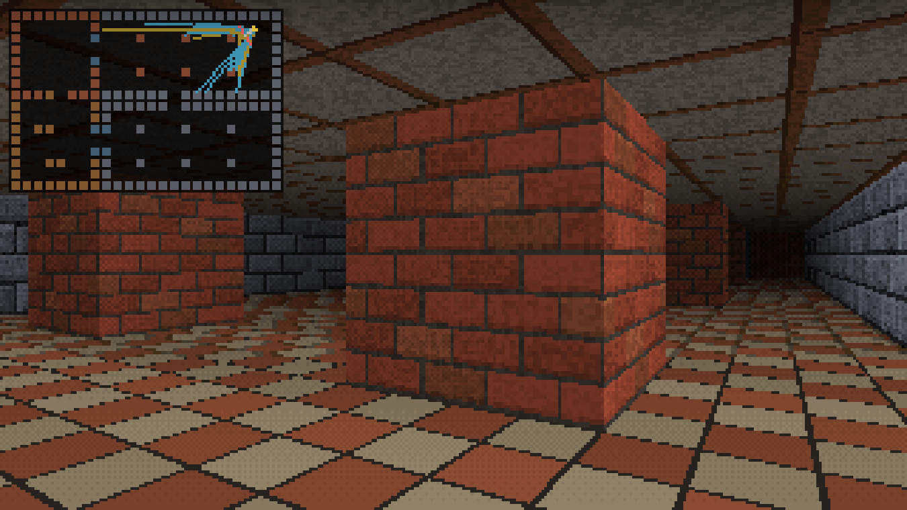

Die Welt dieses Spiels ist eine Karte aus Kästchen, wie Karopapier: Jedes Kästchen ist Boden oder Wand. Für jede Spalte des Bildes geht ein Strahl von der Spielfigur über diese Karte, bis er auf eine Wand trifft, und je weiter weg sie ist, desto kürzer zeichnet das Programm sie. 320 Strahlen für ein Bild, 60 Bilder in der Sekunde. So programmierte John Carmack 1992 Wolfenstein 3D.

_person(carmack)

Du solltest [Echtzeitgrafik mit C](/pixelram) bis »Ein Spiel: Lichtspur« kennen: wie PixelRAM ein Bild zeigt, wie eine Palette funktioniert und wie ein Programm Tasten abfragt. Gerechnet wird mit Vektoren in zwei Dimensionen, mit Sinus und Kosinus und dem Skalarprodukt.

## Einrichten

### Die Vorlage klonen

Du arbeitest wieder mit der Vorlage von PixelRAM, diesmal in einem eigenen Ordner `raycaster`. Öffne ein Terminal und gib ein:

```bash
git clone ${template} ~/raycaster
```

Öffne danach den Ordner: <kbd>Strg</kbd><kbd>K</kbd>, dann <kbd>Strg</kbd><kbd>O</kbd>, wähle `raycaster` und bestätige mit »OK«. Lege darin die Datei `raycaster.c` an; jeder Schritt auf dieser Seite fügt ihr etwas hinzu.

## Die Karte von oben

### Kästchen und eine Spielfigur

Die Karte ist eine Liste von Zeichenketten: Jede Zeichenkette ist eine Zeile, jedes Zeichen ein Kästchen. `.` ist Boden, eine Ziffer ist eine Wand, und welche Ziffer, sagt, woraus die Wand ist. Die Spielfigur hat eine Position in Kästchen, als Kommazahl, denn sie kann irgendwo in einem Kästchen stehen, und eine Blickrichtung als Winkel im Bogenmaß.

PixelRAM hat keine Befehle für Rechtecke, Kreise oder Linien. Drei kleine Funktionen machen das aus einzelnen Pixeln: `fill_rect` füllt ein Rechteck, `fill_circle` einen Kreis, und `draw_line` geht in kleinen Schritten von einem Ende der Linie zum anderen. Schreib dieses Programm in `raycaster.c` und übersetze es im Terminal mit `make PROGRAM=raycaster`:

```c_copy
#include "pixelram.h"
#include <math.h>

#define W 320
#define H 180

// die Karte: '.' ist Boden, jede Ziffer eine Wand
// 1 Ziegel, 2 Stein, 3 Holz, 4 Metall, 5 Moos
#define MAP_W 24
#define MAP_H 16

const char *map[MAP_H] = {
    "111111112222222222222222",
    "1......1...............2",
    "1......4...1...1...1...2",
    "1......................2",
    "1......4...............2",
    "1......1...1...1...1...2",
    "1......1...............2",
    "1113.111222222.222222222",
    "3......3555555.555555555",
    "3......35..............5",
    "3.33...44..5...5...5...5",
    "3......................5",
    "3......44..............5",
    "3..33..35..5...5...5...5",
    "3......35..............5",
    "333333335555555555555555",
};

// die Farben, die wir benutzen (Nummern in der Palette)
enum
{
    BLACK,
    MAP_FLOOR,
    PLAYER,
    VIEW,
    WALL = 10 // 10 bis 14: die fünf Wandarten
};

// die Spielfigur: Position in Kästchen, Blickrichtung im Bogenmaß
double player_x = 3.5;
double player_y = 3.5;
double player_angle = 0;

// so dick ist die Spielfigur (in Kästchen)
#define PLAYER_RADIUS 0.25

void setup_palette(void)
{
    set_palette(BLACK, 0, 0, 0);
    set_palette(MAP_FLOOR, 38, 38, 46);
    set_palette(PLAYER, 255, 214, 64);
    set_palette(VIEW, 255, 255, 255);

    set_palette(WALL + 0, 178, 82, 58);   // Ziegel
    set_palette(WALL + 1, 138, 144, 160); // Stein
    set_palette(WALL + 2, 160, 108, 58);  // Holz
    set_palette(WALL + 3, 84, 132, 164);  // Metall
    set_palette(WALL + 4, 92, 140, 70);   // Moos
}

// ist beim Punkt (x, y) der Karte eine Wand?
int is_wall(double x, double y)
{
    if (x < 0 || y < 0 || x >= MAP_W || y >= MAP_H)
        return 1;
    return map[(int)y][(int)x] != '.';
}

// die Farbe einer Wandart ('1' bis '5')
int wall_color(char cell)
{
    return WALL + (cell - '1');
}

void fill_rect(int x, int y, int width, int height, int color)
{
    for (int j = y; j < y + height; j++)
        for (int i = x; i < x + width; i++)
            set_pixel(i, j, color);
}

void fill_circle(double cx, double cy, double radius, int color)
{
    for (int y = (int)(cy - radius); y <= (int)(cy + radius); y++)
        for (int x = (int)(cx - radius); x <= (int)(cx + radius); x++)
        {
            double dx = x + 0.5 - cx;
            double dy = y + 0.5 - cy;
            if (dx * dx + dy * dy <= radius * radius)
                set_pixel(x, y, color);
        }
}

// eine Linie: in kleinen Schritten von (x0, y0) nach (x1, y1) gehen
void draw_line(double x0, double y0, double x1, double y1, int color)
{
    int steps = (int)fmax(fabs(x1 - x0), fabs(y1 - y0)) + 1;
    for (int i = 0; i <= steps; i++)
    {
        double t = (double)i / steps;
        set_pixel((int)(x0 + (x1 - x0) * t), (int)(y0 + (y1 - y0) * t), color);
    }
}

// die Karte von oben: jedes Kästchen ist cell Pixel groß,
// die linke obere Ecke liegt bei (left, top)
void draw_map(int left, int top, int cell)
{
    // schwarz darunter: das ergibt die Linien zwischen den Kästchen
    fill_rect(left - 1, top - 1, MAP_W * cell + 1, MAP_H * cell + 1, BLACK);
    for (int y = 0; y < MAP_H; y++)
        for (int x = 0; x < MAP_W; x++)
        {
            char c = map[y][x];
            int color = (c == '.') ? MAP_FLOOR : wall_color(c);
            fill_rect(left + x * cell, top + y * cell, cell - 1, cell - 1, color);
        }
}

void draw_player(int left, int top, int cell)
{
    double x = left + player_x * cell;
    double y = top + player_y * cell;

    // die Blickrichtung: ein Kästchen lang
    draw_line(x, y, x + cos(player_angle) * cell, y + sin(player_angle) * cell, VIEW);
    fill_circle(x, y, PLAYER_RADIUS * cell, PLAYER);
}

int main(void)
{
    screen_open(W, H, pixel_indexed8, "Raycaster");
    setup_palette();

    while (!should_close())
    {
        clear(BLACK);
        draw_map(28, 2, 11);
        draw_player(28, 2, 11);
        present();
    }

    screen_close();
    return 0;
}
```

<!-- tutorial-screenshot
# Wie der Leser: im Terminal klonen, den Ordner öffnen, die erste Stufe
show-left-sidebar
terminal-open
terminal-run: git clone -q https://github.com/specht/pixelram-starter.git ~/raycaster && git -C ~/raycaster checkout -q 8eeadbc0bf5b46ccd4e0527f4bcda13b3c0b947d
press: Control+K
press: Control+O
wait-for-input-value: /workspace/
type: raycaster
press: Enter
wait-for-input-value: /workspace/raycaster/
press: Enter
wait-for-text: main.c
write-file: raycaster.c <- previous-code
open-file: raycaster.c
terminal-open
terminal-run: make PROGRAM=raycaster
terminal-wait-for-prompt: 180
move-mouse: selector:.terminal
terminal-expect-no-text: error:
terminal-expect-no-text: ***
-->
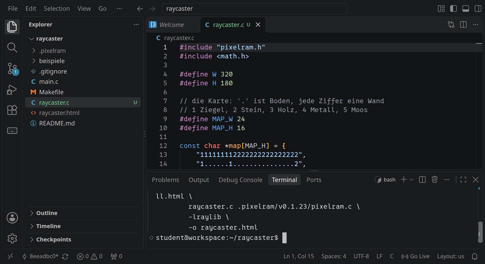

Öffne über »Go Live« die Datei `raycaster.html`:

<!-- tutorial-screenshot
go-live
tab: preview
viewport: 800x450
hook: open raycaster.html
crop-element: #canvas
-->
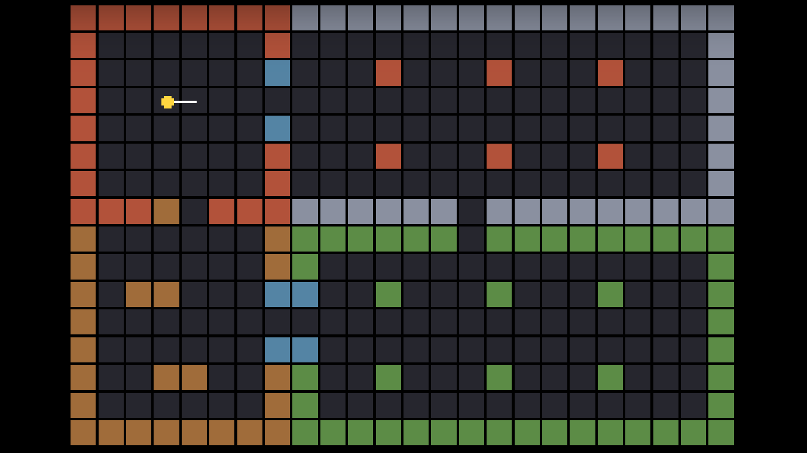

Jedes Kästchen ist hier 11 Pixel groß, und die Farbe zeigt die Wandart: Rot sind Ziegel, Grau Stein, Braun Holz, Blau Metall, Grün Moos. Der gelbe Punkt ist die Spielfigur, der weiße Strich ihre Blickrichtung: `cos(player_angle)` nach rechts und `sin(player_angle)` nach unten. y zeigt hier wie auf dem Bildschirm nach unten; ein größerer Winkel dreht deshalb im Uhrzeigersinn.

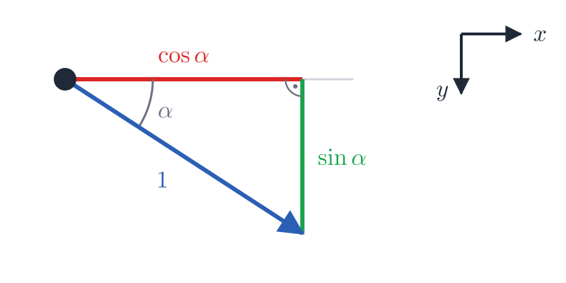

## Bewegen

### Mit der Zeit

Die Spielfigur soll mit den Tasten laufen und sich drehen. Wie weit sie in einem Bild kommt, hängt davon ab, wie lange das Bild gedauert hat: Bei 60 Bildern pro Sekunde ist das eine Sechzigstel Sekunde, auf einem langsamen Rechner mehr. Rechnet das Programm mit der vergangenen Zeit `dt`, läuft die Figur auf jedem Rechner gleich schnell. Unter `PLAYER_RADIUS`:

```c
// Kästchen pro Sekunde und Bogenmaß pro Sekunde
#define MOVE_SPEED 3.0
#define TURN_SPEED 2.5
```

Vor `main` kommt die Bewegung. Vorwärts geht es in Blickrichtung, seitwärts um 90 Grad gedreht: Aus der Richtung `(x, y)` wird nach rechts `(−y, x)`.

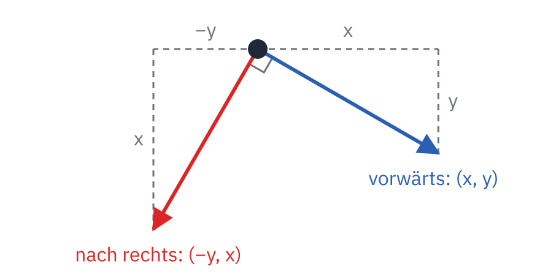

Dreht man das Dreieck aus `x` und `y` um 90 Grad im Uhrzeigersinn, geht der Teil, der nach rechts zeigte, nach unten, und der Teil, der nach unten zeigte, nach links, daher das Minus.

```c
// bewegt die Spielfigur, dt ist die Zeit seit dem letzten Bild in Sekunden
void move_player(double dt)
{
    if (key_down(pixel_key_left))
        player_angle -= TURN_SPEED * dt;
    if (key_down(pixel_key_right))
        player_angle += TURN_SPEED * dt;

    double forward = 0;
    double sideways = 0;
    if (key_down(pixel_key_w) || key_down(pixel_key_up))
        forward += 1;
    if (key_down(pixel_key_s) || key_down(pixel_key_down))
        forward -= 1;
    if (key_down(pixel_key_d))
        sideways += 1;
    if (key_down(pixel_key_a))
        sideways -= 1;

    // vorwärts entlang der Blickrichtung, seitwärts um 90 Grad gedreht
    double dir_x = cos(player_angle);
    double dir_y = sin(player_angle);
    double dx = (dir_x * forward - dir_y * sideways) * MOVE_SPEED * dt;
    double dy = (dir_y * forward + dir_x * sideways) * MOVE_SPEED * dt;

    // nicht aus der Karte hinaus; Wände halten die Figur erst später auf
    player_x = fmin(fmax(player_x + dx, 0.5), MAP_W - 0.5);
    player_y = fmin(fmax(player_y + dy, 0.5), MAP_H - 0.5);
}
```

In `main` misst das Programm die Zeit seit dem letzten Bild:

```c
~     setup_palette();
    double last_time = seconds();

~     while (!should_close())
~     {
        double now = seconds();
        move_player(now - last_time);
        last_time = now;
```

Klicke ins Bild und lauf mit <kbd>W</kbd>, <kbd>A</kbd>, <kbd>S</kbd>, <kbd>D</kbd> und den Pfeiltasten herum. Noch geht die Figur durch Wände; das kommt später.

<!-- tutorial-screenshot
write-file: raycaster.c <- file:stufen/02-bewegen.c
terminal-open
terminal-run: make PROGRAM=raycaster
terminal-wait-for-prompt
terminal-expect-no-text: error:
terminal-expect-no-text: ***
tab: preview
viewport: 800x450
hook: open raycaster.html
click: selector:#canvas
hook: hold KeyW 1.5 ArrowRight 0.25 KeyW 0.58
crop-element: #canvas
-->
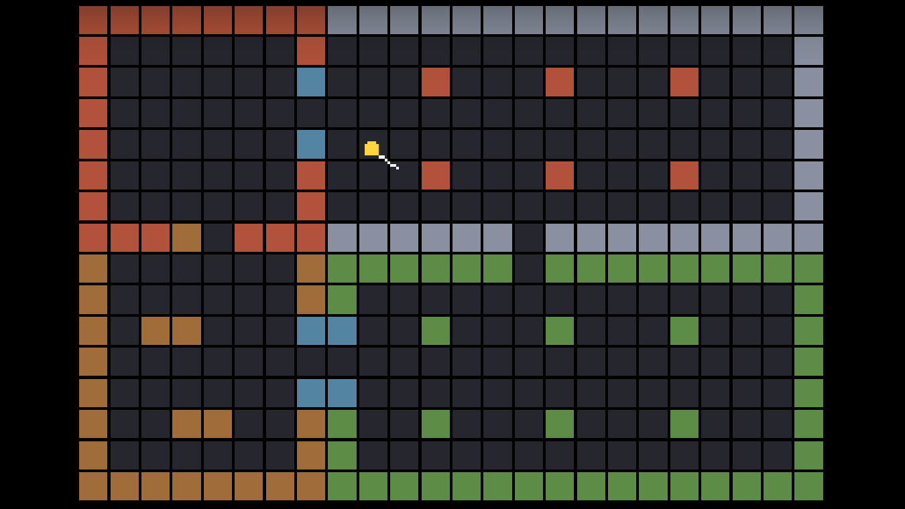

## Strahlen

### Die Kamera-Ebene

Jetzt soll die Figur sehen. Dafür schickt sie für jede Spalte des Bildes einen Strahl los. In welche Richtung, bestimmt die **Kamera**: die Blickrichtung `dir` mit der Länge 1 und quer dazu die **Kamera-Ebene**, eine Strecke, die ein Kästchen vor der Figur liegt. `plane` reicht von ihrer Mitte bis zu ihrem rechten Ende.

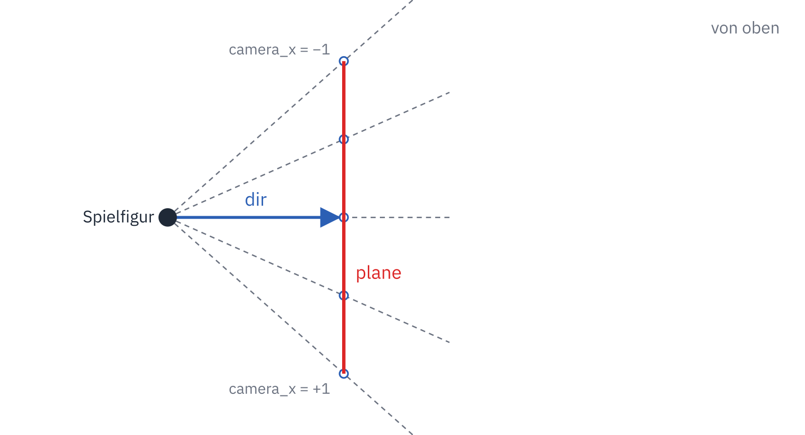

Die Bildspalten liegen gleichmäßig verteilt auf dieser Strecke: die linke Spalte bei `camera_x = −1`, die mittlere bei 0, die rechte bei +1. Der Strahl durch eine Spalte ist dann

$$\text{ray} = \text{dir} + \text{plane} \cdot \text{camera\\_x}$$

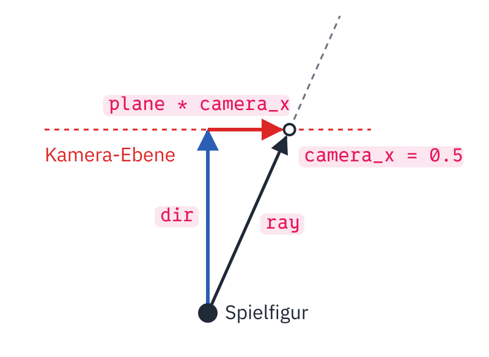

Mehr braucht es nicht, keine Winkel für jeden Strahl, nur eine Summe von zwei Vektoren. Wie lang die Kamera-Ebene ist, legt fest, wie viel die Figur sieht: `PLANE` 0,89 ergibt etwa 83 Grad.

Über `MOVE_SPEED` kommt die Kamera. `plane` steht senkrecht auf `dir`: um 90 Grad gedreht, wie beim Seitwärtslaufen.

```c
// die Kamera: Blickrichtung (Länge 1) und die Kamera-Ebene senkrecht dazu.
// PLANE ist die halbe Breite der Ebene: 0.89 = W / 2 / H ergibt etwa 83 Grad
// Blickwinkel, und ein Stück Wand ist auf dem Bild so breit wie hoch.
#define PLANE 0.89
double dir_x, dir_y;
double plane_x, plane_y;

void update_camera(void)
{
    dir_x = cos(player_angle);
    dir_y = sin(player_angle);
    // um 90 Grad gedreht, zeigt nach rechts
    plane_x = -dir_y * PLANE;
    plane_y = dir_x * PLANE;
}
```

### Schritt für Schritt

Wie weit kommt ein Strahl, bis er an eine Wand stößt? Der einfachste Weg: in kleinen Schritten den Strahl entlanggehen und bei jedem Schritt fragen, ob man schon in einer Wand steckt. Das Programm bekommt zwei neue Farben für die Strahlen und die Kamera-Ebene,

```c
~     VIEW,
    RAY,
    CAMERA_PLANE,
```

```c
~     set_palette(VIEW, 255, 255, 255);
    set_palette(RAY, 196, 160, 72);
    set_palette(CAMERA_PLANE, 255, 92, 92);
```

und über `draw_player` zwei Funktionen: `march` geht den Strahl entlang, `draw_rays` zeichnet jeden 16. Strahl in die Karte.

```c
// geht in kleinen Schritten den Strahl entlang, bis er in einer Wand steckt
#define MARCH_STEP 0.02

double march(double ray_x, double ray_y)
{
    double length = hypot(ray_x, ray_y);
    double distance = 0;
    while (!is_wall(player_x + ray_x / length * distance, player_y + ray_y / length * distance))
        distance += MARCH_STEP;
    return distance;
}

// die Kamera-Ebene und einige Strahlen, von oben gesehen
void draw_rays(int left, int top, int cell)
{
    double x = left + player_x * cell;
    double y = top + player_y * cell;

    for (int column = 0; column < W; column += 16)
    {
        // camera_x läuft über die Kamera-Ebene von -1 (links) bis +1 (rechts)
        double camera_x = 2.0 * (column + 0.5) / W - 1;
        double ray_x = dir_x + plane_x * camera_x;
        double ray_y = dir_y + plane_y * camera_x;

        double distance = march(ray_x, ray_y);
        double length = hypot(ray_x, ray_y);
        draw_line(x, y, x + ray_x / length * distance * cell, y + ray_y / length * distance * cell, RAY);
    }

    // die Kamera-Ebene: eine Strecke ein Kästchen vor der Spielfigur
    draw_line(x + (dir_x - plane_x) * cell, y + (dir_y - plane_y) * cell,
              x + (dir_x + plane_x) * cell, y + (dir_y + plane_y) * cell, CAMERA_PLANE);
}
```

`hypot(x, y)` ist die Länge des Vektors `(x, y)`, \\(\sqrt{x^2 + y^2}\\). In `main` kommen `update_camera()` nach der Bewegung und `draw_rays(28, 2, 11)` zwischen Karte und Spielfigur dazu:

```c
~         last_time = now;
        update_camera();

~         clear(BLACK);
~         draw_map(28, 2, 11);
        draw_rays(28, 2, 11);
~         draw_player(28, 2, 11);
```

<!-- tutorial-screenshot
write-file: raycaster.c <- file:stufen/03-strahlen.c
terminal-open
terminal-run: make PROGRAM=raycaster
terminal-wait-for-prompt
terminal-expect-no-text: error:
terminal-expect-no-text: ***
tab: preview
viewport: 800x450
hook: open raycaster.html
click: selector:#canvas
hook: hold KeyW 1.88 ArrowLeft 0.12
crop-element: #canvas
-->
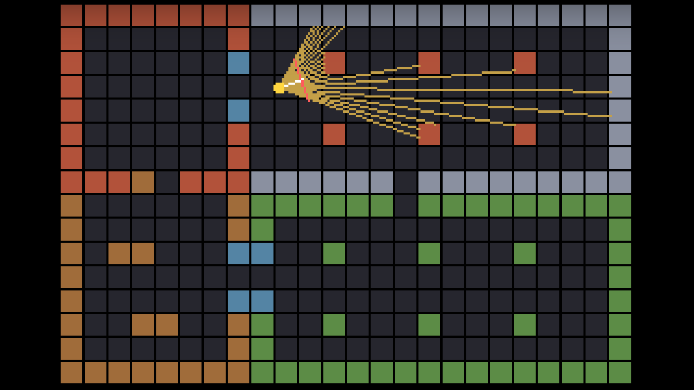

Das funktioniert, ist aber ungenau und langsam: Ein Strahl, der zehn Kästchen weit kommt, braucht 500 Schritte, und eine Ecke, die er zwischen zwei Schritten streift, übersieht er.

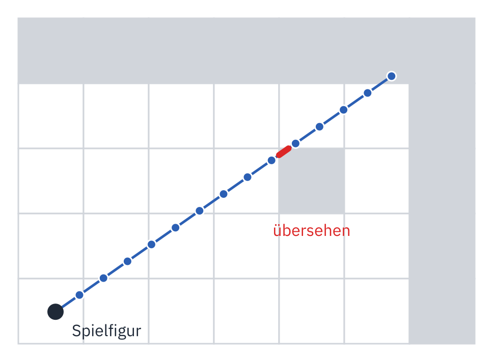

### Von Kästchen zu Kästchen

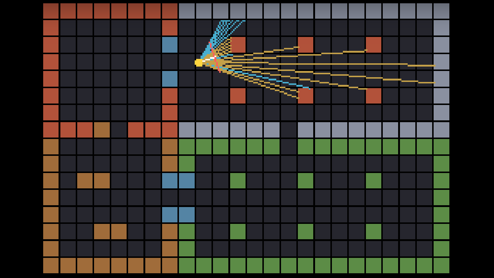

Genauer und schneller geht es mit einem Gedanken: In eine Wand kann ein Strahl nur dort geraten, wo er ein Kästchen verlässt, und das geschieht an einer **Gitterlinie**. Also springt man von Gitterlinie zu Gitterlinie, immer zur nächsten, und prüft nur dort, ob das neue Kästchen eine Wand ist. Das Verfahren heißt **DDA** (Digital Differential Analyzer).

Ein Punkt auf dem Strahl ist \\((\text{player\\\_x} + t \cdot \text{ray\\\_x},\ \text{player\\\_y} + t \cdot \text{ray\\\_y})\\). Um von einer senkrechten Gitterlinie zur nächsten zu kommen, muss x um 1 wachsen, also t um \\(|1 / \text{ray\\\_x}|\\): Das ist `delta_x`. Ebenso `delta_y` für die waagrechten Linien. `next_x` und `next_y` sind die t-Werte der nächsten Linie in jeder Richtung; der kleinere gewinnt.

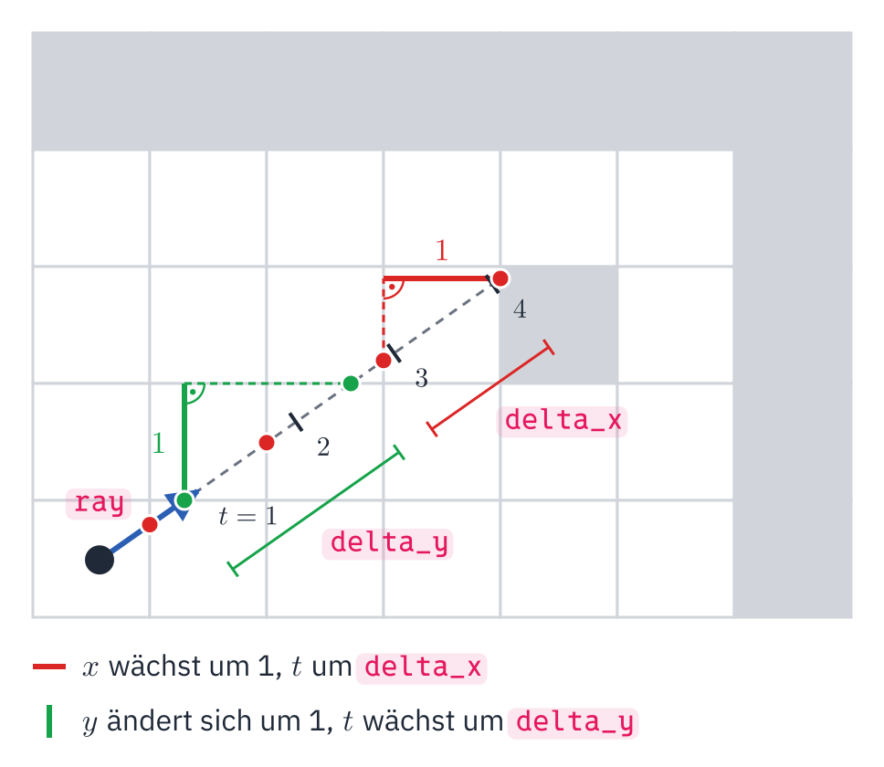

_task(delta)

`march` wird ersetzt durch `cast_ray`, das außer dem Treffpunkt auch sagt, welche Art Gitterlinie getroffen wurde (`side`) und welche Wand:

```c
// was ein Strahl getroffen hat
typedef struct
{
    double x, y; // der Treffpunkt
    int side;    // 0: eine Wand quer zur x-Achse, 1: quer zur y-Achse
    char cell;   // die Wandart
} Hit;

// Digital Differential Analyzer (DDA): geht von Kästchengrenze zu
// Kästchengrenze, bis der Strahl in einer Wand landet. Ein Punkt auf dem
// Strahl ist (player_x + t * ray_x, player_y + t * ray_y).
Hit cast_ray(double ray_x, double ray_y)
{
    int cell_x = (int)player_x;
    int cell_y = (int)player_y;

    // um so viel wächst t von einer senkrechten (x) bzw. waagrechten (y)
    // Gitterlinie zur nächsten; ein Strahl parallel zur Achse kommt nie an
    double delta_x = (ray_x == 0) ? 1e30 : fabs(1 / ray_x);
    double delta_y = (ray_y == 0) ? 1e30 : fabs(1 / ray_y);

    // in welche Richtung es weitergeht, und t an der ersten Gitterlinie
    int step_x, step_y;
    double next_x, next_y;
    if (ray_x < 0)
    {
        step_x = -1;
        next_x = (player_x - cell_x) * delta_x;
    }
    else
    {
        step_x = 1;
        next_x = (cell_x + 1 - player_x) * delta_x;
    }
    if (ray_y < 0)
    {
        step_y = -1;
        next_y = (player_y - cell_y) * delta_y;
    }
    else
    {
        step_y = 1;
        next_y = (cell_y + 1 - player_y) * delta_y;
    }

    // immer über die Gitterlinie, die näher liegt
    double t = 0;
    int side = 0;
    while (map[cell_y][cell_x] == '.')
    {
        if (next_x < next_y)
        {
            t = next_x;
            next_x += delta_x;
            cell_x += step_x;
            side = 0;
        }
        else
        {
            t = next_y;
            next_y += delta_y;
            cell_y += step_y;
            side = 1;
        }
    }

    Hit hit = {player_x + t * ray_x, player_y + t * ray_y, side, map[cell_y][cell_x]};
    return hit;
}
```

Ein Strahl genau parallel zu einer Achse hat `ray_x == 0`. `1 / 0.0` ergibt in C zwar unendlich, aber `0 · unendlich` ist keine Zahl mehr; darum steht dort `1e30`, eine Zahl, die größer ist als jeder Weg über die Karte. `draw_rays` benutzt jetzt `cast_ray` und färbt die Strahlen nach der Art der Linie, die sie getroffen haben:

```c
        Hit hit = cast_ray(ray_x, ray_y);
        int color = (hit.side == 0) ? RAY : RAY_SIDE;
        draw_line(x, y, left + hit.x * cell, top + hit.y * cell, color);
```

Dazu eine Farbe `RAY_SIDE` hinter `RAY` und `set_palette(RAY_SIDE, 72, 176, 210);`.

<!-- tutorial-screenshot
write-file: raycaster.c <- file:stufen/04-dda.c
terminal-open
terminal-run: make PROGRAM=raycaster
terminal-wait-for-prompt
terminal-expect-no-text: error:
terminal-expect-no-text: ***
tab: preview
viewport: 800x450
hook: open raycaster.html
click: selector:#canvas
hook: hold KeyW 1.88 ArrowLeft 0.12
crop-element: #canvas
-->
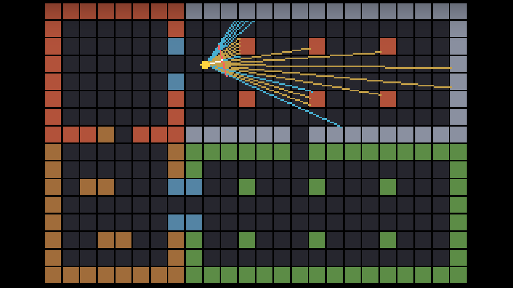

## Wände

### Eine Wandscheibe für jede Spalte

Jetzt kommt der Blick der Figur. Für jede der 320 Spalten des Bildes geht ein Strahl los, und an der Stelle der Spalte zeichnet das Programm ein senkrechtes Stück Wand: je weiter weg, desto niedriger, nämlich `H / distance` Pixel hoch, mittig um den Horizont. Darüber ist die Decke, darunter der Boden.

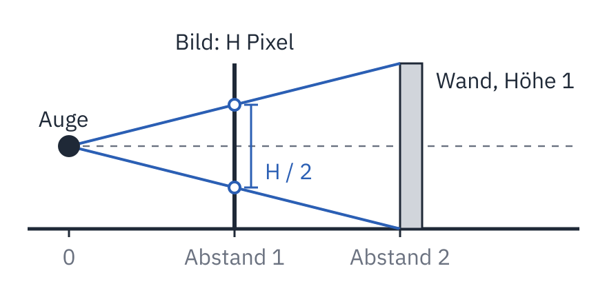

Warum gerade `H / distance`? Denk dir das Bild ein Kästchen vor dem Auge, dort ist es `H` Pixel hoch, und eine Wand der Höhe 1 im Abstand 1 füllt es genau aus. Steht sie doppelt so weit weg, treffen die Strahlen zu ihrer Ober- und Unterkante das Bild nur halb so weit auseinander.

Die Farben bekommen Decke, Boden und eine dunklere Fassung jeder Wand, damit man an Ecken sieht, wo eine Wand aufhört:

```c
~     CAMERA_PLANE,
    CEILING,
    FLOOR,
    WALL = 10,     // 10 bis 14: die fünf Wandarten
    WALL_DARK = 20 // 20 bis 24: dieselben etwas dunkler
```

```c
~     set_palette(WALL + 4, 92, 140, 70);   // Moos
    set_palette(CEILING, 52, 52, 60);
    set_palette(FLOOR, 92, 84, 76);

    // die Wände quer zur x-Achse etwas dunkler, damit man Ecken sieht
    for (int i = 0; i < 5; i++)
    {
        uint8_t r, g, b;
        get_palette(WALL + i, &r, &g, &b);
        set_palette(WALL_DARK + i, r * 7 / 10, g * 7 / 10, b * 7 / 10);
    }
```

Vor `main` kommen die Wandscheibe und das Bild. Der Abstand ist hier zuerst der einfachste: direkt von der Figur zum Treffpunkt.

```c
// eine senkrechte Wandscheibe: je weiter weg, desto niedriger;
// im Abstand 1 ist die Wand genau H Pixel hoch
void draw_wall_column(int column, double distance, int color)
{
    double wall_height = H / fmax(distance, 0.01);
    double wall_top = H / 2.0 - wall_height / 2;

    for (int y = 0; y < H; y++)
    {
        // wo diese Zeile auf der Wand liegt: 0 oben, 1 unten
        double v = (y + 0.5 - wall_top) / wall_height;
        if (v >= 0 && v < 1)
            set_pixel(column, y, color);
    }
}

// das Bild aus Sicht der Spielfigur: für jede Spalte ein Strahl
void draw_view(void)
{
    // oben die Decke, unten der Boden
    fill_rect(0, 0, W, H / 2, CEILING);
    fill_rect(0, H / 2, W, H / 2, FLOOR);

    for (int column = 0; column < W; column++)
    {
        double camera_x = 2.0 * (column + 0.5) / W - 1;
        double ray_x = dir_x + plane_x * camera_x;
        double ray_y = dir_y + plane_y * camera_x;
        Hit hit = cast_ray(ray_x, ray_y);

        // der Abstand: direkt von der Spielfigur zum Treffpunkt
        double distance = hypot(hit.x - player_x, hit.y - player_y);

        int color = wall_color(hit.cell);
        if (hit.side == 0)
            color += WALL_DARK - WALL;
        draw_wall_column(column, distance, color);
    }
}
```

`v` sagt für jede Zeile, wo sie auf der Wand liegt: 0 an ihrer Oberkante, 1 an ihrer Unterkante. Gezeichnet wird nur, wo `v` dazwischen liegt. Dass die Wand höher als das Bild sein kann, wenn man direkt davorsteht, macht so nichts aus; und mit `v` wird später die Textur auf die Wand gelegt.

`main` zeigt jetzt das Bild aus Sicht der Figur und die Karte klein darüber; <kbd>Tab</kbd> blendet sie ein und aus:

```c
~     double last_time = seconds();
    bool show_map = true;
```

```c
        // Tab blendet die Karte ein und aus
        if (key_pressed(pixel_key_tab))
            show_map = !show_map;

        draw_view();
        if (show_map)
        {
            draw_map(4, 4, 4);
            draw_rays(4, 4, 4);
            draw_player(4, 4, 4);
        }
```

<!-- tutorial-screenshot
write-file: raycaster.c <- file:stufen/05-waende-rund.c
terminal-open
terminal-run: make PROGRAM=raycaster
terminal-wait-for-prompt
terminal-expect-no-text: error:
terminal-expect-no-text: ***
tab: preview
viewport: 800x450
hook: open raycaster.html
click: selector:#canvas
hook: hold Tab KeyW 6
crop-element: #canvas
-->
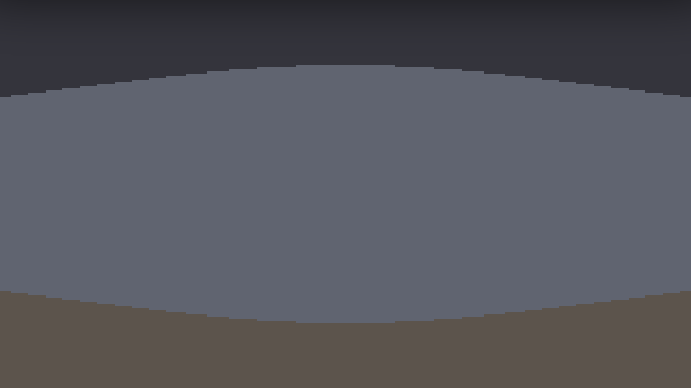

Da ist sie, die dritte Dimension. Aber etwas stimmt nicht: Die Wände sind krumm.

_task(fischauge)

### Gerade Wände

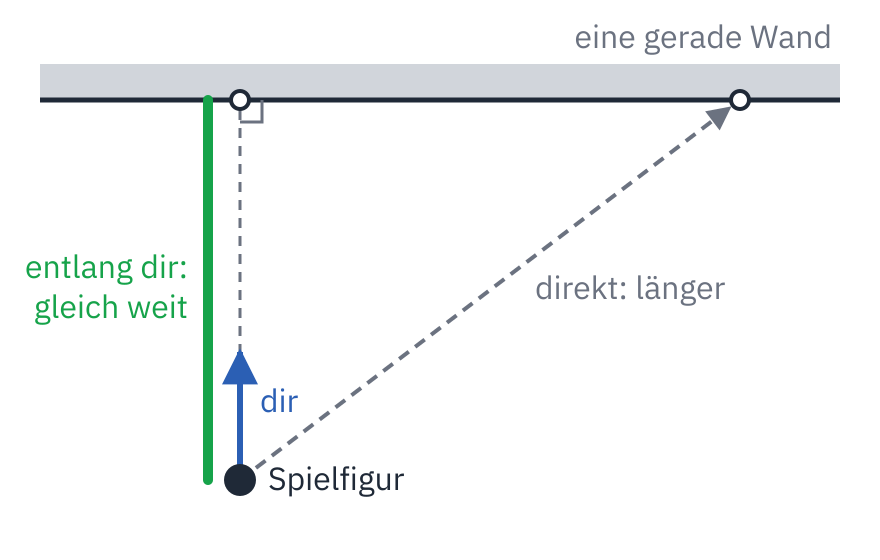

Steht die Figur gerade vor einer Wand, ist der Strahl zur Mitte am kürzesten. Ein Strahl zum Rand des Bildes ist länger, obwohl er dieselbe gerade Wand trifft, und so zeichnet das Programm die Wand dort niedriger. Unser Auge misst aber nicht den Weg zum Punkt, sondern wie weit er **vor** uns liegt: den Abstand **entlang der Blickrichtung**.

Den liefert das Skalarprodukt. Der Vektor `a` von der Figur zum Treffpunkt, multipliziert mit `dir`, das die Länge 1 hat, ergibt genau den Anteil dieses Vektors, der in Blickrichtung zeigt.

<div class='gallery centered small'>
<figure>
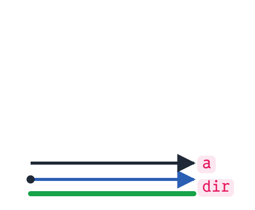
<figcaption>Gleiche Richtung<br><code>a · dir</code> = 1</figcaption>
</figure>
<figure>
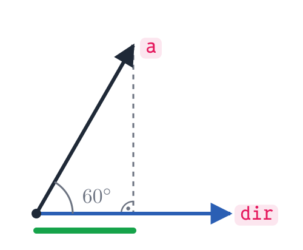
<figcaption>60° dazwischen<br><code>a · dir</code> = cos 60° = 0,5</figcaption>
</figure>
<figure>
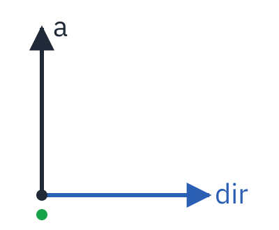
<figcaption>Senkrecht<br><code>a · dir</code> = 0</figcaption>
</figure>
</div>

Für zwei Vektoren der Länge 1 ist das Skalarprodukt der Kosinus des Winkels zwischen ihnen: 1, wenn sie in dieselbe Richtung zeigen, 0, wenn sie senkrecht aufeinander stehen, und dazwischen etwas zwischen 0 und 1. Das ist genau die Länge des Schattens, den `a` auf `dir` wirft (grün). Ist `a` doppelt so lang, ist es auch sein Schatten; mit `dir` der Länge 1 ist das Skalarprodukt also der Weg, den der Treffpunkt in Blickrichtung vor der Figur liegt.

In `draw_view` ändert sich eine einzige Rechnung; das Skalarprodukt ist die Summe aus den multiplizierten x-Anteilen und den multiplizierten y-Anteilen:

```c
        // der Abstand entlang der Blickrichtung: das Skalarprodukt
        // von (Treffpunkt - Spielfigur) mit dir, das die Länge 1 hat
        double distance = (hit.x - player_x) * dir_x + (hit.y - player_y) * dir_y;
```

<!-- tutorial-screenshot
write-file: raycaster.c <- file:stufen/06-waende-gerade.c
terminal-open
terminal-run: make PROGRAM=raycaster
terminal-wait-for-prompt
terminal-expect-no-text: error:
terminal-expect-no-text: ***
tab: preview
viewport: 800x450
hook: open raycaster.html
click: selector:#canvas
hook: hold Tab KeyW 6
crop-element: #canvas
-->
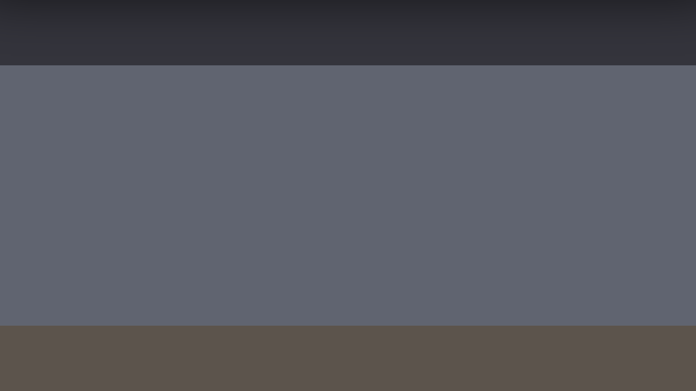

Die Wände sind gerade, und das Bild sieht aus wie ein Blick durch einen Raum.

<div class='hint try'>
<strong>Ausprobieren:</strong> Setz <code>PLANE</code> auf 0.4 und lauf herum: Der Blick wird eng wie durch ein Fernrohr. Bei 1.5 siehst du fast alles um dich herum, aber die Wände am Rand werden breit gezogen. Stell den Wert danach wieder zurück.
</div>

## Nicht durch Wände

### Kollision

Noch läuft die Figur durch Wände. Bevor sie sich bewegt, muss das Programm fragen: Passt sie an den neuen Ort? Die Figur ist kein Punkt, sie hat einen Halbmesser `PLAYER_RADIUS`. Es genügt, die vier Ecken des Quadrats um sie herum zu prüfen; steht keine davon in einer Wand, ist der Platz frei. Über `move_player`:

```c
// passt die Spielfigur an den Punkt (x, y)? Alle vier Ecken des Quadrats
// um sie herum müssen auf Boden stehen.
int is_free(double x, double y)
{
    double r = PLAYER_RADIUS;
    return !is_wall(x - r, y - r) && !is_wall(x + r, y - r) &&
           !is_wall(x - r, y + r) && !is_wall(x + r, y + r);
}
```

Am Ende von `move_player` bewegt sich die Figur in x und in y getrennt, und nur, wenn der neue Ort frei ist:

```c
    // x und y getrennt: an einer Wand gleitet die Spielfigur entlang
    if (is_free(player_x + dx, player_y))
        player_x += dx;
    if (is_free(player_x, player_y + dy))
        player_y += dy;
```

Läuft die Figur schräg gegen eine Wand, ist eine der beiden Richtungen blockiert, die andere nicht: Sie gleitet an der Wand entlang, statt hängen zu bleiben. So fühlt es sich in Spielen an.

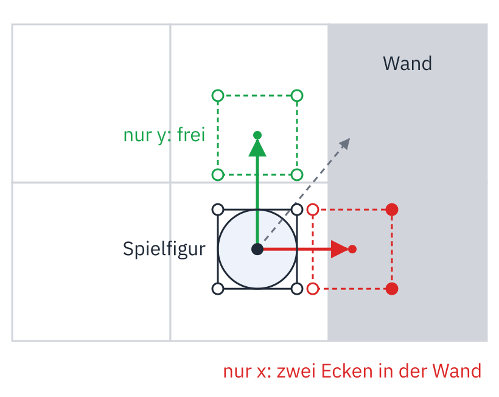

Eine Kleinigkeit in `main`: Ruckelt der Browser, etwa weil der Tab im Hintergrund war, ist `dt` auf einmal eine ganze Sekunde, und die Figur macht einen Riesenschritt, vielleicht durch eine dünne Wand hindurch. Darum höchstens eine Zehntelsekunde:

```c
        // nach einem Ruckler nicht mit einem Riesenschritt durch eine Wand
        move_player(fmin(now - last_time, 0.1));
```

<!-- tutorial-screenshot
write-file: raycaster.c <- file:stufen/07-kollision.c
terminal-open
terminal-run: make PROGRAM=raycaster
terminal-wait-for-prompt
terminal-expect-no-text: error:
terminal-expect-no-text: ***
tab: preview
viewport: 800x450
hook: open raycaster.html
click: selector:#canvas
hook: hold KeyW 2 ArrowLeft 0.25 KeyW 2.25 ArrowRight 0.2
crop-element: #canvas
-->
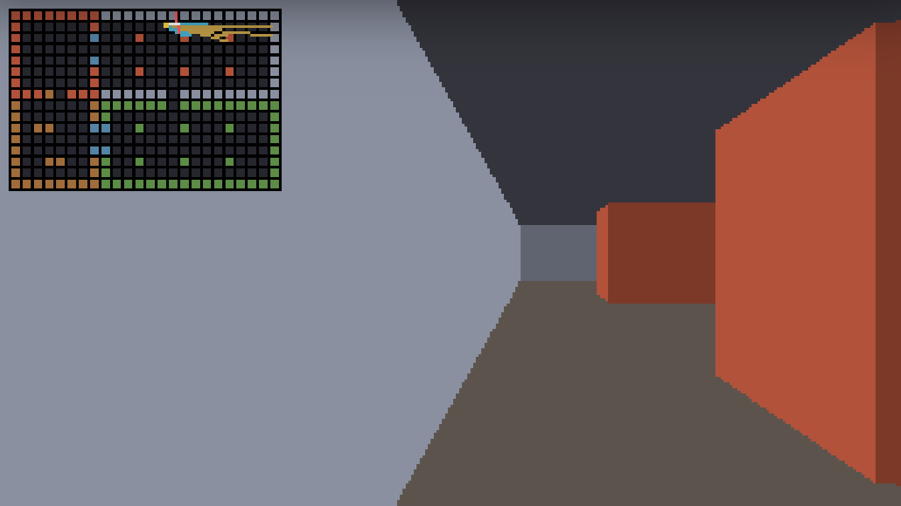

## Licht mit 256 Farben

### Eine Palette aus Farbtönen

Weit entfernte Wände sollen dunkler sein, als verlöre sich das Licht. Im Modus `pixel_indexed8` gibt es aber keine Farben zum Abdunkeln, nur 256 Nummern einer Palette. Spiele der Neunzigerjahre lösten das mit einer geschickt gebauten Palette: **16 Farbtöne mit je 16 Helligkeiten**. Die Farbe mit der Nummer `ramp · 16 + level` hat den Farbton `ramp` und die Helligkeit `level`, von 0 (schwarz) bis 15 (volle Farbe).

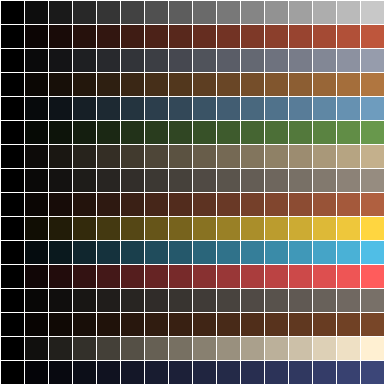

Jede Zeile ist ein Farbton, von links dunkel nach rechts hell. Eine Farbe abzudunkeln heißt jetzt: in ihrer Zeile ein paar Felder nach links gehen. Damit das Programm dafür nicht rechnen muss, schlägt es nach, in einer **Schattentabelle**: `shade[light][color]` ist die Nummer derselben Farbe mit der Helligkeit `light`. Für jedes Pixel ein einziger Blick in eine Tabelle, keine Multiplikation. DOOM machte es 1993 genauso; seine Tabelle hieß COLORMAP.

Ersetze die Farben am Anfang des Programms durch die Palette aus Farbtönen:

```c
// Die Palette: 16 Farbtöne mit je 16 Helligkeiten. Die Farbe Nummer
// ramp * 16 + level hat den Farbton ramp und die Helligkeit level
// (0 schwarz, 15 volle Helligkeit).
#define LEVELS 16
#define COLOR(ramp, level) ((ramp) * LEVELS + (level))

// die Farbtöne; 1 bis 5 sind die Wandarten
enum
{
    GREY,
    BRICK,
    STONE,
    WOOD,
    METAL,
    MOSS,
    SAND,
    PLASTER,
    TERRACOTTA,
    YELLOW,
    CYAN,
    RED,
    MORTAR,
    DARK_WOOD,
    WARM_WHITE,
    DEEP_BLUE
};

// jeder Farbton in voller Helligkeit
const uint8_t ramp_rgb[16][3] = {
    {200, 200, 200}, // GREY
    {190, 86, 60},   // BRICK
    {150, 156, 172}, // STONE
    {176, 118, 64},  // WOOD
    {110, 156, 190}, // METAL
    {104, 152, 76},  // MOSS
    {196, 176, 140}, // SAND
    {150, 140, 128}, // PLASTER
    {176, 96, 64},   // TERRACOTTA
    {255, 214, 64},  // YELLOW
    {80, 190, 230},  // CYAN
    {255, 92, 92},   // RED
    {120, 112, 104}, // MORTAR
    {120, 70, 40},   // DARK_WOOD
    {255, 240, 210}, // WARM_WHITE
    {60, 70, 120},   // DEEP_BLUE
};

// die Farben für die Karte
enum
{
    BLACK = COLOR(GREY, 0),
    MAP_FLOOR = COLOR(GREY, 3),
    VIEW = COLOR(GREY, 15),
    PLAYER = COLOR(YELLOW, 15),
    RAY = COLOR(YELLOW, 10),
    RAY_SIDE = COLOR(CYAN, 12),
    CAMERA_PLANE = COLOR(RED, 15),
    CEILING = COLOR(PLASTER, 15),
    FLOOR = COLOR(SAND, 15)
};

// die Schattentabelle: shade[light][color] ist dieselbe Farbe wie color,
// nur mit der Helligkeit light / 15 (wie die COLORMAP in DOOM)
uint8_t shade[LEVELS][256];
```

`setup_palette` baut jetzt die ganze Palette und die Tabelle:

```c
void setup_palette(void)
{
    for (int ramp = 0; ramp < 16; ramp++)
        for (int level = 0; level < LEVELS; level++)
        {
            const uint8_t *rgb = ramp_rgb[ramp];
            set_palette(COLOR(ramp, level), rgb[0] * level / 15, rgb[1] * level / 15, rgb[2] * level / 15);
        }

    for (int light = 0; light < LEVELS; light++)
        for (int color = 0; color < 256; color++)
        {
            int ramp = color / LEVELS;
            int level = color % LEVELS;
            shade[light][color] = COLOR(ramp, level * light / 15);
        }
}
```

`wall_color` gibt jetzt den Farbton der Wandart in voller Helligkeit zurück:

```c
    return COLOR(cell - '0', 15);
```

_task(lut)

### Dunkler in der Ferne

Vor `draw_view` kommen drei kleine Funktionen: wie hell es in einem Abstand ist, eine Farbe in dieser Helligkeit, und wie weit der Boden in einer Bildzeile entfernt ist; die brauchen wir, damit auch Boden und Decke zum Horizont hin dunkler werden.

```c
// wie hell es im Abstand distance ist: 1 ganz nah, gegen 0 in der Ferne
double light_at(double distance)
{
    return 1 / (1 + 0.04 * distance * distance);
}

// eine Farbe mit der Helligkeit light (0 bis 1) aus der Schattentabelle
int shaded(int color, double light)
{
    return shade[(int)(light * (LEVELS - 1) + 0.5)][color];
}

// wie weit der Boden (unter dem Horizont) bzw. die Decke (darüber) in
// Bildzeile y entfernt ist: die Augen sind 0.5 über dem Boden
double row_distance(int y)
{
    return 0.5 * H / fabs(y + 0.5 - H / 2.0);
}
```

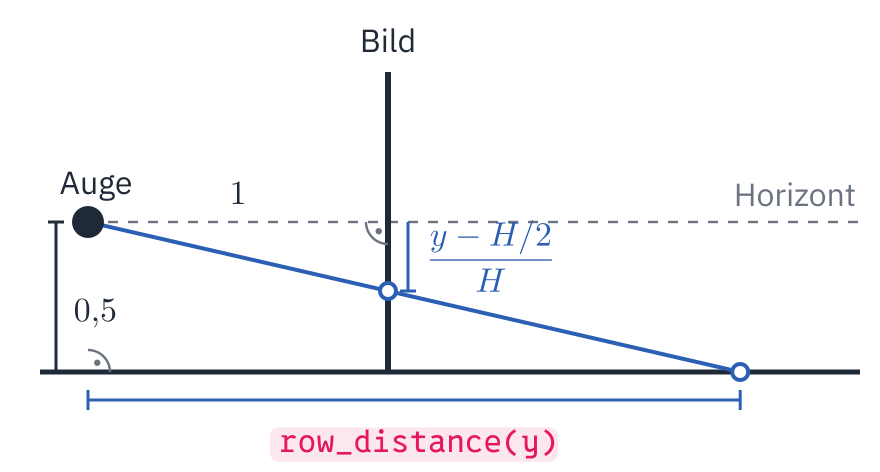

`row_distance` folgt aus ähnlichen Dreiecken: Die Augen sind 0,5 über dem Boden, das Bild steht eine Einheit vor ihnen. Eine Bildzeile, die `y − H/2` Pixel unter dem Horizont liegt, sieht den Boden dort, wo der Strahl auf seinem Weg um 0,5 gesunken ist. Weil das Bild im Abstand 1 genau `H` Pixel hoch ist, liegt sie dort `(y − H/2) / H` unter dem Horizont: Der Strahl sinkt auf dem Weg 1 um so viel, auf dem Weg `row_distance` um 0,5.

In `draw_view` werden Decke und Boden Zeile für Zeile gezeichnet, und jede Wand bekommt ihr Licht:

```c
    // Decke und Boden, Zeile für Zeile dunkler zum Horizont hin
    for (int y = 0; y < H; y++)
    {
        double light = light_at(row_distance(y));
        int color = (y < H / 2) ? CEILING : FLOOR;
        fill_rect(0, y, W, 1, shaded(color, light));
    }
```

```c
        // Wände quer zur x-Achse bekommen etwas weniger Licht
        double light = light_at(distance);
        if (hit.side == 0)
            light *= 0.75;
        draw_wall_column(column, distance, shaded(wall_color(hit.cell), light));
```

<!-- tutorial-screenshot
write-file: raycaster.c <- file:stufen/08-licht.c
terminal-open
terminal-run: make PROGRAM=raycaster
terminal-wait-for-prompt
terminal-expect-no-text: error:
terminal-expect-no-text: ***
tab: preview
viewport: 800x450
hook: open raycaster.html
click: selector:#canvas
hook: hold Tab KeyW 1.97 ArrowRight 0.08
crop-element: #canvas
-->
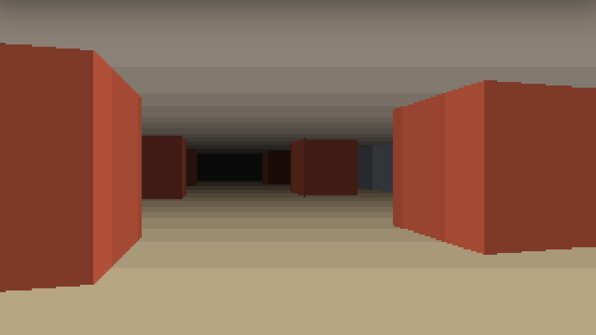

Nach hinten wird es dunkel. Sieh dir die Verläufe an Boden und Decke genau an: Sie haben Stufen, denn es gibt nur 16 Helligkeiten. Am Ende der Seite verschwinden sie.

## Texturen

### Texturen aus dem 2D Game Studio

Eine Wand aus einer Farbe ist langweilig. Eine **Textur** ist ein kleines Bild, hier 64 × 64 **Texel** (Bildpunkte einer Textur), das auf die Wand gelegt wird. Jedes Texel ist eine Nummer der Palette, und genau da hilft die Palette mit 16 Farbtönen nicht mehr: Gezeichnete Texturen haben Farben, die keiner vorher geplant hat.

In echten Spielen war es deshalb umgekehrt: Grafiker zeichneten die Texturen, und ein Werkzeug suchte danach eine Palette von 256 Farben, mit der alle Texturen möglichst gut aussehen. Die Schattentabelle rechnete es auch aus: für jede Farbe und jede Helligkeit die Farbe der Palette, die am nächsten liegt. Bei DOOM heißen die beiden PLAYPAL und COLORMAP.

So ein Werkzeug bekommst du fertig, `palette.rb`, dazu ein Bild mit sieben Texturen: Boden, fünf Wandarten und Decke. Gezeichnet sind sie im [2D Game Studio](https://2d.hackschule.de/), wie die Kacheln der [Klötzchenwelt](/raylib): jede 64 × 64 Pixel groß, als sieben Frames eines Sprites.

<!-- tutorial-scope -->
<!-- tutorial-screenshot
# Das 2D Game Studio mit den Texturen als sieben Frames (eingefügt wie mit
# »Bilder öffnen …«, nichts wird gespeichert)
open-site: /
tab: preview
viewport: 1400x820
hook: studio raycaster/werkzeug/textures.png Wände
-->
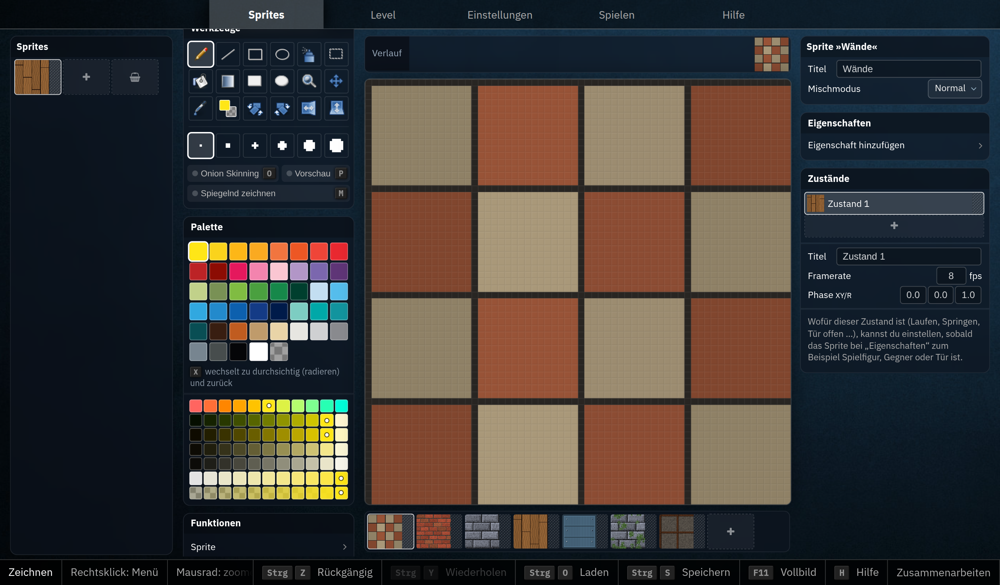

<!-- /tutorial-scope -->

Lade das Werkzeug und das Bild in deinen Ordner, installiere einmal das Rubygem `chunky_png`, das PNG-Bilder liest und schreibt, und lass das Werkzeug laufen:

```bash
wget https://github.com/specht/workspace-files/raw/main/raycaster/palette.rb
wget https://github.com/specht/workspace-files/raw/main/raycaster/textures.png
gem install chunky_png
ruby palette.rb textures.png
```

Es schreibt `palette.h` mit der Palette, der Schattentabelle und den Texturen als Farbnummern, und für jeden Schritt ein Bild. Öffne sie im Explorer.

Erst bringt es alle Texturen auf 40 Grundfarben und macht aus jeder eine Rampe mit 16 Helligkeiten, oben hell, unten schwarz (`2-rampen.png`). Aus diesen 640 Farben sucht es 240 aus, dazu kommen 16 für die Karte und die Anzeige, in der ersten Zeile der Palette (`3-palette.png`):

<div class='gallery' style='grid-template-columns: 40fr 16fr; gap: 1.2em 0.6em;'>
<figure>
<!-- tutorial-screenshot
write-file: palette.rb <- file:werkzeug/palette.rb
write-file: textures.png <- file:werkzeug/textures.png
terminal-open
terminal-run: gem install chunky_png
terminal-wait-for-prompt: 120
terminal-run: ruby palette.rb textures.png
wait-for-file-newer: raycaster/palette.h <- raycaster/textures.png
terminal-wait-for-prompt
terminal-expect-no-text: Error
image-file: raycaster/2-rampen.png 2
-->
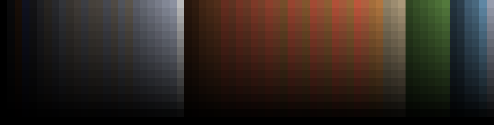
<figcaption>40 Grundfarben mit je 16 Helligkeiten</figcaption>
</figure>
<figure>
<!-- tutorial-screenshot
image-file: raycaster/3-palette.png 2
-->
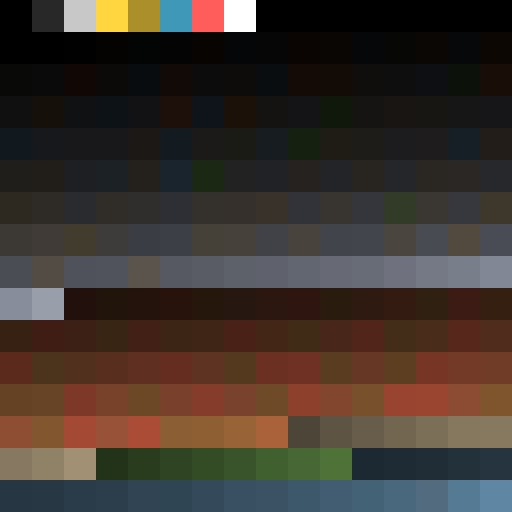
<figcaption>Die Palette mit 256 Farben</figcaption>
</figure>
</div>

Sieh dir die Palette genau an: Viele Farben sind fast schwarz und fast grau. Ganz dunkel sehen Ziegelrot, Moosgrün und Metallblau beinahe gleich aus, und die Palette fasst sie zusammen. Darum werden Farben in dunklen Gängen grauer, so wie in DOOM.

Damit ersetzt `palette.h` deine Palette: Die Farbtöne (das `enum` mit `GREY` bis `DEEP_BLUE`), `ramp_rgb` und `COLOR` kannst du löschen, `LEVELS` bleibt. Oben, unter `#include <math.h>`:

```c
// Palette, Schattentabelle und Texturen, gemacht von palette.rb
#include "palette.h"
```

`setup_palette` kopiert jetzt nur noch:

```c
// die Farben und die Schattentabelle aus palette.h
void setup_palette(void)
{
    for (int i = 0; i < 256; i++)
        set_palette(i, palette_rgb[i][0], palette_rgb[i][1], palette_rgb[i][2]);

    for (int light = 0; light < LEVELS; light++)
        for (int color = 0; color < 256; color++)
            shade[light][color] = palette_shade[light][color];
}
```

Die Farben der Karte sind die reservierten 0 bis 15, und eine Wand zeigt auf der Karte die mittlere Farbe ihrer Textur:

```c
// die Farben für die Karte: die reservierten Farben 0 bis 15 der Palette
enum
{
    BLACK = UI_BLACK,
    MAP_FLOOR = UI_MAP_FLOOR,
    VIEW = UI_VIEW,
    PLAYER = UI_PLAYER,
    RAY = UI_RAY,
    RAY_SIDE = UI_RAY_SIDE,
    CAMERA_PLANE = UI_CAMERA_PLANE
};
```

```c
    return palette_average[cell - '0'];
```

Unter `wall_color` kommen die Texturen, in der Reihenfolge der Kacheln im Bild:

```c
// Texturen: TEX x TEX Texel, so groß wie die Kacheln in textures.png;
// jedes Texel ist eine Farbnummer der Palette
#define TEX PALETTE_TEX

// die Texturen in der Reihenfolge der Kacheln in textures.png
enum
{
    TEX_FLOOR,
    TEX_BRICK, // 1 bis 5: die Wandarten
    TEX_STONE,
    TEX_WOOD,
    TEX_METAL,
    TEX_MOSS,
    TEX_CEILING,
    TEXTURES
};

uint8_t texture[TEXTURES][TEX][TEX];

// die Texturen aus palette.h
void make_textures(void)
{
    for (int t = 0; t < TEXTURES; t++)
        for (int y = 0; y < TEX; y++)
            for (int x = 0; x < TEX; x++)
                texture[t][y][x] = palette_texture[t][y][x];
}
```

Boden und Decke bekommen erst im nächsten Abschnitt Texturen; bis dahin nehmen sie die mittlere Farbe ihrer Textur:

```c
        int color = palette_average[(y < H / 2) ? TEX_CEILING : TEX_FLOOR];
```

### Wo trifft der Strahl die Wand?

Um eine Textur auf eine Wand zu legen, braucht jedes Pixel der Wand zwei Zahlen: `u`, wie weit links oder rechts es auf dem Kästchen liegt, und `v`, wie weit oben oder unten. `v` hat `draw_wall_column` schon. `u` steckt im Treffpunkt: Trifft der Strahl eine Wand quer zur x-Achse, sagt der Nachkommateil von `hit.y`, wo auf dem Kästchen, sonst der von `hit.x`.

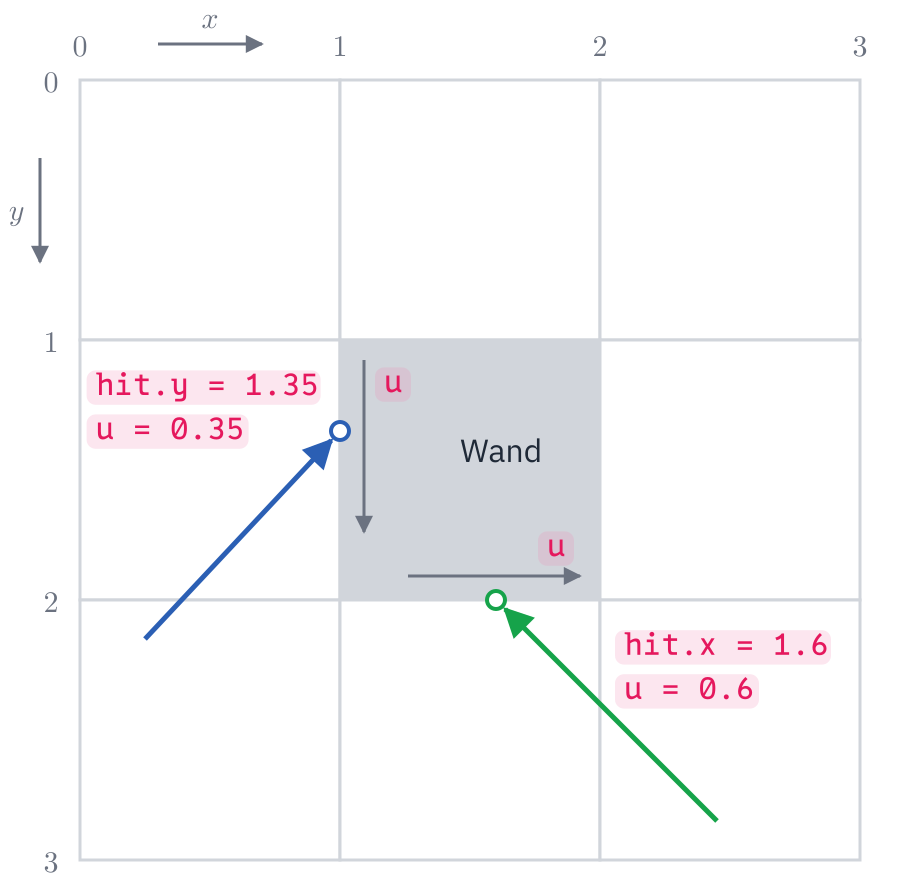

`texel` holt die Farbe aus der Textur:

```c
// das Texel beim Punkt (u, v) der Textur t; u und v laufen von 0 bis 1
int texel(int t, double u, double v)
{
    int x = (int)(u * TEX) & (TEX - 1);
    int y = (int)(v * TEX) & (TEX - 1);
    return texture[t][y][x];
}
```

`PALETTE_TEX` schreibt `palette.rb` in `palette.h`: so viele Pixel, wie deine Kacheln breit sind, bei den mitgelieferten 64. `& (TEX - 1)` hält die Zahl zwischen 0 und `TEX - 1`, auch wenn `u` einmal genau 1 ist. Die Wandscheibe bekommt die Textur und `u` statt einer Farbe:

```c
// eine senkrechte Wandscheibe: je weiter weg, desto niedriger;
// im Abstand 1 ist die Wand genau H Pixel hoch;
// u ist die Spalte in der Textur (0 bis 1)
void draw_wall_column(int column, double distance, int tex, double u, double light)
```

```c
        if (v >= 0 && v < 1)
            set_pixel(column, y, shaded(texel(tex, u, v), light));
```

Weil `draw_wall_column` jetzt `shaded` benutzt, müssen `light_at` und `shaded` darüberstehen; verschiebe die beiden Funktionen vor `draw_wall_column`. In `draw_view` rechnet jede Spalte ihr `u` aus:

```c
        // wo der Strahl die Wand trifft, von 0 bis 1 an der Wand entlang
        double wall_x = (hit.side == 0) ? hit.y : hit.x;
        double u = wall_x - floor(wall_x);
        // von zwei Seiten gesehen wäre die Textur sonst gespiegelt
        if ((hit.side == 0 && ray_x < 0) || (hit.side == 1 && ray_y > 0))
            u = 1 - u;
```

```c
        draw_wall_column(column, distance, hit.cell - '0', u, light);
```

Und `main` erzeugt die Texturen nach der Palette:

```c
~     setup_palette();
    make_textures();
```

<!-- tutorial-screenshot
write-file: raycaster.c <- file:stufen/09-texturen.c
write-file: palette.h <- file:stufen/palette.h
terminal-open
terminal-run: make PROGRAM=raycaster
terminal-wait-for-prompt
terminal-expect-no-text: error:
terminal-expect-no-text: ***
tab: preview
viewport: 800x450
hook: open raycaster.html
click: selector:#canvas
hook: hold Tab KeyW 1.97 ArrowRight 0.08
crop-element: #canvas
-->
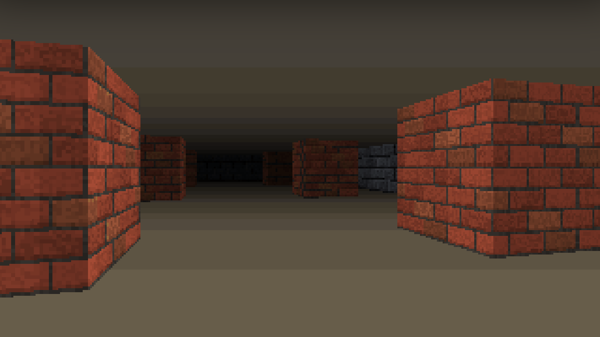

### Eigene Texturen zeichnen

Zeichne deine eigenen Texturen im [2D Game Studio](https://2d.hackschule.de/), wie die Kacheln der [Klötzchenwelt](/raylib):

1. Lege ein neues Sprite an, zum Beispiel »Wände«. Unter »Funktionen« › »Sprite« › »Größe ändern« stellst du 64 × 64 Pixel ein, oder 32 × 32 oder 16 × 16. In dieser Größe kommen die Texturen in `palette.h` und in den Raycaster: Kleine Kacheln sehen aus der Nähe gröber aus.
2. Zeichne sieben Frames desselben Zustands, in dieser Reihenfolge: Boden, die Wandarten 1 bis 5 (in der Karte Ziegel, Stein, Holz, Metall, Moos) und die Decke.
3. Wähle »Funktionen« › »Sprite« › »Als Bild speichern« › »alle Frames dieses Zustands nebeneinander«. Dein Browser speichert die sieben Frames nebeneinander als ein PNG-Bild.

<!-- tutorial-scope -->
<!-- tutorial-screenshot
open-site: /
tab: preview
viewport: 1400x820
hook: studio raycaster/werkzeug/textures.png Wände
hook: studio-menu
-->
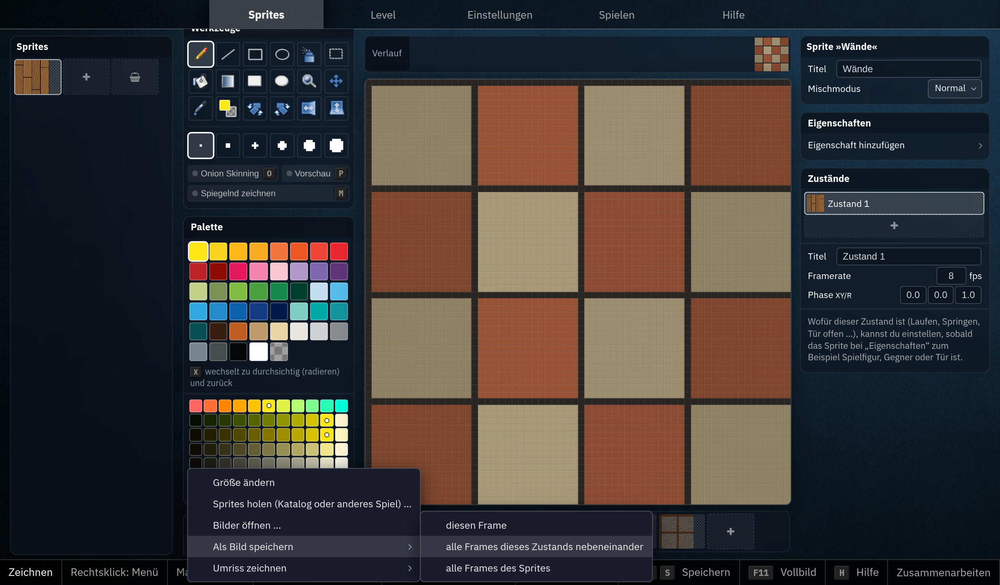

<!-- /tutorial-scope -->

4. Ziehe die Datei in den Explorer, in den Ordner `raycaster`, und nenne sie `textures.png`.

Dann `ruby palette.rb textures.png` und `make PROGRAM=raycaster`, und deine Welt hat deine Texturen.

<div class='hint try'>
<strong>Ausprobieren:</strong> Lass das Werkzeug mit <code>ruby palette.rb textures.png --dither</code> laufen und vergleiche <code>4-texturen.png</code> mit vorher: Wo eine Farbe nicht in der Palette ist, setzt das Werkzeug Pixel aus zwei Farben nebeneinander, die zusammen aussehen wie die fehlende. Bei Texturen mit weichen Verläufen sieht man das am deutlichsten.
</div>

_task(palette)

## Boden und Decke

### Zeile für Zeile

Boden und Decke bekommen auch Texturen, und das geht anders als bei den Wänden. In einer Bildzeile ist der Boden überall gleich weit weg, `row_distance(y)` weiß schon wie weit. Der Strahl durch das linke Bildende ist `dir − plane`, der durch das rechte `dir + plane`. Der Bodenpunkt am linken Rand ist also die Figur plus `distance · (dir − plane)`, und mit jedem Pixel nach rechts geht es ein gleich großes Stück weiter. Wo man auf dem Boden ist, sagt, welches Texel: wieder der Nachkommateil, diesmal von beiden Koordinaten.

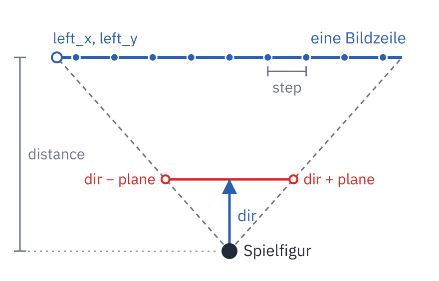

In `draw_view` wird die Schleife für Decke und Boden zu:

```c
    // Decke und Boden: in jeder Zeile derselbe Abstand
    for (int y = 0; y < H; y++)
    {
        double distance = row_distance(y);
        double light = light_at(distance);
        int tex = (y < H / 2) ? TEX_CEILING : TEX_FLOOR;

        // der Punkt auf dem Boden am linken Bildrand (Strahl dir - plane)
        // und der Schritt von einem Pixel zum nächsten nach rechts
        double left_x = player_x + distance * (dir_x - plane_x);
        double left_y = player_y + distance * (dir_y - plane_y);
        double step_x = distance * 2 * plane_x / W;
        double step_y = distance * 2 * plane_y / W;

        for (int x = 0; x < W; x++)
        {
            double world_x = left_x + (x + 0.5) * step_x;
            double world_y = left_y + (x + 0.5) * step_y;
            double u = world_x - floor(world_x);
            double v = world_y - floor(world_y);
            set_pixel(x, y, shaded(texel(tex, u, v), light));
        }
    }
```

Die Decke ist genauso hoch über den Augen wie der Boden darunter, 0,5. Darum hat eine Zeile über dem Horizont denselben Abstand wie die gespiegelte darunter, und dieselbe Schleife zeichnet beide.

_task(zeile)

<!-- tutorial-screenshot
write-file: raycaster.c <- file:stufen/10-boden.c
write-file: palette.h <- file:stufen/palette.h
terminal-open
terminal-run: make PROGRAM=raycaster
terminal-wait-for-prompt
terminal-expect-no-text: error:
terminal-expect-no-text: ***
tab: preview
viewport: 800x450
hook: open raycaster.html
click: selector:#canvas
hook: hold Tab KeyW 1.97 ArrowRight 0.08
crop-element: #canvas
-->
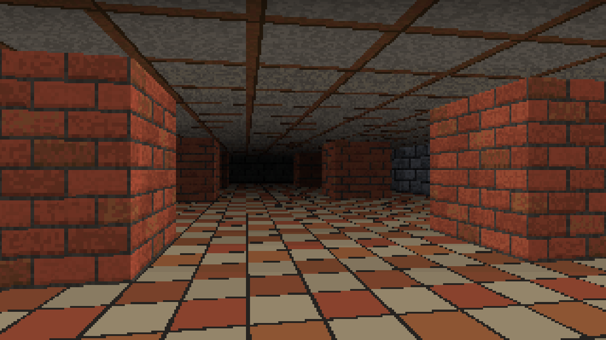

<div class='hint try'>
<strong>Ausprobieren:</strong> Ersetze in <code>light_at</code> die 0.04 durch 0.2: Es wird eng und düster wie in einem Keller mit einer Fackel. Mit 0.005 ist alles hell erleuchtet. Stell den Wert danach wieder zurück.
</div>

### Linien gleicher Tiefe

Warum zeichnet das Programm die Wände Spalte für Spalte, Boden und Decke aber Zeile für Zeile? Es kommt darauf an, wo im Bild alles gleich weit weg ist.

<div class='gallery columns-2'>
<figure>
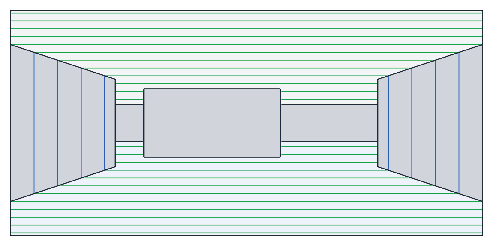
<figcaption>Geradeaus: blau, was in einer Bildspalte gleich weit weg ist, grün, was in einer Bildzeile gleich weit weg ist.</figcaption>
</figure>
<figure>
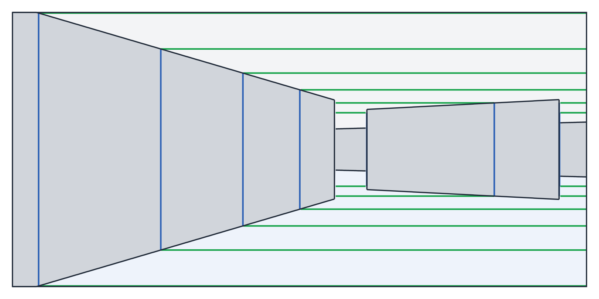
<figcaption>Nach links gedreht: Die Wände stehen schräg, die Linien bleiben senkrecht und waagrecht.</figcaption>
</figure>
</div>

Eine Wand steht senkrecht: In einer Bildspalte ist sie von oben bis unten gleich weit von dir weg, und die Textur wird dort gleichmäßig gestreckt; `v` wächst von Pixel zu Pixel um gleich viel. Der Boden liegt waagrecht: In einer Bildzeile ist er überall gleich weit weg, und von Pixel zu Pixel kommt dasselbe Stück `step_x`, `step_y` dazu. Entlang einer solchen **Linie gleicher Tiefe** ist eine Textur nur ein gleichmäßiger Schritt nach dem anderen, ohne eine eigene Division für jeden Pixel.

Das bleibt so, wenn du dich drehst: Eine Bildspalte zeigt immer eine senkrechte Linie in der Welt, eine Bildzeile immer eine waagrechte, quer zum Blick. Nur wer nach oben oder unten schaut, kippt das.

Wolfenstein 3D und DOOM haben nur senkrechte Wände und waagrechte Böden und lassen dich nicht nach oben oder unten schauen, und das ist kein Zufall. Auf einer schrägen Fläche, einer Rampe oder einer gekippten Wand, laufen die Linien gleicher Tiefe schräg durchs Bild. Erst Quake (1996) zeichnet Flächen in jedem Winkel: Es rechnet die Textur alle 16 Pixel genau aus und geht dazwischen in gleichmäßigen Schritten.

### Jeder Takt zählte

Dein Programm rechnet mit `double`, ruft für jeden Pixel `texel` und `shaded` auf und ist trotzdem schnell genug, denn ein Rechner von heute schafft Milliarden Rechenschritte in der Sekunde. 1992 war es ein 386er mit 33 MHz, 33 Millionen Takte in der Sekunde. Ein Bild mit 320 × 200 Pixeln hat 64 000 davon; sollen es 30 Bilder in der Sekunde sein, bleiben für jeden Pixel etwa 17 Takte, für alles: das Texel holen, abdunkeln, schreiben, weiterzählen. Kommazahlen konnte ein 386er ohne einen zusätzlichen Chip gar nicht rechnen. Darum rechnete man mit ganzen Zahlen in Festkomma und schrieb die innerste Schleife in Assembler, Takt für Takt gezählt. Wolfenstein 3D erzeugte beim Start für jede mögliche Höhe einer Wandscheibe ein eigenes Stück Maschinencode, ganz ohne Schleife.

Michael Abrash erzählt in seinem *Graphics Programming Black Book*, wie das ging. Sein Texture Mapper brauchte 44 Takte für jeden Pixel, als ihm der Programmierer John Miles schrieb, er schaffe es in 9, »Hmph!«. Abrash nahm die Herausforderung an, Kapitel 58 heißt »The 9-Cycle Dare«. Den entscheidenden Einfall hatte sein Freund Chris Hecker: Spalten statt Zeilen zu zeichnen, wie deine Wandscheiben, weil die Grafikkarte dann nicht bei jedem Pixel umgeschaltet werden musste. Das halbierte die Zeit, und am Ende waren es 5,5 Takte.

_person(abrash)

<div class='book'>
<i class='bi bi-book'></i>
<p><strong>Graphics Programming Black Book</strong>, Michael Abrash, 1997. Über tausend Seiten darüber, wie Grafik schnell wird, vom Zählen der Takte bis zu Quake; Kapitel 58 ist die Geschichte mit den 9 Takten. Abrash hat das Buch 2001 frei ins Netz gestellt: <a href='https://www.jagregory.com/abrash-black-book/'>online lesen</a>.</p>
</div>

<div class='book'>
<i class='bi bi-book'></i>
<p><strong>Game Engine Black Book: Wolfenstein 3D</strong>, Fabien Sanglard, 2017. Wie Wolfenstein 3D auf den Rechnern von 1992 lief: die Hardware, der Raycaster, die Wandscheiben aus Maschinencode, mit vielen Bildern. Das PDF gibt es kostenlos auf <a href='https://fabiensanglard.net/gebbwolf3d/'>fabiensanglard.net</a>.</p>
</div>

## Mipmaps

### Flimmern in der Ferne

Lauf langsam durch einen Raum und sieh dir den Boden weit hinten an: Er flimmert, die Fugen zerfallen zu zackigen Linien, die bei jedem Schritt anders aussehen. In der Ferne fallen auf ein Pixel viele Texel, aber das Programm nimmt nur eines davon, je nach Pixel mal eine Fuge, mal eine Fliese.

Die Abhilfe: Jede Textur wird beim Start noch einmal in halber Größe gespeichert, dann in Viertelgröße und so weiter, jedes Texel einer kleineren Stufe gemischt aus vier Texeln der größeren. Diese Stufen heißen **Mipmaps**. Für eine Wand weit weg nimmt das Programm eine kleine Stufe, in der die Fugen schon zu einer Mischfarbe verschwommen sind. Erfunden hat sie Lance Williams.

_person(williams)

<div class='book'>
<i class='bi bi-file-earmark-text'></i>
<p><strong>Pyramidal Parametrics</strong>, Lance Williams, SIGGRAPH 1983. Der Aufsatz, in dem die Mipmaps zum ersten Mal beschrieben sind: eine Pyramide aus immer kleineren Fassungen derselben Textur, aus der das Programm für jeden Pixel die passende Stufe nimmt: <a href='https://doi.org/10.1145/800059.801126'>bei der ACM</a>.</p>
</div>

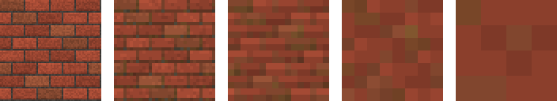

Mischen heißt in einer Palette: die Rot-, Grün- und Blauwerte der vier Farben mitteln und dann die Nummer der Palette suchen, deren Farbe dem Mittel am nächsten kommt. Das dauert, aber nur einmal beim Start. Ersetze `texel` durch:

```c
// Mipmaps: jede Textur noch einmal in halber Größe, in Viertelgröße ...
// Stufe 0 ist das Original, bei 64 Texeln dann 32, 16, 8 und 4
#define MIP_LEVELS 5
uint8_t mip[TEXTURES][MIP_LEVELS][TEX][TEX];

// die Farbe der Palette, die (r, g, b) am nächsten kommt
int nearest_color(int r, int g, int b)
{
    int best = 0;
    int best_difference = 3 * 256 * 256;
    for (int i = 0; i < 256; i++)
    {
        uint8_t pr, pg, pb;
        get_palette(i, &pr, &pg, &pb);
        int difference = (r - pr) * (r - pr) + (g - pg) * (g - pg) + (b - pb) * (b - pb);
        if (difference < best_difference)
        {
            best_difference = difference;
            best = i;
        }
    }
    return best;
}

void make_mipmaps(void)
{
    for (int t = 0; t < TEXTURES; t++)
    {
        for (int y = 0; y < TEX; y++)
            for (int x = 0; x < TEX; x++)
                mip[t][0][y][x] = texture[t][y][x];

        // jedes Texel einer Stufe mischt vier Texel der Stufe davor
        for (int level = 1; level < MIP_LEVELS; level++)
        {
            int size = TEX >> level;
            for (int y = 0; y < size; y++)
                for (int x = 0; x < size; x++)
                {
                    int r = 0, g = 0, b = 0;
                    for (int dy = 0; dy < 2; dy++)
                        for (int dx = 0; dx < 2; dx++)
                        {
                            uint8_t pr, pg, pb;
                            get_palette(mip[t][level - 1][2 * y + dy][2 * x + dx], &pr, &pg, &pb);
                            r += pr;
                            g += pg;
                            b += pb;
                        }
                    mip[t][level][y][x] = nearest_color(r / 4, g / 4, b / 4);
                }
        }
    }
}

// Mipmaps an (M schaltet um)
bool use_mipmaps = true;

// welche Stufe passt, wenn so viele Texel auf ein Pixel fallen:
// ab 2 Texeln Stufe 1, ab 4 Stufe 2, ab 8 Stufe 3 ...
int mip_level(double texels_per_pixel)
{
    int level = 0;
    while (use_mipmaps && texels_per_pixel >= 2 && level < MIP_LEVELS - 1)
    {
        texels_per_pixel /= 2;
        level++;
    }
    return level;
}

// das Texel beim Punkt (u, v) der Textur t in der Mipmap-Stufe level;
// u und v laufen von 0 bis 1
int texel(int t, int level, double u, double v)
{
    int size = TEX >> level;
    int x = (int)(u * size) & (size - 1);
    int y = (int)(v * size) & (size - 1);
    return mip[t][level][y][x];
}
```

`TEX >> level` ist `TEX` durch 2 hoch `level`, bei 64 Texeln 64, 32, 16, 8, 4. Welche Stufe passt, hängt davon ab, wie viele Texel auf ein Pixel fallen. Bei einer Wand sind das `TEX / wall_height`, in `draw_wall_column`:

```c
~     double wall_top = H / 2.0 - wall_height / 2;
    int level = mip_level(TEX / wall_height);
```

```c
            set_pixel(column, y, shaded(texel(tex, level, u, v), light));
```

Beim Boden ist es schwieriger: Quer zur Blickrichtung fallen so viele Texel auf ein Pixel wie bei einer Wand im selben Abstand, in die Tiefe viel mehr, denn der Boden liegt flach. Das Programm nimmt einen Wert dazwischen, das geometrische Mittel. In der Schleife für Decke und Boden, nach `tex`:

```c
        // wie viele Texel auf ein Pixel fallen: quer zur Blickrichtung so
        // viele wie bei einer Wand im selben Abstand, in die Tiefe viel
        // mehr, denn von Zeile zu Zeile wächst der Abstand um 2 * distance² / H;
        // wir nehmen das geometrische Mittel der beiden
        double across = distance * 2 * PLANE / W;
        double along = 2 * distance * distance / H;
        int level = mip_level(TEX * sqrt(across * along));
```

```c
            set_pixel(x, y, shaded(texel(tex, level, u, v), light));
```

In `main` kommen `make_mipmaps();` nach `make_textures();` und die Taste <kbd>M</kbd>:

```c
        // M schaltet die Mipmaps ein und aus
        if (key_pressed(pixel_key_m))
            use_mipmaps = !use_mipmaps;
```

<div class='gallery columns-2'>
<figure>
<!-- tutorial-screenshot
write-file: raycaster.c <- file:stufen/11-mipmaps.c
write-file: palette.h <- file:stufen/palette.h
terminal-open
terminal-run: make PROGRAM=raycaster
terminal-wait-for-prompt
terminal-expect-no-text: error:
terminal-expect-no-text: ***
tab: preview
viewport: 800x450
hook: open raycaster.html
click: selector:#canvas
hook: hold Tab KeyM KeyW 1.83
crop-element: #canvas
-->
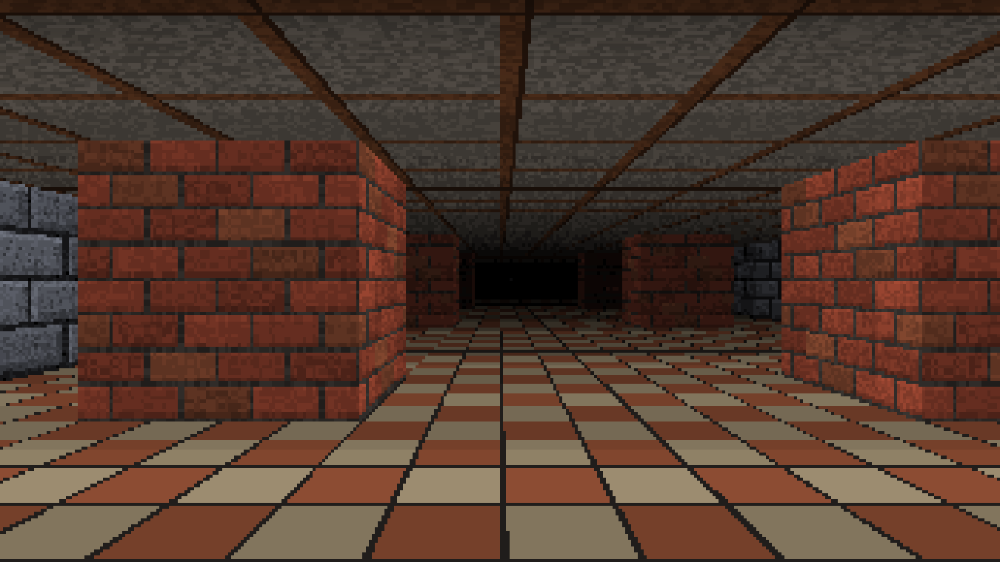
<figcaption>Ohne Mipmaps</figcaption>
</figure>
<figure>
<!-- tutorial-screenshot
tab: preview
viewport: 800x450
hook: open raycaster.html
click: selector:#canvas
hook: hold Tab KeyW 1.83
crop-element: #canvas
-->

<figcaption>Mit Mipmaps</figcaption>
</figure>
</div>

Im Standbild ist der Unterschied klein, in Bewegung groß: Lauf durch die Halle und schalte mit <kbd>M</kbd> hin und her. Ohne Mipmaps flimmert hinten jeder Schritt.

<!-- extra -->
## Das fertige Programm

Vier Dinge machen aus dem Raycaster das Programm vom Anfang der Seite.

**Böden aus der Karte.** Nicht jeder Raum hat Fliesen: In der Karte steht `,` für Holz und `:` für Steinplatten, und alles, was keine Ziffer ist, ist Boden. Ersetze die Karte:

```c
// die Karte: jede Ziffer eine Wand, alles andere Boden
// 1 Ziegel, 2 Stein, 3 Holz, 4 Metall, 5 Moos
// '.' Fliesen, ',' Holz, ':' Steinplatten
#define MAP_W 24
#define MAP_H 16

const char *map[MAP_H] = {
    "111111112222222222222222",
    "1,,,,,,1...............2",
    "1,,,,,,4...1...1...1...2",
    "1,,,,,,,...............2",
    "1,,,,,,4...............2",
    "1,,,,,,1...1...1...1...2",
    "1,,,,,,1...............2",
    "1113,111222222.222222222",
    "3::::::3555555:555555555",
    "3::::::35::::::::::::::5",
    "3:33:::44::5:::5:::5:::5",
    "3::::::::::::::::::::::5",
    "3::::::44::::::::::::::5",
    "3::33::35::5:::5:::5:::5",
    "3::::::35::::::::::::::5",
    "333333335555555555555555",
};
```

`is_wall` prüft jetzt auf eine Ziffer, und eine neue Funktion sagt, welche Textur der Boden an einem Punkt hat:

```c
    char c = map[(int)y][(int)x];
    return c >= '1' && c <= '9';
}

// welche Textur der Boden beim Punkt (x, y) hat
int floor_texture(double x, double y)
{
    if (is_wall(x, y))
        return TEX_FLOOR; // unter Wänden und außerhalb sieht es niemand
    char c = map[(int)y][(int)x];
    if (c == ',')
        return TEX_WOOD;
    if (c == ':')
        return TEX_STONE;
    return TEX_FLOOR;
}
```

In `cast_ray` wird aus `while (map[cell_y][cell_x] == '.')` dann `while (!is_wall(cell_x, cell_y))`, und in der Bodenschleife wählt jedes Pixel seine Textur selbst: `int tex = (y < H / 2) ? TEX_CEILING : floor_texture(world_x, world_y);`, eine Zeile tiefer, in der Schleife über `x`.

**Keine Stufen im Licht.** 16 Helligkeiten sind wenig; in den Verläufen sieht man jede Stufe. Ein Trick aus der Zeit der 256 Farben ist das **Dithering**: Liegt die Helligkeit zwischen zwei Stufen, bekommen benachbarte Pixel nach einem festen Muster mal die hellere, mal die dunklere. Aus etwas Abstand verschwimmt das zur Zwischenstufe. `shaded` bekommt dafür das Pixel, für das es rechnet:

```c
// 4 x 4 Bayer-Muster: verteilt die Zwischenstufen der Helligkeit auf
// benachbarte Pixel, so verschwinden die Stufen im Licht
const int bayer[4][4] = {{0, 8, 2, 10}, {12, 4, 14, 6}, {3, 11, 1, 9}, {15, 7, 13, 5}};

// eine Farbe mit der Helligkeit light (0 bis 1) aus der Schattentabelle,
// gerastert für das Pixel (x, y)
int shaded(int color, double light, int x, int y)
{
    int level = (int)(light * (LEVELS - 1) + bayer[y % 4][x % 4] / 16.0);
    if (level > LEVELS - 1)
        level = LEVELS - 1;
    return shade[level][color];
}
```

Die beiden Aufrufe geben ihr Pixel mit: `shaded(…, light, column, y)` in der Wandscheibe, `shaded(…, light, x, y)` beim Boden.

**Eine durchsichtige Karte.** Die Schattentabelle kann noch mehr: Läuft jedes Pixel unter der Karte durch `shade[4]`, wird es dunkler, und die Karte liegt wie eine getönte Scheibe über dem Bild, ohne eine einzige Rechnung mit Farben. `draw_map` zeichnet danach nur noch die Wände:

```c
    // was unter der Karte liegt, wird über die Schattentabelle dunkler:
    // halb durchsichtig, ohne eine einzige Rechnung mit Farben
    for (int y = top - 1; y < top + MAP_H * cell; y++)
        for (int x = left - 1; x < left + MAP_W * cell; x++)
            set_pixel(x, y, shade[4][get_pixel(x, y)]);

    // darauf nur die Wände
    for (int y = 0; y < MAP_H; y++)
        for (int x = 0; x < MAP_W; x++)
            if (is_wall(x, y))
                fill_rect(left + x * cell, top + y * cell, cell - 1, cell - 1, wall_color(map[y][x]));
```

**Eine Fackel.** Ein wenig flackerndes Licht:

```c
// lässt das Licht leicht flackern wie eine Fackel (1 = ruhig)
double flicker = 1;

// wie hell es im Abstand distance ist: 1 ganz nah, gegen 0 in der Ferne
double light_at(double distance)
{
    return flicker / (1 + 0.04 * distance * distance);
}
```

```c
        flicker = 0.94 + 0.03 * sin(now * 9.1) + 0.03 * sin(now * 23.7);
```

Zwei Sinuswellen mit Frequenzen, die nicht zueinander passen, wiederholen sich so selten, dass das Flackern unregelmäßig wirkt.

<div class='gallery columns-2'>
<figure>
<!-- tutorial-screenshot
write-file: raycaster.c <- file:stufen/12-fertig.c
write-file: palette.h <- file:stufen/palette.h
terminal-open
terminal-run: make PROGRAM=raycaster
terminal-wait-for-prompt
terminal-expect-no-text: error:
terminal-expect-no-text: ***
tab: preview
viewport: 800x450
hook: open raycaster.html
click: selector:#canvas
hook: hold KeyW 6 KeyA 0.63 ArrowRight 1.03
crop-element: #canvas
-->

<figcaption>Die Halle</figcaption>
</figure>
<figure>
<!-- tutorial-screenshot
tab: preview
viewport: 800x450
hook: open raycaster.html
click: selector:#canvas
hook: hold Tab KeyW 0.33 ArrowRight 0.63 KeyW 2.67 ArrowLeft 0.63 KeyW 1.4
crop-element: #canvas
-->
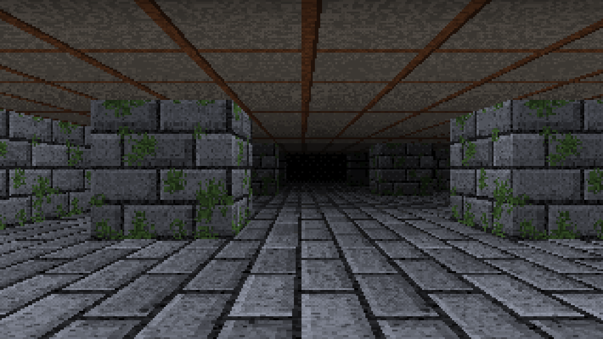
<figcaption>Der Raum mit Moos</figcaption>
</figure>
</div>

<!-- extra -->
## Nach Wolfenstein: DOOM

Ein Jahr später, 1993, kam DOOM, wieder mit der Grafik von John Carmack, und es sieht ganz anders aus: Treppen, Fenster, hohe Hallen und niedrige Gänge, Wände in jedem Winkel, flackerndes Licht. Ein Gitter aus Kästchen gibt es nicht mehr. Die Karte besteht aus **Wänden**, Strecken zwischen zwei Punkten in jeder Richtung und Länge, und aus **Sektoren**: Flächen mit einer eigenen Höhe für Boden und Decke und einer eigenen Helligkeit.

Strahlen über ein Gitter zu schicken geht damit nicht mehr. Stattdessen sortiert DOOM die Wände: Ein **BSP-Baum**, beim Bauen der Karte einmal ausgerechnet, sagt für jeden Standort, welche Wand vor welcher liegt; die Klötzchenwelt erklärt ihn im Abschnitt »Der Baum der Wände« ([Klötzchenwelt](/raylib)), die Bäume selbst stehen im Handbuch unter [Bäume](/reference/baeume). DOOM zeichnet die Wände von vorn nach hinten, jede Bildspalte nur so weit, wie sie noch frei ist, und hört auf, sobald alle Spalten voll sind.

Vieles kennst du trotzdem: Jede Wand wird Spalte für Spalte gezeichnet, Boden und Decke Zeile für Zeile, entlang der Linien gleicher Tiefe, und das Licht kommt aus einer Schattentabelle wie deiner, der COLORMAP. Auch DOOM bleibt dabei, dass Wände senkrecht stehen und Böden waagrecht liegen, und nach oben oder unten schauen kann man nicht. Ganz in 3D ging es erst mit Quake.

<div class='book'>
<i class='bi bi-book'></i>
<p><strong>Game Engine Black Book: DOOM</strong>, Fabien Sanglard, 2018. Die Fortsetzung des Buchs über Wolfenstein 3D: wie DOOM den BSP-Baum, die Sektoren und das Licht auf einem 386er und einem 486er zum Laufen brachte. Auch dieses PDF gibt es kostenlos auf <a href='https://fabiensanglard.net/gebbdoom/'>fabiensanglard.net</a>, und wer lieber in den Quelltext schaut: Sanglard hat ihn auch Stück für Stück <a href='https://fabiensanglard.net/doomIphone/doomClassicRenderer.php'>erklärt</a>.</p>
</div>

## Wie geht es weiter?

Dein Raycaster ist ein Gerüst, auf dem ganze Spiele stehen können:

- **Eine eigene Welt:** eine größere Karte, neue Wandarten (eine Ziffer, eine Textur, ein Farbton), eigene Texturen.
- **Türen:** eine Wandart, deren Wandscheibe sich zur Seite schiebt, wenn man davorsteht.
- **Gegenstände und Gegner:** Bilder, die mitten im Raum stehen (**Sprites**). Für jede Bildspalte merkt sich das Programm, wie weit die Wand war; ein Sprite wird nur dort gezeichnet, wo er näher ist.
- **Mit der Maus umsehen:** `set_mouse_relative(true)` und `mouse_delta` drehen die Figur.
- **Licht an Orten:** Statt nur nach Abstand gibt jedes Kästchen sein eigenes Licht, eine Fackel an der Wand, ein dunkler Gang.

_task(eigene-welt)
