<div class='meta'>
image: tag.webp
image_alt: "Eine Blockwelt mit Bäumen auf grüner Wiese, unten eine Leiste mit Blöcken zum Bauen"
kind: projekt
language: raylib / C
duration: 5 Doppelstunden
requires: [pixelram]
reference: [c, raylib, glsl, vektoren]
template: https://github.com/specht/raylib-starter.git
template_name: der raylib-Vorlage
</div>

# Eine Klötzchenwelt in 3D

<div
    class="autotoc-secondary-trigger"
    data-title="Auf dieser Seite"
    data-levels="h2,h3">
</div>

<p class='abstract'>
Du programmierst in C eine Welt aus Blöcken, durch die du selbst läufst: Mit der Maus siehst du dich um, du springst über Hügel, reißt Blöcke ab und baust neue. Eine Sonne wandert über den Himmel, nachts leuchten deine Fackeln, berechnet von einem Licht-Shader, den du selbst schreibst, und die Blöcke bekommen Texturen, die du selbst zeichnest.
</p>

<div class='gallery'>
<figure>
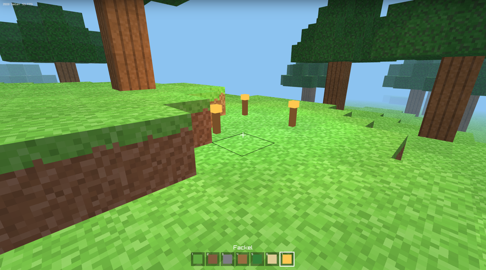
<figcaption>Unterwegs in der eigenen Welt, mit eigenen Texturen; im dunklen Modus bei Nacht</figcaption>
</figure>
<figure>
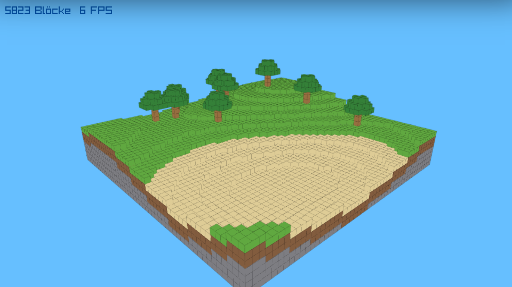
<figcaption>Die Welt ist ein Array mit 55.296 Feldern</figcaption>
</figure>
<figure>
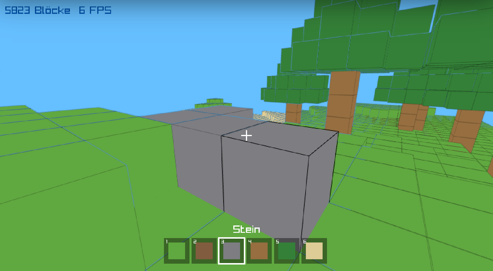
<figcaption>Zielen, bauen und abbauen</figcaption>
</figure>
</div>

Eine Welt aus Blöcken kennst du vermutlich aus *Minecraft*. Markus Persson begann es 2009 in Schweden, nachdem er *Infiniminer* gespielt hatte, ein Spiel von Zach Barth, das im April 2009 erschienen war: Zwei Teams graben darin in einer Welt aus Blöcken nach Erz, aber die Spieler bauten bald lieber, als zu graben. *Minecraft* wurde eines der meistverkauften Spiele überhaupt. Der Kern darunter ist überraschend klein: ein Array aus Blöcken, ein Strahl, mit dem du zielst, und ein Shader für das Licht. Genau das baust du hier.

In der [Anaglyph-Aktivität](/anaglyph) beschreibst du eine Szene, und der Viewer zeigt sie. Bei [PixelRAM](/pixelram) setzt du jedes Pixel selbst. Hier schreibst du ein Programm, das 60-mal in der Sekunde reagiert: auf deine Tasten, auf deine Maus und auf eine Welt, die sich dabei verändert. Dafür verwenden wir **raylib**, eine Bibliothek für Spiele in C. Sie öffnet ein Fenster, liest Tastatur und Maus, zeichnet mit der Grafikkarte in 2D und 3D und spielt Töne ab. Übrigens bringt auch PixelRAM seine Pixel mit raylib auf den Bildschirm.

Du brauchst etwas C: Variablen, Schleifen, Funktionen und `#define`. Wenn du [Echtzeitgrafik mit C](/pixelram) gemacht hast, kennst du alles, was du brauchst. Ein wenig Mathematik kommt dazu, Sinus und Kosinus für die Blickrichtung und Vektoren für Bewegung und Licht; beides wird an der Stelle erklärt, an der du es brauchst. Alle Befehle von raylib, die vorkommen, stehen im [Handbuch](/reference/raylib).

## Einrichten

### Repository klonen

Für diese Anleitung brauchst du die raylib-Vorlage:

_include(workspace#repository-klonen)

### Übersetzen und ansehen

Öffne die Datei `main.c` und gib im Terminal ein:

```bash
make
```

Beim ersten Mal lädt `make` die Webseite herunter, in der dein Programm läuft; sie kommt von PixelRAM, in der neuesten Version, und `make` nimmt danach immer diese Kopie. Mit `make pixelram-update` holst du später die neueste Version. Dann übersetzt es `main.c` in die Datei `main.html`: Dein C-Programm läuft als WebAssembly im Browser.

<!-- tutorial-screenshot
# Die Vorlage so, wie das Klonen sie anlegt (Dateien aus vorlage/, also
# ohne das Repository auf GitHub), den Ordner öffnen, dann make im Terminal
show-left-sidebar
write-file: Makefile <- file:vorlage/Makefile
write-file: main.c <- file:vorlage/main.c
write-file: light.vs <- file:vorlage/light.vs
write-file: light.fs <- file:vorlage/light.fs
write-file: README.md <- file:vorlage/README.md
write-file: .gitignore <- file:vorlage/.gitignore
write-file: compile_flags.txt <- file:vorlage/compile_flags.txt
write-file: .vscode/c_cpp_properties.json <- file:vorlage/.vscode/c_cpp_properties.json
write-file: textures.png <- file:vorlage/textures.png
press: Control+K
press: Control+O
wait-for-input-value: /workspace/
type: raylib-starter
press: Enter
wait-for-input-value: /workspace/raylib-starter/
press: Enter
wait-for-text: main.c
open-file: main.c
terminal-open
terminal-run: make
terminal-wait-for-prompt: 180
terminal-expect-no-text: error:
terminal-expect-no-text: ***
check-task: uebersetzt
check-task-fails: figur
-->
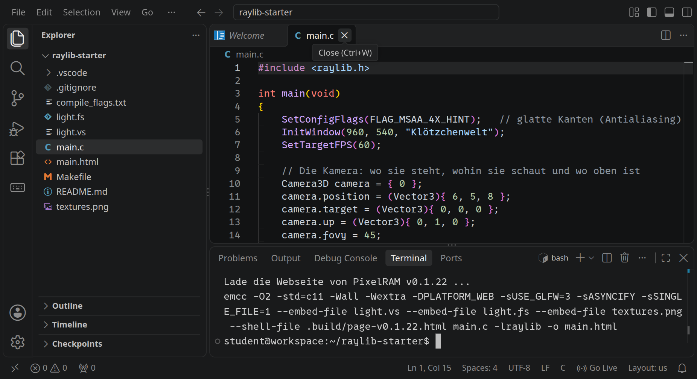


Klicke unten rechts auf »Go Live«. Im neuen Tab siehst du die Dateien des Projekts; klicke dort auf `main.html`. Du solltest einen orangefarbenen Würfel auf einem Gitter sehen:

<div style='clear: both;'></div>

<!-- tutorial-screenshot
go-live
tab: preview
viewport: 960x540
zoom: 0.5555556
hook: open main.html
hook: settle
crop-element: #canvas
-->
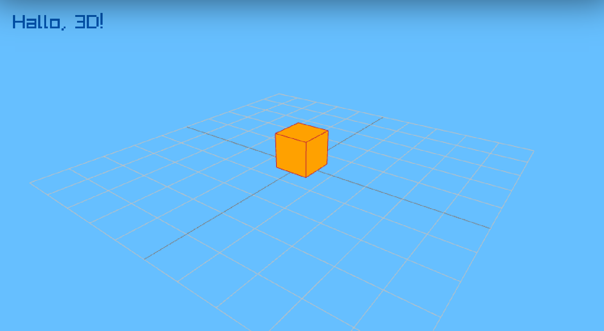

<div class='hint'>
<strong>So arbeitest du ab jetzt:</strong> Datei ändern und speichern, im Terminal <code>make</code>, dann die Vorschau neu laden, falls sie es nicht von selbst tut. Findet <code>make</code> einen Fehler, nennt es die Zeile in deiner Datei, und <code>main.html</code> bleibt, wie sie war. Lies die erste Fehlermeldung zuerst, die übrigen sind oft nur Folgefehler. Was dein Programm mit <code>printf</code> ausgibt, steht in der Konsole der Seite: Fahre mit der Maus über das Bild und klicke unten rechts auf das Terminal-Symbol.
</div>

_task(uebersetzt)

## Eine Welt im Raum

Sieh dir `main.c` an. Das ganze Programm ist eine Schleife, die raylib 60-mal in der Sekunde durchläuft, bis du die Seite schließt:

```c_copy
int main(void)
{
    SetConfigFlags(FLAG_MSAA_4X_HINT | FLAG_WINDOW_RESIZABLE);   // glatte Kanten, Größe wie die Seite
    InitWindow(960, 540, "Klötzchenwelt");
    SetTargetFPS(60);

    // Die Kamera: wo sie steht, wohin sie schaut und wo oben ist
    Camera3D camera = { 0 };
    camera.position = (Vector3){ 6, 5, 8 };
    camera.target = (Vector3){ 0, 0, 0 };
    camera.up = (Vector3){ 0, 1, 0 };
    camera.fovy = 45;
    camera.projection = CAMERA_PERSPECTIVE;

    while (!WindowShouldClose())
    {
        BeginDrawing();
        ClearBackground(SKYBLUE);

        BeginMode3D(camera);
        DrawGrid(10, 1);
        DrawCube((Vector3){ 0, 0.5f, 0 }, 1, 1, 1, ORANGE);
        DrawCubeWires((Vector3){ 0, 0.5f, 0 }, 1.01f, 1.01f, 1.01f, MAROON);
        EndMode3D();

        DrawText("Hallo, 3D!", 20, 20, 30, DARKBLUE);
        EndDrawing();
    }

    CloseWindow();
    return 0;
}
```

Die erste Zeile in `main` bittet um zweierlei, bevor `InitWindow` das Fenster öffnet:

- **Kantenglättung** (Antialiasing, `FLAG_MSAA_4X_HINT`). Eine schräge Kante liegt auf dem Bildschirm zwischen den Pixeln; ohne Glättung ist jedes Pixel ganz Würfel oder ganz Himmel, und die Kante wird zur Treppe. Mit der Glättung prüft die Grafikkarte an jedem Rand vier Punkte pro Pixel und mischt die Farbe daraus.
- **Ein Fenster, das seine Größe ändern darf** (`FLAG_WINDOW_RESIZABLE`). Das Programm beginnt mit 960 × 540 Pixeln, die Seite gibt ihm dann so viele, wie Platz ist, auch im Vollbild. Ohne diese Angabe hätte das Bild immer 960 × 540 Pixel, und auf einem großen Bildschirm würde es vergrößert: Jedes Pixel wäre ein sichtbares Kästchen. Weil sich die Größe ändern kann, fragt das Programm später in jedem Bild mit `GetScreenWidth()` und `GetScreenHeight()`, wie groß das Fenster gerade ist, statt mit 960 und 540 zu rechnen.

<div class='hint try'>
<strong>Ausprobieren:</strong> Setz <code>//</code> vor die Zeile mit <code>SetConfigFlags</code>, übersetze mit <code>make</code> und lade die Vorschau neu. Sieh dir die schrägen Kanten des Würfels vor dem Himmel und die Linien des Gitters an, und schalte unten rechts im Bild auf Vollbild: Was ist anders? Nimm die <code>//</code> danach wieder weg.
</div>

### Drei Achsen

Ein Punkt im Raum hat drei Koordinaten. In raylib zeigt **x** nach rechts, **y** nach oben und **z** nach vorne, auf dich zu, wenn du von vorne auf die Welt schaust:

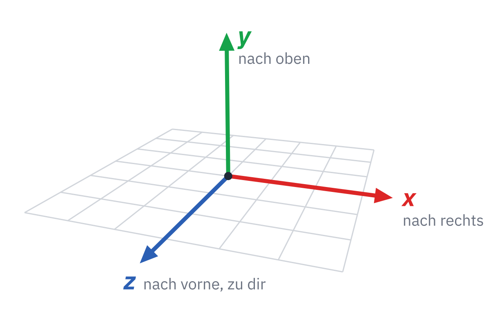

Das Gitter, das `DrawGrid(10, 1)` zeichnet, liegt flach auf dem Boden, also bei y = 0, und reicht von −5 bis 5 in x- und z-Richtung. Eine Einheit ist in diesem Projekt ein Block.

`DrawCube(position, width, height, length, color)` zeichnet einen Quader, dessen **Mitte** an der Position liegt. Der Würfel bei `(0, 0.5f, 0)` ist einen Block hoch und steht deshalb genau auf dem Boden. `DrawCubeWires` zeichnet dieselben Kanten noch einmal als Linien, aber ein winziges Stück größer: `1.01f` statt `1`.

Warum? Für jedes Pixel merkt sich die Grafikkarte, wie weit das, was dort schon gezeichnet ist, von der Kamera entfernt ist, und zeichnet nur, was näher liegt. Lägen die Linien genau auf den Flächen des Würfels, wären beide gleich weit entfernt. Dann entscheiden winzige Rundungsfehler, was vorne ist, mal die Linie, mal die Fläche, und die Kante zerfällt in Stücke. Das heißt **Z-Fighting**, weil die Entfernung zur Kamera in der Grafik z heißt. Ein Hundertstel Block größer liegen die Linien immer vorne.

<div class='hint try'>
<strong>Ausprobieren:</strong> Ändere bei <code>DrawCubeWires</code> die drei <code>1.01f</code> in <code>1</code>, übersetze und schau dir die Kanten an, auch wenn die Kamera sich bewegt. Stell danach <code>1.01f</code> wieder ein.
</div>

`(Vector3){ 0, 0.5f, 0 }` ist ein Wert vom Typ `Vector3`: drei Zahlen `x`, `y` und `z`, zusammengefasst wie in einem `struct`. raylib benutzt `Vector3` für Positionen und für Richtungen. Das `f` hinter `0.5` macht daraus eine `float`-Zahl.

### Die Kamera

Was du siehst, bestimmt die Kamera:

- `position`: wo die Kamera steht,
- `target`: welchen Punkt sie anschaut,
- `up`: welche Richtung oben ist, hier die y-Achse,
- `fovy`: wie weit der Blick nach oben und unten reicht, in Grad. Ein kleiner Wert wirkt wie ein Fernglas, ein großer wie eine Weitwinkellinse.

Alles, was zwischen `BeginMode3D(camera)` und `EndMode3D()` gezeichnet wird, zeigt raylib durch diese Kamera. Was danach kommt, wie `DrawText`, liegt flach auf dem Bild, wie eine Beschriftung auf einer Glasscheibe.

_task(von-oben)

Stell die Kamera danach wieder zurück. Probiere auch, weitere Würfel mit anderen Farben und Größen dazuzustellen, zum Beispiel einen langen, flachen Balken mit `DrawCube((Vector3){ 2, 0.25f, 0 }, 3, 0.5f, 1, DARKGREEN)`. Die Namen der Farben, die raylib kennt, stehen im [Handbuch](/reference/raylib#farben).

## Eine Welt aus Blöcken

Ein paar Würfel kann man einzeln hinschreiben. Eine ganze Welt braucht eine andere Idee: Wir teilen den Raum in ein Gitter aus Feldern, jedes Feld ist einen Block groß, und für jedes Feld merken wir uns, was dort ist: Luft, Gras, Erde, Stein … Das ist ein dreidimensionales Array.

### Die Welt ist ein Array

Ersetze alles, was in `main.c` über `int main(void)` steht, durch diese Zeilen:

```c_copy
#include <math.h>
#include <stdlib.h>
#include <raylib.h>

// ---------------------------------------------------------------- Die Welt

#define WIDTH 48    // x
#define HEIGHT 24   // y, nach oben
#define DEPTH 48    // z

enum { AIR, GRASS, DIRT, STONE, WOOD, LEAVES, SAND, BLOCK_TYPES };

Color colors[BLOCK_TYPES] = {
    { 0, 0, 0, 0 },
    { 96, 168, 64, 255 },     // Gras
    { 130, 92, 62, 255 },     // Erde
    { 125, 125, 130, 255 },   // Stein
    { 150, 110, 64, 255 },    // Holz
    { 52, 128, 56, 255 },     // Laub
    { 222, 204, 150, 255 },   // Sand
};

unsigned char world[WIDTH][HEIGHT][DEPTH];

// Der Block an einer Stelle; außerhalb der Welt ist Luft
int block(int x, int y, int z)
{
    if (x < 0 || y < 0 || z < 0 || x >= WIDTH || y >= HEIGHT || z >= DEPTH)
        return AIR;
    return world[x][y][z];
}
```

- `WIDTH`, `HEIGHT` und `DEPTH` sind die Größe der Welt in Blöcken.
- Das `enum` gibt jeder Blockart eine Nummer: `AIR` ist 0, `GRASS` ist 1 und so weiter. `BLOCK_TYPES` ist dann automatisch die Anzahl der Arten.
- `colors` hat für jede Art eine Farbe, in derselben Reihenfolge. `colors[STONE]` ist das Grau des Steins. Die vier Zahlen sind Rot, Grün, Blau und Deckkraft, jeweils von 0 bis 255.
- `world[x][y][z]` ist der Block an einer Stelle. `unsigned char` ist eine kleine Zahl von 0 bis 255, mehr brauchen wir für eine Blockart nicht.
- `block(x, y, z)` liest einen Block, sagt aber für Stellen außerhalb der Welt einfach `AIR`, statt über den Rand des Arrays hinaus zu lesen. Das wird gleich wichtig.

_task(zellen)

### Hügel aus Wellen

Noch ist die Welt leer: Ein globales Array ist in C am Anfang mit Nullen gefüllt, also mit `AIR`. Für die Landschaft berechnen wir für jede Stelle (x, z) eine Höhe und füllen die Säule darunter mit Blöcken: oben Gras, darunter zwei Lagen Erde, ganz unten Stein. Die Höhe entsteht aus drei Sinuswellen mit verschiedenen Längen, die sich überlagern, so wie die Wellen bei [PixelRAM](/pixelram#3-wellen). Wo die Welt niedrig ist, liegt Sand.

```c_copy
~         return AIR;
~     return world[x][y][z];
~ }
~
void tree(int x, int y, int z)
{
    for (int i = 0; i < 4; i++)
        world[x][y + i][z] = WOOD;
    for (int dx = -2; dx <= 2; dx++)
        for (int dz = -2; dz <= 2; dz++)
            for (int dy = 3; dy <= 5; dy++)
                if (abs(dx) + abs(dz) + (dy - 3) <= 3 && block(x + dx, y + dy, z + dz) == AIR)
                    world[x + dx][y + dy][z + dz] = LEAVES;
}

void generate_world(void)
{
    for (int x = 0; x < WIDTH; x++) {
        for (int z = 0; z < DEPTH; z++) {
            // Hügel aus drei Wellen, die sich überlagern
            float h = 7.0f + 2.0f * sinf(x * 0.13f) + 1.5f * cosf(z * 0.11f)
                    + 1.5f * sinf((x + z) * 0.07f);
            int height = (int)h;
            // hier: die Säule unter height füllen
        }
    }
    SetRandomSeed(7);
    for (int i = 0; i < 14; i++) {
        int x = GetRandomValue(3, WIDTH - 4);
        int z = GetRandomValue(3, DEPTH - 4);
        int y = HEIGHT - 7;
        while (y > 0 && block(x, y - 1, z) == AIR)
            y--;
        if (block(x, y - 1, z) == GRASS)
            tree(x, y, z);
    }
}
```

Am Ende stellt `generate_world` noch 14 Bäume an zufällige Stellen. `SetRandomSeed(7)` sorgt dafür, dass die »zufälligen« Stellen bei jedem Start dieselben sind. Mit einer anderen Zahl wächst ein anderer Wald. Ein Baum ist ein Stamm aus vier Holzblöcken und eine Krone aus Laub, die nach oben schmaler wird: `abs(dx) + abs(dz)` ist der Abstand vom Stamm, gemessen in Schritten entlang der Achsen.

<div class='hint own' data-check='saeule'>
<strong>Jetzt bist du dran:</strong> Füll in <code>generate_world</code> die Säule an der Stelle (x, z): Für jedes <code>y</code> von 0 bis unter <code>height</code> kommt ein Block nach <code>world[x][y][z]</code>. Ganz oben liegt Gras (wo <code>height</code> höchstens 5 ist, Sand), darunter zwei Lagen Erde, alles darunter ist Stein. Darüber bleibt Luft.
</div>

<!-- hint -->
Nimm eine Säule mit `height = 6` und schreib die Blöcke von unten nach oben
auf: Welche `y` gibt es? Welches ist das oberste, welche beiden liegen direkt
darunter? Dann schreib dieselben Grenzen mit `height` statt mit 6.
<!-- /hint -->
<!-- hint -->
Ein Gerüst; die Lücken mit `…` füllst du:

```c
            for (int y = 0; y < height; y++) {
                if (y == …)
                    world[x][y][z] = height <= 5 ? SAND : GRASS;
                else if (y >= …)
                    world[x][y][z] = DIRT;
                else
                    world[x][y][z] = …;
            }
```
<!-- /hint -->

<!-- solution -->
```c
~             int height = (int)h;
            for (int y = 0; y < height; y++) {
                if (y == height - 1)
                    world[x][y][z] = height <= 5 ? SAND : GRASS;
                else if (y >= height - 3)
                    world[x][y][z] = DIRT;
                else
                    world[x][y][z] = STONE;
            }
~         }
~     }
```
<!-- /solution -->

_task(saeule)

### Was man sieht

Jetzt zeichnen wir die Welt. Für jeden Block einen `DrawCube` aufzurufen, wäre viel Arbeit für den Computer: Die meisten Blöcke stecken im Boden, und niemand sieht sie. Gezeichnet wird deshalb nur ein Block, der an Luft grenzt:

```c
~             tree(x, y, z);
~     }
~ }
~
bool visible(int x, int y, int z)
{
    return block(x + 1, y, z) == AIR || block(x - 1, y, z) == AIR
        || block(x, y + 1, z) == AIR || block(x, y - 1, z) == AIR
        || block(x, y, z + 1) == AIR || block(x, y, z - 1) == AIR;
}
```

Hier hilft, dass `block` außerhalb der Welt `AIR` sagt: Am Rand gilt ein Block als sichtbar, ohne dass wir über das Array hinaus lesen.

Ersetze `main` durch diese Fassung. Die Kamera steht jetzt hoch über der Welt, und `UpdateCamera(&camera, CAMERA_ORBITAL)` lässt sie langsam um ihr Ziel kreisen, die Mitte der Welt:

```c_copy
~         || block(x, y + 1, z) == AIR || block(x, y - 1, z) == AIR
~         || block(x, y, z + 1) == AIR || block(x, y, z - 1) == AIR;
~ }
~
int main(void)
{
    SetConfigFlags(FLAG_MSAA_4X_HINT | FLAG_WINDOW_RESIZABLE);   // glatte Kanten, Größe wie die Seite
    InitWindow(960, 540, "Klötzchenwelt");
    SetTargetFPS(60);

    generate_world();

    Camera3D camera = { 0 };
    camera.position = (Vector3){ -20, 30, -20 };
    camera.target = (Vector3){ WIDTH / 2, 4, DEPTH / 2 };
    camera.up = (Vector3){ 0, 1, 0 };
    camera.fovy = 45;
    camera.projection = CAMERA_PERSPECTIVE;

    while (!WindowShouldClose())
    {
        // raylib dreht die Kamera langsam um ihr Ziel
        UpdateCamera(&camera, CAMERA_ORBITAL);

        BeginDrawing();
        ClearBackground(SKYBLUE);

        BeginMode3D(camera);
        int blocks = 0;
        for (int x = 0; x < WIDTH; x++)
            for (int y = 0; y < HEIGHT; y++)
                for (int z = 0; z < DEPTH; z++)
                    if (world[x][y][z] != AIR && visible(x, y, z)) {
                        Vector3 center = { x + 0.5f, y + 0.5f, z + 0.5f };
                        DrawCube(center, 1, 1, 1, colors[world[x][y][z]]);
                        DrawCubeWires(center, 1.01f, 1.01f, 1.01f, Fade(BLACK, 0.25f));
                        blocks++;
                    }
        EndMode3D();

        DrawText(TextFormat("%d Blöcke  %d FPS", blocks, GetFPS()), 10, 10, 20, DARKBLUE);
        EndDrawing();
    }

    CloseWindow();
    return 0;
}
```

<!-- tutorial-screenshot
write-file: main.c <- file:stufen/2.c
terminal-run: make
terminal-wait-for-prompt: 120
terminal-expect-no-text: error:
terminal-expect-no-text: ***
tab: preview
viewport: 960x540
zoom: 0.5555556
hook: open main.html
hook: play 3
hook: settle
crop-element: #canvas
check-task: saeule
check-task-fails: blickrichtung
-->


Jeder Block bekommt dunkle Kanten, wieder ein Hundertstel größer als der Block selbst, gegen das Z-Fighting. Oben links zählt das Programm, wie viele Blöcke es zeichnet, und wie viele Bilder pro Sekunde (FPS) es schafft. Behalte die Zahl im Auge: Später zeichnen wir die Welt viel geschickter.

<div class='hint think'>
<strong>Zum Nachdenken:</strong> Warum sieht man am Rand der Welt die Schichten aus Erde und Stein? Was würde passieren, wenn <code>block</code> außerhalb der Welt <code>STONE</code> statt <code>AIR</code> sagen würde?
</div>

## Mit eigenen Augen

Bis jetzt schwebt die Kamera über der Welt. Jetzt gehst du hinein: Die Kamera wird zu deinen Augen.

### Wohin schaust du?

Eine Figur in der Welt hat eine Position und eine Blickrichtung. Die Position sind ihre Füße. Die Blickrichtung beschreiben wir mit zwei Winkeln: `yaw` dreht nach links und rechts, `pitch` nach oben und unten. Daraus berechnet `view_direction()` einen Vektor, der vom Auge aus nach vorne zeigt. Schreib die Figur unter `visible`:

```c
~         || block(x, y + 1, z) == AIR || block(x, y - 1, z) == AIR
~         || block(x, y, z + 1) == AIR || block(x, y, z - 1) == AIR;
~ }
~
// --------------------------------------------------------------- Die Figur

Vector3 feet;          // Mitte der Fußsohlen
float yaw = 0;         // nach links und rechts, im Bogenmaß
float pitch = 0;       // nach oben und unten

#define EYE_HEIGHT 1.6f

Vector3 view_direction(void)
{
    // hier: die Blickrichtung aus yaw und pitch, 1 lang
}
```

Winkel misst C im **Bogenmaß**: Eine halbe Umdrehung ist π (etwa 3,14), eine ganze 2π. Ohne Neigung zeigt der Blick waagerecht, und es kommt nur auf die Drehung an:

<div class='scroll-x'><table class='table table-sm reference-table'>
<thead><tr><th><code>yaw</code></th><th>Blickrichtung (x, y, z)</th><th>du schaust …</th></tr></thead>
<tbody>
<tr><td>0</td><td>(0, 0, 1)</td><td>nach vorne, in z-Richtung</td></tr>
<tr><td>π/2 ≈ 1,57</td><td>(1, 0, 0)</td><td>nach rechts, in x-Richtung</td></tr>
</tbody>
</table>
</div>

Ist die Neigung nicht 0, wird der Blick um `cosf(pitch)` kürzer in der Waagerechten, und `sinf(pitch)` gibt an, wie weit er nach oben zeigt. So hat der Vektor immer die Länge 1.

<div class='hint own' data-check='blickrichtung'>
<strong>Jetzt bist du dran:</strong> Schreib <code>view_direction</code>: Es gibt den Vektor <code>(x, y, z)</code> der Blickrichtung zurück, wie in der Tabelle für die Drehung und mit der Neigung, wie sie der Absatz darüber beschreibt. <code>sinf</code> und <code>cosf</code> rechnen Sinus und Kosinus mit <code>float</code>. Einen Vektor schreibst du als <code>(Vector3){ x, y, z }</code>.
</div>

<!-- hint -->
Schau dir die Tabelle ohne Neigung an: Bei `yaw = 0` ist x gleich 0 und z
gleich 1, bei `yaw = π/2` ist es umgekehrt. Welche Funktion, `sinf` oder
`cosf`, ist bei 0 gleich 0 und bei π/2 gleich 1? Und welche andersherum?
<!-- /hint -->
<!-- hint -->
Ein Gerüst; die Lücken mit `…` füllst du:

```c
Vector3 view_direction(void)
{
    return (Vector3){
        …(yaw) * cosf(pitch),
        …,
        …(yaw) * cosf(pitch),
    };
}
```
<!-- /hint -->

<!-- solution -->
```c
Vector3 view_direction(void)
{
    return (Vector3){
        sinf(yaw) * cosf(pitch),
        sinf(pitch),
        cosf(yaw) * cosf(pitch),
    };
}
```
<!-- /solution -->

_task(blickrichtung)

_task(blick)

### Laufen

`move_player` liest die Tasten und bewegt die Figur. Schreibe sie unter `view_direction`:

```c_copy
~         cosf(yaw) * cosf(pitch),
~     };
~ }
~
void move_player(float dt)
{
    // Umsehen: Maus (wenn gefangen) oder Pfeiltasten
    if (IsCursorHidden()) {
        Vector2 mouse = GetMouseDelta();
        yaw -= mouse.x * 0.003f;
        pitch -= mouse.y * 0.003f;
    }
    if (IsKeyDown(KEY_LEFT)) yaw += 2.0f * dt;
    if (IsKeyDown(KEY_RIGHT)) yaw -= 2.0f * dt;
    if (IsKeyDown(KEY_UP)) pitch += 1.5f * dt;
    if (IsKeyDown(KEY_DOWN)) pitch -= 1.5f * dt;
    pitch = Clamp(pitch, -1.5f, 1.5f);

    // Laufen: vorwärts in Blickrichtung, aber ohne nach oben zu fliegen
    Vector3 forward = { sinf(yaw), 0, cosf(yaw) };
    Vector3 right = { -cosf(yaw), 0, sinf(yaw) };
    Vector3 move = { 0 };
    if (IsKeyDown(KEY_W)) move = Vector3Add(move, forward);
    if (IsKeyDown(KEY_S)) move = Vector3Subtract(move, forward);
    if (IsKeyDown(KEY_D)) move = Vector3Add(move, right);
    if (IsKeyDown(KEY_A)) move = Vector3Subtract(move, right);
    move = Vector3Scale(Vector3Normalize(move), 4.5f * dt);
    feet = Vector3Add(feet, move);
}
```

- **Umsehen:** Mit den Pfeiltasten änderst du die Winkel. Hat das Programm die Maus gefangen, dreht `GetMouseDelta()` den Blick: Das ist, wie weit sich die Maus seit dem letzten Bild bewegt hat. `Clamp` hält die Neigung zwischen −1,5 und 1,5, sonst könntest du dich über Kopf drehen.
- **Laufen:** `forward` ist die Blickrichtung ohne Neigung, `right` steht im rechten Winkel dazu. Jede gedrückte Taste addiert eine dieser Richtungen zu `move`. `Vector3Normalize` macht den Vektor wieder 1 lang, sonst wärst du schräg (<kbd>W</kbd> und <kbd>D</kbd> zusammen) schneller als geradeaus.
- **Zeit:** `dt` ist die Zeit seit dem letzten Bild in Sekunden. Wer 4,5 Blöcke pro Sekunde laufen soll, läuft in einem Bild `4.5f * dt` Blöcke weit. So ist die Figur auf einem schnellen und einem langsamen Computer gleich schnell.

Die Rechenbefehle für Vektoren wie `Vector3Add` und `Vector3Scale` kommen aus `raymath.h`. Schreibe deshalb oben unter die Zeile mit `raylib.h`:

```c
~ #include <math.h>
~ #include <stdlib.h>
~ #include <raylib.h>
#include <raymath.h>
~
~ // ---------------------------------------------------------------- Die Welt
~
~ #define WIDTH 48    // x
~ #define HEIGHT 24   // y, nach oben
```

_task(pro-bild)

### Die Kamera folgt

In `main` steht die Kamera jetzt dort, wo die Augen der Figur sind, und schaut in die Blickrichtung. Ersetze `main` noch einmal:

```c_copy
~     move = Vector3Scale(Vector3Normalize(move), 4.5f * dt);
~     feet = Vector3Add(feet, move);
~ }
~
int main(void)
{
    SetConfigFlags(FLAG_MSAA_4X_HINT | FLAG_WINDOW_RESIZABLE);   // glatte Kanten, Größe wie die Seite
    InitWindow(960, 540, "Klötzchenwelt");
    SetTargetFPS(60);
    SetExitKey(KEY_NULL);   // Esc gibt nur die Maus frei

    generate_world();
    feet = (Vector3){ 8.5f, 9, 10.5f };
    yaw = 0.8f;      // schräg über die Welt schauen
    pitch = -0.2f;

    Camera3D camera = { 0 };
    camera.up = (Vector3){ 0, 1, 0 };
    camera.fovy = 70;
    camera.projection = CAMERA_PERSPECTIVE;

    while (!WindowShouldClose())
    {
        float dt = GetFrameTime();
        if (dt > 0.05f) dt = 0.05f;

        // Ein Klick ins Bild fängt die Maus, Esc gibt sie frei
        if (!IsCursorHidden() && IsMouseButtonPressed(MOUSE_BUTTON_LEFT))
            DisableCursor();
        if (IsKeyPressed(KEY_ESCAPE)) EnableCursor();

        move_player(dt);

        Vector3 eyes = { feet.x, feet.y + EYE_HEIGHT, feet.z };
        camera.position = eyes;
        camera.target = Vector3Add(eyes, view_direction());

        BeginDrawing();
        ClearBackground(SKYBLUE);

        BeginMode3D(camera);
        int blocks = 0;
        for (int x = 0; x < WIDTH; x++)
            for (int y = 0; y < HEIGHT; y++)
                for (int z = 0; z < DEPTH; z++)
                    if (world[x][y][z] != AIR && visible(x, y, z)) {
                        Vector3 center = { x + 0.5f, y + 0.5f, z + 0.5f };
                        DrawCube(center, 1, 1, 1, colors[world[x][y][z]]);
                        DrawCubeWires(center, 1.01f, 1.01f, 1.01f, Fade(BLACK, 0.25f));
                        blocks++;
                    }
        EndMode3D();

        DrawText(TextFormat("%d Blöcke  %d FPS", blocks, GetFPS()), 10, 10, 20, DARKBLUE);
        if (!IsCursorHidden() && GetTime() < 8)
            DrawText("Klick ins Bild: Maus fangen. WASD laufen, Pfeiltasten umsehen.", 10, 36, 20, WHITE);
        EndDrawing();
    }

    CloseWindow();
    return 0;
}
```

Neu ist auch die Maus: Ein Klick ins Bild ruft `DisableCursor()` auf. Der Mauszeiger verschwindet, und jede Bewegung der Maus dreht den Blick, wie in einem Spiel. <kbd>Esc</kbd> gibt die Maus wieder frei (`SetExitKey(KEY_NULL)` sorgt dafür, dass <kbd>Esc</kbd> nicht gleich das ganze Programm beendet).

<!-- tutorial-screenshot
write-file: main.c <- file:stufen/3.c
terminal-run: make
terminal-wait-for-prompt: 120
terminal-expect-no-text: error:
terminal-expect-no-text: ***
tab: preview
viewport: 960x540
zoom: 0.5555556
hook: open main.html
hook: play 8 KeyW:0.3 ArrowLeft:0.1
hook: settle
crop-element: #canvas
check-task-fails: figur
check-task: blickrichtung
check-task-fails: koerper
-->
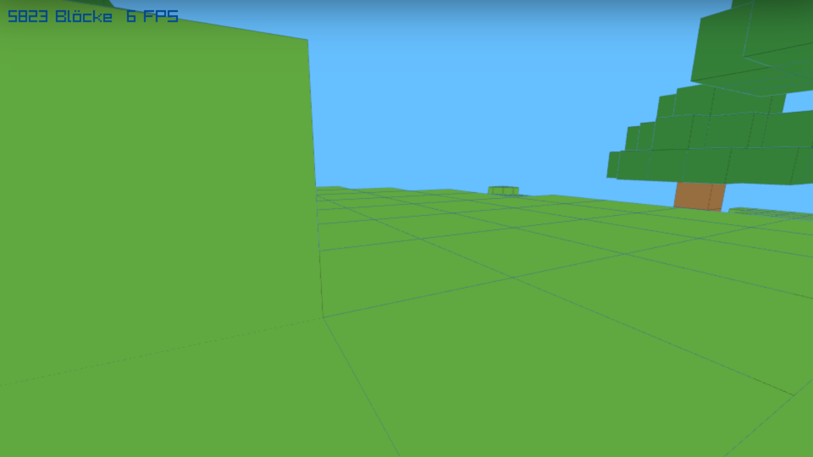

Lauf ein wenig herum. Du merkst schnell: Du bist ein Geist. Du gehst durch Hügel und Bäume hindurch, und wenn das Land abfällt, schwebst du in der Luft.

## Schwerkraft und Wände

### Fest oder nicht?

Damit die Welt dich aufhält, braucht die Figur einen Körper. Wir stellen sie uns als schmale Säule vor: 0,6 Blöcke breit und tief und 1,7 Blöcke hoch. Die Figur steckt in einem Block, wenn ihre Säule in ein festes Feld hineinragt. Dafür muss man nur die wenigen Felder prüfen, die die Säule berührt: `floorf` rundet ab und findet so das Feld, in dem eine Koordinate liegt.

Schreibe `solid` unter `block` und `collides` unter die `#define`s der Figur. Die neuen Variablen `vy` und `on_ground` kommen zu den anderen über `view_direction`:

```c_copy
bool solid(int x, int y, int z)
{
    if (x < 0 || z < 0 || x >= WIDTH || z >= DEPTH || y < 0)
        return true;
    return block(x, y, z) != AIR;
}

#define RADIUS 0.3f      // die Figur ist 0,6 Blöcke breit
#define BODY_HEIGHT 1.7f
#define EYE_HEIGHT 1.6f

// Steckt eine Figur mit diesen Füßen in einem festen Block?
bool collides(Vector3 f)
{
    // hier: alle Felder prüfen, die die Säule der Figur berührt
}

float vy = 0;          // Geschwindigkeit nach oben, in Blöcken pro Sekunde
bool on_ground = false;
```

`solid` hat am Rand und unter der Welt unsichtbare Wände, damit du nicht [hinunterfällst](/unter-der-welt).

<div class='hint own' data-check='koerper'>
<strong>Jetzt bist du dran:</strong> Schreib <code>collides</code>. <code>f</code> ist die Mitte der Fußsohlen. Die Säule der Figur reicht in x und z jeweils <code>RADIUS</code> nach beiden Seiten und von den Füßen <code>BODY_HEIGHT</code> nach oben. Geh mit drei Schleifen über alle Felder, die sie berührt; ist eines davon <code>solid</code>, steckt die Figur fest.
</div>

<!-- hint -->
Rechne ein Beispiel von Hand: Die Füße stehen bei x = 10,75. Von wo bis wo
reicht die Figur in x? In welchen Feldern liegen diese beiden Enden, und
welche Felder liegen dazwischen? `floorf(10.45)` ist 10.
<!-- /hint -->
<!-- hint -->
Ein Gerüst; die Lücken mit `…` füllst du:

```c
    for (int x = (int)floorf(f.x - RADIUS); x <= (int)floorf(…); x++)
        for (int y = (int)floorf(…); y <= (int)floorf(…); y++)
            for (int z = …; z <= …; z++)
                if (solid(x, y, z))
                    return true;
    return false;
```
<!-- /hint -->

<!-- solution -->
```c
bool collides(Vector3 f)
{
    for (int x = (int)floorf(f.x - RADIUS); x <= (int)floorf(f.x + RADIUS); x++)
        for (int y = (int)floorf(f.y); y <= (int)floorf(f.y + BODY_HEIGHT); y++)
            for (int z = (int)floorf(f.z - RADIUS); z <= (int)floorf(f.z + RADIUS); z++)
                if (solid(x, y, z))
                    return true;
    return false;
}
```
<!-- /solution -->

_task(koerper)

### Eine Richtung nach der anderen

Am Ende von `move_player` stand bisher `feet = Vector3Add(feet, move);`. Ersetze diese Zeile durch:

```c
~     if (IsKeyDown(KEY_D)) move = Vector3Add(move, right);
~     if (IsKeyDown(KEY_A)) move = Vector3Subtract(move, right);
~     move = Vector3Scale(Vector3Normalize(move), 4.5f * dt);
~
    // Jede Richtung einzeln: So gleitet man an einer Wand entlang, statt an
    // ihr kleben zu bleiben.
    Vector3 next = feet;
    next.x += move.x;
    if (!collides(next)) feet.x = next.x;
    next = feet;
    next.z += move.z;
    if (!collides(next)) feet.z = next.z;
~
~ }
~
~ int main(void)
~ {
```

Das Programm probiert jeden Schritt erst aus: Würde die Figur nach dem Schritt in einem Block stecken, bleibt sie, wo sie ist.

_task(einzeln)

### Fallen und springen

Unter den Schritt in x und z kommt die Schwerkraft. `vy` ist die Geschwindigkeit nach oben. Die Schwerkraft verkleinert sie in jeder Sekunde um 22 Blöcke pro Sekunde, also wird die Figur immer schneller, je länger sie fällt. Ein Sprung setzt `vy` auf 7,5, und die Schwerkraft bremst ihn wieder ab. Stößt die Figur beim Fallen auf einen Block, steht sie auf dem Boden: `vy` wird 0, und die Füße kommen genau auf die Oberseite des Blocks.

<div class='hint own' data-check='fallen'>
<strong>Jetzt bist du dran:</strong> Schreib die Schwerkraft ans Ende von <code>move_player</code>: Erst wird <code>vy</code> kleiner, und steht die Figur auf dem Boden (<code>on_ground</code>), setzt die Leertaste (<code>KEY_SPACE</code>) <code>vy</code> auf 7,5. Dann probierst du den Schritt in y aus wie die in x und z. Steckt die Figur danach in einem Block, bleibt <code>feet.y</code>, wie es ist, und <code>vy</code> wird 0; war sie dabei am Fallen, ist sie gelandet. Sonst macht sie den Schritt und steht nicht mehr auf dem Boden.
</div>

<!-- hint -->
Spiel ein Bild mit `dt = 0.1` von Hand durch: Die Figur schwebt bei y = 8
und hat `vy = 0`. Wie groß ist `vy` nach dem Bild, und wo sind die Füße?
Wann setzt du `on_ground` auf `true`, wann auf `false`?
<!-- /hint -->
<!-- hint -->
Ein Gerüst; die Lücken mit `…` füllst du:

```c
    vy -= …;
    if (on_ground && IsKeyDown(KEY_SPACE)) vy = …;
    next = feet;
    next.y += …;
    if (collides(next)) {
        if (vy < 0) {
            on_ground = …;
            feet.y = floorf(next.y) + 1.0f;   // genau auf den Block stellen
        }
        vy = …;
    } else {
        feet.y = …;
        on_ground = …;
    }
```
<!-- /hint -->

<!-- solution -->
```c
~     next = feet;
~     next.z += move.z;
~     if (!collides(next)) feet.z = next.z;
~
    // Schwerkraft und Springen
    vy -= 22.0f * dt;
    if (on_ground && IsKeyDown(KEY_SPACE)) vy = 7.5f;
    next = feet;
    next.y += vy * dt;
    if (collides(next)) {
        if (vy < 0) {
            on_ground = true;
            feet.y = floorf(next.y) + 1.0f;   // genau auf den Block stellen
        }
        vy = 0;
    } else {
        feet.y = next.y;
        on_ground = false;
    }
~ }
~
~ int main(void)
~ {
```
<!-- /solution -->

_task(fallen)

Zuletzt soll die Figur nicht mehr bei y = 9 in der Luft beginnen, sondern oben über der Welt, und dann auf den Boden fallen. Ändere die Startposition in `main`:

```c
~ SetTargetFPS(60);
~ SetExitKey(KEY_NULL);   // Esc gibt nur die Maus frei
~
~ generate_world();
feet = (Vector3){ 8.5f, HEIGHT - 2, 10.5f };
~ yaw = 0.8f;      // schräg über die Welt schauen
~ pitch = -0.2f;
~
~ Camera3D camera = { 0 };
```

<!-- tutorial-screenshot
write-file: main.c <- file:stufen/4.c
terminal-run: make
terminal-wait-for-prompt: 120
terminal-expect-no-text: error:
terminal-expect-no-text: ***
tab: preview
viewport: 960x540
zoom: 0.5555556
hook: open main.html
hook: play 8 KeyW:0.5 ArrowRight:0.08
hook: settle
crop-element: #canvas
check-task: figur
check-task-fails: bauen
check-task: koerper
check-task: fallen
check-task-fails: zielen
-->
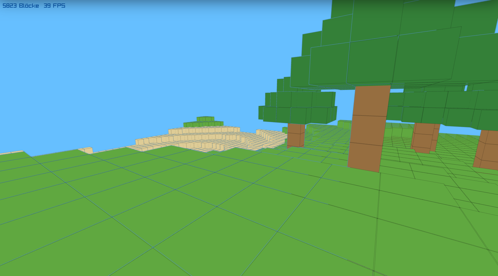

_task(sprunghoehe)

_task(figur)

## Bauen

### Wohin zielst du?

Um einen Block abzubauen, musst du wissen, auf welchen Block du schaust. Dafür gehen wir vom Auge aus in kleinen Schritten die Blickrichtung entlang, bis wir in einem Block landen, höchstens sechs Blöcke weit. Das ist ein **Strahl**, wie ein Laserpointer. Das Feld, durch das der Strahl zuletzt noch durch Luft ging, merken wir uns auch: Dort entsteht ein neuer Block, wenn du baust.

Schreibe das über `main`:

```c
~         on_ground = false;
~     }
~ }
~
// ------------------------------------------------------------------ Zielen

bool hit = false;
int hx, hy, hz;          // der Block, auf den du schaust
int ax, ay, az;          // die Luft davor: Hier entsteht ein neuer Block

void aim(Vector3 eyes, Vector3 look)
{
    hit = false;
    ax = (int)floorf(eyes.x); ay = (int)floorf(eyes.y); az = (int)floorf(eyes.z);
    // hier: in kleinen Schritten den Blick entlang, bis ein Block im Weg ist
}
~
~ int main(void)
~ {
~     SetConfigFlags(FLAG_MSAA_4X_HINT | FLAG_WINDOW_RESIZABLE);   // glatte Kanten, Größe wie die Seite
~     InitWindow(960, 540, "Klötzchenwelt");
```

<div class='hint own' data-check='zielen'>
<strong>Jetzt bist du dran:</strong> Schreib die Schleife in <code>aim</code>: <code>t</code> geht in Schritten von 0,02 von 0 bis unter 6. Der Punkt nach <code>t</code> Blöcken ist <code>eyes</code> plus <code>t</code>-mal <code>look</code> (<code>Vector3Add</code>, <code>Vector3Scale</code>), und <code>floorf</code> findet sein Feld. Ist dort keine Luft, hast du getroffen: <code>hit</code> wird <code>true</code>, das Feld kommt nach <code>hx</code>, <code>hy</code>, <code>hz</code>, und <code>aim</code> ist fertig. Sonst merkst du dir das Feld in <code>ax</code>, <code>ay</code>, <code>az</code>.
</div>

<!-- hint -->
Geh von Hand ein Stück entlang: Das Auge ist bei (10,5; 5,5; 10,5), der Blick
zeigt nach (1, 0, 0), und bei x = 12 steht ein Block. In welchem Feld ist der
Punkt bei t = 0,4, bei t = 1,0, bei t = 1,5? Welches Feld war das letzte mit
Luft?
<!-- /hint -->
<!-- hint -->
Ein Gerüst; die Lücken mit `…` füllst du:

```c
    for (float t = 0; t < 6.0f; t += 0.02f) {
        Vector3 p = Vector3Add(eyes, Vector3Scale(look, …));
        int x = (int)floorf(p.x), y = …, z = …;
        if (block(x, y, z) != AIR) {
            hit = …;
            hx = x; hy = y; hz = z;
            return;
        }
        …   // das Feld mit Luft merken
    }
```
<!-- /hint -->

<!-- solution -->
```c
~ void aim(Vector3 eyes, Vector3 look)
~ {
~     hit = false;
~     ax = (int)floorf(eyes.x); ay = (int)floorf(eyes.y); az = (int)floorf(eyes.z);
    // In kleinen Schritten den Blick entlang, bis ein Block im Weg ist
    for (float t = 0; t < 6.0f; t += 0.02f) {
        Vector3 p = Vector3Add(eyes, Vector3Scale(look, t));
        int x = (int)floorf(p.x), y = (int)floorf(p.y), z = (int)floorf(p.z);
        if (block(x, y, z) != AIR) {
            hit = true;
            hx = x; hy = y; hz = z;
            return;
        }
        ax = x; ay = y; az = z;
    }
~ }
```
<!-- /solution -->

_task(zielen)

_task(schritte)

### Abbauen und bauen

In `main` braucht das Programm die Blockart, die du gerade baust. Schreibe vor die Schleife:

```c
~ camera.up = (Vector3){ 0, 1, 0 };
~ camera.fovy = 70;
~ camera.projection = CAMERA_PERSPECTIVE;
~
int selected = GRASS;
~
~ while (!WindowShouldClose())
~ {
~     float dt = GetFrameTime();
```

und ersetze in der Schleife den Teil, der die Maus fängt:

```c
~ float dt = GetFrameTime();
~ if (dt > 0.05f) dt = 0.05f;
~
~ // Ein Klick ins Bild fängt die Maus, Esc gibt sie frei
if (!IsCursorHidden() && IsMouseButtonPressed(MOUSE_BUTTON_LEFT))
    DisableCursor();
else {
    if (hit && IsMouseButtonPressed(MOUSE_BUTTON_LEFT))
        world[hx][hy][hz] = AIR;
    if (hit && IsMouseButtonPressed(MOUSE_BUTTON_RIGHT) && block(ax, ay, az) == AIR) {
        world[ax][ay][az] = selected;
        if (collides(feet))        // nicht in sich selbst bauen
            world[ax][ay][az] = AIR;
    }
}
if (IsKeyPressed(KEY_ESCAPE)) EnableCursor();
for (int i = 1; i < BLOCK_TYPES; i++)
    if (IsKeyPressed(KEY_ONE + i - 1)) selected = i;
~
~ move_player(dt);
~
~ BeginDrawing();
~ ClearBackground(SKYBLUE);
```

Mit der linken Maustaste wird der Block, auf den du schaust, zu Luft. Die rechte Maustaste setzt einen Block der gewählten Art in das Luftfeld davor, aber nicht, wenn du selbst dort stehst. Die Tasten <kbd>1</kbd> bis <kbd>6</kbd> wählen die Art: `KEY_ONE + 1` ist dasselbe wie `KEY_TWO`, weil die Tasten in raylib Nummern in einer Reihe haben.

Damit `aim` in jedem Bild aufgerufen wird und der Block, auf den du schaust, einen Rahmen bekommt, ändere zwei Stellen. Die Kamera:

```c
~ for (int i = 1; i < BLOCK_TYPES; i++)
~     if (IsKeyPressed(KEY_ONE + i - 1)) selected = i;
~
~ move_player(dt);
~
Vector3 eyes = { feet.x, feet.y + EYE_HEIGHT, feet.z };
Vector3 look = view_direction();
camera.position = eyes;
camera.target = Vector3Add(eyes, look);
aim(eyes, look);
~
~ BeginDrawing();
~ ClearBackground(SKYBLUE);
~
~ BeginMode3D(camera);
```

und, direkt vor `EndMode3D()`:

```c
~                 DrawCubeWires(center, 1.01f, 1.01f, 1.01f, Fade(BLACK, 0.25f));
~                 blocks++;
~             }
if (hit)
    DrawCubeWires((Vector3){ hx + 0.5f, hy + 0.5f, hz + 0.5f }, 1.01f, 1.01f, 1.01f, BLACK);
~ EndMode3D();
~
~ DrawText(TextFormat("%d Blöcke  %d FPS", blocks, GetFPS()), 10, 10, 20, DARKBLUE);
~ if (!IsCursorHidden() && GetTime() < 8)
```

Der Rahmen ist eine Spur größer als der Block, damit er nicht in dessen Kanten verschwindet.

### Fadenkreuz und Leiste

Zuletzt zeichnen wir in 2D über das Bild: ein Fadenkreuz in der Mitte, damit du weißt, wohin du zielst, und unten eine Leiste mit den Blockarten. Für die Namen kommt über `colors` eine Liste dazu:

```c
~ #define HEIGHT 24   // y, nach oben
~ #define DEPTH 48    // z
~
~ enum { AIR, GRASS, DIRT, STONE, WOOD, LEAVES, SAND, BLOCK_TYPES };
~
const char *names[BLOCK_TYPES] = {
    "Luft", "Gras", "Erde", "Stein", "Holz", "Laub", "Sand",
};
~
~ Color colors[BLOCK_TYPES] = {
~     { 0, 0, 0, 0 },
~     { 96, 168, 64, 255 },     // Gras
```

Und nach `EndMode3D()`, vor dem `DrawText` mit den FPS:

```c_copy
~ if (hit)
~     DrawCubeWires((Vector3){ hx + 0.5f, hy + 0.5f, hz + 0.5f }, 1.01f, 1.01f, 1.01f, BLACK);
~ EndMode3D();
~
// 2D über dem Bild: Fadenkreuz, Leiste mit den Blöcken, Hinweise
int mx = GetScreenWidth() / 2, my = GetScreenHeight() / 2;
DrawRectangle(mx - 10, my - 1, 20, 2, WHITE);
DrawRectangle(mx - 1, my - 10, 2, 20, WHITE);

int slots = BLOCK_TYPES - 1;
int left = mx - slots * 26;
for (int i = 1; i < BLOCK_TYPES; i++) {
    int fx = left + (i - 1) * 52, fy = GetScreenHeight() - 62;
    DrawRectangle(fx, fy, 48, 48, Fade(BLACK, 0.4f));
    DrawRectangle(fx + 8, fy + 8, 32, 32, colors[i]);
    DrawText(TextFormat("%d", i), fx + 4, fy + 2, 10, WHITE);
    if (i == selected)
        DrawRectangleLinesEx((Rectangle){ fx - 2, fy - 2, 52, 52 }, 3, WHITE);
}
DrawText(names[selected], mx - MeasureText(names[selected], 20) / 2, GetScreenHeight() - 88, 20, WHITE);
~ DrawText(TextFormat("%d Blöcke  %d FPS", blocks, GetFPS()), 10, 10, 20, DARKBLUE);
~ if (!IsCursorHidden() && GetTime() < 8)
~     DrawText("Klick ins Bild: Maus fangen. WASD laufen, Pfeiltasten umsehen.", 10, 36, 20, WHITE);
```

`MeasureText` sagt, wie breit ein Text wird; so steht der Name genau in der Mitte.

<!-- tutorial-screenshot
write-file: main.c <- file:stufen/5.c
terminal-run: make
terminal-wait-for-prompt: 120
terminal-expect-no-text: error:
terminal-expect-no-text: ***
tab: preview
viewport: 960x540
zoom: 0.5555556
hook: open main.html
hook: play 8 ArrowDown:0.075 Digit3 Rechtsklick ArrowLeft:0.05 Rechtsklick ArrowLeft:0.05 Rechtsklick ArrowRight:0.18 Rechtsklick ArrowUp:0.04
hook: settle
crop-element: #canvas
check-task: bauen
check-task-fails: licht
check-task: zielen
-->


_task(bauen)

## Licht

### Warum alles flach aussieht

Sieh dir einen gebauten Steinblock genau an: Alle Seiten haben genau dieselbe Farbe. Ohne die dunklen Kanten könntest du nicht erkennen, wo eine Seite aufhört und die nächste anfängt. In der Wirklichkeit ist das anders, weil das Licht von einer Seite kommt: Eine Fläche, die zur Sonne zeigt, ist hell, eine Fläche, die schräg zur Sonne steht, ist dunkler, und eine Fläche, die von der Sonne weg zeigt, bekommt nur das Licht, das von überall her kommt.

Um das zu berechnen, muss das Programm für jede Fläche wissen, wohin sie zeigt. Diese Richtung heißt **Normale**: ein Vektor der Länge 1, der senkrecht aus der Fläche herausragt. Die Oberseite eines Blocks hat die Normale (0, 1, 0), die rechte Seite (1, 0, 0). `DrawCube` verrät uns diese Richtungen nicht. Deshalb zeichnen wir die Blöcke ab jetzt selbst, Seite für Seite.

### Seiten statt Würfel

raylib zeichnet alles aus Dreiecken. Mit den Befehlen aus `rlgl.h` können wir der Grafikkarte die Ecken selbst schicken: `rlBegin(RL_QUADS)` sagt, dass immer vier Ecken ein Viereck bilden, `rlColor4ub` und `rlNormal3f` gelten für die folgenden Ecken, `rlVertex3f` ist eine Ecke. Schreibe oben dazu:

```c
~ #include <stdlib.h>
~ #include <raylib.h>
~ #include <raymath.h>
#include <rlgl.h>
~
~ // ---------------------------------------------------------------- Die Welt
~
~ #define WIDTH 48    // x
~ #define HEIGHT 24   // y, nach oben
```

und unter `visible` diese beiden Funktionen:

```c_copy
~     }
~ }
~
~ // ---------------------------------------------------------- Blöcke zeichnen
~
// Eine Seite eines Blocks: vier Ecken, eine Richtung (die Normale), eine Farbe
void face(Vector3 a, Vector3 b, Vector3 c, Vector3 d, Vector3 n, Color f)
{
    rlColor4ub(f.r, f.g, f.b, 255);
    rlNormal3f(n.x, n.y, n.z);
    rlVertex3f(a.x, a.y, a.z);
    rlVertex3f(b.x, b.y, b.z);
    rlVertex3f(c.x, c.y, c.z);
    rlVertex3f(d.x, d.y, d.z);
}

// Zeichnet nur die Seiten, an die Luft grenzt: Die anderen sieht man nie.
int draw_block(int x, int y, int z)
{
    int type = world[x][y][z];
    // Jeder Block ist ein wenig heller oder dunkler, dann wirkt die Welt
    // weniger glatt
    float shade = 0.92f + 0.08f * (((x * 7 + y * 13 + z * 31) % 5) / 4.0f);
    Color f = ColorBrightness(colors[type], shade - 1.0f);

    float x0 = x, x1 = x + 1, y0 = y, y1 = y + 1, z0 = z, z1 = z + 1;
    int faces = 0;
    rlBegin(RL_QUADS);
    if (!solid(x, y + 1, z)) {   // oben
        face((Vector3){x0, y1, z0}, (Vector3){x0, y1, z1}, (Vector3){x1, y1, z1}, (Vector3){x1, y1, z0}, (Vector3){0, 1, 0}, f);
        faces++;
    }
    if (!solid(x, y - 1, z) && y > 0) {   // unten
        face((Vector3){x0, y0, z0}, (Vector3){x1, y0, z0}, (Vector3){x1, y0, z1}, (Vector3){x0, y0, z1}, (Vector3){0, -1, 0}, f);
        faces++;
    }
    if (!solid(x + 1, y, z) && x < WIDTH - 1) {   // rechts (+x)
        face((Vector3){x1, y0, z0}, (Vector3){x1, y1, z0}, (Vector3){x1, y1, z1}, (Vector3){x1, y0, z1}, (Vector3){1, 0, 0}, f);
        faces++;
    }
    if (!solid(x - 1, y, z) && x > 0) {   // links (-x)
        face((Vector3){x0, y0, z0}, (Vector3){x0, y0, z1}, (Vector3){x0, y1, z1}, (Vector3){x0, y1, z0}, (Vector3){-1, 0, 0}, f);
        faces++;
    }
    if (!solid(x, y, z + 1) && z < DEPTH - 1) {   // vorne (+z)
        face((Vector3){x0, y0, z1}, (Vector3){x1, y0, z1}, (Vector3){x1, y1, z1}, (Vector3){x0, y1, z1}, (Vector3){0, 0, 1}, f);
        faces++;
    }
    if (!solid(x, y, z - 1) && z > 0) {   // hinten (-z)
        face((Vector3){x0, y0, z0}, (Vector3){x0, y1, z0}, (Vector3){x1, y1, z0}, (Vector3){x1, y0, z0}, (Vector3){0, 0, -1}, f);
        faces++;
    }
    rlEnd();
    return faces;
}
~
~ // --------------------------------------------------------------- Die Figur
~
~ Vector3 feet;          // Mitte der Fußsohlen
~ float vy = 0;          // Geschwindigkeit nach oben, in Blöcken pro Sekunde
```

- Jede der sechs Seiten wird nur gezeichnet, wenn auf ihrer Seite kein fester Block liegt. Zwei Blöcke nebeneinander zeigen sich ihre Seiten nie, die zeichnen wir auch nicht. Am Rand der Welt sagt `solid` »Wand«; damit die Schichten dort trotzdem zu sehen sind, prüft `draw_block` den Rand eigens.
- `shade` macht jeden Block ein wenig heller oder dunkler, je nach seiner Position. Dann wirkt eine Wiese nicht wie eine einzige grüne Fläche.

Auch die Reihenfolge der vier Ecken in `face` ist nicht beliebig: Von außen gesehen laufen sie gegen den Uhrzeigersinn. Dahinter steckt das **Kreuzprodukt**. Für zwei Vektoren \\(\vec u\\) und \\(\vec v\\) ist

$$\vec u \times \vec v = (u\_y v\_z - u\_z v\_y,\; u\_z v\_x - u\_x v\_z,\; u\_x v\_y - u\_y v\_x)$$

ein Vektor, der senkrecht auf beiden steht. In welche der zwei möglichen Richtungen er zeigt, sagt die Rechte-Hand-Regel: Zeigt der Daumen der rechten Hand entlang \\(\vec u\\) und der Zeigefinger entlang \\(\vec v\\), dann zeigt der Mittelfinger in Richtung \\(\vec u \times \vec v\\).

Nimm die Oberseite des Blocks bei (0, 0, 0). Ihre ersten drei Ecken in `draw_block` sind \\(a = (0, 1, 0)\\), \\(b = (0, 1, 1)\\) und \\(c = (1, 1, 1)\\). Die beiden Kanten von \\(a\\) aus sind \\(\vec u = b - a = (0, 0, 1)\\) und \\(\vec v = c - a = (1, 0, 1)\\), und ihr Kreuzprodukt ist

$$\vec u \times \vec v = (0 \cdot 1 - 1 \cdot 0,\; 1 \cdot 1 - 0 \cdot 1,\; 0 \cdot 0 - 0 \cdot 1) = (0, 1, 0)$$

Das ist genau die Normale der Oberseite: nach oben, aus dem Block heraus. »Von außen gesehen gegen den Uhrzeigersinn« heißt also: Das Kreuzprodukt der Kanten zeigt nach außen. In der umgekehrten Reihenfolge zeigte es in den Block hinein.

Die Grafikkarte rechnet dasselbe, aber erst auf dem Bildschirm. Wo bei einem Block außen ist, weiß sie nicht, und die Normale aus `rlNormal3f` braucht sie nur fürs Licht. Sie rechnet aus, wo die Ecken auf dem Bildschirm landen (x nach rechts, y nach oben), nimmt die ersten drei als Punkte in der Ebene, und vom Kreuzprodukt ihrer Kanten braucht sie nur noch die letzte Zahl:

$$u\_x v\_y - u\_y v\_x$$

Ist sie positiv, laufen die Ecken auf dem Bildschirm gegen den Uhrzeigersinn: Die Seite zeigt zu dir, sie wird gezeichnet. Ist sie negativ, laufen sie im Uhrzeigersinn: Du schaust von hinten auf die Seite, und sie fällt weg.

<div class='gallery centered'>
<figure>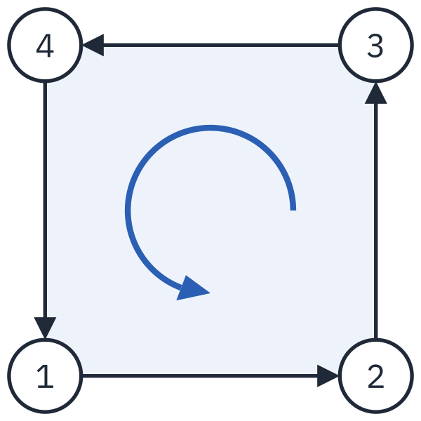<figcaption>Von außen: 1, 2, 3, 4 laufen gegen den Uhrzeigersinn, die Seite wird gezeichnet.</figcaption></figure>
<figure>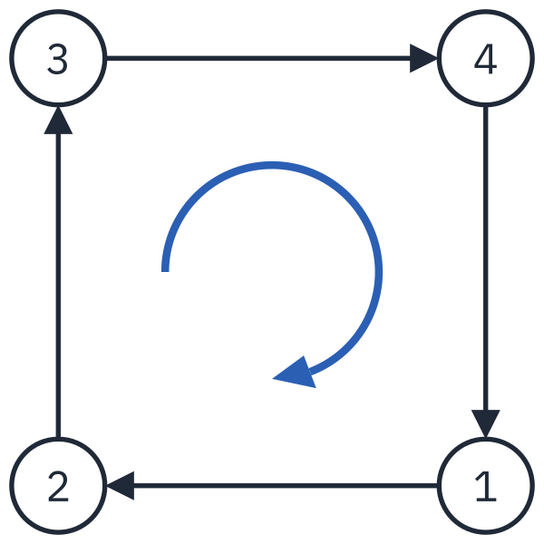<figcaption>Dieselbe Seite von hinten: Dieselben Ecken laufen im Uhrzeigersinn, die Seite fällt weg.</figcaption></figure>
</div>

Im ersten Bild liegen die Ecken 1, 2 und 3 bei (0, 0), (1, 0) und (1, 1). Die Kanten sind \\(\vec u = (1, 0)\\) und \\(\vec v = (1, 1)\\), also \\(1 \cdot 1 - 0 \cdot 1 = 1\\): positiv. Von hinten ist das Bild gespiegelt, die Ecken liegen bei (1, 0), (0, 0) und (0, 1). Jetzt ist \\(\vec u = (-1, 0)\\) und \\(\vec v = (-1, 1)\\), also \\((-1) \cdot 1 - 0 \cdot (-1) = -1\\): negativ. Es ist wie bei einer Uhr an einer Glasscheibe: Von hinten gesehen laufen ihre Zeiger andersherum.

Verloren geht dabei nichts. Die Rückseite einer Seite liegt im Inneren des Blocks, und davor liegen immer andere Seiten. Von einem Würfel zeigen höchstens drei Seiten gleichzeitig zu dir; die anderen lässt die Grafikkarte weg, bevor sie für jedes Pixel darin die Farbe ausrechnet.

_task(wiese)

### Ein Shader rechnet das Licht

Wie hell eine Fläche wird, berechnet die Grafikkarte, und zwar mit einem kleinen Programm, einem **Shader**. Shader sind in einer eigenen Sprache geschrieben, [GLSL](/reference/glsl), die ein wenig wie C aussieht. In der Vorlage liegen schon zwei: `light.vs` und `light.fs`. Der **Vertex-Shader** `light.vs` läuft für jede Ecke eines Dreiecks und rechnet aus, wo die Ecke auf dem Bildschirm landet. Der **Fragment-Shader** `light.fs` läuft für jeden Pixel einer Fläche und rechnet seine Farbe aus:

```glsl_copy
#version 100
precision mediump float;

// Vom Vertex-Shader, für jeden Pixel einer Fläche
varying vec3 position;
varying vec3 normal;
varying vec4 color;

uniform vec3 sun;        // Richtung, aus der die Sonne scheint
uniform vec3 sunlight;   // Farbe und Stärke des Sonnenlichts
uniform vec3 ambient;    // Licht, das von überall kommt

void main()
{
    vec3 n = normalize(normal);

    // Wie direkt trifft die Sonne diese Fläche? 1 = senkrecht, 0 = gar nicht
    float sunAmount = max(dot(n, sun), 0.0);
    vec3 light = ambient + sunlight * sunAmount;

    gl_FragColor = vec4(color.rgb * light, 1.0);
}
```

Die wichtigste Zeile ist `dot(n, sun)`, das **Skalarprodukt** der Normale und der Richtung zur Sonne. Für zwei Vektoren der Länge 1 ist es 1, wenn sie in dieselbe Richtung zeigen, 0, wenn sie im rechten Winkel stehen, und negativ, wenn sie voneinander weg zeigen; `max(…, 0.0)` macht daraus 0. Dazwischen ist es der Kosinus des Winkels. Genau so viel Sonnenlicht kommt auf einer Fläche an: Je schräger die Sonne auf eine Fläche scheint, desto mehr verteilt sich ihr Licht. Zu diesem Sonnenlicht kommt `ambient`, das Licht, das vom Himmel kommt und auch die Schattenseiten erreicht.

`uniform` sind Werte, die das C-Programm dem Shader gibt, für alle Pixel gleich. `varying` sind Werte, die der Vertex-Shader für jede Ecke ausrechnet und die Grafikkarte für jeden Pixel dazwischen mischt.

_task(sonnig)

Jetzt muss `main` den Shader laden, ihm die Werte geben und mit ihm zeichnen. `make` packt die beiden Dateien schon mit in die Webseite, so dass `LoadShader` sie findet. Vor die Schleife kommt:

```c
~ feet = (Vector3){ 8.5f, HEIGHT - 2, 10.5f };
~ yaw = 0.8f;      // schräg über die Welt schauen
~ pitch = -0.2f;
~
Shader light = LoadShader("light.vs", "light.fs");
int loc_sun = GetShaderLocation(light, "sun");
int loc_sunlight = GetShaderLocation(light, "sunlight");
int loc_ambient = GetShaderLocation(light, "ambient");
~
~ Camera3D camera = { 0 };
~ camera.up = (Vector3){ 0, 1, 0 };
~ camera.fovy = 70;
```

`GetShaderLocation` sucht für jeden Namen eines `uniform` die Stelle, an der der Shader ihn erwartet. In der Schleife, nach `move_player(dt);`:

```c
~ for (int i = 1; i < BLOCK_TYPES; i++)
~     if (IsKeyPressed(KEY_ONE + i - 1)) selected = i;
~
~ move_player(dt);
~
// Die Sonne steht schräg über der Welt
Vector3 sun = Vector3Normalize((Vector3){ 0.5f, 0.8f, 0.3f });
Vector3 sunlight = { 0.75f, 0.7f, 0.6f };
Vector3 ambient = { 0.43f, 0.46f, 0.54f };
~
~ Vector3 eyes = { feet.x, feet.y + EYE_HEIGHT, feet.z };
~ Vector3 look = view_direction();
~ camera.position = eyes;
```

und nach `aim(eyes, look);`:

```c
~ camera.position = eyes;
~ camera.target = Vector3Add(eyes, look);
~ aim(eyes, look);
~
SetShaderValue(light, loc_sun, &sun, SHADER_UNIFORM_VEC3);
SetShaderValue(light, loc_sunlight, &sunlight, SHADER_UNIFORM_VEC3);
SetShaderValue(light, loc_ambient, &ambient, SHADER_UNIFORM_VEC3);
~
~ BeginDrawing();
~ ClearBackground(SKYBLUE);
~
~ BeginMode3D(camera);
```

Zuletzt ersetzt du die Schleife, die die Welt zeichnet, durch eine, die `draw_block` aufruft, eingerahmt von `BeginShaderMode` und `EndShaderMode`:

```c
~ BeginDrawing();
~ ClearBackground(SKYBLUE);
~
~ BeginMode3D(camera);
BeginShaderMode(light);
int faces = 0;
for (int x = 0; x < WIDTH; x++)
    for (int y = 0; y < HEIGHT; y++)
        for (int z = 0; z < DEPTH; z++)
            if (world[x][y][z] != AIR)
                faces += draw_block(x, y, z);
EndShaderMode();
~
~ if (hit)
~     DrawCubeWires((Vector3){ hx + 0.5f, hy + 0.5f, hz + 0.5f }, 1.01f, 1.01f, 1.01f, BLACK);
~ EndMode3D();
```

Die Zeile mit den FPS zählt jetzt Seiten statt Blöcke; ändere sie zu:

```c
~         DrawRectangleLinesEx((Rectangle){ fx - 2, fy - 2, 52, 52 }, 3, WHITE);
~ }
~ DrawText(names[selected], mx - MeasureText(names[selected], 20) / 2, GetScreenHeight() - 88, 20, WHITE);
DrawText(TextFormat("%d Seiten  %d FPS", faces, GetFPS()), 10, 10, 10, WHITE);
~ if (!IsCursorHidden() && GetTime() < 8)
~     DrawText("Klick ins Bild: Maus fangen. WASD laufen, Pfeiltasten umsehen.", 10, 36, 20, WHITE);
~ EndDrawing();
```

Die Funktion `visible` brauchst du nicht mehr; `draw_block` prüft jetzt jede Seite einzeln. Vor `CloseWindow()` gibt `UnloadShader(light);` den Shader wieder frei.

<!-- tutorial-screenshot
write-file: main.c <- file:stufen/6.c
terminal-run: make
terminal-wait-for-prompt: 120
terminal-expect-no-text: error:
terminal-expect-no-text: ***
tab: preview
viewport: 960x540
zoom: 0.5555556
hook: open main.html
hook: play 10
hook: settle
crop-element: #canvas
check-task: licht
check-task-fails: fackeln
-->
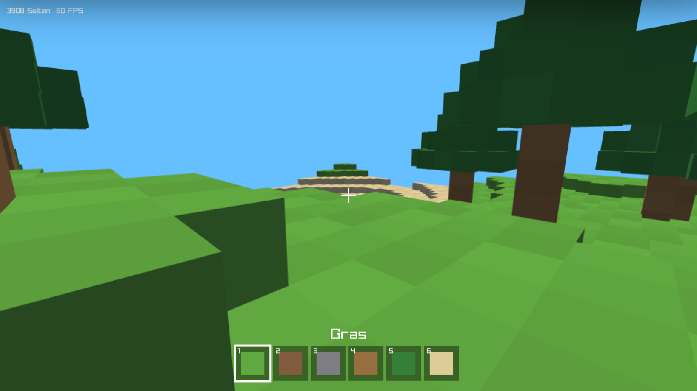

Vergleiche die Zahl der Seiten und die FPS mit vorher.

_task(licht)

<div class='hint try'>
<strong>Ausprobieren:</strong> Vertausche in <code>draw_block</code> bei der Oberseite die zweite und die vierte Ecke, so dass sie im Uhrzeigersinn laufen, und übersetze mit <code>make</code>. Was siehst du, wo vorher Gras war, und warum? Stell die Reihenfolge danach wieder her.
</div>

<div class='hint try'>
<strong>Ausprobieren:</strong> Der Shader ist ein Programm wie jedes andere. Ändere eine Zeile in <code>light.fs</code>, übersetze mit <code>make</code> und lade die Vorschau neu:
<ul>
<li>Ohne das Licht von überall: <code>vec3 light = sunlight * sunAmount;</code>. Wie sehen die Seiten aus, die von der Sonne weg zeigen?</li>
<li>Ohne <code>max</code>: <code>float sunAmount = dot(n, sun);</code>. Welche Seiten werden jetzt dunkler als vorher, und warum?</li>
<li>Die Normale als Farbe: <code>gl_FragColor = vec4(n * 0.5 + 0.5, 1.0);</code>. Eine Normale hat Zahlen von −1 bis 1, eine Farbe von 0 bis 1. Welche Farbe haben alle Oberseiten, und in welche Richtung zeigt eine rosa Seite?</li>
</ul>
Stell <code>light.fs</code> danach wieder her; die nächsten Schritte bauen darauf auf.
</div>

## Tag und Nacht

### Die Sonne wandert

Bisher steht die Sonne still. Mit einer Variable `time_of_day` zwischen 0 und 1 (0 und 1 sind Mitternacht, 0,5 ist Mittag) kann sie wandern. Schreibe über `main`:

```c
~     }
~ }
~
~ // --------------------------------------------------------------- Tageszeit
~
float time_of_day = 0.4f;  // 0 und 1: Mitternacht, 0,5: Mittag
~
~ int main(void)
~ {
~     SetConfigFlags(FLAG_MSAA_4X_HINT | FLAG_WINDOW_RESIZABLE);   // glatte Kanten, Größe wie die Seite
~     InitWindow(960, 540, "Klötzchenwelt");
```

Und ersetze in der Schleife die Zeilen der festen Sonne durch:

```c
~ for (int i = 1; i < BLOCK_TYPES; i++)
~     if (IsKeyPressed(KEY_ONE + i - 1)) selected = i;
~
~ move_player(dt);
~
// Die Zeit vergeht: ein Tag dauert zwei Minuten, mit T schneller
time_of_day += dt / 120.0f + (IsKeyDown(KEY_T) ? dt * 0.2f : 0);
time_of_day -= floorf(time_of_day);
if (IsKeyPressed(KEY_N))   // N springt zwischen Tag und Nacht
    time_of_day = (time_of_day > 0.25f && time_of_day < 0.75f) ? 0.9f : 0.4f;
float angle = (time_of_day - 0.25f) * 2 * PI;   // Sonnenaufgang bei 0,25
Vector3 sun = Vector3Normalize((Vector3){ cosf(angle), sinf(angle), 0.4f });
float day = Clamp(sinf(angle) * 4.0f + 0.3f, 0.0f, 1.0f);
Color sky = ColorLerp((Color){ 12, 16, 36, 255 }, (Color){ 140, 195, 240, 255 }, day);
Vector3 sky_v = { sky.r / 255.0f, sky.g / 255.0f, sky.b / 255.0f };
Vector3 sunlight = { 0.75f * day, 0.7f * day, 0.6f * day };
// Nachts bleibt bläuliches Mondlicht
Vector3 ambient = { 0.2f + 0.23f * day, 0.22f + 0.24f * day, 0.34f + 0.2f * day };
~
~ Vector3 eyes = { feet.x, feet.y + EYE_HEIGHT, feet.z };
~ Vector3 look = view_direction();
~ camera.position = eyes;
```

- Die Sonne läuft auf einem Kreis um die Welt: `cosf(angle)` und `sinf(angle)` sind ihre Position auf dem Kreis, so wie bei der Blickrichtung. Um 0,25 geht sie auf, um 0,75 unter.
- `day` ist 1, solange die Sonne hoch genug steht, und 0 in der Nacht. Damit mischt `ColorLerp` die Farbe des Himmels zwischen Nachtblau und Tagblau, und das Sonnenlicht wird nachts zu 0. Ein schwaches, bläuliches Mondlicht bleibt als `ambient`.
- <kbd>T</kbd> lässt die Zeit schneller laufen, <kbd>N</kbd> springt zwischen Tag und Nacht.

Statt `ClearBackground(SKYBLUE)` steht jetzt `ClearBackground(sky)`.

### Fackeln

Nachts ist es dunkel, Zeit für Licht. Eine Fackel ist eine neue Blockart, die du bauen kannst. Sie ist nicht fest, du kannst durch sie hindurchgehen. Ergänze das `enum`, `names` und `colors` um eine siebte Art, `TORCH`:

```c
~ #define WIDTH 48    // x
~ #define HEIGHT 24   // y, nach oben
~ #define DEPTH 48    // z
~
enum { AIR, GRASS, DIRT, STONE, WOOD, LEAVES, SAND, TORCH, BLOCK_TYPES };
~
~ const char *names[BLOCK_TYPES] = {
~     "Luft", "Gras", "Erde", "Stein", "Holz", "Laub", "Sand", "Fackel",
~ };
```

```c
~     { 150, 110, 64, 255 },    // Holz
~     { 52, 128, 56, 255 },     // Laub
~     { 222, 204, 150, 255 },   // Sand
    { 255, 200, 80, 255 },    // Fackel
~ };
~
~ unsigned char world[WIDTH][HEIGHT][DEPTH];
~
~ // Der Block an einer Stelle; außerhalb der Welt ist Luft
```

In `solid` ist eine Fackel jetzt wie Luft:

```c
~         return AIR;
~     return world[x][y][z];
~ }
~
bool solid(int x, int y, int z)
{
    if (x < 0 || z < 0 || x >= WIDTH || z >= DEPTH || y < 0)
        return true;
    int type = block(x, y, z);
    return type != AIR && type != TORCH;
}
~
~ void tree(int x, int y, int z)
~ {
~     for (int i = 0; i < 4; i++)
```

Eine Fackel leuchtet für ihre Umgebung. Dafür sucht das Programm in jedem Bild alle Fackeln der Welt und gibt ihre Positionen dem Shader, als Liste von höchstens 16 Punkten. Das kommt in der Schleife vor die Zeilen mit `SetShaderValue`:

```c
~ camera.position = eyes;
~ camera.target = Vector3Add(eyes, look);
~ aim(eyes, look);
~
// Fackeln einsammeln: Sie leuchten im Shader
Vector3 torches[16];
int torch_count = 0;
for (int x = 0; x < WIDTH; x++)
    for (int y = 0; y < HEIGHT; y++)
        for (int z = 0; z < DEPTH; z++)
            if (world[x][y][z] == TORCH && torch_count < 16)
                torches[torch_count++] = (Vector3){ x + 0.5f, y + 0.7f, z + 0.5f };
~
~ SetShaderValue(light, loc_sun, &sun, SHADER_UNIFORM_VEC3);
~ SetShaderValue(light, loc_sunlight, &sunlight, SHADER_UNIFORM_VEC3);
~ SetShaderValue(light, loc_ambient, &ambient, SHADER_UNIFORM_VEC3);
```

Die Fackeln selbst zeichnen wir nach `EndShaderMode()` ohne den Licht-Shader: Was selbst leuchtet, braucht kein Licht von außen. Ein Stiel aus Holz und oben eine Flamme:

```c
~         for (int z = 0; z < DEPTH; z++)
~                 faces += draw_block(x, y, z);
~ EndShaderMode();
~
// Fackeln leuchten selbst: ohne Licht-Shader gezeichnet
for (int i = 0; i < torch_count; i++) {
    Vector3 p = torches[i];
    DrawCube((Vector3){ p.x, p.y - 0.4f, p.z }, 0.15f, 0.6f, 0.15f, (Color){ 120, 80, 40, 255 });
    DrawCube((Vector3){ p.x, p.y - 0.05f, p.z }, 0.22f, 0.18f, 0.22f, colors[TORCH]);
}
~
~ if (hit)
~     DrawCubeWires((Vector3){ hx + 0.5f, hy + 0.5f, hz + 0.5f }, 1.01f, 1.01f, 1.01f, BLACK);
~ EndMode3D();
```

Und in der Schleife, die die Welt zeichnet, werden Fackeln nicht als Block gezeichnet:

```c
~ for (int x = 0; x < WIDTH; x++)
~     for (int y = 0; y < HEIGHT; y++)
~         for (int z = 0; z < DEPTH; z++)
            if (world[x][y][z] != AIR && world[x][y][z] != TORCH)
~                 faces += draw_block(x, y, z);
~ EndShaderMode();
~
~ // Fackeln leuchten selbst: ohne Licht-Shader gezeichnet
```

### Nebel

Was weit entfernt ist, sieht in der Wirklichkeit blasser aus, weil Luft nie ganz klar ist. Das hilft dem Auge, Entfernungen zu schätzen, und versteckt nebenbei den Rand der Welt. Der Shader mischt dafür die Farbe eines Pixels mit der Farbe des Himmels, je weiter er von den Augen entfernt ist.

Hier ist der ganze neue Fragment-Shader mit Fackeln und Nebel. Ersetze `light.fs` durch:

```glsl_copy
#version 100
precision mediump float;

varying vec3 position;
varying vec3 normal;
varying vec4 color;

uniform vec3 sun;        // Richtung, aus der die Sonne scheint
uniform vec3 sunlight;   // Farbe und Stärke des Sonnenlichts
uniform vec3 ambient;    // Licht, das von überall kommt
uniform vec3 sky;        // Farbe des Himmels, für den Nebel
uniform vec3 eyes;       // wo die Kamera ist

#define MAX_TORCHES 16
uniform vec3 torches[MAX_TORCHES];
uniform int torchCount;

void main()
{
    vec3 n = normalize(normal);

    // Wie direkt trifft die Sonne diese Fläche? 1 = senkrecht, 0 = gar nicht
    float sunAmount = max(dot(n, sun), 0.0);
    vec3 light = ambient + sunlight * sunAmount;

    // Jede Fackel leuchtet warm, je näher, desto heller
    for (int i = 0; i < MAX_TORCHES; i++) {
        if (i >= torchCount) break;
        vec3 toTorch = torches[i] - position;
        float dist = length(toTorch);
        float facing = max(dot(n, toTorch / dist), 0.0);
        light += vec3(1.0, 0.6, 0.3) * (0.3 + 0.7 * facing) / (1.0 + 0.3 * dist * dist);
    }

    vec3 result = color.rgb * min(light, vec3(1.4));

    // Nebel: weit Entferntes verschwimmt mit dem Himmel
    float fog = clamp((length(position - eyes) - 16.0) / 20.0, 0.0, 1.0);
    gl_FragColor = vec4(mix(result, sky, fog), 1.0);
}
```

Jede Fackel gibt warmes, orangefarbenes Licht. Wie bei der Sonne zählt, wie sehr eine Fläche der Fackel zugewandt ist; dazu kommt der Abstand: Das Licht wird mit `1.0 + 0.3 * dist * dist` geteilt, also schwächer, je weiter die Fläche entfernt ist. `min(light, vec3(1.4))` verhindert, dass eine Fläche zwischen vielen Fackeln weiß ausbrennt.

Damit der Shader die neuen Werte bekommt, braucht `main` vier weitere Stellen:

```c
~ int loc_sun = GetShaderLocation(light, "sun");
~ int loc_sunlight = GetShaderLocation(light, "sunlight");
~ int loc_ambient = GetShaderLocation(light, "ambient");
int loc_sky = GetShaderLocation(light, "sky");
int loc_eyes = GetShaderLocation(light, "eyes");
int loc_torches = GetShaderLocation(light, "torches");
int loc_torch_count = GetShaderLocation(light, "torchCount");
~
~ Camera3D camera = { 0 };
~ camera.up = (Vector3){ 0, 1, 0 };
~ camera.fovy = 70;
```

und in der Schleife nach den anderen `SetShaderValue`:

```c
~ SetShaderValue(light, loc_sun, &sun, SHADER_UNIFORM_VEC3);
~ SetShaderValue(light, loc_sunlight, &sunlight, SHADER_UNIFORM_VEC3);
~ SetShaderValue(light, loc_ambient, &ambient, SHADER_UNIFORM_VEC3);
SetShaderValue(light, loc_sky, &sky_v, SHADER_UNIFORM_VEC3);
SetShaderValue(light, loc_eyes, &eyes, SHADER_UNIFORM_VEC3);
SetShaderValueV(light, loc_torches, torches, SHADER_UNIFORM_VEC3, torch_count > 0 ? torch_count : 1);
SetShaderValue(light, loc_torch_count, &torch_count, SHADER_UNIFORM_INT);
~
~ BeginDrawing();
~ ClearBackground(sky);
~
~ BeginMode3D(camera);
```

`SetShaderValueV` gibt dem Shader eine ganze Liste auf einmal. Steht keine Fackel in der Welt, schicken wir trotzdem einen Eintrag, denn eine Liste mit null Einträgen kennt der Shader nicht; `torchCount` ist dann 0, und die Schleife im Shader hört sofort auf.

<!-- tutorial-screenshot
write-file: main.c <- file:stufen/7.c
write-file: light.fs <- file:stufen/7.fs
terminal-run: make
terminal-wait-for-prompt: 120
terminal-expect-no-text: error:
terminal-expect-no-text: ***
tab: preview
viewport: 960x540
zoom: 0.5555556
hook: open main.html
hook: play 8 ArrowDown:0.25 Digit7 Rechtsklick ArrowLeft:0.35 Rechtsklick ArrowRight:0.7 Rechtsklick ArrowLeft:0.35 ArrowUp:0.15 KeyS:0.9
hook: settle
variants: dark
crop-element: #canvas
check-task: fackeln
check-task-fails: texturen
-->
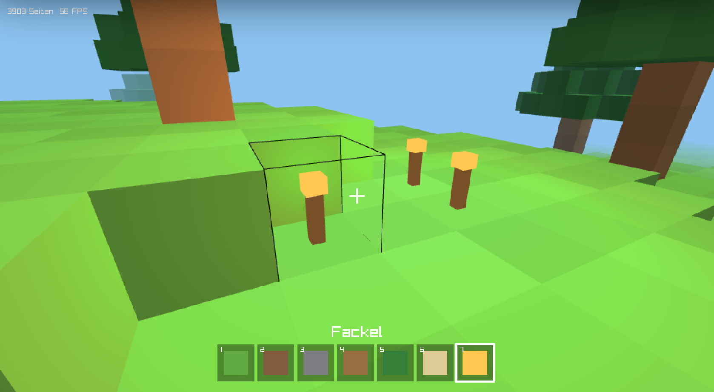

Drück <kbd>N</kbd>: Es wird Nacht, und deine Fackeln leuchten. Auf dieser Seite zeigt der dunkle Modus die Bilder ebenfalls bei Nacht.

_task(fackel-abstand)

_task(fackeln)

<div class='hint try'>
<strong>Ausprobieren:</strong> In <code>light.fs</code> stecken viele Zahlen, an denen du drehen kannst:
<ul>
<li>Färbe den Nebel: Ersetze in der letzten Zeile <code>sky</code> durch <code>vec3(1.0, 0.0, 0.0)</code>. Jetzt siehst du genau, wo der Nebel anfängt und wo er alles verschluckt.</li>
<li>Ändere <code>16.0</code> und <code>20.0</code> in der Zeile mit <code>fog</code>, etwa zu <code>4.0</code> und <code>8.0</code>. Was bedeutet welche der beiden Zahlen?</li>
<li>Ändere <code>0.3 * dist * dist</code> zu <code>0.05 * dist * dist</code>: Wie weit reicht das Licht einer Fackel jetzt?</li>
</ul>
Drück <kbd>N</kbd> für die Nacht, dann siehst du die Fackeln am besten. Stell <code>light.fs</code> danach wieder her.
</div>

## Texturen

Noch hat jeder Block eine einzige Farbe. In Spielen sehen Flächen nach etwas aus: Gras hat Halme, Stein hat Risse, Holz hat Maserung. Dafür klebt die Grafikkarte ein Bild auf jede Fläche, eine **Textur**.

### Ein Streifen aus Kacheln

In der Vorlage liegt `textures.png`, ein Bild aus acht Kacheln von 16 × 16 Pixeln nebeneinander:

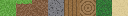

Gras bekommt oben die erste Kachel, an den Seiten die zweite mit dem grünen Rand und unten Erde. Ein Holzblock zeigt an den Seiten Rinde und oben die Jahresringe. Die Reihenfolge der Kacheln steht als `enum` im Programm, und `tile_for` sagt, welche Kachel eine Seite bekommt. Schreibe beides unter `world`:

```c_copy
~     { 255, 200, 80, 255 },    // Fackel
~ };
~
~ unsigned char world[WIDTH][HEIGHT][DEPTH];
~
// ---------------------------------------------------------------- Texturen

// textures.png ist ein Streifen aus Kacheln, alle gleich groß, in dieser
// Reihenfolge von links nach rechts
enum { T_GRASS_TOP, T_GRASS_SIDE, T_DIRT, T_STONE, T_WOOD_SIDE, T_WOOD_TOP,
       T_LEAVES, T_SAND, TILE_COUNT };

// Welche Kachel bekommt eine Seite? dir: 0 oben, 1 unten, 2 seitlich
int tile_for(int type, int dir)
{
    switch (type) {
    case GRASS: return dir == 0 ? T_GRASS_TOP : dir == 1 ? T_DIRT : T_GRASS_SIDE;
    case DIRT: return T_DIRT;
    case STONE: return T_STONE;
    case WOOD: return dir == 2 ? T_WOOD_SIDE : T_WOOD_TOP;
    case LEAVES: return T_LEAVES;
    default: return T_SAND;
    }
}
~
~ // Der Block an einer Stelle; außerhalb der Welt ist Luft
~ int block(int x, int y, int z)
~ {
```

### Texturkoordinaten

Welcher Teil des Bildes auf welche Ecke kommt, sagen **Texturkoordinaten**: zwei Zahlen u und v von 0 bis 1. u = 0 ist der linke Rand des ganzen Bildes, u = 1 der rechte, v = 0 oben und v = 1 unten. Die Kachel Nummer `tile` reicht von u = tile / 8 bis u = (tile + 1) / 8. Dazwischen mischt die Grafikkarte, für jeden Pixel der Fläche.

Damit eine Kachel nicht auf dem Kopf steht, müssen die Ecken einer Seite immer in derselben Reihenfolge kommen: von außen gesehen links unten, rechts unten, rechts oben, links oben. Das ist auch gegen den Uhrzeigersinn, wie bisher. Ersetze `face` und `draw_block`:

```c_copy
~     }
~ }
~
~ // ---------------------------------------------------------- Blöcke zeichnen
~
// Eine Seite eines Blocks: vier Ecken, von außen gesehen links unten, rechts
// unten, rechts oben, links oben; dazu die Richtung (Normale), eine
// Helligkeit und die Kachel aus der Textur
void face(Vector3 lb, Vector3 rb, Vector3 rt, Vector3 lt, Vector3 n, Color f, int tile)
{
    float u0 = (float)tile / TILE_COUNT, u1 = (float)(tile + 1) / TILE_COUNT;
    rlColor4ub(f.r, f.g, f.b, 255);
    rlNormal3f(n.x, n.y, n.z);
    rlTexCoord2f(u0, 1); rlVertex3f(lb.x, lb.y, lb.z);
    rlTexCoord2f(u1, 1); rlVertex3f(rb.x, rb.y, rb.z);
    rlTexCoord2f(u1, 0); rlVertex3f(rt.x, rt.y, rt.z);
    rlTexCoord2f(u0, 0); rlVertex3f(lt.x, lt.y, lt.z);
}

// Zeichnet nur die Seiten, an die Luft grenzt: Die anderen sieht man nie.
int draw_block(int x, int y, int z)
{
    int type = world[x][y][z];
    // Jeder Block ist ein wenig heller oder dunkler, dann wirkt die Welt
    // weniger glatt
    float shade = 0.92f + 0.08f * (((x * 7 + y * 13 + z * 31) % 5) / 4.0f);
    Color f = ColorBrightness(WHITE, shade - 1.0f);
    int top = tile_for(type, 0), bottom = tile_for(type, 1), side = tile_for(type, 2);

    float x0 = x, x1 = x + 1, y0 = y, y1 = y + 1, z0 = z, z1 = z + 1;
    int faces = 0;
    rlBegin(RL_QUADS);
    if (!solid(x, y + 1, z)) {   // oben
        face((Vector3){x0, y1, z1}, (Vector3){x1, y1, z1}, (Vector3){x1, y1, z0}, (Vector3){x0, y1, z0}, (Vector3){0, 1, 0}, f, top);
        faces++;
    }
    if (!solid(x, y - 1, z) && y > 0) {   // unten
        face((Vector3){x0, y0, z0}, (Vector3){x1, y0, z0}, (Vector3){x1, y0, z1}, (Vector3){x0, y0, z1}, (Vector3){0, -1, 0}, f, bottom);
        faces++;
    }
    if (!solid(x + 1, y, z) && x < WIDTH - 1) {   // rechts (+x)
        face((Vector3){x1, y0, z1}, (Vector3){x1, y0, z0}, (Vector3){x1, y1, z0}, (Vector3){x1, y1, z1}, (Vector3){1, 0, 0}, f, side);
        faces++;
    }
    if (!solid(x - 1, y, z) && x > 0) {   // links (-x)
        face((Vector3){x0, y0, z0}, (Vector3){x0, y0, z1}, (Vector3){x0, y1, z1}, (Vector3){x0, y1, z0}, (Vector3){-1, 0, 0}, f, side);
        faces++;
    }
    if (!solid(x, y, z + 1) && z < DEPTH - 1) {   // vorne (+z)
        face((Vector3){x0, y0, z1}, (Vector3){x1, y0, z1}, (Vector3){x1, y1, z1}, (Vector3){x0, y1, z1}, (Vector3){0, 0, 1}, f, side);
        faces++;
    }
    if (!solid(x, y, z - 1) && z > 0) {   // hinten (-z)
        face((Vector3){x1, y0, z0}, (Vector3){x0, y0, z0}, (Vector3){x0, y1, z0}, (Vector3){x1, y1, z0}, (Vector3){0, 0, -1}, f, side);
        faces++;
    }
    rlEnd();
    return faces;
}
~
~ // --------------------------------------------------------------- Die Figur
~
~ Vector3 feet;          // Mitte der Fußsohlen
~ float vy = 0;          // Geschwindigkeit nach oben, in Blöcken pro Sekunde
```

Die Farbe einer Ecke ist jetzt Weiß, ein wenig heller oder dunkler: Die Textur bringt die Farbe mit, und Weiß lässt sie, wie sie ist.

### Die Textur laden

Vor die Schleife kommt, gleich nach `LoadShader`:

```c
~ yaw = 0.8f;      // schräg über die Welt schauen
~ pitch = -0.2f;
~
~ Shader light = LoadShader("light.vs", "light.fs");
Texture2D texture = LoadTexture("textures.png");
SetTextureFilter(texture, TEXTURE_FILTER_POINT);   // scharfe Pixel
~ int loc_sun = GetShaderLocation(light, "sun");
~ int loc_sunlight = GetShaderLocation(light, "sunlight");
~ int loc_ambient = GetShaderLocation(light, "ambient");
```

`TEXTURE_FILTER_POINT` sorgt für scharfe Pixel. Ohne diese Zeile würde die Grafikkarte zwischen den Pixeln weich überblenden, und die Blöcke sähen verschwommen aus. Beim Zeichnen sagt `rlSetTexture`, welche Textur die Flächen bekommen:

```c
~ BeginDrawing();
~ ClearBackground(sky);
~
~ BeginMode3D(camera);
BeginShaderMode(light);
rlSetTexture(texture.id);
int faces = 0;
for (int x = 0; x < WIDTH; x++)
    for (int y = 0; y < HEIGHT; y++)
        for (int z = 0; z < DEPTH; z++)
            if (world[x][y][z] != AIR && world[x][y][z] != TORCH)
                faces += draw_block(x, y, z);
rlSetTexture(0);
EndShaderMode();
~
~ // Fackeln leuchten selbst: ohne Licht-Shader gezeichnet
~ for (int i = 0; i < torch_count; i++) {
~     Vector3 p = torches[i];
```

Vor `UnloadShader(light);` am Ende kommt `UnloadTexture(texture);`. `make` packt `textures.png` mit in die Webseite, so wie die Shader.

### Der Shader liest die Textur

Der Vertex-Shader reicht die Texturkoordinaten an jeden Pixel weiter. In `light.vs` kommen drei Zeilen dazu:

```glsl
attribute vec2 vertexTexCoord;
varying vec2 uv;           // wo in der Textur dieser Punkt liegt
    uv = vertexTexCoord;
```

Die ersten beiden gehören zu den anderen `attribute` und `varying` oben, die dritte in `main`. Im Fragment-Shader `light.fs` kommen `varying vec2 uv;` und die Textur dazu:

```glsl
~ varying vec3 normal;
~ varying vec4 color;
~ varying vec2 uv;
~
uniform sampler2D texture0;  // die Textur mit allen Kacheln
~
~ uniform vec3 sun;        // Richtung, aus der die Sonne scheint
~ uniform vec3 sunlight;   // Farbe und Stärke des Sonnenlichts
~ uniform vec3 ambient;    // Licht, das von überall kommt
```

`texture2D` liest an der Stelle `uv` die Farbe der Textur. Ersetze die Zeile mit `result` durch:

```glsl
~     float facing = max(dot(n, toTorch / dist), 0.0);
~     light += vec3(1.0, 0.6, 0.3) * (0.3 + 0.7 * facing) / (1.0 + 0.3 * dist * dist);
~ }
~
vec3 pixel = texture2D(texture0, uv).rgb;
vec3 result = pixel * color.rgb * min(light, vec3(1.4));
~
~ // Nebel: weit Entferntes verschwimmt mit dem Himmel
~ float fog = clamp((length(position - eyes) - 16.0) / 20.0, 0.0, 1.0);
~ gl_FragColor = vec4(mix(result, sky, fog), 1.0);
```

Licht, Fackeln und Nebel rechnen weiter wie vorher; sie hellen jetzt die Pixel der Textur auf oder dunkeln sie ab.

<!-- tutorial-screenshot
write-file: main.c <- file:stufen/8.c
write-file: light.vs <- file:stufen/8.vs
write-file: light.fs <- file:stufen/8.fs
terminal-run: make
terminal-wait-for-prompt: 120
terminal-expect-no-text: error:
terminal-expect-no-text: ***
tab: preview
viewport: 960x540
zoom: 0.5555556
hook: open main.html
hook: play 8 ArrowDown:0.25 Digit7 Rechtsklick ArrowLeft:0.35 Rechtsklick ArrowRight:0.7 Rechtsklick ArrowLeft:0.35 ArrowUp:0.15 KeyS:0.9
hook: settle
variants: dark
crop-element: #canvas
check-task: texturen
-->


_task(texturen)

<div class='hint try'>
<strong>Ausprobieren:</strong> Zeig die Texturkoordinaten als Farbe. Ersetze in <code>light.fs</code> die Zeile mit <code>gl_FragColor</code> durch <code>gl_FragColor = vec4(fract(uv.x * 8.0), uv.y, 0.0, 1.0);</code>: <code>fract(uv.x * 8.0)</code> geht in jeder Kachel von 0 bis 1. In welcher Ecke einer Seite ist es schwarz, in welcher gelb? Oder verschiebe jede Kachel um eine nach rechts, mit <code>texture2D(texture0, uv + vec2(0.125, 0.0))</code>: Wie sieht die Wiese jetzt aus? Stell die Zeilen danach wieder her.
</div>

### Eigene Texturen zeichnen

Die Kacheln in `textures.png` sind nur ein Anfang. Zeichne deine eigenen im [2D Game Studio](https://2d.hackschule.de/):

1. Lege ein neues Sprite an, zum Beispiel »Kacheln«. Unter »Funktionen« › »Sprite« › »Größe ändern« stellst du 16 × 16 Pixel ein; andere Größen gehen auch, solange alle Kacheln quadratisch sind.
2. Zeichne die acht Kacheln als acht Frames desselben Zustands, in der Reihenfolge von oben: Gras von oben, Gras von der Seite, Erde, Stein, Rinde, Jahresringe, Laub, Sand. Unter der Zeichenfläche stehen die Frames nebeneinander; mit dem Plus kommt ein neuer dazu.

<!-- tutorial-screenshot
# Das 2D Game Studio mit den Kacheln der Vorlage als acht Frames (eingefügt
# wie mit »Bilder öffnen …«, nichts wird gespeichert)
open-site: /
tab: preview
viewport: 1400x820
hook: studio raylib/vorlage/textures.png
-->
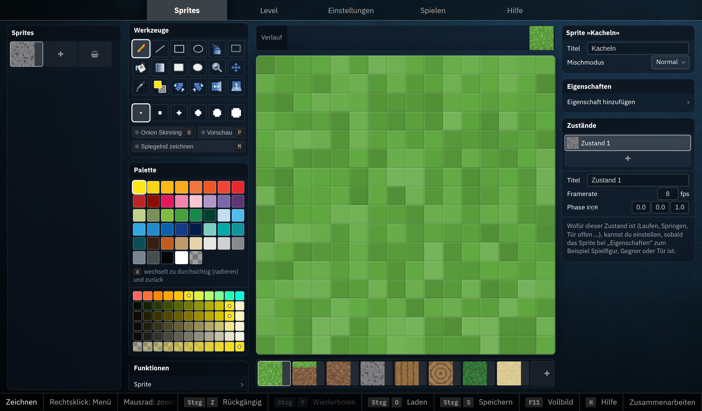

3. Wähle »Funktionen« › »Sprite« › »Als Bild speichern« › »alle Frames dieses Zustands nebeneinander«. Dein Browser speichert einen Streifen wie `kacheln-zustand-1.png`.

<!-- tutorial-screenshot
tab: preview
viewport: 1400x820
hook: studio-menu
-->
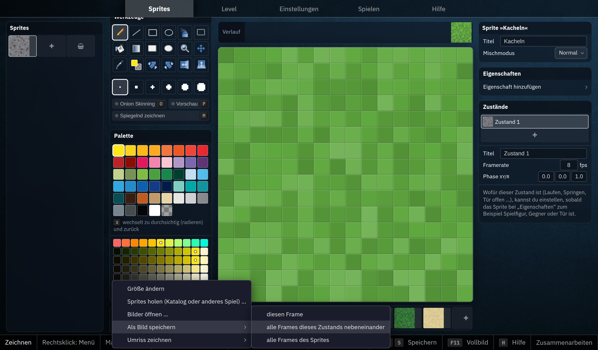

4. Ziehe die Datei aus deinem Download-Ordner in den Explorer des Workspace, in den Ordner `raylib-starter`, und nenne sie `textures.png`. Die alte Datei wird dabei ersetzt; die Vorlage hat sie noch, falls du sie zurück willst.
5. `make`, und deine Welt sieht aus wie gezeichnet.

<div class='hint'>
Eine Kachel wird an alle Seiten eines Blocks geklebt, und viele Blöcke liegen nebeneinander. Was am rechten Rand einer Kachel passiert, sollte deshalb zum linken Rand passen, und oben zu unten. Sonst siehst du auf einer Wiese ein Gitter aus Kanten.
</div>

## Deine Welt

Die Welt gehört jetzt dir. Ein paar Ideen, von leicht bis schwer:

- **Eigene Blockarten:** Glas, Schnee, Ziegel, Gold. Eine neue Art braucht einen Namen in `enum` und `names`, eine Farbe in `colors` und eine Kachel in `textures.png` und in `tile_for`.
- **Eine andere Landschaft:** Ändere die Wellen in `generate_world`, setze Berge, einen See aus blauen Blöcken oder einen Wald mit mehr Bäumen. Eine andere Zahl bei `SetRandomSeed` verteilt die Bäume anders.
- **Höhlen:** Lass in `generate_world` Luft in den Stein, wo eine weitere Welle über einem Wert liegt.
- **Farbiges Licht:** Gib den Fackeln eine andere Farbe, oder lass den Himmel bei Sonnenaufgang und -untergang rot leuchten.
- **Fliegen:** Mit einer Taste schaltest du die Schwerkraft aus, und <kbd>Leertaste</kbd> und <kbd>Shift</kbd> fliegen hoch und runter.
- **Ein Spiel daraus machen:** Sammle zehn versteckte Goldblöcke, so schnell du kannst. Die Zeit zeigt `GetTime()`, gezählt wird, wenn du einen Goldblock abbaust.

_task(abgabe)

<!-- extra -->
## Was vorne liegt

Die Schleife in `main` zeichnet die Blöcke in der Reihenfolge des Arrays, von `x = 0` an, ganz gleich, wo du stehst. Trotzdem verdeckt ein naher Block immer den fernen dahinter, auch wenn der ferne erst danach gezeichnet wird. Welche Fläche an einem Pixel zu sehen ist, heißt in der Computergrafik *Visible Surface Determination*. Zwei Ideen dafür stecken in fast jedem Spiel.

### Der Tiefenpuffer

Die Grafikkarte merkt sich für jedes Pixel nicht nur seine Farbe, sondern auch, wie weit die Fläche, die dort gezeichnet wurde, von der Kamera entfernt ist: im **Tiefenpuffer** (englisch *Z-Buffer*). Kommt eine neue Fläche an dasselbe Pixel, vergleicht die Grafikkarte die beiden Entfernungen. Ist die neue weiter weg, bleibt das Pixel, wie es ist. In welcher Reihenfolge gezeichnet wird, spielt dann keine Rolle mehr. `BeginMode3D` schaltet diesen Vergleich ein, `EndMode3D` wieder aus; darum liegen Fadenkreuz und Leiste, die danach kommen, immer obenauf.

Erfunden haben den Tiefenpuffer 1974 zwei Doktoranden unabhängig voneinander, zuerst Wolfgang Straßer in Berlin:

_person(strasser)

Wenige Monate später beschrieb ihn Edwin Catmull in Utah:

_person(catmull)

### Der Baum der Wände

Grafikkarten mit Tiefenpuffer gab es für zu Hause erst ab 1996. DOOM (1993) musste ohne auskommen. Es zeichnete die Wände von vorne nach hinten, und ein Pixel, das schon gefüllt war, blieb, wie es war. Die richtige Reihenfolge holte es aus einem **BSP-Baum** (*Binary Space Partitioning*), einem [binären Baum](/reference/baeume): Eine Wand teilt die Karte in zwei Hälften, die vor ihr und die hinter ihr. Jede Hälfte wird von einer weiteren Wand geteilt, und so fort, bis jedes Stück nur noch Wände enthält, die sich nicht gegenseitig verdecken. Diesen Baum rechnete ein Programm einmal aus, bevor das Spiel startete. Beim Zeichnen ging DOOM ihn durch wie einen Suchbaum: an jedem Knoten erst in die Hälfte, in der die Kamera steht, dann in die andere. So kamen die Wände von vorne nach hinten heraus, von jedem Standort aus richtig, ohne dass das Spiel etwas sortieren musste.

<div class='book'>
<i class='bi bi-file-earmark-text'></i>
<p><strong>On Visible Surface Generation by A Priori Tree Structures</strong>, Henry Fuchs, Zvi M. Kedem und Bruce F. Naylor, SIGGRAPH 1980. Der Aufsatz, in dem der BSP-Baum zum ersten Mal beschrieben ist: einmal vorab ausgerechnet, liefert er für jeden Standort der Kamera die Reihenfolge der Flächen, ohne dass beim Zeichnen sortiert werden muss: <a href='https://doi.org/10.1145/800250.807481'>bei der ACM</a>.</p>
</div>

Für DOOM griff John Carmack zu diesem Baum:

_person(carmack)

Drei Jahre später, in Quake, kamen beide Ideen zusammen, der Baum und der Tiefenpuffer. Daran arbeitete Carmack mit Michael Abrash:

_person(abrash)

<!-- extra -->
## Wenn die Welt wächst

Unsere Welt hat 48 × 24 × 48 = 55 296 Felder. In jedem Bild geht die Schleife in `main` alle durch, fragt bei jedem Block die Nachbarn ab und schickt die Seiten, an die Luft grenzt, neu an die Grafikkarte, 60-mal in der Sekunde. Zweierlei spart dabei schon Arbeit: Seiten zwischen zwei Blöcken zeichnen wir nicht, und die Grafikkarte lässt Rückseiten weg. Gezeichnet wird aber alles andere, auch was hinter dir liegt und was der Nebel längst verschluckt hat.

Eine Welt, die du erst in sieben Minuten durchquert hast, ist 2000 Blöcke breit und tief. Mit 256 Blöcken in der Höhe sind das 2000 × 256 × 2000, gut eine Milliarde Felder. Die Schleife schafft kein Computer 60-mal in der Sekunde, und das Array allein bräuchte ein Gigabyte Arbeitsspeicher, ein Byte je Feld. Spiele mit großen Klötzchenwelten lösen beides mit ein paar Ideen.

### Weniger zeichnen

- **Chunks:** Die Welt wird in Würfel aus 16 × 16 × 16 Feldern geteilt. Für jeden Chunk berechnet das Programm die sichtbaren Seiten einmal und legt sie als **Mesh** auf der Grafikkarte ab (in raylib mit `UploadMesh`). Neu berechnet wird ein Chunk nur, wenn sich darin ein Block ändert. In jedem Bild sieht das Programm dann nicht mehr jedes Feld an, sondern nur noch die Chunks.
- **Sichtweite:** Ab 36 Blöcken Entfernung ist bei uns alles im Nebel verschwunden. Chunks, die weiter weg liegen, braucht man gar nicht zu zeichnen. Dafür ist Nebel in Spielen oft da: Er versteckt, wo die Welt aufhört.
- **Frustum Culling:** Die Kamera sieht nur, was in einem Pyramidenstumpf vor ihr liegt (englisch *frustum*). Ein Chunk, dessen Kasten ganz außerhalb liegt, wird nicht gezeichnet. Von den Chunks rund um dich fallen so die meisten weg: alle hinter dir und neben dir.
- **Größere Flächen:** Eine Wiese aus 16 × 16 Grasblöcken ist oben eine einzige ebene Fläche. Statt 256 Vierecken genügt eines, wenn die Textur sich darauf 16 × 16-mal wiederholt (*Greedy Meshing*).
- **Verdeckte Chunks:** Ein Chunk tief im Berg, rundherum Stein, ist von außen nie zu sehen, auch wenn er vor der Kamera liegt. Ihn wegzulassen heißt *Occlusion Culling*.

### Weniger speichern

- **Nur, was in der Nähe ist:** Die Landschaft entsteht aus Wellen und einem festen Startwert für den Zufall. Jeder Chunk lässt sich daraus jederzeit wieder berechnen. Im Arbeitsspeicher bleiben nur die Chunks um dich herum; was du gebaut oder abgebaut hast, merkt sich das Programm getrennt oder speichert den geänderten Chunk in eine Datei.
- **Gleiche Chunks:** Ein Chunk nur aus Luft, also fast der ganze Himmel, braucht kein Array mit 4096 Feldern. Eine Zahl genügt: »alles Luft«. Dasselbe gilt für Chunks tief im Stein.
- **Eine Palette je Chunk:** Kommen in einem Chunk nur vier Blockarten vor, speichert er eine Liste dieser vier, und jedes Feld nur, die wievielte es ist. Dafür reichen 2 Bit statt 8.
- **Lauflängen:** Eine Säule von unten nach oben ist zum Beispiel 60 × Stein, 3 × Erde, 1 × Gras, 192 × Luft: vier Paare statt 256 Zahlen. Das ist die [Lauflängenkodierung](/rle). Für vier Millionen Säulen mit je fünf solchen Paaren zu zwei Byte sind das 40 MB statt 1 GB.

## Zeigen und veröffentlichen

_include(workspace#live-apps)

_include(workspace#subdomain)

## Wie geht es weiter?

Du hast eine Welt gebaut, die auf dich reagiert: eine Kamera, die deinen Augen folgt, eine Figur mit Körper und Schwerkraft, einen Strahl zum Zielen und einen Shader für Licht, Tag, Nacht und Nebel. Genau diese Bausteine stecken auch in großen Spielen; dort heißen sie Kamera, Physik, Raycasting und Beleuchtung.

Alle Befehle von raylib, die in diesem Projekt vorkommen, und ein paar mehr findest du im Handbuch unter [raylib](/reference/raylib), die Sprache der Shader unter [GLSL](/reference/glsl). Am Ende jeder der beiden Seiten stehen die offiziellen Unterlagen, zum Beispiel die vollständige Liste aller Funktionen von raylib und Hunderte Beispiele zum Ausprobieren im Browser.
