<div class='meta'>
image: raytracer.webp
image_alt: "Ein gerendertes Bild: ein gestreifter Planet, eine Spiegelkugel, eine volle und eine hohle Glaskugel, glänzende bunte Kugeln und Kugeln aus Gold und Kupfer auf einem Schachbrett unter hellem Himmel, mit weichen Schatten"
kind: projekt
language: C
duration: 4 Doppelstunden
requires: [pixelram]
reference: [c, pixelram, workspace, vektoren]
template: https://github.com/specht/pixelram-starter.git
template_name: des PixelRAM-Starters
</div>

<div
    class="autotoc-secondary-trigger"
    data-title="Auf dieser Seite"
    data-levels="h2,h3">
</div>

# Raytracing in C

<p class='abstract'>
Ein Raytracer schickt für jeden Pixel einen Strahl in eine Szene und rechnet aus, was der Strahl trifft. Du baust einen in C mit PixelRAM, Schritt für Schritt: eine Kugel, Licht, ein Schachbrett als Boden, Schatten, eine Kamera, die um die Szene kreist, einen gestreiften Planeten, eine Spiegelkugel, eine volle und eine hohle Glaskugel, Lack und Metall und am Ende ein Bild ohne Treppenstufen, mit weichen Schatten. Dafür brauchst du nur Vektoren: addieren, multiplizieren und das Skalarprodukt.
</p>

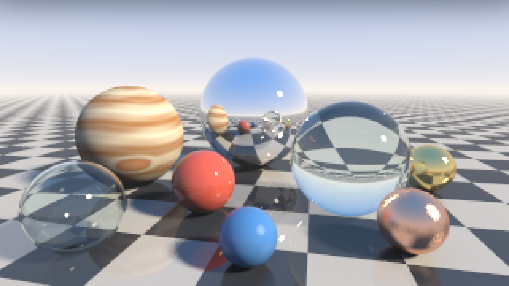


So sieht dein Raytracer am Ende aus. Kein Bild davon ist gemalt: Jeder Pixel ist das Ergebnis einer Rechnung, die einem Lichtstrahl rückwärts folgt, vom Auge in die Szene, dort vielleicht von einer Kugel zur nächsten und dann zur Sonne. Genau so, nur mit viel mehr Strahlen, entstehen die Bilder in Animationsfilmen, und seit einigen Jahren auch in Spielen, mit Grafikkarten, die Strahlen in eigener Hardware verfolgen.

Die Idee, Strahlen auch an Spiegeln und durch Glas weiterzuverfolgen, ist von 1979. Das Bild, mit dem sie bekannt wurde, zeigt Kugeln über einem Schachbrett, wie deins.


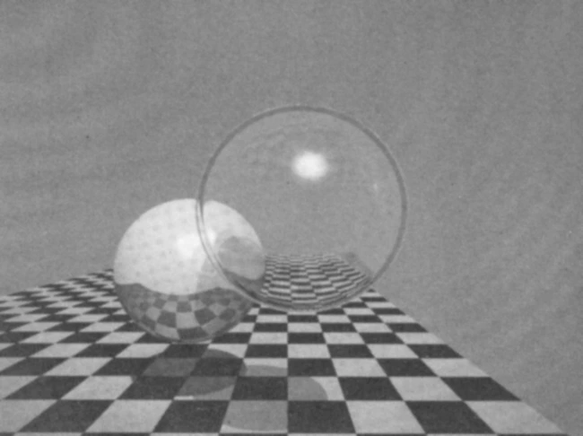
<script src='/include/pixel_exact.js'></script>

Seine Glaskugel ist hohl, eine dünne Schale aus Glas; darum steht das Schachbrett in ihr nicht auf dem Kopf. Im Kapitel »Glas« baust du neben eine volle Glaskugel auch eine hohle.

<div class='book'>
<i class='bi bi-file-earmark-text'></i>
<p><strong>An Improved Illumination Model for Shaded Display</strong>, Turner Whitted, Communications of the ACM, 1980. Auf sieben Seiten steht, was du hier baust: Strahlen, die an Spiegeln abprallen und durch Glas gehen, Strahlen zum Licht für die Schatten und mehr Strahlen an den Kanten gegen Treppenstufen. Das Bild oben ist aus diesem Aufsatz: <a href='https://www.cs.drexel.edu/~deb39/Classes/Papers/p343-whitted.pdf'>PDF</a>, auch bei der <a href='https://doi.org/10.1145/358876.358882'>ACM</a>.</p>
</div>

_person(whitted)

Du solltest [Echtzeitgrafik mit C](/pixelram) bis »Ein Bild aus einer Formel« kennen: wie PixelRAM ein Bild zeigt und wie ein Programm für jeden Pixel eine Farbe ausrechnet. Mehr C brauchst du nicht; was neu ist, wird erklärt, wenn es vorkommt.

## Einrichten

### Die Vorlage klonen

Du arbeitest wieder mit der Vorlage von PixelRAM, diesmal in einem eigenen Ordner `raytracer`. Öffne ein Terminal und gib ein:

```bash
git clone ${template} ~/raytracer
```

Öffne danach den Ordner: <kbd>Strg</kbd><kbd>K</kbd>, dann <kbd>Strg</kbd><kbd>O</kbd>, wähle `raytracer` und bestätige mit »OK«. Lege darin die Datei `raytracer.c` an. Der Raytracer wird eine einzige Datei; jeder Schritt auf dieser Seite fügt ihr etwas hinzu.

### Ein Bild aus Strahlen

Ein Raytracer braucht Punkte, Richtungen und Farben, und alle drei sind drei Zahlen. Darum gibt es dafür einen einzigen Typ, `vec`, mit ein paar Funktionen zum Rechnen. Schreib dieses Programm in `raytracer.c` und übersetze es im Terminal mit `make PROGRAM=raytracer`:

```c_copy
#include "pixelram.h"
#include <math.h>

#define W 320
#define H 180

// ein Vektor: ein Punkt, eine Richtung oder eine Farbe (x, y, z = rot, grün, blau)
typedef struct
{
    double x, y, z;
} vec;

vec add(vec a, vec b)
{
    return (vec){a.x + b.x, a.y + b.y, a.z + b.z};
}

vec scale(vec a, double s)
{
    return (vec){a.x * s, a.y * s, a.z * s};
}

double dot(vec a, vec b)
{
    return a.x * b.x + a.y * b.y + a.z * b.z;
}

double length(vec a)
{
    return sqrt(dot(a, a));
}

// gleiche Richtung, Länge 1
vec normalize(vec a)
{
    return scale(a, 1 / length(a));
}

// überblenden: t = 0 ergibt a, t = 1 ergibt b
vec mix(vec a, vec b, double t)
{
    return add(scale(a, 1 - t), scale(b, t));
}

// der Himmel: am Horizont hell, nach oben tiefblau
vec sky(vec dir)
{
    double up = dir.y > 0 ? sqrt(dir.y) : 0;
    return mix((vec){0.95, 0.9, 0.85}, (vec){0.15, 0.4, 0.9}, up);
}

// die Richtung vom Auge durch den Pixel (x, y)
vec ray_dir(double x, double y)
{
    double sx = (x - W / 2.0) / H;
    double sy = (H / 2.0 - y) / H;
    return normalize((vec){sx, sy, -1});
}

// Farbwert 0 bis 1 zu 0 bis 255
uint8_t to_byte(double c)
{
    if (c > 1)
        c = 1;
    return (uint8_t)(c * 255 + 0.5);
}

void draw(void)
{
    for (int y = 0; y < H; y++)
    {
        for (int x = 0; x < W; x++)
        {
            vec c = sky(ray_dir(x + 0.5, y + 0.5));
            set_pixel_rgb(x, y, to_byte(c.x), to_byte(c.y), to_byte(c.z));
        }
    }
}

int main(void)
{
    screen_open(W, H, pixel_rgb24, "Raytracer");
    draw();
    while (!should_close())
        present();
    screen_close();
    return 0;
}
```

<!-- tutorial-screenshot
# Wie der Leser: im Terminal klonen, den Ordner öffnen, die erste Stufe
show-left-sidebar
terminal-open
terminal-run: git clone -q https://github.com/specht/pixelram-starter.git ~/raytracer && git -C ~/raytracer checkout -q 8eeadbc0bf5b46ccd4e0527f4bcda13b3c0b947d
press: Control+K
press: Control+O
wait-for-input-value: /workspace/
type: raytracer
press: Enter
wait-for-input-value: /workspace/raytracer/
press: Enter
wait-for-text: main.c
write-file: raytracer.c <- previous-code
open-file: raytracer.c
terminal-open
terminal-run: make PROGRAM=raytracer
terminal-wait-for-prompt: 180
move-mouse: selector:.terminal
terminal-expect-no-text: error:
terminal-expect-no-text: ***
-->
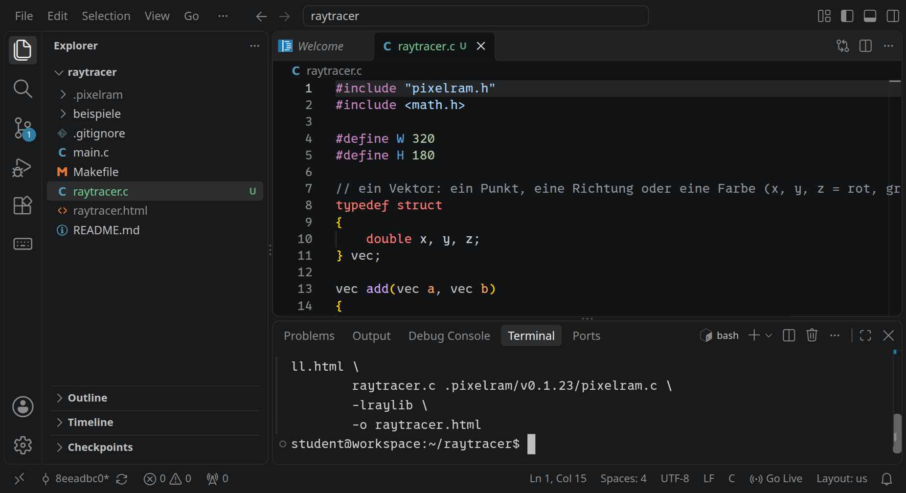

Öffne über »Go Live« die Datei `raytracer.html`. Du siehst einen Himmel:

<!-- tutorial-screenshot
go-live
tab: preview
viewport: 800x450
hook: open raytracer.html
crop-element: #canvas
-->
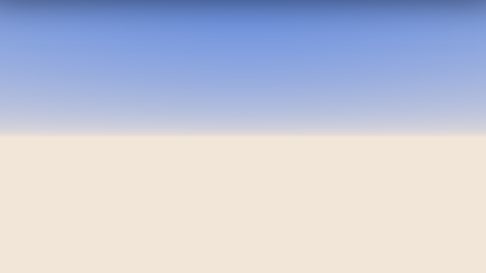

Das Programm hat für jeden der 57.600 Pixel eine Richtung ausgerechnet und gefragt: Welche Farbe hat der Himmel in dieser Richtung? Wer nach oben schaut, sieht Blau, wer geradeaus schaut, das helle Licht am Horizont. Die untere Hälfte ist auch Himmel, nur hell: Einen Boden gibt es noch nicht.

Drei Dinge im Programm sind vielleicht neu:

- `typedef struct { double x, y, z; } vec;` legt einen eigenen Typ an: drei Kommazahlen unter einem Namen. Ist `a` ein `vec`, liest du sie mit `a.x`, `a.y` und `a.z`.
- `(vec){a.x + b.x, a.y + b.y, a.z + b.z}` schreibt einen solchen Wert direkt hin, so wie `3` eine Zahl hinschreibt. `add` gibt ihn gleich zurück.
- `pixel_rgb24` öffnet den Bildschirm ohne Palette: `set_pixel_rgb` setzt einen Pixel aus Rot, Grün und Blau, jedes von 0 bis 255.

Einen Vektor kannst du dir als Pfeil vorstellen, der so weit nach rechts, oben und vorn zeigt, wie seine drei Zahlen sagen. `add` setzt zwei Pfeile aneinander, `scale` macht einen Pfeil länger oder kürzer, und `normalize` macht ihn genau 1 lang, ohne seine Richtung zu ändern; wie lang er vorher war, misst `length` mit dem Satz des Pythagoras. Die Bilder auf dieser Seite zeichnen Vektoren flach, mit zwei Zahlen; mit drei geht alles genauso.

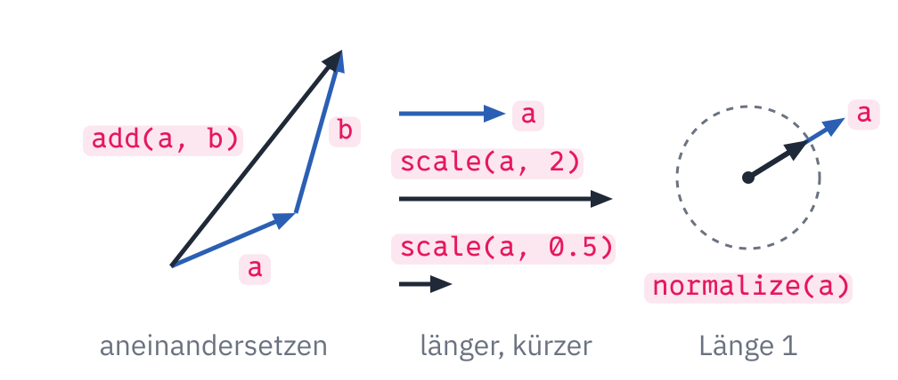

### Vom Auge durch den Bildschirm


Stell dir vor, das Auge sitzt im Nullpunkt und schaut in Richtung −z. Eine Einheit davor steht das Bild, wie eine Glasscheibe, auf der die Pixel liegen. Ein Strahl beginnt beim Auge und geht durch einen Pixel weiter in die Szene. `ray_dir` rechnet die Richtung dieses Strahls aus:

- `sx` und `sy` sagen, wo der Pixel auf der Scheibe liegt: In der Mitte ist beides 0, nach rechts wird `sx` größer, nach oben `sy`. Beide werden durch die Höhe `H` geteilt, damit die Pixel quadratisch bleiben.
- Die Richtung ist dann `(sx, sy, -1)`: so weit nach rechts und oben, und eine Einheit nach vorn.
- `normalize` macht daraus eine Richtung der Länge 1. Das brauchen die Rechnungen gleich.

`x + 0.5` zielt auf die Mitte des Pixels, nicht auf seine linke obere Ecke.

_task(sx)

Wie groß die Scheibe ist, legen `W` und `H` fest: Weil `sx` und `sy` durch `H` geteilt werden, ist sie 1 hoch und `W / H` breit, 320 / 180 ≈ 1,78. Sie hat also dasselbe Seitenverhältnis 16 : 9 wie das Bild aus 320 × 180 Pixeln. Zusammen mit dem Abstand 1 bestimmt diese Größe, wie viel von der Szene ins Bild passt: Von der Unterkante bis zur Oberkante sieht das Auge einen Winkel von 2 · arctan(0,5) ≈ 53°. Wäre die Scheibe nur halb so hoch, zeigte das Bild weniger von der Szene, dafür größer, wie ein Teleobjektiv.

`sky` mischt mit `mix` zwei Farben: das helle Weiß am Horizont und das Blau ganz oben. Wie viel von welcher, entscheidet `dir.y`, wie steil der Strahl nach oben zeigt. Farben sind hier Zahlen von 0 bis 1 für Rot, Grün und Blau; erst `to_byte` macht daraus die Werte 0 bis 255 für PixelRAM.

<div class='hint try'>
<strong>Ausprobieren:</strong> Tausche in <code>sky</code> die beiden Farben gegen ein Orange am Horizont und ein dunkles Violett oben: ein Abendhimmel. Stell sie danach wieder zurück.
</div>

## Die erste Kugel

### Wo trifft der Strahl die Kugel?

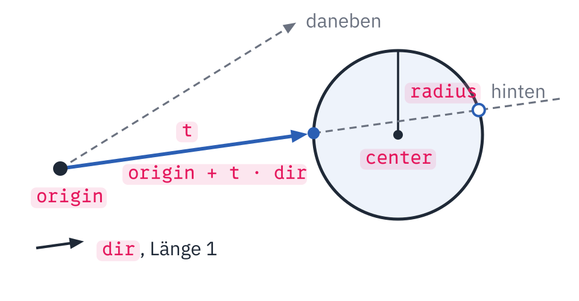

Ein Strahl beginnt bei einem Punkt `origin` und läuft in Richtung `dir`. Nach der Strecke `t` ist er beim Punkt `origin + t · dir`. Eine Kugel besteht aus allen Punkten, die vom Mittelpunkt `center` genau `radius` entfernt sind. Gesucht ist also das `t`, für das gilt:

$$|\text{origin} + t \cdot \text{dir} - \text{center}| = \text{radius}$$

Mit `oc = origin − center` und weil `dir` die Länge 1 hat, wird daraus eine quadratische Gleichung für `t`:

$$t^2 + 2b\,t + c = 0 \quad\text{mit}\quad b = \text{oc} \cdot \text{dir}, \quad c = \text{oc} \cdot \text{oc} - \text{radius}^2$$

Sie hat die Lösungen \\(t = -b \pm \sqrt{b^2 - c}\\). Ist \\(b^2 - c\\) negativ, gibt es keine: Der Strahl geht an der Kugel vorbei. Sonst trifft er sie zweimal, vorn und hinten, und sichtbar ist der vordere Treffpunkt mit dem kleineren `t`.

Schreib die Kugel in dein Programm. Zum Abziehen von Vektoren kommt `sub` dazu:

```c
~ vec add(vec a, vec b)
~ {
~     return (vec){a.x + b.x, a.y + b.y, a.z + b.z};
~ }
~
vec sub(vec a, vec b)
{
    return (vec){a.x - b.x, a.y - b.y, a.z - b.z};
}
```

Unter `sky` kommen die Kugel, das Auge und die Rechnung:

```c
typedef struct
{
    vec center;
    double radius;
    vec color;
} sphere;

sphere ball = {{0, 1, 0}, 1, {0.9, 0.15, 0.1}};

// hier steht das Auge, es schaut in Richtung -z
vec eye = {0, 1.2, 5.5};

// Abstand t, in dem der Strahl origin + t * dir die Kugel trifft, sonst INFINITY
double hit_sphere(vec origin, vec dir, sphere s)
{
    vec oc = sub(origin, s.center);
    double b = dot(oc, dir);
    double c = dot(oc, oc) - s.radius * s.radius;
    double d = b * b - c;
    if (d < 0)
        return INFINITY;  // daneben
    double t = -b - sqrt(d);
    if (t > 0)
        return t;
    return INFINITY;      // die Kugel liegt hinter dem Auge
}

// die Farbe, die aus Richtung dir beim Punkt origin ankommt
vec trace(vec origin, vec dir)
{
    if (hit_sphere(origin, dir, ball) < INFINITY)
        return ball.color;
    return sky(dir);
}
```

`INFINITY` aus `math.h` ist eine Zahl, die größer ist als jede andere; sie steht hier für »kein Treffer«. Das Auge steht jetzt nicht mehr im Nullpunkt, sondern bei `eye`, etwas zurück und auf Augenhöhe der Kugel. In `draw` fragt das Programm statt des Himmels jetzt `trace`, was der Strahl vom Auge aus sieht:

```c
~         for (int x = 0; x < W; x++)
~         {
            vec c = trace(eye, ray_dir(x + 0.5, y + 0.5));
~             set_pixel_rgb(x, y, to_byte(c.x), to_byte(c.y), to_byte(c.z));
```

<!-- tutorial-screenshot
write-file: raytracer.c <- file:stufen/02-kugel.c
terminal-open
terminal-run: make PROGRAM=raytracer
terminal-wait-for-prompt
terminal-expect-no-text: error:
terminal-expect-no-text: ***
tab: preview
viewport: 800x450
hook: open raytracer.html
crop-element: #canvas
-->
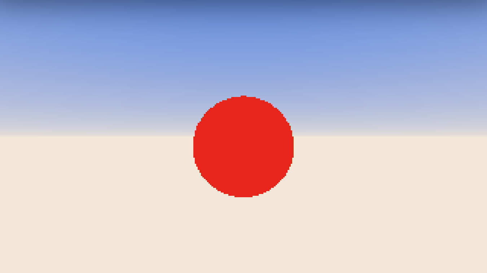

Eine rote Scheibe. Dass sie eine Kugel ist, sieht man noch nicht: Jeder Strahl, der sie trifft, bekommt dieselbe Farbe.

_task(treffer)

## Glatte Kanten

### Zufall im Pixel

Sieh dir den Rand der roten Scheibe genau an: Er besteht aus Treppenstufen. Jeder Pixel schickt genau einen Strahl durch seine Mitte, und ob der die Kugel trifft oder knapp daneben geht, entscheidet über den ganzen Pixel. Was zwischen zwei Mitten liegt, sieht der Raytracer nie.

Die Abhilfe ist einfach und braucht Geduld: viele Strahlen je Pixel, jeder durch einen **zufälligen Punkt im Pixel**, und davon der Durchschnitt. Am Rand einer Kugel treffen dann manche Strahlen die Kugel und manche den Himmel, und der Pixel bekommt eine Mischfarbe. Statt alle Strahlen auf einmal zu rechnen, schickt das Programm in jedem Bild einen weiteren Strahl je Pixel, einen **Durchgang**, und zeigt den Durchschnitt aller bisherigen. So sieht man sofort ein Bild, das mit jeder Sekunde glatter wird.

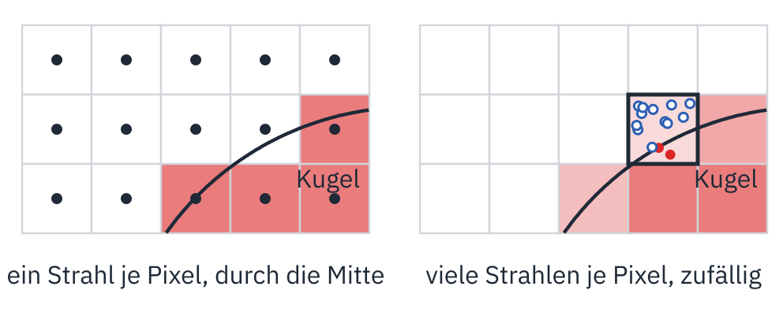

Für den Zufall gibt es eine kleine Funktion; `xorshift` heißt das Verfahren. Unter `mix`:

```c
// Zufall (xorshift): eine Zahl von 0 bis unter 1
uint32_t seed = 2463534242u;

double random_double(void)
{
    seed ^= seed << 13;
    seed ^= seed >> 17;
    seed ^= seed << 5;
    return seed / 4294967296.0;
}
```

`draw` addiert in jedem Durchgang die neue Farbe zur Summe des Pixels und zeigt die Summe geteilt durch die Zahl der Durchgänge. Ersetze `draw` durch:

```c
// für jeden Pixel: die Summe der Farben aus allen Durchgängen
vec sum[H][W];

// ein Durchgang: ein Strahl je Pixel, durch einen zufälligen Punkt im Pixel
void draw(int passes)
{
    for (int y = 0; y < H; y++)
    {
        for (int x = 0; x < W; x++)
        {
            vec c = trace(eye, ray_dir(x + random_double(), y + random_double()));
            if (passes == 1)
                sum[y][x] = c;  // der erste Durchgang: neu anfangen
            else
                sum[y][x] = add(sum[y][x], c);

            // gezeigt wird der Durchschnitt aller Durchgänge
            vec avg = scale(sum[y][x], 1.0 / passes);
            set_pixel_rgb(x, y, to_byte(avg.x), to_byte(avg.y), to_byte(avg.z));
        }
    }
}
```

In `main` zeichnet die Schleife jetzt in jedem Bild einen weiteren Durchgang, und `passes` zählt sie mit. Das `draw();` vor der Schleife fällt weg. Ersetze `main` durch:

```c
int main(void)
{
    screen_open(W, H, pixel_rgb24, "Raytracer");
    int passes = 0;
    while (!should_close())
    {
        // jedes Bild ein weiterer Durchgang: das Bild wird immer glatter
        passes++;
        draw(passes);
        present();
    }
    screen_close();
    return 0;
}
```

<div class='gallery columns-2'>
<figure>
<!-- tutorial-screenshot
write-file: raytracer.c <- file:stufen/03-glatt.c
terminal-open
terminal-run: make PROGRAM=raytracer
terminal-wait-for-prompt
terminal-expect-no-text: error:
terminal-expect-no-text: ***
tab: preview
viewport: 800x450
hook: open raytracer.html
hook: frames 1
crop-element: #canvas
-->
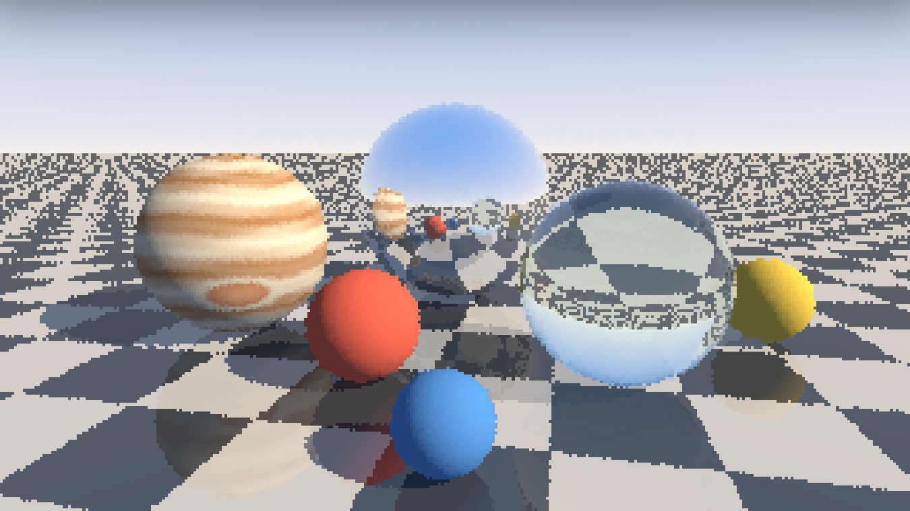
<figcaption>Nach einem Durchgang</figcaption>
</figure>
<figure>
<!-- tutorial-screenshot
tab: preview
viewport: 800x450
hook: open raytracer.html
hook: frames 64
crop-element: #canvas
-->
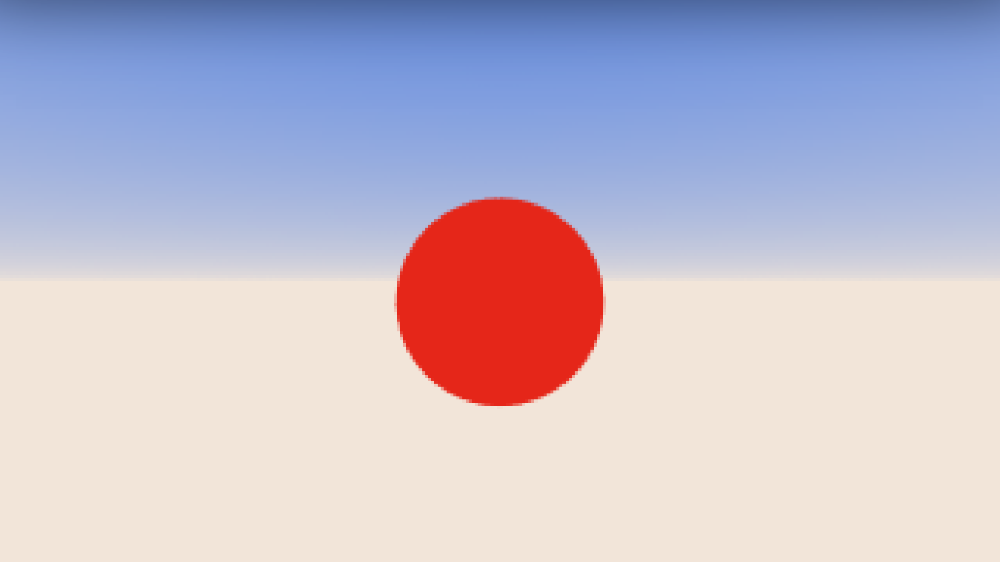
<figcaption>Nach 64 Durchgängen, gut zwei Sekunden</figcaption>
</figure>
</div>

Nach einem Durchgang ist der Rand ausgefranst, weil jeder Strahl irgendwo im Pixel landet. Nach 64 ist er glatt: Ein Pixel am Rand ist so rot, wie viel von ihm die Kugel bedeckt. Alles, was ab jetzt dazukommt, wird von selbst glatt gerechnet, auch das Schachbrett, das später zum Horizont hin in ein gleichmäßiges Grau übergeht.

_task(rauschen)

## Licht

### Die Normale

Eine Kugel wirkt rund, weil sie dort hell ist, wo die Sonne steil auf sie scheint, und dunkel, wo das Licht nur streift. Um das auszurechnen, braucht man an jedem Treffpunkt die Richtung, in die die Oberfläche dort zeigt: die **Normale**. Bei einer Kugel ist das einfach: Sie zeigt vom Mittelpunkt zum Treffpunkt. Geteilt durch den Radius hat sie die Länge 1.

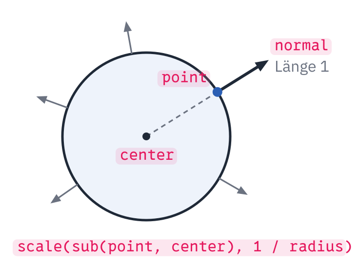

### Wie hell?

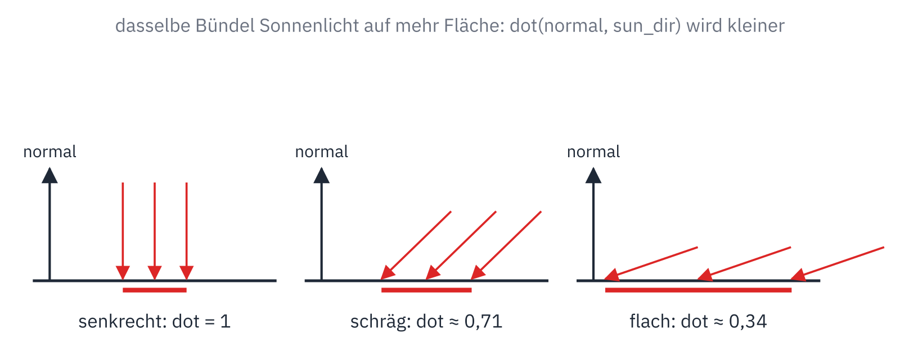

Dasselbe Bündel Sonnenlicht verteilt sich auf eine umso größere Fläche, je flacher es einfällt. Jede Stelle bekommt dann weniger ab. Genau dieses Maß liefert das Skalarprodukt aus Normale und Richtung zur Sonne, `dot(normal, sun_dir)`: 1, wenn die Sonne senkrecht steht, 0, wenn sie streift, und negativ, wenn sie von hinten scheint; dann bekommt die Stelle gar kein Sonnenlicht.

Warum gerade das Skalarprodukt? Für zwei Pfeile der Länge 1 sagt es, wie weit der eine in die Richtung des anderen zeigt: Fällt man von der Spitze des einen das Lot auf den anderen, ist das Stück bis dorthin so lang wie `dot`. Zeigen beide in dieselbe Richtung, ist das ganze Stück 1 lang; stehen sie im rechten Winkel, bleibt nichts übrig; zeigt einer nach hinten, liegt das Stück auf der anderen Seite und zählt negativ.

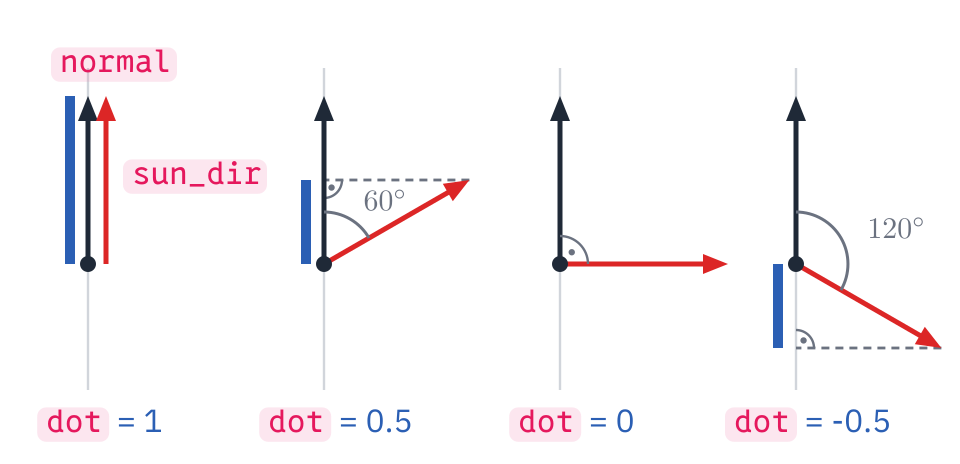

_person(lambert)

Dazu kommt ein wenig Licht, das vom ganzen Himmel kommt, `ambient`. Ohne es wäre die Schattenseite der Kugel völlig schwarz. Farben werden dabei Komponente für Komponente multipliziert: Rotes Material unter weißlichem Licht bleibt rot. Dafür gibt es `mul`:

```c
~ vec scale(vec a, double s)
~ {
~     return (vec){a.x * s, a.y * s, a.z * s};
~ }
~
// Farben mischen: jede Komponente einzeln multiplizieren
vec mul(vec a, vec b)
{
    return (vec){a.x * b.x, a.y * b.y, a.z * b.z};
}
```

Unter die Kugel kommen die Sonne und das Himmelslicht:

```c
~ sphere ball = {{0, 1, 0}, 1, {0.9, 0.15, 0.1}};
~
// die Richtung zur Sonne (Länge 1) und ihre Farbe
vec sun_dir;
vec sun_color = {1.4, 1.2, 0.9};
// Licht vom Himmel: kommt von überall, damit die Schattenseite nicht schwarz ist
vec ambient = {0.12, 0.15, 0.22};
```

`trace` rechnet jetzt den Treffpunkt aus, die Normale und das Licht. Ersetze `trace` durch:

```c
// die Farbe, die aus Richtung dir beim Punkt origin ankommt
vec trace(vec origin, vec dir)
{
    double t = hit_sphere(origin, dir, ball);
    if (t == INFINITY)
        return sky(dir);

    vec point = add(origin, scale(dir, t));
    // die Normale steht senkrecht auf der Oberfläche, Länge 1
    vec normal = scale(sub(point, ball.center), 1 / ball.radius);

    // je steiler die Sonne auf die Oberfläche scheint, desto heller
    double d = dot(normal, sun_dir);
    if (d < 0)
        d = 0;
    vec light = add(scale(sun_color, d), ambient);
    return mul(ball.color, light);
}
```

`sun_dir` bekommt seinen Wert in `main`, weil `normalize` erst dort aufgerufen werden kann:

```c
~     screen_open(W, H, pixel_rgb24, "Raytracer");
    sun_dir = normalize((vec){1.4, 1.0, 0.3});
~     int passes = 0;
```

Eine Kleinigkeit fehlt noch. Ein Bildschirm zeigt den Farbwert 128 nicht halb so hell wie 255, sondern nur etwa ein Fünftel so hell. Dein Programm rechnet aber mit echten Lichtmengen. Die **Gamma-Korrektur** gleicht das aus, in der letzten Zeile von `to_byte`. Ersetze `to_byte` durch:

```c
// Farbwert 0 bis 1 zu 0 bis 255, mit Gamma für den Bildschirm
uint8_t to_byte(double c)
{
    if (c > 1)
        c = 1;
    return (uint8_t)(pow(c, 1 / 2.2) * 255 + 0.5);
}
```

<!-- tutorial-screenshot
write-file: raytracer.c <- file:stufen/04-licht.c
terminal-open
terminal-run: make PROGRAM=raytracer
terminal-wait-for-prompt
terminal-expect-no-text: error:
terminal-expect-no-text: ***
tab: preview
viewport: 800x450
hook: open raytracer.html
hook: frames 64
crop-element: #canvas
check-task-fails: hit-floor
-->
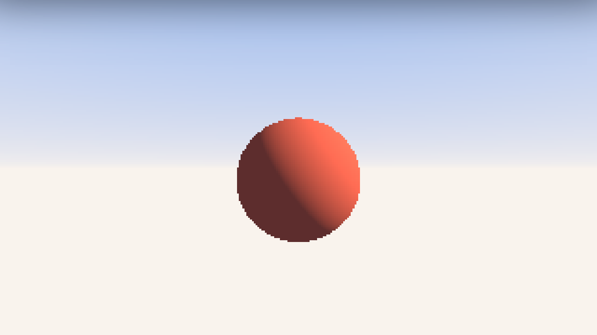

Jetzt ist sie rund. Die Sonne steht rechts oben, ein wenig vor der Kugel.

_task(hell)

<div class='hint try'>
<strong>Ausprobieren:</strong> Setz <code>sun_dir</code> auf <code>(vec){-1, 0.2, 0}</code>: Die Sonne steht dann tief links. Setz danach <code>ambient</code> auf <code>(vec){0, 0, 0}</code> und sieh dir die Schattenseite an. Stell beides wieder zurück.
</div>

## Kugeln und ein Boden

### Material und Treffer

Mit mehr Dingen in der Szene braucht das Programm etwas Ordnung. Jede Oberfläche bekommt ein **Material**; im Moment ist das nur eine Farbe, bald kommen Spiegel und Glas dazu. Statt einer Kugel gibt es eine Liste. Ersetze `sphere` und `ball` durch:

```c
typedef struct
{
    vec color;
} material;

typedef struct
{
    vec center;
    double radius;
    material mat;
} sphere;

sphere spheres[] = {
    {{-0.3, 1.2, -1.4}, 1.2, {.color = {0.6, 0.6, 0.65}}},
    {{1.5, 0.8, 0.8}, 0.8, {.color = {0.9, 0.9, 0.9}}},
    {{-2.2, 0.9, 0.3}, 0.9, {.color = {0.9, 0.6, 0.3}}},
    {{-0.5, 0.45, 1.2}, 0.45, {.color = {0.9, 0.15, 0.1}}},
    {{3.0, 0.4, -0.4}, 0.4, {.color = {0.95, 0.7, 0.1}}},
    {{0.4, 0.3, 2.3}, 0.3, {.color = {0.1, 0.35, 0.9}}},
};
// so viele Kugeln stehen in der Liste
#define SPHERE_COUNT (int)(sizeof spheres / sizeof spheres[0])

material floor_mat = {.color = {0.75, 0.75, 0.75}};
```

`{.color = …}` setzt im Material nur das Feld `color`; alle anderen Felder, die später dazukommen, sind dann 0. `sizeof spheres / sizeof spheres[0]` zählt die Kugeln in der Liste: die Größe der ganzen Liste geteilt durch die Größe einer Kugel. Kommt eine Kugel dazu, stimmt `SPHERE_COUNT` von selbst.

### Der Boden

Der Boden ist die Ebene `y = 0`. Ein Strahl erreicht sie, wenn `origin.y + t · dir.y = 0` ist, also bei `t = −origin.y / dir.y`. Ist `t` negativ, liegt der Boden hinter dem Strahl.

<div class='hint own' data-check='hit-floor'>
<strong>Jetzt bist du dran:</strong> Schreib unter <code>hit_sphere</code> die Funktion <code>double hit_floor(vec origin, vec dir)</code>. Sie gibt dieses <code>t</code> zurück, und <code>INFINITY</code>, wenn der Boden hinter dem Strahl liegt, so wie <code>hit_sphere</code> bei einer Kugel hinter dem Auge. Laufen lassen kannst du sie erst gleich mit <code>nearest_hit</code>, prüfen kann der Workspace sie schon jetzt: mit der Aufgabe unter der Lösung.
</div>

<!-- hint -->
Stell `origin.y + t · dir.y = 0` nach `t` um; das steht schon oben. Wann liegt der Boden hinter dem Strahl, und was gibt `hit_sphere` in diesem Fall zurück?
<!-- /hint -->
<!-- hint -->
Ein Gerüst:

```c
double hit_floor(vec origin, vec dir)
{
    double t = …;   // hier: die Formel von oben
    // hier: t zurückgeben, wenn der Boden vor dem Strahl liegt
    return INFINITY;
}
```
<!-- /hint -->

<!-- solution -->
```c
~     return INFINITY;      // die Kugel liegt hinter dem Auge
~ }
~
// Abstand t, in dem der Strahl den Boden y = 0 trifft, sonst INFINITY
double hit_floor(vec origin, vec dir)
{
    double t = -origin.y / dir.y;
    if (t > 0)
        return t;
    return INFINITY;
}
```
<!-- /solution -->

_task(hit-floor)

_task(boden)

### Der nächste Treffer

Ein Strahl kann mehrere Dinge treffen; zu sehen ist das vorderste. `nearest_hit` fragt den Boden und jede Kugel und behält das kleinste `t`.

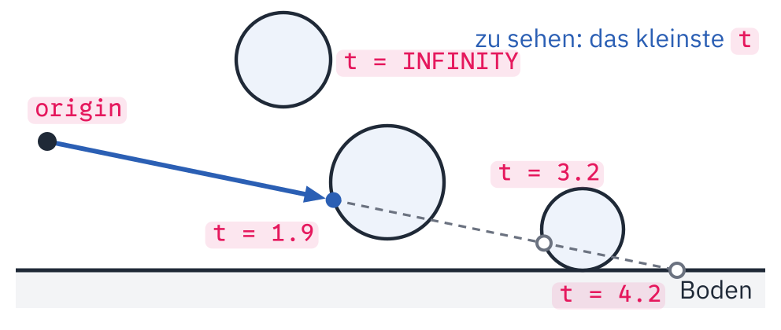

Was über den Treffer bekannt ist, sammelt es in einem `hit`. Beides kommt unter `hit_floor`:

```c
// alles über einen Treffer
typedef struct
{
    double t;     // Abstand vom Anfang des Strahls
    vec point;    // Treffpunkt
    vec normal;   // steht senkrecht auf der Oberfläche, Länge 1
    material mat;
} hit;

// sucht den nächsten Treffer; false, wenn der Strahl in den Himmel geht
bool nearest_hit(vec origin, vec dir, hit *h)
{
    h->t = hit_floor(origin, dir);
    int nearest = -1;  // -1: der Boden
    for (int i = 0; i < SPHERE_COUNT; i++)
    {
        double t = hit_sphere(origin, dir, spheres[i]);
        if (t < h->t)
        {
            h->t = t;
            nearest = i;
        }
    }
    if (h->t == INFINITY)
        return false;

    h->point = add(origin, scale(dir, h->t));
    if (nearest == -1)
    {
        h->normal = (vec){0, 1, 0};
        h->mat = floor_mat;
    }
    else
    {
        sphere s = spheres[nearest];
        h->normal = scale(sub(h->point, s.center), 1 / s.radius);
        h->mat = s.mat;
    }
    return true;
}
```

`hit *h` ist ein Zeiger: `nearest_hit` schreibt seine Ergebnisse in den `hit`, den der Aufrufer bereitstellt, und gibt selbst nur `true` oder `false` zurück. `h->t` heißt »das Feld `t` in dem `hit`, auf den `h` zeigt«. Die Normale des Bodens zeigt überall nach oben.

Das Licht der Sonne bekommt eine eigene Funktion, `sunlight`, und `trace` wird kurz. Ersetze `trace` durch die beiden:

```c
// Licht von der Sonne: je steiler sie auf die Oberfläche scheint, desto heller
vec sunlight(hit h)
{
    double d = dot(h.normal, sun_dir);
    if (d <= 0)
        return (vec){0, 0, 0};
    return scale(sun_color, d);
}

// die Farbe, die aus Richtung dir beim Punkt origin ankommt
vec trace(vec origin, vec dir)
{
    hit h;
    if (!nearest_hit(origin, dir, &h))
        return sky(dir);

    vec light = add(sunlight(h), ambient);
    return mul(h.mat.color, light);
}
```

_task(schatten-da)

Übersetze das Programm mit `make PROGRAM=raytracer` und sieh es dir an: Die Kugeln stehen auf einem grauen Boden, der bis zum Horizont reicht.

<div class='hint own' data-check='schachbrett'>
<strong>Jetzt bist du dran:</strong> Mach aus dem Boden ein Schachbrett aus Feldern der Größe 1, jedes zweite dunkel, <code>(vec){0.05, 0.06, 0.08}</code>. Der Platz dafür ist in <code>nearest_hit</code>, dort, wo der Boden sein Material bekommt. <code>floor(x)</code> aus <code>math.h</code> rundet ab, auf die ganze Zahl darunter: Für jeden Punkt sagt es, in welcher Spalte von Feldern er liegt. Probier es aus, bevor du nachsiehst.
</div>

<!-- hint -->
Welche Feldnummern hat der Punkt `(2.5, 0, -1.3)`? `floor` gibt 2 und −2. Wie kannst du aus den beiden Nummern ablesen, ob ein Feld dunkel ist, sodass zwei Felder nebeneinander nie dieselbe Farbe haben?
<!-- /hint -->
<!-- hint -->
Ein Gerüst, in `nearest_hit` unter `h->mat = floor_mat;`:

```c
        if (…)   // hier: die Summe der beiden Feldnummern ist gerade
            h->mat.color = (vec){0.05, 0.06, 0.08};
```
<!-- /hint -->

<!-- solution -->
```c
~         h->normal = (vec){0, 1, 0};
~         h->mat = floor_mat;
        // Schachbrett: jedes zweite Feld dunkel
        if ((int)(floor(h->point.x) + floor(h->point.z)) % 2 == 0)
            h->mat.color = (vec){0.05, 0.06, 0.08};
~     }
```

Das Schachbrett entsteht ohne ein einziges Bild: `floor` sagt, auf welchem Feld der Treffpunkt liegt, und ist die Summe beider Feldnummern gerade, ist das Feld dunkel. Darum steht dort `== 0` und nicht `== 1`: In C ist `-3 % 2` nicht 1, sondern −1, und mit `== 1` wären links und hinter der Mitte, wo die Feldnummern negativ sind, nur noch helle Felder.
<!-- /solution -->

_task(schachbrett)

<!-- tutorial-screenshot
write-file: raytracer.c <- file:stufen/05-boden.c
terminal-open
terminal-run: make PROGRAM=raytracer
terminal-wait-for-prompt
terminal-expect-no-text: error:
terminal-expect-no-text: ***
tab: preview
viewport: 800x450
hook: open raytracer.html
hook: frames 64
crop-element: #canvas
check-task: hit-floor
check-task: schachbrett
-->
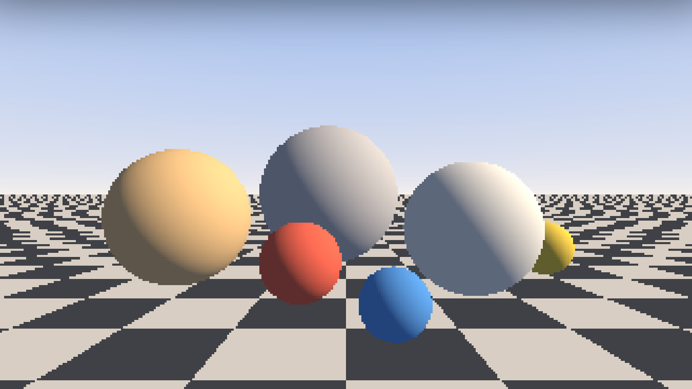

Die Kugeln stehen auf dem Boden, aber sie schweben scheinbar: Es fehlen die Schatten. Und weit hinten, am Horizont, flimmern die Felder des Schachbretts zu einem Muster, das es dort gar nicht gibt. Darum kümmern wir uns am Ende.

## Schatten

### Ein Strahl zur Sonne

Ob ein Punkt im Schatten liegt, findet ein Raytracer genauso heraus wie alles andere: mit einem Strahl. Vom Treffpunkt aus geht er in Richtung Sonne. Trifft er unterwegs etwas, kommt kein Sonnenlicht an.

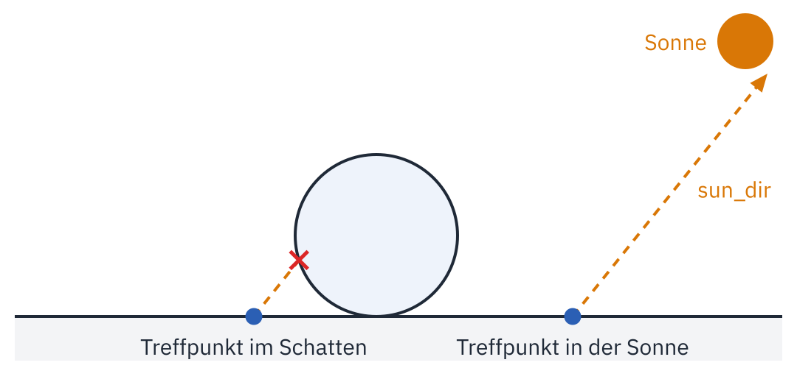

<div class='hint own'>
<strong>Jetzt bist du dran:</strong> Ergänze <code>sunlight</code> so, dass ein Punkt im Schatten kein Sonnenlicht bekommt. Dafür brauchst du nichts Neues: <code>nearest_hit</code> sagt dir, ob ein Strahl, der beim Treffpunkt <code>h.point</code> beginnt und in Richtung <code>sun_dir</code> läuft, unterwegs etwas trifft.
</div>

<!-- hint -->
Der Strahl zur Sonne beginnt bei `h.point` und läuft in Richtung `sun_dir`. Was heißt es für den Punkt, wenn `nearest_hit` für diesen Strahl `true` zurückgibt?
<!-- /hint -->
<!-- hint -->
Ein Gerüst, in `sunlight` vor dem letzten `return`:

```c
    hit blocker;
    if (…)   // hier: trifft der Strahl zur Sonne etwas?
        return (vec){0, 0, 0};
```
<!-- /hint -->

<!-- solution -->
```c
~     if (d <= 0)
~         return (vec){0, 0, 0};
    // Schatten: liegt etwas zwischen dem Punkt und der Sonne?
    hit blocker;
    if (nearest_hit(h.point, sun_dir, &blocker))
        return (vec){0, 0, 0};
~     return scale(sun_color, d);
```
<!-- /solution -->

_task(akne)

<!-- after: akne -->
<!-- tutorial-screenshot
write-file: raytracer.c <- file:stufen/06-akne.c
terminal-open
terminal-run: make PROGRAM=raytracer
terminal-wait-for-prompt
terminal-expect-no-text: error:
terminal-expect-no-text: ***
tab: preview
viewport: 800x450
hook: open raytracer.html
hook: frames 1
crop-element: #canvas
-->
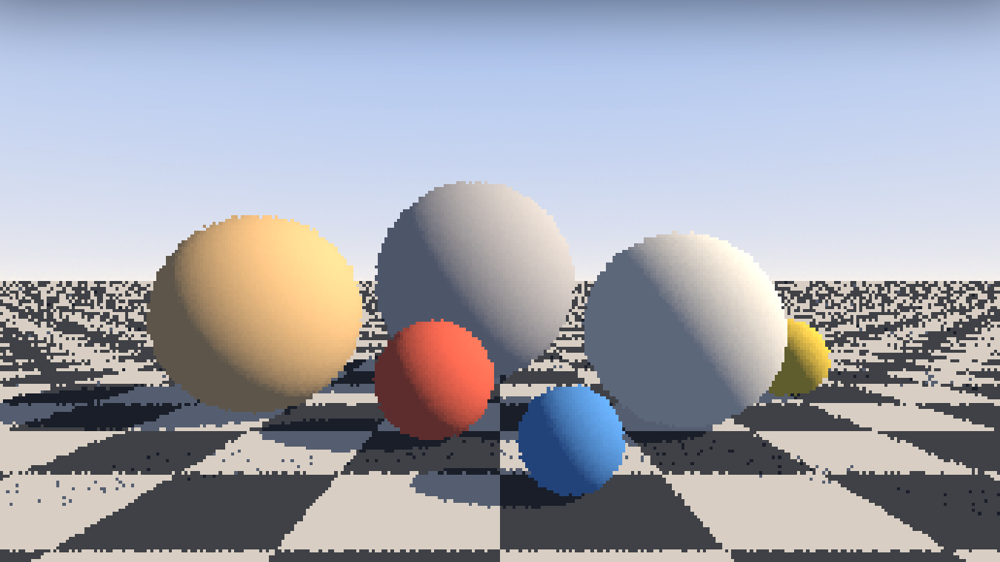

### Akne

Die Schatten sind da, aber auf dem Boden liegen dunkle Sprenkel, vor allem auf den hellen Feldern vorn. Grafiker nennen das **Shadow Acne**. Der Schattenstrahl beginnt genau auf der Oberfläche, und genau heißt bei Kommazahlen: fast. Liegt der berechnete Treffpunkt durch einen Rundungsfehler ein winziges Stück unter dem Boden, trifft der Schattenstrahl den Boden selbst, bei einem `t` wie 0,0000000000000002, und hält den Punkt für beschattet.

Mit jedem Durchgang werden die Sprenkel blasser, denn im Durchschnitt fallen die wenigen falschen Strahlen kaum noch auf. Weg ist der Fehler damit nicht, nur verdünnt: Ein Rauschen wird durch viele Durchgänge richtig, ein Fehler nicht. Das Bild oben zeigt den ersten Durchgang.
<!-- /after -->

Die Abhilfe: Treffer, die näher als eine kleine Zahl `EPS` am Anfang des Strahls liegen, zählen nicht.

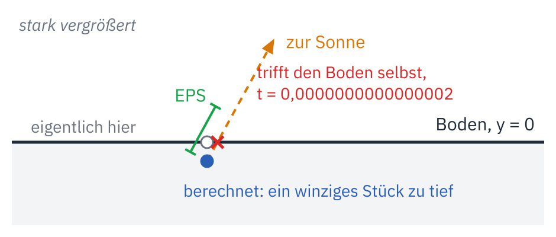

```c
~ #define H 180
~
// Treffer, die näher als EPS am Anfang des Strahls liegen, zählen nicht
#define EPS 1e-4
```

In `hit_sphere` und `hit_floor` wird aus `t > 0` jeweils `t > EPS`:

```c
    if (t > EPS)
        return t;
```

<!-- tutorial-screenshot
write-file: raytracer.c <- file:stufen/06-schatten.c
terminal-open
terminal-run: make PROGRAM=raytracer
terminal-wait-for-prompt
terminal-expect-no-text: error:
terminal-expect-no-text: ***
tab: preview
viewport: 800x450
hook: open raytracer.html
hook: frames 64
crop-element: #canvas
check-task-fails: kamera
-->
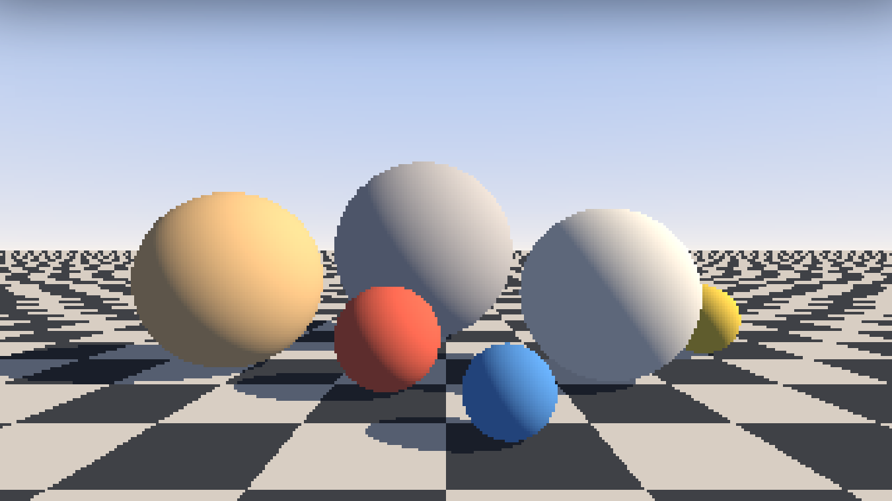

Jetzt stehen die Kugeln auf dem Boden.

## Die Kamera

### Vorne, rechts und oben

Bisher schaut das Auge immer in Richtung −z. Eine Kamera, die man bewegen kann, braucht drei Richtungen: wohin sie schaut, wo rechts ist und wo oben. Ohne Matrizen, nur mit einem neuen Werkzeug, dem **Kreuzprodukt**: `cross(a, b)` ist ein Vektor, der senkrecht auf `a` und auf `b` steht. Vertauscht man `a` und `b`, zeigt er in die Gegenrichtung.

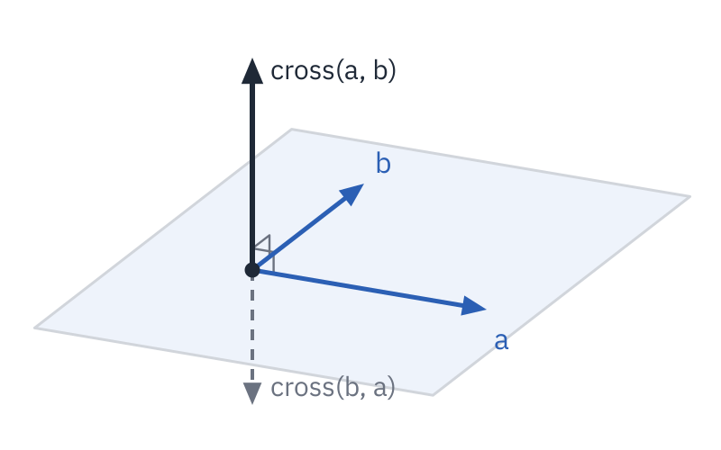

- **forward** zeigt vom Auge `eye` zum Ziel `target`: `normalize(target − eye)`.
- **right** steht senkrecht auf `forward` und auf »oben in der Welt«, `(0, 1, 0)`: `normalize(cross(forward, (0, 1, 0)))`.
- **up** steht senkrecht auf `forward` und `right`: `cross(right, forward)`.

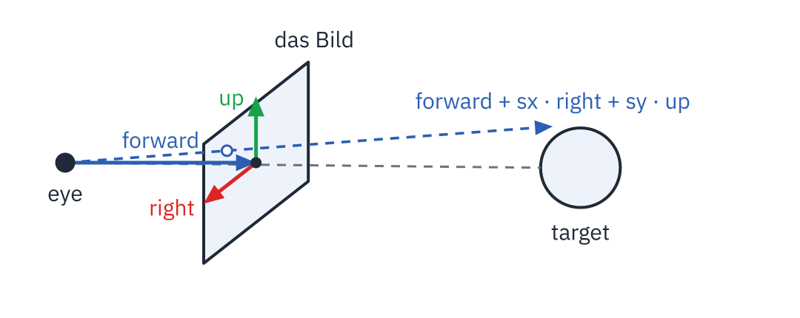

Das Bild steht wieder eine Einheit vor dem Auge, jetzt in Richtung `forward`, und ein Pixel liegt `sx` Schritte in Richtung `right` und `sy` Schritte in Richtung `up` von seiner Mitte. Die Richtung durch den Pixel ist also `forward + sx · right + sy · up`.

Das Kreuzprodukt kommt zu den anderen Rechnungen:

```c
~ double dot(vec a, vec b)
~ {
~     return a.x * b.x + a.y * b.y + a.z * b.z;
~ }
~
// steht senkrecht auf a und auf b
vec cross(vec a, vec b)
{
    return (vec){a.y * b.z - a.z * b.y, a.z * b.x - a.x * b.z, a.x * b.y - a.y * b.x};
}
```

_task(right)

Lösche die Zeilen mit `vec eye = {0, 1.2, 5.5};`. Über `ray_dir` kommt die Kamera, und `ray_dir` benutzt sie. Ersetze `ray_dir` durch die beiden:

```c
// die Kamera: wo das Auge steht und wohin vorne, rechts und oben ist
vec eye, forward, right, up;

// die Kamera kreist im Abstand 5 um die Mitte und schaut auf target
void set_camera(double angle, double height)
{
    eye = (vec){5 * sin(angle), height, 5 * cos(angle)};
    vec target = {0, 0.8, 0};
    // hier: forward, right und up
}

// die Richtung vom Auge durch den Pixel (x, y)
vec ray_dir(double x, double y)
{
    double sx = (x - W / 2.0) / H;
    double sy = (H / 2.0 - y) / H;
    // hier: die Richtung durch den Pixel
}
```

<div class='hint own' data-check='kamera'>
<strong>Jetzt bist du dran:</strong> Schreib die vier fehlenden Zeilen nach den Formeln oben: drei in <code>set_camera</code> für <code>forward</code>, <code>right</code> und <code>up</code>, eine in <code>ray_dir</code>, die die Richtung durch den Pixel zurückgibt, mit der Länge 1. »Oben in der Welt« ist <code>(vec){0, 1, 0}</code>. Laufen lassen kannst du es, sobald gleich <code>main</code> die Kamera einstellt.
</div>

<!-- hint -->
Jede Zeile ist eine der Formeln oben, geschrieben mit den Funktionen, die es schon gibt: `sub`, `normalize`, `cross`, `add` und `scale`. `target − eye` ist `sub(target, eye)`.
<!-- /hint -->
<!-- hint -->
Die Lücken mit `…` füllst du:

```c
    forward = normalize(sub(…, …));
    right = normalize(cross(…, (vec){0, 1, 0}));
    up = cross(…, …);
```

und in `ray_dir` `forward + sx · right + sy · up`, mit `add` und `scale`, am Ende mit `normalize` auf die Länge 1.
<!-- /hint -->

<!-- solution -->
```c
~     vec target = {0, 0.8, 0};
    forward = normalize(sub(target, eye));
    right = normalize(cross(forward, (vec){0, 1, 0}));
    up = cross(right, forward);
~ }
```

```c
~     double sy = (H / 2.0 - y) / H;
    return normalize(add(forward, add(scale(right, sx), scale(up, sy))));
~ }
```
<!-- /solution -->

_task(kamera)

`5 * sin(angle)` und `5 * cos(angle)` legen das Auge auf einen Kreis mit Radius 5 um die Mitte der Szene; `angle` sagt, wo auf dem Kreis.

### Um die Szene kreisen

In `main` fragt die Schleife jetzt die Pfeiltasten ab. Bewegt sich die Kamera, gelten die alten Durchgänge nicht mehr: `passes` fängt wieder bei 0 an, und der nächste Durchgang überschreibt die Summe. Ersetze `main` durch:

```c
int main(void)
{
    screen_open(W, H, pixel_rgb24, "Raytracer");
    sun_dir = normalize((vec){1.4, 1.0, 0.3});

    double angle = 0.2, height = 1.8;
    int passes = 0;
    double last = seconds();

    while (!should_close())
    {
        // die Zeit seit dem letzten Bild, höchstens eine Zehntelsekunde
        double now = seconds();
        double dt = fmin(now - last, 0.1);
        last = now;

        // Pfeiltasten: um die Szene kreisen, höher oder tiefer, so schnell
        // pro Sekunde, egal wie viele Bilder der Rechner schafft
        if (key_down(pixel_key_left))  { angle -= 1.2 * dt; passes = 0; }
        if (key_down(pixel_key_right)) { angle += 1.2 * dt; passes = 0; }
        if (key_down(pixel_key_up) && height < 6)     { height += 2 * dt; passes = 0; }
        if (key_down(pixel_key_down) && height > 0.3) { height -= 2 * dt; passes = 0; }

        // jedes Bild ein weiterer Durchgang: das Bild wird immer glatter
        set_camera(angle, height);
        passes++;
        draw(passes);
        present();
    }
    screen_close();
    return 0;
}
```

Wie weit die Kamera in einem Bild kreist, rechnet das Programm aus der Zeit seit dem letzten Bild aus, `dt`: 1,2 im Bogenmaß pro Sekunde, egal ob der Rechner 60 Bilder in der Sekunde schafft oder nur 10. `fmin` begrenzt `dt` auf eine Zehntelsekunde, damit die Kamera nach einer Pause, etwa mit dem Tab im Hintergrund, nicht springt.

Klicke ins Bild und kreise mit den Pfeiltasten um die Kugeln.

<div class='gallery columns-2'>
<figure>
<!-- tutorial-screenshot
write-file: raytracer.c <- file:stufen/07-kamera.c
terminal-open
terminal-run: make PROGRAM=raytracer
terminal-wait-for-prompt
terminal-expect-no-text: error:
terminal-expect-no-text: ***
tab: preview
viewport: 800x450
hook: open raytracer.html
hook: frames 64
crop-element: #canvas
check-task: kamera
-->
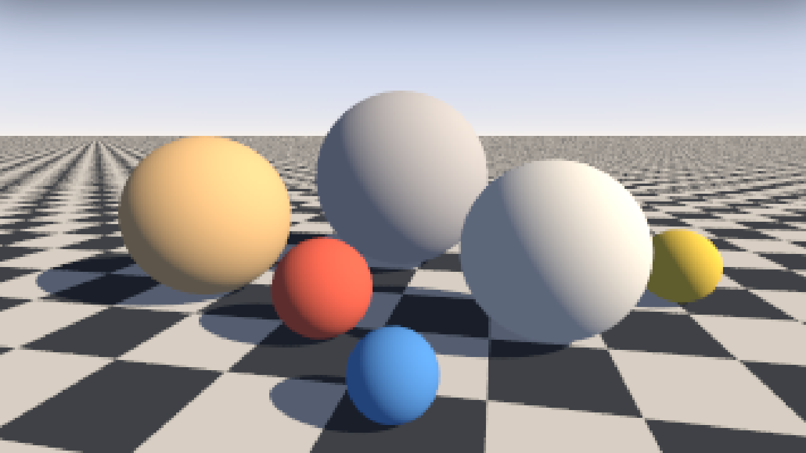
<figcaption>Die Kamera beim Start</figcaption>
</figure>
<figure>
<!-- tutorial-screenshot
tab: preview
viewport: 800x450
hook: open raytracer.html
click: selector:#canvas
hook: play ArrowLeft 0.3 ArrowLeft 0.3 ArrowLeft 0.3 ArrowLeft 0.3 ArrowUp 0.3 ArrowUp 4
crop-element: #canvas
-->
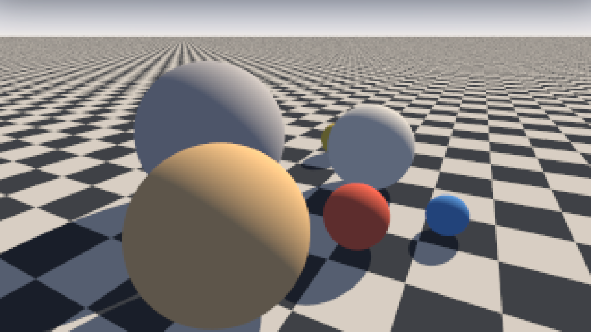
<figcaption>Ein Stück nach links gekreist und höher</figcaption>
</figure>
</div>

## Ein Planet

### Länge und Breite

Bisher hat jede Kugel eine einzige Farbe. Eine **Textur** gibt jedem Punkt der Oberfläche eine eigene. Dafür braucht man für jeden Punkt der Kugel zwei Zahlen, wie die Längen- und Breitengrade auf einem Globus. Die Normale zeigt vom Mittelpunkt zum Punkt; aus ihr kommen beide:

- **Längengrad** `u = atan2(n.z, n.x)`: der Winkel rund um die Kugel, von −π bis π.
- **Breitengrad** `v = asin(n.y)`: wie hoch der Punkt liegt, von −π/2 am Südpol bis π/2 am Nordpol.


Mit `u` und `v` kann man rechnen wie mit `x` und `y` auf einem Bild. Der Planet hier bekommt Streifen wie Jupiter: Die Farbe wechselt mit dem Breitengrad hin und her, in breiten und in feinen Streifen, und damit sie nicht wie mit dem Lineal gezogen aussehen, wellt der Längengrad sie ein wenig. Dazu kommt Jupiters großer roter Fleck, ein Sturm, größer als die Erde. `r` sagt, wie weit ein Punkt von seiner Mitte weg ist, gemessen in seiner Größe: 0 in der Mitte, 1 am Rand. Innen ist er rot, zum Rand hin dunkler, und weich geht er in einen hellen Ring über, wie auf den Fotos von Jupiter.

### Streifen und ein Fleck

Das Material bekommt ein Feld `planet`:

```c
~ typedef struct
~ {
~     vec color;
    bool planet;  // mit Textur
~ } material;
```

Die orange Kugel wird zum Planeten. Ersetze in `spheres` ihre Zeile, die mit `{.color = {0.9, 0.6, 0.3}}`, durch:

```c
    {{-2.2, 0.9, 0.3}, 0.9, {.planet = true}},
```

Unter `hit_floor` kommt die Textur:

```c
// Textur: die Farbe an dem Punkt der Kugel, in den die Normale n zeigt
vec planet_color(vec n)
{
    double u = atan2(n.z, n.x);  // Längengrad: -pi bis pi
    double v = asin(n.y);        // Breitengrad: -pi/2 bis pi/2

    // Streifen nach dem Breitengrad, breite und feine, leicht gewellt
    double band = 0.5 + 0.5 * sin(13 * v + 0.3 * sin(5 * u + 8 * v)) + 0.12 * sin(45 * v + 2 * sin(3 * u));
    vec color = mix((vec){0.58, 0.32, 0.16}, (vec){0.92, 0.84, 0.68}, band);

    // der große rote Fleck: r ist 0 in seiner Mitte und 1 an seinem Rand
    double du = (u - 1.0) / 0.36;
    double dv = (v + 0.38) / 0.15;
    double r = sqrt(du * du + dv * dv);
    // um ihn herum ein heller Ring, innen rot, zum Rand hin dunkler
    color = mix(color, (vec){0.93, 0.86, 0.72}, fmax(0, 1 - fabs(r - 1.15) / 0.35));
    vec spot = mix((vec){0.88, 0.47, 0.26}, (vec){0.62, 0.22, 0.1}, r * r);
    return mix(color, spot, fmin(1, fmax(0, (1 - r) / 0.2)));
}
```

Was die Zeilen tun, siehst du am besten flach. Breite die Textur als Rechteck aus, waagrecht `u` von −π links bis π rechts, senkrecht `v` von −π/2 unten bis π/2 oben, so wie eine Weltkarte die Erde ausbreitet. Die blassen Linien liegen alle π/4. Zeile für Zeile entsteht so der Planet:

<div class='gallery columns-2'>
<figure>
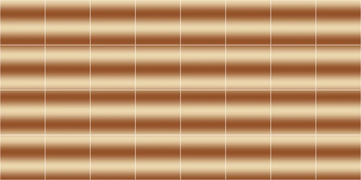
<figcaption>Nur <code>0.5 + 0.5 * sin(13 * v)</code>: gerade Streifen, die nur vom Breitengrad abhängen.</figcaption>
</figure>
<figure>
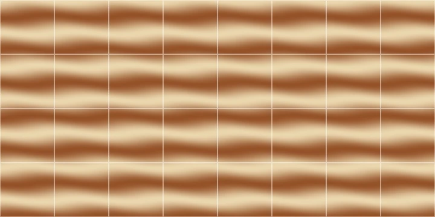
<figcaption>Mit <code>0.3 * sin(5 * u + 8 * v)</code> im Sinus: Der Längengrad wellt die Streifen.</figcaption>
</figure>
<figure>
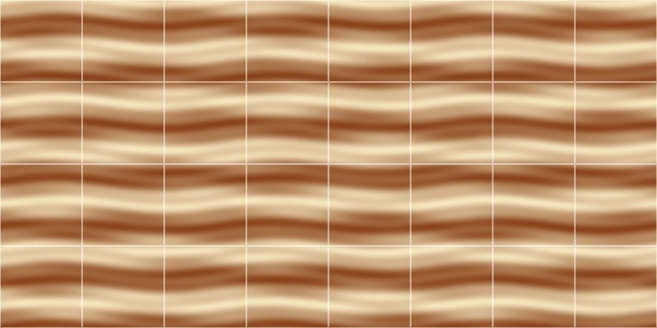
<figcaption>Dazu <code>0.12 * sin(45 * v + 2 * sin(3 * u))</code>: feine Streifen zwischen den breiten.</figcaption>
</figure>
<figure>
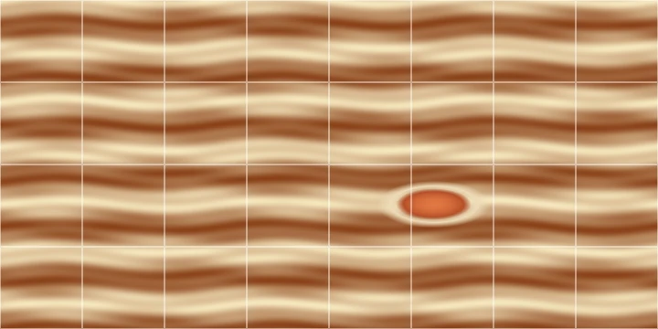
<figcaption>Dazu der Fleck mit seinem Ring, in der Mitte bei <code>u = 1.0</code> und <code>v = -0.38</code>.</figcaption>
</figure>
</div>

Auf der Kugel holt sich jeder Punkt mit seinem `u` und `v` die Farbe an dieser Stelle des Rechtecks: Das Rechteck wird um die Kugel gewickelt.

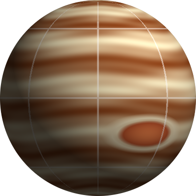

Von vorn siehst du die Hälfte mit `u` von 0 am rechten Rand der Kugel bis π am linken: Wegen `atan2(n.z, n.x)` wächst `u` auf der Kugel von rechts nach links, das Rechteck liegt also gespiegelt auf ihr. Und je näher ein Punkt an einem Pol liegt, desto enger rücken die Spalten des Rechtecks zusammen; am Pol treffen sie sich alle in einem Punkt.

In `nearest_hit` holt sich eine Kugel mit `planet` ihre Farbe aus der Textur:

```c
~         h->mat = s.mat;
        if (s.mat.planet)
            h->mat.color = planet_color(h->normal);
```

<!-- tutorial-screenshot
write-file: raytracer.c <- file:stufen/08-textur.c
terminal-open
terminal-run: make PROGRAM=raytracer
terminal-wait-for-prompt
terminal-expect-no-text: error:
terminal-expect-no-text: ***
tab: preview
viewport: 800x450
hook: open raytracer.html
hook: frames 64
crop-element: #canvas
check-task-fails: reflect
-->
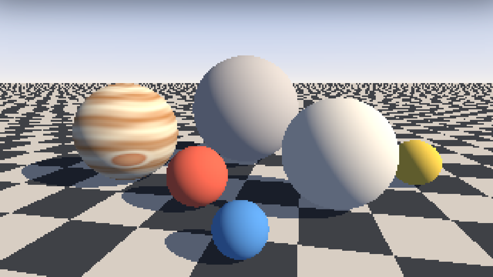

<div class='hint try'>
<strong>Ausprobieren:</strong> Ersetze in <code>planet_color</code> die Zeile mit <code>band</code> durch <code>double band = ((int)floor(4 * u) + (int)floor(4 * v)) % 2 == 0;</code>. Dann liegt ein Schachbrett aus Längen- und Breitengraden auf der Kugel, und du siehst, wie <code>u</code> und <code>v</code> um sie herumlaufen: Zu den Polen werden die Felder immer schmaler. Stell die Zeile danach wieder zurück.
</div>

## Spiegel

### Abprallen

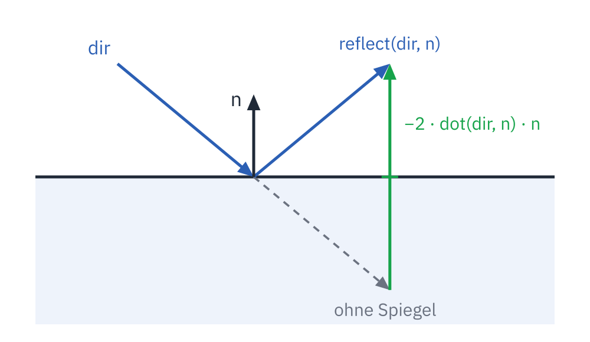

Ein Spiegel schickt den Strahl weiter, und zwar so, dass er im selben Winkel abprallt, in dem er angekommen ist. Zerlegt man `dir` in einen Teil entlang der Normalen, `dot(dir, n) · n`, und den Rest, dann dreht sich beim Abprallen nur der Teil entlang der Normalen um. Zieht man ihn zweimal ab, ist er umgedreht:

$$\text{reflect}(\text{dir}, n) = \text{dir} - 2\,(\text{dir} \cdot n)\, n$$

Wie ein gespiegelter Strahl weitergeht, weiß `trace` schon: Es ist dieselbe Frage wie beim Strahl vom Auge. `trace` ruft sich also selbst auf. Damit ein Strahl zwischen zwei Spiegeln nicht ewig hin und her springt, zählt `depth` mit, wie oft schon gespiegelt wurde. Oben in die Datei:

```c
~ #define EPS 1e-4
// wie oft ein Strahl höchstens gespiegelt wird
#define MAX_DEPTH 6
```

Das Material sagt, wie stark eine Oberfläche spiegelt:

```c
~     vec color;
    double mirror;  // Anteil, der gespiegelt wird: 0 bis 1
~     bool planet;    // mit Textur
```

Die große Kugel hinten wird ein Spiegel, und der Boden glänzt ein wenig. Ersetze in `spheres` die erste Zeile, die große graue Kugel, und `floor_mat` durch:

```c
    {{-0.3, 1.2, -1.4}, 1.2, {.color = {0.9, 0.9, 0.95}, .mirror = 0.9}},
```

```c
material floor_mat = {.color = {0.75, 0.75, 0.75}, .mirror = 0.1};
```

Jetzt fehlen `reflect` und das neue `trace`, das sich selbst aufruft.

<div class='hint own' data-check='reflect'>
<strong>Jetzt bist du dran:</strong> Schreib über <code>trace</code> die Funktion <code>vec reflect(vec dir, vec n)</code> nach der Formel oben. Dann bekommt <code>trace</code> einen dritten Parameter, <code>int depth</code>, und zwei neue Teile: Ist <code>depth</code> größer als <code>MAX_DEPTH</code>, gibt es Schwarz zurück. Und spiegelt das getroffene Material (<code>h.mat.mirror &gt; 0</code>), verfolgt <code>trace</code> vom Treffpunkt aus einen neuen Strahl in Richtung <code>reflect(dir, h.normal)</code>, eine Stufe tiefer, und mischt dessen Farbe mit <code>mix</code> im Anteil <code>mirror</code> unter die eigene.
</div>

<!-- hint -->
`reflect` ist eine einzige Zeile: die Formel oben mit `sub`, `scale` und `dot`. Für `trace`: An welcher Stelle im alten `trace` weißt du, welches Material getroffen wurde und wo?
<!-- /hint -->
<!-- hint -->
Ein Gerüst für `trace`:

```c
vec trace(vec origin, vec dir, int depth)
{
    // hier: zu oft gespiegelt? Dann Schwarz.

    hit h;
    if (!nearest_hit(origin, dir, &h))
        return sky(dir);

    vec light = add(sunlight(h), ambient);
    vec color = mul(h.mat.color, light);
    if (h.mat.mirror > 0)
    {
        // hier: trace für den gespiegelten Strahl vom Treffpunkt aus,
        // eine Stufe tiefer, und seine Farbe mit mix unter color mischen
    }
    return color;
}
```
<!-- /hint -->

<!-- solution -->
```c
// der Strahl dir prallt an der Oberfläche mit der Normalen n ab
vec reflect(vec dir, vec n)
{
    return sub(dir, scale(n, 2 * dot(dir, n)));
}

// die Farbe, die aus Richtung dir beim Punkt origin ankommt
vec trace(vec origin, vec dir, int depth)
{
    if (depth > MAX_DEPTH)
        return (vec){0, 0, 0};  // zu oft gespiegelt

    hit h;
    if (!nearest_hit(origin, dir, &h))
        return sky(dir);

    vec light = add(sunlight(h), ambient);
    vec color = mul(h.mat.color, light);

    // Spiegel: ein neuer Strahl vom Treffpunkt aus
    if (h.mat.mirror > 0)
    {
        vec reflected = trace(h.point, reflect(dir, h.normal), depth + 1);
        color = mix(color, reflected, h.mat.mirror);
    }
    return color;
}
```
<!-- /solution -->

In `draw` beginnt jeder Strahl vom Auge mit `depth` 0; die Zeile mit `trace` wird zu:

```c
            vec c = trace(eye, ray_dir(x + random_double(), y + random_double()), 0);
```

_task(reflect)

_task(spiegeln)

<!-- tutorial-screenshot
write-file: raytracer.c <- file:stufen/09-spiegel.c
terminal-open
terminal-run: make PROGRAM=raytracer
terminal-wait-for-prompt
terminal-expect-no-text: error:
terminal-expect-no-text: ***
tab: preview
viewport: 800x450
hook: open raytracer.html
hook: frames 64
crop-element: #canvas
check-task: reflect
-->
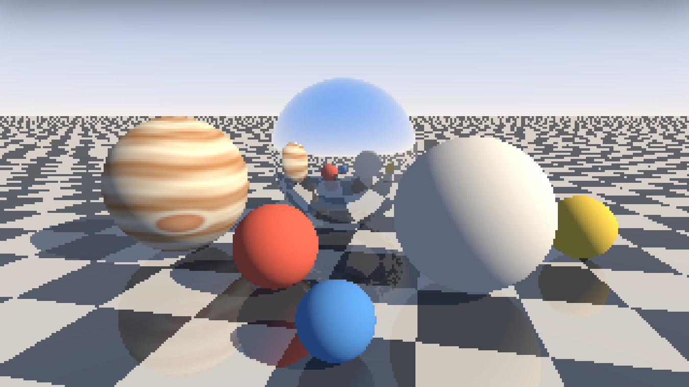

Die Spiegelkugel zeigt die ganze Szene, gebogen wie in einer Christbaumkugel, und im Boden spiegeln sich die Kugeln ganz leicht.

_task(tiefe)

## Glas

### Brechen

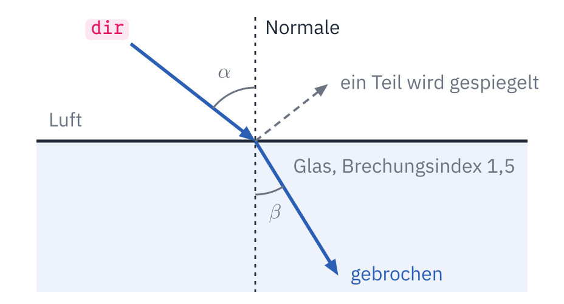

Fällt Licht schräg auf Glas, knickt es ab, zur Normalen hin. Wie stark, hängt vom **Brechungsindex** ab: Luft hat 1, Glas etwa 1,5. Für die Winkel α vor und β nach der Grenze gilt das Brechungsgesetz \\(\sin\alpha = 1{,}5 \cdot \sin\beta\\).

_person(snellius)

Als Vektoren mit `eta` = Brechungsindex davor geteilt durch danach und `cos_in = −dot(dir, n)`:

$$k = 1 - \eta^2 \,(1 - \cos^2\_{\text{in}}), \qquad \text{gebrochen} = \eta \cdot \text{dir} + (\eta \cos\_{\text{in}} - \sqrt{k})\, n$$

Kommt der Strahl von innen, aus dem Glas, ist alles umgekehrt: `eta` ist 1,5, und die Normale muss nach innen zeigen. Wird `k` negativ, gibt es keinen gebrochenen Strahl: Das Licht kommt so flach von innen an die Oberfläche, dass es ganz zurückgespiegelt wird, die **Totalreflexion**. Glasfasern leiten Licht so über Tausende Kilometer.

_task(grenzwinkel)

### Wie viel wird gespiegelt?

Glas bricht nicht nur, es spiegelt auch, und wie viel, hängt vom Winkel ab: Schaut man senkrecht auf eine Scheibe, sieht man fast nur hindurch, schaut man flach darüber, spiegelt sie wie ein Spiegel. Christophe Schlick fand 1994 eine einfache Formel, die dem genauen Gesetz sehr nahe kommt.

_person(fresnel)

Das Material bekommt einen Brechungsindex:

```c
~     double mirror;  // Anteil, der gespiegelt wird: 0 bis 1
    double glass;   // Brechungsindex bei Glas, sonst 0
```

Die weiße Kugel rechts wird Glas. Ersetze in `spheres` ihre Zeile, die mit `{.color = {0.9, 0.9, 0.9}}`, durch:

```c
    {{1.5, 0.8, 0.8}, 0.8, {.color = {0.95, 1.0, 0.97}, .glass = 1.5}},
```

Ein gebrochener Strahl beginnt im Glas, und von innen trifft er die Kugel ein zweites Mal, hinten. `hit_sphere` braucht dafür auch die zweite Lösung:

```c
~     double t = -b - sqrt(d);
~     if (t > EPS)
~         return t;
    t = -b + sqrt(d);     // der Strahl startet in der Kugel (Glas)
    if (t > EPS)
        return t;
~     return INFINITY;      // die Kugel liegt hinter dem Auge
```

Glas wirft auch einen Schatten, aber einen helleren: Es lässt einen Teil des Lichts durch. Statt `nearest_hit` fragt `sunlight` darum jetzt `light_through`. Ersetze `sunlight` durch die beiden:

```c
// wie viel Licht von point aus in Richtung dir durchkommt: 1, 0 oder dazwischen
double light_through(vec point, vec dir)
{
    double light = 1;
    for (int i = 0; i < SPHERE_COUNT; i++)
    {
        if (hit_sphere(point, dir, spheres[i]) < INFINITY)
        {
            if (spheres[i].mat.glass == 0)
                return 0;
            light *= 0.6;  // Glas lässt etwas durch
        }
    }
    return light;
}

// Licht von der Sonne: je steiler sie auf die Oberfläche scheint, desto heller
vec sunlight(hit h)
{
    double d = dot(h.normal, sun_dir);
    if (d <= 0)
        return (vec){0, 0, 0};
    return scale(sun_color, d * light_through(h.point, sun_dir));
}
```

Unter `reflect` kommt das Glas. Weil `glass` `trace` aufruft und `trace` erst danach steht, sagt die erste Zeile dem Compiler vorab, dass es `trace` gibt:

```c
vec trace(vec origin, vec dir, int depth);

// Glas: ein Teil wird gespiegelt, der Rest gebrochen
vec glass(hit h, vec dir, int depth)
{
    vec n = h.normal;
    double eta = 1 / h.mat.glass;  // von der Luft ins Glas
    if (dot(dir, n) > 0)
    {
        n = scale(n, -1);          // von innen nach außen
        eta = h.mat.glass;
    }
    double cos_in = -dot(dir, n);
    vec reflected = trace(h.point, reflect(dir, n), depth + 1);

    // Brechung nach Snellius; k < 0: Totalreflexion
    double k = 1 - eta * eta * (1 - cos_in * cos_in);
    if (k < 0)
        return reflected;
    vec refracted_dir = add(scale(dir, eta), scale(n, eta * cos_in - sqrt(k)));
    vec refracted = mul(trace(h.point, refracted_dir, depth + 1), h.mat.color);

    // Fresnel nach Schlick: wie viel gespiegelt wird, flach mehr als steil
    double r0 = (1 - h.mat.glass) / (1 + h.mat.glass);
    r0 = r0 * r0;
    double r = r0 + (1 - r0) * pow(1 - cos_in, 5);
    return mix(refracted, reflected, r);
}
```

In `trace` geht Glas einen eigenen Weg:

```c
~     if (!nearest_hit(origin, dir, &h))
~         return sky(dir);
~
    if (h.mat.glass > 0)
        return glass(h, dir, depth);
```

<!-- tutorial-screenshot
write-file: raytracer.c <- file:stufen/10-glas.c
terminal-open
terminal-run: make PROGRAM=raytracer
terminal-wait-for-prompt
terminal-expect-no-text: error:
terminal-expect-no-text: ***
tab: preview
viewport: 800x450
hook: open raytracer.html
hook: frames 64
crop-element: #canvas
-->


Durch die Glaskugel steht das Schachbrett auf dem Kopf, wie bei einer Lupe, die man weit vom Auge hält. Zum Rand hin spiegelt sie immer mehr.

### Whitteds Kugel ist hohl

In Whitteds Bild am Anfang der Seite steht das Schachbrett in der Glaskugel nicht auf dem Kopf; man sieht fast ungestört hindurch. Seine Kugel ist hohl: eine dünne Schale aus Glas, innen Luft. Gefragt, warum, sagte Whitted, eine volle Kugel wäre »zu schwer« gewesen; außerdem gaben die zwei Oberflächen einen interessanteren Baum von Strahlen, mit Spiegelungen innen in der Wand.

<div class='book'>
<i class='bi bi-file-earmark-text'></i>
<p><strong>About that glass ball…</strong>, Eric Haines, Real-Time Rendering Blog, 2019. Wie Haines im Nachbau von Whitteds Szene bei NVIDIA entdeckte, dass die Glaskugel fast ganz hohl ist, wie anders eine volle aussieht und was Whitted selbst dazu schrieb: <a href='https://realtimerendering.com/blog/?p=5265'>realtimerendering.com</a>.</p>
</div>

<div class='gallery columns-2'>
<figure>
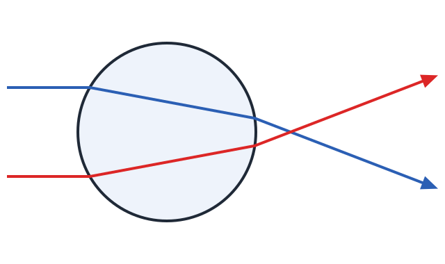
<figcaption>Voll: Jeder Strahl knickt zweimal zur Mitte hin ab, die Strahlen kreuzen sich, oben und unten tauschen.</figcaption>
</figure>
<figure>
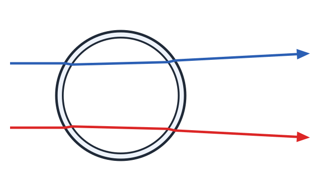
<figcaption>Hohl: In jeder dünnen Wand knickt der Strahl ab und gleich wieder zurück; er geht fast gerade hindurch.</figcaption>
</figure>
</div>

In der vollen Kugel knickt ein Strahl beim Eintreten und beim Austreten jeweils zur Mitte hin ab, die Strahlen kreuzen sich, und was oben war, ist unten. In der hohlen geht er durch zwei dünne Wände wie durch zwei Fensterscheiben: In jeder knickt er ab und gleich wieder zurück, und er kommt fast in derselben Richtung heraus.

Für deinen Raytracer ist eine hohle Glaskugel eine Glaskugel und darin eine etwas kleinere Kugel aus Luft, mit demselben Mittelpunkt. Im Nachbau von Whitteds Szene bei NVIDIA hat die innere den 0,96-fachen Radius der äußeren, und so ist es auch hier. Links vorn kommt eine kleinere hohle Glaskugel dazu, damit du beide zugleich im Bild hast:

```c
~     {{1.5, 0.8, 0.8}, 0.8, {.color = {0.95, 1.0, 0.97}, .glass = 1.5}},
    // hohle Glaskugel: außen Glas, innen eine etwas kleinere Kugel aus Luft
    {{-1.5, 0.5, 2.4}, 0.5, {.color = {0.95, 1.0, 0.97}, .glass = 1.5}},
    {{-1.5, 0.5, 2.4}, 0.48, {.color = {1, 1, 1}, .glass = 1 / 1.5}},
```

`glass` ist der Brechungsindex innen geteilt durch den außen. Bei der Glaskugel ist innen Glas und außen Luft, 1,5 / 1; bei der Kugel aus Luft ist es umgekehrt, 1 / 1,5. Trifft ein Strahl sie von außen, aus dem Glas, rechnet `glass` darum mit `eta = 1 / (1 / 1,5) = 1,5`, genau wie für einen Strahl, der aus Glas in Luft geht. Mehr braucht es nicht, auch nicht für die Totalreflexion in der Wand. `.color = {1, 1, 1}` lässt das Licht in der Luft, wie es ist.

<!-- tutorial-screenshot
write-file: raytracer.c <- file:stufen/10-hohl.c
terminal-open
terminal-run: make PROGRAM=raytracer
terminal-wait-for-prompt
terminal-expect-no-text: error:
terminal-expect-no-text: ***
tab: preview
viewport: 800x450
hook: open raytracer.html
hook: frames 64
crop-element: #canvas
-->


Links geht das Schachbrett fast gerade durch die hohle Kugel hindurch, wie bei Whitted; nur ihr Rand und ein paar Spiegelungen verraten sie. Rechts stellt die volle Kugel es auf den Kopf. Die hohle Kugel kostet Zeit: In ihrer dünnen Wand wird ein Strahl oft gespiegelt und gebrochen, bis `MAX_DEPTH` erreicht ist, und jeder Durchgang dauert spürbar länger.

## Weiche Schatten

### Die Sonne ist eine Scheibe

Die Schatten haben scharfe Ränder, weil die Sonne bisher ein Punkt ist: Ein Punkt sieht die Sonne oder sieht sie nicht. Die echte Sonne ist eine Scheibe am Himmel. Am Rand eines Schattens verdeckt eine Kugel nur einen Teil von ihr, und es ist nur ein bisschen dunkler, ein **Halbschatten**.

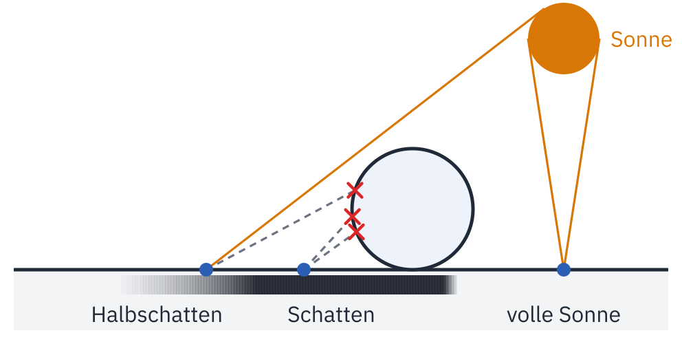

Das kostet jetzt fast nichts mehr: Jeder Durchgang zielt mit dem Schattenstrahl auf einen anderen zufälligen Punkt der Sonnenscheibe, und der Durchschnitt über viele Durchgänge ergibt den Halbschatten von selbst. Vorgeschlagen haben das Robert Cook, Thomas Porter und Loren Carpenter 1984 bei Lucasfilm.

<div class='book'>
<i class='bi bi-file-earmark-text'></i>
<p><strong>Distributed Ray Tracing</strong>, Robert L. Cook, Thomas Porter und Loren Carpenter, SIGGRAPH 1984. Statt eines Strahls viele, deren Richtungen gewürfelt werden: über die Fläche der Lampe verteilt für Halbschatten, über die Linse für Tiefenschärfe, über die Zeit für Bewegungsunschärfe, dazu unscharfe Spiegelungen und trübes Glas: <a href='https://doi.org/10.1145/800031.808590'>bei der ACM</a>.</p>
</div>

Dafür braucht es einen zufälligen Punkt in einer Kugel um den Nullpunkt; `random_in_sphere` würfelt so lange, bis ein Punkt im Würfel auch in der Kugel liegt. Unter `random_double`:

```c
// ein zufälliger Punkt in der Kugel mit Radius 1 um den Nullpunkt
vec random_in_sphere(void)
{
    while (true)
    {
        vec p = {2 * random_double() - 1, 2 * random_double() - 1, 2 * random_double() - 1};
        if (dot(p, p) < 1)
            return p;
    }
}
```

Bei der Sonne steht, wie groß sie ist:

```c
~ vec sun_color = {1.4, 1.2, 0.9};
// wie groß die Sonne am Himmel ist (im Bogenmaß)
#define SUN_SIZE 0.08
```

`sunlight` wackelt die Richtung zur Sonne ein wenig. Ersetze `sunlight` durch:

```c
// Licht von der Sonne: zu einem zufälligen Punkt der Sonnenscheibe
vec sunlight(hit h)
{
    vec to_sun = normalize(add(sun_dir, scale(random_in_sphere(), SUN_SIZE)));
    double d = dot(h.normal, to_sun);
    if (d <= 0)
        return (vec){0, 0, 0};
    return scale(sun_color, d * light_through(h.point, to_sun));
}
```

Und damit man die Sonne im Spiegel sieht, zeichnet `trace` sie in den Himmel; aus `return sky(dir);` unter `if (!nearest_hit(…))` wird:

```c
~     if (!nearest_hit(origin, dir, &h))
    {
        if (dot(dir, sun_dir) > cos(SUN_SIZE))
            return scale(sun_color, 3);  // die Sonnenscheibe
        return sky(dir);
    }
```

<div class='gallery columns-2'>
<figure>
<!-- tutorial-screenshot
write-file: raytracer.c <- file:stufen/11-weich.c
terminal-open
terminal-run: make PROGRAM=raytracer
terminal-wait-for-prompt
terminal-expect-no-text: error:
terminal-expect-no-text: ***
tab: preview
viewport: 800x450
hook: open raytracer.html
hook: frames 1
crop-element: #canvas
-->
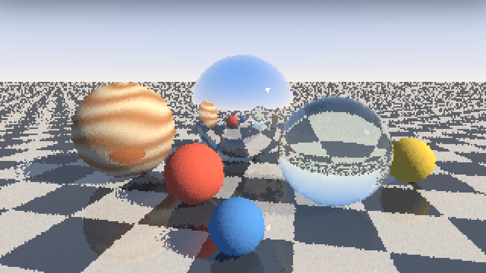
<figcaption>Nach einem Durchgang</figcaption>
</figure>
<figure>
<!-- tutorial-screenshot
tab: preview
viewport: 800x450
hook: open raytracer.html
hook: frames 64
crop-element: #canvas
-->
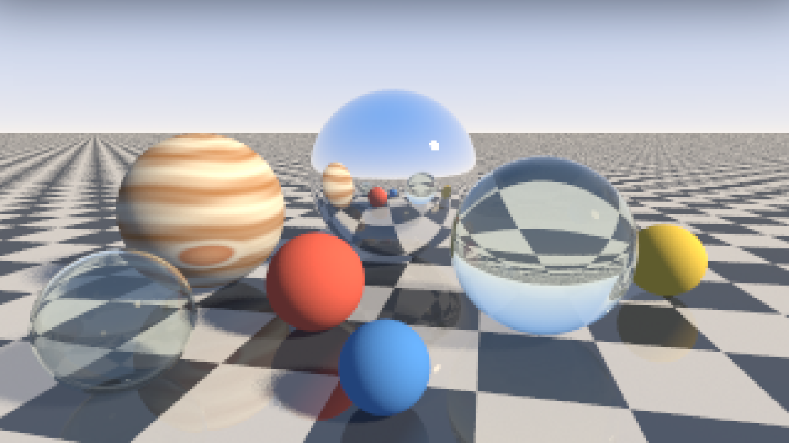
<figcaption>Nach 64 Durchgängen</figcaption>
</figure>
</div>

<div class='hint try'>
<strong>Ausprobieren:</strong> Setz <code>SUN_SIZE</code> auf 0.3: Die Sonne wird riesig, und die Schatten werden so weich wie an einem trüben Tag. Bei 0.01 sind sie fast wieder scharf. Stell den Wert danach wieder zurück.
</div>

## Licht vom Himmel

### Ein Strahl in eine zufällige Richtung

Eine Sache stimmt noch nicht: Das Himmelslicht `ambient` kommt überall gleich stark an, auch unter einer Kugel, dort, wo sie fast auf dem Boden aufliegt. In Wirklichkeit sieht ein Punkt dort kaum Himmel. Mit derselben Idee wie bei der Sonne lässt sich auch das ausrechnen: Jeder Durchgang schickt vom Treffpunkt einen Strahl in eine zufällige Richtung über der Oberfläche. Sieht er den Himmel, kommt dessen Farbe als Licht an; trifft er etwas, nicht.

`ambient` wird gelöscht, an seine Stelle tritt `skylight`, unter `reflect`:

```c
// Licht vom Himmel: aus einer zufälligen Richtung über der Oberfläche
vec skylight(hit h)
{
    vec d = normalize(add(h.normal, random_in_sphere()));
    if (d.y < 0)
        return (vec){0, 0, 0};  // nach unten ist der Boden im Weg
    return scale(sky(d), 0.3 * light_through(h.point, d));
}
```

`normal + random_in_sphere()` zeigt immer in die Hälfte über der Oberfläche, und steil nach oben öfter als flach zur Seite, so wie auch der Himmel steil von oben mehr Licht gibt.

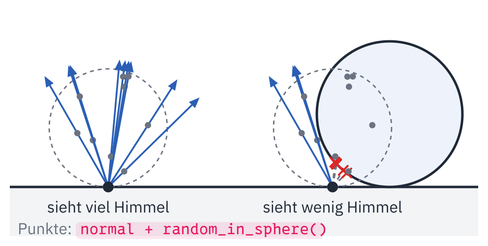

In `trace` wird die Zeile mit `ambient` zu:

```c
    vec light = add(sunlight(h), skylight(h));
```

<!-- tutorial-screenshot
write-file: raytracer.c <- file:stufen/12-himmelslicht.c
terminal-open
terminal-run: make PROGRAM=raytracer
terminal-wait-for-prompt
terminal-expect-no-text: error:
terminal-expect-no-text: ***
tab: preview
viewport: 800x450
hook: open raytracer.html
hook: frames 128
crop-element: #canvas
-->


Unter jeder Kugel ist der Boden jetzt dort dunkel, wo sie ihn fast berührt, und erst damit stehen sie richtig auf ihm. Die Schattenseiten bekommen das Blau des Himmels.

## Glanz

### Lack

Die rote und die blaue Kugel sehen noch aus wie aus Ton. Eine lackierte Kugel hat in der Sonne einen hellen Punkt, den **Glanzpunkt**, und der ist nichts anderes als die Sonne, gespiegelt im Lack. Lack ist eine dünne, durchsichtige Schicht wie Glas: Er spiegelt ein wenig, wenn du steil von vorn schaust, und flach am Rand fast alles. Wie viel, rechnet die Formel von Schlick aus, die du schon für das Glas geschrieben hast. Damit `glass` und der Lack sie beide benutzen können, kommt sie in eine eigene Funktion über `glass`:

```c
// Fresnel nach Schlick: wie viel eine Oberfläche mit diesem Brechungsindex
// spiegelt, flach mehr als steil
double fresnel(double cos_in, double index)
{
    double r0 = (1 - index) / (1 + index);
    r0 = r0 * r0;
    return r0 + (1 - r0) * pow(1 - cos_in, 5);
}
```

Am Ende von `glass` steht dann statt der vier Zeilen von Schlick nur noch:

```c
~     vec refracted = mul(trace(h.point, refracted_dir, depth + 1), h.mat.color);
    return mix(refracted, reflected, fresnel(cos_in, h.mat.glass));
~ }
```

Das Material bekommt ein Feld für den Lack:

```c
~     double glass;   // Brechungsindex bei Glas, sonst 0
    bool varnish;   // lackiert: spiegelt ein wenig, flach mehr als steil
```

In `trace` spiegelt jetzt ein Spiegel oder ein Lack. Beim Spiegel steht fest, wie viel er spiegelt, beim Lack rechnet es `fresnel` aus: `-dot(dir, h.normal)` ist der Kosinus des Winkels, unter dem der Strahl auftrifft, wie `cos_in` in `glass`, und 1,5 ist der Brechungsindex von Lack, etwa wie bei Glas. Ersetze in `trace` den Teil, der mit `// Spiegel:` beginnt, durch:

```c
    // Spiegel und Lack: ein neuer Strahl vom Treffpunkt aus
    double shine = h.mat.mirror;
    if (h.mat.varnish)
        shine = fresnel(-dot(dir, h.normal), 1.5);  // Lack ist wie eine dünne Schicht Glas
    if (shine > 0)
    {
        vec reflected = trace(h.point, reflect(dir, h.normal), depth + 1);
        color = mix(color, reflected, shine);
    }
```

Lackiert werden die rote und die blaue Kugel; ihre Zeilen in `spheres` werden zu:

```c
    {{-0.5, 0.45, 1.2}, 0.45, {.color = {0.9, 0.15, 0.1}, .varnish = true}},
~     {{3.0, 0.4, -0.4}, 0.4, {.color = {0.95, 0.7, 0.1}}},
    {{0.4, 0.3, 2.3}, 0.3, {.color = {0.1, 0.35, 0.9}, .varnish = true}},
```

_task(lack)

Übersetzt du jetzt, siehst du kaum einen Glanzpunkt. Das liegt an der Sonnenscheibe: Sie ist bisher nur dreimal so hell wie `sun_color`, und davon spiegelt der Lack nur wenig. Wie hell ist sie wirklich? Das ganze Licht `sun_color` kommt aus einer winzigen Scheibe mit dem Radius `SUN_SIZE`. Ihre Fläche am Himmel ist \\(\pi \cdot 0{,}08^2 \approx 0{,}02\\), und so viel Licht aus so wenig Himmel heißt: Jeder Punkt der Scheibe ist etwa fünfzigmal so hell wie `sun_color`. In `trace` wird aus `return scale(sun_color, 3);`:

```c
~         if (dot(dir, sun_dir) > cos(SUN_SIZE))
            // die Sonnenscheibe: ihr ganzes Licht kommt aus dieser kleinen Fläche
            return scale(sun_color, 1 / (3.14159 * SUN_SIZE * SUN_SIZE));
```

<!-- tutorial-screenshot
write-file: raytracer.c <- file:stufen/13-lack.c
terminal-open
terminal-run: make PROGRAM=raytracer
terminal-wait-for-prompt
terminal-expect-no-text: error:
terminal-expect-no-text: ***
tab: preview
viewport: 800x450
hook: open raytracer.html
hook: frames 128
crop-element: #canvas
-->
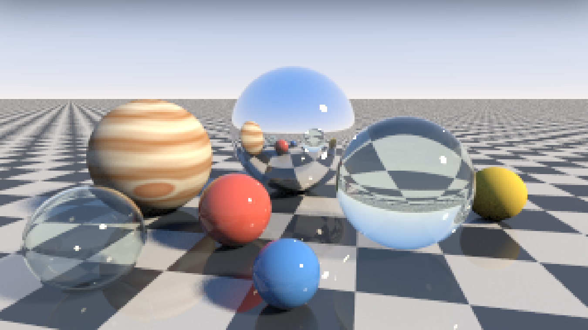

Jetzt hat jede lackierte Kugel einen weißen Glanzpunkt, dort, wo sie die Sonne zu deinem Auge spiegelt, und am Rand spiegelt sie das Schachbrett. Kreist du um die Szene, wandert der Glanzpunkt mit, denn er hängt davon ab, wo du stehst. Die helle Seite der Kugel bleibt, wo sie ist: Sie hängt nur von der Sonne ab.

<div class='hint try'>
<strong>Ausprobieren:</strong> Gib dem Boden Lack statt eines festen Spiegels: <code>material floor_mat = {.color = {0.75, 0.75, 0.75}, .varnish = true};</code>. Schau, wie stark er vorn spiegelt und wie stark zum Horizont hin, wo du ganz flach auf ihn schaust. Setz danach <code>.mirror = 0.1</code> wieder ein.
</div>

### Metall

Eine Kugel aus Chrom und eine aus Gold spiegeln beide fast alles. Aber in der Goldkugel sieht alles golden aus: Ein Metall färbt, was es spiegelt. Gold spiegelt rotes Licht fast ganz, grünes etwas weniger und blaues nur zu einem Drittel. Lack dagegen spiegelt alle Farben gleich, darum ist der Glanzpunkt auf der roten Kugel weiß und nicht rot. Für ein Metall wird das Gespiegelte mit der Farbe des Materials multipliziert, mit `mul`, so wie das Licht auf einer farbigen Oberfläche.

### Matt

Gebürstetes Metall oder eine seidenmatte Farbe spiegeln auch, aber verschwommen: Winzige Unebenheiten lenken jeden Strahl ein wenig anders ab. Das ist wieder die Idee der weichen Schatten. In jedem Durchgang bekommt der gespiegelte Strahl einen zufälligen Vektor dazu, und im Mittel über viele Durchgänge verschwimmt das Spiegelbild. `rough` sagt, wie weit: Es ist der Radius der Kugel, aus der der zufällige Vektor kommt.

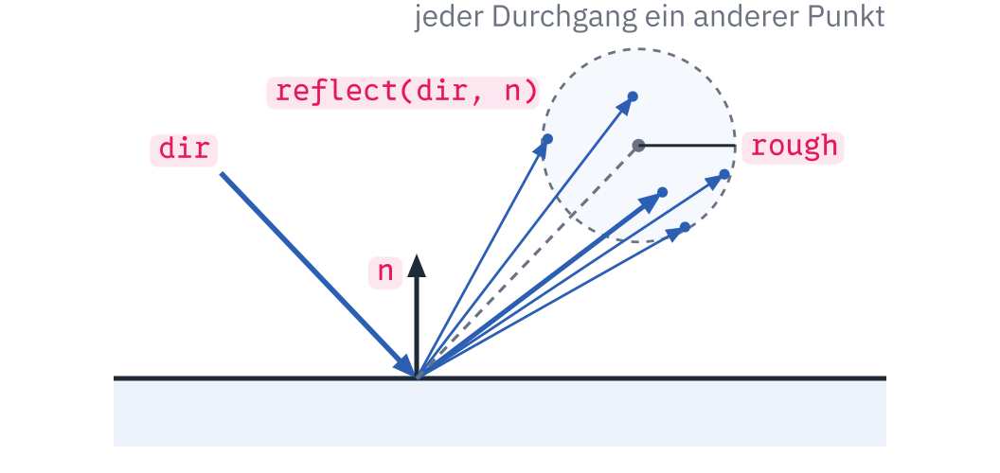

Das Material bekommt zwei Felder:

```c
~     bool varnish;   // lackiert: spiegelt ein wenig, flach mehr als steil
    bool metal;     // Metall färbt, was es spiegelt
    double rough;   // wie matt die Spiegelung ist: 0 glatt, 0.3 matt
```

Und in `trace` wird der Strahl verschoben und, bei Metall, gefärbt. Zeigt er nach dem Verschieben unter die Oberfläche, nimmt `trace` die glatte Richtung. Der Block unter `if (shine > 0)` wird zu:

```c
~     if (shine > 0)
    {
        vec r = reflect(dir, h.normal);
        // matt: in jedem Durchgang ein wenig anders, im Mittel verschwommen
        if (h.mat.rough > 0)
        {
            r = normalize(add(r, scale(random_in_sphere(), h.mat.rough)));
            if (dot(r, h.normal) < 0)
                r = reflect(dir, h.normal);
        }
        vec reflected = trace(h.point, r, depth + 1);
        if (h.mat.metal)
            reflected = mul(reflected, h.mat.color);
        color = mix(color, reflected, shine);
    }
```

Die gelbe Kugel wird Gold, leicht matt, dazu kommt eine matte Kugel aus Kupfer, und die blaue wird seidenmatt. Ersetze die beiden letzten Zeilen in `spheres`, die gelbe und die blaue Kugel, durch diese drei:

```c
    {{3.0, 0.4, -0.4}, 0.4, {.color = {1.0, 0.75, 0.3}, .mirror = 0.95, .metal = true, .rough = 0.12}},
    {{2.1, 0.35, 1.7}, 0.35, {.color = {0.95, 0.55, 0.4}, .mirror = 0.95, .metal = true, .rough = 0.35}},
    {{0.4, 0.3, 2.3}, 0.3, {.color = {0.1, 0.35, 0.9}, .varnish = true, .rough = 0.3}},
```

<!-- tutorial-screenshot
write-file: raytracer.c <- file:stufen/14-metall.c
terminal-open
terminal-run: make PROGRAM=raytracer
terminal-wait-for-prompt
terminal-expect-no-text: error:
terminal-expect-no-text: ***
tab: preview
viewport: 800x450
hook: open raytracer.html
hook: frames 256
crop-element: #canvas
-->
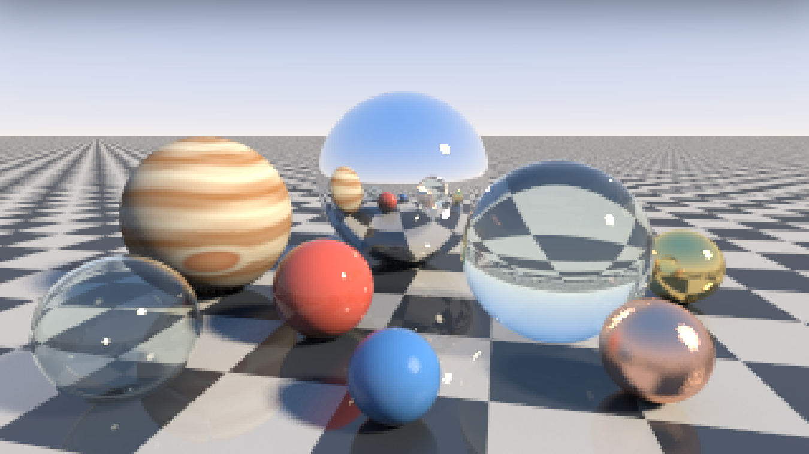

Auf einer matten Fläche ist der Glanzpunkt ein großer, weicher Fleck: Viele der verschobenen Strahlen treffen die Sonne, viele knapp daneben. Matte Spiegel brauchen viele Durchgänge, bis sie glatt sind, denn ein Strahl trifft die kleine, helle Sonne nur ab und zu.

## Das fertige Bild

Zwei Kleinigkeiten machen das Bild zum fertigen Raytracer vom Anfang der Seite. Weit hinten verschwimmt das Schachbrett im **Dunst**: Je weiter ein Treffer entfernt ist, desto mehr mischt sich die Farbe des Himmels hinein. Am Ende von `trace` wird aus `return color;`:

```c
    // Dunst: was weit weg ist, verschwimmt mit dem Himmel
    double haze = exp(-0.0004 * h.t * h.t);
    return mix(sky(dir), color, haze);
```

Und im Titel des Fensters steht, wie viele Durchgänge schon gerechnet sind. Dafür braucht es oben `#include <stdio.h>` und in der Schleife nach `draw`:

```c
        char title[64];
        snprintf(title, sizeof title, "Raytracer – %d Durchgänge", passes);
        set_title(title);
```

<!-- tutorial-screenshot
write-file: raytracer.c <- file:stufen/raytracer.c
terminal-open
terminal-run: make PROGRAM=raytracer
terminal-wait-for-prompt
terminal-expect-no-text: error:
terminal-expect-no-text: ***
tab: preview
viewport: 800x450
hook: open raytracer.html
hook: frames 256
crop-element: #canvas
-->


Von einer anderen Stelle aus:

<!-- tutorial-screenshot
tab: preview
viewport: 800x450
hook: open raytracer.html
click: selector:#canvas
hook: play ArrowRight 0.3 ArrowRight 0.3 ArrowRight 0.3 ArrowRight 0.3 ArrowRight 0.3 ArrowDown 0.3 ArrowDown 0.3 ArrowDown 6
crop-element: #canvas
-->
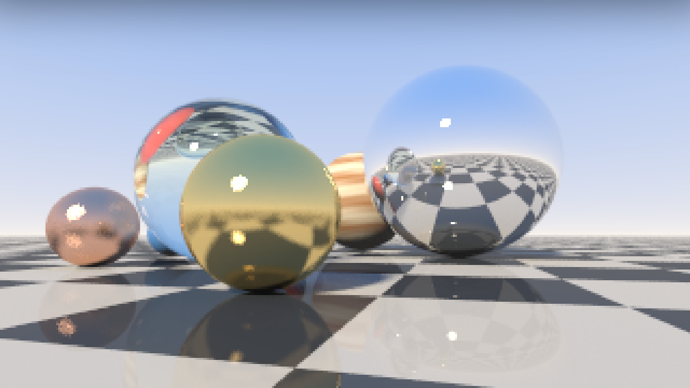

Kreise mit den Pfeiltasten um die Szene. Solange du eine Taste hältst, rauscht das Bild; lässt du los, wird es in ein paar Sekunden glatt, die matte Kupferkugel zuletzt.

### Kugeln auf Plattencovern

In den 1980er Jahren waren glänzende Kugeln über einem Schachbrett das Bild für Computergrafik schlechthin. Whitteds Bild von 1979 zeigte genau das, und bald tauchten solche Kugeln auch auf Plattencovern auf. Dieses ist von 1985, das zweite Album von Modern Talking, hier in der Ausgabe von Amiga, dem Plattenlabel der DDR. Ob das Bild gemalt, fotografiert oder gerechnet ist, steht nirgends. Mit dem, was du über Strahlen weißt, siehst du aber, was daran nicht stimmen kann.

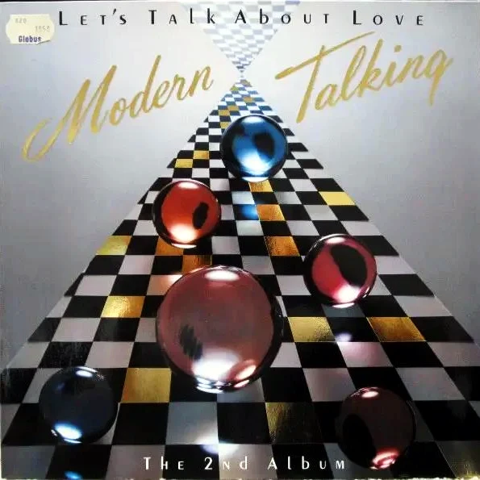

_task(cover)

<!-- extra -->
## Tiefenschärfe

### Eine Linse statt eines Punkts

Bisher kommen alle Strahlen aus einem einzigen Punkt, dem Auge. Darum ist alles gleich scharf, ganz nah wie ganz fern. Ein Fotoapparat hat eine Linse, und das Licht eines Punkts kommt durch die ganze Linse. Scharf ist nur, was im richtigen Abstand liegt, in der **Schärfeebene**; davor und dahinter verschwimmt es.

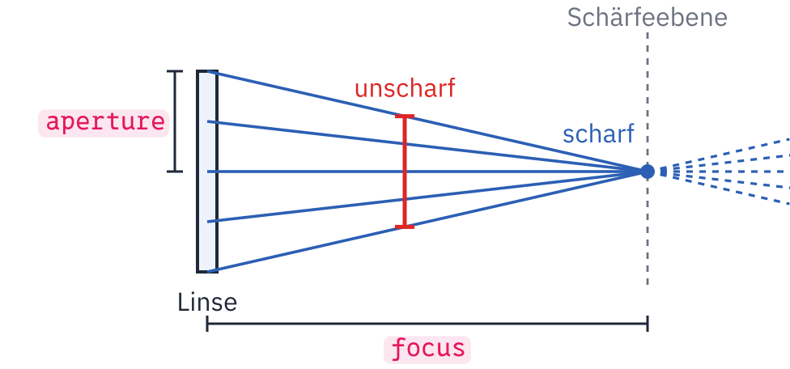

Dein Raytracer macht das wieder mit Zufall: In jedem Durchgang beginnt der Strahl eines Pixels an einem anderen zufälligen Punkt der Linse, zielt aber auf denselben Punkt der Schärfeebene wie ohne Linse. Was dort liegt, treffen alle Strahlen des Pixels gleich; was davor oder dahinter liegt, treffen sie an verschiedenen Stellen, und der Durchschnitt verschwimmt. Einen zufälligen Punkt auf der Linse gibt `random_in_disc`, unter `random_in_sphere`:

```c
// ein zufälliger Punkt in einer Scheibe mit dem Radius 1, wie eine Linse
vec random_in_disc(void)
{
    while (true)
    {
        vec p = {2 * random_double() - 1, 2 * random_double() - 1, 0};
        if (dot(p, p) < 1)
            return p;
    }
}
```

Über `ray_dir` stehen der Radius der Linse und der Abstand der Schärfeebene:

```c
// Tiefenschärfe: wie groß die Linse ist und wie weit weg alles scharf ist
double aperture = 0.06;
double focus = 4.2;
```

In `draw` beginnt der Strahl jetzt auf der Linse. `sharp` ist der Punkt, an dem der alte Strahl die Schärfeebene trifft: Er geht so weit, bis er `focus` weit vor dem Auge ist, und weil `dir` schräg ist, ist das etwas mehr als `focus`. Die Zeile mit `trace` in `draw` wird zu:

```c
            // der Strahl beginnt an einem zufälligen Punkt der Linse und
            // zielt auf denselben Punkt in der Schärfeebene wie ohne Linse
            vec dir = ray_dir(x + random_double(), y + random_double());
            vec sharp = add(eye, scale(dir, focus / dot(dir, forward)));
            vec lens = random_in_disc();
            vec origin = add(eye, add(scale(right, aperture * lens.x), scale(up, aperture * lens.y)));
            vec c = trace(origin, normalize(sub(sharp, origin)), 0);
```

Mit <kbd>W</kbd> und <kbd>S</kbd> schiebst du die Schärfe weiter weg oder näher heran:

```c
~         if (key_down(pixel_key_down) && height > 0.3) { height -= 2 * dt; passes = 0; }
        // W/S: scharf weiter weg oder näher
        if (key_down(pixel_key_w) && focus < 12) { focus += 3 * dt; passes = 0; }
        if (key_down(pixel_key_s) && focus > 1)  { focus -= 3 * dt; passes = 0; }
```

Und der Titel sagt, wo es scharf ist; die Zeile mit `snprintf` wird zu:

```c
        snprintf(title, sizeof title, "Raytracer – %d Durchgänge, scharf bei %.1f", passes, focus);
```

<!-- tutorial-screenshot
write-file: raytracer.c <- file:stufen/15-schaerfe.c
terminal-open
terminal-run: make PROGRAM=raytracer
terminal-wait-for-prompt
terminal-expect-no-text: error:
terminal-expect-no-text: ***
tab: preview
viewport: 800x450
hook: open raytracer.html
hook: frames 256
crop-element: #canvas
-->


<div class='hint try'>
<strong>Ausprobieren:</strong> Mach die Linse größer, <code>aperture = 0.2</code>: Wie weit reicht der scharfe Bereich jetzt noch nach vorn und nach hinten? Mit <code>aperture = 0</code> ist alles wieder scharf. Setz danach 0.06 wieder ein.
</div>

<!-- extra -->
## Path Tracing

### Licht von Kugel zu Kugel

Licht kommt nicht nur von der Sonne und vom Himmel. Der helle Boden hellt die Unterseiten der Kugeln auf, und neben der roten Kugel ist der Boden ein wenig rötlich. `skylight` schickt schon in jedem Durchgang einen Strahl in eine zufällige Richtung, aber es zählt nur, ob er den Himmel sieht. Trifft er etwas, kann `trace` ausrechnen, wie hell es dort ist, und das ist das Licht, das von dort kommt. Dort schickt `trace` wieder einen zufälligen Strahl weiter, und so folgt jeder Durchgang einem Weg des Lichts durch die Szene, von Fläche zu Fläche. Das ist **Path Tracing**, so werden heute Animationsfilme gerechnet. Beschrieben hat es Jim Kajiya 1986.

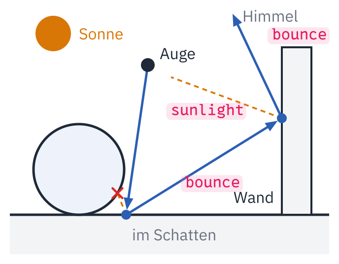

<div class='book'>
<i class='bi bi-file-earmark-text'></i>
<p><strong>The Rendering Equation</strong>, James T. Kajiya, SIGGRAPH 1986. Eine Gleichung für alles Licht in einer Szene, und dazu der Vorschlag, statt eines ganzen Baums von Strahlen an jeder Fläche nur einem zufälligen Weg zu folgen. Das ist das Path Tracing, das du hier einbaust: <a href='https://www.cse.chalmers.se/edu/year/2011/course/TDA361/2007/rend_eq.pdf'>PDF</a>, auch bei der <a href='https://doi.org/10.1145/15922.15902'>ACM</a>.</p>
</div>

_person(kajiya)

Path Tracing baut wie die Tiefenschärfe auf dem fertigen Programm auf, nicht auf ihr; beide passen aber auch zusammen. `skylight` wird gelöscht. An seine Stelle kommt `bounce`, nach der Vorab-Deklaration von `trace`, denn es ruft `trace` auf:

```c
~ vec trace(vec origin, vec dir, int depth);

// Licht von allem rundherum: ein Strahl in eine zufällige Richtung über der
// Oberfläche; trifft er etwas, bringt er mit, wie hell es dort ist, sonst
// das Licht des Himmels
vec bounce(hit h, int depth)
{
    vec d = normalize(add(h.normal, random_in_sphere()));
    hit other;
    if (!nearest_hit(h.point, d, &other))
        return scale(sky(d), 0.3);
    vec c = trace(h.point, d, depth + 1);
    // über einen Spiegel kann der Strahl in die Sonne schauen; das Licht der
    // Sonne zählt schon sunlight, so ein Ausreißer würde lange glitzern
    return (vec){fmin(c.x, 1), fmin(c.y, 1), fmin(c.z, 1)};
}
```

`depth + 1` sorgt dafür, dass der Weg irgendwann endet: Nach `MAX_DEPTH` Flächen gibt `trace` Schwarz zurück. In `trace` wird die Zeile mit `skylight` zu:

```c
    vec light = add(sunlight(h), bounce(h, depth));
```

Jeder Durchgang dauert jetzt etwa doppelt so lange, denn fast jeder Strahl, der etwas trifft, schickt einen weiteren los. In der Szene von vorhin bringt das wenig: Bei Tag kommt fast alles Licht von der Sonne und vom Himmel. Am deutlichsten zeigt sich Path Tracing neben farbigen Wänden in der Sonne: Sie werfen ihr Licht weiter, und was vor ihnen steht, bekommt ihre Farbe ab. Eine Wand ist hier eine Kugel mit dem Radius 1000: so groß, dass sie in der Nähe der Szene fast eben ist. Kevin Beasons »smallpt«, ein Path Tracer in 99 Zeilen C++, baut seine ganze Szene so. Ersetze die Kugeln:

```c
sphere spheres[] = {
    {{-1003, 0, 0}, 1000, {.color = {0.04, 0.42, 0.45}}},              // Wand links, petrol
    {{0, 0, -1003}, 1000, {.color = {0.95, 0.45, 0.05}}},               // Wand hinten, orange
    {{-1.8, 1.0, -0.9}, 1.0, {.color = {0.85, 0.85, 0.85}}},            // weiß, dicht an der Wand
    {{0.4, 0.75, -1.2}, 0.75, {.color = {0.85, 0.85, 0.85}}},           // weiß
    {{-2.2, 0.45, 1.3}, 0.45, {.color = {0.85, 0.85, 0.85}}},           // weiß, klein
};
```

Alles hier ist matt, auch der Boden: Spiegelungen würden die Farben der Wände ebenfalls zeigen, und dann sähe man nicht, was vom Path Tracing kommt. Ersetze `floor_mat` durch:

```c
material floor_mat = {.color = {0.75, 0.75, 0.75}};  // ohne Spiegelanteil
```

Die Wände sind so hoch wie breit, fast 1000, und würden eine Sonne hinter ihnen ganz verdecken. Darum ist der Hof rechts offen, und die Sonne kommt von rechts oben und ein wenig von vorn; so stehen beide Wände in der Sonne. In `main` werden die Zeilen mit `sun_dir` und `angle` zu:

```c
    sun_dir = normalize((vec){1.0, 1.3, 0.6});
~
    double angle = 0.25, height = 1.6;
```

Kreist du zu weit, stehst du hinter einer Wand und siehst ihre Rückseite.

<div class='gallery columns-2'>
<figure>
<!-- tutorial-screenshot
write-file: raytracer.c <- file:stufen/16-pathtracing.c
terminal-open
terminal-run: make PROGRAM=raytracer
terminal-wait-for-prompt
terminal-expect-no-text: error:
terminal-expect-no-text: ***
tab: preview
viewport: 800x450
hook: open raytracer.html
hook: frames 512
crop-element: #canvas
-->
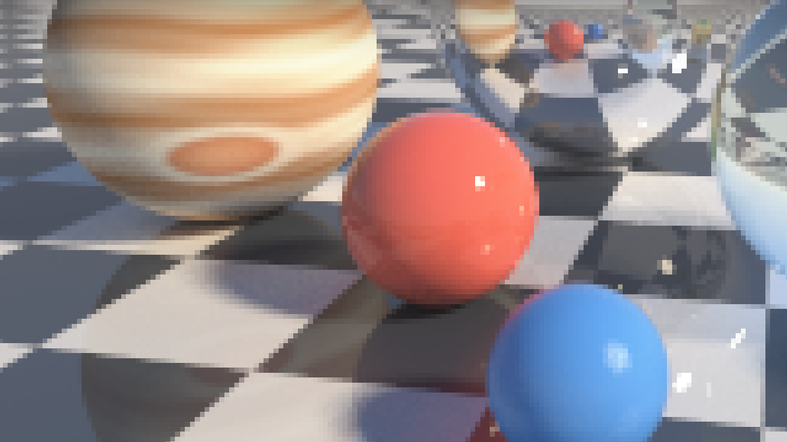
<figcaption>Mit Path Tracing: Das Licht der Wände fällt auf die Kugeln und auf den Boden; die Kugeln schimmern zur linken Wand hin petrol, der Boden vor der hinteren Wand gelblich, und die Schatten werden hell.</figcaption>
</figure>
<figure>
<!-- tutorial-screenshot
write-file: raytracer.c <- file:stufen/vergleich-ohne-pathtracing.c
terminal-open
terminal-run: make PROGRAM=raytracer
terminal-wait-for-prompt
terminal-expect-no-text: error:
terminal-expect-no-text: ***
tab: preview
viewport: 800x450
hook: open raytracer.html
hook: frames 512
crop-element: #canvas
-->
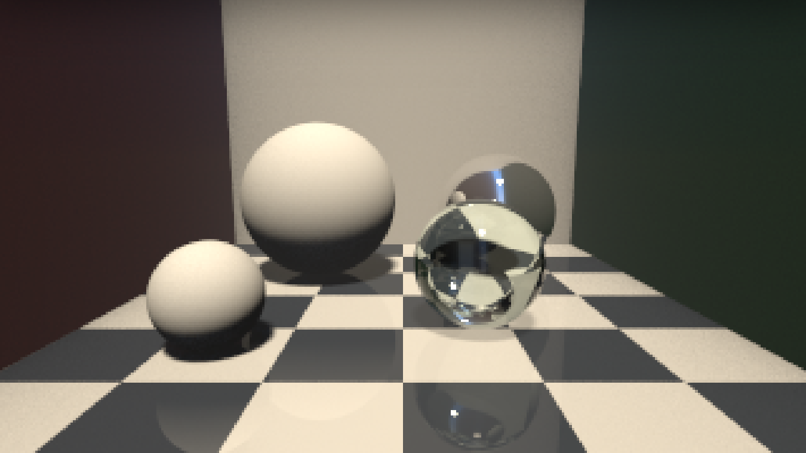
<figcaption>Ohne Path Tracing: Die Wände behalten ihr Licht; Kugeln und Boden bleiben weiß und grau, die Schatten dunkel.</figcaption>
</figure>
</div>

Die Wände stehen in beiden Bildern in der Sonne und haben dieselben Farben. Ohne Path Tracing bleibt ihr Licht bei ihr: Die Schattenseiten der weißen Kugeln, der Boden und die weiße Wand bekommen nur das Grau des Himmels. Mit Path Tracing trägt jeder Strahl, der von einer Kugel oder vom Boden aus eine Wand trifft, ihr Licht zurück: Die Seiten der Kugeln, die zur linken Wand zeigen, schimmern petrol, der Boden vor der hinteren Wand gelblich, und die Schatten werden hell. Das ist nicht gespiegelt, alles hier ist matt; es ist Licht, das von der Wand auf eine matte Fläche fällt und von dort in dein Auge.

<div class='hint try'>
<strong>Ausprobieren:</strong> Mach die linke Wand rot, <code>.color = {0.85, 0.1, 0.05}</code>, und sieh dir die große weiße Kugel an. Schieb sie danach ein Stück von der Wand weg, ihr Mittelpunkt bei <code>x = 0</code>: Wie viel Farbe bekommt sie dann noch ab? Stell danach beides zurück.
</div>

<!-- extra -->
## Belichtung

### Zu hell für den Bildschirm

Ein Bildschirm kann nichts heller zeigen als 1, also ganz weiß, und `to_byte` schneidet alles darüber ab. Im fertigen Bild fällt das kaum auf, denn fast alles ist dunkler als 1. Anders, wenn du heller belichtest, wie mit einer weiter geöffneten Blende, damit man in den Schatten mehr sieht: Dann werden der Himmel, die weißen Felder und die Sonnenseiten der Kugeln heller als 1. Abgeschnitten werden sie zu glatten weißen Flächen, und Farben verlieren ihren Ton, weil jeder Farbkanal einzeln bei 1 aufhört.

Eine Kamera schneidet nicht hart ab. Sie drückt alles weich zusammen, je heller, desto stärker: Je heller etwas ist, desto weniger wird es noch heller. So eine Kurve heißt **Tone Mapping**. Diese hier beginnt so steil wie die gerade Linie, biegt dann immer weiter ab und nähert sich 1, ohne sie je zu erreichen. So bleiben auch zwischen 1 und 3 noch Unterschiede:

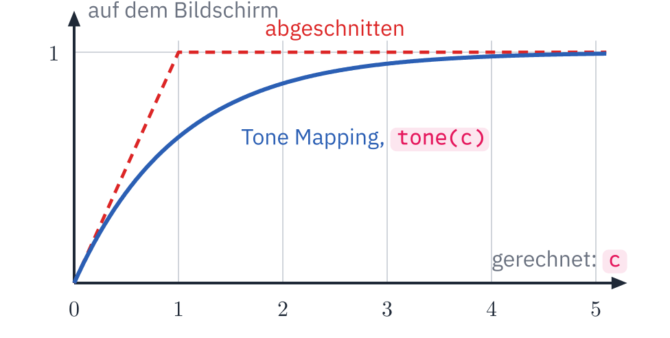

Über `to_byte` kommen die Belichtung und die Kurve; `exp` ist die Exponentialfunktion, die Kurve nähert sich 1, erreicht sie aber nie. Die Belichtung beginnt bei 1,5: Die Kurve macht alles etwas dunkler, auch die Mitten, und 1,5 gleicht das ungefähr aus.

```c
// Belichtung: größer ist heller, wie eine weiter geöffnete Blende; 1.5,
// weil tone() alles etwas dunkler macht, auch die Mitten
double exposure = 1.5;

// Tone Mapping: je heller, desto stärker zusammengedrückt; die Kurve
// nähert sich 1, erreicht sie aber nie, auch ganz Helles bleibt verschieden
double tone(double c)
{
    return 1 - exp(-c);
}
```

`to_byte` belichtet und drückt zusammen, bevor die Gamma-Korrektur kommt. Ersetze `to_byte` durch:

```c
// Farbwert 0 bis 1 zu 0 bis 255, mit Belichtung, Tone Mapping und Gamma
uint8_t to_byte(double c)
{
    c = tone(c * exposure);
    return (uint8_t)(pow(c, 1 / 2.2) * 255 + 0.5);
}
```

Mit <kbd>H</kbd> belichtest du heller, mit <kbd>D</kbd> dunkler, jedes Mal um das Anderthalbfache. Die Durchgänge bleiben dabei, denn die Belichtung ändert nur, wie die Summe angezeigt wird. In der Schleife in `main`, unter den Pfeiltasten:

```c
~         if (key_down(pixel_key_down) && height > 0.3) { height -= 2 * dt; passes = 0; }
        // H heller, D dunkler: nur die Anzeige ändert sich, die Durchgänge bleiben
        if (key_pressed(pixel_key_h))
            exposure *= 1.5;
        if (key_pressed(pixel_key_d))
            exposure /= 1.5;
```

Und der Titel zeigt, wie hell belichtet ist; die Zeile mit `snprintf` wird zu:

```c
        snprintf(title, sizeof title, "Raytracer – %d Durchgänge, Belichtung %.2f", passes, exposure);
```

<div class='gallery columns-2'>
<figure>
<!-- tutorial-screenshot
write-file: raytracer.c <- file:stufen/vergleich-belichtung-weich.c
terminal-open
terminal-run: make PROGRAM=raytracer
terminal-wait-for-prompt
terminal-expect-no-text: error:
terminal-expect-no-text: ***
tab: preview
viewport: 800x450
hook: open raytracer.html
hook: frames 128
crop-element: #canvas
-->
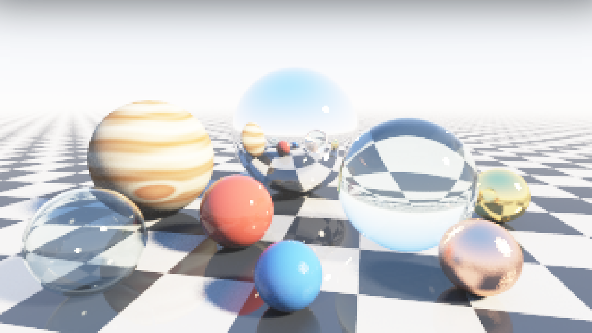
<figcaption>Einmal <kbd>H</kbd>, mit Tone Mapping</figcaption>
</figure>
<figure>
<!-- tutorial-screenshot
write-file: raytracer.c <- file:stufen/vergleich-belichtung-hart.c
terminal-open
terminal-run: make PROGRAM=raytracer
terminal-wait-for-prompt
terminal-expect-no-text: error:
terminal-expect-no-text: ***
tab: preview
viewport: 800x450
hook: open raytracer.html
hook: frames 128
crop-element: #canvas
-->

<figcaption>Dasselbe, hart bei 1 abgeschnitten</figcaption>
</figure>
</div>

Abgeschnitten wird der Himmel über dem Horizont zu einer glatten weißen Fläche, in der der Horizont verschwindet. Die Spiegelkugel zeigt dort nur einen türkisen Fleck, weil Grün und Blau schon bei 1 aufhören, Rot aber noch nicht. Mit Tone Mapping bleibt der Verlauf, der Horizont ist zu sehen, und auch die weißen Felder unterscheiden sich noch. Dafür wirkt das ganze Bild etwas weicher: Die Kurve drückt nicht nur das Helle zusammen, sondern ein wenig auch alles andere.

## Wie geht es weiter?

Dein Raytracer ist klein genug, um ihn ganz zu verstehen, und alles Weitere passt in dieselben Funktionen:

- **Eine eigene Szene:** Kugeln verschieben, Farben ändern, eine zweite Glaskugel, farbiges Glas (`.glass = 1.5` mit einer kräftigen `.color`), ein Spiegel als Boden (`floor_mat` mit `.mirror = 0.8`).
- **Eine andere Textur:** Marmor mit `sin(x + 3 * sin(…))`, ein Planet mit Kontinenten, eine Holzmaserung für den Boden.
- **Mehr Formen:** eine Scheibe (der Boden mit einem Radius), ein Würfel (drei Paare von Ebenen, wie der Boden), ein Ring.
- **Eine Lampe:** Eine Kugel, die selbst leuchtet: `trace` gibt für sie ihre Farbe zurück, mal einer Helligkeit über 1. Mit Path Tracing fällt ihr Licht auf alles in ihrer Nähe; dafür muss die Grenze von 1 in `bounce` höher. Ohne Sonne wird es Nacht.

_task(eigene-szene)

Wie es weitergeht, mit Texturen, Lampen und Nebel, steht in einer Buchreihe, die einen Raytracer ebenfalls Schritt für Schritt baut, in C++:

<div class='book'>
<i class='bi bi-book'></i>
<p><strong>Ray Tracing in One Weekend</strong>, Peter Shirley, Trevor David Black und Steve Hollasch, seit 2016. Drei kurze Bücher: Im ersten entsteht ein Path Tracer mit Glas und Tiefenschärfe wie deiner, im zweiten kommen Texturen, Lampen, Rauch und Bewegungsunschärfe dazu, im dritten geht es darum, die richtigen Strahlen zu würfeln. Frei online, ohne Urheberrechte (CC0): <a href='https://raytracing.github.io/'>raytracing.github.io</a>.</p>
</div>
