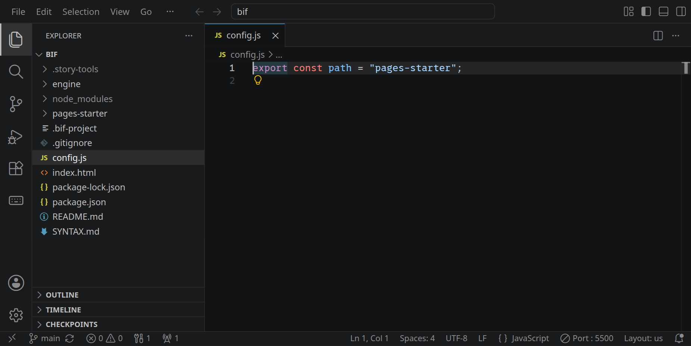
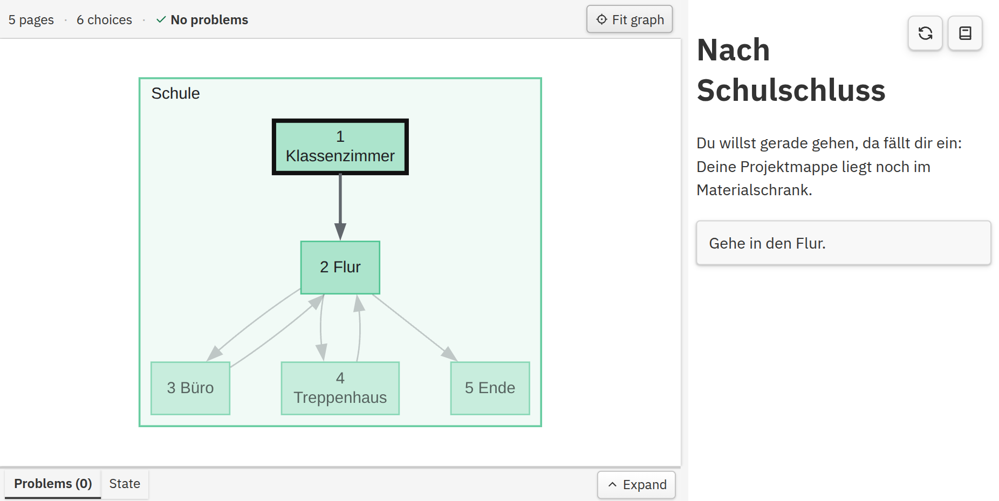
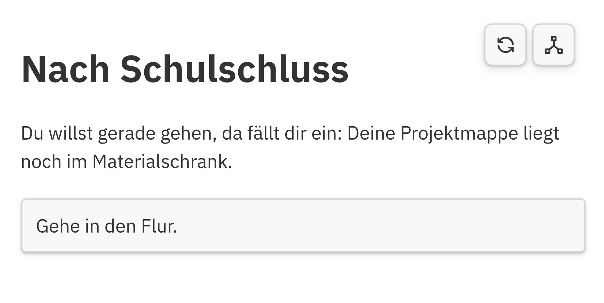
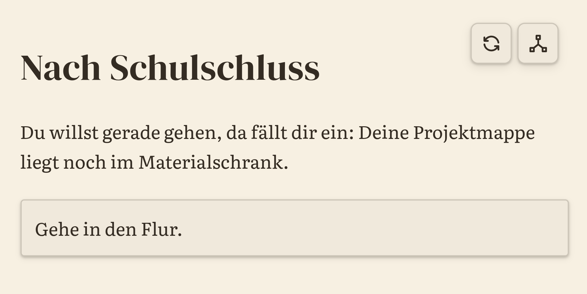
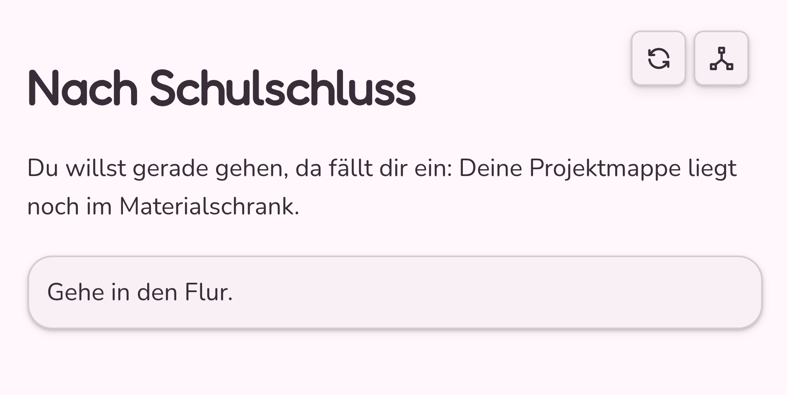
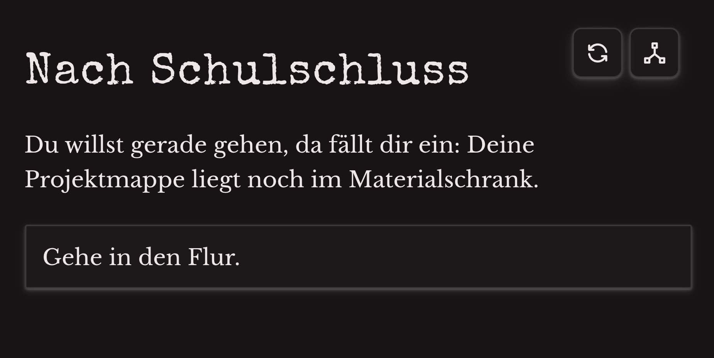
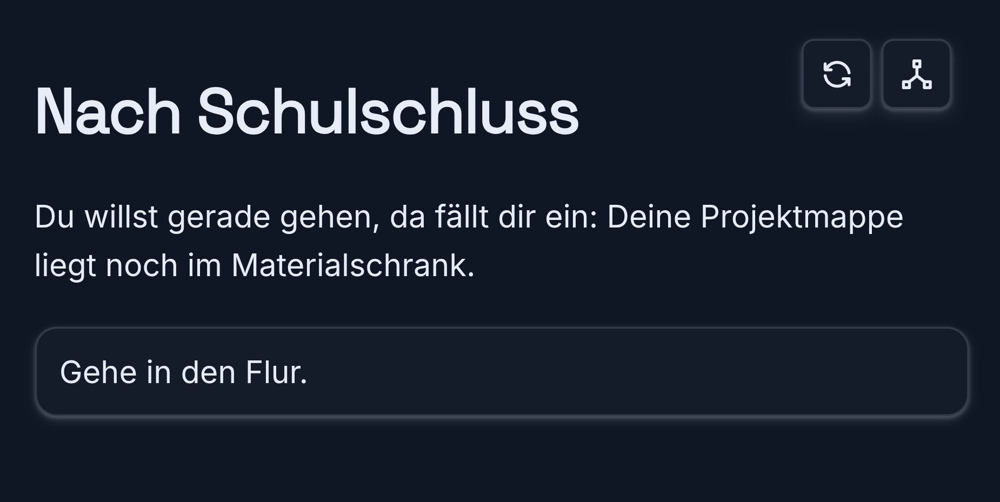
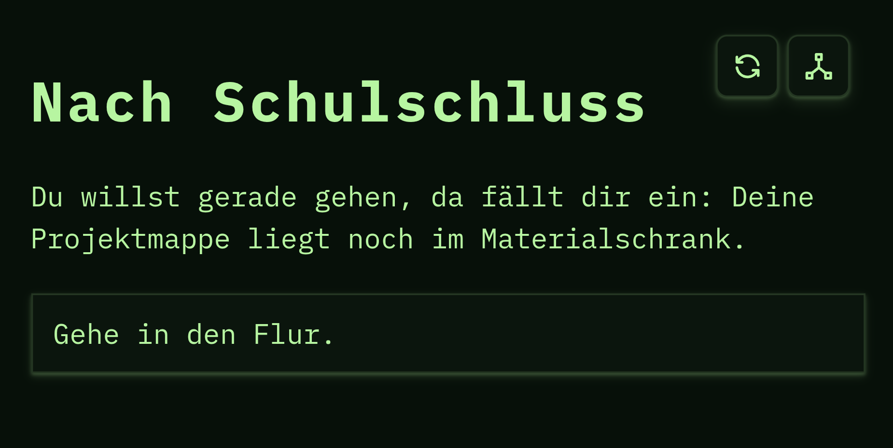
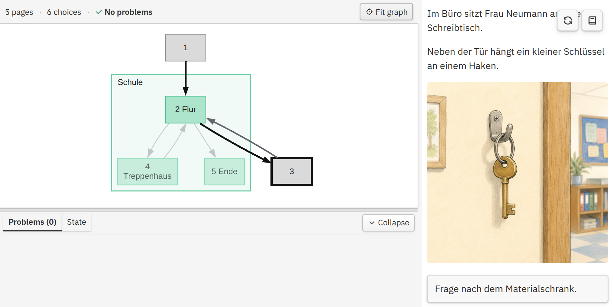

<div class='meta'>
image: theme-mystery.webp
kind: reference
</div>

<div
    class="autotoc-secondary-trigger"
    data-title="Auf dieser Seite"
    data-levels="h2,h3,h4">
</div>

# Interaktive Geschichten mit BIF

<p class='abstract'>
Eine BIF-Geschichte besteht aus Markdown-Dateien mit ein paar eigenen Schreibweisen für Entscheidungen, Variablen und Bedingungen. Hier stehen sie zum Nachschlagen, wenn du deine eigene Geschichte schreibst. Wie alles zusammenspielt, zeigt die Aktivität <a href='/bif'>»Interaktive Geschichten schreiben«</a>.
</p>

## Eine Geschichte schreiben

Seiten, Entscheidungen zwischen ihnen und ein Ende: mehr braucht eine Geschichte nicht.

<!-- part: seiten -->
<!-- short: Jede `.md`-Datei im Geschichtenordner ist eine Seite, `2.md` ist Seite 2. Jede Geschichte beginnt bei `1.md`. -->
### Seiten

Eine Geschichte besteht aus Seiten. Jede `.md`-Datei im Geschichtenordner ist eine Seite, und ihr Name ohne `.md` ist ihre Seitennummer: `2.md` ist Seite 2. Statt Zahlen gehen auch Wörter, `keller.md` ist dann die Seite `keller`; Groß- und Kleinschreibung zählt.

Jede Geschichte beginnt bei `1.md`. Nur dort steht ganz oben der Titel der Geschichte, mit einem `#`:

```markdown_wrap
# Nach Schulschluss

Du willst gerade gehen, da fällt dir ein: Deine Projektmappe liegt noch im Materialschrank.
```

Für Zwischenüberschriften auf einer Seite nimmst du `##`.
<!-- /part -->

<!-- part: entscheidungen -->
<!-- short: `- [Text](2)` ist eine Entscheidung, die zu Seite 2 führt. In die Klammer kommt die Seite ohne `.md`. -->
### Entscheidungen

Eine Entscheidung ist ein Listenpunkt mit einem Link: In eckigen Klammern steht, was die Leserin oder der Leser sieht, in runden Klammern die Seite, auf der es weitergeht.

```markdown_wrap
- [Sieh im Büro nach.](3)
- [Gehe ins Treppenhaus.](4)
```

Stehen mehrere Entscheidungen untereinander, verzweigt sich die Geschichte. Wege dürfen später wieder zusammenlaufen: Mehrere Seiten können zur selben Seite führen.

<div class='hint'>
Schreibe <code>(3)</code>, nicht <code>(3.md)</code>. Mit <code>.md</code> ist es für BIF ein gewöhnlicher Link und keine Entscheidung.
</div>
<!-- /part -->

<!-- part: lokal -->
<!-- short: `- [Text](.)` bleibt auf derselben Seite. Was danach erscheint, steht darunter, mit vier Leerzeichen eingerückt. -->
### Lokale Entscheidungen

Mit einem Punkt statt einer Seitennummer bleibt die Geschichte auf derselben Seite. Was nach der Auswahl erscheint, steht direkt darunter, **mit vier Leerzeichen eingerückt**:

```markdown_wrap
- [Frage nach dem Materialschrank.](.)

    > "Der ist abgeschlossen. Der kleine Schlüssel hängt hier neben der Tür."

- [Gehe zurück in den Flur.](2)
```

Eine lokale Entscheidung lässt sich bei einem Besuch der Seite einmal auswählen. Wer die Seite verlässt und wiederkommt, kann sie erneut wählen; was dauerhaft gelten soll, merkst du dir deshalb in einer Variable.

<div class='hint'>
Im eingerückten Teil darf keine weitere Entscheidung stehen. Schreib sie auf die oberste Ebene und zeige sie mit einer Bedingung erst, wenn sie passt.
</div>
<!-- /part -->

<!-- part: ende -->
<!-- short: Eine Seite ohne Entscheidung zu einer anderen Seite ist ein Ende; dort kann man die Geschichte neu beginnen. -->
### Ende

Eine Seite, auf der keine Entscheidung zu einer anderen Seite führt, ist ein Ende. BIF zeigt dort den Knopf »Gedrückt halten, um erneut zu spielen«; nach einem Neustart beginnt die Geschichte wieder bei `1.md`, und die Anfangswerte dort gelten von Neuem.

Eine Geschichte kann mehrere Enden haben: ein gutes, ein schlechtes, ein überraschendes.
<!-- /part -->

## Was sich die Geschichte merkt

Mit Variablen erinnert sich die Geschichte an das, was passiert ist, und kann darauf reagieren.

<!-- part: variablen -->
<!-- short: `<script>has_key = false;</script>` merkt sich etwas für den Rest der Geschichte; den Anfangswert setzt du in `1.md`. -->
### Variablen

In einem `<script>`-Block gibst du einer Variable einen Wert. Sie behält ihn für den Rest der Geschichte, auch wenn die Leserin oder der Leser die Seite wechselt.

```html
<script>
has_key = false;
points = 0;
name = "Lea";
</script>
```

Ein Skript läuft bei jedem Besuch seiner Seite. Anfangswerte gehören deshalb nach `1.md`, die nur am Anfang besucht wird. Steht ein Skript eingerückt unter einer lokalen Entscheidung, läuft es erst, wenn diese Entscheidung gewählt wird:

```markdown_wrap
- [Nimm den Schlüssel.](.)

    <script>
    has_key = true;
    </script>

    Du nimmst den kleinen Schlüssel vom Haken.
```

In der Entwicklungsansicht zeigt der Bereich **State**, welchen Wert jede Variable gerade hat.
<!-- /part -->

<!-- part: bedingungen -->
<!-- short: `{condition="has_key"}` hinter einer Entscheidung oder `<p condition="!has_key">` um Text: Sichtbar ist es nur, wenn die Bedingung stimmt. -->
### Bedingungen

Eine Bedingung entscheidet, ob eine Entscheidung oder ein Text gerade erscheint. Hinter einer Entscheidung steht sie in geschweiften Klammern, um einen Text herum in einem `<p>`:

```markdown_wrap
- [Öffne den Materialschrank.](5){condition="has_key"}

<p condition="!has_key">
Neben der Tür hängt ein kleiner Schlüssel an einem Haken.
</p>
```

Bedingungen sind JavaScript-Ausdrücke:

<div style='max-width: 100%; overflow-x: auto;'>
<table class='table'>
<thead><tr><th>Bedingung</th><th>stimmt, wenn …</th></tr></thead>
<tbody>
<tr><td><code>has_key</code></td><td><code>has_key</code> den Wert <code>true</code> hat</td></tr>
<tr><td><code>!has_key</code></td><td><code>has_key</code> <em>nicht</em> <code>true</code> ist</td></tr>
<tr><td><code>points >= 3</code></td><td><code>points</code> mindestens 3 ist (auch <code>&gt;</code>, <code>&lt;</code>, <code>&lt;=</code>)</td></tr>
<tr><td><code>name == "Lea"</code></td><td><code>name</code> genau <code>Lea</code> ist (<code>!=</code>: ungleich)</td></tr>
<tr><td><code>has_key &amp;&amp; points > 2</code></td><td>beides stimmt</td></tr>
<tr><td><code>has_key || has_map</code></td><td>mindestens eins von beiden stimmt</td></tr>
</tbody>
</table>
</div>
<!-- /part -->

<!-- part: werte -->
<!-- short: `[[ points ]]` setzt den Wert einer Variable in den Text; `points ??= 0;` gibt nur einen Anfangswert, wenn es die Variable noch nicht gibt. -->
### Werte im Text

Variablen können nicht nur `true` und `false`, sondern auch Zahlen oder Texte enthalten.

Zum Beispiel:

```html
<script>
points = 3;
</script>
```

Mit doppelten eckigen Klammern kannst du einen Wert in den Text einsetzen:

```markdown
Du hast [[ points ]] Punkte.
```

Wenn eine Variable auf einer Seite einen Anfangswert bekommen soll, die mehrfach besucht werden kann, ist `??=` praktisch:

```js
points ??= 0;
```

Der Wert wird damit nur gesetzt, wenn `points` noch nicht existiert. Werte wie `0`, `false` oder ein bereits vorhandener Text bleiben unverändert.
<!-- /part -->

<!-- part: zufall -->
<!-- short: `Math.w6()` würfelt, `Math.chance(50)` ist in der Hälfte der Fälle `true`. -->
### Zufall

Für manche Geschichten kann Zufall interessant sein.

```js
Math.w6()
```

würfelt mit einem sechsseitigen Würfel.

```js
Math.chance(50)
```

liefert mit einer Wahrscheinlichkeit von 50 Prozent `true`.

Zum Ausprobieren kannst du zum Beispiel diesen Block auf eine Seite schreiben:

```html_wrap
<script>
if (Math.chance(50)) {
    print("Aus dem Treppenhaus hörst du Schritte.");
} else {
    print("Im Treppenhaus bleibt alles still.");
}
</script>
```

Lade die Seite mehrmals über einen Neustart der Geschichte. Mal hörst du die Schritte, mal bleibt es still.

Zufall eignet sich gut für kleine Überraschungen. Wichtige Folgen sind oft interessanter, wenn sie von vorherigen Entscheidungen abhängen.
<!-- /part -->

## Ordnung im Projekt

Wenn die Geschichte wächst: ein eigener Ordner und Gruppen im Graphen.

<!-- part: eigener-ordner -->
<!-- short: Neuer Ordner mit einer `1.md`, dann in `config.js`: `export const path = "pages-meine-geschichte";` -->
### Eigener Geschichtenordner

Welche Geschichte BIF zeigt, steht in `config.js`. Für eine eigene Geschichte legst du neben `pages-starter` einen neuen Ordner an, zum Beispiel `pages-meine-geschichte`, darin eine `1.md`, und trägst ihn ein:

```js
export const path = "pages-meine-geschichte";
```

Der Name muss genau so geschrieben sein wie im Explorer, in Anführungszeichen. Bilder, Töne und Videos der Geschichte gehören ebenfalls in diesen Ordner.

<!-- tutorial-screenshot
# Die BIF-Vorlage klonen und öffnen, damit die BIF Authoring Tools
# laufen, dann »Go Live«; die Seiten schreiben die Rezepte selbst
show-left-sidebar
clone-start: https://github.com/specht/bif.git @ 9b8abe88b071b5f7acdc86252519a9e6eb92a3b6
press: Enter
wait-for-input-value: /workspace/
press: Enter
wait-for-text: Would you like to open the repository?
click: Open
wait-for-text: pages-starter
wait-for-file: bif/node_modules/markdown-it/LICENSE
wait-for-file: bif/.story-tools/analysis.json
go-live
open-file: config.js
close-tab: Welcome
-->


<!-- /part -->

<!-- part: gruppen -->
<!-- short: Eine Kommentarzeile ganz oben auf einer Seite, etwa mit `Schule -- Büro`, fasst Seiten im Graphen zu Bereichen zusammen. -->
### Graph-Gruppen

Bei größeren Geschichten kannst du Seiten im Graphen zu Bereichen zusammenfassen.

Ganz oben in einer Seite kann zum Beispiel stehen:

```markdown_wrap
<!-- Schule -- Büro -->
```

Eine andere Seite könnte beginnen mit:

```markdown_wrap
<!-- Schule -- Flur -->
```

Diese Kommentare sind für die Leserinnen und Leser unsichtbar. Sie helfen nur dabei, den Graphen übersichtlich zu halten.

<!-- tutorial-screenshot
write-file: pages-starter/1.md <- file:1-with-groups.md.txt
write-file: pages-starter/2.md <- file:2-with-groups.md.txt
write-file: pages-starter/3.md <- file:3-with-groups.md.txt
write-file: pages-starter/4.md <- file:4-with-groups.md.txt
write-file: pages-starter/5.md <- file:5-with-groups.md.txt
wait-for-file-newer: bif/.story-tools/analysis.json <- bif/pages-starter/1.md
tab: preview
preview-reload
hold: 1.5s selector:.story-restart-control
# Das Bild zeigt die Gruppen: die Leiste unter dem Graphen zuklappen, so
# bekommt er die ganze Höhe, egal wie hoch sie vorher war
click: Problems (0)
click: Collapse
move-mouse: No problems
click: Fit graph
sleep: 0.5
variants: dark
-->

<!-- /part -->

## Gestalten

Farben, Schriften, Bilder und Töne geben der Geschichte ihre Stimmung.

<!-- part: aussehen -->
<!-- short: Ganz oben in `1.md`, zwischen zwei Zeilen `---`: `theme: mystery` wählt ein fertiges Aussehen; Farben und Schriften lassen sich einzeln ändern. -->
### Aussehen anpassen

Das Aussehen deiner Geschichte stellst du ganz oben in `1.md` ein. Dafür kannst du einen sogenannten **Front-Matter-Block** verwenden. Er steht noch vor dem Titel der Geschichte.
#### Ein fertiges Theme

Am einfachsten wählst du ein fertiges Theme:

```markdown_wrap
---
theme: mystery
---

# Nach Schulschluss
```

BIF bringt mehrere Themes mit: `default`, `paper`, `playful`, `mystery`, `midnight` und `terminal`.
Ein Theme legt Farben und Schriften fest und verändert außerdem einige Details wie Abstände und abgerundete Ecken. Du kannst es deshalb einfach so verwenden, wie es ist.

<div class='gallery columns-3'>
    <!-- tutorial-screenshot
    write-file: pages-starter/1.md <- file:theme-default.md.txt
    wait-for-file-newer: bif/.story-tools/analysis.json <- bif/pages-starter/1.md
    tab: preview
    preview-reload
    click: selector:.story-view-toggle
    hold: 1.5s selector:.story-restart-control
    move-mouse: Nach Schulschluss
    zoom: 2
    sleep: 0.5
    -->
    <figure><figcaption><code>default</code></figcaption></figure>
    <!-- tutorial-screenshot
    write-file: pages-starter/1.md <- file:theme-paper.md.txt
    wait-for-file-newer: bif/.story-tools/analysis.json <- bif/pages-starter/1.md
    tab: preview
    preview-reload
    zoom: 2
    sleep: 0.5
    -->
    <figure><figcaption><code>paper</code></figcaption></figure>
    <!-- tutorial-screenshot
    write-file: pages-starter/1.md <- file:theme-playful.md.txt
    wait-for-file-newer: bif/.story-tools/analysis.json <- bif/pages-starter/1.md
    tab: preview
    preview-reload
    zoom: 2
    sleep: 0.5
    -->
    <figure><figcaption><code>playful</code></figcaption></figure>
    <!-- tutorial-screenshot
    write-file: pages-starter/1.md <- file:theme-mystery.md.txt
    wait-for-file-newer: bif/.story-tools/analysis.json <- bif/pages-starter/1.md
    tab: preview
    preview-reload
    zoom: 2
    sleep: 0.5
    -->
    <figure><figcaption><code>mystery</code></figcaption></figure>
    <!-- tutorial-screenshot
    write-file: pages-starter/1.md <- file:theme-midnight.md.txt
    wait-for-file-newer: bif/.story-tools/analysis.json <- bif/pages-starter/1.md
    tab: preview
    preview-reload
    zoom: 2
    sleep: 0.5
    -->
    <figure><figcaption><code>midnight</code></figcaption></figure>
    <!-- tutorial-screenshot
    write-file: pages-starter/1.md <- file:theme-terminal.md.txt
    wait-for-file-newer: bif/.story-tools/analysis.json <- bif/pages-starter/1.md
    tab: preview
    preview-reload
    zoom: 2
    sleep: 0.5
    -->
    <figure><figcaption><code>terminal</code></figcaption></figure>
</div>

#### Ein Theme verändern

Du kannst ein Theme aber auch verändern. Zum Beispiel:

```markdown_wrap
---
theme: midnight
accent: "#ff7a18"
font_heading: Bungee
---
```

`accent` ist die Akzentfarbe für Links und interaktive Elemente. Mit `font_heading` änderst du nur die Schrift der Überschriften.

#### Eigene Farben

Du musst überhaupt kein Theme auswählen. Wenn du `theme:` weglässt, kannst du die Standarddarstellung selbst mit Farben und Schriften anpassen:

```markdown_wrap
---
background: "#fff7fb"
text: "#382d38"
accent: "#9d3b77"
font_body: Nunito
font_heading: Fredoka
---
```

Die drei Grundfarben haben unterschiedliche Aufgaben:

- `background` – Hintergrund
- `text` – normaler Text und Überschriften
- `accent` – Links, Hervorhebungen und interaktive Elemente

Die übrigen Farbtöne für Flächen, Rahmen und Schatten leitet BIF automatisch daraus ab. Du musst also nicht für jedes kleine Element eine eigene Farbe festlegen.

#### Hell oder dunkel

Mit

```markdown_wrap
brightness: light
```

oder

```markdown_wrap
brightness: dark
```

kannst du eine helle oder dunkle Darstellung erzwingen. `brightness: system` folgt stattdessen der Einstellung des Geräts.

#### Schriften

Für `font_body` und `font_heading` kannst du den Namen einer Schrift von [Google Fonts](https://fonts.google.com/) eintragen. Schreibe den Namen genau so, wie er dort steht. BIF lädt die benötigten Schriftdateien beim Entwickeln automatisch herunter und speichert sie lokal im Ordner `bif-assets`. Diesen Ordner solltest du deshalb nicht selbst für Bilder oder andere Dateien verwenden.

<div class='hint'>
Gestaltung kann viel zur Stimmung beitragen. Eine Mystery-Geschichte darf anders aussehen als eine Komödie oder ein Terminal-Abenteuer. Achte aber darauf, dass der Text gut lesbar bleibt.
</div>
<!-- /part -->

<!-- part: markdown -->
<!-- short: `**fett**`, `*kursiv*` und `##` für Zwischenüberschriften; `#` nur für den Titel in `1.md`. -->
### Markdown

Für die normalen Texte kannst du die üblichen Markdown-Schreibweisen verwenden.

Fetter Text:

```markdown_wrap
Auf dem Tisch liegt ein **kleiner Schlüssel**.
```

Kursiver Text:

```markdown_wrap
Aus dem Nebenraum hörst du ein *leises Klopfen*.
```

Eine Zwischenüberschrift innerhalb einer Seite:

```markdown_wrap
## Ein Hinweis
```

Denke daran: `#` verwenden wir für den Titel der gesamten Geschichte. Für Unterüberschriften innerhalb einer Seite beginnt die Hierarchie bei `##`.
<!-- /part -->

<!-- part: bilder -->
<!-- short: Bilder in den Geschichtenordner legen, am besten in `images/`, und mit `` einbinden. -->
### Bilder

Bilder speicherst du am besten innerhalb deines Geschichtenordners, zum Beispiel:

```text
pages-meine-geschichte/
├── 1.md
├── 2.md
└── images/
    └── key.jpg
```

In Markdown kannst du das Bild so einfügen:

```markdown_wrap

```

Der Text in den eckigen Klammern beschreibt das Bild und hilft zum Beispiel Menschen, die einen Screenreader verwenden.

<!-- tutorial-screenshot
# Die ganze Geschichte, damit der Weg ins Büro führt (die Gruppen-
# Kommentare sieht nur der Graph, nicht die Leseansicht)
write-file: pages-starter/1.md <- file:theme-default.md.txt
write-file: pages-starter/2.md <- file:2-with-groups.md.txt
write-file: pages-starter/3.md <- file:3-with-image.md.txt
write-file: pages-starter/4.md <- file:4-with-groups.md.txt
write-file: pages-starter/5.md <- file:5-with-groups.md.txt
write-file: pages-starter/images/key.jpg <- file:key.jpg
wait-for-file-newer: bif/.story-tools/analysis.json <- bif/pages-starter/1.md
tab: preview
preview-reload
click: selector:.story-view-toggle
hold: 1.5s selector:.story-restart-control
click: Gehe in den Flur.
wait-for-text: Sieh im Büro nach.
sleep: 0.5
click: Sieh im Büro nach.
wait-for-text: Gehe zurück in den Flur.
# BIF merkt sich den Reiter unter dem Graphen; »Problems« zeigen, egal
# welches Rezept vorher lief
click: Problems (0)
move-mouse: No problems
click: Fit graph
sleep: 1.5
variants: dark
-->


<!-- /part -->

<!-- part: medien -->
<!-- short: `<audio controls src="…">` und `<video controls>` wie in HTML, die Dateien im Geschichtenordner. -->
### Audio und Video

Auch Audio- und Videodateien können Teil einer Geschichte sein:

```html
<audio controls src="audio/door.mp3"></audio>
```

oder:

```html
<video controls>
    <source src="video/train.webm" type="video/webm">
</video>
```
<!-- /part -->

## Für Fortgeschrittene

Wenn die Schreibweisen von BIF nicht mehr reichen.

<!-- part: javascript -->
<!-- short: `presentChoice` und `goToPage` bauen Entscheidungen, die erst beim Lesen aus Daten entstehen. -->
### JavaScript

Für normale Entscheidungen reichen die Markdown-Links fast immer aus:

```markdown_wrap
- [Gehe nach links.](5)
- [Gehe nach rechts.](6)
```

JavaScript wird interessant, wenn Entscheidungen nicht einfach fest im Text stehen sollen, sondern erst aus Daten oder dem aktuellen Zustand der Geschichte entstehen.

BIF stellt Skripten dafür unter anderem die Funktionen `print`, `presentChoice` und `goToPage` zur Verfügung. Das folgende Beispiel baut die Entscheidungsmöglichkeiten mit JavaScript zusammen. Wenn `has_key` den Wert `true` hat, kommt eine zusätzliche Möglichkeit dazu:

```html_wrap
<script>
const choices = [
    ["3", "Sieh im Büro nach."],
    ["4", "Gehe ins Treppenhaus."]
];

if (has_key) {
    print("Du spürst den kleinen Schlüssel in deiner Tasche.");
    choices.push(["5", "Öffne den Materialschrank."]);
}

const target = await presentChoice(choices);
await goToPage(target);
</script>
```

`presentChoice` zeigt die erzeugten Entscheidungen an und liefert zurück, welcher Wert ausgewählt wurde. In diesem Beispiel ist das direkt die Nummer der Zielseite. `goToPage` öffnet anschließend diese Seite.

Mit JavaScript könntest du auf diese Weise zum Beispiel Entscheidungen aus einer Liste erzeugen, kleine Rätsel programmieren oder Abläufe bauen, die mit normalen Markdown-Entscheidungen umständlich würden. Für die meisten Stellen einer Geschichte bleiben Markdown, Variablen und Bedingungen aber übersichtlicher.

<div class='hint'>
Benutze zusätzliche Technik nur dann, wenn sie deiner Geschichte etwas bringt. Mehr Variablen, Skripte oder Verzweigungen machen eine Geschichte nicht automatisch besser.
</div>
<!-- /part -->

## Wenn etwas nicht klappt

Was die Meldungen unter »Problems« bedeuten und was du dann tust.

<!-- part: probleme -->
<!-- short: Unten unter »Problems« nennt BIF Datei und Zeile; was die Meldungen bedeuten, steht in der Tabelle. -->
### Wenn BIF ein Problem meldet

BIF liest deine Geschichte bei jedem Speichern und meldet unten im Bereich **Problems**, in welcher Datei und Zeile etwas nicht stimmt; im Graphen ist die Seite rot markiert. Die Meldungen sind auf Englisch:

<div style='max-width: 100%; overflow-x: auto;'>
<table class='table'>
<thead><tr><th>Meldung beginnt mit</th><th>Bedeutung</th><th>Was hilft</th></tr></thead>
<tbody>
<tr><td><code>Choice … links to missing page</code></td><td>Eine Entscheidung führt zu einer Seite, die es nicht gibt.</td><td>Die Datei anlegen oder die Nummer in <code>( )</code> korrigieren.</td></tr>
<tr><td><code>Page … is unreachable</code></td><td>Keine Entscheidung führt zu dieser Seite.</td><td>Eine Entscheidung zu ihr schreiben, oder die Seite löschen.</td></tr>
<tr><td><code>Unexpected token</code></td><td>Tippfehler in einem <code>&lt;script&gt;</code>.</td><td>Die Zeile ansehen: fehlt etwas nach <code>=</code>, eine Klammer, ein Anführungszeichen?</td></tr>
<tr><td><code>Invalid condition</code></td><td>Eine Bedingung ist kein gültiger Ausdruck.</td><td>Mit der Tabelle unter »Bedingungen« vergleichen, etwa <code>==</code> statt <code>=</code>.</td></tr>
<tr><td><code>Story choices cannot be nested</code></td><td>Unter einer lokalen Entscheidung steht eingerückt eine weitere Entscheidung.</td><td>Die zweite Entscheidung auf die oberste Ebene schreiben, mit einer Bedingung.</td></tr>
<tr><td><code>A local choice has no result</code></td><td>Unter einer lokalen Entscheidung steht nichts Eingerücktes.</td><td>Den Text darunter mit vier Leerzeichen einrücken.</td></tr>
<tr><td><code>Story asset not found</code></td><td>Ein Bild, Ton oder Video fehlt.</td><td>Liegt die Datei im Geschichtenordner, mit genau diesem Namen, auch in Groß- und Kleinschreibung?</td></tr>
<tr><td><code>Image has no alternative text</code></td><td>Einem Bild fehlt die Beschreibung (nur eine Warnung).</td><td>In die eckigen Klammern schreiben, was auf dem Bild zu sehen ist.</td></tr>
<tr><td><code>Configured story directory does not exist</code></td><td>Den Ordner aus <code>config.js</code> gibt es nicht.</td><td>Den Namen in <code>config.js</code> mit dem im Explorer vergleichen.</td></tr>
<tr><td><code>Configured story has no 1.md</code></td><td>Im Geschichtenordner fehlt die erste Seite.</td><td>Eine <code>1.md</code> anlegen.</td></tr>
</tbody>
</table>
</div>

Läuft dein Workspace nicht, liest BIF auch nichts. Öffne ihn und speichere eine Seite, dann ist die Liste wieder aktuell.
<!-- /part -->
