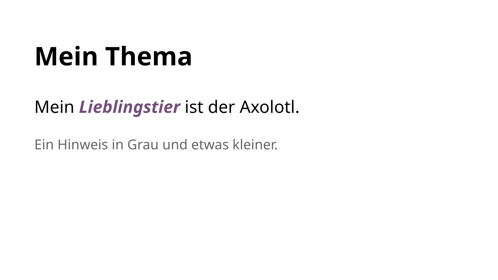
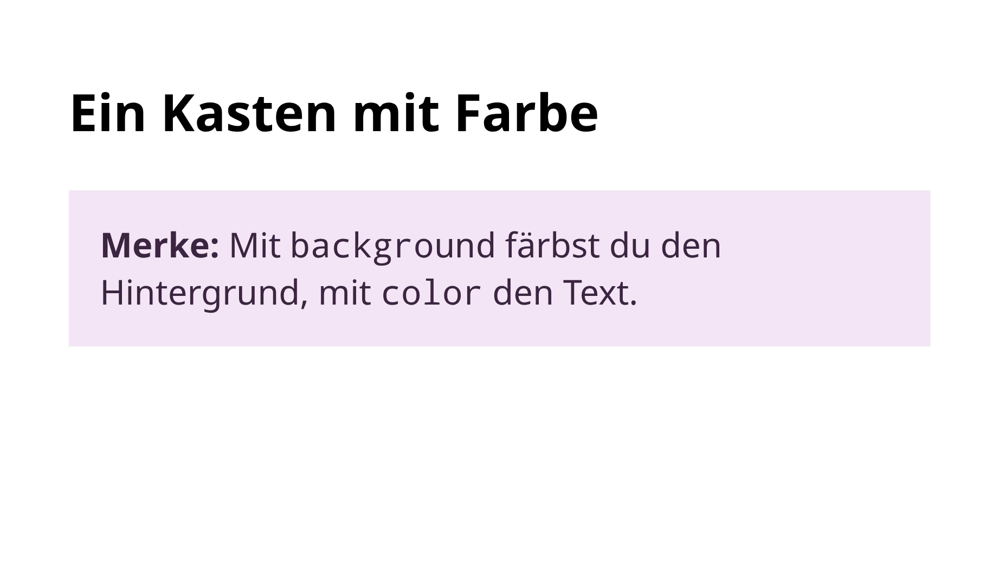
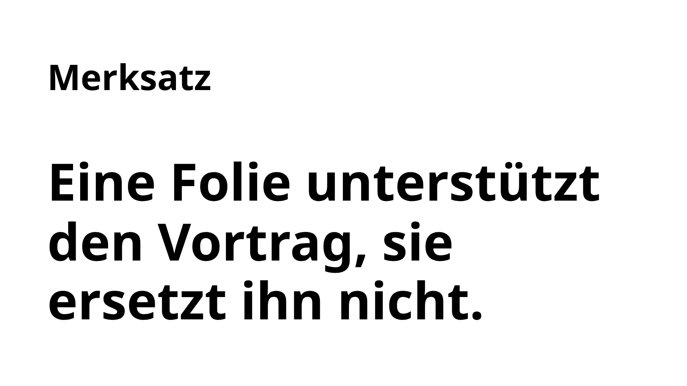
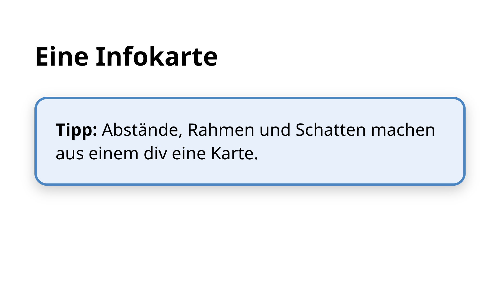
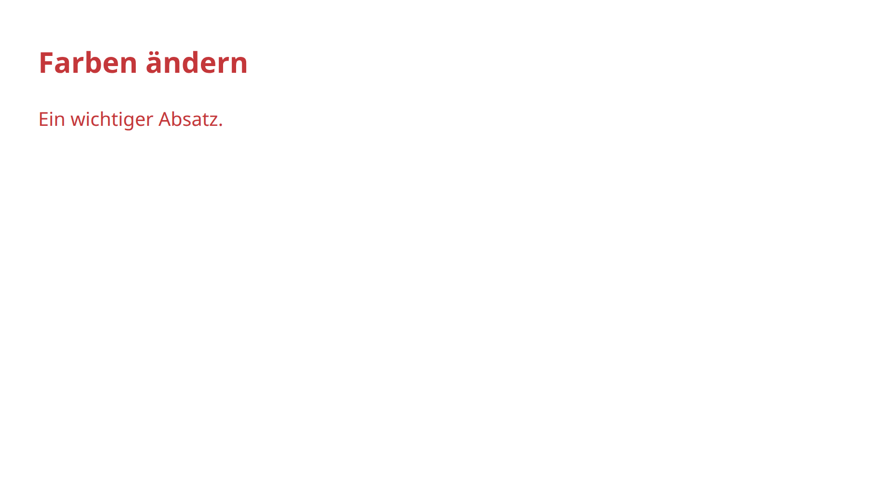

<div class='meta'>
image: infokarte.webp
kind: reference
</div>

<div
    class="autotoc-secondary-trigger"
    data-title="Auf dieser Seite"
    data-levels="h2,h3,h4">
</div>

# CSS: Aussehen

<p class='abstract'>
Mit CSS legst du fest, wie der Inhalt aussieht: Farben, Schrift, Abstände, Rahmen und die Größe von Bildern. Wie du Elemente nebeneinander anordnest, steht unter Layout.
</p>

_person(wium-lie)

<div class='book'>
<i class='bi bi-file-earmark-text'></i>
<p><strong>Cascading HTML style sheets – a proposal</strong>, Håkon W Lie, CERN, 10. Oktober 1994. Der Vorschlag, mit dem CSS anfing: Regeln, die einem HTML-Element Eigenschaften wie Schrift und Farbe geben, und Stylesheets von Leser und Autor, die übereinander gelegt werden: <a href='https://www.w3.org/People/howcome/p/cascade.html'>beim W3C</a>.</p>
</div>

Alles auf dieser Seite gilt für Webseiten und für Folien mit Shower. Jedes Beispiel zeigt rechts, wie es aussieht; mit dem Knopf <svg class='icon-slide' viewBox='0 0 24 24' aria-hidden='true'><rect x='3' y='4' width='18' height='12' rx='1.5'/><path d='M12 16v3.5M8.5 21l3.5-1.5 3.5 1.5M7 8.5h6M7 11.5h9'/></svg> in der Ecke des Bildes siehst du es als Folie.

## Grundlagen

Wie eine CSS-Regel aufgebaut ist und wie sie die richtigen Elemente findet. Wohin die Regeln kommen:

- **Webseite:** Lege `styles.css` neben `index.html` an und binde sie im `<head>` ein: `<link rel="stylesheet" href="styles.css">`.
- **Shower:** Die Vorlage hat schon eine `styles.css`. Deine Regeln gehören ans Ende, unter den Kommentar »Eigene CSS-Regeln«.

<!-- part: regeln -->
<!-- short: CSS steht in `styles.css`: Selektor, dann in geschweiften Klammern Eigenschaft und Wert, `h2 { color: #75507b; }`. -->
### CSS-Regeln

CSS schreibst du in eine eigene Datei, `styles.css`. So bleibt der Inhalt in `index.html` und die Gestaltung in `styles.css`. Eine CSS-Regel sieht so aus:

<!-- screenshot-code: regeln-html -->
```html
<h2>Mein Thema</h2>
<p>Mein <em>Lieblingstier</em> ist der Axolotl.</p>
<p class="hinweis">Ein Hinweis in Grau und etwas kleiner.</p>
```

```css
em {
    color: #75507b;
    font-weight: bold;
}

.hinweis {
    color: #666666;
    font-size: 80%;
}
```

<!-- tutorial-screenshot
# Die Vorlage der Aktivität »Eine Präsentation in HTML erstellen«: In ihr
# zeigt sich jedes Beispiel als Seite und als Folie (tutorial-screenshot-hooks.mjs)
terminal-open
terminal-run: git clone -q https://git.nhcham.org/specht/shower.js.git /workspace/shower.js && git -C /workspace/shower.js checkout -q 50a071df026545793cfa29853e5e4ed6b1ece36e
terminal-wait-for-prompt
terminal-run: cd /workspace/shower.js && (python3 -m http.server 8090 > /dev/null 2>&1 &)
write-file: beispiel.html <- previous-code (regeln-html)
write-file: beispiel.css <- previous-code
preview-port: 8090
tab: preview
viewport: 1024x576
zoom: 1.6
hook: beispiel css
variants: folie
-->

<button class='tutorial-preview' type='button'>
    
</button>

- Vor der geschweiften Klammer steht der **Selektor**: welche Elemente gemeint sind. `em` meint alle Elemente `<em>`, `.hinweis` alle Elemente mit `class="hinweis"`.
- Zwischen `{` und `}` stehen **Eigenschaften** mit ihrem **Wert**, getrennt durch einen Doppelpunkt und beendet mit einem Semikolon.

<div class='tutorial-preview-clear'></div>

#### Zum Ausprobieren: style

Für einen schnellen Versuch kannst du CSS auch direkt an ein Element schreiben, im Attribut `style`:

```html
<p style="color: #4b86c2;">Dieser Absatz ist blau.</p>
```

Das ist praktisch zum Ausprobieren. Soll dieselbe Gestaltung an mehreren Stellen gelten, ist eine Klasse in `styles.css` besser: Dann änderst du sie an einer Stelle für alle.

<!-- /part -->

<!-- part: selektoren -->
<!-- short: `p` meint alle Absätze, `.name` alle Elemente mit `class="name"`, `main p` Absätze in `main`, `h1, h2` beide, `a:hover` einen Link unter der Maus. -->
### Selektoren

Der Selektor bestimmt, wofür eine Regel gilt:

<div style='max-width: 100%; overflow-x: auto;'>
<table class='table'>
<tr><th>Selektor</th><th>Meint</th></tr>
<tr><td><code>p</code></td><td>alle Elemente <code>&lt;p&gt;</code></td></tr>
<tr><td><code>.hinweis</code></td><td>alle Elemente mit <code>class="hinweis"</code></td></tr>
<tr><td><code>p.hinweis</code></td><td>nur Absätze mit dieser Klasse</td></tr>
<tr><td><code>h1, h2</code></td><td>alle <code>&lt;h1&gt;</code> und alle <code>&lt;h2&gt;</code></td></tr>
<tr><td><code>main p</code></td><td>Absätze, die irgendwo in <code>&lt;main&gt;</code> stehen</td></tr>
<tr><td><code>main &gt; img</code></td><td>Bilder, die direkt in <code>&lt;main&gt;</code> stehen</td></tr>
<tr><td><code>a:hover</code></td><td>einen Link, solange die Maus darauf zeigt</td></tr>
<tr><td><code>#start</code></td><td>das eine Element mit <code>id="start"</code></td></tr>
</table>
</div>

Ein Element kann mehrere Klassen haben, durch Leerzeichen getrennt: `class="hinweis wichtig"`. Klassennamen schreibst du am besten klein und ohne Umlaute.

<!-- /part -->

## Gestalten

Farben, Schrift, Abstände und Bilder.

<!-- part: farben -->
<!-- short: `color` färbt den Text, `background` den Hintergrund; achte auf Kontrast. Farbcodes und den Farbmischer findest du unter »Farben angeben«. -->
### Farben

Zwei Eigenschaften brauchst du ständig:

- `color` färbt den Text,
- `background` färbt den Hintergrund.

<!-- screenshot-code: farben-html -->
```html
<h2>Ein Kasten mit Farbe</h2>
<div class="merke">
    <strong>Merke:</strong> Mit <code>background</code> färbst du den
    Hintergrund, mit <code>color</code> den Text.
</div>
```

```css
.merke {
    background: #f3e5f5;
    color: #3b2540;
    padding: 20px;
}
```

<!-- tutorial-screenshot
write-file: beispiel.html <- previous-code (farben-html)
write-file: beispiel.css <- previous-code
tab: preview
viewport: 1024x576
zoom: 1.6
hook: beispiel css
variants: folie
-->

<button class='tutorial-preview' type='button'>
    
</button>

Farben gibst du mit Namen (`red`, `white`), als Farbcode (`#75507b`) oder mit Rot-, Grün- und Blauanteil an (`rgb(117, 80, 123)`). Wie das geht, mit einem Farbmischer zum Ausprobieren, steht unter [Farben angeben](/reference/farben).

<div class='hint'>
Färbst du einen Hintergrund, leg auch die Textfarbe fest, und achte auf Kontrast: dunkler Text auf hellem Grund oder heller Text auf dunklem. Hellgrau auf Weiß sieht vielleicht schick aus, kann aber in einem hellen Raum niemand lesen. VS Code zeigt neben jedem Farbcode ein kleines Farbfeld; ein Klick darauf öffnet eine Farbauswahl.
</div>

<div class='tutorial-preview-clear'></div>

<!-- /part -->

<!-- part: schrift -->
<!-- short: `font-size` für die Größe (`32px`, `120%`), `line-height` für den Zeilenabstand, `font-weight: bold` für fett, `text-align: center` zum Zentrieren, `font-family` für die Schriftart. -->
### Schrift

<!-- screenshot-code: schrift-html -->
```html
<h2>Merksatz</h2>
<p class="gross">Eine Folie unterstützt den Vortrag, sie ersetzt ihn nicht.</p>
<p class="klein">Quelle: eigene Erfahrung</p>
```

```css
.gross {
    font-size: 48px;
    line-height: 1.15;
    font-weight: bold;
}

.klein {
    font-size: 70%;
    color: #666666;
    text-align: right;
}
```

<!-- tutorial-screenshot
write-file: beispiel.html <- previous-code (schrift-html)
write-file: beispiel.css <- previous-code
tab: preview
viewport: 1024x576
zoom: 1.6
hook: beispiel css
variants: folie
-->

<button class='tutorial-preview' type='button'>
    
</button>

- `font-size` ist die Schriftgröße: in Pixeln (`48px`) oder im Verhältnis zur Umgebung (`70%`).
- `line-height` ist der Zeilenabstand, als Vielfaches der Schriftgröße. Große Schrift verträgt einen kleineren Wert.
- `font-weight: bold` macht fett, `font-style: italic` kursiv.
- `text-align` richtet Text aus: `left`, `center`, `right` oder `justify` (Blocksatz).

<div class='hint'>
Musst du die Schrift auf einer Folie immer kleiner machen, steht zu viel darauf. Verteile den Inhalt lieber auf zwei Folien.
</div>

<div class='tutorial-preview-clear'></div>

#### Die Schriftart

`font-family` wählt die Schriftart. Weil nicht jeder Rechner jede Schrift hat, nennst du zum Schluss eine allgemeine Familie, die immer geht:

```css
body {
    font-family: Georgia, serif;
}
```

`serif` ist eine Schrift mit kleinen Endstrichen wie in Büchern, `sans-serif` eine ohne, `monospace` eine, in der alle Zeichen gleich breit sind, wie im Code. Nimm höchstens zwei Schriftarten: eine für Überschriften, eine für den Text.

#### Eine eigene Schriftart

Eine besondere Schrift muss als Datei in deinem Projekt liegen; sonst fehlt sie auf jedem anderen Rechner und ganz ohne Internet. So holst du sie dir:

1. Such dir auf [fonts.google.com](https://fonts.google.com) eine Schrift aus, zum Beispiel »Atkinson Hyperlegible«.
2. Such sie auf [gwfh.mranftl.com](https://gwfh.mranftl.com) und wähle die Schnitte, die du brauchst, etwa `regular` und `700` (fett).
3. Lade die ZIP-Datei herunter und lege die `.woff2`-Dateien in einen Ordner `fonts` in deinem Projekt.
4. Kopiere den CSS-Code, den die Seite anzeigt, an den Anfang deiner `styles.css`. Er sieht so aus:

```css
@font-face {
    font-family: 'Atkinson Hyperlegible';
    font-weight: 400;
    font-display: swap;
    src: url('fonts/atkinson-hyperlegible-v12-latin-regular.woff2') format('woff2');
}
```

Danach verwendest du den Namen wie jede andere Schrift: `font-family: 'Atkinson Hyperlegible', sans-serif;`. Erscheint sie nicht, prüfe den Pfad in `url(…)`: Liegt die Datei in `fonts/`, muss der Pfad mit `fonts/` beginnen.

<div class='hint think'>
Auch Schriften haben Lizenzen. Die Schriften von Google Fonts darfst du verwenden und weitergeben.
</div>

<!-- /part -->

<!-- part: abstaende -->
<!-- short: `padding` ist der Abstand innen, `margin` der Abstand außen; `border` zieht einen Rahmen, `border-radius` rundet die Ecken, `box-shadow` wirft einen Schatten. -->
### Abstände, Rahmen und Schatten

Jedes Element ist ein Kasten. Um seinen Inhalt herum liegen, von innen nach außen:

- `padding`, der Abstand innen, zwischen Inhalt und Rand,
- `border`, der Rahmen,
- `margin`, der Abstand außen, zu den Nachbarn.

<!-- screenshot-code: infokarte-html -->
```html
<h2>Eine Infokarte</h2>
<div class="karte">
    <strong>Tipp:</strong> Abstände, Rahmen und Schatten machen aus
    einem div eine Karte.
</div>
```

```css
.karte {
    max-width: 520px;
    margin-top: 30px;
    padding: 24px;
    border: 3px solid #4b86c2;
    border-radius: 16px;
    background: #e8f1fb;
    box-shadow: 0 6px 16px rgba(0, 0, 0, 0.2);
}
```

<!-- tutorial-screenshot
write-file: beispiel.html <- previous-code (infokarte-html)
write-file: beispiel.css <- previous-code
tab: preview
viewport: 1024x576
zoom: 1.6
hook: beispiel css
variants: folie
-->

<button class='tutorial-preview' type='button'>
    
</button>

- `padding: 24px` gilt für alle vier Seiten; `padding: 10px 24px` heißt 10 oben und unten, 24 links und rechts.
- `border: 3px solid #4b86c2` ist ein 3 Pixel breiter, durchgezogener Rahmen in Blau.
- `border-radius: 16px` rundet die Ecken; `50%` macht aus einem Quadrat einen Kreis.
- `box-shadow: 0 6px 16px rgba(0, 0, 0, 0.2)`: 0 Pixel nach rechts, 6 nach unten, 16 Pixel weich, in Schwarz mit 20 % Deckkraft.

<div class='tutorial-preview-clear'></div>

<!-- /part -->

<!-- part: bildgroesse -->
<!-- short: Gib Bildern nur eine Höhe oder eine Breite; mit beiden zusammen kommt `object-fit: cover` dazu, sonst wird das Bild verzerrt. -->
### Bildgröße und Zuschnitt

Ohne Angabe ist ein Bild so groß wie die Datei, oft viel zu groß. Gib ihm eine Höhe **oder** eine Breite; die andere Seite passt sich an, damit nichts verzerrt:

```html

```

<!-- tutorial-screenshot
write-file: beispiel.html <- previous-code
tab: preview
viewport: 1024x576
zoom: 1.6
hook: beispiel
variants: folie
-->

<button class='tutorial-preview' type='button'>
    
</button>

`max-width: 100%` sorgt außerdem dafür, dass ein Bild nie breiter wird als der Platz, den es hat. Auf Webseiten ist das eine gute Regel für alle Bilder: `img { max-width: 100%; }`. In der Shower-Vorlage steht sie schon.

<div class='tutorial-preview-clear'></div>

#### Breite und Höhe zugleich

Gibst du beides an und es passt nicht zum Bild, wird es verzerrt:

```html

```

<!-- tutorial-screenshot
write-file: beispiel.html <- previous-code
tab: preview
viewport: 1024x576
zoom: 1.6
hook: beispiel
variants: folie
-->

<button class='tutorial-preview' type='button'>
    
</button>

Mit `object-fit: cover` füllt das Bild den Rahmen, ohne sich zu verzerren; was übersteht, wird abgeschnitten. `object-position` wählt, welcher Teil zu sehen bleibt: der erste Wert waagerecht (0 % links, 100 % rechts), der zweite senkrecht.

```html

```

<!-- tutorial-screenshot
write-file: beispiel.html <- previous-code
tab: preview
viewport: 1024x576
zoom: 1.6
hook: beispiel
variants: folie
-->

<button class='tutorial-preview' type='button'>
    
</button>

<div class='tutorial-preview-clear'></div>

#### Ein festes Seitenverhältnis

Sollen mehrere Bilder gleich geformt sein, gib ihnen eine Höhe und ein Seitenverhältnis mit `aspect-ratio`; `object-fit: cover` schneidet sie passend zu:

<!-- screenshot-code: seitenverhaeltnis-html -->
```html


```

```css
.quadrat {
    height: 200px;
    aspect-ratio: 1 / 1;
    object-fit: cover;
    border-radius: 12px;
}
```

<!-- tutorial-screenshot
write-file: beispiel.html <- previous-code (seitenverhaeltnis-html)
write-file: beispiel.css <- previous-code
tab: preview
viewport: 1024x576
zoom: 1.6
hook: beispiel css
variants: folie
-->

<button class='tutorial-preview' type='button'>
    
</button>

Häufige Verhältnisse sind `1 / 1` (quadratisch), `4 / 3`, `3 / 4` (hochkant) und `16 / 9` (breit wie ein Bildschirm).

<div class='tutorial-preview-clear'></div>

<!-- /part -->

<!-- part: wirkt-nicht -->
<!-- short: Wirkt eine Regel nicht: gespeichert? `styles.css` eingebunden? Klammern und Semikolons? Und eine genauere Regel gewinnt; schreib dann den Tag-Namen dazu, etwa `h2.wichtig`. -->
## Wenn eine Regel nicht wirkt

Prüfe der Reihe nach:

1. Hast du `styles.css` gespeichert und die Vorschau neu geladen?
2. Ist `styles.css` im `<head>` eingebunden (bei der Shower-Vorlage schon erledigt)?
3. Stimmt der Selektor? Ein Punkt vor Klassen (`.hinweis`), keiner vor Tags (`p`); die Klasse heißt im HTML genauso.
4. Hat jede Eigenschaft ihren Doppelpunkt und ihr Semikolon, jede Regel ihre schließende `}`? Ein Fehler kann alle Regeln danach unwirksam machen. VS Code unterstreicht ihn rot.

### Die genauere Regel gewinnt

Gelten zwei Regeln für dasselbe Element, gewinnt die **genauere**. Bei Folien stolpert man darüber oft, weil das Shower-Theme schon Regeln für Überschriften mitbringt (`.slide h2`). Diese Regel wirkt auf einer Webseite, auf einer Folie aber nicht:

<!-- screenshot-code: genauer-html -->
```html
<h2 class="wichtig">Farben ändern</h2>
<p class="wichtig">Ein wichtiger Absatz.</p>
```

```css
.wichtig {
    color: #c4373a;
}
```

<!-- tutorial-screenshot
write-file: beispiel.html <- previous-code (genauer-html)
write-file: beispiel.css <- previous-code
tab: preview
viewport: 1024x576
zoom: 1.6
hook: beispiel css
variants: folie
-->

<button class='tutorial-preview' type='button'>
    
</button>

Schalte das Bild auf Folie um: Der Absatz ist rot, die Überschrift nicht. `.slide h2` nennt eine Klasse und einen Tag, `.wichtig` nur eine Klasse, also gewinnt das Theme. Schreib den Tag-Namen dazu, dann ist deine Regel genauso genau, und weil `styles.css` nach dem Theme kommt, gewinnt sie:

<!-- screenshot-code: genauer2-html -->
```html
<h2 class="wichtig">Farben ändern</h2>
<p class="wichtig">Ein wichtiger Absatz.</p>
```

```css
h2.wichtig,
p.wichtig {
    color: #c4373a;
}
```

<!-- tutorial-screenshot
write-file: beispiel.html <- previous-code (genauer2-html)
write-file: beispiel.css <- previous-code
tab: preview
viewport: 1024x576
zoom: 1.6
hook: beispiel css
variants: folie
-->

<button class='tutorial-preview' type='button'>
    
</button>

<div class='hint'>
Im Browser zeigt dir ein Rechtsklick auf das Element und »Untersuchen« alle Regeln, die für es gelten; durchgestrichene haben verloren. So findest du heraus, welche Regel deine überstimmt.
</div>

<div class='tutorial-preview-clear'></div>

<!-- /part -->

## Zum Nachschlagen

- [MDN: CSS-Referenz](https://developer.mozilla.org/de/docs/Web/CSS/Reference): alle Eigenschaften, Werte und Selektoren, auf Deutsch. Hier schaust du nach, welche Werte eine Eigenschaft annimmt und was sie bewirken.
- [MDN: CSS-Selektoren](https://developer.mozilla.org/de/docs/Web/CSS/Guides/Selectors): alle Arten von Selektoren, auch die, die hier fehlen, etwa `li:nth-child(2)` oder `a[href^="https"]`.
- [MDN: Das Box-Modell](https://developer.mozilla.org/de/docs/Web/CSS/Guides/Box_model/Introduction): wie Inhalt, `padding`, `border` und `margin` zusammen die Größe eines Elements ergeben.
- [MDN: Spezifität](https://developer.mozilla.org/de/docs/Web/CSS/Guides/Cascade/Specificity): genau, wie der Browser ausrechnet, welche Regel gewinnt.
- [Can I use](https://caniuse.com/): eine Übersicht, welcher Browser eine Eigenschaft seit welcher Version kann.
