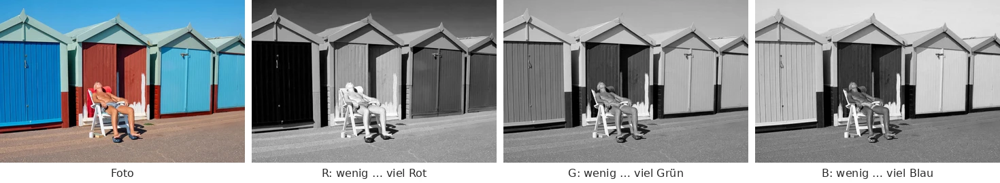
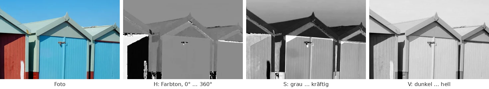
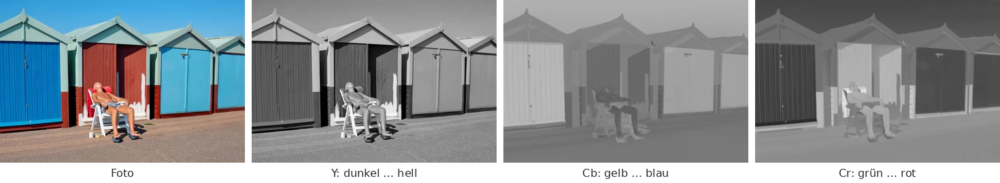

kind: reference

# Farbräume

Eine Farbe ist für den Computer drei Zahlen, aber welche drei, hängt davon ab, wofür man sie braucht. Zum Anzeigen nimmt man Rot, Grün und Blau, zum Komprimieren Helligkeit und zwei Farbanteile, zum Vergleichen einen Farbraum, in dem gleiche Abstände gleich verschieden aussehen. Hier stehen die wichtigsten, wie man zwischen ihnen umrechnet und wie dasselbe Foto in jedem von ihnen aussieht.

Alle Bilder auf dieser Seite zerlegen dasselbe Foto in die drei Kanäle eines Farbraums. Jeder Kanal ist ein Graubild: dunkel, wo der Wert klein ist, hell, wo er groß ist. Unter jedem steht, was dunkel und was hell bedeutet.

Foto mit freundlicher Genehmigung von Ian Kobylanski · <a href='https://koby.photography/' target='_blank'>https://koby.photography/</a>

<!-- part: rgb-wuerfel -->
## RGB

Bildschirme mischen jede Farbe aus rotem, grünem und blauem Licht. Jeder Anteil ist eine Zahl von 0 bis 255, ein Byte; zusammen sind das \\(256^3\\), also gut 16,7 Millionen Farben. Man kann sie sich als Würfel vorstellen: Schwarz (0, 0, 0) in einer Ecke, Weiß (255, 255, 255) in der gegenüberliegenden, und auf der Diagonale dazwischen alle Grautöne, bei denen die drei Anteile gleich sind.

Alle drei Kanäle sehen aus wie das Foto selbst, denn in jedem steckt die Helligkeit. Das ist gut zum Anzeigen, aber schlecht, wenn man wissen will, wie hell ein Pixel ist oder wie ähnlich zwei Farben sind: Dafür muss man alle drei Zahlen zusammen ansehen. Wie man Farben in CSS und im Anaglyph-Viewer mit RGB angibt, steht in [Farben angeben](/reference/farben).
<!-- /part -->

<!-- part: gamma -->
## Gespeicherte Werte und Licht

Ein Wert von 128 ist nicht halb so viel Licht wie 255, sondern nur etwa ein Fünftel. Die Werte in einer Bilddatei folgen dem Standard **sRGB**: Sie verteilen die 256 Stufen so, dass dunkle Töne mehr Stufen bekommen, denn dort sieht das Auge feinere Unterschiede. Wer mit Licht rechnen will, etwa um zwei Farben zu mischen oder in einen anderen Farbraum umzurechnen, rechnet einen Wert \\(v\\) zuerst in die Lichtmenge \\(c\\) von 0 bis 1 um:

$$c = \left(\frac{v / 255 + 0{,}055}{1{,}055}\right)^{2{,}4}$$

Für sehr dunkle Werte, bis \\(v / 255 = 0{,}04045\\), gilt stattdessen die Gerade \\(c = \frac{v / 255}{12{,}92}\\). Dieses Umrechnen heißt oft **Gamma**: Der Exponent 2,4 ist sein Kern. Zurück geht es mit dem Kehrwert, \\(1 / 2{,}4\\).
<!-- /part -->

<!-- part: graustufen -->
## Graustufen

Aus einem Farbbild wird ein Graubild, indem man jedem Pixel seine Helligkeit gibt. Der Mittelwert \\((R + G + B) / 3\\) liegt daneben, denn das Auge sieht Grün viel heller als Blau: Ein reines Blau (0, 0, 255) wirkt fast so dunkel wie Schwarz. Fernsehen und JPEG nehmen deshalb Gewichte:

$$Y = 0{,}299 \cdot R + 0{,}587 \cdot G + 0{,}114 \cdot B$$

Grün zählt fast doppelt so viel wie Rot und fünfmal so viel wie Blau. Diese Formel arbeitet direkt mit den gespeicherten Werten; genauer, aber aufwendiger ist es, erst in Licht umzurechnen (siehe oben) und dann mit 0,2126, 0,7152 und 0,0722 zu gewichten. So rechnet CIELab weiter unten seine Helligkeit aus.
<!-- /part -->

<!-- part: hsv -->
## HSV: Farbton, Sättigung, Hellwert

HSV beschreibt eine Farbe so, wie man sie mit Worten beschreiben würde:

- **H** (»hue«, der Farbton) ist ein Winkel auf dem Farbkreis: 0° Rot, 60° Gelb, 120° Grün, 180° Cyan, 240° Blau, 300° Magenta und bei 360° wieder Rot.
- **S** (»saturation«, die Sättigung) sagt, wie kräftig die Farbe ist: 0 ist grau, 1 die reine Farbe.
- **V** (»value«, der Hellwert) ist der größte der drei RGB-Anteile, von 0 bis 1.

Aus RGB, mit \\(r, g, b\\) von 0 bis 1, \\(M\\) dem größten und \\(m\\) dem kleinsten der drei Werte: \\(V = M\\), \\(S = (M - m) / M\\) (0, wenn \\(M = 0\\)). Der Farbton hängt davon ab, welcher Anteil der größte ist; ist es Rot, gilt \\(H = 60° \cdot \frac{g - b}{M - m}\\), bei Grün \\(H = 60° \cdot \left(2 + \frac{b - r}{M - m}\right)\\), bei Blau \\(H = 60° \cdot \left(4 + \frac{r - g}{M - m}\right)\\), und ein negatives Ergebnis plus 360°. In Python rechnet das `colorsys.rgb_to_hsv(r, g, b)`, mit H von 0 bis 1 statt bis 360°.

Im Farbton zerfällt die rote Tür in Schwarz und Weiß: Rot liegt am Anfang und am Ende des Kreises, bei 0° und bei fast 360°, und als Graubild sind das die beiden Enden. Ein Farbton ist eben ein Winkel und keine Zahl auf einer Linie. Wo die Sättigung fast 0 ist, im weißen Farbfleck auf der roten Tür, ist der Farbton sogar ganz zufällig: Weiß und Grau haben keinen. HSV ist gut, wenn Menschen Farben auswählen oder verschieben wollen, etwa »dieselbe Farbe, nur blasser«. In CSS gibt es mit `hsl(…)` einen nahen Verwandten.
<!-- /part -->

<!-- part: ycbcr -->
## YCbCr: Helligkeit und zwei Farbanteile

JPEG und Video trennen die Helligkeit **Y** von zwei Farbanteilen: **Cb** sagt, wie viel bläulicher, **Cr**, wie viel rötlicher die Farbe ist als ein Grau derselben Helligkeit. Mit Werten von 0 bis 255:

$$Y = 0{,}299 R + 0{,}587 G + 0{,}114 B$$

$$C\_b = 128 - 0{,}168736 R - 0{,}331264 G + 0{,}5 B$$

$$C\_r = 128 + 0{,}5 R - 0{,}418688 G - 0{,}081312 B$$

Y ist genau das Graubild von oben. Zurück geht es mit \\(R = Y + 1{,}402 (C\_r - 128)\\), \\(G = Y - 0{,}344136 (C\_b - 128) - 0{,}714136 (C\_r - 128)\\) und \\(B = Y + 1{,}772 (C\_b - 128)\\), jeweils auf 0 bis 255 begrenzt.

In Cb und Cr steckt kaum noch etwas vom Bild: Wo eine Fläche fast grau ist, an den blassen Giebeln, sind beide nahe 128, mittleres Grau, und nur die Türen und der Himmel heben sich ab. Die Kanten und Details stecken fast alle in Y. Das nutzt JPEG aus: Das Auge sieht Helligkeit viel feiner als Farbe, also speichert JPEG Cb und Cr oft nur für jedes zweite Pixel in jeder Richtung, ein Viertel der Daten, ohne dass man es sieht. Ausprobieren kannst du das unter [Trennung von Helligkeit und Farbe](/colorspace); wie ein Decoder zurückrechnet, zeigt [Eine JPEG-Datei decodieren](/jpeg).
<!-- /part -->

<!-- part: cielab -->
## CIELab: Farben, wie wir sie sehen

In RGB und auch in YCbCr sind gleiche Abstände nicht gleich verschieden: Zwei Grüntöne, die sich um 10 unterscheiden, sehen fast gleich aus, zwei dunkle Blautöne mit demselben Abstand deutlich verschieden. **CIELab** ist so gebaut, dass der Abstand zweier Farben ungefähr dem entspricht, was ein Mensch als Unterschied sieht. **L** ist die Helligkeit von 0 (schwarz) bis 100 (weiß), **a** geht von Grün (negativ) nach Rot (positiv), **b** von Blau (negativ) nach Gelb (positiv); Grau hat a = b = 0.

Die Umrechnung geht in drei Schritten. Zuerst jeden Kanal in Licht \\(r, g, b\\) umrechnen (»Gespeicherte Werte und Licht«), dann in den Farbraum **XYZ**, der beschreibt, wie stark die drei Arten von Zapfen im Auge angeregt werden, geteilt durch die Werte für Weiß:

$$X = (0{,}4124 r + 0{,}3576 g + 0{,}1805 b) / 0{,}95047$$

$$Y = 0{,}2126 r + 0{,}7152 g + 0{,}0722 b$$

$$Z = (0{,}0193 r + 0{,}1192 g + 0{,}9505 b) / 1{,}08883$$

Zuletzt nimmt \\(f(t) = \sqrt[3]{t}\\) (für \\(t \le 216 / 24389\\) die Gerade \\(f(t) = (24389 / 27 \cdot t + 16) / 116\\)) jedem Wert seine Ungleichmäßigkeit, denn auch das Auge empfindet Helligkeit ungefähr wie die dritte Wurzel der Lichtmenge:

$$L = 116 f(Y) - 16, \quad a = 500 \left(f(X) - f(Y)\right), \quad b = 200 \left(f(Y) - f(Z)\right)$$

Wie bei YCbCr steckt das Bild fast ganz in L, und a und b sind grau, wo keine Farbe ist. Der Unterschied liegt im Abstand: Der Unterschied zweier Farben ist in Lab einfach \\(\Delta E = \sqrt{(L\_1 - L\_2)^2 + (a\_1 - a\_2)^2 + (b\_1 - b\_2)^2}\\), und ein \\(\Delta E\\) um 2 sieht man gerade eben. Druckereien prüfen damit, ob eine Farbe stimmt, und [Geheime Botschaften in Bildern](/steganography) versteckt Daten in Farben, die in Lab so nah beieinander liegen, dass niemand den Unterschied sieht.
<!-- /part -->

## Welcher Farbraum wofür?

<table class='table'>
<thead><tr><th>Farbraum</th><th>Kanäle</th><th>Gut für</th></tr></thead>
<tbody>
<tr><td>RGB</td><td>Rot, Grün, Blau</td><td>Anzeigen; so speichern Bilddateien und Bildschirme ihre Pixel</td></tr>
<tr><td>HSV</td><td>Farbton, Sättigung, Hellwert</td><td>Farben aussuchen und verändern: blasser, dunkler, einen anderen Farbton</td></tr>
<tr><td>YCbCr</td><td>Helligkeit, zwei Farbanteile</td><td>Komprimieren: Farbe gröber speichern als Helligkeit (JPEG, Video)</td></tr>
<tr><td>CIELab</td><td>Helligkeit, Grün–Rot, Blau–Gelb</td><td>Vergleichen: Abstände so groß, wie das Auge sie sieht</td></tr>
</tbody>
</table>

