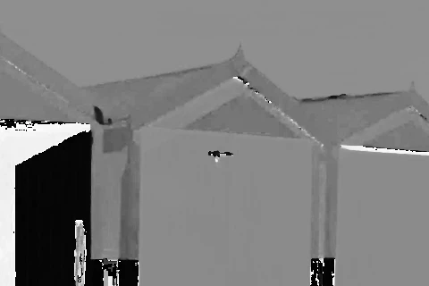
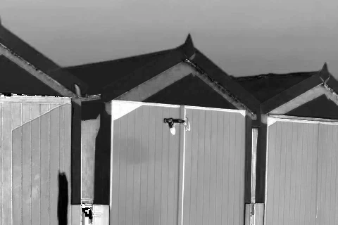
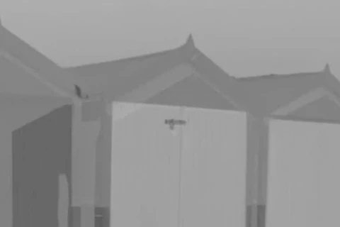
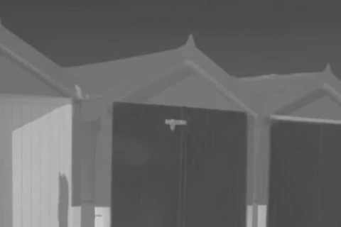
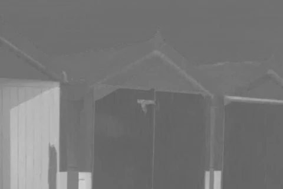
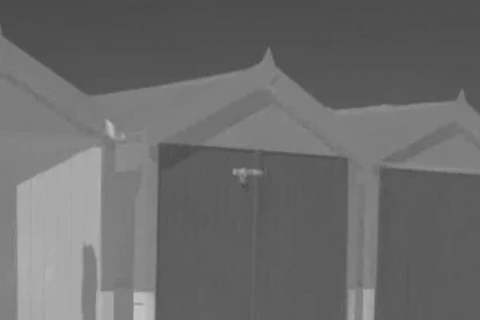
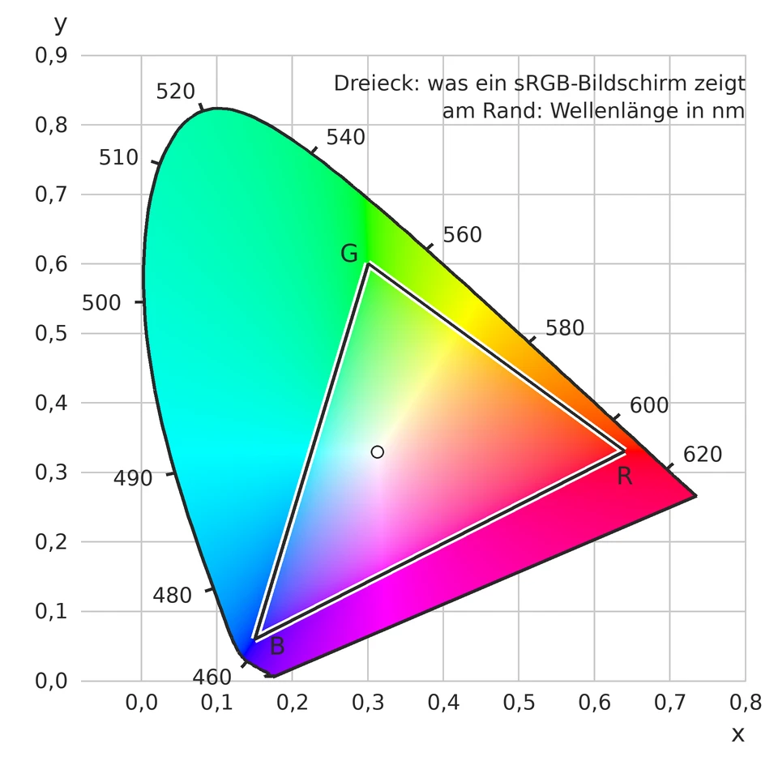

<div class='meta'>
kind: reference
</div>

<script src="/include/color_solid.js"></script>

<div
    class="autotoc-secondary-trigger"
    data-title="Auf dieser Seite"
    data-levels="h2,h3">
</div>

# Farbräume

<p class='abstract'>
Eine Farbe ist für den Computer drei Zahlen, aber welche drei, hängt davon ab, wofür man sie braucht. Zum Anzeigen nimmt man Rot, Grün und Blau, zum Komprimieren Helligkeit und zwei Farbanteile, zum Vergleichen einen Farbraum, in dem gleiche Abstände gleich verschieden aussehen. Hier stehen die wichtigsten, wie man zwischen ihnen umrechnet, wie dasselbe Foto in jedem von ihnen aussieht und wie sie entstanden sind.
</p>

Zu jedem Farbraum gibt es einen Körper zum Drehen: alle Farben des RGB-Würfels, an die Stelle gesetzt, die ihnen der Farbraum gibt, das Helle oben. Zieh mit der Maus, um ihn zu drehen. Mit **Schnitt** schneidest du ihn waagerecht ab und siehst auf der Schnittfläche alle Farben derselben Helligkeit; **Viertel herausnehmen** öffnet den Körper, und du siehst auch in sein Inneres. **Zerteilen** zerlegt den RGB-Würfel in 8 × 8 × 8 gleich große Würfel von je 32 Stufen pro Kanal, und **Auseinander** zieht sie voneinander weg. Im Farbraum sind diese Stücke meist keine Würfel mehr. So siehst du, wie jeder Farbraum gleiche Schritte in RGB verbiegt.

Die Bilder auf dieser Seite zerlegen dasselbe Foto in die drei Kanäle eines Farbraums. Jeder Kanal ist ein Graubild: dunkel, wo der Wert klein ist, hell, wo er groß ist. Unter jedem steht, was dunkel und was hell bedeutet. Das ist das Foto:


<p class='expl'>Foto mit freundlicher Genehmigung von Ian Kobylanski · <a href='https://koby.photography/'>https://koby.photography/</a></p>

<!-- part: rgb-wuerfel -->
## RGB

Bildschirme mischen jede Farbe aus rotem, grünem und blauem Licht. Jeder Anteil ist eine Zahl von 0 bis 255, ein Byte; zusammen sind das \\(256^3\\), also gut 16,7 Millionen Farben. Man kann sie sich als Würfel vorstellen: Schwarz (0, 0, 0) in einer Ecke, Weiß (255, 255, 255) in der gegenüberliegenden, und auf der Diagonale dazwischen alle Grautöne, bei denen die drei Anteile gleich sind. Hier steht der Würfel auf seiner schwarzen Ecke, die graue Diagonale ist die senkrechte Achse. Ein waagerechter Schnitt zeigt alle Farben mit derselben Summe R + G + B, mal ein Dreieck, mal ein Sechseck:

<div class='color-solid' data-space='rgb'></div>

<div class='gallery columns-3'>
<figure><figcaption>R: wenig … viel Rot</figcaption></figure>
<figure><figcaption>G: wenig … viel Grün</figcaption></figure>
<figure><figcaption>B: wenig … viel Blau</figcaption></figure>
</div>

Alle drei Kanäle sehen aus wie das Foto selbst, denn in jedem steckt die Helligkeit. Das ist gut zum Anzeigen, aber schlecht, wenn man wissen will, wie hell ein Pixel ist oder wie ähnlich zwei Farben sind: Dafür muss man alle drei Zahlen zusammen ansehen. Wie man Farben in CSS und im Anaglyph-Viewer mit RGB angibt, steht in [Farben angeben](/reference/farben).
<!-- /part -->

<!-- part: gamma -->
## Gespeicherte Werte und Licht

Ein Wert von 128 ist nicht halb so viel Licht wie 255, sondern nur etwa ein Fünftel. Die Werte in einer Bilddatei folgen dem Standard **sRGB**: Sie verteilen die 256 Stufen so, dass dunkle Töne mehr Stufen bekommen, denn dort sieht das Auge feinere Unterschiede. Wer mit Licht rechnen will, etwa um zwei Farben zu mischen oder in einen anderen Farbraum umzurechnen, rechnet einen Wert \\(v\\) zuerst in die Lichtmenge \\(c\\) von 0 bis 1 um:

$$c = \left(\frac{v / 255 + 0{,}055}{1{,}055}\right)^{2{,}4}$$

Für sehr dunkle Werte, bis \\(v / 255 = 0{,}04045\\), gilt stattdessen die Gerade \\(c = \frac{v / 255}{12{,}92}\\). Dieses Umrechnen heißt oft **Gamma**: Der Exponent 2,4 ist sein Kern. Zurück geht es mit dem Kehrwert, \\(1 / 2{,}4\\).
<!-- /part -->

<!-- part: graustufen -->
## Graustufen

Aus einem Farbbild wird ein Graubild, indem man jedem Pixel seine Helligkeit gibt. Der Mittelwert \\((R + G + B) / 3\\) liegt daneben, denn das Auge sieht Grün viel heller als Blau: Ein reines Blau (0, 0, 255) wirkt fast so dunkel wie Schwarz. Fernsehen und JPEG nehmen deshalb Gewichte:

$$Y = 0{,}299 \cdot R + 0{,}587 \cdot G + 0{,}114 \cdot B$$

Grün zählt fast doppelt so viel wie Rot und fünfmal so viel wie Blau. Diese Formel arbeitet direkt mit den gespeicherten Werten; genauer, aber aufwendiger ist es, erst in Licht umzurechnen (siehe oben) und dann mit 0,2126, 0,7152 und 0,0722 zu gewichten. So rechnet CIELab weiter unten seine Helligkeit aus.
<!-- /part -->

<!-- part: hsv -->
## HSV: Farbton, Sättigung, Hellwert

HSV beschreibt eine Farbe so, wie man sie mit Worten beschreiben würde:

- **H** (»hue«, der Farbton) ist ein Winkel auf dem Farbkreis: 0° Rot, 60° Gelb, 120° Grün, 180° Cyan, 240° Blau, 300° Magenta und bei 360° wieder Rot.
- **S** (»saturation«, die Sättigung) sagt, wie kräftig die Farbe ist: 0 ist grau, 1 die reine Farbe.
- **V** (»value«, der Hellwert) ist der größte der drei RGB-Anteile, von 0 bis 1.

Aus RGB, mit \\(r, g, b\\) von 0 bis 1, \\(M\\) dem größten und \\(m\\) dem kleinsten der drei Werte: \\(V = M\\), \\(S = (M - m) / M\\) (0, wenn \\(M = 0\\)). Der Farbton hängt davon ab, welcher Anteil der größte ist; ist es Rot, gilt \\(H = 60° \cdot \frac{g - b}{M - m}\\), bei Grün \\(H = 60° \cdot \left(2 + \frac{b - r}{M - m}\right)\\), bei Blau \\(H = 60° \cdot \left(4 + \frac{r - g}{M - m}\right)\\), und ein negatives Ergebnis plus 360°. In Python rechnet das `colorsys.rgb_to_hsv(r, g, b)`, mit H von 0 bis 1 statt bis 360°.

<div class='gallery columns-3'>
<figure><figcaption>H: Farbton, 0° … 360°</figcaption></figure>
<figure><figcaption>S: grau … kräftig</figcaption></figure>
<figure><figcaption>V: dunkel … hell</figcaption></figure>
</div>

Im Farbton zerfällt die rote Tür in Schwarz und Weiß: Rot liegt am Anfang und am Ende des Kreises, bei 0° und bei fast 360°, und als Graubild sind das die beiden Enden. Ein Farbton ist eben ein Winkel und keine Zahl auf einer Linie. Wo die Sättigung fast 0 ist, im weißen Farbfleck auf der roten Tür, ist der Farbton sogar ganz zufällig: Weiß und Grau haben keinen. HSV ist gut, wenn Menschen Farben auswählen oder verschieben wollen, etwa »dieselbe Farbe, nur blasser«. In CSS gibt es mit `hsl(…)` einen nahen Verwandten.

Als Körper ist HSV ein Kegel: Schwarz an der Spitze unten, oben eine Scheibe mit Weiß in der Mitte und den reinen Farben am Rand, rundherum nach ihrem Farbton. Der Abstand von der Achse ist hier S · V. Nähme man S selbst, würde aus dem Kegel ein Zylinder, dessen ganzer Boden schwarz ist, denn bei V = 0 ist jeder Farbton und jede Sättigung schwarz.

<div class='color-solid' data-space='hsv'></div>
<!-- /part -->

<!-- part: ycbcr -->
## YCbCr: Helligkeit und zwei Farbanteile

JPEG und Video trennen die Helligkeit **Y** von zwei Farbanteilen: **Cb** sagt, wie viel bläulicher, **Cr**, wie viel rötlicher die Farbe ist als ein Grau derselben Helligkeit. Mit Werten von 0 bis 255:

$$Y = 0{,}299 R + 0{,}587 G + 0{,}114 B$$

$$C\_b = 128 - 0{,}168736 R - 0{,}331264 G + 0{,}5 B$$

$$C\_r = 128 + 0{,}5 R - 0{,}418688 G - 0{,}081312 B$$

Y ist genau das Graubild von oben. Zurück geht es mit \\(R = Y + 1{,}402 (C\_r - 128)\\), \\(G = Y - 0{,}344136 (C\_b - 128) - 0{,}714136 (C\_r - 128)\\) und \\(B = Y + 1{,}772 (C\_b - 128)\\), jeweils auf 0 bis 255 begrenzt.

<div class='gallery columns-3'>
<figure><figcaption>Y: dunkel … hell</figcaption></figure>
<figure><figcaption>Cb: gelb … blau</figcaption></figure>
<figure><figcaption>Cr: grün … rot</figcaption></figure>
</div>

In Cb und Cr steckt kaum noch etwas vom Bild: Wo eine Fläche fast grau ist, an den blassen Giebeln, sind beide nahe 128, mittleres Grau, und nur die Türen und der Himmel heben sich ab. Die Kanten und Details stecken fast alle in Y. Das nutzt JPEG aus: Das Auge sieht Helligkeit viel feiner als Farbe, also speichert JPEG Cb und Cr oft nur für jedes zweite Pixel in jeder Richtung, ein Viertel der Daten, ohne dass man es sieht. Ausprobieren kannst du das unter <a href='/colorspace' target='_blank' rel='noopener'>Trennung von Helligkeit und Farbe</a>; wie ein Decoder zurückrechnet, zeigt [Eine JPEG-Datei decodieren](/jpeg).

YCbCr rechnet nur mit festen Gewichten, darum bleibt der Würfel ein Körper mit geraden Kanten, nur schief und gekippt. Seine Ecken liegen auf verschiedenen Höhen: Gelb fast oben bei Weiß, Blau fast unten bei Schwarz, denn Y gewichtet Grün und Rot viel stärker als Blau.

<div class='color-solid' data-space='ycbcr'></div>
<!-- /part -->

<!-- part: cielab -->
## CIELab: Farben, wie wir sie sehen

In RGB und auch in YCbCr sind gleiche Abstände nicht gleich verschieden: Zwei Grüntöne, die sich um 10 unterscheiden, sehen fast gleich aus, zwei dunkle Blautöne mit demselben Abstand deutlich verschieden. **CIELab** ist so gebaut, dass der Abstand zweier Farben ungefähr dem entspricht, was ein Mensch als Unterschied sieht. **L** ist die Helligkeit von 0 (schwarz) bis 100 (weiß), **a** geht von Grün (negativ) nach Rot (positiv), **b** von Blau (negativ) nach Gelb (positiv); Grau hat a = b = 0.

Die Umrechnung geht in drei Schritten. Zuerst jeden Kanal in Licht \\(r, g, b\\) umrechnen (»Gespeicherte Werte und Licht«), dann in den Farbraum **XYZ**, die gemeinsame Sprache aller Farbräume (woher er kommt, steht unter »Wie die Farbräume entstanden sind«). X und Z werden dabei durch ihre Werte für Weiß geteilt, Y ist für Weiß schon 1:

$$X = (0{,}4124 r + 0{,}3576 g + 0{,}1805 b) / 0{,}95047$$

$$Y = 0{,}2126 r + 0{,}7152 g + 0{,}0722 b$$

$$Z = (0{,}0193 r + 0{,}1192 g + 0{,}9505 b) / 1{,}08883$$

Zuletzt nimmt \\(f(t) = \sqrt[3]{t}\\) (für \\(t \le 216 / 24389\\) die Gerade \\(f(t) = (24389 / 27 \cdot t + 16) / 116\\)) jedem Wert seine Ungleichmäßigkeit, denn auch das Auge empfindet Helligkeit ungefähr wie die dritte Wurzel der Lichtmenge:

$$L = 116 f(Y) - 16, \quad a = 500 \left(f(X) - f(Y)\right), \quad b = 200 \left(f(Y) - f(Z)\right)$$

<div class='gallery columns-3'>
<figure><figcaption>L: dunkel … hell</figcaption></figure>
<figure><figcaption>a: grün … rot</figcaption></figure>
<figure><figcaption>b: blau … gelb</figcaption></figure>
</div>

Wie bei YCbCr steckt das Bild fast ganz in L, und a und b sind grau, wo keine Farbe ist. Der Unterschied liegt im Abstand: Der Unterschied zweier Farben ist in Lab einfach \\(\Delta E = \sqrt{(L\_1 - L\_2)^2 + (a\_1 - a\_2)^2 + (b\_1 - b\_2)^2}\\), und ein \\(\Delta E\\) um 2 sieht man gerade eben. Druckereien prüfen damit, ob eine Farbe stimmt. Genauer ist die verbesserte Formel CIEDE2000, die im Blau und bei kräftigen Farben nachbessert; sie rechnet aber ebenfalls mit L, a und b.

In Lab sind die Farben des RGB-Würfels kein Würfel mehr, sondern ein schiefer Körper mit gebogenen Flächen. Er reicht weit nach Blau (−b) und nach Rot und Magenta (+a), und die kräftigen Farben liegen auf ganz verschiedenen Höhen: ein reines Gelb bei L = 97, ein reines Blau bei L = 32. Ein Schnitt zeigt, welche Farben gleich hell aussehen.

Zerteilt in die 8 × 8 × 8 Würfel von RGB zeigt Lab, wie verschieden gleiche Schritte in RGB aussehen. Die Stücke der dunklen Farben sind groß, bis zu siebzigmal so groß wie die kleinsten: Dort sieht man 32 Stufen eines Kanals deutlich. Am kleinsten sind die Stücke der kräftigen Grüntöne, dort unterscheidet das Auge dieselben 32 Stufen kaum. In HSV dagegen sind alle Stücke fast gleich groß, nur anders geformt, denn HSV ordnet den Würfel nur um.

<div class='color-solid' data-space='lab'></div>
<!-- /part -->

<!-- part: oklab -->
## OKLab und OKLCh

CIELab ist von 1976 und hat Schwächen. Die bekannteste: Macht man ein Blau blasser, ohne seinen Farbton in Lab zu ändern, wird es lila. 2020 hat Björn Ottosson **OKLab** veröffentlicht, gebaut wie CIELab, mit der Helligkeit **L** und den Gegenfarben **a** (Grün–Rot) und **b** (Blau–Gelb), aber an neuere Messungen angepasst, gleichmäßiger im Farbton und einfacher zu rechnen. Aus dem Licht \\(r, g, b\\) (»Gespeicherte Werte und Licht«) geht es in zwei Schritten mit einer Kubikwurzel dazwischen:

$$l = 0{,}4122 r + 0{,}5363 g + 0{,}0514 b, \quad m = 0{,}2119 r + 0{,}6807 g + 0{,}1074 b, \quad s = 0{,}0883 r + 0{,}2817 g + 0{,}6300 b$$

$$L = 0{,}2105 \sqrt[3]{l} + 0{,}7936 \sqrt[3]{m} - 0{,}0041 \sqrt[3]{s}$$

$$a = 1{,}9780 \sqrt[3]{l} - 2{,}4286 \sqrt[3]{m} + 0{,}4506 \sqrt[3]{s}, \quad b = 0{,}0259 \sqrt[3]{l} + 0{,}7828 \sqrt[3]{m} - 0{,}8087 \sqrt[3]{s}$$

L geht von 0 bis 1, a und b bleiben für die Farben eines Bildschirms zwischen etwa −0,3 und 0,3. Die Zahlen mit allen Stellen stehen in [Ottossons Beschreibung](https://bottosson.github.io/posts/oklab/); für die meisten Zwecke reichen diese.

**OKLCh** sind dieselben Farben in Polarkoordinaten, wie HSV für RGB: \\(C = \sqrt{a^2 + b^2}\\) ist die Buntheit (»chroma«) und \\(h\\), der Winkel von \\((a, b)\\), der Farbton. Anders als bei HSV sehen zwei Farben mit demselben L auch gleich hell aus. Das macht OKLCh gut für Farbpaletten und Verläufe, und alle großen Browser können es seit 2023 in CSS:

```css
color: oklch(70% 0.15 250);                          /* L, C, h in Grad */
background: linear-gradient(in oklch, blue, yellow);  /* Verlauf durch OKLCh */
```

Der Körper sieht aus wie in CIELab, nur schlanker, denn OKLab misst Buntheit in anderen Einheiten als Helligkeit:

<div class='color-solid' data-space='oklab'></div>
<!-- /part -->

## Welcher Farbraum wofür?

<div style='max-width: 100%; overflow-x: auto;'>
<table class='table'>
<thead><tr><th>Farbraum</th><th>Kanäle</th><th>Gut für</th></tr></thead>
<tbody>
<tr><td>RGB</td><td>Rot, Grün, Blau</td><td>Anzeigen; so speichern Bilddateien und Bildschirme ihre Pixel</td></tr>
<tr><td>HSV</td><td>Farbton, Sättigung, Hellwert</td><td>Farben aussuchen und verändern: blasser, dunkler, einen anderen Farbton</td></tr>
<tr><td>YCbCr</td><td>Helligkeit, zwei Farbanteile</td><td>Komprimieren: Farbe gröber speichern als Helligkeit (JPEG, Video)</td></tr>
<tr><td>CIELab</td><td>Helligkeit, Grün–Rot, Blau–Gelb</td><td>Vergleichen: Abstände so groß, wie das Auge sie sieht</td></tr>
<tr><td>OKLab, OKLCh</td><td>Helligkeit, Grün–Rot, Blau–Gelb, oder Helligkeit, Buntheit, Farbton</td><td>Farben verändern, ohne dass Helligkeit oder Farbton verrutschen: Paletten, Verläufe, CSS</td></tr>
</tbody>
</table>
</div>

## Wie die Farbräume entstanden sind

Dass drei Zahlen für eine Farbe reichen, liegt nicht am Licht, sondern am Auge. Licht kann aus beliebig vielen Wellenlängen gemischt sein, aber das Auge misst davon nur drei Werte: Zwei Lichter, die für diese drei Werte gleich sind, sehen gleich aus, auch wenn sie ganz verschieden gemischt sind. Jeder Farbraum auf dieser Seite antwortet auf die Frage, welche drei Zahlen man aufschreibt, und jeder kommt aus einer anderen Zeit und für einen anderen Zweck.

### Drei Farben reichen: Young, Helmholtz, Maxwell

Um 1802 vermutete der englische Arzt Thomas Young, dass das Auge drei Arten von Empfängern hat, jede für einen anderen Teil des Spektrums empfindlich. Hermann von Helmholtz baute die Idee in den 1850er Jahren aus. James Clerk Maxwell, der später die Gleichungen für Elektrizität und Magnetismus aufschrieb, ließ Versuchspersonen Farben aus drei Lichtern nachmischen und zeigte 1861 das erste Farbfoto: drei Schwarzweißaufnahmen einer karierten Schleife, durch ein rotes, ein grünes und ein blaues Filter aufgenommen und mit denselben Filtern übereinander an die Wand geworfen. Das ist RGB, fast hundert Jahre vor dem ersten Farbfernseher. Dass es im Auge tatsächlich drei Arten von Zapfen gibt, empfindlich für kurze, mittlere und lange Wellenlängen, konnte man erst 1964 direkt messen.

_person(maxwell)

### Farben messen: XYZ von 1931

Um eine Farbe aufschreiben zu können, statt eine Probe herumzuschicken, brauchte man Zahlen, auf die sich alle einigen. Ende der 1920er Jahre ließen William David Wright und John Guild in England zusammen 17 Versuchspersonen jede Farbe des Spektrums aus einem roten, einem grünen und einem blauen Licht nachmischen. Manche Farben ließen sich so nicht treffen: Ein reines Türkis aus dem Spektrum war jeder Mischung zu kräftig. Dann gab man Rot zur *Vorlage* hinzu, bis beide gleich aussahen, und schrieb das als negative Menge Rot auf. Aus diesen Messungen beschloss die Internationale Beleuchtungskommission CIE 1931 den Farbraum **XYZ**: drei Grundwerte, die man so umgerechnet hat, dass jede sichtbare Farbe positive Werte bekommt und Y die Helligkeit ist, gewichtet nach der Empfindlichkeit des Auges für jede Wellenlänge. Diese Grundwerte sind keine Lichter, die es gibt, sondern Rechengrößen. Bis heute rechnet man über XYZ von einem Farbraum in einen anderen; auch die Formel für CIELab oben geht diesen Weg.

Teilt man X und Y durch die Summe X + Y + Z, bleibt nur noch die Farbart ohne die Helligkeit, zwei Zahlen x und y. Auf dieser **Normfarbtafel** liegen alle Farben, die ein Mensch sieht, in einer Art Hufeisen. Auf seinem gebogenen Rand liegen die reinen Farben des Spektrums, an der geraden Kante unten die Purpurtöne, die es im Spektrum nicht gibt. Ein Bildschirm mischt aus drei Leuchtstoffen und kann nur zeigen, was zwischen ihnen liegt:



Die Farben außerhalb des Dreiecks sind im Bild nur angedeutet: Dein Bildschirm kann sie nicht zeigen, sonst wären sie kräftiger. Darum hat CIELab Platz für Farben, die es in RGB nicht gibt, und die Farben des RGB-Würfels sind in Lab ein schiefer Körper, kein Quader.

### Fernsehen in Farbe: YCbCr

YCbCr kommt aus dem Fernsehen. Als das Farbfernsehen kam, in den USA 1953 und in Deutschland 1967, standen schon Millionen Schwarzweißgeräte in den Wohnzimmern, und die sollten weiter ein Bild zeigen. Darum sendete man die Helligkeit Y genau wie vorher und schickte zwei Farbdifferenzen mit, Blau minus Helligkeit und Rot minus Helligkeit; ein altes Gerät beachtete sie einfach nicht. Die Gewichte 0,299, 0,587 und 0,114 stammen aus der amerikanischen Norm von 1953 und passen zu den Leuchtstoffen der damaligen Bildröhren. Weil das Auge Farbe weniger fein sieht als Helligkeit, bekamen die Farbdifferenzen von Anfang an weniger Platz im Signal als Y. JPEG speichert sie aus demselben Grund oft mit halber Auflösung. Die digitale Form heißt YCbCr und wurde 1982 als Norm für digitales Video festgelegt (ITU-R BT.601); JPEG nimmt sie mit Werten von 0 bis 255.

### Gegenfarben und gleiche Abstände: CIELab

XYZ sagt, ob zwei Farben gleich aussehen, aber nicht, *wie* verschieden sie aussehen. 1942 maß David MacAdam für Farben überall auf der Normfarbtafel, wie weit man sich von ihnen entfernen kann, bevor man einen Unterschied sieht. Diese Bereiche waren im Grün viel größer als im Blau: Gleiche Abstände auf der Tafel sind sehr verschieden große Unterschiede.

Die Achsen von Lab gehen auf Ewald Hering zurück. Er beobachtete in den 1870er Jahren, dass es kein rötliches Grün und kein gelbliches Blau gibt, wohl aber ein gelbliches Rot und ein bläuliches Grün. Rot und Grün schließen sich also aus, Gelb und Blau ebenso, als wären sie die beiden Enden einer Achse. Lange stritt man, wer recht hatte, Helmholtz mit seinen drei Zapfen oder Hering mit seinen Gegenfarben. In den 1950er und 60er Jahren zeigte sich: beide. Das Auge misst mit drei Zapfen, und schon in der Netzhaut werden ihre Signale zu drei Gegensätzen verrechnet, Hell gegen Dunkel, Rot gegen Grün, Gelb gegen Blau. Nach diesem Vorbild sind L, a und b gebaut.

Die dritte Zutat war eine Helligkeitsskala, wie Menschen sie empfinden. Der Maler Albert Munsell hatte ab 1905 Farbmuster so geordnet, dass benachbarte Muster gleich verschieden aussehen, nach Farbton, Helligkeit und Buntheit, beurteilt von Menschen, nicht von Messgeräten. Die dritte Wurzel in der Formel von L ahmt seine Helligkeitsstufen nach. 1976 beschloss die CIE den Farbraum CIELab. »Gleiche Abstände sehen gleich aus« gilt dabei nur ungefähr: Im Blau und bei sehr kräftigen Farben stimmt es schlechter. Die CIE hat deshalb die Formel für den Abstand zweimal verbessert, 1994 und 2000 (CIEDE2000), Lab selbst aber behalten, weil es so einfach ist.

### Malprogramme: HSV

HSV ist der einzige Farbraum hier, der für Computer erfunden wurde. Mitte der 1970er Jahre suchte Alvy Ray Smith, der an einem der ersten Malprogramme arbeitete und später Pixar mitgründete, einen Weg, Farben so auszuwählen, wie Malerinnen und Maler denken: welcher Farbton, wie kräftig, wie hell. Er sah den RGB-Würfel entlang seiner grauen Diagonale an, von Weiß nach Schwarz. Von dort ist sein Umriss ein Sechseck, um das herum die Farbtöne liegen, und daraus wurde der Farbkreis von H. HSV rechnet nichts über das Auge aus, es ordnet nur den Würfel um. Darum ist ein Gelb mit V = 1 so viel heller als ein Blau mit V = 1.

_person(smith-alvy)

<div class='book'>
<i class='bi bi-file-earmark-text'></i>
<p><strong>Color Gamut Transform Pairs</strong>, Alvy Ray Smith, SIGGRAPH 1978. Der Aufsatz, in dem HSV zum ersten Mal beschrieben ist: das Sechseck, das der RGB-Würfel entlang seiner grauen Diagonale zeigt, und die Rechnungen von RGB nach HSV und zurück, die damals schon seit etwa vier Jahren in Malprogrammen liefen: <a href='https://alvyray.com/Papers/CG/color78.pdf'>PDF</a>, auch bei der <a href='https://doi.org/10.1145/965139.807361'>ACM</a>.</p>
</div>

### sRGB: die Werte in jeder Bilddatei

sRGB ist eine Vereinbarung von HP und Microsoft aus dem Jahr 1996, drei Jahre später eine internationale Norm. Die Idee war, aufzuschreiben, was ein üblicher Röhrenmonitor ohnehin tat. Eine Bildröhre gibt bei doppelter Spannung nicht doppelt so viel Licht, sondern ungefähr mit der Potenz 2,2 bis 2,5 mehr. Das passt zufällig gut zum Auge, das bei dunklen Tönen feinere Unterschiede sieht. Die Kurve aus »Gespeicherte Werte und Licht« steckte also schon in der Hardware, bevor man sie aufschrieb. Die drei Grundfarben von sRGB, die Ecken des Dreiecks in der Normfarbtafel, sind die des HDTV-Standards von 1990.

### Heute: OKLab

OKLab erschien nicht als Norm, sondern 2020 in einem Blogeintrag. Björn Ottosson, ein Programmierer aus Schweden, wollte für Bildbearbeitung einen Farbraum, der Helligkeit, Buntheit und Farbton so gut vorhersagt wie die genauen, aber aufwendigen Modelle der Forschung, und dabei so einfach zu rechnen ist wie CIELab. Er passte zwei Matrizen und eine Kubikwurzel an Messdaten an. Schon drei Jahre später konnten ihn alle großen Browser.

## Zum Nachschlagen

- [CSS Color Module Level 4: Beispielcode](https://www.w3.org/TR/css-color-4/#color-conversion-code): die Umrechnungen zwischen sRGB, XYZ, CIELab und OKLab als kurzer Code, mit allen Stellen der Matrizen.
- [A perceptual color space for image processing](https://bottosson.github.io/posts/oklab/) von Björn Ottosson: die erste Beschreibung von OKLab, wie er hergeleitet ist und Code zum Umrechnen.
- [A Standard Default Color Space for the Internet – sRGB](https://www.w3.org/Graphics/Color/sRGB.html): der Vorschlag von HP und Microsoft von 1996. Die Norm IEC 61966-2-1, die daraus wurde, ist kostenpflichtig; ihre Zahlen weichen ein wenig ab, die Formel oben folgt der Norm.
- [JFIF 1.02](https://www.w3.org/Graphics/JPEG/jfif3.pdf): legt fest, wie JPEG-Dateien YCbCr speichern, mit den Formeln von oben, auf vier Stellen gerundet. Die Gewichte für Y stehen in der Fernsehnorm [ITU-R BT.601](https://www.itu.int/rec/R-REC-BT.601/).
- [Color Gamut Transform Pairs](https://alvyray.com/Papers/CG/color78.pdf) von Alvy Ray Smith: der Aufsatz von 1978, in dem HSV zum ersten Mal beschrieben ist.
