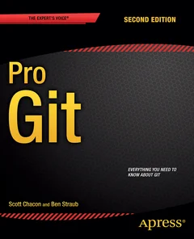

<div class='meta'>
kind: reference
search: commit, add, status, diff, log, branch, checkout, switch, merge, Konflikt, pull, push, clone, restore, revert, stash, gitignore, tag, HEAD
</div>

<div
    class="autotoc-secondary-trigger"
    data-title="Auf dieser Seite"
    data-levels="h2,h3">
</div>

# Git: Versionen verwalten

<p class='abstract'>
Die Befehle aus <a href='/git'>Versionsverwaltung mit Git</a> zum Nachschlagen: Commits anlegen, die Geschichte ansehen, mit Branches arbeiten, Konflikte lösen, mit anderen teilen und Fehler rückgängig machen. Wie dein Workspace sich bei einem Git-Server anmeldet, steht unter <a href='/reference/gitlab'>Git-Server: Zugang und Veröffentlichen</a>.
</p>

## Die Begriffe

<!-- part: git-begriffe -->
<!-- short: Repository, Commit, Arbeitsverzeichnis, Staging Area, Branch, HEAD und Remote in einem Satz. -->
<div class='scroll-x'><table class='table table-sm reference-table'>
<thead><tr><th>Begriff</th><th>Was es ist</th></tr></thead>
<tbody>
<tr><td>Repository</td><td>ein Ordner, dessen Geschichte Git verwaltet; die Geschichte selbst liegt im versteckten Ordner <code>.git</code></td></tr>
<tr><td>Commit</td><td>ein gespeicherter Stand aller Dateien, mit Nachricht, Autor, Zeit und einer ID wie <code>a3ac34a</code></td></tr>
<tr><td>Arbeitsverzeichnis</td><td>die Dateien, wie du sie gerade siehst und bearbeitest</td></tr>
<tr><td>Staging Area</td><td>was mit dem nächsten Commit gespeichert wird; <code>git add</code> legt Änderungen dorthin</td></tr>
<tr><td>Branch</td><td>ein Name, der auf einen Commit zeigt und mit jedem neuen Commit weiterrückt, zum Beispiel <code>main</code></td></tr>
<tr><td><code>HEAD</code></td><td>wo du gerade bist: meist ein Branch, nach <code>git checkout HEAD~2</code> ein einzelner Commit</td></tr>
<tr><td>Remote</td><td>ein anderes Repository, mit dem du Commits austauschst, meist <code>origin</code> auf einem Git-Server</td></tr>
</tbody>
</table>
</div>

`HEAD~1` ist der Commit vor `HEAD`, `HEAD~2` der davor. Statt einer ID genügen ihre ersten Zeichen, solange sie eindeutig sind.
<!-- /part -->

_person(torvalds)

## Alleine arbeiten

<!-- part: git-anlegen -->
<!-- short: git init macht einen Ordner zum Repository, git clone holt eine Kopie eines vorhandenen. -->
### Ein Repository anlegen

<div class='scroll-x'><table class='table table-sm reference-table'>
<thead><tr><th>Befehl</th><th>Was er tut</th></tr></thead>
<tbody>
<tr><td><code>git init</code></td><td>macht den aktuellen Ordner zu einem Repository, ohne Commits</td></tr>
<tr><td><code>git clone ADRESSE</code></td><td>holt eine Kopie eines Repositorys mit seiner ganzen Geschichte in einen neuen Ordner</td></tr>
<tr><td><code>git clone ADRESSE ordner</code></td><td>dasselbe in einen Ordner mit anderem Namen</td></tr>
</tbody>
</table>
</div>

Bevor du den ersten Commit machst, muss Git wissen, wer du bist: [Git sagen, wer du bist](/reference/gitlab#git-name). Ein Repository für eine Aktivität klonst du so, wie es unter [Repository klonen](/reference/workspace#repository-klonen) steht.
<!-- /part -->

<!-- part: git-commit -->
<!-- short: git status, git add, git commit -m, git diff: Änderungen ansehen, bereitlegen und als Commit speichern. -->
### Änderungen speichern

<div class='scroll-x'><table class='table table-sm reference-table'>
<thead><tr><th>Befehl</th><th>Was er tut</th></tr></thead>
<tbody>
<tr><td><code>git status</code></td><td>zeigt, welche Dateien geändert, bereitgelegt oder Git noch unbekannt sind (»Untracked files«)</td></tr>
<tr><td><code>git add datei</code></td><td>legt eine neue oder geänderte Datei für den nächsten Commit bereit; <code>git add .</code> alles im Ordner</td></tr>
<tr><td><code>git commit -m "Nachricht"</code></td><td>speichert alles Bereitgelegte als Commit</td></tr>
<tr><td><code>git commit -a -m "Nachricht"</code></td><td>legt vorher alle geänderten Dateien bereit, die Git schon kennt; neue Dateien brauchen trotzdem <code>git add</code></td></tr>
<tr><td><code>git diff</code></td><td>zeigt die Änderungen, die noch nicht bereitgelegt sind, Zeile für Zeile</td></tr>
<tr><td><code>git diff --staged</code></td><td>zeigt, was bereitgelegt ist und mit dem nächsten Commit gespeichert wird</td></tr>
<tr><td><code>git mv alt neu</code></td><td>benennt eine Datei um oder verschiebt sie</td></tr>
<tr><td><code>git rm datei</code></td><td>löscht eine Datei und legt das Löschen bereit</td></tr>
</tbody>
</table>
</div>

Der Ablauf ist fast immer derselbe:

```bash
git status
git add README.md
git commit -m "Anleitung ergänzt"
```

Eine gute Nachricht sagt in einer Zeile, was der Commit ändert, so dass du ihn in `git log` später wiederfindest: »Punkte zählen, wenn ein Stern gefangen wird«, nicht »weiter«.
<!-- /part -->

<!-- part: git-log -->
<!-- short: git log zeigt die Commits, git show einen davon, git blame, wer welche Zeile zuletzt geändert hat. -->
### Die Geschichte ansehen

<div class='scroll-x'><table class='table table-sm reference-table'>
<thead><tr><th>Befehl</th><th>Was er zeigt</th></tr></thead>
<tbody>
<tr><td><code>git log</code></td><td>alle Commits, der neueste oben, mit ID, Autor, Datum und Nachricht</td></tr>
<tr><td><code>git log --oneline</code></td><td>jeden Commit in einer Zeile</td></tr>
<tr><td><code>git log --oneline --graph --all</code></td><td>alle Branches als Graph, wo sie sich trennen und wieder zusammenkommen</td></tr>
<tr><td><code>git log --author=Name</code></td><td>nur die Commits einer Person; <code>git log -- datei</code> nur die, die eine Datei ändern</td></tr>
<tr><td><code>git show a3ac34a</code></td><td>einen Commit mit allen seinen Änderungen</td></tr>
<tr><td><code>git blame datei</code></td><td>zu jeder Zeile, in welchem Commit und von wem sie zuletzt geändert wurde</td></tr>
</tbody>
</table>
</div>

Eine lange Ausgabe zeigt Git seitenweise wie `less`: Pfeiltasten und Leertaste blättern, <kbd>Q</kbd> beendet.
<!-- /part -->

<!-- part: gitignore -->
<!-- short: .gitignore: Dateien, die Git nicht beachten soll, ein Muster pro Zeile. -->
### Dateien ignorieren

Was dein Programm erzeugt (übersetzte Programme, Bilder, die es rechnet, Ordner wie `node_modules`), gehört nicht ins Repository. Eine Datei `.gitignore` im Repository nennt sie, ein Muster pro Zeile:

```text
hello
*.o
build/
```

`hello` ist eine Datei mit genau diesem Namen, `*.o` jede Datei, die auf `.o` endet, `build/` ein ganzer Ordner. `git status` zeigt sie danach nicht mehr an, und `git add .` lässt sie aus. Die `.gitignore` selbst wird committet, damit sie für alle gilt. Eine Datei, die schon committet ist, ignoriert Git erst, wenn du sie mit `git rm --cached datei` aus dem Repository nimmst; im Ordner bleibt sie.
<!-- /part -->

## Branches

<!-- part: git-branch -->
<!-- short: git branch name, git checkout name, git merge name: nebeneinander arbeiten und wieder zusammenführen. -->
### Anlegen, wechseln, zusammenführen

<div class='scroll-x'><table class='table table-sm reference-table'>
<thead><tr><th>Befehl</th><th>Was er tut</th></tr></thead>
<tbody>
<tr><td><code>git branch</code></td><td>listet die Branches auf; vor dem, auf dem du bist, steht ein <code>*</code></td></tr>
<tr><td><code>git branch feature</code></td><td>legt einen Branch an, der auf den aktuellen Commit zeigt; du bleibst, wo du bist</td></tr>
<tr><td><code>git checkout feature</code></td><td>wechselt zu dem Branch: Die Dateien im Ordner sind jetzt die von dort</td></tr>
<tr><td><code>git checkout -b feature</code></td><td>beides auf einmal: anlegen und wechseln</td></tr>
<tr><td><code>git merge feature</code></td><td>holt die Commits von <code>feature</code> in den Branch, auf dem du bist</td></tr>
<tr><td><code>git branch -d feature</code></td><td>löscht den Branch, wenn seine Commits schon gemergt sind; <code>-D</code> auch sonst</td></tr>
</tbody>
</table>
</div>

Vor dem Wechseln sollte `git status` nichts Geändertes zeigen: Committe erst, oder leg die Änderungen mit `git stash` beiseite (siehe unten). Neuere Fassungen von Git kennen für das Wechseln auch `git switch feature` und `git switch -c feature`; sie tun dasselbe wie die beiden `checkout`-Zeilen oben.

Gemergt wird immer *in* den Branch, auf dem du gerade bist. Um `feature` in `main` zu bringen:

```bash
git checkout main
git merge feature
```
<!-- /part -->

<!-- part: git-konflikt -->
<!-- short: Ein Konflikt: Git markiert beide Fassungen in der Datei; die richtige Fassung herstellen, Markierungen löschen, git add, git commit. -->
### Konflikte lösen

Haben zwei Commits dieselben Zeilen verschieden geändert, kann Git sie nicht von selbst zusammenführen. `git merge` oder `git pull` melden dann `CONFLICT`, und in der Datei stehen beide Fassungen:

```text
<<<<<<< HEAD
HOLAAA
=======
HEYYYY
>>>>>>> ef91739
```

Oben steht deine Fassung, unten die, die dazukommen soll. So löst du den Konflikt:

1. Öffne die Datei und stell die Fassung her, die gelten soll: eine der beiden, beide oder eine dritte.
2. Lösche die drei Zeilen mit `<<<<<<<`, `=======` und `>>>>>>>`.
3. `git add datei`, für jede Datei mit Konflikt; `git status` zeigt, welche es noch gibt.
4. `git commit -m "Konflikt gelöst"`, danach wie gewohnt `git push`.

Visual Studio Code zeigt über jedem Konflikt die Knöpfe »Accept Current Change«, »Accept Incoming Change« und »Accept Both Changes«; sie erledigen die Schritte 1 und 2. Willst du lieber wieder zum Stand vor dem Merge, bricht `git merge --abort` ihn ab.
<!-- /part -->

## Gemeinsam arbeiten

<!-- part: git-remote -->
<!-- short: git remote add origin, git push -u origin main, dann git pull und git push. -->
<div class='scroll-x'><table class='table table-sm reference-table'>
<thead><tr><th>Befehl</th><th>Was er tut</th></tr></thead>
<tbody>
<tr><td><code>git remote add origin ADRESSE</code></td><td>nennt ein anderes Repository <code>origin</code>, damit du mit ihm Commits austauschen kannst</td></tr>
<tr><td><code>git remote -v</code></td><td>zeigt, welche Remotes es gibt und wo sie liegen</td></tr>
<tr><td><code>git push -u origin main</code></td><td>schickt <code>main</code> zum ersten Mal und merkt sich <code>origin</code> als Ziel für diesen Branch</td></tr>
<tr><td><code>git push</code></td><td>schickt deine neuen Commits zum Remote</td></tr>
<tr><td><code>git pull</code></td><td>holt die neuen Commits vom Remote und führt sie mit deinen zusammen</td></tr>
<tr><td><code>git config pull.rebase false</code></td><td>sagt Git einmal, dass <code>git pull</code> zusammenführen soll, wenn beide Seiten neue Commits haben</td></tr>
<tr><td><code>git push origin --tags</code></td><td>schickt auch die Tags (siehe unten)</td></tr>
</tbody>
</table>
</div>

Hol mit `git pull`, bevor du anfängst, und schick mit `git push`, wenn du fertig bist. Lehnt Git deinen Push ab, weil jemand vor dir gepusht hat, steht unter [Wenn Git den Push ablehnt](/reference/gitlab#push-abgelehnt), was zu tun ist. Bricht `git pull` ab, weil du Dateien geändert hast, die auch in der neuen Version anders sind, hilft `git stash` wie unter [Eine neue Version der Vorlage holen](/reference/workspace#neue-version).
<!-- /part -->

### Eigene Repositorys zum Üben

Hat deine Schule den Git-Server des Workspace, legst du unter [Git-Repositorys](/git) bei **Meine Repositorys** bis zu zehn eigene Repositorys an. Nur du kannst sie klonen, pushen und im Browser ansehen; deine Lehrkräfte sehen sie nicht. Dort steht auch die Adresse zum Klonen, und dort siehst du, ob dein Workspace schon einen Schlüssel für den Git-Server hat. Zum Ausprobieren von `git push`, Branches und Tags ist so ein Repository richtig; was ihr in der Klasse zusammen baut, gehört in das Repository eurer Gruppe.

## Zurückgehen und rückgängig machen

<!-- part: git-zurueck -->
<!-- short: git checkout HEAD~2 schaut einen alten Stand an, git checkout main kehrt zurück. -->
### Einen alten Stand ansehen

<div class='scroll-x'><table class='table table-sm reference-table'>
<thead><tr><th>Befehl</th><th>Was er tut</th></tr></thead>
<tbody>
<tr><td><code>git checkout HEAD~2</code></td><td>die Dateien, wie sie zwei Commits vorher waren</td></tr>
<tr><td><code>git checkout a3ac34a</code></td><td>die Dateien, wie sie in diesem Commit waren; <code>git checkout v1.0</code> wie bei einem Tag</td></tr>
<tr><td><code>git checkout main</code></td><td>zurück zum neuesten Stand von <code>main</code></td></tr>
<tr><td><code>git restore --source HEAD~2 datei</code></td><td>nur diese eine Datei so, wie sie zwei Commits vorher war; danach wie jede Änderung committen</td></tr>
</tbody>
</table>
</div>

Nach `git checkout` auf einen Commit oder Tag meldet Git **detached HEAD**: Du bist auf keinem Branch. Ansehen und ausprobieren geht, aber Commits von hier gehören zu keinem Branch. Willst du von hier aus weiterarbeiten, leg zuerst mit `git checkout -b neuer-name` einen Branch an.
<!-- /part -->

<!-- part: git-rueckgaengig -->
<!-- short: git restore verwirft Änderungen, git restore --staged nimmt sie aus der Staging Area, git revert hebt einen Commit mit einem neuen auf, git stash legt sie beiseite. -->
### Änderungen zurücknehmen

Welcher Befehl passt, hängt davon ab, wie weit die Änderung schon gekommen ist:

<div class='scroll-x'><table class='table table-sm reference-table'>
<thead><tr><th>Die Änderung ist …</th><th>Befehl</th><th>Was passiert</th></tr></thead>
<tbody>
<tr><td>nur im Arbeitsverzeichnis</td><td><code>git restore datei</code></td><td>Die Datei ist wieder auf dem Stand des letzten Commits. Die Änderung ist weg.</td></tr>
<tr><td>mit <code>git add</code> bereitgelegt</td><td><code>git restore --staged datei</code></td><td>Die Änderung kommt aus der Staging Area zurück ins Arbeitsverzeichnis; verloren geht nichts.</td></tr>
<tr><td>im letzten Commit, noch nicht gepusht</td><td><code>git commit --amend -m "Nachricht"</code></td><td>Der letzte Commit wird ersetzt, mit dem, was jetzt bereitliegt, und der neuen Nachricht.</td></tr>
<tr><td>schon committet</td><td><code>git revert HEAD</code></td><td>Ein neuer Commit hebt den letzten auf; statt <code>HEAD</code> geht jede Commit-ID.</td></tr>
<tr><td>noch nicht fertig, soll aber kurz weg</td><td><code>git stash</code></td><td>legt alle Änderungen beiseite, der Ordner ist wieder auf dem Stand des letzten Commits; <code>git stash pop</code> holt sie zurück, <code>git stash list</code> zeigt, was beiseite liegt</td></tr>
</tbody>
</table>
</div>

<div class='hint warning'>
Einen Commit, den andere schon mit <code>git pull</code> geholt haben können, ersetzt du nicht mit <code>--amend</code>, sondern hebst ihn mit <code>git revert</code> auf: Sonst passt ihre Geschichte nicht mehr zu deiner, und der nächste Push wird abgelehnt.
</div>

Was einmal committet war, findet Git meist wieder: `git reflog` listet, wo `HEAD` in letzter Zeit überall stand, auch Commits, auf die kein Branch mehr zeigt. Was mit `git restore` verworfen wurde, war nie committet und ist wirklich weg.
<!-- /part -->

<!-- part: git-tag -->
<!-- short: git tag -a v1.0 -m "…" gibt einem Commit einen festen Namen; git push origin v1.0 schickt ihn. -->
## Tags

Ein Tag ist ein fester Name für einen Commit, etwa für eine Version, die du abgibst. Anders als ein Branch rückt er nicht weiter.

<div class='scroll-x'><table class='table table-sm reference-table'>
<thead><tr><th>Befehl</th><th>Was er tut</th></tr></thead>
<tbody>
<tr><td><code>git tag -a v1.0 -m "Abgabe"</code></td><td>gibt dem aktuellen Commit den Namen <code>v1.0</code>, mit einer Nachricht</td></tr>
<tr><td><code>git tag</code></td><td>listet die Tags auf</td></tr>
<tr><td><code>git push origin v1.0</code></td><td>schickt einen Tag zum Remote; <code>git push origin --tags</code> alle</td></tr>
<tr><td><code>git checkout v1.0</code></td><td>die Dateien, wie sie bei diesem Tag waren (detached HEAD, siehe oben)</td></tr>
</tbody>
</table>
</div>
<!-- /part -->

## Zum Nachschlagen

Zu jedem Befehl zeigt `git help befehl` alle Optionen, zum Beispiel `git help commit`.

<div class='book with-cover'>

<p><strong>Pro Git</strong>, Scott Chacon und Ben Straub, Apress, 2. Auflage 2014. Alles, was hier fehlt: Rebase, Git auf einem Server, die Arbeit mit GitHub und wie Git seine Commits intern speichert. Frei lesbar, auch auf Deutsch: <a href='https://git-scm.com/book/de/v2'>auf git-scm.com</a>.</p>
<p class='book-credit'>Cover: Apress, CC BY-NC-SA 3.0 (<a href='https://github.com/progit/progit2'>progit2</a>)</p>
</div>

- [Git Reference](https://git-scm.com/docs): jeder Befehl mit allen Optionen, auf Englisch.
- [Learn Git Branching](https://learngitbranching.js.org/): Branches, Merge und mehr als Spiel im Browser, mit einem gezeichneten Commit-Graphen, der sich bei jedem Befehl ändert.
- [Mist, Git!](https://dangitgit.com/de): kurze Rezepte für die Pannen, die allen passieren, vom falschen Branch bis zur vergessenen Datei im letzten Commit.
