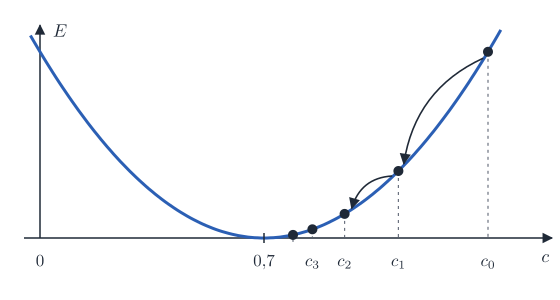

<div class='meta'>
kind: reference
search: Gradientenabstieg, Gradient, Ableitung, Steigung, Lernrate, learning rate, Fehler, Verlust, loss, Minimum, partielle Ableitung, numerische Ableitung, Adam, Momentum, Schwung, stochastisch, lernen, Training, optimieren
</div>

<div
    class="autotoc-secondary-trigger"
    data-title="Auf dieser Seite"
    data-levels="h2,h3">
</div>

# Gradientenabstieg

<p class='abstract'>
Wie ein Programm lernt: Es misst, wie weit es vom Ziel weg ist, und dreht jeden seiner Regler ein Stück in die Richtung, in der der Fehler kleiner wird. So lernen die Splats in <a href='/gaussian-splatting'>Gaussian Splatting</a> ihre Lage, Form und Farbe, und so lernen neuronale Netze. Hier stehen die Idee, der Pseudocode, wie groß die Schritte sein dürfen, und das Verfahren Adam, das fast alle Programme nehmen.
</p>

## Die Idee

<!-- part: idee -->
<!-- short: Ein Fehler hängt von Reglern ab; die Ableitung sagt, wie steil es an der jetzigen Stelle bergab geht, und ein Schritt geht ein Stück gegen die Steigung. -->
### Ein Regler und ein Fehler

Ein Programm hat Zahlen, die es einstellen kann, die **Regler**, und eine Zahl, die sagt, wie schlecht das Ergebnis ist, den **Fehler** (englisch *loss*). Gesucht sind die Regler, bei denen der Fehler am kleinsten ist. Mit nur einem Regler \\(c\\) und dem Fehler

$$E(c) = (c - 0{,}7)^2$$

sieht man es sofort: bei \\(c = 0{,}7\\). Bei Millionen Reglern sieht man nichts mehr. Man kann aber an jeder Stelle fühlen, wie steil es bergab geht und in welche Richtung, wie jemand im Nebel am Berg.

### Die Steigung

Die **Ableitung** \\(E'(c)\\) ist die Steigung an der Stelle \\(c\\), hier \\(E'(c) = 2\\,(c - 0{,}7)\\). Ist sie positiv, wird der Fehler größer, wenn \\(c\\) wächst; also macht man \\(c\\) kleiner, und umgekehrt. Ein Schritt geht ein Stück gegen die Steigung:

$$c \leftarrow c - \eta \cdot E'(c)$$

Die Zahl \\(\eta\\) (Eta) ist die **Lernrate**: Sie sagt, wie groß die Schritte sind. Wo es steil ist, wird der Schritt groß, wo es flach wird, klein; nahe am Tiefpunkt geht es deshalb von selbst immer langsamer.
<!-- /part -->

## Der Algorithmus

<!-- part: algorithmus -->
<!-- short: Wiederholen: Steigung ausrechnen, jeden Regler um Lernrate mal Steigung zurücknehmen, bis der Fehler nicht mehr kleiner wird. -->
```pseudocode
gradientenabstieg(regler, lernrate, schritte):
    for k from 1 to schritte:
        steigung ← ableitung(regler)
        regler ← regler − lernrate · steigung
    return regler
```

Für \\(E(c) = (c - 0{,}7)^2\\), begonnen bei \\(c = 1{,}4\\) mit der Lernrate 0,2:

<div class='scroll-x'><table class='table table-sm reference-table'>
<thead><tr><th>Schritt</th><th>\(c\)</th><th>Steigung \(2\,(c - 0{,}7)\)</th><th>Fehler \(E(c)\)</th></tr></thead>
<tbody>
<tr><td>0</td><td>1,4</td><td>1,4</td><td>0,49</td></tr>
<tr><td>1</td><td>1,12</td><td>0,84</td><td>0,176</td></tr>
<tr><td>2</td><td>0,952</td><td>0,504</td><td>0,064</td></tr>
<tr><td>3</td><td>0,8512</td><td>0,302</td><td>0,023</td></tr>
<tr><td>4</td><td>0,7907</td><td>0,181</td><td>0,008</td></tr>
</tbody>
</table>
</div>



Jeder Schritt ist kleiner als der vorige, weil die Steigung kleiner wird. Den Tiefpunkt erreicht das Verfahren nie genau, aber so nah, wie man will; man hört auf, wenn sich der Fehler kaum noch ändert.
<!-- /part -->

## Die Lernrate

<!-- part: lernrate -->
<!-- short: Zu klein: viele Schritte; passend: schnell zum Tiefpunkt; zu groß: über den Tiefpunkt hinweg, hin und her oder immer weiter weg. -->
Die Lernrate entscheidet, ob es klappt. Dasselbe Beispiel, begonnen bei 1,4, mit verschiedenen Lernraten:

<div class='scroll-x'><table class='table table-sm reference-table'>
<thead><tr><th>Lernrate</th><th>\(c\) nach 0, 1, 2, 3, 4 Schritten</th><th>was passiert</th></tr></thead>
<tbody>
<tr><td>0,05</td><td>1,4; 1,33; 1,27; 1,21; 1,16</td><td>kommt an, aber langsam</td></tr>
<tr><td>0,2</td><td>1,4; 1,12; 0,95; 0,85; 0,79</td><td>kommt zügig an</td></tr>
<tr><td>0,5</td><td>1,4; 0,7; 0,7; 0,7; 0,7</td><td>in einem Schritt am Tiefpunkt (nur bei dieser Parabel)</td></tr>
<tr><td>1,0</td><td>1,4; 0; 1,4; 0; 1,4</td><td>springt hin und her, ohne anzukommen</td></tr>
<tr><td>1,1</td><td>1,4; −0,14; 1,71; −0,51; 2,15</td><td>schießt über den Tiefpunkt hinaus, immer weiter weg</td></tr>
</tbody>
</table>
</div>

Eine zu große Lernrate erkennt man daran, dass der Fehler von Schritt zu Schritt wächst oder auf und ab springt. Dann halbiert man sie. Eine zu kleine erkennt man daran, dass er sehr langsam, aber stetig fällt.
<!-- /part -->

## Viele Regler: der Gradient

<!-- part: gradient -->
<!-- short: Bei vielen Reglern hat jeder seine eigene Steigung (partielle Ableitung); alle zusammen sind der Gradient, und alle gehen gleichzeitig einen Schritt. -->
### Jeder Regler seine Steigung

Hängt der Fehler von vielen Reglern ab, hat jeder seine eigene Steigung: wie sich der Fehler ändert, wenn man nur diesen Regler ein wenig dreht und alle anderen lässt (die **partielle Ableitung**). Alle Steigungen zusammen sind der **Gradient** \\(\nabla E\\), ein Vektor mit so vielen Zahlen, wie es Regler gibt. Er zeigt in die Richtung, in der der Fehler am schnellsten wächst; ein Schritt geht also für alle Regler gleichzeitig dagegen:

$$\vec{r} \leftarrow \vec{r} - \eta \cdot \nabla E(\vec{r})$$

### Wenn die Ableitung schwer ist

Ist die Formel für die Ableitung zu schwierig, schätzt man sie: den Regler ein winziges Stück \\(h\\) verschieben und schauen, wie sich der Fehler ändert,

$$E'(c) \approx \frac{E(c + h) - E(c - h)}{2h}$$

mit einem kleinen \\(h\\), etwa 0,0001. Das ist einfach, kostet aber für jeden Regler zwei Rechnungen des ganzen Fehlers; bei Millionen Reglern rechnet man die Ableitungen deshalb aus der Formel, rückwärts durch die Rechnung (*Backpropagation*). Zum Prüfen, ob die eigene Ableitung stimmt, ist die Schätzung trotzdem gut.
<!-- /part -->

## Adam: jeder Regler sein eigenes Tempo

<!-- part: adam -->
<!-- short: Adam merkt sich je Regler den Schwung m und die typische Größe v der Steigung und geht m / √v: Schritte von etwa gleicher Größe für jeden Regler. -->
Haben die Regler verschiedene Größenordnungen, Lagen in Pixeln, Winkel im Bogenmaß, Farben von 0 bis 1, passt eine Lernrate für alle nicht mehr. Das Verfahren **Adam** gibt jedem Regler ein eigenes Tempo. Es merkt sich für jeden, in welche Richtung er zuletzt gegangen ist (der **Schwung** \\(m\\)) und wie groß seine Steigungen typisch sind (\\(v\\)), und teilt das eine durch das andere:

```pseudocode
adam_schritt(regler, steigung, lernrate, t):
    m ← 0,9 · m + 0,1 · steigung
    v ← 0,999 · v + 0,001 · steigung²
    m̂ ← m / (1 − 0,9^t)          # am Anfang sind m und v noch zu klein
    v̂ ← v / (1 − 0,999^t)
    regler ← regler − lernrate · m̂ / (√v̂ + 0,00000001)
```

So macht jeder Regler Schritte von etwa der Größe der Lernrate, egal wie groß seine Steigung gerade ist. Der Schwung glättet das Hin und Her, wenn die Steigung von Schritt zu Schritt das Vorzeichen wechselt. Diederik Kingma und Jimmy Ba haben Adam 2014 beschrieben; fast alle Programme, die heute etwas lernen, nehmen Adam oder ein Verfahren wie Adam.

### Kleine Stapel

Hängt der Fehler von sehr vielen Beispielen ab, Millionen Bilder oder Fotos, rechnet man ihn für jeden Schritt nur mit einigen davon aus, einem **Stapel** (englisch *batch*), jedes Mal mit anderen. Die Steigung wird ungenauer, aber jeder Schritt viel schneller (*stochastischer Gradientenabstieg*). Gaussian Splatting nimmt für jeden Schritt ein einziges Foto.
<!-- /part -->

## Wo es hängenbleiben kann

<!-- part: grenzen -->
<!-- short: Gradientenabstieg findet einen Tiefpunkt in der Nähe, nicht unbedingt den tiefsten; Startwerte und Lernrate entscheiden mit. -->
Gradientenabstieg geht immer nur bergab, dorthin, wo es von hier aus abwärts geht. Hat der Fehler mehrere Täler, landet er im nächsten, nicht unbedingt im tiefsten (ein **lokales Minimum**). Auf einer flachen Hochebene oder einem Sattel ist die Steigung fast 0, und es geht kaum voran. Was dagegen hilft: gute Startwerte, ein Schwung wie bei Adam, der über kleine Mulden hinwegträgt, und bei sehr vielen Reglern die Erfahrung, dass es dort selten echte Sackgassen gibt.
<!-- /part -->

## Zum Nachschlagen

- [Gradientenverfahren](https://de.wikipedia.org/wiki/Gradientenverfahren) in der Wikipedia.
- [Adam: A Method for Stochastic Optimization](https://arxiv.org/abs/1412.6980), der Aufsatz von Diederik Kingma und Jimmy Ba, auf Englisch.
- [Why Momentum Really Works](https://distill.pub/2017/momentum/): warum ein Schwung hilft, mit Reglern zum Ausprobieren, auf Englisch.
